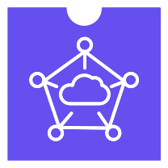

# 雲原生實作課程

應用已經部署在 Kubernetes 上，接下來常會遇到新的問題：GPU 不夠分、容器裡發生了什麼看不清楚、服務之間需要身分驗證，或某一場遊戲必須持續連到同一台伺服器。這些需求都超過「建立一個 Deployment」本身，卻又與既有叢集緊密相連。

這門課分成五個主題，從具體情境開始，逐步介紹能處理該問題的開源專案。你會安裝工具、觀察輸出，並比較它們各自負責哪一部分。章末的「想一想」會換一個情境，讓你練習判斷該查什麼、該改哪裡。

適合已會用 `kubectl` 部署與檢查 Pod，想評估新工具的工程師。實作使用 Azure AKS，需要自己的 Azure 訂閱，以及 `az`、`kubectl`、Helm。各 Sprint 的 Day 0 交代環境或新觀念；GPU、遊戲 UDP 與機密運算等額外條件，會在對應主題說明。

課程保留既有實測輸出，版本與未驗證範圍以各章為準。歷史結果用來理解機制，不能直接當成其他版本或正式環境的保證。

## 課程地圖

-   { width="32" }
    { width="32" }
    { width="32" }

    **Sprint 1 · [GPU 排程三部曲](sprints/sprint1.md)**（9 章）

    ---

    多個團隊與工作負載共用少數幾張 GPU 時，要決定誰先拿到卡、拿到之後能用多少。你會用 KAI Scheduler 的佇列、配額與 gang scheduling 管排程順序，用 HAMi 把一張 T4 的 VRAM 切給多個容器並互相隔離，再用 Kubernetes DRA 以 ResourceClaim 描述與挑選裝置。最後一章整理三者各自適合的場景。

-   { width="76" }
    { width="76" }
    { width="28" }
    { width="28" }
    { width="28" }

    **Sprint 2 · [eBPF 與執行期安全](sprints/sprint2.md)**（11 章）

    ---

    用 eBPF 觀察並控制容器在節點上的行為。你會用 bpftrace 追蹤 syscall 並對應回 pod，用 Falco 撰寫偵測規則並調校誤報，用 Tetragon 在核心層過濾事件並攔截違規行程，最後用 Cilium 取代 kube-proxy、撰寫 L3 到 L7 的網路政策，並用 Hubble 觀察流量。Day 0 從零講起，不需要先接觸過 eBPF。

-   { width="32" }
    { width="28" }
    { width="28" }
    { width="28" }

    **Sprint 3 · [WebAssembly](sprints/sprint3.md)**（10 章）

    ---

    WebAssembly（wasm）是容器之外另一種在 Kubernetes 上執行程式的方式。你會先了解 wasm 是什麼、Kubernetes 怎麼透過 RuntimeClass 與 containerd shim 執行它，再操作三條路線：不改動節點的 wasmCloud、手動安裝 shim 的 WasmEdge、由 runtime-class-manager 設定節點的 SpinKube。過程中也會量測 WasmEdge 與一般容器從建立到清理的總時間及記憶體用量，並練習移除 SpinKube、檢查節點上的殘留。

-   { width="30" }
    { width="30" }
    { width="28" }
    { width="30" }

    **Sprint 4 · [服務網格與機密運算](sprints/sprint4.md)**（10 章）

    ---

    Part 1 講服務網格：用 Envoy Gateway 與 Gateway API 管理入口流量並開啟 HTTP/3，再比較 Istio ambient 的 mTLS、工作負載身分與連線池限制，以及 Cilium 的 WireGuard 加密與 L7 政策。Part 2 講機密運算：用 Kata 把 pod 跑進有獨立 kernel 的 VM，在 AMD SEV-SNP 硬體上執行 kata-cc，並用遠端證明與政策雜湊，檢查金鑰的釋出條件。

-   { width="30" }
    { width="32" }
    { width="26" }

    **Sprint 5 · [遊戲伺服器平台](sprints/sprint5.md)**（11 章）

    ---

    多人遊戲的 dedicated game server 保有每場對戰的狀態，玩家通常透過 UDP 連到指定的 pod，對戰中途被中斷會影響玩家，重新建立 Pod 不會自動恢復對戰狀態；只靠一般的 Deployment 與 Service，管不了 server 的分配與結束時機。你會用 Agones 管理 GameServer、Fleet 與 allocation，用 Quilkin 依 token 轉送 UDP 封包，用 Nakama 與 PostgreSQL 處理登入與配對，再用 Python 與 Unity client 走完從登入、配對到連進 GameServer 的流程。另外也會演練 server 關閉、程序崩潰與節點失效時平台的反應。

五個 sprint 可以依興趣挑著讀，後面的 sprint 偶爾會引用前面的章節，遇到時再回頭補讀即可。

- [Sprint 1 · GPU 排程三部曲](sprints/sprint1.md)
- [Sprint 2 · eBPF 與執行期安全](sprints/sprint2.md)
- [Sprint 3 · WebAssembly](sprints/sprint3.md)
- [Sprint 4 · 服務網格與機密運算](sprints/sprint4.md)
- [Sprint 5 · 遊戲伺服器平台](sprints/sprint5.md)

想直接動手，從 [Sprint 1 Day 0](runbook/sprint1-day0-azure-aks-foundation.md) 建叢集開始。
