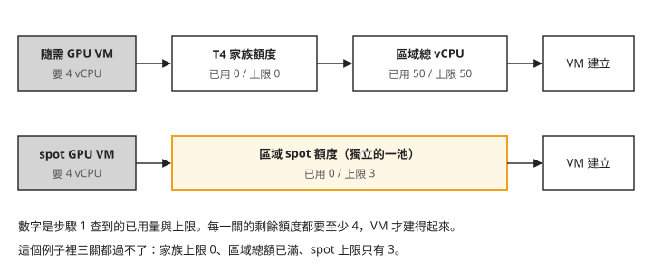
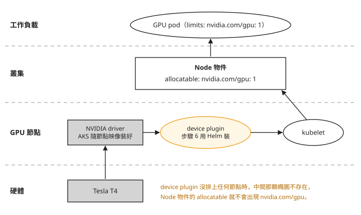
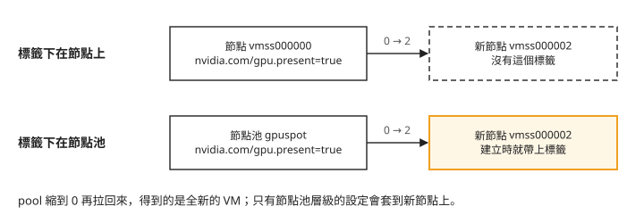

# Day 0: 環境建置——quota、GPU spot 節點池與 device plugin

{ align=right width="95" }

想像你剛在叢集裡加了一台插著 T4（NVIDIA 給資料中心用的入門 GPU）的節點。`kubectl get nodes` 顯示它 `Ready`，可是 `kubectl describe node` 翻遍了都找不到 `nvidia.com/gpu`，要 GPU 的 pod 一顆也排不上去。

這一章從零蓋出 Sprint 1 後面每一天都要用的 AKS（Azure Kubernetes Service）叢集。AKS 是 Azure 提供的託管 Kubernetes 服務。本章會申請額度、建叢集、開兩台 T4 的 GPU 節點、安裝 NVIDIA device plugin，最後在容器裡執行 `nvidia-smi`，查詢 GPU 型號、記憶體用量與驅動程式版本。

**device plugin** 是 Kubernetes 用來登錄 GPU 等特殊硬體的擴充機制。NVIDIA device plugin 會偵測節點上的 GPU，向 kubelet（每台節點上管理 pod 的元件）註冊成 `nvidia.com/gpu` 資源。本課由 AKS 安裝 NVIDIA driver（驅動程式），device plugin 則自行用 Helm 安裝，方便後續章節更換 GPU 分配工具。缺少 device plugin 時，即使 driver 已裝好，GPU 仍無法登錄為 Kubernetes 可排程的資源。

一路上，GPU 會在三個地方「消失」：雲端額度不夠，VM 根本開不出來；device plugin 沒有排上節點；節點重建之後，原本補上的標籤不見了。讀完之後，GPU 節點上看不到 `nvidia.com/gpu` 時，你能分辨問題出在額度、device plugin 沒排上，還是節點重建後標籤掉了。

!!! note "指令裡的佔位符"
    本課程的指令用 `<cluster>` 代表叢集名稱、`<resource-group>` 代表資源群組、`<subscription-id>` 代表訂閱 ID——照做時換成自己的值。

## 這門課需要什麼樣的叢集

Sprint 1 要比較三套分配 GPU 的工具，它們對叢集的要求只有兩條。

第一，Kubernetes 要 **1.34 以上**：Day 6–7 要用的一項 Kubernetes 功能，從 1.34 才有正式版。

第二，GPU 要能隨開隨關。學習用的工作負載沒有必要讓卡整天開著，所以 GPU 節點平常縮到 0 台，要用時再增加節點數。

本課程用 AKS 滿足這兩條。換成其他版本夠新的託管叢集也行，指令細節自行對應。

GPU 選的是 T4：`Standard_NC4as_T4_v3` 是 Azure 上規格最小的完整 GPU VM，課程後面每一章的操作它都跑得動。怎麼讓多個 pod 共用一張卡、怎麼排程有限的卡，是後面幾章的主題。

## 步驟 1:查 GPU 相關的 quota,釋放被佔住的額度 {#step-1}

GPU VM 開不起來，最常見的原因是 quota：Azure 對每個訂閱、在每個區域能同時開多少 vCPU 設的上限。這個上限不只一個數字。先查和 GPU 有關的三行：

```console
$ az vm list-usage --location japaneast --subscription <subscription-id> -o table | grep -E "NCASv3_T4|Low-priority|Total Regional vCPUs"
Total Regional Low-priority vCPUs         0               3
Total Regional vCPUs                      50              50
Standard NCASv3_T4 Family vCPUs           0               0
```

每一行的兩個數字是「已用量」和「上限」。把三行對到建 VM 的過程，會是下面這張圖：



我們可以從圖上看到兩件事：

1. 一般的隨需（on-demand）VM 要同時通過兩關：**VM 家族額度**（`Standard NCASv3_T4 Family vCPUs`，T4 這一系列機型能用多少 vCPU）和**區域總額**（`Total Regional vCPUs`，這個區域所有 VM 加起來的上限）。GPU 家族的額度預設是 0，一定要申請。
2. spot VM（Azure 用便宜價格出租的閒置容量，Azure 需要時可以收回，步驟 5 再細講）用的是另一池額度 `Total Regional Low-priority vCPUs`。這裡上限是 3，一台 NC4as 要 4 vCPU，連一台都開不起來。

AKS 用**節點池（node pool）**管理節點：一個節點池是一組規格相同的 VM，可以一起擴縮。system pool 是用來跑 CoreDNS 這類叢集元件的節點池。本課把它和 GPU 節點分開，GPU 節點縮到 0 台時叢集照樣運作。

本課的 GPU 節點用 spot，但步驟 3 的 system pool 是隨需節點，一樣要從區域總額扣。這個例子裡，區域總額 50/50 已經滿了。要注意的是：**停機（deallocated，VM 關機並釋放運算資源，但 VM 和磁碟還留著）的 VM 仍然佔著區域額度**，只是關機不會還回來，要刪掉資源才會釋放（見[疑難排解：quota 夠了，VM 還是開不起來](#mine-2)）。刪掉不用的資源群組之後，再查一次：

```console
$ az group delete -n <old-lab-rg> --subscription <subscription-id> --yes
$ az vm list-usage --location japaneast --subscription <subscription-id> -o table | grep "Total Regional vCPUs"
Total Regional vCPUs                      16              50
```

已用量降到 16，區域總額有空間了。spot 額度不夠的部分，下一步送申請。

## 步驟 2:送 quota 申請

本課的 GPU 節點池用 spot，只需要把 `Total Regional Low-priority vCPUs` 調到 8 以上（兩台 NC4as_T4_v3，各 4 vCPU）。`Standard NCASv3_T4 Family vCPUs` 只有在你之後想改用隨需的 GPU 節點時才需要，可以先不申請。建議一次多要一點（例如 16），免得之後再跑一次流程。

<span id="mine-3"></span>申請的路有三條，看你的訂閱是怎麼來的：自己或公司直接向 Azure 開的訂閱，走前兩條；向代理商買的訂閱，走第三條。不確定的話，先試第一條，回 `Unauthorized` 再往下換。

1. **`az quota create`**:最快,但需要你的身分在該訂閱有 quota 寫入權限。如果你是以 B2B guest 身分登入（帳號屬於別的組織，被邀請進這個訂閱所在的 tenant），這個指令常常只回 `(Unauthorized) Request failed`，改走下面兩條。
2. **Portal 的 Quotas 頁**:搜尋 Quotas → Compute → 篩區域,勾選項目送出。多數自有訂閱走這條就通。帳號下掛著多個訂閱時，送出前確認選的是目標訂閱。
3. **透過代理商(CSP 訂閱)**:向代理商（Cloud Solution Provider，雲端解決方案供應商）購買的訂閱，quota 常常只有代理商能調。寫信給他們,附上訂閱名稱、訂閱 ID、區域、quota 項目與目標值。這條路要等人工處理，可能要幾個工作天。

## 步驟 3:建 RG 與 AKS

所有課程資源集中在一個獨立的 resource group,收尾時 `az group delete` 一次全部清掉,也不會動到訂閱裡的其他東西:

```console
$ az group create -n <resource-group> -l japaneast --subscription <subscription-id> --tags course=CloudNativePracticing sprint=1

$ az aks create -g <resource-group> -n <cluster> --subscription <subscription-id> \
    --tier free --kubernetes-version 1.35.6 \
    --nodepool-name system --node-count 1 --node-vm-size Standard_D2as_v5 \
    --generate-ssh-keys
```

這裡先建 system pool，用最小的 D2as_v5 隨需節點，因為 AKS 規定 system pool 不能用 spot。

版本選 1.35 而不是最新的 1.36：1.34 以上就夠用，而 Day 1 要裝的 KAI Scheduler 官方文件沒有寫明支援到哪個版本。

## 步驟 4:連上叢集,確認 DRA 的 API 在

拉 kubeconfig:

```console
$ az aks get-credentials -g <resource-group> -n <cluster> --subscription <subscription-id>
```

這個指令會順手把 kubectl 的 current-context（沒指定叢集時 kubectl 預設操作的那一個）切到新叢集。如果你的 kubeconfig 裡還有其他叢集，之後的指令就可能打錯地方，見[疑難排解：指令打到了另一座叢集](#mine-4)。

```console
$ kubectl get nodes
NAME                             STATUS   ROLES    AGE   VERSION
aks-system-35459509-vmss000000   Ready    <none>   68s   v1.35.6
```

接著確認 Day 6–7 要用的 DRA（Dynamic Resource Allocation，讓 pod 用條件描述「我要什麼樣的裝置」的 Kubernetes API）都在。這就是開頭說要 1.34 以上的原因：DRA 在 Kubernetes 1.34 進入 GA（正式版），API 群組是 `resource.k8s.io`：

```console
$ kubectl api-resources | grep resource.k8s.io
deviceclasses            resource.k8s.io/v1    false   DeviceClass
resourceclaims           resource.k8s.io/v1    true    ResourceClaim
resourceclaimtemplates   resource.k8s.io/v1    true    ResourceClaimTemplate
resourceslices           resource.k8s.io/v1    false   ResourceSlice
```

四個 API 都在，而且是正式版 `v1`，不用開任何 feature gate。這四個物件各做什麼，Day 6 再講。

## 步驟 5:開 GPU spot pool

quota 核准後，加一個 GPU 節點池。這裡用的是 **spot VM**：Azure 把閒置的容量用便宜很多的價格賣出，代價是 Azure 需要容量時可以隨時收回（evict）。學習和批次實驗中斷了可以重跑，正好適合。

```console
$ az aks nodepool add -g <resource-group> --cluster-name <cluster> -n gpuspot \
    --subscription <subscription-id> \
    --node-count 2 --node-vm-size Standard_NC4as_T4_v3 \
    --priority Spot --eviction-policy Delete --spot-max-price -1 \
    --labels pool=gpu

$ kubectl get nodes -l pool=gpu
NAME                              STATUS   ROLES    AGE    VERSION
aks-gpuspot-21249019-vmss000000   Ready    <none>   102s   v1.35.6
aks-gpuspot-21249019-vmss000001   Ready    <none>   106s   v1.35.6
```

指令裡有幾個設定之後會一直遇到：

- `--spot-max-price -1` 表示「跟著現價走，不因為價格被收回」。容量不足時仍然可能被收回，這是 spot 本來的條件。這個值建立後不能改。
- spot 節點池會自動帶上 `kubernetes.azure.com/scalesetpriority=spot:NoSchedule` 這個 taint。taint 是節點上的排程限制；這裡的 `NoSchedule` 會阻止沒有對應 toleration 的 pod 排入。toleration 寫在 pod 上，表示允許它通過相應的 taint 限制，但仍須符合其他排程條件。之後所有要排到 GPU 節點的 pod，都得寫上對應的 toleration。
- `--labels pool=gpu` 是我們自己加的標籤，後面用 `nodeSelector` 把 GPU 工作導到這兩台。
- 節點數固定為 2，**不開 cluster autoscaler**（AKS 依 Pending 的 pod 自動增減節點的功能）。Day 2 的示範需要「資源刻意不夠」的情境，autoscaler 自動補節點的話，情境就不成立。平常用完就手動縮到 0，步驟 8 會實際走一次。

兩台都 `Ready` 了，但如果現在 `kubectl describe node` 其中一台，會看到和開場一樣的情況：沒有 `nvidia.com/gpu`。AKS 在節點映像裡裝好了 NVIDIA driver，但還缺 device plugin 向 kubelet 註冊 GPU，下一步就來安裝。

AKS 有一種全託管模式，driver 和 device plugin 都由它裝。本課程選的是「AKS 管 driver、device plugin 自己用 Helm 裝」，原因在後面幾章：Day 3 的 HAMi 要用自己的 device plugin 接管 `nvidia.com/gpu`，Day 7 的 DRA driver 也要避免和傳統 device plugin 各自配置同一批實體 GPU。如果 device plugin 交給 AKS 託管，到時候會跟自己裝的元件衝突。

## 步驟 6:裝 device plugin,讓節點回報 GPU {#step-6}

裝之前，先把 GPU 從硬體到 pod 經過哪幾層畫出來。由下往上看：



我們可以從圖上看到，driver 和 kubelet 中間隔著 device plugin。device plugin 以 DaemonSet 的形式部署，每台符合條件的節點跑一份。它向 kubelet 註冊之後，kubelet 才會把 `nvidia.com/gpu` 寫進節點的 **allocatable**：這台節點可以分給 pod 的資源量。GPU 必須先登錄為可分配資源，才能滿足 pod 的 GPU 請求；排程器也會檢查其他資源需求、親和性等[排程條件](https://kubernetes.io/docs/concepts/scheduling-eviction/kube-scheduler/#kube-scheduler)。

用 NVIDIA 官方的 Helm chart 安裝，限定只跑在 GPU pool、並容忍 spot taint:

```console
$ helm repo add nvdp https://nvidia.github.io/k8s-device-plugin
$ helm upgrade -i nvdp nvdp/nvidia-device-plugin \
    -n nvidia-device-plugin --create-namespace \
    --set nodeSelector.pool=gpu \
    --set-json 'tolerations=[{"key":"kubernetes.azure.com/scalesetpriority","operator":"Equal","value":"spot","effect":"NoSchedule"},{"key":"nvidia.com/gpu","operator":"Exists","effect":"NoSchedule"}]'
```

Helm 回報安裝完成：

```text
Release "nvdp" does not exist. Installing it now.
NAME: nvdp
LAST DEPLOYED: Mon Aug  3 11:48:59 2026
NAMESPACE: nvidia-device-plugin
STATUS: deployed
REVISION: 1
DESCRIPTION: Install complete
TEST SUITE: None
```

接著看兩台 GPU 節點的 allocatable 有沒有出現 GPU。這個查詢只印出每台節點名稱和 `nvidia.com/gpu` 的數量：

```console
$ kubectl get nodes -l pool=gpu \
    -o jsonpath='{range .items[*]}{.metadata.name}: gpu={.status.allocatable.nvidia\.com/gpu}{"\n"}{end}'
aks-gpuspot-21249019-vmss000000: gpu=
aks-gpuspot-21249019-vmss000001: gpu=
```

`gpu=` 後面是空的，兩台都沒有，再等下去也只會逾時。這時去看 DaemonSet 本身：它打算跑幾份（desired），以及它的排程條件。下面這段把幾個檢查的輸出合在一起：第一行是等待逾時的訊息，後面四行是 DaemonSet 的 desired、nodeSelector、tolerations 和 affinity（查 desired 和 affinity 的指令寫法，見[疑難排解：device plugin 的 desired 是 0](#mine-1)）。先看 `desired` 是不是 0，再看 `affinity` 裡要求了哪些標籤：

```text
error: timed out waiting for the condition
desired=0
nodeSelector={"pool":"gpu"}
tolerations=[{"effect":"NoSchedule","key":"kubernetes.azure.com/scalesetpriority","operator":"Equal","value":"spot"},{"effect":"NoSchedule","key":"nvidia.com/gpu","operator":"Exists"}]
affinity={"nodeAffinity":{"requiredDuringSchedulingIgnoredDuringExecution":{"nodeSelectorTerms":[{"matchExpressions":[{"key":"feature.node.kubernetes.io/pci-10de.present","operator":"In","values":["true"]}]},{"matchExpressions":[{"key":"feature.node.kubernetes.io/cpu-model.vendor_id","operator":"In","values":["NVIDIA"]}]},{"matchExpressions":[{"key":"nvidia.com/gpu.present","operator":"In","values":["true"]}]}]}}}
```

由上往下看：

- `desired=0`：沒有節點符合 DaemonSet 的排程條件，預期執行的 pod 數量是 0。
- `nodeSelector` 和 `tolerations` 是我們用 `--set` 傳進去的，都對。
- `affinity` 不是我們設的，是 chart 預設帶的 nodeAffinity：節點必須符合三組條件的其中一組才排得上：`feature.node.kubernetes.io/pci-10de.present`（節點上有 NVIDIA 的 PCI 裝置，10de 是 NVIDIA 的 PCI 廠商代碼）、`feature.node.kubernetes.io/cpu-model.vendor_id=NVIDIA`（CPU 是 NVIDIA 自家的，例如 Grace），以及 `nvidia.com/gpu.present=true`。

`feature.node.kubernetes.io/` 開頭的標籤，是 **NFD**（Node Feature Discovery）貼的。NFD 是一個會自動偵測節點硬體、把結果貼成節點標籤的元件；`nvidia.com/gpu.present` 則是 NVIDIA 的 **GFD**（GPU Feature Discovery）這類元件會貼的標籤。AKS 預設兩個都沒有裝，所以三組條件全部落空，沒有節點符合 DaemonSet 的排程條件，desired 就是 0。

修法是補上第三組條件要的標籤 `nvidia.com/gpu.present=true`。這個標籤要下在**節點池層級**，不要用 `kubectl label node` 直接貼在節點上，理由步驟 8 會看到。`--labels` 會整組取代原有的標籤，所以 `pool=gpu` 要一起帶上：

```console
$ az aks nodepool update -g <resource-group> --cluster-name <cluster> -n gpuspot \
    --subscription <subscription-id> \
    --labels pool=gpu "nvidia.com/gpu.present=true"

$ kubectl get nodes -l pool=gpu \
    -o jsonpath='{range .items[*]}{.metadata.name}: gpu={.status.allocatable.nvidia\.com/gpu}{"\n"}{end}'
aks-gpuspot-21249019-vmss000000: gpu=1
aks-gpuspot-21249019-vmss000001: gpu=1
```

兩台節點的 allocatable 各出現一張 GPU。device plugin 的日誌裡也印出 `Detected platform: nvml`，表示它透過 driver 提供的 NVML 函式庫找到了卡，對應圖上 driver 到 device plugin 那一段。

## 步驟 7:第一個 CUDA pod

最後送一顆真的要 GPU 的 pod，把圖上每一層都走一次：排程器依 allocatable 挑節點、toleration 讓它進得了 spot 節點、device plugin 把卡分給它、driver 讓容器裡的 `nvidia-smi` 讀得到卡。

```yaml
# gpu-smoke.yaml
apiVersion: v1
kind: Pod
metadata:
  name: gpu-smoke
spec:
  restartPolicy: Never
  nodeSelector:
    pool: gpu
  tolerations:
    - key: kubernetes.azure.com/scalesetpriority
      operator: Equal
      value: spot
      effect: NoSchedule
  containers:
    - name: cuda
      image: nvcr.io/nvidia/cuda:12.4.1-base-ubuntu22.04
      command: ["nvidia-smi"]
      resources:
        limits:
          nvidia.com/gpu: 1
```

```console
$ kubectl apply -f gpu-smoke.yaml
$ kubectl wait pod/gpu-smoke --for=jsonpath='{.status.phase}'=Succeeded --timeout=180s
$ kubectl logs gpu-smoke
+-----------------------------------------------------------------------------------------+
| NVIDIA-SMI 580.159.04             Driver Version: 580.159.04     CUDA Version: 13.0     |
|=========================================+========================+======================|
|   0  Tesla T4                       Off |   00000001:00:00.0 Off |                  Off |
| N/A   36C    P8             15W /   70W |       0MiB /  16384MiB |      0%      Default |
+-----------------------------------------+------------------------+----------------------+
```

容器裡看到的是一張 Tesla T4、16 GB VRAM（`16384MiB`），driver 是 580 系列。

## 步驟 8:縮到 0 再拉回來,確認一切會自己回來 {#step-8}

GPU pool 每次用完都要縮到 0。但縮下去只是一半，下次拉回來時 GPU 也要自動出現才算數。特別是步驟 6 補的標籤：它會不會跟著新節點回來？實際走一輪：

```console
$ kubectl delete pod gpu-smoke
$ az aks nodepool scale -g <resource-group> --cluster-name <cluster> -n gpuspot \
    --subscription <subscription-id> --node-count 0
$ az aks nodepool scale -g <resource-group> --cluster-name <cluster> -n gpuspot \
    --subscription <subscription-id> --node-count 2

$ kubectl get nodes -l pool=gpu \
    -o jsonpath='{range .items[*]}{.metadata.name}: gpu={.status.allocatable.nvidia\.com/gpu} labels-ok={.metadata.labels.nvidia\.com/gpu\.present}{"\n"}{end}'
aks-gpuspot-21249019-vmss000002: gpu=1 labels-ok=true
aks-gpuspot-21249019-vmss000003: gpu=1 labels-ok=true
```

注意節點名稱從 `vmss000000/000001` 變成了 `vmss000002/000003`：這是兩台全新的 VM，不是原本那兩台重開機。新節點身上有標籤、allocatable 有 GPU，代表三件事都自動回來了：driver 跟著節點映像裝好、標籤由節點池套上、device plugin 的 DaemonSet 依標籤排上新節點。

標籤之所以會回來，是因為它下在節點池上。把兩種做法並排比較：



我們可以從圖上看到，縮到 0 再拉回來，節點本身是換掉的，貼在舊節點上的東西全部跟著消失。spot 節點被 Azure 收回後手動補上時也一樣。所以會被重建的節點，標籤和 taint 都要下在節點池層級。

確認完，把 pool 縮回 0。之後每一章開始時，再照這一步拉回 2 台。

## 疑難排解

### device plugin 的 desired 是 0,節點沒有 `nvidia.com/gpu` {#mine-1}

**症狀**:Helm 回報 `STATUS: deployed`，但節點的 allocatable 沒有 `nvidia.com/gpu`，namespace 裡也沒有 device plugin 的 pod。

**原因**:chart 預設的 nodeAffinity 要求的標籤，AKS 的節點上都沒有，DaemonSet 的 desired 是 0。用下面的指令確認，修法見[步驟 6](#step-6)；標籤要下在節點池層級的理由見步驟 8。

```console
$ kubectl -n nvidia-device-plugin get ds nvdp-nvidia-device-plugin \
    -o jsonpath='desired={.status.desiredNumberScheduled}{"\n"}affinity={.spec.template.spec.affinity}'
desired=0
affinity={"nodeAffinity":{"requiredDuringSchedulingIgnoredDuringExecution":{"nodeSelectorTerms":[
  {"matchExpressions":[{"key":"feature.node.kubernetes.io/pci-10de.present","operator":"In","values":["true"]}]},
  {"matchExpressions":[{"key":"feature.node.kubernetes.io/cpu-model.vendor_id","operator":"In","values":["NVIDIA"]}]},
  {"matchExpressions":[{"key":"nvidia.com/gpu.present","operator":"In","values":["true"]}]}]}}}
```

### quota 夠了,VM 還是開不起來 {#mine-2}

**症狀**:VM 開不出來，可是你以為 quota 已經夠了。

**原因**:看錯了 quota 的維度（spot 看的是 `Total Regional Low-priority vCPUs`），或區域總額被停機的 VM 佔住。查法和釋放額度的做法見[步驟 1](#step-1)。

### 指令打到了另一座叢集 {#mine-4}

**症狀**:指令沒有錯，操作的叢集卻不是你以為的那一座。

**原因**:kubectl 沒帶 `--context` 時，操作的是 kubeconfig 裡的 current-context。`az aks get-credentials` 會切換它，其他終端機或腳本也可能切換它。

**修法**:kubeconfig 裡有多座叢集時，kubectl 一律帶 `--context`、helm 一律帶 `--kube-context`，不依賴 current-context。本課的指令為了好讀沒有帶這個旗標，照做前先用 `kubectl config current-context` 確認它指向你要操作的叢集。

## 想一想

- 同事在另一座叢集加了一個 GPU 節點池，用的是另一份 device plugin 安裝設定。節點都 `Ready`，GPU pod 卻一直 Pending，事件說 `Insufficient nvidia.com/gpu`。你會先看哪個數字，它是多少時代表什麼？
- 你要把 GPU pool 從 0 拉回 2 台，`az` 回報超過 quota，可是 T4 家族額度明明核准了 16。這個節點池是 spot 的。你會去查哪一行？
- 有人用 `kubectl label node` 補了 device plugin 需要的標籤，當天一切正常。隔天早上把 pool 從 0 拉回來，GPU 又不見了。為什麼？要怎麼改才不會再發生？

## 小結

這一章蓋出了 Sprint 1 共用的叢集：一座 1.35 的 AKS、一個平常縮在 0 台的 T4 spot 節點池，以及自己用 Helm 裝的 device plugin。GPU 要讓 pod 用到，中間每一層都要接上：雲端額度讓 VM 開得出來，driver 讓節點認得卡，device plugin 把卡註冊成 `nvidia.com/gpu`，最後才出現在節點的 allocatable。之後哪一天 GPU 又「不見了」，就照這個順序往下查：VM 有沒有開出來、device plugin 的 DaemonSet desired 對不對、節點重建後標籤還在不在。

## 延伸閱讀

想再深入，可以從這幾份開始：

- [Add an Azure Spot node pool to an AKS cluster](https://learn.microsoft.com/en-us/azure/aks/spot-node-pool) —— spot pool 的 taint/label 行為、限制與 max price 機制
- [Supported Kubernetes versions in AKS](https://learn.microsoft.com/en-us/azure/aks/supported-kubernetes-versions) —— AKS 支援哪幾個 Kubernetes 版本、各自支援到什麼時候
- [NVIDIA device plugin for Kubernetes](https://github.com/NVIDIA/k8s-device-plugin) —— Helm 部署選項與 GFD 標籤機制
- [Dynamic Resource Allocation | Kubernetes](https://kubernetes.io/docs/concepts/scheduling-eviction/dynamic-resource-allocation/) —— DRA 概念與 API 物件

## 下一步

叢集準備好了，兩張 T4 要用時才開。可是兩張卡要分給好幾個團隊時，Kubernetes 原生的排程雖然有 PriorityClass 和搶占，卻沒辦法替每個團隊設定保底幾張、閒置時能借幾張，也沒辦法讓一組 pod 全部排上或全部不排。Day 1 安裝第一套工具 KAI Scheduler：讓它和預設排程器並存，跑通第一個 GPU 任務，再建立兩個佇列，看它怎麼在「線上推論」與「離線批次」之間分配 GPU。[Day 1](sprint1-day1-kai-queue-basics.md)

---

!!! quote ""
    Kubernetes 標誌為 CNCF 之官方資產,此處作社群教學用途。
