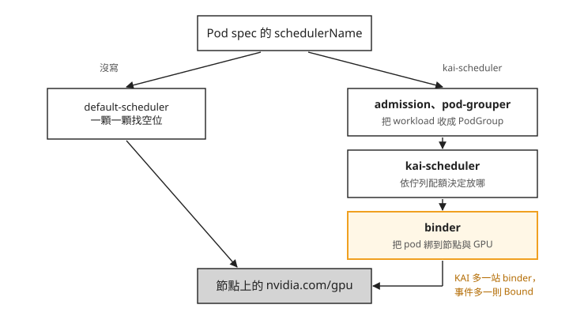
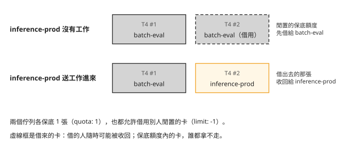
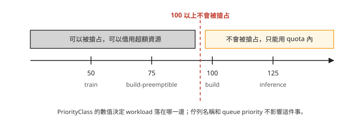

# Day 1: 安裝 KAI Scheduler——佇列、配額與搶占

{ align=right width="100" }

想像一個下午：批次評估工作把叢集僅有的兩張 T4 全部用光，線上推論的 pod 進不來，只能 Pending。`kubectl get pods` 看不到任何錯誤，因為 Kubernetes 預設的排程器看不出「這兩張卡該留一張給線上推論」。它有 PriorityClass 和搶占，可以讓高優先權的 pod 擠掉低優先權的，但沒辦法替每個團隊設定保底幾張卡、閒置時能借幾張、借出去的什麼時候收回。

這一章安裝 KAI Scheduler，讓推論和批次各有一份保底的 GPU，閒置時可以互相借用，需要時再收回來。我們會在兩張 T4 上把這個下午實際重演一次：先裝好 KAI、建立兩個佇列，送出第一顆走 KAI 的 GPU pod，再讓兩張卡被佔滿，看 KAI 怎麼把借出去的卡收回來（reclaim），以及怎麼在同一個佇列裡讓高優先權的工作擠掉低優先權的（preemption，搶占）。

讀完之後，一顆 GPU pod 卡在 Pending 時，你會知道該先看佇列的配額、pod 的優先權，還是資源根本還沒釋放出來。

## 預設排程器缺了什麼

先看 Kubernetes 預設的排程器（kube-scheduler）怎麼處理一顆還沒有節點的 pod：

1. **過濾**：刷掉不合格的節點，例如資源不夠、taint 沒有對應的 toleration、nodeSelector 對不上。
2. **打分**：替剩下的節點排名，例如剩餘資源多、映像檔已經在本機的分數高。
3. **繫結**：把 pod 寫到選中的節點上，接下來交給 kubelet。

這套流程的決策單位是**一顆 pod**，不辨識訓練工作群組，也沒辦法表達「推論組保底一張卡、批次組保底一張卡，閒置時互相借」這種以「一組人」為單位的規則。原生的 PriorityClass 可以讓高優先權的 pod 搶占低優先權的 pod；搶占以單顆待排 pod 的需求決策，必要時會驅逐多顆低優先權 pod。

排無狀態、彼此獨立的服務時，這樣就夠了。GPU 叢集要回答的卻是另一類問題：推論組跟批次組各該分到幾張卡？離峰時能不能讓批次多借兩張，尖峰再還回來？這些問題的主詞是「一個團隊」或「一份工作」，預設排程器沒有對應的概念。

KAI Scheduler 就是為這類問題設計的排程器。它的前身是 Run:ai 的商用排程引擎，NVIDIA 在 2024 年收購 Run:ai 之後，2025 年把它以 Apache 2.0 授權開源，同年 12 月進入 CNCF Sandbox。Sandbox 是 [CNCF 專案成熟度的初始階段](https://contribute.cncf.io/projects/lifecycle/)（截至 2026-08，KAI 仍在這個階段）。

## 讓 pod 改走 KAI

一個叢集可以同時跑好幾個排程器。pod spec 裡有一個 `schedulerName` 欄位：沒寫，就由預設排程器處理；寫 `kai-scheduler`，就交給 KAI。所以 KAI 不是取代預設排程器，而是跟它並存，只處理明講要走 KAI 的 pod。這也是它可以安全裝進正在運作的叢集的原因。



我們可以從圖上看到兩件事：

1. 走 KAI 的 pod 會先被收成一個 **PodGroup**。PodGroup 是 KAI 排程的單位，就算送出的是一顆裸 Pod，KAI 也會自動替它建一個。
2. KAI 把「決定放哪裡」和「真正綁上去」拆給 `kai-scheduler` 和 `binder` 兩個元件。所以 pod 的事件裡會多一則來自 binder 的 `Bound`。追一顆卡住的 GPU pod 時，看它停在 `Scheduled` 還是 `Bound`，就能分辨是排程決策沒過，還是資源綁定沒過。

開始之前，你需要完成 Day 0 的 AKS 環境（Kubernetes 1.35.6），備妥兩個各有一張 T4 的 spot GPU 節點，並已安裝 NVIDIA device plugin。本章會安裝 KAI `v0.16.8`。

## 步驟 1:啟動 GPU 節點

GPU 節點池每次用完都縮到 0（做法見 [Day 0 步驟 8](sprint1-day0-azure-aks-foundation.md#step-8)），使用前先拉回 2 台:

```console
$ az aks nodepool scale \
    -g <resource-group> --cluster-name <cluster> -n gpuspot \
    --subscription <subscription-id> --node-count 2
```

這是同步阻塞指令,而且會塞很久。另開一個視窗查進度:

```console
$ az aks nodepool show -g <resource-group> --cluster-name <cluster> -n gpuspot \
    --subscription <subscription-id> \
    --query '{count:count, provisioningState:provisioningState, powerState:powerState.code, vmSize:vmSize}' -o json
{
  "count": 2,
  "powerState": "Running",
  "provisioningState": "Scaling",
  "vmSize": "Standard_NC4as_T4_v3"
}
```

`provisioningState: Scaling` 是進行中的正常狀態。從下指令到兩張卡可以使用，大約要 **7 分鐘**（VM 佈建、GPU driver 安裝、kubelet 註冊）。這段時間不必乾等——KAI 的元件全部落在 system node,不需要 GPU 節點就位就能裝。

## 步驟 2:安裝 KAI v0.16.8

KAI 的 GitHub 專案首頁寫的安裝指令是 `--version <VERSION>`，直覺會填 release 頁面上的版本號 `0.16.8`。Helm chart 的版本字串要完全對上才抓得到，所以安裝前先用 `helm show chart` 試一次：

```console
$ helm show chart oci://ghcr.io/kai-scheduler/kai-scheduler/kai-scheduler --version 0.16.8
Error: failed to perform "FetchReference" on source: ghcr.io/kai-scheduler/kai-scheduler/kai-scheduler:0.16.8: not found

$ helm show chart oci://ghcr.io/kai-scheduler/kai-scheduler/kai-scheduler --version v0.16.8
Pulled: ghcr.io/kai-scheduler/kai-scheduler/kai-scheduler:v0.16.8
apiVersion: v2
appVersion: v0.16.8
description: KAI Scheduler by NVIDIA
name: kai-scheduler
type: application
version: v0.16.8
```

看最後一行:chart 的 `version` 欄位本身就帶 `v`。多數 chart 的 version 是裸 semver,KAI 直接把 git release tag 當成 chart version,細節見[疑難排解：抓不到 chart](#mine-1)。

```console
$ helm upgrade -i kai-scheduler oci://ghcr.io/kai-scheduler/kai-scheduler/kai-scheduler \
    \
    -n kai-scheduler --create-namespace \
    --version v0.16.8 \
    --wait --timeout 10m
Release "kai-scheduler" does not exist. Installing it now.
Pulled: ghcr.io/kai-scheduler/kai-scheduler/kai-scheduler:v0.16.8
NAME: kai-scheduler
LAST DEPLOYED: Mon Aug  3 15:16:09 2026
NAMESPACE: kai-scheduler
STATUS: deployed
REVISION: 1
DESCRIPTION: Install complete
```

`STATUS: deployed` 之後立刻查 pod,會看到一半的元件還沒起來:

```console
$ kubectl -n kai-scheduler get pods
NAME                                     READY   STATUS              RESTARTS   AGE
admission-8f8cf9ffb-b4759                0/1     ContainerCreating   0          9s
binder-69b9dff55-ln5ww                   0/1     ContainerCreating   0          9s
kai-operator-58cb44c58c-rdfgk            1/1     Running             0          36s
kai-scheduler-default-745fc7dcf9-m48t5   1/1     Running             0          9s
pod-grouper-5f8ccd5b75-df7z4             0/1     ContainerCreating   0          9s
podgroup-controller-8854fdc49-6grwf      1/1     Running             0          9s
queue-controller-746cb94d99-tnsz5        0/1     ContainerCreating   0          9s
```

[Operator](https://kubernetes.io/docs/concepts/extend-kubernetes/operator/) 是將維運邏輯寫成程式,依設定自動管理應用與元件的方式。KAI 的 `kai-operator` 會讀取 `Config` 物件,建立並維護其餘六個元件。Helm 的 `--wait` 只等待 chart 直接建立的資源,這六個元件不在等待範圍內。詳見[疑難排解：`helm --wait` 成功不代表已就緒](#mine-2)。安裝後補一道自己的等待條件:

```console
$ kubectl -n kai-scheduler wait --for=condition=Available deploy --all --timeout=300s
deployment.apps/admission condition met
deployment.apps/binder condition met
deployment.apps/kai-operator condition met
deployment.apps/kai-scheduler-default condition met
deployment.apps/pod-grouper condition met
deployment.apps/podgroup-controller condition met
deployment.apps/queue-controller condition met
```

## 步驟 3:清點安裝了哪些東西

這一步要看出三件事，後面的步驟都會用到：KAI 的元件放在哪裡、會不會吃緊；它讓 Kubernetes 多認得哪些物件；它預先建好了哪些佇列和優先權。

先看元件。剛才 `get pods` 列出的七個元件，只有 `kai-operator` 是 Helm chart 直接建立的，其餘六個是 operator 讀取 `Config` 物件之後才建立的。七個都放在 system node 上（它們沒有 spot 的 toleration，排不上 GPU 節點），resource request 加總約 500m CPU / 1.7 GiB，2 vCPU / 8 GB 的 system node 就容得下，不必為 KAI 另外開節點。另外，只有 operator 和排程器的名字帶 `kai-` 前綴，其餘五個沒有，要查元件狀態時用 namespace 篩，用名字 grep 會漏掉。

<details markdown="1">
<summary>各元件的資源 request 與職責</summary>

```console
$ kubectl -n kai-scheduler get deploy \
    -o custom-columns='NAME:.metadata.name,CPU_REQ:.spec.template.spec.containers[*].resources.requests.cpu,MEM_REQ:.spec.template.spec.containers[*].resources.requests.memory'
NAME                    CPU_REQ   MEM_REQ
admission               50m       256Mi
binder                  50m       200Mi
kai-operator            <none>    <none>
kai-scheduler-default   250m      512Mi
pod-grouper             50m       256Mi
podgroup-controller     50m       256Mi
queue-controller        50m       256Mi
```

| Deployment | 負責什麼 |
|---|---|
| `kai-operator` | 讀 `Config` 物件，建立並維護下面六個元件 |
| `kai-scheduler-default` | 排程器本體 |
| `binder` | 排程決定之後，把 pod 綁到節點，處理 GPU 資源的綁定 |
| `admission` | webhook，在 workload 建立時補上 PodGroup 需要的欄位 |
| `pod-grouper` | 從 Deployment、Job、裸 Pod 等 workload 推導出 PodGroup |
| `podgroup-controller` | 維護 PodGroup 的生命週期與狀態 |
| `queue-controller` | 維護佇列狀態，計算配額和公平分配 |

</details>

接著看安裝帶進來了哪些 CRD（CustomResourceDefinition，讓 Kubernetes 認得新種類物件的定義，例如 Queue、PodGroup），以及哪些預設物件。下面的輸出看三個地方：CRD 名稱的後半段（API group）、預設的佇列、四個 PriorityClass 的數值：

```console
$ kubectl get crd | grep -Ei 'run.ai|kai'
bindrequests.scheduling.run.ai                   2026-08-03T07:16:08Z
configs.kai.scheduler                            2026-08-03T07:16:07Z
podgroups.scheduling.run.ai                      2026-08-03T07:16:08Z
queues.scheduling.run.ai                         2026-08-03T07:16:08Z
schedulingshards.kai.scheduler                   2026-08-03T07:16:08Z
topologies.kai.scheduler                         2026-08-03T07:16:08Z

$ kubectl get queues
NAME                   PRIORITY   PARENT                 CHILDREN            DISPLAYNAME
default-parent-queue                                     ["default-queue"]
default-queue                     default-parent-queue

$ kubectl get priorityclass | grep -Ev 'system-'
build                     100          false            66s    PreemptLowerPriority
build-preemptible         75           false            66s    PreemptLowerPriority
inference                 125          false            66s    PreemptLowerPriority
train                     50           false            66s    PreemptLowerPriority
```

我們可以從輸出看到：

1. CRD 分屬兩個 API group。排程用的物件（Queue、PodGroup、BindRequest）在 `scheduling.run.ai`，這是 Run:ai 時期留下來的命名；operator 自己的設定（Config 等）在 `kai.scheduler`。寫 YAML 時要對照物件種類挑 apiVersion，兩個 group 很容易寫混。
2. 裝完就自帶一組 `default-parent-queue` → `default-queue` 階層。
3. 裝完也自帶四個 PriorityClass：`train` 50、`build-preemptible` 75、`build` 100、`inference` 125。這四個數字在後面的「兩套優先權」會用到。

## 佇列與配額：保底、借用、收回

建佇列之前，先弄清楚佇列的配額怎麼運作。可以把它想成部門的預算：每個部門有一筆保底額度，別的部門拿不走；這個月用不完的部分，別的部門可以先借去用；哪天自己要用了，借出去的就收回來。KAI 的配額就是這個邏輯，只是把錢換成 GPU。

KAI 的 **Queue**（佇列）是階層式的：上層是 parent，下面掛 leaf，workload 只能放在 leaf 上。每個 leaf 對每種資源設定三個數字：

- **`quota`**：保底額度。這個佇列一定拿得到的量，其他佇列收不走。
- **`limit`**：上限。`-1` 表示不設上限，可以在其他佇列閒置時借用超過 quota 的部分。要允許借用，就明寫 `limit: -1`。
- **`overQuotaWeight`**：queue priority 相同的佇列同時想借閒置的資源時，按這個比例分；priority 不同時，priority 高的先分。

這一章建立的階層只有三個佇列：

| 佇列 | 角色 | GPU quota | GPU limit | queue priority |
|---|---|---|---|---|
| `cnp-root` | parent | -1（不限） | -1 | — |
| `inference-prod` | leaf，線上推論 | 1 | -1 | 200 |
| `batch-eval` | leaf，離線批次 | 1 | -1 | 100 |

兩張卡、兩個佇列各保底一張。因為 `limit` 都是 `-1`，任何一方都可以在對方閒置時把整座叢集借走。步驟 6 會實際演一次：



## 步驟 4:建立兩層佇列

依官方 queues 文件的 CRD schema(`scheduling.run.ai/v2`, kind `Queue`),parent `cnp-root` 加兩個 leaf。整份存成 `01-queues.yaml`——步驟 8 收尾時要拿同一份檔案刪回去:

```bash
cat > 01-queues.yaml <<'EOF'
apiVersion: scheduling.run.ai/v2
kind: Queue
metadata:
  name: cnp-root
spec:
  displayName: "CNP Sprint1 Root"
  resources:
    cpu:
      quota: -1
      limit: -1
      overQuotaWeight: 1
    memory:
      quota: -1
      limit: -1
      overQuotaWeight: 1
    gpu:
      quota: -1
      limit: -1
      overQuotaWeight: 1
---
apiVersion: scheduling.run.ai/v2
kind: Queue
metadata:
  name: inference-prod
spec:
  displayName: "Inference Prod"
  parentQueue: cnp-root
  priority: 200
  resources:
    cpu:
      quota: -1
      limit: -1
      overQuotaWeight: 1
    memory:
      quota: -1
      limit: -1
      overQuotaWeight: 1
    gpu:
      quota: 1
      limit: -1
      overQuotaWeight: 2
---
apiVersion: scheduling.run.ai/v2
kind: Queue
metadata:
  name: batch-eval
spec:
  displayName: "Batch Eval"
  parentQueue: cnp-root
  priority: 100
  resources:
    cpu:
      quota: -1
      limit: -1
      overQuotaWeight: 1
    memory:
      quota: -1
      limit: -1
      overQuotaWeight: 1
    gpu:
      quota: 1
      limit: -1
      overQuotaWeight: 1
EOF
```

```console
$ kubectl apply -f 01-queues.yaml
queue.scheduling.run.ai/cnp-root created
queue.scheduling.run.ai/inference-prod created
queue.scheduling.run.ai/batch-eval created

$ kubectl get queues
NAME                   PRIORITY   PARENT                 CHILDREN                          DISPLAYNAME
batch-eval             100        cnp-root                                                 Batch Eval
cnp-root                                                 ["inference-prod","batch-eval"]   CNP Sprint1 Root
default-parent-queue                                     ["default-queue"]
default-queue                     default-parent-queue
inference-prod         200        cnp-root                                                 Inference Prod
```

父子關係是**子指父的單向宣告**:只有 leaf 寫 `parentQueue: cnp-root`,`cnp-root` 自己完全不提子佇列,`CHILDREN` 欄是 queue-controller 反向算出來填的。所以建立順序不重要,但刪 parent 之前要自己確認底下沒有孤兒 leaf。

剛建立的佇列 status 是 `null`,不是空物件:

```console
$ kubectl get queue inference-prod -o json | jq '{spec:.spec, status:.status}'
{
  "spec": {
    "displayName": "Inference Prod",
    "parentQueue": "cnp-root",
    "priority": 200,
    "resources": {
      "cpu": {"limit": -1, "overQuotaWeight": 1, "quota": -1},
      "gpu": {"limit": -1, "overQuotaWeight": 2, "quota": 1},
      "memory": {"limit": -1, "overQuotaWeight": 1, "quota": -1}
    }
  },
  "status": null
}
```

沒有 workload 之前,queue-controller 不寫任何配額統計。想確認「quota 有沒有生效」不能看 queue status,得等 workload 進來後看 PodGroup 與 pod events。

這份 CRD 還有兩處容易寫錯。**單位**跟 pod spec 的 `resources` 完全不同:CPU 是 millicore(`1000` = 1 核)、memory 是 **MB**(10⁶ bytes,不是 MiB)、GPU 是張數,不能寫 `"2"` 或 `4Gi`。**0 值的語意**則是兩個欄位反向:`quota: 0`(或不填)是沒有保證資源,`limit: 0`(或不填)卻是完全不准超額——想借閒置資源就一定要明寫 `limit: -1`。

最後開一個 workload 專用 namespace——官方明令不要把 workload 丟進 `kai-scheduler` namespace:

```console
$ kubectl create namespace kai-lab
namespace/kai-lab created
```

## 步驟 5:第一顆走 KAI 的 GPU pod

回頭確認 GPU 節點的狀態。節點 `Ready` 不等於卡可用——節點 Ready 之後，可能還要再等二三十秒，`allocatable` 才會出現 `nvidia.com/gpu`：回報 GPU 給 Kubernetes 的 NVIDIA device plugin（Day 0 裝的）這時還在啟動。腳本化的等待條件要盯 allocatable,不能只盯 node Ready:

```console
$ kubectl get nodes -o json | jq -r '.items[]
    | select(.metadata.name|test("gpuspot"))
    | {name:.metadata.name, allocGPU:.status.allocatable["nvidia.com/gpu"]}'
{
  "name": "aks-gpuspot-21249019-vmss000004",
  "allocGPU": "1"
}
{
  "name": "aks-gpuspot-21249019-vmss000005",
  "allocGPU": "1"
}
```

走 KAI 排程只需要三個欄位:`spec.schedulerName: kai-scheduler`、`kai.scheduler/queue` label、以及 `nvidia.com/gpu` limit。GPU 節點有 spot taint,所以額外掛 toleration:

```bash
cat > 02-smoke-gpu-pod.yaml <<'EOF'
apiVersion: v1
kind: Pod
metadata:
  name: kai-smoke-nvidia-smi
  namespace: kai-lab
  labels:
    kai.scheduler/queue: inference-prod
spec:
  schedulerName: kai-scheduler
  restartPolicy: Never
  tolerations:
    - key: kubernetes.azure.com/scalesetpriority
      operator: Equal
      value: spot
      effect: NoSchedule
  containers:
    - name: main
      image: nvcr.io/nvidia/cuda:12.4.1-base-ubuntu22.04
      command: ["nvidia-smi"]
      resources:
        limits:
          nvidia.com/gpu: "1"
EOF
```

```console
$ kubectl apply -f 02-smoke-gpu-pod.yaml
$ kubectl -n kai-lab get pod kai-smoke-nvidia-smi -o wide
NAME                   READY   STATUS      RESTARTS   AGE   IP             NODE
kai-smoke-nvidia-smi   0/1     Completed   0          20s   10.244.1.214   aks-gpuspot-21249019-vmss000004

$ kubectl -n kai-lab logs kai-smoke-nvidia-smi
+-----------------------------------------+------------------------+----------------------+
| GPU  Name                 Persistence-M | Bus-Id          Disp.A | Volatile Uncorr. ECC |
|=========================================+========================+======================|
|   0  Tesla T4                       Off |   00000001:00:00.0 Off |                  Off |
| N/A   40C    P8             15W /   70W |       0MiB /  16384MiB |      0%      Default |
+-----------------------------------------+------------------------+----------------------+
```

排的人是不是 KAI,看事件的來源欄:

```console
$ kubectl -n kai-lab get events \
    --field-selector involvedObject.name=kai-smoke-nvidia-smi --sort-by=.lastTimestamp \
    -o custom-columns='TIME:.lastTimestamp,TYPE:.type,REASON:.reason,FROM:.source.component,MSG:.message'
TIME                   TYPE     REASON      FROM            MSG
2026-08-03T07:22:08Z   Normal   Scheduled   kai-scheduler   Successfully assigned pod kai-lab/kai-smoke-nvidia-smi to node aks-gpuspot-21249019-vmss000004 at node-pool default
2026-08-03T07:22:08Z   Normal   Bound       binder          Pod bound successfully to node aks-gpuspot-21249019-vmss000004
2026-08-03T07:22:09Z   Normal   Pulling     kubelet         Pulling image "nvcr.io/nvidia/cuda:12.4.1-base-ubuntu22.04"
2026-08-03T07:22:14Z   Normal   Started     kubelet         Container started
```

`Scheduled` 的來源是 `kai-scheduler` 而不是 `default-scheduler`,而且多了一則原生 K8s 沒有的 `Bound`——這就是前面那張圖多出來的那一站。

送出去的是一顆裸 Pod,PodGroup 由 KAI 自動建立:

```console
$ kubectl -n kai-lab get podgroups -o json \
    | jq -r '.items[] | {name:.metadata.name, queue:.spec.queue, priority:.spec.priorityClassName, minMember:.spec.minMember}'
{
  "name": "pg-kai-smoke-nvidia-smi-9dd6446b-…",
  "queue": "inference-prod",
  "priority": "train",
  "minMember": 1
}
```

`queue` 從 label 帶過去了,但 `priorityClassName` 是 **`train`(50)**——放在名為 `inference-prod` 的佇列裡,拿到的卻是可被搶占的等級。為什麼會這樣,見[疑難排解：佇列名稱不等於優先權](#mine-3)。

### 沒有 GPU Operator 也能跑

KAI 的 README 把 NVIDIA GPU Operator 列為前置條件，但這個叢集只裝了 NVIDIA device plugin，沒有 GPU Operator，上面這顆 pod 照樣拿到整張 T4、正常執行。對「一顆 pod 用一張完整 GPU」這種用法，device plugin 提供的 `nvidia.com/gpu` 資源就夠了。把一張卡切給多個容器共用時，情況就不一樣了，Day 3 會遇到。

## 兩套優先權

步驟 5 的 PodGroup 出現了一個讓人意外的值：pod 放在叫 `inference-prod` 的佇列，拿到的優先權卻是 `train`。要理解原因，得先分清楚 KAI 裡的兩套優先權：

| | queue priority（`Queue.spec.priority`） | workload priority（PriorityClass） |
|---|---|---|
| 管什麼 | **超額資源**先分給誰 | 誰可以搶占誰、誰不會被搶占 |
| 對 quota 內的資源 | 沒有作用，quota 內受保護 | 無關 |
| 本章的值 | 200 / 100 | `train` 50、`build-preemptible` 75、`build` 100、`inference` 125 |

KAI 裝好就附帶那四個 PriorityClass，分水嶺是 100：



我們可以從圖上看到，「不會被搶占」是有代價的：換來保護的同時，也失去了借用閒置資源的權利。接下來兩步分別站在這條線的兩邊：步驟 6 看佇列之間的收回，步驟 7 看同一個佇列裡的搶占。

## 步驟 6:兩張卡佔滿之後,提交高優先佇列的工作

先讓 `batch-eval` 吃滿兩張 T4。它的 quota 只有 1 GPU,但送兩顆 `train` 優先權的 pod——一顆在 quota 內,一顆屬於超額借用。這份 `03-batch-eval-hogs.yaml` 也是後面幾步共用的範本:

```bash
cat > 03-batch-eval-hogs.yaml <<'EOF'
apiVersion: v1
kind: Pod
metadata:
  name: batch-hog-1
  namespace: kai-lab
  labels:
    kai.scheduler/queue: batch-eval
    priorityClassName: train
spec:
  schedulerName: kai-scheduler
  restartPolicy: Never
  tolerations:
    - key: kubernetes.azure.com/scalesetpriority
      operator: Equal
      value: spot
      effect: NoSchedule
  containers:
    - name: main
      image: nvcr.io/nvidia/cuda:12.4.1-base-ubuntu22.04
      command: ["bash", "-c"]
      args: ["nvidia-smi -L; sleep infinity"]
      resources:
        limits:
          nvidia.com/gpu: "1"
---
apiVersion: v1
kind: Pod
metadata:
  name: batch-hog-2
  namespace: kai-lab
  labels:
    kai.scheduler/queue: batch-eval
    priorityClassName: train
spec:
  schedulerName: kai-scheduler
  restartPolicy: Never
  tolerations:
    - key: kubernetes.azure.com/scalesetpriority
      operator: Equal
      value: spot
      effect: NoSchedule
  containers:
    - name: main
      image: nvcr.io/nvidia/cuda:12.4.1-base-ubuntu22.04
      command: ["bash", "-c"]
      args: ["nvidia-smi -L; sleep infinity"]
      resources:
        limits:
          nvidia.com/gpu: "1"
EOF
```

```console
$ kubectl apply -f 03-batch-eval-hogs.yaml
$ kubectl -n kai-lab get pods -o wide
NAME          READY   STATUS    RESTARTS   AGE   NODE
batch-hog-1   1/1     Running   0          7s    aks-gpuspot-21249019-vmss000004
batch-hog-2   1/1     Running   0          7s    aks-gpuspot-21249019-vmss000005

$ kubectl get queue batch-eval -o json | jq '.status'
{
  "allocated": {"nvidia.com/gpu": "2"},
  "requested": {"nvidia.com/gpu": "2"}
}
```

兩顆都跑起來,`batch-eval` 拿到 quota 的兩倍。`inference-prod` 當下沒有任何 workload,閒置額度全被借走——超額借用的用意就在這裡：卡閒著的時候，先讓需要的人用。

接著提交 `inference-prod` 的工作要卡,兩顆 `inference`(125)優先權的 pod。`04-inference-claimants.yaml` 就是上面那份範本換三個字串——pod 名字、佇列標籤、`priorityClassName`,其餘一字不動:

```bash
sed -e 's/batch-hog/infer-claim/' \
    -e 's/queue: batch-eval/queue: inference-prod/' \
    -e 's/priorityClassName: train/priorityClassName: inference/' \
    03-batch-eval-hogs.yaml > 04-inference-claimants.yaml
```

```console
$ kubectl apply -f 04-inference-claimants.yaml
$ kubectl -n kai-lab get pods -o wide
NAME            READY   STATUS        RESTARTS   AGE   NODE
batch-hog-1     1/1     Running       0          22s   aks-gpuspot-21249019-vmss000004
batch-hog-2     1/1     Terminating   0          22s   aks-gpuspot-21249019-vmss000005
infer-claim-1   0/1     Pending       0          9s    <none>
infer-claim-2   0/1     Pending       0          8s    <none>
```

稍等一下再看，狀態穩定下來:

```console
$ kubectl -n kai-lab get pods -o wide
NAME            READY   STATUS    RESTARTS   AGE   NODE
batch-hog-1     1/1     Running   0          50s   aks-gpuspot-21249019-vmss000004
infer-claim-1   1/1     Running   0          37s   aks-gpuspot-21249019-vmss000005
infer-claim-2   0/1     Pending   0          36s   <none>
```

結果是**一張收回、一顆卡住**：`batch-eval` 超額借的那張卡被回收(reclaim)還給 `inference-prod`,但第二顆 inference pod 沒有繼續去搶 `batch-hog-1`,永久停在 Pending。兩張卡回到「每個佇列各一張」的 quota 分配。

為什麼會這樣？回到前面講的兩件事。`batch-hog-1` 用的是 `batch-eval` 自己保底的那張卡，跨佇列回收時，保底額度內的卡不會被收走，所以只有借來的 `batch-hog-2` 被收回。這種「把借出去的卡收回給原本的佇列」叫 **reclaim**（收回）。而 `infer-claim-2` 的優先權是 `inference`（125），屬於不會被搶占、但只能用 quota 內資源的等級；`inference-prod` 的 quota 只有 1 張，已經被 `infer-claim-1` 用掉，所以它再也拿不到卡，只能一直 Pending。

有一點跟官方文件不同：KAI 的 scheduling deep-dive 文件寫，不可搶占的 workload 不會觸發其他佇列的 reclaim，但這次實測，`inference`（125）等級的 `infer-claim-2` 確實觸發了對 `batch-eval` 的 reclaim（下面的事件訊息可以看到）。以 v0.16.8 來說，結論是：不可搶占的 workload 一樣能把其他佇列借走的卡收回來，替線上服務設好 quota 就拿得回保底的卡，不必為了收回而改用可搶占的等級。升級 KAI 之後，先用步驟 6 的情境重跑一次，確認這個行為沒有變。

### KAI 把收回的理由記在哪裡

驅逐事件掛在 PodGroup 上,不在 pod 上:

```console
$ kubectl -n kai-lab get events --sort-by=.lastTimestamp \
    -o custom-columns='TIME:.lastTimestamp,TYPE:.type,OBJ:.involvedObject.name,REASON:.reason,FROM:.source.component,MSG:.message'
2026-08-03T07:23:39Z  Normal  pg-batch-hog-2-a94044ee-…  Evict  kai-scheduler
  Pod kai-lab/batch-hog-2 was preempted by workload kai-lab/pg-infer-claim-2-8b80dcd8-….
  Batch Eval     uses <GPU: 2, ...> with a quota of <GPU: 1, ...>, fair-share of <GPU: 1, ...> and queue priority of <100>.
  Inference Prod uses <GPU: 0, ...> with a quota of <GPU: 1, ...>, fair-share of <GPU: 1, ...> and queue priority of <200>.
```

卡住那顆的事件講得更直白:

```console
2026-08-03T07:24:04Z  Warning  infer-claim-2  Unschedulable  kai-scheduler
  NonPreemptibleOverQuota: Non-preemptible workload is over quota. Workload requested 1 GPUs,
  but Inference Prod quota is 1 GPUs, while 1 GPUs are already allocated for non-preemptible pods.
  Use a preemptible workload to go over quota..
```

排程器日誌每輪都印出資源分割結果:

```console
$ kubectl -n kai-scheduler logs deploy/kai-scheduler-default
Resource division result for queue <Inference Prod>: Queue Priority: <200>,
  GPU: deserved: <1>, requested: <2>, maxAllowed: <Unlimited>, allocated: <1>, fairShare: <1>
Resource division result for queue <Batch Eval>: Queue Priority: <100>,
  GPU: deserved: <1>, requested: <1>, maxAllowed: <Unlimited>, allocated: <1>, fairShare: <1>

[preempt] Attempting to preempt for job: <kai-lab/pg-infer-claim-2-…>, priority: <125>, queue: <inference-prod>
[preempt] Job <kai-lab/pg-infer-claim-2-…> would have placed the queue resources over quota
[preempt] Didn't find a preemption strategy for job <kai-lab/pg-infer-claim-2-…>
```

事件訊息列出了每個佇列的四個數字：`uses`（目前用了幾張）、`quota`（保底幾張）、`fair-share`（依權重算出該分到幾張）和 queue priority。看第一則：`batch-eval` 用了 2 張、保底 1 張，超出了自己的份額；`inference-prod` 用了 0 張、保底 1 張，所以 KAI 從 `batch-eval` 收回一張。不必翻日誌就能重建這次決定。

排程器的日誌多了幾個欄位：`deserved` 是依 quota 該分到的量，`allocated` 是實際拿到的量。最後三行顯示，KAI 嘗試替 `infer-claim-2` 搶占資源（`Attempting to preempt`），但判定會讓 `inference-prod` 超過 quota（`would have placed the queue resources over quota`），因此沒有執行搶占。這兩個決定為什麼跟直覺相反，疑難排解裡的[「queue priority 無法回收其他佇列 quota 內的資源」](#mine-4)和[「`priorityClassName: inference` 反而讓 pod 卡住」](#mine-5)有更完整的說明。

另外，每次建立 pod 都會先出現一則 `PodGrouperWarning ... Pod "batch-hog-2" not found` 事件。這是 pod-grouper 的快取還沒看到剛建立的 pod，1 秒後就正常排完，沒有影響——但把 `Warning` 事件一律當失敗處理的 CI 或告警規則會一直誤報。

## 步驟 7:同一個佇列裡的搶占

步驟 6 演的是**跨佇列的 reclaim**（收回）。這一步看的是 **preemption**（搶占）：在同一個佇列裡，高優先權的 workload 把低優先權的擠掉。兩顆 pod 都放在 `inference-prod`：受害者是 `train`(50,可被搶占),搶占者是 `inference`(125,不可被搶占)。

兩顆 pod 的差別只有名字與 `priorityClassName` 兩行,佇列、映像、資源需求全部相同——這樣才確定演出來的是優先權的作用,不是別的變因:

```bash
cat > 05-preempt-victim-train.yaml <<'EOF'
apiVersion: v1
kind: Pod
metadata:
  name: preempt-victim-train
  namespace: kai-lab
  labels:
    kai.scheduler/queue: inference-prod
    priorityClassName: train
spec:
  schedulerName: kai-scheduler
  restartPolicy: Never
  tolerations:
    - key: kubernetes.azure.com/scalesetpriority
      operator: Equal
      value: spot
      effect: NoSchedule
  containers:
    - name: main
      image: nvcr.io/nvidia/cuda:12.4.1-base-ubuntu22.04
      command: ["bash", "-c"]
      args: ["nvidia-smi -L; sleep infinity"]
      resources:
        limits:
          nvidia.com/gpu: "1"
EOF

sed -e 's/preempt-victim-train/preempt-preemptor-inference/' \
    -e 's/priorityClassName: train/priorityClassName: inference/' \
    05-preempt-victim-train.yaml > 06-preempt-preemptor-inference.yaml
```

先清空環境,只放一顆受害者(佔 vmss000004),讓 vmss000005 那張卡空著,然後送出搶占者:

```console
$ kubectl -n kai-lab delete pod --all
$ kubectl apply -f 05-preempt-victim-train.yaml
$ kubectl apply -f 06-preempt-preemptor-inference.yaml
$ kubectl -n kai-lab get pods -o wide
NAME                          READY   STATUS    RESTARTS   AGE   NODE
preempt-preemptor-inference   1/1     Running   0          10s   aks-gpuspot-21249019-vmss000005
preempt-victim-train          1/1     Running   0          29s   aks-gpuspot-21249019-vmss000004
```

搶占者直接去拿那張空卡,既有的 pod 沒有被驅逐。搶占不是「優先權高就一定觸發」的動作,而是沒有其他辦法時的最後手段;只要還有閒置資源,排程器一律走正常配置路徑。想在測試環境重現搶占,得先把資源佔到零,否則永遠測不出來。

第二輪:補第二顆受害者把兩張卡佔滿,再送搶占者。第二顆受害者跟第一顆只差在名字:

```bash
sed 's/preempt-victim-train/preempt-victim-train-2/' \
    05-preempt-victim-train.yaml > 07-preempt-victim-train-2.yaml
```

執行下面的 `kubectl -n kai-lab get pods -o wide` 後,先確認 `preempt-victim-train` 與 `preempt-victim-train-2` 都達到 `1/1 Running`,且 `NODE` 欄顯示各佔一個不同的 GPU 節點。若尚未達到這個條件,就繼續用同一條指令查看;確認兩張卡都已佔用後,才執行 `kubectl apply -f 06-preempt-preemptor-inference.yaml` 提交搶占者。

```console
$ kubectl -n kai-lab delete pod preempt-preemptor-inference
$ kubectl apply -f 07-preempt-victim-train-2.yaml
$ kubectl -n kai-lab get pods -o wide
NAME                     READY   STATUS    RESTARTS   AGE   NODE
preempt-victim-train     1/1     Running   0          86s   aks-gpuspot-21249019-vmss000004
preempt-victim-train-2   1/1     Running   0          6s    aks-gpuspot-21249019-vmss000005

$ kubectl apply -f 06-preempt-preemptor-inference.yaml
$ kubectl -n kai-lab get pods -o wide
NAME                          READY   STATUS    RESTARTS   AGE    NODE
preempt-preemptor-inference   1/1     Running   0          39s    aks-gpuspot-21249019-vmss000005
preempt-victim-train          1/1     Running   0          2m9s   aks-gpuspot-21249019-vmss000004
```

`preempt-victim-train-2` 不見了,它的卡被搶占者接手。時間軸:

```console
07:27:46Z  Normal  pg-preempt-victim-train-2-851be242-…  Evict  kai-scheduler
  Pod kai-lab/preempt-victim-train-2 was preempted by higher priority workload
  kai-lab/pg-preempt-preemptor-inference-93f1e435-…
07:28:10Z  Normal  preempt-preemptor-inference  Pipelined  kai-scheduler
  Pod kai-lab/preempt-preemptor-inference was pipelined to node aks-gpuspot-21249019-vmss000005
07:28:17Z  Normal  preempt-preemptor-inference  Bound      binder
  Pod bound successfully to node aks-gpuspot-21249019-vmss000005
07:28:18Z  Normal  preempt-preemptor-inference  Started    kubelet
```

三個條件到齊才成立:同佇列、victim 可被搶占、搶占者優先權嚴格較高(125 > 50)。注意兩顆 `train` 只有一顆被驅逐：搶占者只需要 1 GPU,KAI 只挑一個受害者。至於 `Evict` 到 `Bound` 中間那 31 秒,見[疑難排解：搶占後那張卡不會立刻交出](#mine-6)。

### 分辨 reclaim 與 preemption

兩種機制的事件 `reason` 都是 `Evict`,光看 reason 分不出來:

| | 步驟 6(跨佇列 reclaim) | 步驟 7(同佇列 preemption) |
|---|---|---|
| 訊息用語 | `was preempted by workload <X>` | `was preempted by higher priority workload <X>` |
| 附帶資訊 | 兩個佇列的 uses / quota / fair-share / queue priority | 無配額數字 |
| 判定依據 | 佇列超額 + fair-share | workload 優先權高低 |

**有配額數字的是 reclaim,寫 `higher priority` 的是 preemption。**事後追查「我的 job 為什麼被砍」時,這是最快的分岔點。

## 步驟 8:收尾

刪測試 pod、測試 queue 與 lab namespace。KAI 的安裝保留下來,Day 2 直接接著用。最後用完把 GPU 節點池縮到 0（同 [Day 0 步驟 8](sprint1-day0-azure-aks-foundation.md#step-8)）。

```console
$ kubectl -n kai-lab delete pod --all
$ kubectl delete -f 01-queues.yaml
$ kubectl delete namespace kai-lab

$ kubectl get queues
NAME                   PRIORITY   PARENT                 CHILDREN            DISPLAYNAME
default-parent-queue                                     ["default-queue"]
default-queue                     default-parent-queue

$ kubectl -n kai-scheduler get pods
NAME                                     READY   STATUS    RESTARTS   AGE
admission-8f8cf9ffb-b4759                1/1     Running   0          12m
binder-69b9dff55-ln5ww                   1/1     Running   0          12m
kai-operator-58cb44c58c-rdfgk            1/1     Running   0          13m
kai-scheduler-default-745fc7dcf9-m48t5   1/1     Running   0          12m
pod-grouper-5f8ccd5b75-df7z4             1/1     Running   0          12m
podgroup-controller-8854fdc49-6grwf      1/1     Running   0          12m
queue-controller-746cb94d99-tnsz5        1/1     Running   0          12m
```

三個測試佇列刪掉了、預設階層不受影響,七個元件都還在 Running。PodGroup 隨 namespace 一起消失,不用另外清。最後執行 `az aks nodepool scale ... --node-count 0`,把 GPU 節點池縮到 0。

## 疑難排解

### `--version 0.16.8` 抓不到 chart {#mine-1}

**症狀**:`helm ... --version 0.16.8` 回 `FetchReference ... not found`,看起來像 registry 掛了或版本根本不存在。

**原因**:KAI 把 chart version 直接設成 git release tag `v0.16.8`(含 `v`),OCI artifact 的 tag 也是 `v0.16.8`。Helm 做的是精確字串比對,不會自動補 `v`。多數 chart 的 version 是裸 semver,這個直覺在這裡失效。

**修法**:`--version v0.16.8`。不確定時先用 `helm show chart oci://... --version <candidate>` 驗一次,拿到的輸出裡 `version:` 那一行就是唯一正解,別直接 install。

### `helm --wait` 回傳成功,不代表 KAI 已就緒 {#mine-2}

**症狀**:`helm upgrade -i --wait` 回 `STATUS: deployed`,但 `admission` / `binder` / `pod-grouper` / `queue-controller` 都還是 `ContainerCreating`。這時候馬上送 workload,會撞上 admission webhook 還沒起來的錯誤。

**原因**:KAI 是 operator 架構。Helm chart 安裝的是 `kai-operator` 加一個 `configs.kai.scheduler` CR,真正的排程元件由 operator 二次產生,Helm 完全看不到它們,`--wait` 自然等不到。

**修法**:Helm 回報成功不代表元件已就緒,安裝後補一道自己的等待條件。

```console
$ kubectl -n kai-scheduler wait --for=condition=Available deploy --all --timeout=300s
```

這條規則對所有 operator 型安裝都成立:Helm 的 `--wait` 只等它自己建立的資源。

### 放進 `inference-prod` 佇列,不等於拿到 inference 優先權 {#mine-3}

**症狀**:pod 放在名為 `inference-prod`、queue priority 200 的高優先佇列裡,PodGroup 的 `priorityClassName` 卻是 `train`(50),屬於可被搶占的等級。

**原因**:佇列優先權(`Queue.spec.priority`)與 workload 優先權(PriorityClass)是兩套完全獨立的系統。前者只決定超額資源的分配先後,後者才決定誰能搶占誰、誰不會被搶。沒指定 `priorityClassName` 的裸 Pod 一律預設 `train`;只有 Deployment、Knative Service 這類長駐型 workload 才預設 `inference`。

**修法**:要不可被搶占就明寫 `priorityClassName: inference`(或 `build`)。佇列名稱只是給人看的,不影響優先權——`inference-prod` 這個名字對排程器毫無意義。

### queue priority 無法回收其他佇列 quota 內的資源 {#mine-4}

**症狀**:`inference-prod` 佇列優先權 200、`batch-eval` 只有 100,兩顆 inference pod 卻只有一顆跑得起來,另一顆無限 Pending。直覺會以為優先權高就該把兩張卡都拿過來。

**原因**:queue priority(`Queue.spec.priority`)**只決定超額資源先分給哪個佇列**。跨佇列回收超額資源時,quota 內的資源受保護:`batch-hog-1` 佔的是 `batch-eval` 保底額度內的那張卡,不在回收範圍內,被回收的只有借了超額那張卡的 `batch-hog-2`。這個保護只針對跨佇列的回收。同一個佇列裡,workload priority(PriorityClass)較高的 workload 仍然可能搶占較低的,步驟 7 就是這種情況。

**修法**:想讓 `inference-prod` 吃到兩張卡,要改的是 **quota 而不是 priority**(例如 `inference-prod` GPU quota 設 2、`batch-eval` 設 0)。把 quota 當成保證下限來設計,而不是當成上限,才對得上 KAI 的心智模型。

### `priorityClassName: inference` 反而讓 pod 卡住 {#mine-5}

**症狀**:第二顆 inference pod 被判 `NonPreemptibleOverQuota`,事件訊息甚至反過來建議 "Use a preemptible workload to go over quota"。

**原因**:PriorityClass 值 ≥100 在 KAI 裡等於「不可被搶占」,代價是**只能用 quota 內的資源,永遠不准超額**。`inference`(125)踩到這條線:`inference-prod` 的 quota 只有 1 GPU 且已被第一顆佔滿,第二顆就再也拿不到卡——即使叢集裡明明還有一張正在跑低優先權的工作。反倒是 `train`(50)這種可被搶占的等級,能自由借用超額資源。

**修法**:這是 trade-off,不是 bug。要保證服務不中斷，就把 quota 開到尖峰用量(不可被搶占 + 足額 quota);要吞吐量就用 `train` 去借超額資源、接受隨時被回收。混用時,每個 workload 的 PriorityClass 決定它屬於哪一種:不會被搶占但只能用 quota 內的資源,或者能借用超額資源但可能被收回。

### 受害者被驅逐後,那張卡不會立刻交給搶占者 {#mine-6}

**症狀**:`Evict` 事件發出之後,搶占者隔了約 31 秒才 `Bound`;期間排程器日誌每秒重複印一次 `Attempting to allocate job: <pg-preempt-preemptor-inference-…>`,看起來像卡住了。

**原因**:驅逐是非同步的。KAI 只負責送出刪除,接下來要等 kubelet 走完正常的停止流程（graceful termination：先送 `SIGTERM` 讓程式自己收尾，預設最多等 30 秒才強制結束）、容器真正結束、device plugin 回收 GPU、節點資源狀態更新,排程器才能在下一輪把卡配出去。本例的受害者用 `sleep infinity` 且沒有攔 `SIGTERM`,bash 不會把訊號轉給 `sleep`,於是硬等滿 30 秒。

**修法**:不是 bug，但會影響高優先工作多快能開始跑——**高優先工作的啟動延遲 = 搶占決策時間 + 受害者的 `terminationGracePeriodSeconds`**。要縮短就得從受害者端下手:讓訓練工作正確處理 `SIGTERM`(做完 checkpoint 就退出),或針對可被搶占的 workload 調低 `terminationGracePeriodSeconds`。官方 quickstart 的 GPU pod 範例特地寫成 `trap 'exit 0' TERM; sleep infinity & wait`,就是為了避開這 30 秒。

## 想一想

- 你把一顆 pod 放進 `inference-prod` 佇列，事件卻顯示它被搶占了。你會先去查什麼？
- 一個團隊抱怨：「我們佇列的 queue priority 設成最高，為什麼還搶不到第二張卡？」你會建議他改哪個設定？
- 叢集裡明明還有一張卡在跑低優先權的工作，一顆 `inference` 等級的 pod 卻一直 Pending。可能是什麼原因？

## 小結

KAI Scheduler 跟預設排程器並存，只處理 `schedulerName` 指向它的 pod，並把它們收成 PodGroup 排程。佇列的 quota 是保底額度，`limit: -1` 才允許在別人閒置時借用，借來的部分隨時可能被收回。優先權有兩套：queue priority 只決定超額資源先分給哪個佇列，PriorityClass 才決定誰能搶占誰，而 100 以上的「不可搶占」等級，只能用自己佇列的 quota。另外，Helm 的 `--wait` 只等它自己建立的資源，operator 型的安裝要自己補一道 `kubectl wait`；搶占從決定到真正拿到卡，還要等受害者走完 graceful termination。

## 延伸閱讀

想再深入，可以從這幾份開始：

- **[KAI Scheduler 專案首頁](https://github.com/NVIDIA/KAI-Scheduler)** —— 安裝指令、前置條件、功能總覽;本章的 Helm OCI 指令與 GPU Operator 那條 prerequisite 都出自這裡。
- **[Queue CRD 與階層佇列文件(v0.16.8)](https://github.com/NVIDIA/KAI-Scheduler/blob/v0.16.8/docs/queues/README.md)** —— `quota` / `limit` / `overQuotaWeight` 的完整語意,以及 CPU 用 millicore、memory 用 MB 的單位規定。
- **[Pod Priority and Preemption | Kubernetes](https://kubernetes.io/docs/concepts/scheduling-eviction/pod-priority-preemption/)** —— 原生的 PriorityClass 與搶占機制,對照著看能分辨哪些行為是 K8s 給的、哪些是 KAI 自己加的。
- **[KAI Scheduler 的 CNCF 專案頁](https://www.cncf.io/projects/kai-scheduler/)** —— 進 sandbox 的時間與社群活躍度資料,評估要不要放進正式環境時的判斷材料。

## 下一步

兩張卡、單顆 pod 的世界很單純:要一張給一張,不夠就排隊。但訓練工作不是這樣要資源的——8 個 worker 只湊到 7 個,那 7 張卡就是純浪費,而且還佔著別人的位置。Day 2 把 PodGroup 的 `minMember` 打開,看 gang scheduling 怎麼處理「全有或全無」,順便補上今天沒做完的兩題:只有兩個節點時 `minMember > 1` 會排成什麼樣子,以及搶占一組 workload 時,KAI 是砍整組還是砍單顆。

---

!!! quote ""
    KAI Scheduler 標誌為 CNCF artwork 之官方資產,此處作社群教學用途。
