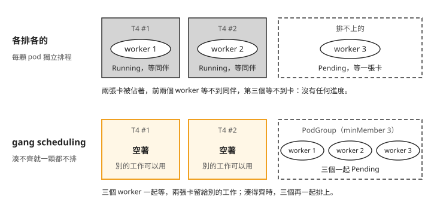
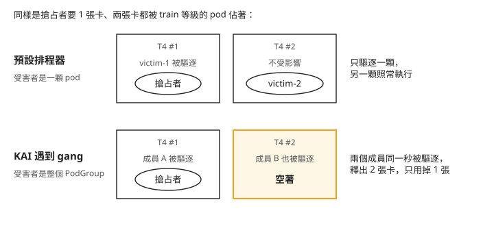
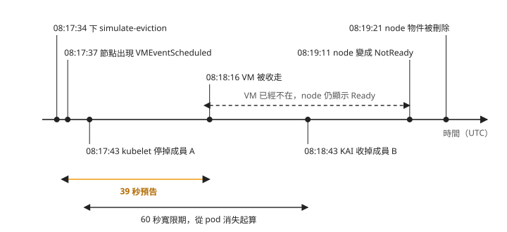

# Day 2: Gang Scheduling——一組 pod 的整組排程、搶占與 spot 回收

{ align=right width="100" }

一份分散式訓練工作要 3 個 worker，各用一張 GPU。叢集只有兩張 T4。送出去之後，`kubectl get pods` 顯示 2 個 Running、1 個 Pending。看起來像是「已經在跑，只是慢一點」，其實兩張卡被佔著，卻一步都沒有算。

Day 1 處理的都是單顆 pod：誰先拿到卡、誰會被擠掉。這一章處理「一組 pod 要一起拿到資源才有用」的情況。我們會在兩張 T4 上重現上面那個畫面，然後讓 KAI 把三個 worker 當成一個單位排程，再看這個單位遇到搶占、遇到 spot 節點被雲端收走時，會發生什麼事。

讀完之後，一份多 worker 的工作出現部分 Running、部分 Pending 時，你會知道該看 PodGroup 的 `minMember`（最低同時排程成員數），判斷它有沒有被當成一整組排程，也能預估它被搶占或節點被回收時，會不會整組重來。

## 少一個 worker，其他 worker 也動不了

分散式訓練會把一份工作拆給好幾個 process 同時算，每一個叫一個 **worker**，在 Kubernetes 上通常一個 worker 就是一顆 pod。每算完一步，所有 worker 要把各自算出的結果交換、加總，再一起進下一步；這個「大家把結果湊在一起」的動作叫 **all-reduce**。只要少一個 worker，all-reduce 就湊不齊，其他 worker 只能停在原地等。

所以這類工作要的不是「盡量多給幾張卡」，而是「三張一起給，否則一張都不要」。下面把兩種排程方式並排比較，上面是每顆 pod 各排各的，下面是把三個 worker 當成一組：



我們可以從圖上看到兩件事：

1. 上面那一列，兩張卡都有人佔著，但沒有任何進度。前兩個 worker 等第三個，第三個等一張卡，而唯一能放出卡的就是前兩個。沒有人介入的話，這個狀態會一直維持下去。
2. 下面那一列，三個 worker 都沒排上，看起來比較糟，但兩張卡是空的，別的工作可以先用。等卡夠了，三個再一起排上。

下面那一列的做法叫 **gang scheduling**：以一組 pod 為排程單位，資源足夠才整組配置，不足時整組等待、不佔用資源。

## 開始之前

這一章接著 Day 1 的環境：AKS 叢集、KAI Scheduler v0.16.8、`gpuspot` pool 兩台各帶一張 T4 的 spot 節點。Day 1 收尾時刪掉了測試佇列和 namespace，GPU pool 也縮回 0，所以先做三件事：

1. 照 [Day 1 步驟 1](sprint1-day1-kai-queue-basics.md) 把 `gpuspot` pool 拉回 2 台，等兩張 T4 出現在 `allocatable`。
2. 用 Day 1 步驟 4 的 `01-queues.yaml` 重建佇列：`kubectl apply -f 01-queues.yaml`。底下 `inference-prod`（queue priority 200）和 `batch-eval`（queue priority 100）各保底一張卡。
3. 重建 workload 用的 namespace：`kubectl create namespace kai-lab`。

## 步驟 1:送一個 3 worker 的 Job

先用最直覺的寫法：一個 `batch/v1` Job，`parallelism: 3` 表示同時跑 3 顆 pod，`schedulerName: kai-scheduler` 讓它走 KAI，佇列標籤放 `batch-eval`，不加其他設定。

```bash
cat > 02-gang3-job.yaml <<'EOF'
apiVersion: batch/v1
kind: Job
metadata:
  name: gang3
  namespace: kai-lab
spec:
  parallelism: 3
  completions: 3
  backoffLimit: 0
  template:
    metadata:
      labels:
        kai.scheduler/queue: batch-eval
        priorityClassName: train
    spec:
      schedulerName: kai-scheduler
      restartPolicy: Never
      tolerations:
        - key: kubernetes.azure.com/scalesetpriority
          operator: Equal
          value: spot
          effect: NoSchedule
      containers:
        - name: main
          image: nvcr.io/nvidia/cuda:12.4.1-base-ubuntu22.04
          command: ["bash", "-c"]
          args: ["trap 'exit 0' TERM; nvidia-smi -L; sleep infinity & wait"]
          resources:
            limits:
              nvidia.com/gpu: "1"
EOF
```

容器指令裡的 `trap 'exit 0' TERM` 讓 pod 收到停止訊號就立刻結束，不必等滿 30 秒的寬限期。這是 Day 1 的[「受害者被驅逐後,那張卡不會立刻交給搶占者」](sprint1-day1-kai-queue-basics.md#mine-6)提過的寫法：Kubernetes 停掉一顆 pod 時，先送 `SIGTERM` 訊號讓程式自己收尾，最多等一段寬限期（預設 30 秒）才強制結束，而 bash 不會把這個訊號轉給 `sleep`，沒有 `trap` 就會硬等滿寬限期。這一章所有 pod 都用這個寫法。它的副作用是：pod 被驅逐時也以 exit code 0 結束，Job 會把它當成正常完成，步驟 4 會實際看到。

pod template 的 label 裡那行 `priorityClassName: train` 是 KAI 的寫法：KAI 從這個 label 讀 workload 的優先權，跟 Kubernetes 標準的 `spec.priorityClassName` 欄位不同（步驟 6 會用到標準的寫法）。

送出去，看 pod 落在哪裡：

```console
$ kubectl apply -f 02-gang3-job.yaml
$ kubectl -n kai-lab get pods -o wide
NAME          READY   STATUS    RESTARTS   AGE   NODE
gang3-5mvdw   1/1     Running   0          25s   aks-gpuspot-21249019-vmss000006
gang3-b5mgg   1/1     Running   0          25s   aks-gpuspot-21249019-vmss000007
gang3-fzwls   0/1     Pending   0          25s   <none>
```

2 個 Running、1 個 Pending，就是開場那張圖的上半部。叢集裝了 KAI，結果卻跟各排各的一樣。

Day 1 看過，走 KAI 的 pod 會先被收成一個 **PodGroup**：這是 KAI 排程的單位，同一份工作的 pod 共用一個。原因要從 PodGroup 找：

```console
$ kubectl -n kai-lab get podgroups -o json \
    | jq -c '.items[]|{name:.metadata.name,minMember:.spec.minMember,status:.status}'
{"name":"pg-gang3-d1c60636-...","minMember":1,
 "status":{"resourcesStatus":{"allocated":{"nvidia.com/gpu":"2"},"requested":{"nvidia.com/gpu":"3"}}}}
```

三顆 pod 確實被收進同一個 PodGroup，但 `minMember` 是 1。**`minMember`** 是 PodGroup 的一個欄位，意思是「至少要幾顆 pod 同時排得上，才排這一組」。它是 1，就表示排得上一顆就放一顆，等於沒有 gang。`status` 裡的 `allocated: 2` 也對得上：已經佔了兩張卡。

為什麼是 1？`pod-grouper`（KAI 裡負責替 workload 建 PodGroup 的元件）替 `batch/v1` Job 建 PodGroup 時，預設 `minMember` 就是 1，不會拿 `parallelism` 當 gang 的大小。KAI 的官方文件 `docs/batch/README.md` 第一段也寫了，這樣的 Job 裡的 pod 會 "scheduled separately"。PyTorchJob（Kubeflow 用來跑 PyTorch 分散式訓練的工作類型）、JobSet（Kubernetes 社群把多個 Job 組成一份工作的 API）這類本身就描述「幾個 worker」的工作類型，才會自動推出 gang；`batch/v1` Job 要自己講。

講的方式是在 **Job 自己的 `metadata`**（不是 pod template 那一層）加上 **`kai.scheduler/batch-min-member`** 標註，值就是 gang 的大小。把上面那份複製成 `02b-gang3-minmember-job.yaml`，補上這兩行：

```yaml
metadata:
  name: gang3
  namespace: kai-lab
  annotations:
    kai.scheduler/batch-min-member: "3"
```

刪掉舊的 Job，送新的：

```console
$ kubectl -n kai-lab delete job gang3
$ kubectl apply -f 02b-gang3-minmember-job.yaml
$ kubectl -n kai-lab get pods -o wide
NAME          READY   STATUS    RESTARTS   AGE   NODE
gang3-7z29z   0/1     Pending   0          30s   <none>
gang3-8wtjf   0/1     Pending   0          30s   <none>
gang3-8zjvx   0/1     Pending   0          30s   <none>
```

這次三顆全部 Pending，變成開場那張圖的下半部。PodGroup 的狀態說明了原因：

```console
$ kubectl -n kai-lab get podgroups -o json | jq -c '.items[].status'
{"resourcesStatus":{"requested":{"nvidia.com/gpu":"3"}},
 "schedulingConditions":[{
   "reason":"Unschedulable","type":"UnschedulableOnNodePool","status":"True",
   "message":"PodSchedulingErrors: Resources were found for 2 pods while 3 are required for gang scheduling. Additional pods cannot be scheduled due to: no nodes with enough resources were found: 3 node(s) didn't have enough resources: GPUs.."}]}
```

這段狀態有兩處要看：

1. 訊息寫「Resources were found for 2 pods while 3 are required for gang scheduling」。KAI 找得到 2 張卡，因為湊不到 3 張，才一顆都不放。
2. `resourcesStatus` 只有 `requested: 3`，沒有 `allocated`。前一次沒有 gang 時是 `allocated: 2`。有沒有 `allocated` 這一欄，是看「這組有沒有佔卡」最快的地方。

判斷一份工作有沒有被當成 gang，看的是 PodGroup 的 `minMember`，不是 Job 的 `parallelism`，也不是 pod 跑不跑得起來。

## 步驟 2:確認卡真的空著

PodGroup 沒有 `allocated`，只是 KAI 自己的紀錄。要確認兩張 GPU 真的沒被鎖住，就在 gang 卡著的時候，送一顆同佇列、同優先權、只要一張卡的 pod 進去。這顆 pod 只是用來測試卡有沒有空，叫它探針 pod：

```bash
cat > 03-prober-pod.yaml <<'EOF'
apiVersion: v1
kind: Pod
metadata:
  name: gang-prober
  namespace: kai-lab
  labels:
    kai.scheduler/queue: batch-eval
    priorityClassName: train
spec:
  schedulerName: kai-scheduler
  restartPolicy: Never
  tolerations:
    - key: kubernetes.azure.com/scalesetpriority
      operator: Equal
      value: spot
      effect: NoSchedule
  containers:
    - name: main
      image: nvcr.io/nvidia/cuda:12.4.1-base-ubuntu22.04
      command: ["bash", "-c"]
      args: ["trap 'exit 0' TERM; nvidia-smi -L; sleep infinity & wait"]
      resources:
        limits:
          nvidia.com/gpu: "1"
EOF
```

```console
$ kubectl apply -f 03-prober-pod.yaml
$ kubectl -n kai-lab get pods -o wide
NAME          READY   STATUS    RESTARTS   AGE   NODE
gang-prober   1/1     Running   0          26s   aks-gpuspot-21249019-vmss000006
gang3-7z29z   0/1     Pending   0          66s   <none>
gang3-8wtjf   0/1     Pending   0          66s   <none>
gang3-8zjvx   0/1     Pending   0          66s   <none>
```

探針 pod 馬上排上了。再從整個叢集清點，哪些 pod 已經排到節點上、而且要了 GPU：

```console
$ kubectl get pods -A -o json | jq -r '.items[]
    | select(.spec.nodeName!=null)
    | select([.spec.containers[].resources.limits["nvidia.com/gpu"]//empty]|length>0)
    | "\(.metadata.namespace)/\(.metadata.name)  node=\(.spec.nodeName)  phase=\(.status.phase)"'
kai-lab/gang-prober  node=aks-gpuspot-21249019-vmss000006  phase=Running
```

整個叢集只有探針 pod 握著 GPU。三個 gang 成員等了一分多鐘，一張卡都沒碰。這就是 gang 的用處：與其讓兩個成員佔著卡等第三個，不如全部讓出來，讓別的工作先用。

KAI 的排程器日誌可以看出它把這一組當成什麼：

```console
$ kubectl -n kai-scheduler logs deploy/kai-scheduler-default --since=110s | grep -iE "gang|pg-gang3"
allocate/allocate.go:84       Attempting to allocate job: <kai-lab/pg-gang3-d62ca3dd-...> of queue <Batch Eval>, resources: <[0 0 3 3 0 0 0]>
allocate/allocate.go:89       Could not allocate resources for job: <kai-lab/pg-gang3-d62ca3dd-...> of queue <batch-eval>
consolidation/consolidation.go:98   Attempting to consolidate running jobs in order to make room for job: <kai-lab/pg-gang3-d62ca3dd-...>
consolidation/consolidation.go:102  Can't consolidate for job: <kai-lab/pg-gang3-d62ca3dd-...>, not enough allocatable GPUs in the cluster
preempt/preempt.go:117        Attempting to preempt for job: <kai-lab/pg-gang3-d62ca3dd-...>, priority: <50>, queue: <batch-eval>, resources: <[0 0 3 3 0 0 0]>
preempt/preempt.go:105        Didn't find a preemption strategy for job <kai-lab/pg-gang3-d62ca3dd-...>
stalegangeviction/stalegangeviction.go:30  Enter StaleGangEviction ...
```

從上往下看，排程器依序試了幾種辦法：直接配置（allocate）、把正在跑的工作挪一挪騰出空間（consolidation，日誌寫的是 "consolidate running jobs in order to make room"）、搶占別人（preempt），三種都沒成功。consolidation 和搶占的差別在於：被搬的工作會換到別的節點重新跑，不會因此失去資源；preempt 和 Day 1 的 reclaim 則是把別人的卡拿走。最後一行的 StaleGangEviction 步驟 4 會講。

`resources: <[0 0 3 3 0 0 0]>` 是排程器內部記錄資源需求的格式，不必逐欄解讀，只要注意裡面的 3：整組三顆 pod 加起來要 3 張 GPU。排程器處理的單位是「一個要 3 張卡的工作」，不是三個各要 1 張的 pod。這就是 gang 的實際做法：把一組 pod 合成一筆不能拆開的資源需求。

## 步驟 3:湊得齊的時候，整組一起排上

把 gang 縮成 2 個成員，剛好等於叢集的兩張 T4。標註同樣要寫，值改成 2：

```bash
cat > 04-gang2-job.yaml <<'EOF'
apiVersion: batch/v1
kind: Job
metadata:
  name: gang2
  namespace: kai-lab
  annotations:
    kai.scheduler/batch-min-member: "2"
spec:
  parallelism: 2
  completions: 2
  backoffLimit: 0
  template:
    metadata:
      labels:
        kai.scheduler/queue: batch-eval
        priorityClassName: train
    spec:
      schedulerName: kai-scheduler
      restartPolicy: Never
      tolerations:
        - key: kubernetes.azure.com/scalesetpriority
          operator: Equal
          value: spot
          effect: NoSchedule
      containers:
        - name: main
          image: nvcr.io/nvidia/cuda:12.4.1-base-ubuntu22.04
          command: ["bash", "-c"]
          args: ["trap 'exit 0' TERM; nvidia-smi -L; sleep infinity & wait"]
          resources:
            limits:
              nvidia.com/gpu: "1"
EOF
```

先刪掉探針 pod，騰出它佔的那張卡：

```console
$ kubectl -n kai-lab delete pod gang-prober
```

再刪掉卡住的 gang3，送 gang2：

```console
$ kubectl -n kai-lab delete job gang3
$ kubectl apply -f 04-gang2-job.yaml
$ kubectl -n kai-lab get pods -o wide
NAME          READY   STATUS    NODE
gang2-8n57n   1/1     Running   aks-gpuspot-21249019-vmss000006
gang2-d4psb   1/1     Running   aks-gpuspot-21249019-vmss000007
```

兩顆都跑起來了。要看「一起」排上，得看事件的時間。下面是把 events 依 `lastTimestamp` 排序後，取時間、物件、原因、來源四欄（寫法同 Day 1 用過的 `-o custom-columns`）：

```console
08:04:25Z  gang2         SuccessfulCreate  job-controller
08:04:25Z  gang2         SuccessfulCreate  job-controller
08:04:26Z  gang2-d4psb   Scheduled         kai-scheduler
08:04:26Z  gang2-8n57n   Scheduled         kai-scheduler
08:04:26Z  gang2-d4psb   Bound             binder
08:04:26Z  gang2-8n57n   Bound             binder
08:04:27Z  gang2-d4psb   Started           kubelet
08:04:27Z  gang2-8n57n   Started           kubelet
```

兩顆的 `Scheduled` 和 `Bound` 都落在同一秒。這跟步驟 1 對得上：KAI 要等整組需要的資源都能滿足，才開始替這一組配置；只湊得到一部分時，一顆都不排。至於兩顆的綁定是不是一次完成、中間有沒有短暫只綁上一顆的時刻，事件時間只精確到秒，這一章沒有驗證，不能下結論。

## 步驟 4:成員少了一個，剩下的會怎樣

gang 排上之後，成員還是可能中途消失：pod 當掉、節點失聯。少了一個成員，剩下的成員又回到開場那個「佔著卡等同伴」的狀態。KAI 用 **StaleGangEviction** 處理這種情況：每一輪排程都檢查有沒有 PodGroup 的存活成員少於 `minMember`，有的話就把剩下的成員也驅逐，整組收掉、把卡還出來。步驟 2 日誌最後那行 `Enter StaleGangEviction` 就是這個檢查。

不過它不會一發現就動手。寬限期的預設值寫在 KAI 原始碼的 `cmd/scheduler/app/options/options.go`：

```go
defaultStalenessGracePeriod = 60 * time.Second
```

這個值可以調：排程器的啟動參數是 `--default-staleness-grace-period`，在 KAI 的設定裡對應 `globalDefaultStalenessGracePeriod`；設成負值表示永遠不驅逐，寧可讓缺員的 gang 繼續佔卡。要確認自己的叢集有沒有改過，看 `kai-scheduler-default` ConfigMap 裡有沒有這個欄位：

```console
$ kubectl -n kai-scheduler get cm kai-scheduler-default -o jsonpath='{.data.config\.yaml}' | grep -i staleness
```

下面是不加 `grep` 時的完整設定。要看的是有沒有 `globalDefaultStalenessGracePeriod` 這一行；這份設定裡沒有，所以用的是預設值：

```console
$ kubectl -n kai-scheduler get cm kai-scheduler-default -o jsonpath='{.data.config\.yaml}'
actions: allocate, consolidation, reclaim, preempt, stalegangeviction
...
scenarioSearchBudgets:
  maxGeneratorSearchDuration:
    MultiNodeGang: 2m0s
    NodeLocalGreedy: 30s
tiers:
- plugins:
  ...
  - name: sg-nodelocalgreedy
  - name: sg-multinodegang
```

沒有輸出，就是用預設的 60 秒。動手之前先想一想：殺掉一個成員之後，剩下那個會立刻被驅逐，還是等一陣子？

兩顆 gang2 正在跑，用 `--force --grace-period=0` 直接刪掉其中一顆，模擬成員意外消失：

```console
$ VICTIM=$(kubectl -n kai-lab get pods --no-headers -o custom-columns=':.metadata.name' | head -1)
$ kubectl -n kai-lab delete pod $VICTIM --force --grace-period=0
```

接著每 10 秒取樣一次剩下的 pod 和 PodGroup。每列開頭的 `t+10s` 是從刪除那一刻起算的秒數，後面的時鐘是台灣時間；下面的事件用 UTC（結尾的 `Z`），兩者差 8 小時，事件的 08:05:32Z 換成台灣時間是 16:05:32，也就是刪除的那一刻。`mm` 是 `minMember`、`alloc` 是已配置的卡：

```text
--- t+10s 16:05:42 ---  gang2-d4psb 1/1 Running   {"mm":2,"alloc":{"nvidia.com/gpu":"1"},"req":{"nvidia.com/gpu":"1"}}
--- t+30s 16:06:04 ---  gang2-d4psb 1/1 Running   {"mm":2,"alloc":{"nvidia.com/gpu":"1"},"req":{"nvidia.com/gpu":"1"}}
--- t+50s 16:06:25 ---  gang2-d4psb 1/1 Running   {"mm":2,"alloc":{"nvidia.com/gpu":"1"},"req":{"nvidia.com/gpu":"1"}}
--- t+60s 16:06:35 ---  No resources found        {"mm":2,"alloc":null,"req":null}
```

前 50 秒，剩下的 `gang2-d4psb` 一直在跑，PodGroup 記著只佔一張卡；到第 60 秒，pod 和配置都沒了。對照事件和排程器日誌：

```text
08:05:32Z  gang2-8n57n   Killing    kubelet         Stopping container main
08:05:57Z  pg-gang2-...  StaleJob   kai-scheduler   Job is stale. 1 pods are active, minMember is 2
08:06:32Z  gang2-d4psb   Killing    kubelet         Stopping container main
08:06:33Z  gang2         Completed  job-controller  Job completed

2026-08-03T08:06:32.680Z  INFO  stalegangeviction/stalegangeviction.go:80
  Evicted task: <kai-lab/gang2-d4psb> due its job being a stale job, its status: <Releasing>
```

第一個成員 08:05:32 停掉，剩下的成員 08:06:32 被驅逐，正好 60 秒：不是立刻，而是等滿寬限期。中間 KAI 先發了一則 `StaleJob` 事件，寫明「1 pods are active, minMember is 2」，等寬限期滿才動手。這 60 秒是給短暫的中斷用的：pod 重啟、節點短暫斷線，只要成員在 60 秒內回來，整組就不會被收掉。

KAI 的做法是不保留只剩一部分的 gang。對分散式訓練來說這是對的，少一個 worker 的工作本來就算不下去，留著只會佔卡。

要注意最後一行事件：`Job completed`。整組被驅逐，Job 卻記成正常完成。原因是開頭那段 `trap 'exit 0' TERM`，詳見[疑難排解：被驅逐的 gang 被記成「完成」](#mine-2)。

## 步驟 5:搶占者只要一張卡

步驟 4 的成員是被手動刪掉的。另一種會讓成員消失的情況是搶占。這次先刪掉步驟 4 已經結束的 gang2 Job（同名的 Job 重新 apply 不會產生新的 pod），重新送出一次讓它佔滿兩張卡，再送一顆同佇列（`batch-eval`）、優先權 `inference`（125，不會被搶占）、**只要一張卡**的 pod 當搶占者。它就是探針 pod 換個名字、換個優先權：

```bash
sed -e 's/gang-prober/gang-preemptor/' \
    -e 's/priorityClassName: train/priorityClassName: inference/' \
    03-prober-pod.yaml > 05-gang-preemptor-inference.yaml
```

```console
$ kubectl -n kai-lab delete job gang2
```

完成上面的刪除後，以下列指令取代下方紀錄中的兩行 `apply`，等 gang2 的兩顆受害者都 Ready 才送出搶占者（依官方文件補上，本課沒有實跑）：

```bash
kubectl apply -f 04-gang2-job.yaml &&
kubectl -n kai-lab wait job/gang2 \
  --for=jsonpath='{.status.ready}'=2 --timeout=300s &&
kubectl apply -f 05-gang-preemptor-inference.yaml
```

Kubernetes 1.35 的 [JobStatus API](https://v1-35.docs.kubernetes.io/docs/reference/generated/kubernetes-api/v1.35/#jobstatus-v1-batch) 定義 `status.ready` 為已 Ready 且未進入終止程序的活躍 pod 數量，因此用 [`kubectl wait`](https://v1-35.docs.kubernetes.io/docs/reference/kubectl/generated/kubectl_wait/) 等它等於 2；`&&` 讓建立或等待失敗時不會送出搶占者。

```console
$ kubectl apply -f 04-gang2-job.yaml
$ kubectl apply -f 05-gang-preemptor-inference.yaml
$ kubectl -n kai-lab get pods -o wide
NAME             READY   STATUS    NODE
gang-preemptor   1/1     Running   aks-gpuspot-21249019-vmss000006
```

搶占者只要一張卡，10 秒後整個 gang 卻都不見了，只剩搶占者。事件如下：

```text
08:09:05Z  pg-gang2-5a370b1d-...  Evict  kai-scheduler
  Pod kai-lab/gang2-x9vkj was preempted by higher priority workload kai-lab/pg-gang-preemptor-c746b6fc-...
08:09:05Z  pg-gang2-5a370b1d-...  Evict  kai-scheduler
  Pod kai-lab/gang2-7bpkp was preempted by higher priority workload kai-lab/pg-gang-preemptor-c746b6fc-...
08:09:05Z  gang-preemptor  Pipelined  kai-scheduler
08:09:06Z  gang-preemptor  Bound      binder
```

兩則 `Evict` 在同一秒發出，訊息都是 `was preempted by higher priority workload`。這是搶占造成的，不是 StaleGangEviction：如果是後者，要等 60 秒，訊息也會寫 stale job。也就是說，KAI 挑受害者時，**以整個 PodGroup 為單位**，而不是先殺一顆、再等剩下的那顆因為缺員被收掉。`Pipelined` 表示排程器已經替搶占者選好一張正在釋放的卡，等卡空出來就綁定，這次隔 1 秒就 `Bound`。

這個做法的代價是：搶占者只要一張卡，整組兩張都被收走，另一張就空著。gang 越大，代價越大。怎麼減少這種情況，見[疑難排解：搶 1 張卡，整個 gang 都被驅逐](#mine-3)。

## 步驟 6:同樣的需求交給預設排程器

為什麼不直接用 Kubernetes 預設的排程器？這一步用一樣的資源需求做兩組對照：先送和步驟 1 一樣的 3 個 worker，看預設排程器怎麼排；再做一次搶占，跟步驟 5 比較被驅逐的範圍。最後把兩個排程器的差異整理成一張表。

先清掉步驟 5 留下的搶占者和 gang2 Job，讓兩張卡空出來：

```console
$ kubectl -n kai-lab delete pod gang-preemptor
$ kubectl -n kai-lab delete job gang2
```

第一組對照：拿掉 `schedulerName`、拿掉佇列標籤，其餘與步驟 1 相同：

```bash
cat > 06-default-sched-3pods.yaml <<'EOF'
apiVersion: batch/v1
kind: Job
metadata:
  name: nogang3
  namespace: kai-lab
spec:
  parallelism: 3
  completions: 3
  backoffLimit: 0
  template:
    spec:
      restartPolicy: Never
      tolerations:
        - key: kubernetes.azure.com/scalesetpriority
          operator: Equal
          value: spot
          effect: NoSchedule
      containers:
        - name: main
          image: nvcr.io/nvidia/cuda:12.4.1-base-ubuntu22.04
          command: ["bash", "-c"]
          args: ["trap 'exit 0' TERM; nvidia-smi -L; sleep infinity & wait"]
          resources:
            limits:
              nvidia.com/gpu: "1"
EOF
```

```console
$ kubectl apply -f 06-default-sched-3pods.yaml
$ kubectl -n kai-lab get pods -o wide
nogang3-jftr6 0/1 Pending  <none>
nogang3-pbcq4 1/1 Running  aks-gpuspot-21249019-vmss000007
nogang3-zd8fs 1/1 Running  aks-gpuspot-21249019-vmss000006
```

2 個 Running、1 個 Pending，兩張 T4 被佔住，直到有人手動處理。預設排程器給的理由是：

```text
FailedScheduling  0/3 nodes are available: 3 Insufficient nvidia.com/gpu.
  no new claims to deallocate, preemption: 0/3 nodes are available:
  1 Preemption is not helpful for scheduling, 2 No preemption victims found for incoming pod.
```

這段訊息只講這一顆 pod：沒有節點有足夠的 GPU。預設排程以單顆 pod 為單位，不會把同一份工作的三顆 pod 當成一組處理。KAI 在步驟 1 的訊息則會把整組的缺口講出來。

另外，這幾顆 pod 不在 KAI 的帳上：

```console
$ kubectl -n kai-lab get podgroups
No resources found in kai-lab namespace.
$ kubectl get queue batch-eval -o json | jq -c '.status'
{}
```

`pod-grouper` 沒有替它們建 PodGroup，`batch-eval` 佇列的 `status` 是空的，KAI 看不到這兩張已經被用掉的卡。同一個叢集裡兩個排程器並存時，KAI 佇列上的用量會比實際少，規劃 quota 時要把這部分算進去。

第二組對照是搶占。這次沿用 KAI 帶進來的 `train`（50）和 `inference`（125）兩個 PriorityClass。它們本來就是標準的 Kubernetes 物件，設定是 `preemptionPolicy: PreemptLowerPriority`，預設排程器也認得。

先刪掉第一組的 nogang3 Job，把卡空出來：

```console
$ kubectl -n kai-lab delete job nogang3
```

再用兩顆受害者 pod 佔滿兩張 T4。注意優先權寫在 `spec.priorityClassName`，不是前面 KAI 用的那個 label：

```bash
cat > 07-default-sched-victim-train.yaml <<'EOF'
apiVersion: v1
kind: Pod
metadata:
  name: nogang-victim-1
  namespace: kai-lab
spec:
  # kube-scheduler only reads spec.priorityClassName, never KAI's label convention
  priorityClassName: train
  restartPolicy: Never
  tolerations:
    - key: kubernetes.azure.com/scalesetpriority
      operator: Equal
      value: spot
      effect: NoSchedule
  containers:
    - name: main
      image: nvcr.io/nvidia/cuda:12.4.1-base-ubuntu22.04
      command: ["bash", "-c"]
      args: ["trap 'exit 0' TERM; nvidia-smi -L; sleep infinity & wait"]
      resources:
        limits:
          nvidia.com/gpu: "1"
---
apiVersion: v1
kind: Pod
metadata:
  name: nogang-victim-2
  namespace: kai-lab
spec:
  priorityClassName: train
  restartPolicy: Never
  tolerations:
    - key: kubernetes.azure.com/scalesetpriority
      operator: Equal
      value: spot
      effect: NoSchedule
  containers:
    - name: main
      image: nvcr.io/nvidia/cuda:12.4.1-base-ubuntu22.04
      command: ["bash", "-c"]
      args: ["trap 'exit 0' TERM; nvidia-smi -L; sleep infinity & wait"]
      resources:
        limits:
          nvidia.com/gpu: "1"
EOF
```

搶占者是同一份規格的單顆 pod，只改名字和優先權：

```bash
sed -e '/^---$/,$d' -e 's/nogang-victim-1/nogang-preemptor/' \
    -e 's/priorityClassName: train/priorityClassName: inference/' \
    07-default-sched-victim-train.yaml > 08-default-sched-preemptor-inference.yaml
```

以下列指令取代下方紀錄中的兩行 `apply`，等兩顆具名受害者都 Ready 才送出搶占者（依官方文件補上，本課沒有實跑）：

```bash
kubectl apply -f 07-default-sched-victim-train.yaml &&
kubectl -n kai-lab wait pod/nogang-victim-1 pod/nogang-victim-2 \
  --for=condition=Ready --timeout=300s &&
kubectl apply -f 08-default-sched-preemptor-inference.yaml
```

Kubernetes 1.35 的 [`kubectl wait`](https://v1-35.docs.kubernetes.io/docs/reference/kubectl/generated/kubectl_wait/) 會等待列出的每個資源符合條件；這裡指定兩顆 pod 的 `Ready` 條件，並用 `&&` 讓建立或等待失敗時不會送出搶占者。

```console
$ kubectl apply -f 07-default-sched-victim-train.yaml
$ kubectl apply -f 08-default-sched-preemptor-inference.yaml
$ kubectl -n kai-lab get pods -o wide
nogang-preemptor 1/1 Running aks-gpuspot-21249019-vmss000007
nogang-victim-2  1/1 Running aks-gpuspot-21249019-vmss000006
```

```text
nogang-victim-1   Preempted  Preempted by pod d330a2f9-... on node aks-gpuspot-21249019-vmss000007
08:13:34Z  nogang-victim-1   Killing  kubelet  Stopping container main
08:13:35Z  nogang-preemptor  Started  kubelet
```

預設排程器的搶占正常運作，而且只驅逐一顆：victim-1 被驅逐，victim-2 照常執行。另外，`Preempted` 事件把搶占者印成 UID 而不是名字，事後追查要再反查一次；KAI 的訊息則直接寫出 workload 名稱。

受害者 08:13:34 收到 `Killing`，搶占者 08:13:35 就 `Started`，只隔 1 秒。Day 1 那次空等了 31 秒，原因是受害者沒有處理 `SIGTERM`，硬等滿 30 秒寬限期；這一章的 pod 都寫了 `trap 'exit 0' TERM`，所以沒有這段等待。這個寫法的代價就是步驟 4 看到的 `Job completed`。

把步驟 5 和這裡的搶占放在一起看：



我們可以從圖上看到，差別不在搶占者，而在受害者是不是一組。預設排程器眼中每顆 pod 都是獨立的，所以只驅逐一顆。KAI 把 gang 當成一個單位，要嘛整組留下，要嘛整組離開，所以為了一張卡收走兩張。

把這一章跑過的項目整理起來。看這張表時抓住一件事：KAI 的每一項差異，都來自它把一組 pod 當成一筆需求處理，預設排程器只看得到單顆 pod。

| 面向 | KAI Scheduler v0.16.8 | 預設排程器（kube-scheduler） |
|---|---|---|
| 3 顆要 3 張卡、只有 2 張 | 加 `batch-min-member` 後三顆全 Pending、**不佔卡**，別的工作可以用 | 2 個 Running、1 個 Pending，兩張卡被佔住 |
| gang 的預設行為 | **預設沒有**：裸 Job 的 PodGroup 是 `minMember: 1`，要明寫標註 | 沒有這個概念 |
| 搶占時的受害者 | **整個 PodGroup**：搶 1 張卡，2 個成員的 gang 全部被驅逐 | **單顆 pod**：搶 1 張卡只驅逐 1 顆 |
| 成員少了之後 | `StaleGangEviction`：60 秒內沒回來就整組收掉 | 不處理，剩下的 pod 繼續佔著卡 |
| 排程器處理的單位 | 一組一筆需求（`resources: <[0 0 3 3 0 0 0]>`，3 是整組總和） | 一顆 pod 一筆需求，彼此無關 |
| 排不上時的訊息 | 寫出整組缺口：「Resources were found for 2 pods while 3 are required for gang scheduling」 | 只講單顆：「3 Insufficient nvidia.com/gpu」 |
| 兩個排程器並存時 | 佇列只記走 KAI 的 pod；預設排程器用掉的卡在 queue `status` 裡看不到 | —— |

## 步驟 7:讓 Azure 收走一台 spot 節點

步驟 4、5 的缺員都是我們自己製造的。這門課的 GPU 節點是 spot VM：Azure 用折扣價出租的閒置機器，Azure 需要時可以隨時收回。所以真實環境裡，成員消失最常見的原因是節點被收走。Azure 提供 `az vmss simulate-eviction`，可以隨時觸發一次回收，不必等它真的發生。

這道指令要指定 VMSS 和實例編號。**VMSS**（Virtual Machine Scale Set）是 Azure 管理一群同規格 VM 的服務，AKS 的每個 node pool 底下就是一組 VMSS，每台節點是其中一個實例。這些 VM 不在你建叢集的那個 resource group 裡，而在 AKS 自動建立、專門放節點實體資源的 resource group，名字的格式是 `MC_<rg>_<cluster>_<region>`。先列出 VMSS 和實例：

```console
$ az vmss list -g MC_<resource-group>_<cluster>_<region> \
    --subscription <subscription-id> \
    --query '[].{name:name,sku:sku.name,capacity:sku.capacity,priority:virtualMachineProfile.priority}' -o json
[
  {"capacity": 2, "name": "aks-gpuspot-21249019-vmss", "priority": "Spot", "sku": "Standard_NC4as_T4_v3"},
  {"capacity": 1, "name": "aks-system-35459509-vmss", "priority": null, "sku": "Standard_D2as_v5"}
]

$ az vmss list-instances -g MC_<resource-group>_<cluster>_<region> \
    -n <vmss-name> --subscription <subscription-id> \
    --query '[].{id:instanceId,name:osProfile.computerName}' -o json
[{"id": "6", "name": "aks-gpuspot-21249019-vmss000006"},
 {"id": "7", "name": "aks-gpuspot-21249019-vmss000007"}]
```

`priority: "Spot"` 那一組就是 GPU pool，它的 `name` 就是下面指令裡的 `<vmss-name>`。要收走哪一台，先在 `list-instances` 輸出中找到該節點的 `name`，再把同一筆的 `id` 填進 `<instance-id>`。不要直接取節點名稱尾碼：Uniform VMSS 的 instance ID 是十進位，電腦名稱尾碼則是三十六進位，詳見 [Microsoft 的實例 ID 說明](https://learn.microsoft.com/en-us/azure/virtual-machine-scale-sets/virtual-machine-scale-sets-instance-ids)。如果不確定節點所在的 resource group 名稱，可以用 `az aks show -g <resource-group> -n <cluster> --query nodeResourceGroup -o tsv` 查。

先刪掉步驟 6 留下的兩顆 pod。`gang2` Job 在步驟 6 開頭已經刪掉；如果還在，也要先刪，因為同名的 Job 重新 apply 不會產生新的 pod：

```console
$ kubectl -n kai-lab delete pod nogang-preemptor nogang-victim-2
```

再照步驟 3 送出 gang2，讓兩個成員各在一台節點上跑。然後挑其中一台的實例編號，把它收走：

```console
$ az vmss simulate-eviction \
    -g MC_<resource-group>_<cluster>_<region> \
    -n <vmss-name> --instance-id <instance-id> \
    --subscription <subscription-id>
```

指令沒有輸出，立刻返回。接下來大約兩分鐘，節點收到回收預告、上面的 pod 被停掉、VM 被收走，最後 node 物件從叢集消失。最先出現的是節點上的一則 condition：

```text
2026-08-03T08:17:37Z  aks-gpuspot-21249019-vmss000006  VMEventScheduled
  Node condition VMEventScheduled is now: True, reason: VMEventScheduled,
  message: "Preempt Scheduled: Mon, 03 Aug 2026 08:18:16 GMT. DurationInSeconds: -1.
  For more information, see https://aka.ms/aks/scheduledevents EventId: 218E4ED7-..."
```

Azure 在回收或維護 VM 之前，會先發一則預告，叫 **scheduled event**。AKS 把這則預告寫成節點上的 **`VMEventScheduled`** condition，訊息裡的 `Preempt Scheduled: ... 08:18:16 GMT` 就是 VM 會被收走的時間。

把整段過程依時間畫在一條軸上，上方是節點和 VM 的變化，下方是兩個 gang 成員的去向：



我們可以從時間軸上看到三件事：

1. **Azure 有預告，AKS 也會先動手。** 從預告（08:17:37）到 VM 被收走（08:18:16），這次量到 39 秒，Azure 只保證至少 30 秒。AKS 在預告後 6 秒（08:17:43）就讓 kubelet 停掉成員 A，pod 是在 VM 還在的時候被移走的。這段預告期就是 spot 上的工作能用來存 checkpoint（把訓練進度存下來，之後可以從這裡接著跑）的時間。
2. **KAI 的 60 秒從 pod 消失起算，不是從節點消失起算。** 成員 A 在 08:17:43 停掉，成員 B 在 08:18:43 被收掉，跟步驟 4 手動刪 pod 一樣是 60 秒。KAI 不會因為是節點故障而走另一條路，它只看 PodGroup 還剩幾個成員，所以結果很好預測。
3. **node 物件比 VM 晚將近一分鐘才反應。** VM 08:18:16 就不在了，Kubernetes 的 node 物件到 08:19:11 才變成 `NotReady`、08:19:21 才被刪除。這段時間 `kubectl get nodes` 還顯示 `Ready`。要盡早知道 spot 節點要被收走，該看的是 `VMEventScheduled`，不是 node 的 Ready 狀態。

節點沒了之後，再看一次 node pool：

```console
$ az aks nodepool show -g <resource-group> --cluster-name <cluster> -n gpuspot \
    --subscription <subscription-id> --query '{count:count,provisioningState:provisioningState}' -o json
{"count": 1, "provisioningState": "Succeeded"}
```

過了 3 分鐘以上，`count` 還是 1，狀態是 `Succeeded`，Azure 認為這就是穩定狀態。叢集少了一半的 GPU，沒有任何告警。原因和修法見[疑難排解：spot 節點被收走後，pool 不會補回來](#mine-4)。要繼續用兩張卡，就照 Day 1 步驟 1 的指令把 `--node-count` 設回 2，下完之後再用上面的 `nodepool show` 回查一次 `count`。

把 spot 和 gang 放在一起看：任何一台節點被收走，整組 gang 都會在 60 秒後被收掉；pool 又不會自己補回節點，重新送出時，可能連湊齊 `minMember` 的節點都不夠，整組卡在 Pending。所以要在 spot 上跑分散式訓練，需要三件事：開 cluster autoscaler（依工作需求自動增減節點數的元件）讓 pool 補回節點、讓訓練程式在預告期內存完 checkpoint（Azure 只保證至少 30 秒）、讓 gang 大小比節點總數小一點（`minMember` 不要剛好等於全部節點數）。

## 步驟 8:收尾

刪掉測試 workload、佇列和 namespace。KAI 的安裝保留，Day 3–4 的 HAMi 實驗還會用到。佇列用的是 [Day 1 步驟 4](sprint1-day1-kai-queue-basics.md) 那份 `01-queues.yaml`：

```console
$ kubectl -n kai-lab delete job --all
$ kubectl delete -f 01-queues.yaml
$ kubectl delete namespace kai-lab
job.batch "gang2" deleted
queue.scheduling.run.ai "cnp-root" deleted
queue.scheduling.run.ai "inference-prod" deleted
queue.scheduling.run.ai "batch-eval" deleted
namespace "kai-lab" deleted
```

GPU pool 照 Day 0 的做法縮回 0（指令同 Day 0 步驟 8）。縮容完成後，用步驟 7 的 `az aks nodepool show` 指令回查，確認 `count` 是 0、`provisioningState` 是 `Succeeded`。

## 參考：另一種組 gang 的寫法

除了本章用的 `batch-min-member` 標註，KAI 也可以用外部 PodGroup 組 gang：自己建一個 PodGroup，在 pod 加上 `pod-group-name` 標註和 `kai.scheduler/skip-podgrouper: "true"`。適合多個 workload 要併成同一組，或由外部 controller 管生命週期的情況。細節見延伸閱讀的批次工作文件。

## 疑難排解

### 裝了 KAI、Job 寫了 `parallelism: 3`，卻沒有 gang {#mine-1}

照步驟 1 補上標註就不會遇到；這一項給你自己寫 Job 時對照。

**症狀**:`batch/v1` Job 寫了 `parallelism: 3`、走 KAI，送上去卻是 2 個 Running、1 個 Pending。

**原因**:裸 Job 的 PodGroup 預設 `minMember` 是 1，見步驟 1。

**檢查方式**:不要看 pod 跑不跑得起來，直接查 PodGroup:

```console
$ kubectl -n kai-lab get podgroups -o json | jq '.items[].spec.minMember'
```

這個數字是 1，就代表沒有 gang，不管 Job 寫了多少 `parallelism`。

**修法**:在 Job 本身（不是 pod template）的 `metadata.annotations` 加 `kai.scheduler/batch-min-member: "3"`。

### 被驅逐的 gang 被記成「完成」 {#mine-2}

**症狀**:整組被 StaleGangEviction 收掉之後，`kubectl get job` 顯示 `succeeded: 2`、condition `Complete / CompletionsReached`、事件是 `Job completed`。從 Job 來看是一次成功的執行，實際上工作沒有做完。

**原因**:容器指令寫的是 `trap 'exit 0' TERM; sleep infinity & wait`，為的是避開 Day 1 的[「受害者被驅逐後,那張卡不會立刻交給搶占者」](sprint1-day1-kai-queue-basics.md#mine-6)那 30 秒等待。但收到 `SIGTERM` 就 `exit 0`，被驅逐的 pod 在 Job controller 看來是正常結束（exit code 0 = Succeeded），於是 `completions: 2` 算是達成，Job 被標成 Complete，也不會補建 pod。

**修法**:收到停止訊號時，用**非零的 exit code** 結束，Job 才會記成失敗，並依 `backoffLimit` 重試:

```bash
# 143 = 128 + SIGTERM(15); exits fast but keeps the failure semantics
trap 'exit 143' TERM
```

監控上也不能只看 Job 的 `Complete` condition 判斷訓練有沒有跑完，要另外看工作自己的 checkpoint 或 metrics。快速結束和非零 exit code 兩件事要一起做：前者讓卡盡快釋放，後者讓 Job 記對成敗。

### 搶 1 張卡，整個 gang 都被驅逐 {#mine-3}

**症狀**:搶占者只要 1 張 GPU，2 成員的 gang 卻整組被驅逐，另一張卡空著（步驟 5）。

**原因**:KAI 以 PodGroup 為單位挑受害者。Day 1 步驟 7 同樣搶 1 張卡，受害者是兩顆獨立的 pod，就只驅逐一顆。

**代價**:gang 越大，搶占收走的卡越多。一個 8 卡的 gang 會為了讓出 1 張卡而整組被驅逐，7 張卡上已經算完的部分都白費了。

**修法**:(1) 把 gang 型的工作放進**獨立的佇列並給足 quota**：quota 內的資源受保護，搶占進不來（Day 1 的[「queue priority 200 打不贏 quota 內的 100」](sprint1-day1-kai-queue-basics.md#mine-4)講的就是這個保護）；(2) gang 工作一定要做 checkpoint，重跑的成本才有上限；(3) 如果需要只驅逐一部分，就不能用 gang，但對分散式訓練來說，少一個 worker 本來就跑不下去，通常不是選項。

### spot 節點被收走後，pool 不會補回來 {#mine-4}

**症狀**:一台 spot 節點被 Azure 收走後，`az aks nodepool show` 的 `count` 從 2 變成 1，`provisioningState: Succeeded`，看起來一切正常。叢集少了一半 GPU，沒有任何告警。

**原因**:這個 pool **沒有開 cluster autoscaler**（Day 0 建立時刻意不開，避免它在 gang 示範中自動加節點）。沒有 autoscaler，就沒有元件負責把節點數補回來。VMSS 的 capacity 被 Azure 收走一台後直接減一，AKS 也把它當成新的 `count`。`count` 記的是現況，不是目標。

**修法**:(1) 正式環境的 spot pool 要開 cluster autoscaler（`--enable-cluster-autoscaler --min-count N --max-count M`），才會自動補節點；(2) 或者另外配一個隨需計價的 pool 當保底容量，spot 只用來接尖峰；(3) 監控要看 pool 的 `count` 和預期節點數的差，不能只看節點是不是 Ready。

## 想一想

- 一份 4 個 worker 的訓練工作用 `batch/v1` Job 送進 KAI，叢集有 4 張卡，4 個 worker 全部 Running。這樣能確定它被當成 gang 了嗎？你會怎麼確認？
- 一個 8 卡的 gang 跑了三小時，一個只要 1 張卡的高優先權推論 pod 進到同一個佇列，整組訓練被驅逐。你會建議怎麼調整佇列或工作設定，讓這種事少發生？
- 你的監控用 `kubectl get nodes` 的 Ready 狀態判斷 spot 節點還在不在，並在節點消失時觸發存檔。從這一章的時間軸來看，這樣設計會出什麼問題？

## 小結

一組要一起跑的 pod，如果被一顆一顆排程，就可能出現部分 Running、部分 Pending，卡被佔著卻沒有進度。KAI 用 PodGroup 的 `minMember` 決定一組至少要幾顆一起排上，但 `batch/v1` Job 預設是 1，要在 Job 上加 `kai.scheduler/batch-min-member` 才有 gang；有沒有 gang，看 PodGroup 的 `minMember`。gang 的好處和代價來自同一件事：湊不齊時一張卡都不佔，排得上時整組同時上；但成員少了一個，60 秒後整組被收掉，被搶占時也是整組被驅逐。在 spot 節點上，這代表任何一台被收走都會讓整組重來，所以要搭配 autoscaler、checkpoint，以及預留一點節點數。之後看到多 worker 的工作只跑起一部分，或整組突然消失，可以回來對照這一章。

## 延伸閱讀

PodGroup 有哪些欄位，可以直接問叢集：

```console
$ kubectl explain podgroup.spec --recursive
GROUP:      scheduling.run.ai
KIND:       PodGroup
VERSION:    v2alpha2

FIELD: spec <Object>

FIELDS:
  markUnschedulable	<boolean>
  minMember	<integer>
  minSubGroup	<integer>
  preemptibility	<string>
  enum: preemptible, non-preemptible
  priorityClassName	<string>
  queue	<string>
  schedulingBackoff	<integer>
  subGroups	<[]Object>
```

（PodGroup 的版本是 `v2alpha2`，跟 Day 1 的 Queue 用的 `v2` 不同。自己寫 PodGroup 時，apiVersion 要照這裡的版本寫。）

想再深入，可以從這幾份開始：

- **[KAI Scheduler 的批次工作與 gang 標註](https://github.com/NVIDIA/KAI-Scheduler/blob/v0.16.8/docs/batch/README.md)** —— `kai.scheduler/batch-min-member` 的官方說明與三種組 gang 的寫法,對應本章步驟 1。
- **[KAI Scheduler 排程器啟動參數原始碼](https://github.com/NVIDIA/KAI-Scheduler/blob/v0.16.8/cmd/scheduler/app/options/options.go)** —— `defaultStalenessGracePeriod = 60 * time.Second` 與 `--default-staleness-grace-period` 旗標的定義處,步驟 4 那 60 秒的出處。
- **[Azure Scheduled Events](https://learn.microsoft.com/en-us/azure/virtual-machines/linux/scheduled-events)** —— spot 回收的 `Preempt` 事件、最短 30 秒預告時間,以及 VM 內查詢事件的 metadata 端點。
- **[Pod 優先權與搶占 | Kubernetes](https://kubernetes.io/docs/concepts/scheduling-eviction/pod-priority-preemption/)** —— 原生搶占如何挑受害者 pod、PodDisruptionBudget 與優雅終止的處理,對照本章 KAI 的整組粒度。

## 下一步

Day 1 處理「誰先拿到卡」，Day 2 處理「一次要拿幾張才算數」。但兩天下來，資源的單位都是一整張 T4：一個只需要 2 GB VRAM 的推論服務，照樣要佔掉 16 GB 的卡。Day 3 換 HAMi，把一張卡切給多個容器共用，並驗證 VRAM 上限是真的擋得住，還是只靠程式自己遵守。Day 1 留下的問題也會在那裡回答：整張卡配置時不需要 GPU Operator，切分 VRAM 時是否還是如此。

---

!!! quote ""
    KAI Scheduler 標誌為 CNCF artwork 之官方資產,此處作社群教學用途。
