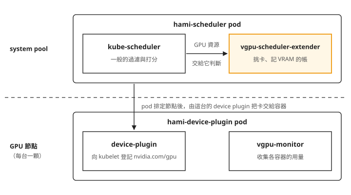
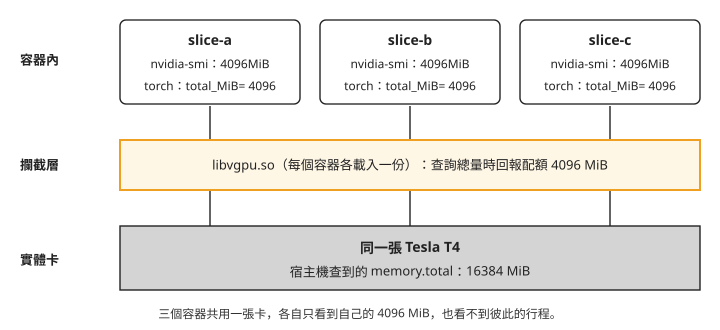
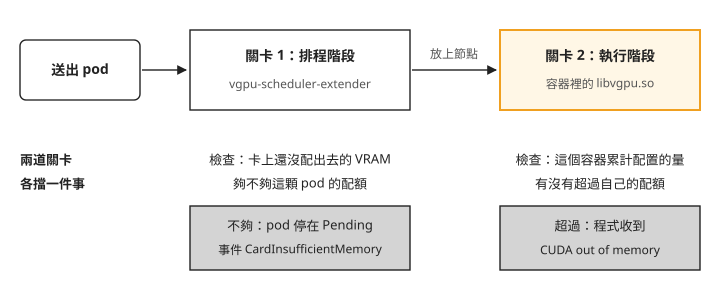
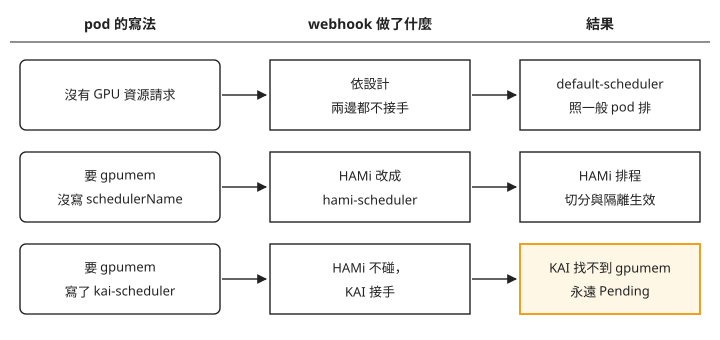

# Day 3: 安裝 HAMi——把一張 T4 分給多個容器，並擋住超用

{ align=right width="100" }

想像你在叢集上部署一個推論服務，模型只需要 2 GB 的 VRAM（GPU 上的記憶體），pod 寫的是 `nvidia.com/gpu: 1`。它一跑起來，就佔走整張 16 GB 的 T4。接著第二個推論服務送進來，同樣只要 2 GB，卻只能 Pending：叢集裡已經沒有空的「一張卡」了，剩下的 14 GB 閒在那裡，誰也用不到。

這一章安裝 HAMi，讓同一張 T4 同時服務多個容器，每個容器各有一份 VRAM 配額。我們會實際回答兩個問題：容器裡的 `nvidia-smi` 會看到多少 VRAM？宣告了 4 GB 配額的程式硬要配置 8 GB，擋不擋得住，會不會連累同一張卡上的鄰居？

讀完之後，一顆共用 GPU 的 pod 出現 Pending 或 out of memory 時，你能分辨是排程時卡上的 VRAM 不夠、執行時撞到自己的配額，還是這顆 pod 根本沒被 HAMi 接手。

## 一張卡為什麼只能整張發

前兩天的 pod 都用 `nvidia.com/gpu: 1` 要卡。Kubernetes 本身只認得 CPU、記憶體這類內建資源，GPU 是靠 Day 0 裝的 device plugin 向節點登記的：它告訴 kubelet「這台有一個叫 `nvidia.com/gpu` 的資源，數量是 1」。這種由外掛登記、名字和數量都由外掛決定的資源，叫 **extended resource**。它的數量只能是整數，pod 要幾個就整個整個拿，沒有「0.25 張卡」這種寫法。

對一份吃得下整張卡的訓練工作，這樣剛好；對只要 2 GB 的推論服務，就是開場那種浪費。要讓多個容器共用一張卡，下面兩件事必須同時成立：

1. **排程時看得懂 VRAM。** 排程器得知道「這張卡已經配出去多少 VRAM、還剩多少」，才不會把第五顆各要 4 GB 的 pod 也塞進一張 16 GB 的卡。
2. **執行時真的擋得住。** 只在排程時記帳沒有用。容器跑起來之後，CUDA 程式（CUDA 是 NVIDIA 的 GPU 程式開發平台，PyTorch 這類框架都透過它使用 GPU）看到的是整張實體卡。有些框架會依卡的總容量決定要佔多少：TensorFlow 是用來訓練與執行機器學習模型的框架，預設一啟動就佔用看得到的幾乎全部 VRAM；vLLM 是提供大型語言模型推論服務的框架，依 `gpu_memory_utilization`（預設 0.9）佔用總容量的一個比例。看到 16 GB 就照 16 GB 佔，第一個這樣的容器就會讓同一張卡上的鄰居沒有 VRAM 可用。

**HAMi**（Heterogeneous AI Computing Virtualization Middleware）兩件都做。它帶著自己的 device plugin 和排程元件，在排程時記 VRAM 的帳，在容器裡攔下超過配額的配置。接下來的步驟會一件一件看到它們。

開始之前，準備好 Day 0 建立的 AKS（Kubernetes 1.35.6），並照 Day 1 步驟 1 的方式把 spot GPU pool 啟動至 2 台，每台各有一張 16 GB 的 T4。本章會安裝 HAMi chart／appVersion `2.9.0`；保留 Day 1 安裝的 KAI Scheduler v0.16.8，供步驟 6 測試兩套排程器共存時的行為。接著建立 `hami-lab` namespace，這一章的測試 pod 都放在這裡：

```console
$ kubectl create namespace hami-lab
```

## 準備：用 prepuller 先把測試映像拉到 GPU 節點上 {#prepuller}

<span id="mine-3"></span>

後面的測試 pod 都用 `pytorch/pytorch:2.5.1-cuda12.4-cudnn9-runtime`。要使用 HAMi 的 VRAM 配額，映像需提供 glibc（C 標準函式庫）及 `libvgpu.so` 所需的 `libdl.so.2`；本章指定的 PyTorch 映像符合這個條件。缺少 `libdl.so.2` 的映像會在容器啟動時失敗，錯誤輸出如下：

```text
sh: error while loading shared libraries: libdl.so.2: cannot open shared object file: No such file or directory
```

這個 PyTorch 映像有好幾 GB，每台節點第一次拉取都要等好幾分鐘。可以先放一個 DaemonSet，在每台 GPU 節點上各跑一顆只用來拉映像的 pod（這種用途的 DaemonSet 常叫 prepuller）。它不要任何 GPU 資源，所以不受接下來拆裝 device plugin 的影響：

```bash
cat > 00-image-prepuller.yaml <<'EOF'
apiVersion: apps/v1
kind: DaemonSet
metadata:
  name: image-prepuller
  namespace: hami-lab
spec:
  selector:
    matchLabels:
      app: image-prepuller
  template:
    metadata:
      labels:
        app: image-prepuller
    spec:
      nodeSelector:
        pool: gpu
      tolerations:
        - key: kubernetes.azure.com/scalesetpriority
          operator: Equal
          value: spot
          effect: NoSchedule
      containers:
        - name: prepull
          image: pytorch/pytorch:2.5.1-cuda12.4-cudnn9-runtime
          command: ["sh", "-c", "sleep infinity"]
          resources:
            requests:
              cpu: 10m
              memory: 32Mi
EOF
```

```console
$ kubectl apply -f 00-image-prepuller.yaml
$ kubectl -n hami-lab get pods -l app=image-prepuller -o wide
```

兩台 GPU 節點上各有一顆 `image-prepuller-*`，而且都是 `1/1 Running`，就表示映像已經拉完：容器要先有映像才能啟動。這一步不做也能完成整章，只是步驟 4 的第一顆 pod 要多等映像下載。

## 步驟 1:把舊的 device plugin 拆掉

Day 0 到 Day 2 的 `nvidia.com/gpu` 都由 helm release `nvdp`（NVIDIA 官方的 device plugin）提供。HAMi 要用同一個資源名稱登記自己的切分結果，兩套 device plugin 不能同時管同一張卡，所以先卸載舊的：

```console
$ helm uninstall nvdp -n nvidia-device-plugin
release "nvdp" uninstalled
```

卸載之後，每 10 秒查一次兩台 GPU 節點的 `allocatable`（節點上還能分給 pod 的資源量）：

```text
[11:08:31] uninstall 指令返回
[11:08:37] [{"n":"vmss000009","gpu":"0"},{"n":"vmss00000a","gpu":"1"}]
[11:08:47] [{"n":"vmss000009","gpu":"0"},{"n":"vmss00000a","gpu":"0"}]
```

十幾秒內兩台都歸零了。kubelet 一發現 device plugin 斷線，就不再把卡分出去，不必重啟節點。namespace 裡的物件也被 helm 清乾淨了：

```console
$ kubectl -n nvidia-device-plugin get all
No resources found in nvidia-device-plugin namespace.
```

節點物件上其實有兩個欄位在記 GPU：`capacity`（這台總共有多少）和 `allocatable`。把兩個並排印出來：

```console
$ kubectl get nodes -o json | jq '.items[]|select(.metadata.name|test("gpuspot"))
    |{name:.metadata.name, capacity:(.status.capacity|with_entries(select(.key|test("nvidia")))),
      allocatable:(.status.allocatable|with_entries(select(.key|test("nvidia"))))}'
{
  "name": "aks-gpuspot-21249019-vmss000009",
  "capacity":    { "nvidia.com/gpu": "1" },
  "allocatable": { "nvidia.com/gpu": "0" }
}
```

（另一台的輸出相同。）`allocatable` 是 0，`capacity` 卻還寫著 1。kubelet 在 device plugin 斷線時只把 `allocatable` 歸零，`capacity` 要等 kubelet 重啟或節點重建才會消失。所以只看 `kubectl describe node` 的 Capacity 區塊，會誤以為 device plugin 還在。

排程器看的是哪一個？送一顆要 `nvidia.com/gpu: 1` 的 busybox pod 進去就知道：

```text
NAME          READY   STATUS    RESTARTS   AGE
nogpu-probe   0/1     Pending   0          13s

Events:
  Warning  FailedScheduling  13s  default-scheduler
  0/3 nodes are available: 1 node(s) didn't match Pod's node affinity/selector,
  2 Insufficient nvidia.com/gpu. no new claims to deallocate,
  preemption: 0/3 nodes are available: 3 Preemption is not helpful for scheduling.
```

訊息是 `Insufficient nvidia.com/gpu`（不夠），而不是「沒有這種資源」：資源名稱還在，值是 0，排程器只認 `allocatable`。判斷 device plugin 還在不在的方法，整理在[疑難排解：`capacity` 還寫著有卡](#mine-1)。

現在叢集有 GPU 硬體、有 AKS 管理的驅動，但沒有任何 device plugin，可以把 HAMi 接上去了。

## 步驟 2:把 HAMi 要的節點標籤補在 pool 層級

HAMi 的 device plugin 只會跑在帶 `gpu=on` 標籤的節點上（chart 的 `nvidiaNodeSelector` 預設值），官方文件教的是 `kubectl label nodes <node> gpu=on`。在 AKS 上不要這樣做：spot 節點被回收重建、pool 縮到 0 再拉回來，都會換成新的 VM，直接貼在節點上的標籤會跟著消失。Day 0 的[「device plugin 的 desired 是 0,節點沒有 `nvidia.com/gpu`」](sprint1-day0-azure-aks-foundation.md#mine-1)遇過同樣的事。

所以標籤要下在 node pool 層級，新節點一建立就會帶著。注意 `--labels` 是整組取代，pool 上原有的兩個標籤要一起寫上：

```console
$ az aks nodepool update -g <resource-group> --cluster-name <cluster> -n gpuspot \
    --subscription <subscription-id> \
    --labels pool=gpu "nvidia.com/gpu.present=true" gpu=on
{ "count": 2, "state": "Succeeded",
  "labels": { "gpu": "on", "kubernetes.azure.com/scalesetpriority": "spot",
              "nvidia.com/gpu.present": "true", "pool": "gpu" } }
```

回傳的標籤裡有三個是我們寫的，另外一個 `kubernetes.azure.com/scalesetpriority=spot` 是 AKS 自己掛的系統標籤，不用也不能寫進 `--labels`，整組取代也不會把它洗掉。改 pool 標籤只更新節點的標籤，不會換新節點，可以用 `kubectl get nodes` 的 `AGE` 欄確認節點還是原來那兩台。

再確認標籤真的到了節點上：

```console
$ kubectl get nodes -L gpu
```

兩台 GPU 節點的 `GPU` 欄都要是 `on`，HAMi 的 device plugin 才會跑上去。

## 步驟 3:安裝 HAMi v2.9.0

安裝值只改三件事，其餘沿用 chart 預設：

```bash
cat > 01-hami-values.yaml <<'EOF'
devicePlugin:
  # without this the DaemonSet never lands on the spot-tainted GPU nodes
  tolerations:
    - key: kubernetes.azure.com/scalesetpriority
      operator: Equal
      value: spot
      effect: NoSchedule

scheduler:
  # pin the control plane to the system pool
  nodeSelector:
    agentpool: system
  patch:
    nodeSelector:
      agentpool: system
EOF
```

第一段讓 device plugin 能跑上帶 spot taint 的 GPU 節點；`scheduler.nodeSelector` 把排程元件固定在 system pool，`scheduler.patch.nodeSelector` 則是固定安裝時替 webhook 產生憑證的 patch job，讓它也跑在 system pool。保留預設的兩個值等一下會直接看到效果：`deviceSplitCount: 10`（每張實體卡最多分給 10 個容器）與 `deviceMemoryScaling: 1`（配出去的 VRAM 總量不超過實體容量）。

chart 裡的 kube-scheduler 映像預設從阿里雲的 registry（`registry.cn-hangzhou.aliyuncs.com`）拉，tag 跟著叢集版本走，1.35.6 的叢集會拉 `kube-scheduler:v1.35.6`。這個 registry 不保證跟得上最新的 Kubernetes 版本。`helm template ... --kube-version 1.35.6 | grep image:` 可以先印出最終的映像字串，但它只看得到名字，不能證明映像存在。裝完之後如果 `hami-scheduler` 出現 `ImagePullBackOff`，就用 `helm upgrade` 加上 `--set scheduler.kubeScheduler.image.registry=registry.k8s.io --set scheduler.kubeScheduler.image.repository=kube-scheduler`，改從官方 registry 拉。

```console
$ helm repo add hami-charts https://project-hami.github.io/HAMi/ && helm repo update
$ helm install hami hami-charts/hami --version 2.9.0 \
    -n kube-system -f 01-hami-values.yaml
NAME: hami
NAMESPACE: kube-system
STATUS: deployed
REVISION: 1
NOTES:
Resource name: nvidia.com/gpu
```

沿用剛加入的 Helm repository 與 `01-hami-values.yaml`，用 [Helm 3 的 `template`](https://helm.sh/docs/v3/helm/helm_template/) 預覽 HAMi 2.9.0 在 Kubernetes 1.35.6 下的完整映像名稱（依官方文件補上，本課沒有實跑）：

```bash
helm template hami hami-charts/hami \
  --version 2.9.0 \
  --namespace kube-system \
  --kube-version 1.35.6 \
  -f 01-hami-values.yaml |
  grep 'image:'
```

若確認拉取失敗的是預設 registry 的 kube-scheduler 映像，依 [HAMi v2.9.0 的映像參數](https://github.com/Project-HAMi/HAMi/blob/v2.9.0/charts/hami/README.md#kube-scheduler-configuration)與 [Helm 3 的 `upgrade`](https://helm.sh/docs/v3/helm/helm_upgrade/) 保留既有設定，改用 [Kubernetes v1.35.6 官方映像清單](https://github.com/kubernetes/kubernetes/blob/release-1.35/CHANGELOG/CHANGELOG-1.35.md#v1356)列出的映像（依官方文件補上，本課沒有實跑）：

```bash
helm upgrade hami hami-charts/hami \
  --version 2.9.0 \
  --namespace kube-system \
  --reuse-values \
  --set-string scheduler.kubeScheduler.image.registry=registry.k8s.io \
  --set-string scheduler.kubeScheduler.image.repository=kube-scheduler \
  --set-string scheduler.kubeScheduler.image.tag=v1.35.6 \
  --wait --timeout 5m
```

安裝或更新後，用 Kubernetes 1.35 的 [`rollout status`](https://v1-35.docs.kubernetes.io/docs/reference/kubectl/generated/kubectl_rollout/kubectl_rollout_status/) 等待 Deployment 就緒，再用 [`get`](https://v1-35.docs.kubernetes.io/docs/reference/kubectl/generated/kubectl_get/) 查看各容器的映像、`ready` 與 `imageID`（依官方文件補上，本課沒有實跑）：

```bash
kubectl -n kube-system rollout status deployment/hami-scheduler --timeout=300s

kubectl -n kube-system get pods \
  -l app.kubernetes.io/instance=hami,app.kubernetes.io/component=hami-scheduler \
  -o json |
  jq '.items[] | {
    pod: .metadata.name,
    images: [.spec.containers[] | {name, image}],
    status: [.status.containerStatuses[]? | {name, ready, imageID}]
  }'
```

一兩分鐘後，三顆 pod 全部 Running：

```text
hami-device-plugin-k884s          2/2   Running   0   73s   aks-gpuspot-21249019-vmss00000a
hami-device-plugin-z46mx          2/2   Running   0   73s   aks-gpuspot-21249019-vmss000009
hami-scheduler-6cb48464bb-g8swb   2/2   Running   0   73s   aks-system-35459509-vmss000000
```

`READY` 欄都是 `2/2`，每顆 pod 裡有兩個容器。把三顆 pod 和它們的容器畫出來，上半部在 system pool，下半部在 GPU 節點：



我們可以從圖上看到兩件事：

1. HAMi 的排程元件不是自己從頭寫的排程器，而是一個標準的 `kube-scheduler` 加上一個 **scheduler extender**。extender 是 kube-scheduler 支援的擴充方式：一般的過濾與打分照內建邏輯走，遇到它負責的資源，就呼叫外部的 extender 一起判斷。HAMi 的 extender 負責挑哪一張卡，並記住每張卡的 VRAM 已經配出去多少。Day 1 的 KAI 則是自己實作整套排程器，元件也多得多（七個 Deployment）。
2. device plugin 跑在每一台 GPU 節點上，負責向 kubelet 登記資源，並在 pod 被排到這台時把卡交給容器。

裝好之後，節點對外宣告的 GPU 數量變了：

```json
{ "name": "aks-gpuspot-21249019-vmss000009",
  "capacity": { "nvidia.com/gpu": "10" }, "allocatable": { "nvidia.com/gpu": "10" } }
```

一張實體 T4 變成 10 份 `nvidia.com/gpu`。這個 10 就是 `deviceSplitCount`，意思是「這張卡最多分給幾個容器」，跟 VRAM 無關。HAMi 另外定義了兩種資源：`nvidia.com/gpumem`（VRAM 配額，單位 MiB）和 `nvidia.com/gpucores`（算力配額，百分比）。這兩個名字都沒有出現在節點的資源裡，而是記在節點的 annotation 上：

先用 `kubectl get nodes -l pool=gpu -o jsonpath='{.items[0].metadata.name}'` 取得一台 GPU 節點名稱，再填入下方的 `<node-name>` 查詢 annotation。修正後的寫法本課沒有實跑；下方保留原查詢的輸出。

```console
$ kubectl get node <node-name> -o json \
    | jq '.metadata.annotations|with_entries(select(.key|test("hami")))'
{
  "hami.io/node-handshake": "Requesting_2026-08-04 03:12:22",
  "hami.io/node-nvidia-register": "[{\"id\":\"GPU-76fd10c5-...-0f4a59e7e1cc\",\"count\":10,\"devmem\":16384,\"devcore\":100,\"type\":\"NVIDIA-Tesla T4\",\"mode\":\"hami-core\",\"health\":true,\"devicepairscore\":{}}]"
}
```

看 `hami.io/node-nvidia-register` 這一行：卡的 UUID、`count: 10`、`devmem: 16384`（VRAM 總量 MiB）、`devcore: 100`（算力百分比）都在這裡，這是叢集裡唯一看得到實體卡規格的地方。VRAM 的帳不經過 kubelet，所以 `kubectl describe node` 查不到還剩多少 VRAM，該去哪裡查見[疑難排解：查不到 VRAM 餘額](#mine-2)。

## 步驟 4:把一張 T4 分給三個容器

送出三顆 pod，各要 1 份 `nvidia.com/gpu` 加 4096 MiB 的 `nvidia.com/gpumem`，用 `nodeSelector: kubernetes.io/hostname` 固定在同一台節點（也就是同一張卡）。容器的資源寫法是：

```yaml
    - name: app
      image: pytorch/pytorch:2.5.1-cuda12.4-cudnn9-runtime
      resources:
        limits: { nvidia.com/gpu: 1, nvidia.com/gpumem: 4096 }
```

```text
[11:13:17] pod/slice-a created / pod/slice-b created / pod/slice-c created
[11:13:33] slice-a   1/1   Running   0   16s   aks-gpuspot-21249019-vmss000009
           slice-b   1/1   Running   0   16s   aks-gpuspot-21249019-vmss000009
           slice-c   1/1   Running   0   15s   aks-gpuspot-21249019-vmss000009
```

16 秒就 Running，是因為[準備](#prepuller)那一步已經把映像拉到節點上；沒有先拉，第一次要多等好幾分鐘。是不是真的落在同一張實體卡，看 HAMi 寫回 pod 的 annotation：

```text
slice-a  hami.io/vgpu-devices-allocated = GPU-76fd10c5-...-0f4a59e7e1cc,NVIDIA,4096,0:;
slice-b  hami.io/vgpu-devices-allocated = GPU-76fd10c5-...-0f4a59e7e1cc,NVIDIA,4096,0:;
slice-c  hami.io/vgpu-devices-allocated = GPU-76fd10c5-...-0f4a59e7e1cc,NVIDIA,4096,0:;
```

格式是 `<GPU-UUID>,<廠牌>,<VRAM MiB>,<算力 %>`。三顆是同一個 GPU UUID、各 4096 MiB，最後的 0 表示沒有限制算力。

還有一處變化：三顆 pod 的 `spec.schedulerName` 都變成了 `hami-scheduler`，但 manifest 裡根本沒寫這個欄位。改它的是 HAMi 的 **mutating webhook**。Kubernetes 在把一個物件寫進叢集之前，可以先把它送給外部服務檢查或修改，負責修改的這種服務就叫 mutating webhook。HAMi 的 webhook 看到 pod 要 GPU 資源，就把它交給 `hami-scheduler` 排程，所以 pod 不必自己寫 `schedulerName`。

### 容器裡看到的是 4 GB，不是 16 GB

在 `slice-a` 容器內執行 `nvidia-smi`，再用 PyTorch 讀卡的總容量：

```text
+-----------------------------------------+------------------------+----------------------+
|   0  Tesla T4                       Off |   00000001:00:00.0 Off |                  Off |
| N/A   34C    P8             13W /   70W |       0MiB /   4096MiB |      0%      Default |
+-----------------------------------------+------------------------+----------------------+
===== torch view =====
name= Tesla T4 total_MiB= 4096
```

同一時刻，借旁邊一顆不要 GPU 的 pod 在宿主機端查同一張卡：

```text
memory.used [MiB], memory.total [MiB], utilization.gpu [%]
0 MiB, 16384 MiB, 0 %
```

同一張卡，容器裡是 4096，宿主機是 16384。把三個容器和這張卡畫在一起：



圖上的重點是中間那一層：每個容器都只看到自己的 4096 MiB，`nvidia-smi` 的 `Processes` 區塊也是空的，看不到鄰居的行程。

PyTorch 那一行 `total_MiB= 4096` 說明，程式透過 CUDA 查到的卡片總容量也被換成了配額。依總容量決定用量的框架都會受影響：vLLM 的 `gpu_memory_utilization` 是總容量的比例，容器如果看到 16 GB，照預設的 0.9 就會去要 14.4 GB；看到 4 GB，就只要 3.6 GB 左右，落在配額之內，應用程式不用改。PyTorch 本身則是用到才向 CUDA 要記憶體，步驟 5 會看到它的錯誤訊息也照 4 GB 的卡來報。

### 限制藏在哪裡

先看 pod spec 裡有沒有任何跟配額有關的設定：

```console
$ kubectl -n hami-lab get pod slice-a -o json \
    | jq '.spec.containers[0]|{env,volumeMounts,resources}'
{
  "env": null,
  "volumeMounts": [],
  "resources": { "limits": { "nvidia.com/gpu": "1", "nvidia.com/gpumem": "4096" } }
}
```

`env` 是 `null`，也沒有掛載任何 volume。再 exec 進容器看：

```console
$ kubectl -n hami-lab exec slice-a -- env | grep -iE "cuda|nvidia|vgpu"
CUDA_DEVICE_MEMORY_LIMIT_0=4096m
CUDA_DEVICE_MEMORY_SHARED_CACHE=/usr/local/vgpu/b0118c30-....cache
CUDA_DEVICE_SM_LIMIT=0
LIBCUDA_LOG_LEVEL=1
NVIDIA_VISIBLE_DEVICES=GPU-76fd10c5-...-0f4a59e7e1cc
$ kubectl -n hami-lab exec slice-a -- cat /etc/ld.so.preload
/usr/local/vgpu/libvgpu.so
```

容器裡多了 `CUDA_DEVICE_MEMORY_LIMIT_0=4096m` 這類環境變數，還有一個 `/etc/ld.so.preload`。Linux 的動態載入器在啟動任何程式時，會先載入這個檔案列出的函式庫，再載入程式自己需要的。HAMi 放進去的是 `libvgpu.so`，所以容器裡每個程式呼叫 CUDA，或呼叫 NVML（NVIDIA 用來查詢 GPU 狀態的函式庫，`nvidia-smi` 就靠它），都會先經過 `libvgpu.so`。`nvidia-smi` 回報 4096，就是因為它查詢記憶體的那個 NVML 呼叫被改寫了。

這些設定是 device plugin 在把卡交給容器時，透過 kubelet 直接注入容器的，不會寫回 pod spec。所以要確認一顆 pod 有沒有真的被 HAMi 接管，`kubectl get pod -o yaml` 幫不上忙，要 exec 進去看這兩樣。

### VRAM 不夠時，排程階段就擋下來

這張卡已經配出 3 × 4096 = 12288 MiB（實體 16384），再送一顆要 8192 MiB 的 pod：

```text
NAME                   READY   STATUS    RESTARTS   AGE
mem-overcommit-probe   0/1     Pending   0          16s

Events:
  Warning  FilteringFailed   hami-scheduler   1 nodes CardInsufficientMemory(aks-gpuspot-21249019-vmss000009)
  Warning  FilteringFailed   hami-scheduler   no available node, 1 nodes do not meet
  Warning  FailedScheduling  hami-scheduler   0/3 nodes are available: 1 NodeUnfitPod, ...

# 同一時刻節點的帳本:
Allocated resources:
  Resource           Requests    Limits
  nvidia.com/gpu     3           3
```

`CardInsufficientMemory` 是 extender 發出的事件，直接點名哪一張卡的 VRAM 不夠。再看下面節點的帳本：只寫著 `nvidia.com/gpu` 用掉 3 份，「VRAM 只剩 4096」這件事在上面完全看不到。看到這種 Pending，要讀 pod 的事件，不要讀節點帳本。

### 不指定節點時，HAMi 會先把一張卡疊滿

前面是我們把 pod 固定在同一台。如果不指定節點，HAMi 會怎麼擺？先刪掉前面的 pod，讓兩張卡都是空的：

```console
$ kubectl -n hami-lab delete pod slice-a slice-b slice-c mem-overcommit-probe
```

再送四顆各要 3000 MiB 的 pod，不寫任何 `nodeSelector`：

```text
NAME        STATUS    NODE
g-place-1   Running   aks-gpuspot-21249019-vmss000009
g-place-2   Running   aks-gpuspot-21249019-vmss000009
g-place-3   Running   aks-gpuspot-21249019-vmss000009
g-place-4   Running   aks-gpuspot-21249019-vmss000009

g-place-1 dev=GPU-76fd10c5-...-0f4a59e7e1cc,NVIDIA,3000,0:;   ← 四顆的 UUID 完全相同
node 000009:  nvidia.com/gpu  4  (4 顆 pod,共 12000 MiB)
node 00000a:  nvidia.com/gpu  0  (完全沒用到)
```

四顆全部疊在同一張 T4 上，另一台節點完全沒用到。這是 chart 的預設策略：節點層級是 `binpack`（先把一台塞滿，再換下一台），同一台有多張卡時，卡的層級是 `spread`（把 pod 分散到不同卡上）。集中的好處是空出來的節點可以縮掉；代價是風險也集中，那台 spot 節點被回收，四個服務一起停。想要分散，就把 `scheduler.defaultSchedulerPolicy.nodeSchedulerPolicy` 改成 `spread`。

## 兩道關卡

到這裡，HAMi 在兩個時間點各擋了一件事。把一顆 pod 從送出到程式配置 VRAM 的過程畫成一條線：



我們可以從圖上看到，兩道關卡檢查的是不同的數字：

1. 排程階段比的是「這張卡還沒配出去的 VRAM」和「這顆 pod 的配額」，擋下的 pod 會停在 Pending。步驟 4 的 `mem-overcommit-probe` 就是這種。
2. 執行階段比的是「這個容器已經配置的量」和「它自己的配額」，跟卡上還剩多少無關。擋下的是程式裡的某一次配置，pod 本身已經在跑。

第一道關卡步驟 4 已經看過了。下一步驗證第二道。

## 步驟 5:超額配置只影響自己

兩顆 pod 固定在同一台（同一張卡），配額都是 4096 MiB：`iso-holder` 配置 3.00 GiB 並一直持有，每 15 秒回報一次還活著，並印出資料校驗值；`iso-hog` 以 512 MiB 為單位一路加碼，目標 8192 MiB，是配額的兩倍。兩顆都是用 PyTorch 在 GPU 上建立張量，完整內容如下：

??? example "03-isolation-pods.yaml"

    ```bash
    cat > 03-isolation-pods.yaml <<'EOF'
    apiVersion: v1
    kind: Pod
    metadata:
      name: iso-holder
      namespace: hami-lab
    spec:
      restartPolicy: Never
      nodeSelector:
        kubernetes.io/hostname: NODE_PLACEHOLDER
      tolerations:
        - key: kubernetes.azure.com/scalesetpriority
          operator: Equal
          value: spot
          effect: NoSchedule
      containers:
        - name: app
          image: pytorch/pytorch:2.5.1-cuda12.4-cudnn9-runtime
          command:
            - python
            - -u
            - -c
            - |
              import torch, time
              print("budget check: total_MiB =", torch.cuda.get_device_properties(0).total_memory // 1024 // 1024, flush=True)
              buf = torch.empty(3 * 1024 * 1024 * 1024 // 4, dtype=torch.float32, device="cuda")
              buf.fill_(1.0)
              torch.cuda.synchronize()
              print("HOLDER: allocated 3.00 GiB, checksum=", float(buf[0]), flush=True)
              i = 0
              while True:
                  torch.cuda.synchronize()
                  print("HOLDER alive t=%ds reserved_MiB=%d first_elem=%s"
                        % (i, torch.cuda.memory_reserved() // 1024 // 1024, float(buf[0])), flush=True)
                  i += 15
                  time.sleep(15)
          resources:
            limits:
              nvidia.com/gpu: 1
              nvidia.com/gpumem: 4096
    ---
    apiVersion: v1
    kind: Pod
    metadata:
      name: iso-hog
      namespace: hami-lab
    spec:
      restartPolicy: Never
      nodeSelector:
        kubernetes.io/hostname: NODE_PLACEHOLDER
      tolerations:
        - key: kubernetes.azure.com/scalesetpriority
          operator: Equal
          value: spot
          effect: NoSchedule
      containers:
        - name: app
          image: pytorch/pytorch:2.5.1-cuda12.4-cudnn9-runtime
          command:
            - python
            - -u
            - -c
            - |
              import torch
              print("budget check: total_MiB =", torch.cuda.get_device_properties(0).total_memory // 1024 // 1024, flush=True)
              chunks = []
              CHUNK = 512 * 1024 * 1024
              for n in range(1, 17):
                  try:
                      chunks.append(torch.empty(CHUNK // 4, dtype=torch.float32, device="cuda"))
                      torch.cuda.synchronize()
                      print("HOG: allocated %d MiB total" % (n * 512), flush=True)
                  except Exception as e:
                      print("HOG: FAILED at %d MiB" % (n * 512), flush=True)
                      print("HOG: exception type =", type(e).__name__, flush=True)
                      print("HOG: exception text =", str(e), flush=True)
                      raise SystemExit(0)
              print("HOG: reached 8192 MiB with NO error -- isolation did NOT hold", flush=True)
          resources:
            limits:
              nvidia.com/gpu: 1
              nvidia.com/gpumem: 4096
    EOF
    ```

先刪掉上一節的四顆放置測試 pod，讓卡上有空間。manifest 裡的 `NODE_PLACEHOLDER` 換成一台 GPU 節點的名稱，兩顆就會落在同一張卡上：

```console
$ kubectl -n hami-lab delete pod g-place-1 g-place-2 g-place-3 g-place-4
$ NODE=$(kubectl get nodes -l gpu=on -o jsonpath='{.items[0].metadata.name}')
$ sed "s/NODE_PLACEHOLDER/$NODE/" 03-isolation-pods.yaml | kubectl apply -f -
$ kubectl -n hami-lab logs -f iso-hog
```

### hog 的錯誤訊息有兩層

```text
budget check: total_MiB = 4096
HOG: allocated 512 MiB total
...
HOG: allocated 3584 MiB total
[HAMI-core ERROR (pid:1 thread=125213539699584 allocator.c:52)]: Device 0 OOM 4401922048 / 4294967296
HOG: FAILED at 4096 MiB
HOG: exception type = OutOfMemoryError
HOG: exception text = CUDA out of memory. Tried to allocate 512.00 MiB. GPU 0 has a total
capacity of 4.00 GiB of which 410.00 MiB is free. Including non-PyTorch memory, this process
has 3.60 GiB memory in use. ... If reserved but unallocated memory is large try
setting PYTORCH_CUDA_ALLOC_CONF=expandable_segments:True to avoid fragmentation.
```

先看 `[HAMI-core ERROR ...]` 那一行，這是 `libvgpu.so` 印的（HAMi-core 是它的專案名稱）。分母 `4294967296` 正好是 4 GiB，也就是配額；分子 `4401922048` 約 4.10 GiB，是這次請求之後的累計量。拒絕這次配置的是攔截層，不是 GPU 驅動。

再看下面 PyTorch 的訊息：`GPU 0 has a total capacity of 4.00 GiB`。PyTorch 依回報容量產生訊息，顯示的總容量是 4.00 GiB，並附上調整 `expandable_segments` 的建議。程式不需要另外判斷這個容量是否來自 HAMi 配額。

還有一個數字要注意：實際拿到的是 3584 MiB（7 塊 512 MiB），第 8 塊就被擋了。HAMi 算的用量除了程式配置的資料，還包含 **CUDA context**：程式第一次使用 GPU 時，CUDA 會替這個 process 在卡上建立一份執行環境，這份環境本身就要佔 VRAM。從上面的數字推算，被拒絕時累計是 4401922048 bytes，約 4198 MiB，扣掉已配置的 3584 MiB 和這次要的 512 MiB，context 大約 100 MiB。3584 + 約 100 + 512 超過 4096，所以第 8 塊放不進去；主要原因是每次要 512 MiB 這個單位太大，context 本身不大。規劃配額時，在模型需要的量之外多留約 100–200 MiB 給 context。

### 擋住它的是配額，不是卡的容量

把 hog 放慢：`iso-hog-slow` 和 `iso-hog` 只差在每配置一塊就停 2 秒，方便同時在宿主機端記錄實體卡的用量。等 `iso-hog` 變成 `Completed`（它撞到配額後就結束，用掉的 VRAM 也還回去），再送出放慢版：

??? example "04-hog-slow.yaml"

    ```bash
    cat > 04-hog-slow.yaml <<'EOF'
    apiVersion: v1
    kind: Pod
    metadata:
      name: iso-hog-slow
      namespace: hami-lab
    spec:
      restartPolicy: Never
      nodeSelector:
        kubernetes.io/hostname: NODE_PLACEHOLDER
      tolerations:
        - key: kubernetes.azure.com/scalesetpriority
          operator: Equal
          value: spot
          effect: NoSchedule
      containers:
        - name: app
          image: pytorch/pytorch:2.5.1-cuda12.4-cudnn9-runtime
          command:
            - python
            - -u
            - -c
            - |
              import torch, time
              print("budget check: total_MiB =", torch.cuda.get_device_properties(0).total_memory // 1024 // 1024, flush=True)
              chunks = []
              CHUNK = 512 * 1024 * 1024
              for n in range(1, 17):
                  try:
                      chunks.append(torch.empty(CHUNK // 4, dtype=torch.float32, device="cuda"))
                      torch.cuda.synchronize()
                      print("HOG: allocated %d MiB total" % (n * 512), flush=True)
                  except Exception as e:
                      print("HOG: FAILED at %d MiB" % (n * 512), flush=True)
                      print("HOG: exception type =", type(e).__name__, flush=True)
                      print("HOG: exception text =", str(e), flush=True)
                      raise SystemExit(0)
                  time.sleep(2)
              print("HOG: reached 8192 MiB with NO error -- isolation did NOT hold", flush=True)
          resources:
            limits:
              nvidia.com/gpu: 1
              nvidia.com/gpumem: 4096
    EOF
    ```

```console
$ sed "s/NODE_PLACEHOLDER/$NODE/" 04-hog-slow.yaml | kubectl apply -f -
```

實體卡的用量和 hog 的 log 並排如下：

```text
[11:16:54] 實體卡 used=3193 MiB | hog:
[11:16:58] 實體卡 used=3807 MiB | hog: HOG: allocated 1024 MiB total
[11:17:02] 實體卡 used=4831 MiB | hog: HOG: allocated 2048 MiB total
[11:17:06] 實體卡 used=5855 MiB | hog: HOG: allocated 3072 MiB total
[11:17:10] 實體卡 used=6879 MiB | hog: HOG: allocated 3584 MiB total
[11:17:14] 實體卡 used=3193 MiB | hog: HOG: exception text = CUDA out of memory ...
```

看倒數第二行：hog 被拒絕時，實體卡用了 6879 / 16384 MiB，還空著約 9.5 GB，它還是拿不到下一塊 512 MiB。上限來自容器自己的配額，卡上還剩多少跟它無關，這就是上一節圖上的第二道關卡。若沒有配額限制，程式會繼續嘗試配置，目標為 8 GiB。最後一行 hog 退出後，用量掉回 3193 MiB（holder 的 3 GiB 加上它的 CUDA context），hog 用過的 VRAM 都釋放了。

### 鄰居不受影響

```text
HOLDER: allocated 3.00 GiB, checksum= 1.0
HOLDER alive t=0s   reserved_MiB=3072 first_elem=1.0
...
HOLDER alive t=165s reserved_MiB=3072 first_elem=1.0

NAME           READY   STATUS      RESTARTS   AGE
iso-hog-slow   0/1     Completed   0          71s
iso-holder     1/1     Running     0          3m
```

快版和慢版的 hog 各撞了一次配額，holder 的 `reserved_MiB` 一直是 3072、資料校驗值一直是 1.0、`RESTARTS 0`。驅動也沒有回報 Xid 錯誤（NVIDIA 驅動遇到 GPU 硬體或驅動層級的錯誤時，記在系統 log 裡的錯誤碼），GPU 沒有被重設，節點上其他 pod 都沒受影響。超用的後果只留在 hog 自己的容器裡。

## 步驟 6:把 pod 指名交給 KAI，卻要 HAMi 的 VRAM

現在叢集裡兩套系統都在跑：Day 1 裝的 KAI，和今天裝的 HAMi。一個很自然的想法是「用 KAI 的佇列管配額，用 HAMi 的切分省卡」。送一顆 pod 試試，指名由 KAI 排程，但要的是 HAMi 的 VRAM 配額：

```yaml
spec:
  schedulerName: kai-scheduler        # explicitly ask for KAI
  containers:
    - resources:
        limits:
          nvidia.com/gpu: 1
          nvidia.com/gpumem: 4096     # but ask for HAMi's resource
```

```text
NAME              READY   STATUS    RESTARTS   AGE
collision-probe   0/1     Pending   0          20s

spec.schedulerName(webhook 跑完之後)= kai-scheduler
PodGroup: pg-collision-probe-50b46df6-...  ← KAI 接手了

Events:
  Warning  Unschedulable      kai-scheduler   Scheduling conditions were not met for pod
    hami-lab/collision-probe:
    MaxNodePoolResources: The pod hami-lab/collision-probe requires GPU: 1, CPU: 0 (cores),
    memory: 0 (GB), pods: 1, nvidia.com/gpumem: 4096000.
    No node in the default node-pool has nvidia.com/gpumem resources.
```

這顆 pod 一直 Pending。webhook 跑完之後，`schedulerName` 還是 `kai-scheduler`，KAI 也替它建了 PodGroup，表示 HAMi 的 webhook 沒有改它，是 KAI 接手了。HAMi 的 webhook 設定了 `forceOverwriteDefaultScheduler: true`，但這只在 `schedulerName` 是 `default-scheduler` 時生效，已經指名其他排程器的 pod 它一律不碰。接著 KAI 到節點的資源裡找 `nvidia.com/gpumem`，但步驟 3 看過，這個名字根本不在節點資源裡，所以找不到。訊息裡的 `4096000` 是 KAI 把它當成一般資源做了 milli 換算（4096 × 1000），數字看起來奇怪，但不是 bug。

誰來排一顆 pod，取決於它的寫法。把今天看過的三種情況並排：



我們可以從圖上看到，HAMi 的 webhook 只改沒寫 `schedulerName`、或寫的是 `default-scheduler` 的 pod。HAMi 不改寫已指定其他排程器（例如 `kai-scheduler`）的 `schedulerName`，所以兩套系統裝在一起，並不會自動合作。要用 HAMi 切分的 pod 就不要寫 `schedulerName`，讓 HAMi 的 webhook 去改；要走 KAI 佇列的 pod 照 KAI 的方式寫，兩邊不交集。

除了這顆刻意送的 pod，今天其他的 pod（3 顆切分、4 顆放置、隔離測試的 pod）KAI 都沒有介入：

```text
hami-lab namespace 的 PodGroup:              No resources found
iso-holder 的 labels/annotations:             只有 hami.io/*,沒有 kai/runai 的鍵
KAI admission log 提到 hami-lab 的行數: 0
KAI binder log 提到 hami 的行數:        0
KAI 七元件(跨 Day 1–3):                     全部 Running,RESTARTS 0,age 20h
```

`hami-lab` 這個 namespace 同時落在兩個 mutating webhook 的範圍內（KAI 的 `mutating-kai-admission` 只排除 `kube-system` 與 `kai-scheduler`，HAMi 的 `vgpu.hami.io` 只排除帶 `hami.io/webhook: ignore` 標籤的 namespace 或 pod），實際上卻沒有互相干擾，因為誰接手由 `schedulerName` 決定。沒有 GPU 資源請求的 pod，依兩邊的設計都不會接手：HAMi 的 webhook 只改寫有請求 HAMi 資源的 pod，KAI 只排 `schedulerName` 指向它的 pod。[準備](#prepuller)那一步的 prepuller 就是這種 pod，可以用 `kubectl -n hami-lab get pods -l app=image-prepuller -o jsonpath='{.items[*].spec.schedulerName}'` 確認，它一直是 `default-scheduler`。

兩個 webhook 還有一處設計正好相反。webhook 的設定裡有一個 `failurePolicy` 欄位，決定 webhook 本身掛掉時，Kubernetes 要怎麼處理送進來的 pod。KAI 設成 `Fail`：webhook 掛掉就拒絕建立 pod。HAMi 設成 `Ignore`：webhook 掛掉，pod 照樣建立，只是不會被改寫。後者在故障時不容易發現：pod 會在沒有任何 VRAM 限制的狀態下跑起來，`kubectl get pods` 一片 Running，隔離其實已經失效。所以監控要檢查 pod 有沒有拿到 `hami.io/vgpu-devices-allocated` annotation，只看 Running 看不出這件事。

## 步驟 7:需不需要 GPU Operator

Day 1 提過，KAI 的 README 把 NVIDIA GPU Operator 列為前置條件。GPU Operator 是 NVIDIA 提供的一個 operator，會在 GPU 節點上自動安裝驅動、container toolkit、device plugin，以及節點標籤、監控等元件。Day 1 已經確認「一顆 pod 用一張完整的卡」不需要它。把一張卡切給多個容器呢？查一下今天的叢集裡有沒有 Operator 的元件：

查詢節點 labels 前，先用 `kubectl get nodes -l pool=gpu -o jsonpath='{.items[0].metadata.name}'` 取得一台 GPU 節點名稱，填入下方的 `<node-name>`。修正後的寫法本課沒有實跑；下方保留原查詢的輸出。

```console
$ kubectl get ds,deploy -A | grep -iE "nvidia|dcgm|nfd|node-feature|mig|gpu-feature"
# operator 類工作負載(driver / toolkit / dcgm / NFD / MIG manager):NONE

$ kubectl get node <node-name> -o json \
    | jq '[.metadata.labels|keys[]|select(test("feature.node|nvidia"))]'
[ "nvidia.com/gpu.present" ]     ← 這一顆是我們自己在 pool 層級掛的,不是 NFD 掛的
```

grep 的幾個關鍵字都是 Operator 會裝的元件：NFD（Node Feature Discovery，偵測節點硬體並自動貼標籤）、MIG manager（把 A100、H100 這類卡切成多個硬體分割區）、DCGM（NVIDIA 的 GPU 監控工具，DCGM exporter 把溫度、使用率等指標輸出給 Prometheus）。結果一個都沒有。今天所有的結果，包括一張卡分成 10 份、四顆 pod 共用一張 T4、容器內看到 4096 MiB、超額配置在排程和執行兩個階段都被擋下，都是在沒有 GPU Operator 的叢集上跑出來的。所以 HAMi 的 VRAM 切分與隔離，在 AKS 上不需要 GPU Operator。

原因是 HAMi 需要平台提供的只有兩樣：NVIDIA 驅動（AKS 管理，這裡是 580.159.04），以及 nvidia-container-runtime（AKS 的 GPU 節點預先裝好）。device plugin 與 `libvgpu.so` 都是 HAMi 自己帶的。至於 KAI 自己的 GPU 共用功能需不需要 Operator，那是另一個問題，留到 Day 4。

少了 Operator，代價是沒有每張 GPU 的硬體指標（使用率、溫度、功耗）。HAMi 自己的 metrics 只涵蓋它的配額帳，硬體指標要自己另外裝 DCGM exporter，Day 5 會做這件事。

## 步驟 8:收尾

刪掉測試 pod 與 `hami-lab` namespace。HAMi 與 KAI 都保留（Day 4 要用），GPU pool 照 Day 0 的做法縮回 0，縮完再查一次 pool 的狀態，確認 `count` 真的是 0：

```console
$ kubectl -n hami-lab delete pod --all --grace-period=5
$ kubectl delete namespace hami-lab
$ az aks nodepool scale -g <resource-group> --cluster-name <cluster> -n gpuspot \
    --subscription <subscription-id> --node-count 0
$ az aks nodepool show -g <resource-group> --cluster-name <cluster> -n gpuspot \
    --subscription <subscription-id> --query '{count:count,state:provisioningState}' -o json
{
  "count": 0,
  "state": "Succeeded"
}
```

GPU 節點消失後，看一下兩個 HAMi 元件：

```text
hami-scheduler-6cb48464bb-g8swb   2/2   Running   0   12m       ← 在 system pool,不受影響
hami-device-plugin (DaemonSet)    DESIRED 0  CURRENT 0          ← 沒有 gpu=on 的節點,自然歸零
```

device plugin 的 DaemonSet `DESIRED` 歸零，因為已經沒有帶 `gpu=on` 的節點；scheduler 固定在 system pool，不受影響。這就是步驟 3 把排程元件和 device plugin 分開放的用意。Day 4 把 GPU pool 拉回來時，新節點會從 pool 帶著 `gpu=on`，DaemonSet 會自動在上面建立 pod，不需要重裝。

## 疑難排解

### `helm uninstall` 之後，`capacity` 還寫著有卡 {#mine-1}

**症狀**:卸載 device plugin 之後，`kubectl describe node` 的 Capacity 區塊依然寫著 `nvidia.com/gpu: 1`，看起來 device plugin 還活著、GPU 還能用。

**原因**:device plugin 斷線時，kubelet 只把 `allocatable` 歸零，`capacity` 要到 kubelet 重啟或節點重建才消失（步驟 1）。

**修法**:判斷 device plugin 是否還在，一律看 `allocatable`。一行版：

```console
$ kubectl get nodes -o json \
    | jq -r '.items[]|"\(.metadata.name) \(.status.allocatable["nvidia.com/gpu"] // "<absent>")"'
```

三種輸出要分清楚：`<absent>` 是這台節點從來沒有 GPU 資源；`0` 是曾經有、現在 device plugin 不在；大於 0 表示 device plugin 有登記資源。`allocatable` 是節點可分配的總量，不會因為 pod 用掉而減少；已經用掉多少，要看 `kubectl describe node` 的 Allocated resources 裡的 requests。

### `kubectl describe node` 查不到 VRAM 餘額 {#mine-2}

**症狀**:pod 寫了 `nvidia.com/gpumem: 4096` 也順利跑起來，但 `kubectl describe node` 的 Capacity、Allocatable、Allocated resources 三個區塊都找不到 `nvidia.com/gpumem`。想知道「這張卡還剩多少 VRAM 可以配」，平常用的 kubectl 指令都查不到。

**原因**:HAMi 的 device plugin 只向 kubelet 登記 `nvidia.com/gpu` 一種資源（數量等於 `deviceSplitCount`）。VRAM 與算力的帳不經過 kubelet：實體卡規格寫在節點 annotation `hami.io/node-nvidia-register`，已配出去的量記在 scheduler extender 的記憶體與各 pod 的 annotation 上。scheduler 的 configmap 寫得很清楚：

```yaml
managedResources:
- { ignoredByScheduler: true, name: nvidia.com/gpu }
- { ignoredByScheduler: true, name: nvidia.com/gpumem }
- { ignoredByScheduler: true, name: nvidia.com/gpucores }
```

`ignoredByScheduler: true` 的意思是「內建的 kube-scheduler 不要拿這幾個資源判斷節點夠不夠」，全部交給 extender。內建排程器不知道 `gpumem` 是什麼，也就不會把它算進節點的帳。

**修法**:查 VRAM 餘額要用 HAMi 自己的資訊來源，有三個地方可查：把各 pod 的 `hami.io/vgpu-devices-allocated` annotation 加總；看 extender 的 log（`kubectl -n kube-system logs deploy/hami-scheduler -c vgpu-scheduler-extender`）裡的 `Usedmem`；或讀 HAMi 的 metrics endpoint（chart 預設開在 NodePort 31993）。`kubectl describe node` 只告訴你 `nvidia.com/gpu` 用掉幾份，那是分給了幾個容器，不是用掉幾 GB。

### 指定 `schedulerName: kai-scheduler` 又要 `gpumem`，pod 永遠 Pending {#mine-4}

**症狀**:pod 寫了 `schedulerName: kai-scheduler` 又要 `nvidia.com/gpumem`，一直 Pending，KAI 的事件寫著 `No node in the default node-pool has nvidia.com/gpumem resources`。兩套系統都裝好了、都正常，pod 就是排不上。

**原因**:HAMi 的 webhook 不碰已經指名其他排程器的 pod，而 KAI 在節點資源裡找不到 `nvidia.com/gpumem`（見[疑難排解：查不到 VRAM 餘額](#mine-2)）。

**修法**:要用 HAMi 切分的 pod 不要寫 `schedulerName`。完整的判讀見步驟 6。

## 想一想

- 一顆要 `nvidia.com/gpumem: 6000` 的 pod 停在 Pending，同事看了 `kubectl describe node`，說那台的 `nvidia.com/gpu` 才用掉 2 份，一定是 HAMi 壞了。你會先看哪裡，來確認是不是卡上的 VRAM 已經不夠？
- 一個推論服務在容器裡噴出 `CUDA out of memory`，但宿主機的 `nvidia-smi` 顯示那張卡還空著一大半。這是哪一道關卡擋下的？要讓它跑得起來，你會改什麼？
- 某天 HAMi 的 webhook 掛了一陣子，期間新建的 pod 全部顯示 Running。這些 pod 有沒有 VRAM 限制？要確認其中一顆有沒有被 HAMi 接管，你會看哪兩個地方？

## 小結

HAMi 用兩道關卡讓多個容器共用一張 GPU：排程時，scheduler extender 記住每張卡已經配出去多少 VRAM，不夠就讓 pod Pending；執行時，容器裡的 `libvgpu.so` 讓程式只看到自己的配額，超過就回 out of memory，而且只影響那個容器。這些帳和設定都不在你平常查的地方：VRAM 餘額不在節點資源裡，隔離設定也不在 pod spec 裡，要看 annotation、extender 的 log，或 exec 進容器。之後遇到共用 GPU 的 pod 出問題，先分清楚它是停在排程階段、撞到自己的配額，還是根本沒被 HAMi 接手；最後一種情況，看 `schedulerName` 和 `hami.io/vgpu-devices-allocated` annotation 就能判斷。

## 延伸閱讀

想再深入，可以從這幾份開始：

- **[HAMi GPU 虛擬化原理](https://project-hami.io/docs/core-concepts/gpu-virtualization)** —— `/etc/ld.so.preload` 的掛法、`dlsym` 劫持如何攔下 `cu*` 與 `nvml*` 呼叫，以及 `nvmlDeviceGetMemoryInfo` 被改寫後為什麼 `nvidia-smi` 只回報配額，對應本章步驟 4。
- **[HAMi 架構總覽](https://project-hami.io/docs/core-concepts/architecture)** —— mutating webhook 改寫 `schedulerName` 的判斷邏輯與 scheduler extender 的職責分工，對照本章[疑難排解：指定 KAI 又要 gpumem](#mine-4)。
- **[HAMi-core：容器內的 GPU 資源控制器](https://github.com/Project-HAMi/HAMi-core)** —— `libvgpu.so` 的原始碼與 `CUDA_DEVICE_MEMORY_LIMIT` 等環境變數的定義處，本章那則 `allocator.c:52` OOM 訊息的出處。
- **[HAMi 成為 CNCF incubating 專案](https://www.cncf.io/blog/2026/07/15/hami-becomes-a-cncf-incubating-project/)** —— 專案成熟度歷程（2024 年 8 月進 CNCF sandbox、2026 年 7 月升為 incubating）與採用情況，評估要不要放進正式環境時的判斷材料。

## 下一步

今天結束時，KAI 管得了佇列與配額，HAMi 切得動 VRAM 也擋得住超用，但同一顆 pod 只能選一邊：寫了 `kai-scheduler` 就拿不到 HAMi 的切分。Day 4 看 HAMi 官方為這件事提供的整合方式，把它裝起來實際跑一次，看整合之後排程由誰負責、哪些設定要改。[Day 4](sprint1-day4-hami-kai-integration.md)

---

!!! quote ""
    HAMi 標誌為 CNCF artwork 之官方資產,此處作社群教學用途。
