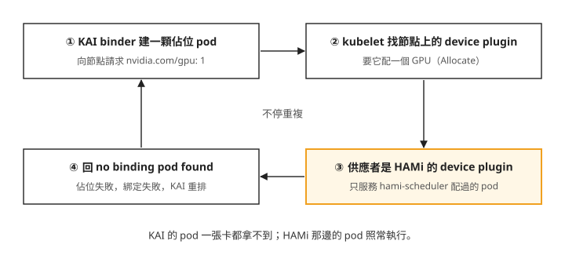

# Day 4: 讓 KAI 排程的 pod 也能切 VRAM——HAMi-core 整合與兩套 GPU 方案的衝突

{ align=right width="100" }

Day 3 結尾留下一顆排不上的 pod。團隊已經用 KAI 的佇列管 GPU 配額（Day 1–2），又想照 Day 3 的做法用 HAMi 把一張 T4 切給好幾個小模型，於是很自然地把兩件事寫進同一顆 pod：`schedulerName: kai-scheduler`，加上 `nvidia.com/gpumem: 4096`。結果它一直 Pending，KAI 的事件寫著 `No node in the default node-pool has nvidia.com/gpumem resources`。兩套系統都裝著、都健康，卻沒有一邊接手。原因 Day 3 查過了：HAMi 只改寫走預設排程器的 pod，見 Day 3 的[「指定 `schedulerName: kai-scheduler` 又要 `gpumem`，pod 永遠 Pending」](sprint1-day3-hami-memory-isolation.md#mine-4)。

這一章照 HAMi 官方文件提供的整合方式，讓走 KAI 的 pod 也拿得到 VRAM 上限。我們會先在 HAMi 還裝著的叢集上送出整合寫法的 pod，看兩套 GPU 方案同時在場時怎麼互相卡住；接著把 HAMi 整組卸掉、檢查它留下了什麼，再在乾淨的節點上把同一份 YAML 跑通，並確認隔離仍然有效。

讀完之後，遇到一個叢集同時裝了兩套 GPU 方案，你會知道先查「節點上的 `nvidia.com/gpu` 是誰在宣告」，並從答案判斷它們會不會互相卡住。

## 步驟 1：把 GPU 節點拉起來

GPU 節點池用完都會縮到 0（做法見 [Day 0](sprint1-day0-azure-aks-foundation.md)），先拉回 2 台，並回頭查節點池的 `count` 確認真的是 2，不要只看指令有沒有回傳。

Day 1 裝的 KAI 和 Day 3 裝的 HAMi 都還在。HAMi 的 device plugin 是 DaemonSet，新節點加入後自動跑起來，兩台節點就緒後 `allocatable`（節點可以分給 pod 的資源量，排程器只看這個；另一個欄位 `capacity` 是節點宣稱自己有多少）會各出現 `nvidia.com/gpu: 10`，也就是 HAMi 把一張卡報成 10 份。這一章用的版本是 HAMi v2.9.0、KAI v0.16.8，叢集是 Kubernetes 1.35.6。workload 都放在 `day4-lab` namespace，先建好：

```console
$ kubectl create namespace day4-lab
```

## 選讀：HAMi 平台的集中與分散擺法

這一節跟開場的問題無關，可以跳過。它談 HAMi 平台的另一個設定：同一組 pod 要集中在一張卡上，還是分散到幾台節點。實驗要用到 HAMi 平台，所以放在動 KAI 之前做；跑完把這八顆 pod 刪掉，再進步驟 2。

HAMi 的 scheduler extender（掛在預設排程器旁邊、替它挑 GPU 節點的元件）會替每個候選節點算一個「這台已經多滿」的分數。往最高分放是集中，叫 **binpack**；往最低分放是分散，叫 **spread**。設定分兩個層級：

| 政策 | 層級 | 效果 | 逐 pod 覆寫 |
|---|---|---|---|
| `binpack` | Node(挑哪一台節點) | 盡量塞進同一台 GPU 節點 | 可以,用 annotation |
| `spread` | Node | 盡量分散到不同 GPU 節點 | 可以,用 annotation |
| `numa-first` | GPU(同一台裡挑哪張卡) | 多卡配置時優先同 NUMA(v2.9.0 尚未實作) | 不行,只能全域設定 |

NUMA 指多 CPU 插槽的伺服器上，記憶體和 PCIe 裝置分屬不同 CPU，同組存取比較快；這一章每台只有一張卡，用不到。chart 預設是 node 層級 `binpack`，可以改安裝值 `scheduler.defaultSchedulerPolicy.nodeSchedulerPolicy`，或在 pod 上寫 annotation `hami.io/node-scheduler-policy` 逐 pod 覆寫。

**對照組**用預設政策（`01-placement-default.yaml`）：四顆 pod 各要 `nvidia.com/gpu: 1` 加 `nvidia.com/gpumem: 4096`，不寫 annotation。四顆只差編號，用迴圈產生：

```bash
for n in 1 2 3 4; do
  cat <<EOF
---
apiVersion: v1
kind: Pod
metadata:
  name: bp-$n
  namespace: day4-lab
  labels: { run: placement-default }
spec:
  restartPolicy: Never
  nodeSelector: { gpu: "on" }
  tolerations:
    - key: kubernetes.azure.com/scalesetpriority
      operator: Equal
      value: spot
      effect: NoSchedule
  containers:
    - name: c
      image: nvidia/cuda:12.9.2-base-ubuntu24.04
      command: ["bash", "-c", "nvidia-smi --query-gpu=memory.total --format=csv,noheader; sleep 3600"]
      resources:
        limits:
          nvidia.com/gpu: 1
          nvidia.com/gpumem: 4096
EOF
done > 01-placement-default.yaml
```

```text
12:23:45 apply -> 12:23:56  all four pods bound (11s)
bp-1..4  Running  aks-gpuspot-21249019-vmss00000c  SCHED hami-scheduler
         hami.io/vgpu-devices-allocated = GPU-7987a0bf-...,NVIDIA,4096,0:;

node ledger   vmss00000b  nvidia.com/gpu  0
              vmss00000c  nvidia.com/gpu  4
in-container  4096 MiB (all four)
```

四顆都在同一張卡上。`4 × 4096 = 16384 MiB` 正好等於 HAMi 記錄的這張卡總 VRAM（`devmem`），剛好用滿也排得進去。

**實驗組**（`02-placement-spread.yaml`）把迴圈裡的 `bp-$n` 改成 `sp-$n`、`placement-default` 改成 `placement-spread`，並在 `metadata` 補上 annotation，其餘不動：

```yaml
metadata:
  name: sp-$n
  namespace: day4-lab
  labels: { run: placement-spread }
  annotations:
    hami.io/node-scheduler-policy: "spread"
```

```text
12:24:53 apply -> 12:25:02  bound (9s)
sp-1, sp-3  Running  vmss00000b  →  GPU-845254fb-...
sp-2, sp-4  Running  vmss00000c  →  GPU-7987a0bf-...

node ledger   vmss00000b  nvidia.com/gpu  2
              vmss00000c  nvidia.com/gpu  2
```

兩組並排比較：

| | 預設(binpack) | annotation `spread` |
|---|---|---|
| 用到幾張實體卡 | 1 張(bp-1..4 全在 `vmss00000c`) | **2 張**(每台各 2 顆) |
| 該卡 VRAM 佔用 | 16384 / 16384 MiB(100%) | 各 8192 / 16384 MiB(50%) |
| 空節點 | 1 台(可以縮掉) | 0 台 |
| 單台 spot 被回收時受影響的 pod | **4 顆同時中斷** | 2 顆 |
| 綁定耗時 | 11 秒 | 9 秒 |

extender 的日誌可以看到分數怎麼算。同一個 `vgpu-scheduler-extender` 容器，兩輪的分數如下：

```text
# binpack round, when bp-4 arrives
score.go:185  "NodeFitPod" pod="day4-lab/bp-4" node="vmss00000c" score=10.5
score.go:185  "NodeFitPod" pod="day4-lab/bp-4" node="vmss00000b" score=0

# spread round, when sp-4 arrives
node_policy.go:82  node vmss00000b used 2, usedCore 0, usedMem 8192,
node_policy.go:63  node vmss00000c default score is 3.500000, computer override score is 3.500000
score.go:185  "NodeFitPod" pod="day4-lab/sp-4" node="vmss00000c" score=3.5
score.go:185  "NodeFitPod" pod="day4-lab/sp-4" node="vmss00000b" score=7
```

binpack 那一輪，bp-4 去了 10.5 分、已經比較滿的 `vmss00000c`；spread 那一輪，sp-4 去了 3.5 分、比較空的 `vmss00000c`。annotation 沒有換掉評分方式，只換掉挑選方向，`computer override score` 那一行就是它生效的紀錄。

binpack 能空出整台節點來縮掉，但 spot 節點被收回時四顆同時中斷；spread 分散影響，代價是兩台都得開著。這個 annotation 由寫 pod 的人自己決定，HAMi 不做限制，要強制得靠 OPA、Kyverno 這類在 pod 建立時檢查並改寫內容的 policy engine。

跑完把兩組 pod 刪掉：`kubectl -n day4-lab delete pod -l 'run in (placement-default,placement-spread)'`。

## 官方整合只借走 HAMi 的一個函式庫

Day 3 那條路動用了 HAMi 的整組元件：webhook 把 pod 的 `schedulerName` 改成 `hami-scheduler`；`hami-scheduler` 挑一張卡，並記下誰用了多少 VRAM；`hami-device-plugin` 在容器啟動時，把一個叫 `libvgpu.so` 的動態函式庫送進容器。真正在執行期攔下 CUDA 的記憶體配置、讓容器裡的 `nvidia-smi` 只看到 4096 MiB 的，是最後這個函式庫。它在 HAMi 專案裡有自己的名字：**HAMi-core**。

所以要讓 KAI 排的 pod 也有 VRAM 上限，只要把 HAMi-core 送進容器、再告訴它上限是多少就夠了。HAMi 官方的 KAI 整合文件一開頭就這樣劃界：

> The integration uses **HAMi-core directly, not the full HAMi platform**. KAI Scheduler keeps its own scheduling capability and brings in HAMi-core only for GPU memory isolation.

排程、記帳、配額都留在 KAI 手上，要裝的東西只剩下表三樣。admission 和 binder 是 Day 1 看過的 KAI 元件：前者在 pod 建立時補上欄位，後者在排程決定之後把 pod 綁到節點。這一章要動手的是前兩列：改 KAI admission 的設定，另外安裝 `kai-resource-isolator`。

| 元件 | 做什麼 | 來自 |
|---|---|---|
| KAI 的 admission | 算出這顆 pod 分到多少 VRAM，產生一個記著上限的 ConfigMap | KAI，要開 `global.gpuSharing` 與 `binder.plugins.hamicore.enabled` |
| `kai-resource-isolator` | DaemonSet 把 `libvgpu.so` 鋪到每台 GPU 節點；webhook 把它和 `/etc/ld.so.preload` 掛進 pod | HAMi 專案的獨立 chart |
| HAMi-core `libvgpu.so` | 執行期攔 CUDA 配置呼叫，強制上限 | 同上 |

下面這張圖把兩條路並排，左邊是 Day 3 走過的，右邊是今天要走的：


我們可以從圖上看到兩件事：

1. 右邊那條路上沒有 `hami-scheduler`、`hami-device-plugin`，也沒有 HAMi 的 webhook。
2. pod 要 VRAM 的寫法也換了：不再寫在 `resources.limits`，改成 annotation `gpu-memory`。步驟 3 會實際寫一份。

兩條路的終點是同一個函式庫，隔離效果應該跟 Day 3 一樣，步驟 8 會驗證。

## 步驟 2：裝上整合的兩個元件，並確認設定真的生效

官方文件第一步是 `helm install kai-scheduler oci://ghcr.io/nvidia/kai-scheduler ...`，這個位址抓不到 chart：

```console
$ helm show chart oci://ghcr.io/nvidia/kai-scheduler --version v0.16.8
Error: failed to perform "FetchReference" on source:
  GET "https://ghcr.io/v2/nvidia/kai-scheduler/manifests/v0.16.8":
  response status code 403: denied: requested access to the resource is denied
```

能用的是 Day 1 裝 KAI 時用的 `ghcr.io/kai-scheduler/kai-scheduler/kai-scheduler`，KAI 專案自己的 README 寫的也是這個位址。Day 1 的[「`--version 0.16.8` 抓不到 chart」](sprint1-day1-kai-queue-basics.md#mine-1)是版本字串對不上，這次是位址不對；兩種情況都可以先用 `helm show chart` 試一次再安裝。

KAI 已經裝著，所以用 `helm upgrade` 疊上整合需要的兩個值：`global.gpuSharing: true` 打開「多顆 pod 共用一張卡」的功能，`binder.plugins.hamicore.enabled: true` 打開 binder 的 HAMi-core 外掛。把它們寫成 `07-kai-integration-values.yaml`：

```bash
cat > 07-kai-integration-values.yaml <<'EOF'
global:
  gpuSharing: true
binder:
  plugins:
    hamicore:
      enabled: true
EOF
```

```console
$ helm upgrade kai-scheduler \
    oci://ghcr.io/kai-scheduler/kai-scheduler/kai-scheduler --version v0.16.8 \
    -n kai-scheduler -f 07-kai-integration-values.yaml --wait --timeout 8m
12:26:03 -> 12:26:43 (40s)   STATUS: deployed   REVISION: 2
```

接著確認兩個值真的生效。KAI 是 operator 架構，helm 值會先寫進一個 `Config` 物件（KAI operator 的設定物件，Day 1 看過），operator 再依它產生各元件。容易查錯的地方是：helm 值寫在 `global.gpuSharing`，`Config` 裡卻放在 `spec.admission` 底下，`spec.global` 查不到：

```text
spec.global.gpuSharing          = None    # looking here suggests it never applied
spec.admission.gpuSharing       = True    # where the value actually lands
spec.binder.plugins             = {"hamicore": {"enabled": true}}
```

比較可靠的做法是跳過 `Config`，直接看 Deployment 的啟動參數，那是元件真正收到的設定：

```text
admission:  ... "--gpu-sharing-enabled=true", "--hami-core-enabled=true",
                "--gpu-fraction-runtime-class-name", "nvidia"
binder:     ... --plugins {"gpusharing":{"enabled":true,"priority":100,...},
                           "hamicore":{"enabled":true,"priority":50}, ...}
```

前兩個參數就是我們要的。admission 的最後一個參數還藏著一件事：它會替每顆共卡的 pod 指定 `runtimeClassName: nvidia`。RuntimeClass 是 Kubernetes 用來指定「用哪一種容器執行環境啟動這顆 pod」的物件；pod 指名了一個不存在的 RuntimeClass，API server 會直接拒絕建立。這個 RuntimeClass 通常由 NVIDIA 的 GPU Operator 或原廠 device plugin 建立，在 AKS 上跑 `kubectl get runtimeclass`，只會列出 `runc` 和 `kata-vm-isolation`，沒有 `nvidia`。所以再 upgrade 一次，把這個值清空：

```console
$ helm upgrade kai-scheduler \
    oci://ghcr.io/kai-scheduler/kai-scheduler/kai-scheduler --version v0.16.8 \
    -n kai-scheduler -f 07-kai-integration-values.yaml \
    --set admission.gpuFractionRuntimeClassName="" --wait --timeout 8m
```

完成後再看一次 admission 的參數，應該變成 `"--gpu-fraction-runtime-class-name", ""`。清空就好，AKS GPU 節點預設的容器執行環境本來就用得到 GPU，Day 3 整天沒有指定過 `runtimeClassName`。細節見[疑難排解：RuntimeClass "nvidia" not found](#mine-1)。

第二個元件是裝在節點端的 isolator：

```console
$ helm install kai-resource-isolator \
    oci://docker.io/projecthami/kai-resource-isolator \
    --namespace kai-resource-isolator --create-namespace --version 1.0.0-chart
12:27:25 -> 12:27:41 (16s)

kai-resource-isolator-libsync-plrf6   1/1  Running   ← DaemonSet,desired 3
kai-resource-isolator-libsync-qqmvz   1/1  Running
kai-resource-isolator-libsync-wfq6t   1/1  Running
kai-resource-isolator-webhook-...                 1/1 Running
```

注意 `desired 3`：叢集只有兩台 GPU 節點，但這個 DaemonSet 沒有 nodeSelector，tolerations 又是 `Exists/NoSchedule`，所以連沒有卡的 system 節點也跑了一份。節點一多，就要自己補 nodeSelector，否則每台機器都會多一個沒有用途的常駐 pod。

裝完之後，叢集裡會在 pod 建立時改寫它的 mutating webhook 有三個，第一個是 Day 3 看過的 HAMi webhook：

| webhook | failurePolicy | 排除條件 |
|---|---|---|
| `vgpu.hami.io` | **Ignore** | namespace 或 pod 帶 `hami.io/webhook: ignore` |
| `vgpu.lib.kai-resource-isolator.io` | **Ignore** | namespace 或 pod 帶 `kai-resource-isolator.io/webhook: ignore` |
| `admission.kai-scheduler.svc` | **Fail** | namespace 為 `kube-system` 或 `kai-scheduler` |

`failurePolicy` 決定 webhook 本身掛掉時怎麼辦：`Ignore` 的掛掉，pod 照樣建得出來但不再被改寫，隔離會悄悄消失；`Fail` 的掛掉，除了排除的 namespace，其他地方都建不出 pod。最後一欄的排除條件步驟 3 會用到。

## 步驟 3：照官方文件送出共卡的 pod

官方文件的 pod 寫法跟 Day 3 有幾處不同：

| | HAMi 平台路徑（Day 3） | KAI 加 HAMi-core 路徑（今天） |
|---|---|---|
| 排程器 | `hami-scheduler`（webhook 自動改寫） | `kai-scheduler`（自己寫 `schedulerName`） |
| VRAM 怎麼要 | `resources.limits["nvidia.com/gpumem"]: 4096` | `metadata.annotations["gpu-memory"]: "4096"` |
| 佇列 | 無 | `labels["kai.scheduler/queue"]: default-queue` |
| 隔離執行者 | HAMi-core | HAMi-core |

`gpu-memory` 的單位是 MiB，不帶字尾；pod 的 `resources` 不寫任何 GPU 資源。`03-kai-hami-integrated.yaml` 照文件寫，兩顆共卡的 pod 只差編號：

```bash
for n in 1 2; do
  cat <<EOF
---
apiVersion: v1
kind: Pod
metadata:
  name: kai-shared-$n
  namespace: day4-lab
  labels:
    kai.scheduler/queue: default-queue
    run: kai-integrated
  annotations:
    gpu-memory: "4096" # unit is MiB, no suffix
spec:
  schedulerName: kai-scheduler
  restartPolicy: Never
  nodeSelector: { gpu: "on" }
  tolerations:
    - key: kubernetes.azure.com/scalesetpriority
      operator: Equal
      value: spot
      effect: NoSchedule
  containers:
    - name: c
      image: nvidia/cuda:12.9.2-base-ubuntu24.04
      command: ["bash", "-c", "nvidia-smi; sleep 3600"]
EOF
done > 03-kai-hami-integrated.yaml
```

如果漏了步驟 2 清空 RuntimeClass 那一步，`kubectl apply` 會直接被拒，物件在 API server 就被擋下，`kubectl get pods` 什麼都查不到：

```console
$ kubectl apply -f 03-kai-hami-integrated.yaml
Error from server (Forbidden): error when creating "03-kai-hami-integrated.yaml":
  pods "kai-shared-1" is forbidden: pod rejected: RuntimeClass "nvidia" not found
```

建得出來之後，pod 卻一直 Pending：

```text
12:34:34 apply -> 12:41:43  still Pending (7m)

Events:
  Warning  Unschedulable  2m8s (x300 over 7m8s)  kai-scheduler
    no nodes with enough resources were found:
      3 node(s) didn't have enough resources: GPU memory.
      3 node(s) didn't have enough resources: GPUs.

proportion.go:256  Total allocatable resources are
  <CPU: 7.511 (cores), memory: 50.122 (GB), Gpus: 20>, number of nodes: <3>
```

這兩段訊息互相矛盾：排程器日誌說看得到 `Gpus: 20`（兩台節點，HAMi 各報 10 份），事件卻說 GPU memory 不夠。問題不在請求量，而是 KAI 不知道一張卡有多少 VRAM：KAI 從節點標籤 `nvidia.com/gpu.memory` 讀取每張卡的 VRAM（單位 MiB）。這個標籤平常由 GPU Feature Discovery（GFD，NVIDIA 用來把 GPU 型號、VRAM 等規格寫成節點標籤的元件）打上，這座叢集沒有 GFD，HAMi 的 device plugin 也不打這個標籤。標籤不存在時，KAI 就把一張卡當成 100 MiB，任何 `gpu-memory` 請求都放不下。替兩台 GPU 節點手動補上：`kubectl label node <gpu-nodes> nvidia.com/gpu.memory=16384 nvidia.com/gpu.count=1 --overwrite`。這樣打的標籤節點重建就會消失，要長期保留得寫到 node pool 層級，見[疑難排解：KAI 把一張卡當成 100 MiB](#mine-2)。

補上標籤後，排程立刻過了，但綁定失敗：

```text
Events:
  Normal   Scheduled     kai-scheduler  Successfully assigned day4-lab/kai-shared-1 to vmss00000b
  Warning  BindingError  binder  Failed to bind pod day4-lab/kai-shared-1 to node ...:
    failed to reserve GPUs for pod <day4-lab/kai-shared-1> in gpu group <9e3ffaf1-...>:
    admission webhook "vgpu.hami.io" denied the request: pod has node assigned
```

`failed to reserve GPUs` 這句帶出整合路徑上的另一個角色：**佔位 pod**（reservation pod）。共卡的 pod 自己不請求 GPU 資源，KAI 的 binder 會另外在 `kai-resource-reservation` namespace 建一顆佔位 pod（名稱以 `gpu-reservation-` 開頭），由它向節點請求 `nvidia.com/gpu: 1`，把整張卡佔下來，再讓共卡的 pod 分著用。被拒的就是這顆佔位 pod：binder 建它時已經指定好節點，而 HAMi 的 webhook 拒絕已經指定節點的 pod。

照步驟 2 那張表的排除條件，把佔位 pod 所在的 namespace 標成 HAMi webhook 不處理：

```console
$ kubectl label namespace kai-resource-reservation hami.io/webhook=ignore --overwrite
```

佔位 pod 這次建得出來，卻在節點上被拒：

```text
gpu-reservation-c6186a984b5142b0   0/1   UnexpectedAdmissionError   vmss00000b

Message: Pod was rejected: Allocate failed due to rpc error: code = Unknown desc =
         no binding pod found on node aks-gpuspot-21249019-vmss00000b, which is unexpected
```

這句錯誤是 **HAMi 的 device plugin** 回的。KAI 的佔位 pod 為什麼會找上它？下一步單獨看這件事。

## 步驟 4：兩套方案同時在場時，誰擋了誰

兩套方案同時裝著，會不會把同一張卡分配兩次？`05-coexistence-probe.yaml` 把兩顆 pod 用 `nodeSelector: kubernetes.io/hostname` 釘在同一台節點上（每台只有一張卡，所以必然同卡）：`coex-kai` 走 KAI 整合路徑（`gpu-memory` annotation），`coex-hami` 走 HAMi 平台路徑（`nvidia.com/gpumem` 資源）。兩顆都申請 4096 MiB，並在程式裡實際佔住 3 GiB。`<node-a>` 換成自己叢集裡任一台 GPU 節點的 hostname（`kubectl get nodes` 查得到），兩顆一定要寫同一台：

```bash
cat > 05-coexistence-probe.yaml <<'EOF'
apiVersion: v1
kind: Pod
metadata:
  name: coex-kai
  namespace: day4-lab
  labels:
    kai.scheduler/queue: default-queue
    run: coexistence
  annotations:
    gpu-memory: "4096"
spec:
  schedulerName: kai-scheduler
  restartPolicy: Never
  nodeSelector:
    kubernetes.io/hostname: <node-a>
  tolerations:
    - key: kubernetes.azure.com/scalesetpriority
      operator: Equal
      value: spot
      effect: NoSchedule
  containers:
    - name: c
      image: pytorch/pytorch:2.5.1-cuda12.4-cudnn9-runtime
      command:
        - python
        - -c
        - |
          import torch, time
          print("visible total MiB:", torch.cuda.get_device_properties(0).total_memory // 1024 // 1024, flush=True)
          x = torch.empty(3 * 1024 * 1024 * 1024, dtype=torch.uint8, device="cuda")
          print("held 3 GiB", flush=True)
          while True:
              time.sleep(30)
---
apiVersion: v1
kind: Pod
metadata:
  name: coex-hami
  namespace: day4-lab
  labels:
    run: coexistence
spec:
  restartPolicy: Never
  nodeSelector:
    kubernetes.io/hostname: <node-a>
  tolerations:
    - key: kubernetes.azure.com/scalesetpriority
      operator: Equal
      value: spot
      effect: NoSchedule
  containers:
    - name: c
      image: pytorch/pytorch:2.5.1-cuda12.4-cudnn9-runtime
      command:
        - python
        - -c
        - |
          import torch, time
          print("visible total MiB:", torch.cuda.get_device_properties(0).total_memory // 1024 // 1024, flush=True)
          x = torch.empty(3 * 1024 * 1024 * 1024, dtype=torch.uint8, device="cuda")
          print("held 3 GiB", flush=True)
          while True:
              time.sleep(30)
      resources:
        limits:
          nvidia.com/gpu: 1
          nvidia.com/gpumem: 4096
EOF
```

```text
12:43:43 apply
coex-hami   Running   aks-gpuspot-21249019-vmss00000b   SCHED hami-scheduler
coex-kai    Pending   <none>                            SCHED kai-scheduler
```

`coex-hami` 一下就跑起來，annotation 也完整（`hami.io/bind-phase: success`、`hami.io/vgpu-devices-allocated: GPU-845254fb-...,NVIDIA,4096,0:;`）。`coex-kai` 的事件則不斷重複 `Scheduled` → `BindingError` → `Scheduled`，`kai-resource-reservation` 裡的佔位 pod 每一輪都以 `UnexpectedAdmissionError` 收場。

要看懂這個迴圈，得先回到節點上的 `nvidia.com/gpu` 是誰給的。這個資源由 device plugin 向 kubelet 宣告，而同一個資源名在一台節點上只能有一個 device plugin 供應。Day 3 已經把原廠的 NVIDIA device plugin 換成 HAMi 的，所以現在任何 pod 請求 `nvidia.com/gpu`，kubelet 都會去找 HAMi 的 device plugin 要卡，KAI 的佔位 pod 也不例外。把這個過程畫成一圈，照著圖上的編號看：



關鍵在第 ③ 步。HAMi 的 device plugin 收到配卡要求時，會去找 `hami-scheduler` 留下的待綁定紀錄（`hami.io/vgpu-devices-to-allocate`），KAI 的佔位 pod 沒有這筆紀錄，於是被拒。KAI 收到綁定失敗就重排，又回到第 ① 步。

所以回到開頭的問題：同一張卡不會被分配兩次。只要 HAMi 還是 `nvidia.com/gpu` 的唯一供應者，`coex-hami` 就正常執行，KAI 那顆一個裝置都拿不到。壞掉的樣子是 KAI 排不上，一送 pod 就看得到，不會變成兩邊都以為自己拿到同一塊 VRAM。

另外，步驟 3 的排程器日誌說叢集有 `Gpus: 20`：實體只有 2 張 T4，KAI 照單全收 HAMi 報的 allocatable（`deviceSplitCount: 10`）。假如沒有上面那道限制，KAI 會拿「20 張卡」去算佇列配額與 fair-share（各佇列依 quota 和權重該分到的量，Day 1 看過），而兩邊的數字各自看起來都正常。

這就是開場說的判斷方法：兩套 GPU 方案能不能同時裝，先查節點上的 `nvidia.com/gpu` 是誰在宣告。看節點上跑的是哪一個 device plugin 的 DaemonSet，再看 `allocatable` 的數字：HAMi 預設把一張卡報成 10（`deviceSplitCount` 的預設值），原廠 plugin 預設報 1（開了 time-slicing 會報得更多）。答案是 HAMi，KAI 的整合就動不了；要走 KAI 路徑，就得把 HAMi 平台拆掉，換回原廠的 device plugin。完整的症狀與修法見[疑難排解：兩套方案同時裝著，KAI 的 pod 無限重排](#mine-3)。

## 步驟 5：拆掉 HAMi 之前，各抓一次 metrics

拆之前順便看一下兩套系統各自的 metrics 能回答什麼問題。兩邊各 port-forward 一次就讀得到，不必裝監控系統。先看 HAMi：

```console
$ kubectl -n kube-system port-forward deploy/hami-scheduler 19993:9395
$ curl -s http://127.0.0.1:19993/metrics | grep -v '^#'
hami_gpu_memory_limit_bytes{device_uuid="GPU-845254fb-...",node="vmss00000b"}      1.7179869184e+10
hami_gpu_memory_allocated_bytes{device_uuid="GPU-845254fb-...",node="vmss00000b"}  4.294967296e+09
hami_gpu_memory_allocated_bytes{device_uuid="GPU-7987a0bf-...",node="vmss00000c"}  0
hami_node_gpu_memory_allocated_ratio{device_uuid="GPU-845254fb-...",node="vmss00000b"} 0.25
hami_resource_quota_used{namespace="day4-lab",quota_name="nvidia.com/gpumem"}  20480
hami_resource_quota_used{namespace="hami-lab",quota_name="nvidia.com/gpumem"}  16096
```

Day 3 留了一個問題：`nvidia.com/gpumem` 不是節點資源，`kubectl` 查不到 VRAM 還剩多少。答案在這裡，`hami_gpu_memory_limit_bytes` 減掉 `hami_gpu_memory_allocated_bytes`，就是這張卡剩下的 VRAM；`ratio = 0.25` 也正好對上 `coex-hami` 的 4096/16384。<span id="mine-4"></span>最後兩行按 namespace 加總的 `hami_resource_quota_used` 則不要拿來用：`hami-lab` 是 Day 3 結束時就刪掉的 namespace，`day4-lab` 實際也只有 `coex-hami` 一顆持有 4096 MiB，數字卻還掛著。這組數字記在 scheduler extender 的記憶體裡，namespace 層級的累計值沒有隨著 pod 和 namespace 刪除而扣回去。看用量請以按裝置計算的那幾行為準。

KAI 那邊：

```console
$ kubectl -n kai-scheduler port-forward deploy/kai-scheduler-default 18080:8080
$ curl -s http://127.0.0.1:18080/metrics | grep -v '^#'
kai_e2e_scheduling_latency_milliseconds                                        1
kai_action_scheduling_latency_milliseconds{action="allocate"}                  0
kai_plugin_scheduling_latency_milliseconds{plugin="gpupack",...}               0
kai_queue_fair_share_gpu{queue_name="default-queue"}                        0.78
kai_queue_gpu_usage{queue_name="default-queue"}                                0
```

KAI 給的是佇列與排程行為：佇列該分到多少（`fair_share_gpu`）、實際用了多少（`gpu_usage`，此時是 0，因為 KAI 的 pod 全卡在步驟 4 那一圈裡）、每個排程動作花多久。想知道哪張卡快滿了看 HAMi，想知道哪個佇列等不到卡看 KAI。Day 5 會把 HAMi 這些數字接到網頁介面上。

## 步驟 6：卸載 HAMi 平台，檢查留下了什麼

步驟 4 的結論是：不把 HAMi 平台拆掉，KAI 路徑就跑不起來。卸載時要特別留意三樣 helm 管不到的東西：webhook 憑證 secret、HAMi 寫在節點物件上的 annotation，以及節點的 `capacity`，因為下一套 GPU 方案會讀到後兩者，拿到過期的卡規格。拆之前可以用 `helm get manifest hami -n kube-system` 看 release 管得到哪些物件：Deployment、DaemonSet、Service、ConfigMap、ServiceAccount、mutating webhook 和一組 RBAC，共 19 個，沒有 CRD。HAMi 的帳記在 scheduler extender 的記憶體與 pod annotation 裡，所以用量只能從 metrics 讀。

`secret/hami-scheduler-tls`（webhook 的憑證）不在 manifest 裡，它是安裝時由 helm hook job 另外產生的，卸載時最容易留下來。

```console
$ helm uninstall hami -n kube-system
release "hami" uninstalled
```

第一件要確認的是新 pod 還會不會被改寫。送一顆走 `default-scheduler`、資源欄寫著 HAMi 資源的 pod：

```bash
cat > 06-post-uninstall-probe.yaml <<'EOF'
apiVersion: v1
kind: Pod
metadata:
  name: post-uninstall-probe
  namespace: day4-lab
spec:
  restartPolicy: Never
  nodeSelector: { gpu: "on" }
  tolerations:
    - key: kubernetes.azure.com/scalesetpriority
      operator: Equal
      value: spot
      effect: NoSchedule
  containers:
    - name: c
      image: nvidia/cuda:12.9.2-base-ubuntu24.04
      command: ["bash", "-c", "nvidia-smi; sleep 600"]
      resources:
        limits:
          nvidia.com/gpu: 1
          nvidia.com/gpumem: 4096
EOF
```

pod 的 `schedulerName` 維持 `default-scheduler`，沒有被改寫；沒有任何 `hami.io/*` annotation，沒有 `CUDA_DEVICE_MEMORY_LIMIT` 環境變數，volumeMounts 只剩 serviceaccount。事件是：

```text
Warning  FailedScheduling  default-scheduler
  0/3 nodes are available: 1 node(s) didn't match Pod's node affinity/selector,
  2 Insufficient nvidia.com/gpu, 2 Insufficient nvidia.com/gpumem.
```

少了 HAMi 的 extender，`default-scheduler` 把 `nvidia.com/gpumem` 當成一般的擴充資源，沒有任何節點能滿足。

第二件要確認的是殘留：

| 類別 | 卸載後狀態 |
|---|---|
| MutatingWebhookConfiguration `hami-webhook` | 已刪 |
| ClusterRole/ClusterRoleBinding(含 `system:kube-scheduler` 那兩條) | 已刪 |
| Deployment/DaemonSet/Service/ConfigMap/ServiceAccount | 已刪 |
| CRD | 本來就沒有 |
| `secret/hami-scheduler-tls`(kube-system) | **殘留** |
| 節點 annotation `hami.io/node-handshake` | **殘留** |
| 節點 annotation `hami.io/node-nvidia-register` | **殘留**(整串卡規格) |
| 節點 `capacity: nvidia.com/gpu: 10` | **殘留**(`allocatable` 已歸 0) |

helm 建的物件都刪乾淨了，留下來的是它不認得的東西：hook 產生的 secret、device plugin 寫在節點物件上的 annotation，以及 kubelet 還沒更新的 `capacity`（Day 3 的[「`helm uninstall` 之後，`capacity` 還寫著有卡」](sprint1-day3-hami-memory-isolation.md#mine-1)是同一件事）。步驟 9 收尾時會一併清掉，原因見[疑難排解：卸載 HAMi 之後，節點上還留著它的資料](#mine-5)。

## 步驟 7：裝回原廠 device plugin，把同一份 YAML 重跑一次

卸載後節點上沒有任何 device plugin，`allocatable` 是 0。照步驟 4 的結論，把原廠的 `nvidia-device-plugin` 裝回來，安裝值只加 spot toleration 與 `gpu=on` nodeSelector：

```bash
cat > 08-nvdp-values.yaml <<'EOF'
tolerations:
  - key: kubernetes.azure.com/scalesetpriority
    operator: Equal
    value: spot
    effect: NoSchedule
nodeSelector:
  gpu: "on"
EOF
```

安裝方式跟 Day 0 相同，只是改用這份 values 檔，版本固定在 0.19.3：

```console
$ helm repo add nvdp https://nvidia.github.io/k8s-device-plugin
$ helm upgrade -i nvdp nvdp/nvidia-device-plugin --version 0.19.3 \
    -n nvidia-device-plugin --create-namespace -f 08-nvdp-values.yaml
```

等兩台節點的 DaemonSet pod 都 Running，再看節點的 `capacity` 與 `allocatable`：

```text
12:50:12 helm upgrade -i nvdp nvdp/nvidia-device-plugin --version 0.19.3
12:50:39 both DaemonSet pods Running
12:50:56 vmss00000b / vmss00000c   capacity {'nvidia.com/gpu': '1'}   allocatable {'nvidia.com/gpu': '1'}
```

現在宣告 `nvidia.com/gpu` 的是原廠 plugin，一張實體卡報 1，不再是 HAMi 的 10。重送一字未改的 `03-kai-hami-integrated.yaml`：

```text
12:51:16 apply -> 12:51:30  both Running (14s)

kai-shared-1 / kai-shared-2         Running  vmss00000b  SCHED kai-scheduler
gpu-reservation-65ccb3d920befca0    Running  vmss00000b  (kai-resource-reservation namespace)
```

兩顆共卡的 pod 和佔位 pod 都跑起來了，開場那個「指名 KAI 又要 VRAM」的需求排得上了。解法不是讓 HAMi 接手 KAI 的 pod（兩套都裝著時，HAMi 反而擋住了佔位 pod），而是把 VRAM 請求搬到 annotation，並把 HAMi 平台換掉、只留 HAMi-core。

容器裡看到的是切出來的一份：

```console
$ kubectl -n day4-lab logs kai-shared-1
[HAMI-core Msg(43:...:libvgpu.c:870)]: Initializing.....
|   0  Tesla T4                       Off |   00000001:00:00.0 Off |                  Off |
| N/A   37C    P8             13W /   70W |       0MiB /   4259MiB |      0%      Default |
```

總量是 `4259MiB`，為什麼不是 4096 留到步驟 8。第一行的 `[HAMI-core Msg ... libvgpu.c]` 跟 Day 3 一模一樣，是同一個函式庫，只是這次由 `kai-resource-isolator` 送進來。兩顆 pod 的 `NVIDIA_VISIBLE_DEVICES` 也指向同一顆 GPU UUID，確認它們共用同一張實體卡。

這張表要看出的是：共卡的 pod spec 是 `resources: {}`，完全沒有請求 GPU 資源；請求整張卡的是佔位 pod，限制 VRAM 的是 HAMi-core，中間由 KAI 和 isolator 把設定接起來。表中的 PodGroup 是 Day 1 看過的 KAI 排程單位；libsync 是 isolator 的 DaemonSet，負責把函式庫複製到每台節點；hostPath 是把節點上的目錄掛進容器，subPath 是只掛其中一個檔案。

| 步驟 | 誰做 | 做了什麼(現場證據) |
|---|---|---|
| 1 | KAI scheduler | 決定放哪台、跟誰共卡;建 PodGroup |
| 2 | KAI binder | 在 `kai-resource-reservation` 建佔位 pod,**那顆才是真正請求 `nvidia.com/gpu: 1` 的** |
| 3 | KAI admission | 產生 ConfigMap,pod 上蓋 annotation `runai/shared-gpu-configmap`、label `runai-gpu-group` |
| 4 | isolator webhook | 掛上 `hostPath /usr/local/vgpu` 與 `subPath: ld.so.preload` 兩個 volumeMount |
| 5 | isolator libsync | 把 `libvgpu.so` 鋪到節點的 `/usr/local/vgpu` |
| 6 | HAMi-core `libvgpu.so` | 執行期攔 CUDA 配置,強制上限 |
| — | HAMi 平台 | 完全沒有參與(已卸載) |

第 3 列的 ConfigMap 記著 KAI 算出來的上限，可以跟容器內的三個地方對照：

```console
$ kubectl -n day4-lab get cm kai-shared-1-...-shared-gpu-0 -o jsonpath='{.data}'
{"CUDA_DEVICE_MEMORY_LIMIT":"4259m","GPU_PORTION":"0.26",
 "NVIDIA_VISIBLE_DEVICES":"GPU-845254fb-...","RUNAI_NUM_OF_GPUS":"0.26"}

$ env | grep -E "CUDA_DEVICE|GPU_PORTION"
CUDA_DEVICE_MEMORY_LIMIT=4259m
GPU_PORTION=0.26
$ cat /etc/ld.so.preload
/usr/local/vgpu/libvgpu.so
$ ls -la /usr/local/vgpu
-rw-r--r-- 1 root root     27 ld.so.preload
-rw-r--r-- 1 root root 684856 libvgpu.so
-rwxr-xr-x 1 root root 684264 libvgpu.so.v2.9.0
```

ConfigMap 裡的上限就是容器的 `CUDA_DEVICE_MEMORY_LIMIT`；`/etc/ld.so.preload` 讓每個程式啟動時先載入 `libvgpu.so`，HAMi-core 靠這個掛進來。Day 3 的 HAMi 平台路徑要 exec 進容器才查得到上限，KAI 路徑用 `kubectl get cm` 就讀得到。

## 步驟 8：驗證隔離，並看 VRAM 怎麼換算成 GPU 比例

`04-kai-overalloc.yaml` 帶同樣的 `gpu-memory: "4096"`，程式以 512 MiB 為單位一路加到 8192：

```bash
cat > 04-kai-overalloc.yaml <<'EOF'
apiVersion: v1
kind: Pod
metadata:
  name: kai-hog
  namespace: day4-lab
  labels:
    kai.scheduler/queue: default-queue
    run: kai-integrated
  annotations:
    gpu-memory: "4096"
spec:
  schedulerName: kai-scheduler
  restartPolicy: Never
  nodeSelector: { gpu: "on" }
  tolerations:
    - key: kubernetes.azure.com/scalesetpriority
      operator: Equal
      value: spot
      effect: NoSchedule
  containers:
    - name: c
      image: pytorch/pytorch:2.5.1-cuda12.4-cudnn9-runtime
      command:
        - python
        - -c
        - |
          import torch, time
          print("visible total MiB:", torch.cuda.get_device_properties(0).total_memory // 1024 // 1024, flush=True)
          blocks = []
          got = 0
          for i in range(16):
              try:
                  blocks.append(torch.empty(512 * 1024 * 1024, dtype=torch.uint8, device="cuda"))
                  got += 512
                  print(f"OK  +512MiB  total={got}MiB", flush=True)
              except Exception as e:
                  print(f"FAIL at total={got + 512}MiB -> {type(e).__name__}: {e}", flush=True)
                  break
              time.sleep(0.5)
          print("final held MiB:", got, flush=True)
          time.sleep(600)
EOF
```

```text
12:52:32 apply -> 12:52:43  finished

visible total MiB: 4259
OK  +512MiB  total=512MiB
...
OK  +512MiB  total=4096MiB
[HAMI-core ERROR (pid:1 thread=... allocator.c:52)]: Device 0 OOM 4938792960 / 4465885184
FAIL at total=4608MiB -> OutOfMemoryError: CUDA out of memory. Tried to allocate 512.00 MiB.
  GPU 0 has a total capacity of 4.16 GiB of which 61.00 MiB is free.
final held MiB: 4096
```

程式拿到 4096 MiB 之後，下一個 512 MiB 就被拒絕。錯誤訊息裡的分母 `4465885184` bytes 正好是 4259 MiB，也就是 `CUDA_DEVICE_MEMORY_LIMIT`；`allocator.c:52` 跟 Day 3 那顆超額 pod 的錯誤一字不差，因為執行隔離的是同一份 HAMi-core 程式碼，換掉的只有把它送進容器的元件。同一張卡上的 `kai-shared-1`、`kai-shared-2` 全程 `Running`、`RESTARTS 0`，沒有受到影響。

那 4259 是怎麼來的？KAI 內部不用 MiB 記帳，而是把一張卡當成 1，每顆共卡的 pod 分到一個兩位小數的比例，叫 **GPU fraction**。步驟 7 的 ConfigMap 裡 `GPU_PORTION: 0.26` 就是它。照 KAI v0.16.8 的原始碼，排程器讀節點標籤 `nvidia.com/gpu.memory`（16384）時，會先無條件捨去到 100 的倍數，當成 16300；4096 / 16300 約 0.2513，再以 0.01 為單位無條件進位，得到 0.26。binder 算上限時則拿標籤原值 16384 乘 0.26，得到 4259.84，取整數就是 `4259m`。

現在同一張卡上有三顆 pod，各 0.26，加起來 0.78。再送第四顆：

```text
12:53:22   kai-fourth   Pending   <none>
  Normal  Pipelined  0s (x20 over 19s)  kai-scheduler
    Pod day4-lab/kai-fourth was pipelined to node aks-gpuspot-21249019-vmss00000b
```

第四顆排不上，事件是 `Pipelined`：KAI 已經把它指派到已有三顆 pod 的那台節點，正在等那裡的資源被釋放，釋放之前 pod 不會真的綁上去。在那張卡上，0.78 再加 0.26 是 1.04，超過一張卡。另一台節點當時的佔用沒有記錄下來，所以這裡只能確定一件事：照 0.26 換算，一張卡最多放三顆。HAMi 平台以 MiB 記帳，四顆 4096 MiB 正好填滿 16384 MiB（前面選讀那一節的對照組就是這樣擺的）。規劃方式見[疑難排解：每張卡少放一個 pod](#mine-6)。

## 步驟 9：把叢集還原成整合前

刪 workload、拆兩個 chart，KAI 用 `--reset-values` 把今天疊上去的值整組丟掉；今天臨時加在節點與 namespace 上的標籤要拆，步驟 6 那三項殘留也一起清掉：

```console
$ kubectl -n day4-lab delete pod --all --grace-period=5
$ helm uninstall kai-resource-isolator -n kai-resource-isolator
$ helm uninstall nvdp -n nvidia-device-plugin
$ helm upgrade kai-scheduler \
    oci://ghcr.io/kai-scheduler/kai-scheduler/kai-scheduler --version v0.16.8 \
    -n kai-scheduler --reset-values --wait --timeout 8m
$ kubectl label node <gpu-nodes> nvidia.com/gpu.memory- nvidia.com/gpu.count-
$ kubectl label namespace kai-resource-reservation hami.io/webhook-
$ kubectl delete namespace day4-lab
$ kubectl -n kube-system delete secret hami-scheduler-tls
$ kubectl delete ns kai-resource-isolator nvidia-device-plugin
$ kubectl annotate node <gpu-nodes> hami.io/node-handshake- hami.io/node-nvidia-register-
```

`kai-resource-isolator` 和 `nvidia-device-plugin` 這兩個 namespace 要自己刪，因為 `helm uninstall` 不會刪掉當初用 `--create-namespace` 建的 namespace。還原後的 KAI：

```text
12:54:30  REVISION: 4   STATUS: deployed   USER-SUPPLIED VALUES: null

Config CR:  admission.gpuSharing                  = False
            admission.gpuFractionRuntimeClassName = nvidia   # chart default is back
            binder.plugins                        = null
```

`gpuFractionRuntimeClassName` 回到 `nvidia`，表示這是 chart 的預設值。之後在這座叢集再打開 KAI 的 GPU sharing，步驟 2 清空 RuntimeClass 那一步要再做一次。最後照 Day 0 把 GPU pool 縮回 0，並回頭查 `count` 確實是 0。

## 疑難排解

### KAI 替共卡 pod 指定 RuntimeClass "nvidia"，AKS 沒有，pod 建不出來 {#mine-1}

步驟 2 已經清空這個值的話，可以跳過這一項。

**症狀**：`kubectl apply` 直接回 `Forbidden ... RuntimeClass "nvidia" not found`。pod 物件根本沒建成，所以不會出現 Pending 或 CrashLoop，`kubectl get pods` 什麼都查不到，很容易誤以為 YAML 寫錯。

**原因**：KAI chart 的 `admission.gpuFractionRuntimeClassName` 預設是 `nvidia`，admission 會把它寫到每顆共卡 pod 上（見步驟 2）。KAI 的 GPU sharing 文件有一句：「By default, KAI Scheduler uses the `nvidia` Runtime Class, which is typically configured by the NVIDIA device plugin.」這句講的是 binder 建立的佔位 pod，不是 admission 這個預設值，但背後是同一個假設：叢集裡已經有 device plugin 或 GPU Operator 建好的 `nvidia` RuntimeClass。

**修法**：`--set admission.gpuFractionRuntimeClassName=""`。佔位 pod 那邊的設定是 `binder.resourceReservation.runtimeClassName`，v0.16.8 的 `values.yaml` 沒有替它設預設值，這一章的佔位 pod 也沒有被擋過，不用動。在 AKS、EKS、GKE 這類託管叢集上裝 NVIDIA 相關的 chart 之前，先跑一次 `kubectl get runtimeclass`，這些 chart 大多預設叢集裡有 GPU Operator。

### KAI 不知道卡有多大，當成 100 MiB，`gpu-memory` 的 pod 永遠 Pending {#mine-2}

步驟 3 已經補上節點標籤的話，可以跳過這一項。

**症狀**：`gpu-memory: "4096"` 的 pod 一直 Pending，事件寫 `didn't have enough resources: GPU memory`，同一個排程器的日誌卻報告 `Gpus: 20`，卡明明在。把請求改小到 2000、1000 也一樣。

**原因**：KAI 從節點標籤 `nvidia.com/gpu.memory` 取得每張卡有多少 MiB，標籤不存在就用預設值：

```go
DefaultGpuMemory = 100 // The default value is 100 because it allows all the calculation of
                       // (memory = fractional * GpuMemory) to work, if it was 0 the result will always be zero too
GpuMemoryLabel   = "nvidia.com/gpu.memory"
```

這個標籤平常由 GFD 打上；HAMi 的 device plugin 不打，它把卡的規格寫在 annotation `hami.io/node-nvidia-register` 裡，KAI 讀不到。

**修法**：`kubectl label node <gpu-nodes> nvidia.com/gpu.memory=16384 nvidia.com/gpu.count=1 --overwrite`。要在節點重建後還留著，得寫到 node pool 層級（`az aks nodepool update --labels`）。這個預設值不會報錯，只會讓請求永遠放不下；遇到「卡看得到、VRAM 卻不夠」這種訊息，先查 KAI 讀的那個標籤在不在、值對不對，不要反覆調整請求量。

### 兩套方案同時裝著，KAI 的 pod 無限重排 {#mine-3}

**症狀**：HAMi 平台和 KAI 整合都裝好、都健康，`gpu-memory` annotation 的 pod 在 `Scheduled` 與 `BindingError` 之間不斷重複；`kai-resource-reservation` 裡的佔位 pod 一直是 `UnexpectedAdmissionError`。錯誤字串 `no binding pod found on node <X>, which is unexpected` 看不出是兩個專案之間的衝突。

**原因**：節點上的 `nvidia.com/gpu` 只能有一個 device plugin 供應。HAMi 平台裝著時供應者是 HAMi，它只服務 `hami-scheduler` 處理過的 pod，KAI 的佔位 pod 因此被拒（過程見步驟 3、4）。

**修法**：兩者擇一。要走 KAI 路徑，節點上必須是原廠的 `nvidia-device-plugin`（或 GPU Operator），HAMi 平台整組卸掉，只留 `kai-resource-isolator` 送進去的 `libvgpu.so`，做法見步驟 6、7。

### 卸載 HAMi 之後，節點上還留著它的資料 {#mine-5}

步驟 9 的收尾指令已經包含這裡的修法。

**症狀**：`helm uninstall hami` 之後 release、webhook、pod 都不見了，但節點的 `hami.io/node-nvidia-register` annotation 原封不動（整串 UUID、`devmem 16384`、`mode hami-core`），`capacity.nvidia.com/gpu` 還是 10，只有 `allocatable` 變成 0。下一套 GPU 方案接手時，讀 `capacity` 或節點 annotation 的工具會拿到錯的資料。

**原因**：annotation 是 device plugin 寫在節點物件上的，helm 不知道要刪；`capacity` 要等節點重啟才更新。

**修法**：

```console
$ kubectl -n kube-system delete secret hami-scheduler-tls
$ kubectl annotate node <gpu-nodes> \
    hami.io/node-handshake- hami.io/node-nvidia-register-
# capacity only clears on node recreation; this pool scales to 0, next boot is a fresh VM
```

檢查卸載乾不乾淨，不能只看 `helm list` 和 namespace，要分四類各查一次：cluster 層級的物件（webhook、RBAC、CRD）、其他 namespace 裡的殘留、寫在節點物件上的 label 與 annotation，以及 `--create-namespace` 建出來、現在已經空掉的 namespace。

### `gpu-memory` 換算成 GPU 比例後進位，每張卡少放一個 pod {#mine-6}

**症狀**：要 4096 MiB，容器裡 `nvidia-smi` 顯示 4259 MiB，多了 163 MiB。同樣四顆 pod，在 HAMi 平台路徑放得進一張 T4，在 KAI 路徑第四顆一直 `Pipelined`。

**原因**：KAI 把 `gpu-memory` 換算成兩位小數的 GPU fraction，換算方式見步驟 8：4096 MiB 變成 0.26，`1 / 0.26` 約 3.8，一張卡只放得下三顆。官方文件也警告過這件事，舉的例子是 15360 MiB 的卡上要 4096，會變成 0.27 與 4147m，跟同一套算法對得上。

**修法**：規劃容量時從比例往回推，不要從 MiB 出發：先決定一張卡要切幾份，再確認每份換算後的比例乘上份數不超過 1。這一章只實測了 4096 MiB 變成 0.26、一張卡放三顆；照上面的算法推，16384 MiB 的卡要放四顆，每顆最多寫 4075（16300 × 0.25），這個數字沒有實測過。KAI 另有 `gpu-fraction` annotation 可以直接寫比例，例如 `gpu-fraction: "0.25"`，但這門課沒有測過，用之前請自己驗證。節點標籤 `nvidia.com/gpu.memory` 的值就是換算的基準（見[疑難排解：KAI 把一張卡當成 100 MiB](#mine-2)），標錯了整個叢集的配額都會算錯，要跟 `nvidia-smi` 顯示的總量一致。

## 想一想

- 一個叢集已經裝了 GPU Operator，有同事想在同一批 GPU 節點上再裝 HAMi 平台試切卡。裝之前你會先查哪一件事？
- KAI 的共卡 pod 事件寫著 `didn't have enough resources: GPU memory`，排程器日誌卻顯示看得到卡。你會先去看節點的哪個地方？
- 一張卡的 `nvidia.com/gpu.memory` 標籤是 24576，想讓 KAI 平均分給 3 顆 pod。如果每顆都寫 `gpu-memory: "8192"`，照步驟 8 的換算方式，一張卡放得下幾顆？

## 小結

HAMi 官方的 KAI 整合只借用 HAMi-core：選卡、記帳、配額交給 KAI，pod 用 `gpu-memory` annotation 要 VRAM，向節點請求 `nvidia.com/gpu` 的是 KAI 另建的佔位 pod。節點上的 `nvidia.com/gpu` 只能由一個 device plugin 供應，所以它不能跟 HAMi 平台同時存在。之後遇到叢集裡同時有兩套 GPU 方案，先查這個資源是誰宣告的；KAI 路徑上的 pod 排不上時，再查節點有沒有 `nvidia.com/gpu.memory` 標籤，以及 VRAM 換算成 GPU 比例後有沒有因為進位而放不下。卸載 HAMi 時，也記得 helm 只收得走它自己建的物件。

## 延伸閱讀

想再深入，可以從這幾份開始：

- **[HAMi 官方的 KAI Scheduler 整合指南](https://project-hami.io/docs/next/userguide/kai-scheduler/how-to-use-kai-scheduler)** ——(HAMi 文件站僅 next 版本收錄此頁,對應版本路徑不存在,截至 2026-08)本章整合路徑的依據,包含 `gpu-memory` annotation 的寫法與 fraction 換算的警告,以及那句劃界的 "not the full HAMi platform"。
- **[HAMi 排程政策文件](https://project-hami.io/docs/userguide/nvidia-device/scheduling-policy)** —— `binpack`/`spread` 的 node 與 GPU 兩個層級、預設值,以及「只有 node 層級能逐 pod 覆寫」的規定。
- **[KAI Scheduler GPU Sharing 說明(v0.16.8)](https://github.com/NVIDIA/KAI-Scheduler/blob/v0.16.8/docs/gpu-sharing/README.md)** —— `gpu-fraction` 與 `gpu-memory` 兩種要法、佔位 pod 機制、`nvidia` RuntimeClass 預設值的出處,對應本章疑難排解的 RuntimeClass 那一項。
- **[KAI Scheduler 節點資訊原始碼(v0.16.8)](https://github.com/NVIDIA/KAI-Scheduler/blob/v0.16.8/pkg/scheduler/api/node_info/node_info.go)** —— `DefaultGpuMemory = 100` 與 `GpuMemoryLabel` 的定義處,也就是 KAI 把卡當成 100 MiB 的原因。

## 下一步

到今天為止，宣告一張 GPU 的寫法看過三種：整張卡的 `nvidia.com/gpu: 1`、HAMi 的 `nvidia.com/gpumem: 4096`、KAI 的 `gpu-memory` annotation。三種寫法有同一個限制：device plugin 只能把裝置報成一個整數計數的擴充資源，凡是「多少 VRAM」「哪一張」「要不要同 NUMA」這類條件，都只能另外塞進資源名、annotation 或節點標籤裡。今天遇到的兩個主要問題都出在這裡：KAI 換算 VRAM 要靠一個節點標籤，而整數資源在一台節點上只能有一個供應者。

往下一層之前，Day 5 先處理一個更直接的問題：HAMi 的用量散在 annotation、節點物件與 metrics 三處，連「現在哪張卡快滿了」都要下三道指令，所以先替它接上一個看得見的介面。取代這整套做法的 Dynamic Resource Allocation，Day 6 用模擬裝置學概念，Day 7 回到這座叢集用真卡驗證。[Day 5](sprint1-day5-hami-webui.md)

---

!!! quote ""
    HAMi 標誌為 CNCF artwork 之官方資產,此處作社群教學用途。
