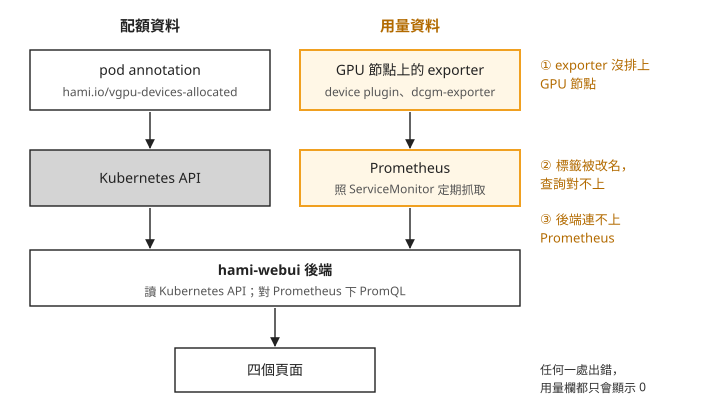
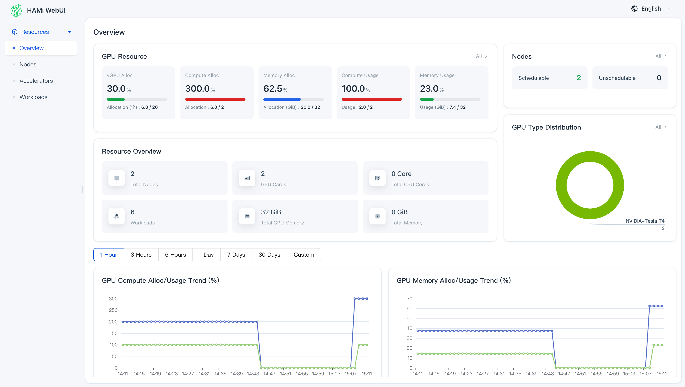
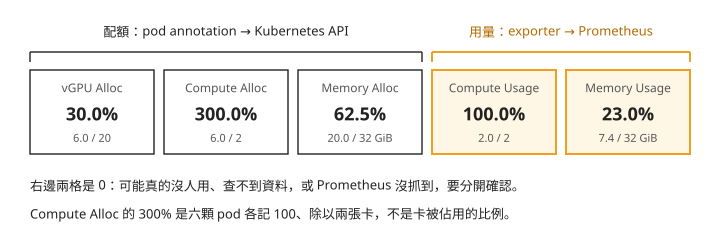
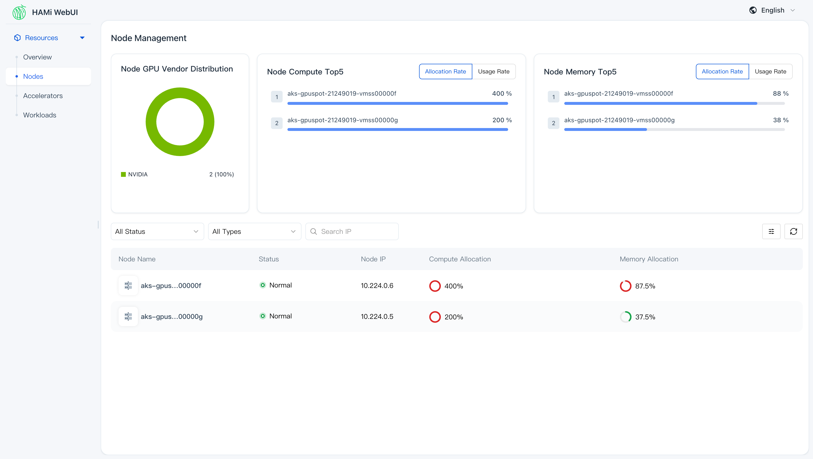
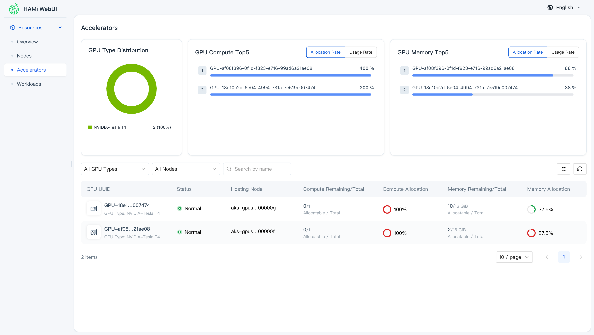
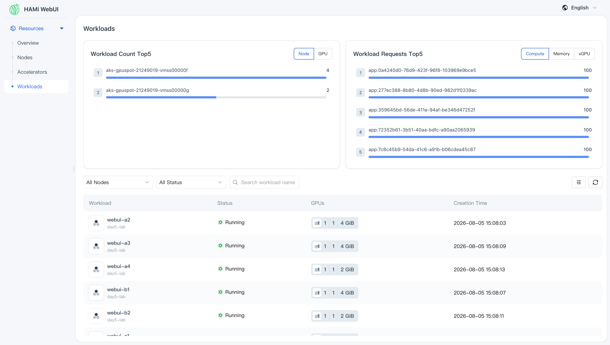
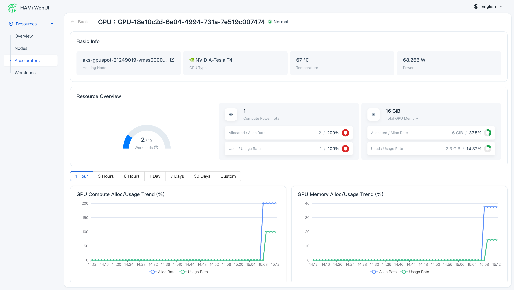

# Day 5: 安裝 HAMi-WebUI——GPU 儀表板上的數字從哪裡來

{ align=right width="100" }

有人問你：「兩張 T4 現在還剩多少 VRAM？要再塞一顆 4 GiB 的推論服務，放得下嗎？」照 Day 3 和 Day 4 的做法，你得下好幾道 `kubectl` 指令，從 pod、節點、metrics 三個地方把數字拼起來，才答得出來。

這一章安裝 HAMi-WebUI，把這些數字放到一個網頁上，打開就看得到哪張卡剩多少、哪顆 pod 佔了哪一塊。安裝過程中，畫面上會好幾次出現 0，而每次的原因都不一樣。讀完之後，看到儀表板上的用量顯示 0，你會知道該怎麼分辨：是後端連不上 Prometheus、查詢條件和資料的標籤對不上、負責回報數字的程式沒排上 GPU 節點，還是真的沒有人在用卡。

## 查一次帳要下三道指令

先回想 Day 3 到 Day 4 是怎麼查帳的：

- `kubectl get pod -o jsonpath` 讀 pod 的 `hami.io/vgpu-devices-allocated` annotation，知道誰配到哪張卡、拿了多少 VRAM。
- `kubectl get node -o json` 讀 `capacity` 和 `hami.io/node-nvidia-register`，知道每張卡本身多大、切成幾份。
- port-forward 到 `hami-scheduler` 的 9395 埠，讀 device 維度的 metrics。

三道指令、三種輸出格式，每多一台節點就要多查一輪。追一顆排錯的 pod 還可以，要回答「整座叢集的卡快滿了沒」就太慢了。

HAMi 官方為這件事另外開了一個子專案 **HAMi-WebUI**。它和 HAMi 本體不在同一個 repo，有自己的 Helm chart（Helm 是 Kubernetes 的套件管理工具，chart 是它的安裝包）和版本號，本課程用 chart / appVersion `1.2.0`。它的後端替你讀 pod 和節點的帳，再向 Prometheus 查用量；前端把結果畫成四個頁面：叢集總覽、節點、顯示卡、工作負載。

## 步驟 1:把 GPU 節點和 HAMi 準備好

GPU pool 平時不用就縮到 0（Day 0 的做法），先拉回 2 台：

```bash
az aks nodepool scale -g <resource-group> --cluster-name <cluster> -n gpuspot \
  --subscription <subscription-id> --node-count 2
```

Day 4 最後把 HAMi 卸載了，重裝前先確認卸載的殘留都清掉了：

- Day 4 收尾時刪掉的 `hami-scheduler-tls` secret 不應該還在，`kubectl get secret -A | grep -i hami` 應該沒有輸出；還在的話先刪掉。
- 卸載後節點物件上會留下 HAMi 的 annotation 和 `capacity`（見 Day 4 疑難排解裡的[「卸載 HAMi 之後，節點上還留著它的資料」](sprint1-day4-hami-kai-integration.md#mine-5)）。如果你的 GPU pool 中間縮到 0 又拉起來，這些殘留會跟著舊節點一起消失，因為新拉起來的是全新的 VM；長期不關的固定節點就要自己清。

HAMi chart 的 `kube-scheduler` 映像沒有寫死版本，而是照叢集的 Kubernetes 版本推出來（我們的叢集是 1.35.6，就去拉 `kube-scheduler:v1.35.6`），預設的 registry 是阿里雲的 `registry.cn-hangzhou.aliyuncs.com`。這個 registry 不保證跟得上最新的 Kubernetes 版本，所以裝之前先問它有沒有這個 tag。下面兩行先取一個匿名的讀取 token，再查這個 tag 的 manifest，回 `200` 就表示映像存在、可以用預設值（版本號換成你叢集的版本）：

```bash
TOK=$(curl -s "https://dockerauth.cn-hangzhou.aliyuncs.com/auth?service=registry.aliyuncs.com:cn-hangzhou:26842&scope=repository:google_containers/kube-scheduler:pull" | jq -r .token)
curl -s -o /dev/null -w "%{http_code}\n" -H "Authorization: Bearer $TOK" \
  -H "Accept: application/vnd.docker.distribution.manifest.list.v2+json" \
  https://registry.cn-hangzhou.aliyuncs.com/v2/google_containers/kube-scheduler/manifests/v1.35.6
```

安裝值和 Day 3 完全相同：device plugin 帶 spot toleration，scheduler 和 patch job 固定在 system pool。

```bash
cat > 01-hami-values.yaml <<'EOF'
devicePlugin:
  tolerations:
    - key: kubernetes.azure.com/scalesetpriority
      operator: Equal
      value: spot
      effect: NoSchedule

scheduler:
  nodeSelector:
    agentpool: system
  patch:
    nodeSelector:
      agentpool: system
EOF

helm install hami hami-charts/hami --version 2.9.0 \
  -n kube-system -f 01-hami-values.yaml
```

安裝後先確認 hami-scheduler 和兩顆 hami-device-plugin 都已就緒，兩台 GPU 節點各有 10 份 `allocatable nvidia.com/gpu`。節點的 annotation 會列出卡片資訊：

```text
hami.io/node-nvidia-register =
  [{"id":"GPU-3a42fadb-…","count":10,"devmem":16384,"devcore":100,
    "type":"NVIDIA-Tesla T4","mode":"hami-core","health":true}]
```

看最後一段：節點的 `hami.io/node-nvidia-register` 記著這張 T4 有 16384 MiB、切成 10 份（`count`），兩台節點的 `allocatable` 也都變成 10。這就是 Day 3 看過的那份節點帳本，等一下 WebUI 會從這裡讀出每張卡的大小。

## 它要的不只是一顆 Prometheus

WebUI 的用量數字不是自己量的，而是向 **Prometheus** 查來的。Prometheus 是一套監控系統：它定期到各個程式開出來的 `/metrics` 網址抓一批數字，依時間存起來，之後可以用查詢語言把某段時間、某個條件的數字撈出來。

官方安裝文件的前置條件只寫了「Prometheus > 2.8.0」，看起來像是叢集裡有一顆 Prometheus 就夠了。但把 chart 拉下來讀 `templates/`，會看到它建立三份 **ServiceMonitor**（webui 自己、HAMi device plugin、dcgm-exporter 各一份）。ServiceMonitor 是一種 Kubernetes 物件，內容是「請 Prometheus 定期來抓這個 Service 的這個埠」。它不是 Kubernetes 內建的種類，而是 **Prometheus Operator** 用 CRD 加進來的。CRD（CustomResourceDefinition）是讓 Kubernetes 認得新種類物件的定義，Day 1 的 Queue、PodGroup 就是這樣來的。Prometheus Operator 是一個控制器，它讀這些 ServiceMonitor，替你產生 Prometheus 的抓取設定。

所以叢集裡沒有 Prometheus Operator 的話，ServiceMonitor 這個種類不存在，三份物件建不起來，`helm install` 第一步就會失敗。真正的前置條件是一整套 Prometheus Operator。chart 給了兩條路：

| 路 | 開關 | 意思 |
|---|---|---|
| (a) 外接 | `externalPrometheus.enabled=true` 加 `address` | 叢集裡已經有 Prometheus Operator 那一套，指過去 |
| (b) 自帶 | `kube-prometheus-stack.enabled=true` | 用 subchart 現拉一套 |

subchart 是包在另一個 chart 裡、當成相依元件一起安裝的 chart，由父 chart 的 values 開關決定裝不裝。我們的叢集還沒有任何 Prometheus，所以走 (b)，接下來要做的是把這套 stack 縮到最小。

## 步驟 2:安裝 WebUI 和精簡過的 Prometheus

先加入 HAMi-WebUI 的 chart repo 並更新索引：

```bash
helm repo add hami-webui https://project-hami.github.io/HAMi-WebUI && helm repo update hami-webui
```

`helm pull hami-webui/hami-webui --version 1.2.0 --untar` 把 chart 拉下來之後，`Chart.yaml` 列出兩個 subchart：

```yaml
dependencies:
- name: dcgm-exporter          version: 3.5.0    condition: dcgm-exporter.enabled          # default true
- name: kube-prometheus-stack  version: 62.6.0   condition: kube-prometheus-stack.enabled  # default false
```

第一個 **dcgm-exporter** 是 NVIDIA 的程式，在每台 GPU 節點上跑一顆，讀出整張卡的使用率、溫度、功耗，開成 `/metrics` 給 Prometheus 抓。第二個就是上一節說的 Prometheus 那一整套，預設關閉。

chart 自己的 values 已經關掉 alertmanager、grafana、nodeExporter、defaultRules 和 kubernetesServiceMonitors。我們還要改三個地方：打開 CRD 和 operator（不開就裝不成），關掉 kube-state-metrics（把 Deployment、Pod 這些 Kubernetes 物件的狀態轉成指標的元件，WebUI 用不到）：

```bash
cat > 02-hami-webui-values.yaml <<'EOF'
nodeSelector:
  agentpool: system

kube-prometheus-stack:
  enabled: true
  crds:
    enabled: true                      # chart default false; without it there is no ServiceMonitor CRD
  kubeStateMetrics:
    enabled: false
  prometheusOperator:
    enabled: true                      # chart default false; without it nobody reconciles the Prometheus CR
    admissionWebhooks:
      enabled: false
    tls:
      enabled: false
    nodeSelector:
      agentpool: system
  prometheus:
    prometheusSpec:
      nodeSelector:
        agentpool: system
      retention: 6h
      resources:
        requests:
          cpu: 100m
          memory: 400Mi
        limits:
          memory: 1Gi
EOF
```

dcgm-exporter 也要補設定。chart 預設把它排到帶 `gpu: "on"` 標籤的節點，剛好對上我們的 GPU 節點，但它的 `tolerations` 預設是空的，而 GPU 節點帶著 spot 的 taint，不補它就排不上去（步驟 6 會看到少了它的樣子）。另外照 NVIDIA GPU Operator 的慣例，用 `extraEnv` 明寫讓它看得到整台節點的 GPU。dcgm-exporter 不跟 Kubernetes 要 `nvidia.com/gpu`，這兩個變數是保險起見加的，本課程沒有測過拿掉它們會怎樣。把這段接到同一個檔案後面：

```bash
cat >> 02-hami-webui-values.yaml <<'EOF'

dcgm-exporter:
  tolerations:
    - key: kubernetes.azure.com/scalesetpriority
      operator: Equal
      value: spot
      effect: NoSchedule
  extraEnv:
    - name: NVIDIA_VISIBLE_DEVICES
      value: "all"
    - name: NVIDIA_DRIVER_CAPABILITIES
      value: "all"
EOF
```

這份值還少兩處設定，步驟 3 和步驟 6 會各遇到一處、補上。先照這一版裝，才看得到少了會怎樣。

chart 內建的 `prometheus.prometheusSpec.serviceMonitorSelector.matchLabels.jobRelease=hami-webui-prometheus` 保留不動。有這一行，這顆 Prometheus 只抓帶了這個標籤的三份 ServiceMonitor，縮小監控範圍。不過，每組不同的指標標籤都會形成一條時間序列並消耗記憶體；受監控的 GPU 節點、pod 或標籤組合增加時，時間序列數量和記憶體用量仍可能增加，詳見 [Prometheus 官方說明](https://prometheus.io/docs/practices/instrumentation/#do-not-overuse-labels)。

```bash
helm install hami-webui hami-webui/hami-webui --version 1.2.0 \
  -n kube-system -f 02-hami-webui-values.yaml
```

裝完之後多出來的元件（表中的 emptyDir 是跟著 pod 生滅的暫存空間，pod 重建資料就沒了；6h retention 指只保留 6 小時的資料）：

| 元件 | 數量／落位 | 說明 |
|---|---|---|
| `hami-webui`(fe + be) | 1 pod／2 容器,system pool | 前端 node server:3000、後端 Go:8000 |
| `hami-webui-kube-prometheus-operator` | 1 pod,system pool | 只為了 reconcile 那顆 Prometheus |
| `prometheus-hami-webui-kube-prometheus-prometheus-0` | 1 pod／2 容器,system pool | 單副本、emptyDir、6h retention |
| `hami-webui-dcgm-exporter` | DaemonSet 2 pod,GPU 節點 | 真實使用率／溫度／功耗 |
| CRD | 10 個(kube-prometheus-stack 的) | 隨 release 生滅 |

一分鐘左右，這些 pod 都會變成 Running。接著跑 `kubectl -n kube-system get servicemonitor`，webui、hami、dcgm 三份都要在；少了任何一份，就是 values 裡沒有打開 Prometheus Operator 的 CRD（`kube-prometheus-stack.crds.enabled`）。

## 步驟 3:pod 全是 Running，後端卻連不上 Prometheus

pod 都起來了，不代表元件之間找得到彼此。WebUI 的後端要向 Prometheus 查用量，先看後端容器的 log：

```text
Error querying Prometheus: Post "http://hami-webui-kube-prometh-prometheus.kube-system.svc.cluster.local:9090/api/v1/query":
dial tcp: lookup ... no such host
```

每秒一行 `no such host`：後端要連的位址不存在。把後端設定裡的位址（`kubectl -n kube-system get cm hami-webui-config -o yaml`）和實際的 Service 名稱（`kubectl -n kube-system get svc`）並排比對，會發現後端要找的是 `hami-webui-kube-prometh-prometheus`，實際建出來的卻是 `hami-webui-kube-prometheus-prometheus`。這個位址是 chart 自己算出來的，算錯的原因見[疑難排解：後端連不上自帶的 Prometheus](#mine-1)。

這時候 UI 打得開，節點清單是對的，用量卻全是 0，因為後端根本查不到 Prometheus。

修法是改走外接那條路，把正確的位址明寫進 `02-hami-webui-values.yaml`，再用同一份檔案 `helm upgrade`：

```yaml
externalPrometheus:
  enabled: true
  address: "http://hami-webui-kube-prometheus-prometheus.kube-system.svc.cluster.local:9090"
```

`helm upgrade` 成功，ConfigMap 也變成新位址了，後端卻還在噴同一個舊位址的錯，pod 也沒有重建。後端的設定是用檔案掛進容器的，chart 的 Deployment 沒有任何會隨設定改變的欄位，Kubernetes 看到 pod template 沒變，就不會重建 pod，容器裡還是啟動時讀進去的舊設定（見[疑難排解：ConfigMap 改了，pod 沒有重啟](#mine-2)）。所以要自己重啟。

重啟之前先處理一件事。Day 0 建的 system pool 只有一台 2 vCPU 節點，裝完 HAMi、WebUI 和 Prometheus 之後，這台節點的 CPU requests 已經用掉九成以上。Deployment 預設的更新方式是先起新的 pod、再停舊的，更新的那段時間要能同時放下兩份 hami-webui（一份要 250m CPU）。放不下的話，新 pod 會一直 Pending：

```text
0/3 nodes are available: 1 Insufficient cpu, 2 node(s) had untolerated taint(s).
preemption: 0/3 nodes are available: 1 No preemption victims found for incoming pod.
```

新的排不進去，舊的也就不會被停掉，更新卡住。先把策略改成先停舊的、再起新的：

```bash
kubectl -n kube-system patch deploy hami-webui \
  -p '{"spec":{"strategy":{"type":"RollingUpdate","rollingUpdate":{"maxSurge":0,"maxUnavailable":1}}}}'
```

代價是更新時介面會中斷幾十秒，對觀測用的介面可以接受。另一個選擇是 system pool 多開一台節點。這道 patch 是用 `kubectl` 直接下的，之後每次 `helm upgrade` 都會把它改回預設值，要記得重下。然後重啟：

```bash
kubectl -n kube-system rollout restart deploy/hami-webui
```

重啟之後，後端的 log 不再出現 `no such host`。

## 步驟 4:佈六顆配額不對稱的切卡負載

畫面上要有東西可看，負載本身得有高低差。六顆 pod 的 VRAM 配額刻意做成不對稱，讓兩張卡的佔用差一倍：

| 節點 | pod | VRAM 配額(MiB) | 卡上合計 |
|---|---|---|---|
| `…00000d` | webui-a1 / a2 / a3 / a4 | 4096 / 4096 / 4096 / 2048 | 14336 / 16384,4/10 vGPU |
| `…00000e` | webui-b1 / b2 | 4096 / 2048 | 6144 / 16384,2/10 vGPU |

下面這段迴圈看起來長，其實六顆 pod 的規格只差最後那張表的四欄：名字、節點、`HOLD_MIB`、配額。真正要注意的只有兩個數字：`nvidia.com/gpumem` 是 HAMi 的 VRAM 配額（4096 或 2048 MiB），`HOLD_MIB` 是容器實際佔住多少 VRAM（1024 或 512 MiB）。容器會一直做 4096×4096 的矩陣乘法，讓用量是真的數字，不是一堆閒置的 pod。

```bash
while read -r name node hold mem; do
  cat <<EOF
---
apiVersion: v1
kind: Pod
metadata:
  name: $name
  namespace: day5-lab
  labels: { demo: hami-webui }
spec:
  restartPolicy: Never
  nodeSelector: { kubernetes.io/hostname: $node }
  tolerations:
    - key: kubernetes.azure.com/scalesetpriority
      operator: Equal
      value: spot
      effect: NoSchedule
  containers:
    - name: app
      image: pytorch/pytorch:2.5.1-cuda12.4-cudnn9-runtime
      env: [{ name: HOLD_MIB, value: "$hold" }]
      command: ["python", "-u", "-c", "import torch,os,time\nprint('total_MiB =', torch.cuda.get_device_properties(0).total_memory//1024//1024, flush=True)\nhold = torch.empty(int(os.environ['HOLD_MIB'])*1024*1024//4, dtype=torch.float32, device='cuda')\nhold.fill_(1.0)\na = torch.randn(4096,4096, device='cuda'); b = torch.randn(4096,4096, device='cuda')\ni = 0\nwhile True:\n    for _ in range(20):\n        c = a @ b\n    torch.cuda.synchronize(); i += 1\n    if i % 20 == 0:\n        print('iter', i, 'reserved_MiB', torch.cuda.memory_reserved()//1024//1024, flush=True)\n    time.sleep(0.2)\n"]
      resources:
        limits:
          nvidia.com/gpu: 1
          nvidia.com/gpumem: $mem
EOF
done > 03-webui-workloads.yaml <<'TABLE'
webui-a1 NODE_A_PLACEHOLDER 1024 4096
webui-a2 NODE_A_PLACEHOLDER 1024 4096
webui-a3 NODE_A_PLACEHOLDER 1024 4096
webui-a4 NODE_A_PLACEHOLDER 512  2048
webui-b1 NODE_B_PLACEHOLDER 1024 4096
webui-b2 NODE_B_PLACEHOLDER 512  2048
TABLE
```

manifest 用 `nodeSelector: kubernetes.io/hostname` 把 pod 固定在指定節點上。節點名每次重建都會變，所以檔案裡先放佔位符。先用 `kubectl get nodes` 查自己叢集當下兩台 GPU 節點的 hostname。六顆 pod 都放在 `day5-lab` namespace，先建立它：

```console
$ kubectl create namespace day5-lab
```

將查到的兩個 hostname 分別填入 `NODE_A='<node-a-hostname>'`、`NODE_B='<node-b-hostname>'`，可用 `sed -e "s/NODE_A_PLACEHOLDER/${NODE_A}/" -e "s/NODE_B_PLACEHOLDER/${NODE_B}/" 03-webui-workloads.yaml | kubectl apply -f -` 套用。修正後的寫法本課沒有實跑。下方保留直接填入 hostname 的原寫法，執行前須把 `<node-a-hostname>`、`<node-b-hostname>` 換成查到的值：

```bash
sed -e 's/NODE_A_PLACEHOLDER/<node-a-hostname>/' \
    -e 's/NODE_B_PLACEHOLDER/<node-b-hostname>/' 03-webui-workloads.yaml | \
kubectl apply -f -
```

等六顆 pod 全部變成 `Running`，再比對容器內的 VRAM 總量和 pod annotation：

```text
容器裡看到的是切片:
  webui-a1  total_MiB = 4096      webui-a4  total_MiB = 2048
  webui-b1  total_MiB = 4096

pod annotation(HAMi 的帳本):
  webui-a1  GPU-3a42fadb-…,NVIDIA,4096,0:;
  webui-a4  GPU-3a42fadb-…,NVIDIA,2048,0:;
  webui-b1  GPU-361043c7-…,NVIDIA,4096,0:;
```

容器裡看到的 VRAM 總量就是自己的配額（4096 或 2048 MiB），而 pod annotation 記著每顆 pod 配到哪張卡（GPU UUID）、多少 MiB。接下來 WebUI 讀的配額，就是這些 annotation。

## 畫面上的數字從兩個地方來

開始對數字之前，先看 WebUI 的每個數字從哪裡來。下面這張圖左右兩邊各是一種資料，由上往下是數字流動的方向：



我們可以從圖上看到兩件事：

1. **配額資料**的路很短。HAMi 排程時把配額寫進 pod annotation，後端讀一次 Kubernetes API 就拿到了。HAMi 裝好、pod 排上去，這一邊就是對的。
2. **用量資料**的路長得多。GPU 節點上的 exporter（把程式內部的數字開成 `/metrics` 的程式，這裡是 HAMi device plugin 和 dcgm-exporter）先產生指標，Prometheus 定期抓走，後端再對 Prometheus 下查詢，算出每張卡、每顆 pod 的用量。

用量這條路上任何一處出錯，畫面上看到的都一樣：顯示 0。圖上標的三處，步驟 3 已經遇到「後端連不上 Prometheus」，另外兩處在步驟 6。真的沒有人在用卡，畫面也是 0。要分辨這幾種 0，就得知道數字是走哪一條路來的。

## 步驟 5:不開瀏覽器，先用 curl 對配額

先不看畫面，直接問後端要數字，跟步驟 4 的表格逐格對。

WebUI 的資料 API 要經過前端的 3000 埠，路徑前綴是 `/api/vgpu`。前端容器裡的 proxy 設定把這段前綴拿掉，再轉給同一顆 pod 裡的後端：

```yaml
# /apps/dist/config/production/proxy.js, inside the frontend container
vgpu:
  target: 'http://127.0.0.1:8000'
  pathRewrite: { '^/api/vgpu': '' }
```

**PromQL** 是 Prometheus 的查詢語言，可以在大括號裡寫標籤條件，篩選符合條件的指標。下表的 `/api/vgpu/v1/monitor/query/instant-vector` 端點會由 WebUI 後端代為向 Prometheus 執行 PromQL 查詢，再把結果回傳給前端。

| 瀏覽器實際打的路徑(:3000) | 後端路由 | 方法 | 用途 |
|---|---|---|---|
| `/api/vgpu/v1/summary` | `/v1/summary` | POST | 首頁統計 |
| `/api/vgpu/v1/nodes` | `/v1/nodes` | POST | 節點列表 |
| `/api/vgpu/v1/gpus` | `/v1/gpus` | POST | 顯卡列表 |
| `/api/vgpu/v1/containers` | `/v1/containers` | POST | 任務列表 |
| `/api/vgpu/v1/monitor/query/instant-vector` | 同左 | POST | 由後端代查 Prometheus，供圖表使用 |
| `/health_check` | —(前端自己) | GET | 存活探測 |

要記的只有一件事：資料 API 全部用 POST，而且至少要帶 `{"filters":{}}`，送空物件 `{}` 會回 500。路徑打錯也不會回報錯誤：前端對不認得的路徑一律回網頁本身的 HTML（它是在瀏覽器裡自己切換頁面的單頁應用，SPA），所以拿到一整頁 HTML 就代表路徑錯了。

```bash
kubectl -n kube-system port-forward svc/hami-webui 13000:3000
curl -s -X POST -H 'Content-Type: application/json' -d '{"filters":{}}' \
  http://127.0.0.1:13000/api/vgpu/v1/summary
```

```json
{"vgpuUsed":6,"vgpuTotal":20,"coreUsed":600,"coreTotal":200,
 "memoryUsed":20480,"memoryTotal":32768,"gpuCount":2,"nodeCount":2}
```

跟步驟 4 的表格對一下：20 份 vGPU 用掉 6 份，32768 MiB 配出 20480 MiB（4096×3 + 2048 + 4096 + 2048），兩張卡、兩台節點。`coreUsed` 600 比 `coreTotal` 200 還大，步驟 7 會說明這個數字怎麼算。

`/v1/nodes` 和 `/v1/gpus` 用同樣的方式打，每台節點、每張卡的配額也和表格一致：

```json
{"list":[
 {"name":"aks-gpuspot-21249019-vmss00000d","ip":"10.224.0.5","isSchedulable":true,"isReady":true,
  "type":["NVIDIA-Tesla T4"],"cardCnt":1,
  "vgpuUsed":4,"vgpuTotal":10,"memoryUsed":14336,"memoryTotal":16384,
  "osImage":"Ubuntu 24.04.4 LTS","kubeletVersion":"v1.35.6"},
 {"name":"aks-gpuspot-21249019-vmss00000e","ip":"10.224.0.6",
  "vgpuUsed":2,"vgpuTotal":10,"memoryUsed":6144,"memoryTotal":16384, …}]}

{"list":[
 {"uuid":"GPU-361043c7-…","nodeName":"…00000e","vgpuUsed":2,"vgpuTotal":10,
  "memoryUsed":6144,"memoryTotal":16384,"mode":"hami-core","health":true},
 {"uuid":"GPU-3a42fadb-…","nodeName":"…00000d","vgpuUsed":4,"vgpuTotal":10,
  "memoryUsed":14336,"memoryTotal":16384,"mode":"hami-core","health":true}]}
```

任務列表要多帶一個分頁參數 `pageSize`：

```bash
curl -s -X POST -H 'Content-Type: application/json' \
  -d '{"filters":{},"pageSize":{"pageSize":50,"pageNo":1}}' \
  http://127.0.0.1:13000/api/vgpu/v1/containers
```

```text
count = 6
 webui-a1  …00000d  ns=day5-lab  mem= 4096  cores=100  success  GPU-3a42fadb…
 webui-a2  …00000d  ns=day5-lab  mem= 4096  cores=100  success  GPU-3a42fadb…
 webui-a3  …00000d  ns=day5-lab  mem= 4096  cores=100  success  GPU-3a42fadb…
 webui-a4  …00000d  ns=day5-lab  mem= 2048  cores=100  success  GPU-3a42fadb…
 webui-b1  …00000e  ns=day5-lab  mem= 4096  cores=100  success  GPU-361043c7…
 webui-b2  …00000e  ns=day5-lab  mem= 2048  cores=100  success  GPU-361043c7…
```

到這裡，配額資料已經逐格核對過。這個方法在沒有瀏覽器的地方（跳板機、CI）也能用，而且比看截圖精確。

## 步驟 6:用量顯示 0——把用量資料接通

在已連上本章叢集的本機終端機，將 Prometheus 的 9090 埠轉到本機 19090，並保持此終端機開啟（依官方文件補上，本課沒有實跑；語法見 [Kubernetes 1.35 port-forward 文件](https://v1-35.docs.kubernetes.io/docs/reference/kubectl/generated/kubectl_port-forward/)）：

```bash
kubectl -n kube-system port-forward \
  svc/hami-webui-kube-prometheus-prometheus 19090:9090
```

在本機瀏覽器開啟 `http://127.0.0.1:19090/targets` 查看抓取對象與狀態。

上面任務列表裡的 `mem` 和 `cores` 都是配額。同一份回應裡另有一組用量欄位，此時六顆全是 0。步驟 3 已經修好後端的位址，所以這次不是連不上 Prometheus。先看 Prometheus 有沒有抓到資料，它自己的 target 頁面（Prometheus 定期去抓的對象清單）五個都是 `up`：

```text
hami-webui-dcgm-exporter    10.244.1.250:9400  up
hami-webui-dcgm-exporter    10.244.2.44:9400   up
hami-device-plugin-monitor  10.244.1.143:9394  up
hami-device-plugin-monitor  10.244.2.201:9394  up
hami-webui                  10.244.0.135:8000  up
```

本章使用的 [kube-prometheus-stack 62.6.0 預設映像](https://raw.githubusercontent.com/prometheus-community/helm-charts/kube-prometheus-stack-62.6.0/charts/kube-prometheus-stack/values.yaml)是 Prometheus v2.54.1，另開本機終端機，透過 API 查詢 `hami_vgpu_memory_used_bytes` 的目前數值（依官方文件補上，本課沒有實跑；語法見 [Prometheus v2.54.1 即時查詢文件](https://github.com/prometheus/prometheus/blob/v2.54.1/docs/querying/api.md#instant-queries)）：

```bash
curl -fsS --get 'http://127.0.0.1:19090/api/v1/query' \
  --data-urlencode 'query=hami_vgpu_memory_used_bytes'
```

在 Prometheus 裡查 `hami_vgpu_memory_used_bytes` 這個指標，也有真實數值。指標有了、Prometheus 抓得到、後端也連得上，數字卻還是 0，那問題就出在後端的查詢條件。

### 查詢條件和標籤對不上

Prometheus 的每一筆指標都帶著一組標籤（label），例如這筆數字屬於哪個 namespace、哪顆 pod。後端算每顆 pod 的 VRAM 用量時，用 PromQL 指定標籤條件：

```text
avg(hami_vgpu_memory_used_bytes{device_uuid="GPU-…", namespace="day5-lab", pod="webui-a1", container="app"})
```

它要找的是 `namespace="day5-lab"`、`pod="webui-a1"` 的資料。可是實際存進 Prometheus 的資料長這樣：

```text
{ namespace="kube-system", pod="hami-device-plugin-l9d9m",
  exported_namespace="day5-lab", exported_pod="webui-a1", container="app" } => 1478624256
```

`day5-lab` 和 `webui-a1` 還在，只是標籤名稱多了 `exported_` 前綴；原本的 `namespace` 和 `pod` 則變成了 HAMi device plugin 自己那顆 pod。Prometheus 抓資料時，會替每筆資料加上「從哪顆 pod 抓來的」`namespace` 和 `pod` 標籤。exporter 自己也帶了同名的標籤，兩者衝突時，Prometheus 預設保留自己加的，把 exporter 帶的改名成 `exported_<原名>`。後端的條件因此永遠找不到資料，命中 0 筆，畫面就寫 0：資料明明存在，只是查詢條件和標籤對不上。

ServiceMonitor 的 `honorLabels` 設定決定衝突時保留誰。設成 `true`，就保留 exporter 自己帶的標籤。chart 預設是 `false`，在 values 裡打開：

```yaml
hamiServiceMonitor:
  honorLabels: true
```

加進 `02-hami-webui-values.yaml` 再 `helm upgrade`。這次 upgrade 也會把步驟 3 那道 `maxSurge: 0` 的 patch 改回預設值，upgrade 完記得把步驟 3 的 `kubectl patch` 再下一次，下次重啟才不會卡住。這次改的是 ServiceMonitor，不是後端的 ConfigMap，不用重啟 hami-webui。約 90 秒後（Prometheus 重新載入設定、後端再算一輪），同一組指標出現真實數值：

```text
webui-a1 => 1410.1 MiB    webui-a2 => 1410.1 MiB    webui-a3 => 1410.1 MiB
webui-a4 =>  898.1 MiB    webui-b1 => 1410.1 MiB    webui-b2 =>  898.1 MiB
hami_container_core_util:webui-a1/a3/a4 = 100、b1/b2 = 96
```

以後看到「數字是 0」，先把後端那句 PromQL 原封不動拿到 Prometheus 查一次：查得到，問題在後端；查不到，再比對 exporter 輸出的標籤和存進去的標籤。看到 `exported_` 前綴，就是這個問題。

### exporter 沒排上 GPU 節點

卡片的溫度、功耗、整卡使用率，由 dcgm-exporter 提供。它是一個 DaemonSet：Kubernetes 會在每一台符合條件的節點上各跑一顆。步驟 2 的 values 已經替它加了 spot 的 toleration，所以這一章沒有真的遇到這個問題。少了這段 toleration 會怎樣，可以用一個同樣 `nodeSelector: gpu=on`、不帶 toleration 的探針 DaemonSet 看出來：

```text
NAME               DESIRED   CURRENT   READY   NODE SELECTOR
toleration-probe   0         0         0       gpu=on
```

`DESIRED` 欄位是這個 DaemonSet 的預期執行數，這裡是 0。GPU 節點帶著 `kubernetes.azure.com/scalesetpriority=spot:NoSchedule` 這個 taint，DaemonSet 遇到不能容忍的 taint，會直接把那台節點當成「不需要跑」，不會留下 Pending 的 pod。`kubectl get pods` 什麼都看不到，`kubectl describe` 也沒有事件，沒有任何訊息提醒你少裝了。換成 dcgm-exporter，畫面上的溫度、功耗、使用率就會全空。所以驗 DaemonSet 時要看 `DESIRED`：`kubectl -n kube-system get ds hami-webui-dcgm-exporter` 的 `DESIRED` 應該等於 GPU 節點數。

確認 dcgm-exporter 有在回報，可以透過 WebUI 的 PromQL 查詢端點查整卡使用率。端點名稱裡的 instant-vector 指「查某一個時間點的值」，相對於查一段時間的曲線：

```bash
curl -s -X POST -H 'Content-Type: application/json' -d '{"query":"DCGM_FI_DEV_GPU_UTIL"}' \
  http://127.0.0.1:13000/api/vgpu/v1/monitor/query/instant-vector
```

```text
aks-gpuspot-…00000d  gpu 0 => 100
aks-gpuspot-…00000e  gpu 0 => 100
```

兩張卡都被矩陣乘法壓在 100%。到這裡，節點、顯卡、任務三個層級都有真實的用量，可以打開瀏覽器了。

## 步驟 7:四個頁面逐頁看

port-forward 還開著的話，瀏覽器打開 `http://127.0.0.1:13000/`。每一頁都看同一件事：哪些數字是配額、哪些是用量，再拿配額去對步驟 4 的表格。四個頁面各回答一個問題：

| 頁面 | 回答的問題 |
|---|---|
| Overview | 整座叢集配出去多少、實際用掉多少 |
| Nodes | 哪一台節點的卡快滿了 |
| Accelerators | 每一張實體卡的配額、用量、溫度、功耗 |
| Workloads | 每一顆 pod 拿了哪張卡的哪一塊 |

下面的截圖用的是同一組六顆 pod、同樣的配額，只是節點重建過一次，所以節點名是 `…00000f`／`…00000g`，GPU UUID 也和前面的輸出不同。

### Overview



看最上面那排五格之前，先認識一個欄位。HAMi 讓 pod 用 `nvidia.com/gpucores` 宣告最多可以用一張卡多少百分比的算力；沒有宣告，HAMi 就把這顆 pod 記成 100（等於不限制）。我們的六顆 pod 都沒有寫 `gpucores`。

把這一排五格單獨畫出來，標上每一格的來源：



我們可以從圖上看到，左邊三格是配額，右邊兩格是用量。左邊正常、右邊是 0 的時候，先別急著認定哪裡壞了，0 有三種可能，各有確認的方法：

- **數值真的是 0**：卡上沒有工作在跑。到 Prometheus 查 `DCGM_FI_DEV_GPU_UTIL`，有回傳資料、值是 0，就是真的閒著。
- **沒有資料**：Prometheus 抓到了，但查詢條件找不到。把後端的 PromQL 拿到 Prometheus 查，回傳是空的；再看存進去的標籤，有 `exported_` 前綴就是步驟 6 的標籤問題。
- **抓取失敗**：Prometheus 根本沒抓到。打開 Prometheus 的 targets 頁，對應的 target 是 `down`，或根本不在清單上（例如 exporter 的 DaemonSet `DESIRED` 是 0）。

`Compute Alloc` 的 300%，就是步驟 5 裡 `coreUsed` 600 對 `coreTotal` 200 的那個比例：六顆 pod 各記 100，加起來除以兩張卡。所以在沒有寫 `gpucores` 的叢集裡，這一格是「有 GPU 的 pod 數 × 100 ÷ 卡數」，不是卡被佔用的比例，拿它做容量規劃會得到很奇怪的結論。VRAM 那一格才是真的會擋住下一顆 pod 的數字。

下方 `Resource Overview` 的 `Total CPU Cores` 和 `Total Memory` 是 0。這兩格跟 GPU 無關，它們的資料原本由 node-exporter 和 kube-state-metrics 提供，而這兩個元件在步驟 2 都關掉了。

### Nodes



上方兩張 Top5 是排行，不是總量。六顆 pod 刻意分得不平均，四顆 pod 的那台排在前面，這裡直接看得出負載偏在哪一台。

### Accelerators



排行榜右上角的 `Allocation Rate`／`Usage Rate` 按鈕，切換的就是配額和用量兩種資料。`GPU Compute Top5` 的 400% 和 200% 跟 Overview 的 300% 是同一個算法：一張卡上四顆 pod，另一張兩顆。`GPU Memory Top5` 的 88% 和 38% 才是 VRAM 的配額，也就是步驟 4 表格裡的 14336/16384 和 6144/16384。

### Workloads



清單每一列的 `GPUs` 欄有三個數字：整卡數、vGPU 份數、VRAM 配額，和 manifest 一致。右上的 `Workload Requests Top5` 切到 `Compute` 之後全部是 100，就是那個 400% 拆開來的樣子。這份排行列的是容器 ID，不是 pod 名稱，要對到哪一顆 pod 得回清單查。

### 單張顯示卡



`Basic Info` 的溫度和功耗只有 dcgm-exporter 提供得出來，這兩格空白，就回去看步驟 6 的 `DESIRED`。`Resource Overview` 把配額和用量上下並排：VRAM 配了 37.5%，實際只用了 14.32%，兩者差多少在同一格裡就看得到，這是 `kubectl` 查不到的。左邊 `2 / 10 Workloads` 儀表的分母 10，就是 Day 3 看過的 `deviceSplitCount`：HAMi 把一張卡切成幾份，也就是一張卡最多接幾個容器。

## 節點消失時，畫面長什麼樣

spot 節點隨時可能被 Azure 收回。Overview 截圖下方那兩張趨勢圖，正好記下了兩台 GPU 節點先後被收走、再重新拉起來的過程。從左到右分成三段：

- 左段：算力配額 200%、VRAM 配額 37.5%。這時第一台已經被收走，只剩一張卡和上面的兩顆 pod，不是正常的數字。
- 中段：兩條線一起掉到 0，維持了二十多分鐘，兩台都不在了。
- 右段：跳回 300% 和 62.5%，節點重建、六顆 pod 重新佈上去。

只看配額掉下來，分不出是 pod 跑完了還是節點不見了。這時看分母：`/v1/summary` 的 `vgpuTotal`（或 Overview 的 GPU 卡數）跟著變少，就是有卡不見了；分母不變、只有分子變少，才是 pod 結束了。再用 `kubectl get nodes` 確認 GPU 節點還剩幾台。只剩一張卡的那段時間，Accelerators 頁上只列一張卡，配額和用量都照常更新，畫面沒有任何異常標記，不看分母就不會發現。單張卡的詳情頁則看不到這段過程，節點重建之後 GPU UUID 是新的，舊卡的歷史不會跟過來。要看跨越節點重建的事件，看叢集或節點層級的圖。

節點也不會自己補回來。GPU pool 沒有開 cluster autoscaler，被收走之後節點數就停在 0，要自己 scale 回去（見 Day 2 疑難排解的[「spot 節點被收走後，pool 不會補回來」](sprint1-day2-gang-scheduling-preemption.md#mine-4)）。scale 回 2 台之後，HAMi 的 device plugin 和 dcgm-exporter 會自動排上新節點，`vgpuTotal` 回到 20，WebUI 和 HAMi 的設定都不用動。

要重來的是那六顆 pod。新節點的 hostname 不一樣了，`03-webui-workloads.yaml` 要用新的 hostname 重新 `sed` 一次。忘了換，或直接 apply 還留著佔位符的檔案，六顆 pod 都會一直 Pending，`hami-scheduler` 的事件只寫 `didn't match Pod's node affinity/selector`，不會告訴你那個 hostname 已經不存在。這是用 `kubernetes.io/hostname` 把 pod 固定在節點上的代價。本章這樣寫，是為了讓兩張卡的配額不對稱；正式環境要指定位置，應該用 pool 層級的標籤（`agentpool`、`gpu=on`）或 [Day 4](sprint1-day4-hami-kai-integration.md) 用過的 `hami.io/node-scheduler-policy` annotation，這兩種在節點重建後都還有效。

## 步驟 8:收尾

刪掉 `day5-lab` namespace 的六顆 pod，把 GPU pool 縮回 0。WebUI 和 HAMi 兩個 release 都留著。它們的控制元件都固定在 system pool，device plugin 和 dcgm-exporter 則跟著 GPU 節點出現和消失，下次把 pool 拉起來就會自己排上去。

縮到 0 之後，UI 上的節點、顯示卡、工作負載會全部變成 0，配額和用量兩邊同時歸零，因為節點不在了，device plugin 和 exporter 也跟著不在。這是預期中的樣子，不是安裝壞了。

## 疑難排解

### 後端連不上 chart 自帶的 Prometheus,位址是用舊規則算出來的 {#mine-1}

**症狀**:pod 全 `Running`、target 全 `up`,只有用量全是 0,後端 log 每秒一行 `no such host`。

**原因**:`externalPrometheus.enabled=false` 時,chart 的 `templates/configmap.yaml` 用寫死的字串湊位址:

```text
printf "http://%s-kube-prometh-prometheus.%s.svc.cluster.local:9090" (fullname) (namespace)
```

subchart(kube-prometheus-stack 62.6.0)實際建出來的 Service 叫 `...-kube-prometheus-prometheus`。chart 用的是舊版截短名稱的規則,兩邊都不會回報錯誤。

**修法**:改用 `externalPrometheus` 明寫位址,見步驟 3。

### ConfigMap 改了,pod 沒有重啟 {#mine-2}

**症狀**:`helm upgrade` 成功、ConfigMap 是新設定,後端卻還用舊設定,pod 沒有重建。

**原因**:設定以檔案掛進容器(`--conf /apps/config/config.yaml`),Deployment 沒有 `checksum/config` 這類隨設定改變的 annotation,pod template 沒變就不會重建。

**修法**:`rollout restart`,見步驟 3。別的 chart 可以用 `helm get manifest` 看 pod template 有沒有隨設定改變的欄位。

### 每顆 pod 的用量永遠是 0,標籤被加上了 `exported_` 前綴 {#mine-3}

**症狀**:後端連得上 Prometheus、指標查得到真實數值,每顆 pod 的用量卻都是 0。

**原因**:`hamiServiceMonitor.honorLabels` 預設 `false`,Prometheus 把 exporter 自帶的 `namespace`/`pod` 改名成 `exported_*`,後端的 PromQL 命中 0 筆。

**修法**:設 `honorLabels: true`,見步驟 6。

## 想一想

- 你接手一座叢集，WebUI 上每顆 pod 的 VRAM 配額都正常，但 `Memory Usage` 一直是 0%。你會依序查哪些地方？
- 一位同事看到 Accelerators 頁上某張卡的算力分配率是 800%，認為這張卡嚴重超載，要求把一半的 pod 搬走。你會先確認什麼？
- 某天早上，Overview 的趨勢圖顯示 VRAM 配額從 62.5% 掉到 31%，而沒有人刪過 pod。你會怎麼判斷是工作負載結束了，還是節點不見了？

## 小結

HAMi-WebUI 把 HAMi 散在 pod annotation、節點物件和 metrics 裡的數字集中到一個網頁上，但它需要的不只是一顆 Prometheus，而是一整套 Prometheus Operator，因為 chart 用 ServiceMonitor 告訴 Prometheus 要抓誰。畫面上的數字分成兩種：配額從 pod annotation 經 Kubernetes API 來，HAMi 裝好就對；用量要經過 exporter、Prometheus、後端的 PromQL，任何一處出錯都只會顯示 0。之後看到儀表板上的 0，先想這個數字走的是哪條路，再依序查後端連不連得上 Prometheus、查詢條件和標籤對不對得上、exporter 的 `DESIRED` 是不是等於節點數，最後才是真的沒有人在用。另外，HAMi 的算力分配率在沒有宣告 `gpucores` 時只是 pod 數的加總，VRAM 才是會擋住下一顆 pod 的那個數字。

## 延伸閱讀

想再深入，可以從這幾份開始：

- **[HAMi-WebUI 專案首頁](https://github.com/Project-HAMi/HAMi-WebUI)** —— 本章主題的原始碼,後端 `server/api/v1/*.proto` 的路由定義與 `server/internal/exporter/exporter.go` 的 PromQL 查詢都在裡面,對應步驟 5 的 API 寫法和疑難排解裡的[「`exported_` 前綴」](#mine-3)。
- **[HAMi-WebUI Helm 安裝指南](https://github.com/Project-HAMi/HAMi-WebUI/blob/main/docs/installation/helm/index.md)** —— 官方的前置條件(Prometheus > 2.8.0)與 `externalPrometheus.address` 的寫法,本章外接、自帶兩條路的出處。
- **[Prometheus scrape_config 設定說明](https://prometheus.io/docs/prometheus/latest/configuration/configuration/)** —— `honor_labels` 的完整定義,包含「設為 false 時衝突標籤會被改名成 `exported_<原名>`」這句話,步驟 6 的標籤問題就出在這裡。
- **[NVIDIA dcgm-exporter](https://github.com/NVIDIA/dcgm-exporter)** —— `DCGM_FI_DEV_GPU_UTIL` 等指標的定義與 DaemonSet 部署方式,卡片詳情頁的溫度、功耗、整卡使用率全部由它提供。

## 下一步

今天畫面上每一個 GPU 相關的數字，追到底都來自同一組東西：一個整數型的擴充資源 `nvidia.com/gpu`、幾條寫在 pod annotation 裡的自訂字串，再加上一支 exporter 回報執行時的實際狀況。Day 3 到 Day 5 遇到的限制也都出在這裡：VRAM 要靠額外的資源名稱或 annotation 表達，卡的規格要從節點標籤推出來，一個節點上的 `nvidia.com/gpu` 只能有一個提供者，而 UI 想講清楚「這顆 pod 拿了哪張卡的哪一塊」，得自己把三個來源拼起來。

Kubernetes 為此準備了一套新的表達方式，叫 Dynamic Resource Allocation。裝置不再是節點上的一個整數，而是可以被描述、被挑選、被宣告用途的物件。Day 6 先在不需要 GPU 的環境把它的概念與物件模型走一遍，看今天這些繞路在那套做法裡各自變成什麼。

---

!!! quote ""
    HAMi 與 HAMi-WebUI 標誌為該專案之官方資產,此處作社群教學用途。
