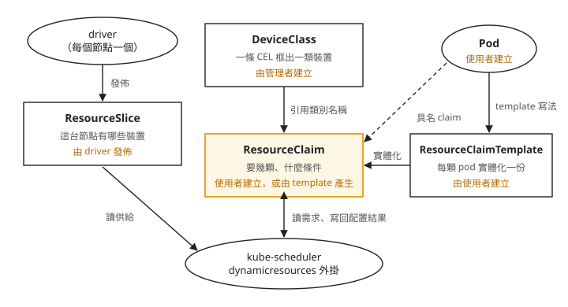
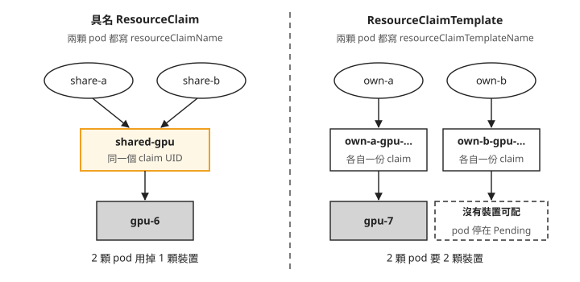

# Day 6: DRA 基礎——用模擬裝置學 ResourceClaim、DeviceClass 與 CEL

{ align=right width="95" }

假設你要替一個推論服務寫 pod，需求是「VRAM 40Gi 以上的卡，而且不要舊的那一批型號」。打開 `resources.limits`，你能寫的只有一行 `nvidia.com/gpu: 1`。這一格只放得下一個整數，「多大」「哪一型」都沒有地方寫。

這一章介紹 Kubernetes 裡另一種要裝置的寫法：Dynamic Resource Allocation（DRA，動態資源配置）。我們不開真卡，改用官方的模擬 driver 在一台 CPU 節點上變出幾顆假的 GPU，把「挑符合條件的裝置」「排除某個型號」「兩顆 pod 共用同一顆裝置」都實際做一次。

讀完之後，你能判斷裝置條件該由管理者統一定義，還是由個別工作提出，也能選擇讓兩顆 pod 共用一顆裝置，或各自取得裝置的寫法。

## 整數寫不出條件

Day 0 到 Day 5 用的都是 device plugin 的做法：節點回報「我有幾個 `nvidia.com/gpu`」，pod 在 `resources.limits` 寫要幾個，排程器做減法。這套做法能回答「幾顆」，回答不了「哪一顆」。

Day 3 已經碰過這個限制。為了表達「我只要 4 GB」，HAMi 另外發明了 `nvidia.com/gpumem` 這個資源名稱，再加一支攔在 CUDA 前面的函式庫才擋得住超用（[Day 3](sprint1-day3-hami-memory-isolation.md)）。挑 VRAM 大於某個門檻的卡、排掉某一型、讓兩顆 pod 明確共用同一顆，在 device plugin 的寫法裡都只能靠節點標籤、annotation 或自訂資源名稱繞過去。

DRA 換了一個做法：裝置不再是節點上的一個數字，而是一個個帶著屬性的 API 物件。pod 可以用條件挑裝置，也可以用名字指定要跟誰共用。DRA 的核心在 Kubernetes 1.34 正式發佈（GA），API 群組是 `resource.k8s.io/v1`。

## 為什麼用一台 CPU 節點就夠

這一章用的 driver 是 **kubernetes-sigs/dra-example-driver v0.4.0**。它管的裝置是模擬出來的，不碰任何硬體，設定 `numDevices: 8` 就會回報八顆。

模擬裝置學得到東西，是因為 DRA 從頭到尾的流程跟真卡一樣：driver 回報裝置、使用者寫條件、排程器挑一顆、節點上的 driver 把裝置交給容器。唯一的差別在最後一步：真卡要把 `/dev/nvidia*` 和函式庫掛進容器，模擬裝置只放進幾個環境變數。這一章要學的是前面那一整段。

你需要 Day 0 建好的 AKS，以及一個只有一台 CPU 節點的 spot 節點池 `drasim`（spot 是 Day 0 用過的折扣 VM，Azure 需要容量時可能把它收回）。步驟 1 會建立這個節點池，完成練習後再刪除；本章不需要 GPU 節點。

## 步驟 1:先確認映像拉得到，再開節點

先把 driver 的原始碼 clone 下來，使用這一章的 `v0.4.0` tag。安裝用的 chart 和後面要讀的原始碼都在裡面。後續指令都在 `dra-example-driver` 目錄執行，chart 的相對路徑是 `./deployments/helm/dra-example-driver`：

```bash
git clone --branch v0.4.0 --depth 1 https://github.com/kubernetes-sigs/dra-example-driver.git
cd dra-example-driver
```

這個 driver 用 Helm 安裝：Helm 是 Kubernetes 的套件管理工具，chart 是它的安裝套件，chart 裡的 `values.yaml` 是預設設定值，安裝時可以用自己的值檔覆蓋。chart 放在 `deployments/helm/dra-example-driver/`，它的 `values.yaml` 寫的倉庫位址是 `registry.k8s.io/dra-example-driver/dra-example-driver`，`tag` 留空時取 `Chart.yaml` 的 `appVersion`（`v0.4.0`）。不必真的把映像拉下來，直接向 registry 要這個 tag 的 manifest 就知道它存不存在：

```console
$ curl -sSL -o /dev/null -w "%{http_code} %{content_type}\n" \
    "https://registry.k8s.io/v2/dra-example-driver/dra-example-driver/manifests/v0.4.0" \
    -H "Accept: application/vnd.oci.image.index.v1+json, application/vnd.docker.distribution.manifest.list.v2+json"
200 application/vnd.docker.distribution.manifest.list.v2+json
```

`200` 表示映像存在，而且不用登入就拿得到。回來的類型是 manifest list，也就是一份索引，列出同一個映像在不同 CPU 架構（這裡是 amd64、arm64、ppc64le）各自的版本，節點會自己挑對的那一份。

確定映像沒問題，再開節點池。規格照 Day 0，只是換成 CPU 機型：

```console
$ az aks nodepool add -g <resource-group> --cluster-name <cluster> -n drasim \
    --subscription <subscription-id> --node-count 1 --node-vm-size Standard_D2as_v5 \
    --priority Spot --eviction-policy Delete --spot-max-price -1 --labels pool=drasim --no-wait
16:02:01  下達 add
16:03:53  節點 Ready(1 分 52 秒):aks-drasim-30601265-vmss000000  v1.35.6
          labels: pool=drasim / kubernetes.azure.com/scalesetpriority=spot
          taints: kubernetes.azure.com/scalesetpriority=spot:NoSchedule
          allocatable: cpu=1900m  memory=5930728Ki  pods=250
```

輸出裡要記下的是標籤 `pool=drasim` 和 spot 的 taint。後面所有 `nodeSelector` 與 toleration 都照這兩項寫。

## 步驟 2:裝 driver，讀出第一份 ResourceSlice

先寫安裝值。`image` 指定映像來源與版本，`kubeletPlugin.numDevices` 設定每個節點模擬幾顆裝置，`nodeSelector` 與 `tolerations` 讓 driver 排到帶有 spot taint 的 `drasim` 節點。

值檔裡有幾行註解提到 `DRA` 開頭的名字，例如 `DRAConsumableCapacity`。這些是 DRA 周邊功能的開關名稱：`BETA=1` 表示這項功能在 beta 階段，而且這座叢集有開；`which is 0` 表示沒開。註解寫 0 的，表示它依賴的功能在這座叢集沒開，所以把對應的設定關掉。步驟 3 會實際查出這些開關的狀態：

```bash
cat > 01-dra-driver-values.yaml <<'EOF'
deviceProfile: "gpu"

image:
  repository: registry.k8s.io/dra-example-driver/dra-example-driver
  tag: "v0.4.0"
  pullPolicy: IfNotPresent

gpuDeviceStatus: true                # DRAResourceClaimDeviceStatus is BETA=1 here
gpuAllowMultipleAllocations: false   # needs DRAConsumableCapacity, which is 0

deviceClass:
  extendedResourceName: ""           # needs DRAExtendedResource, which is 0

kubeletPlugin:
  numDevices: 8
  gpuPartitions: 0                   # needs DRAPartitionableDevices, which is 0
  nodeSelector:
    pool: drasim
  tolerations:
    - key: kubernetes.azure.com/scalesetpriority
      operator: Equal
      value: spot
      effect: NoSchedule
  containers:
    plugin:
      resources:
        requests:
          cpu: 50m
          memory: 64Mi

controller:
  plugins: []

webhook:
  enabled: false
EOF
```

另外兩個設定值得說明：

- `controller.plugins: []` 是 chart 的預設值。chart 的 controller 模板外層包著 `{{- if .Values.controller.plugins }}`，清單是空的就整份不產生。這個 controller 只用在一項這座叢集沒開的試驗功能上，DRA 本身不需要它。所以整套 driver 只剩一個 DaemonSet，每個 `drasim` 節點跑一份。
- `numDevices: 8` 是**每個節點**各模擬 8 顆。

```console
$ helm install dra-example-driver ./deployments/helm/dra-example-driver \
    -n dra-example-driver --create-namespace \
    -f 01-dra-driver-values.yaml --wait --timeout 5m
16:04:22 → 16:04:29(7 秒)   STATUS: deployed   REVISION: 1

$ kubectl -n dra-example-driver get pods -o wide
dra-example-driver-kubeletplugin-dfqb4   1/1   Running   aks-drasim-30601265-vmss000000
$ kubectl get deviceclass ; kubectl get resourceslices
gpu.example.com   35s
NAME                                       NODE                             DRIVER            POOL
00000-gpu.example.com-aks-drasim-…-fffzn   aks-drasim-30601265-vmss000000   gpu.example.com   aks-drasim-…
```

裝完之後，叢集裡多了兩種新物件，我們一個一個看。

第一個是 `gpu.example.com` 這個 **DeviceClass**，意思是「一類裝置」。chart 建的這一個，內容只有一行條件：`device.driver == 'gpu.example.com'`，也就是「這個 driver 回報的裝置都算這一類」。這行條件的寫法叫 **CEL**（Common Expression Language），一種只用來寫判斷條件的小型運算式語言，Kubernetes 用它在 API 物件裡描述「哪些東西符合條件」。步驟 4b 會自己寫幾條。

第二個是 **ResourceSlice**，driver 在節點上跑起來之後自己回報的裝置清單：這台節點有哪些裝置，每一顆有什麼屬性、多少容量。它取代的是 device plugin 時代節點上那個整數。下面節錄第一顆裝置和開頭的清單資訊，其他七顆結構相同：

```yaml
spec:
  driver: gpu.example.com
  nodeName: aks-drasim-30601265-vmss000000
  pool: { generation: 1, name: aks-drasim-30601265-vmss000000, resourceSliceCount: 1 }
  devices:
  - name: gpu-0
    attributes:
      driverVersion: { version: 1.0.0 }
      index:         { int: 0 }
      model:         { string: LATEST-GPU-MODEL }
      uuid:          { string: gpu-a6fe3131-… }
    capacity: { compute: { value: "100" }, memory: { value: 80Gi } }
```

每顆裝置有兩組資料：`attributes` 是描述性的屬性（型號、版本、編號），`capacity` 是可以比大小的容量（記憶體、算力）。後面寫條件時，挑的就是這些欄位。把八顆的內容整理成表，最右欄是在 CEL 裡怎麼引用。後面的示範只會用到 `model`、`memory` 和 `driver` 三列，其他幾列列出來供參考：

| 位置 | 鍵 | 型別 | 值 | CEL 寫法 |
|---|---|---|---|---|
| `attributes` | `index` | int | 0–7 | `device.attributes['gpu.example.com'].index` |
| `attributes` | `uuid` | string | `gpu-<uuid>`,每顆不同 | `device.attributes['gpu.example.com'].uuid` |
| `attributes` | `model` | string | `LATEST-GPU-MODEL`(全部一樣) | `device.attributes['gpu.example.com'].model` |
| `attributes` | `driverVersion` | version | `1.0.0`(全部一樣) | `device.attributes['gpu.example.com'].driverVersion` |
| `capacity` | `memory` | quantity | `80Gi`(全部一樣) | `device.capacity['gpu.example.com'].memory` |
| `capacity` | `compute` | quantity | `100`(全部一樣) | `device.capacity['gpu.example.com'].compute` |
| 內建欄位 | `driver` | string | driver 名 | `device.driver` |

注意 CEL 寫法中括號裡的 `'gpu.example.com'`：屬性和容量的鍵前面都掛著 driver 的名字，叫做「網域」。這樣同一台節點上有兩個 driver 時，各自的 `model` 不會撞名。下一步就要用到這件事。

## 步驟 3:八顆一模一樣，換一個 driver 名再裝一次

看上面那張表的「值」欄：八顆裝置只有 `index` 和 `uuid` 不同，型號、記憶體、算力全部一樣。拿這樣的裝置練習「挑 VRAM 大的」「排除舊型號」，條件寫得出來，卻分不出任何一顆。

原因在 driver 原始碼：`internal/profiles/gpu/gpu.go` 裡記憶體固定 `80Gi`、算力固定 `100`，屬性表的型號和版本也是常數：

```go
"model":         { StringValue:  ptr.To("LATEST-GPU-MODEL") },   // constant
"driverVersion": { VersionValue: ptr.To("1.0.0") },              // constant
```

chart 裡倒是有能做出差異的設定，例如 `kubeletPlugin.gpuPartitions` 會把一顆切成幾份，每一份的記憶體比整顆小。可是它就是步驟 2 值檔裡被關掉的那一行。為什麼要關？

### 查這座叢集開了哪些試驗功能

Kubernetes 的新功能會依序經過 alpha（試驗，預設關閉）、beta、GA（正式）幾個階段。還沒正式的功能由 **feature gate** 控制，它是 Kubernetes 元件啟動時的功能開關。DRA 的核心已經 GA，但以本課程的叢集（AKS 1.35.6）來看，周邊有一大半功能還在 alpha。

自己架的叢集要打開這些功能，通常得在 apiserver、kube-scheduler、kubelet 等元件上都開啟對應的 feature gate，有些功能還要另外啟用對應的 API 版本。託管的 AKS 不讓你改這些設定：看不到 apiserver 的 pod，也看不到它的啟動參數。能問出真實狀態的地方，是 apiserver 的 metrics 端點。下面是在 AKS 1.35.6 上的輸出：

```console
$ kubectl get --raw /metrics | grep 'kubernetes_feature_enabled' | grep -i DRA | sort
kubernetes_feature_enabled{name="DRAAdminAccess",stage="BETA"} 1
kubernetes_feature_enabled{name="DRAConsumableCapacity",stage="ALPHA"} 0
kubernetes_feature_enabled{name="DRADeviceBindingConditions",stage="ALPHA"} 0
kubernetes_feature_enabled{name="DRADeviceTaintRules",stage="ALPHA"} 0
kubernetes_feature_enabled{name="DRADeviceTaints",stage="ALPHA"} 0
kubernetes_feature_enabled{name="DRAExtendedResource",stage="ALPHA"} 0
kubernetes_feature_enabled{name="DRAPartitionableDevices",stage="ALPHA"} 0
kubernetes_feature_enabled{name="DRAPrioritizedList",stage="BETA"} 1
kubernetes_feature_enabled{name="DRAResourceClaimDeviceStatus",stage="BETA"} 1
kubernetes_feature_enabled{name="DRASchedulerFilterTimeout",stage="BETA"} 1
```

每一行是一個功能，最後的 1 或 0 表示開或關。規律很清楚：`BETA` 的都是 1，`ALPHA` 的都是 0。拿這張表對照 chart 的設定，能做出差異的三個設定，在 AKS 1.35.6 上剛好都卡在 alpha：

| 設定 | 效果 | 依賴的功能 |
|---|---|---|
| `kubeletPlugin.gpuPartitions` | 一顆切成 N 份,partition 與整顆的 memory 不同 | `DRAPartitionableDevices` |
| `gpuAllowMultipleAllocations` | 裝置可被多個 claim 依容量分食 | `DRAConsumableCapacity` |
| `deviceClass.extendedResourceName` | 讓 pod 用 `resources.limits` 要裝置 | `DRAExtendedResource` |

第一行的 partition 是把一顆裝置切成幾份；第二行是多個 claim 按容量分用同一顆裝置。三個在這座叢集上都用不了。還能用的是 `gpuDeviceStatus`，它依賴的 `DRAResourceClaimDeviceStatus` 是 beta、已開啟，作用是讓 driver 把裝置資訊寫回 claim。

在託管叢集上做 DRA，這張表最好在設計示範或規劃功能之前就先查。先裝再查的話，想做的事多半做不了，而且失敗的樣子常常是「設定寫了，什麼都沒發生」。

### 把差異做在 driver 這一層 {#mine-1}

裝置層做不出差異，就利用步驟 2 最後提到的網域。chart 有一個 `driverName` 設定，沒寫時用預設的 `gpu.example.com`，它同時決定 driver 名、屬性網域和 chart 建立的 DeviceClass 名稱。同一份 chart、同一種模擬裝置，只把 `driverName` 換成 `retro-gpu.example.com`、裝置數改成 3，再裝一次。新 driver 的裝置屬性掛在另一個網域下，等於多了一批「另一個廠牌」的卡。

第二份值檔跟第一份只差三處：多一行 `driverName`、裝置數改成 3、拿掉兩個本來就用不上的 alpha 設定。

```bash
cat > 02-dra-driver-retro-values.yaml <<'EOF'
deviceProfile: "gpu"
driverName: "retro-gpu.example.com"

image:
  repository: registry.k8s.io/dra-example-driver/dra-example-driver
  tag: "v0.4.0"
  pullPolicy: IfNotPresent

gpuDeviceStatus: true

kubeletPlugin:
  numDevices: 3
  nodeSelector:
    pool: drasim
  tolerations:
    - key: kubernetes.azure.com/scalesetpriority
      operator: Equal
      value: spot
      effect: NoSchedule
  containers:
    plugin:
      resources:
        requests:
          cpu: 50m
          memory: 64Mi

controller:
  plugins: []

webhook:
  enabled: false
EOF
```

裝好之後，把兩個 driver 的裝置一起列出來：

```console
$ helm install retro-gpu … -f 02-dra-driver-retro-values.yaml --wait
16:05:42  STATUS: deployed

$ kubectl get resourceslices -o json | jq -r '.items[] | .spec.driver as $d |
    .spec.devices[] | "\($d)\t\(.name)\tmodel=\(.attributes.model.string)\tmem=\(.capacity.memory.value)"'
gpu.example.com         gpu-0 … gpu-7   model=LATEST-GPU-MODEL   mem=80Gi     (8 顆)
retro-gpu.example.com   gpu-0 … gpu-2   model=LATEST-GPU-MODEL   mem=80Gi     (3 顆)
```

同一台節點上現在有 11 顆裝置、2 個 driver、2 個 DeviceClass。我們可以看到兩個 driver 的裝置名字**都有 `gpu-0`**。DRA 用 driver、pool、裝置名三個欄位一起識別一顆裝置，名字只在同一個 pool 裡唯一，所以後面 claim 的配置結果裡，這三個欄位永遠一起出現。

兩個 driver 能在同一台節點上並存，有兩個原因：DaemonSet 沒有用 `hostNetwork`（`templates/kubeletplugin.yaml` 裡沒有這個欄位），所以兩份 metrics 的 8080 port 不會撞；driver 名透過 `DRIVER_NAME` 環境變數傳進去，兩份各自用不同名字向 kubelet 註冊。

## 步驟 4:六組示範，把核心 API 走一遍

接下來的測試 pod 都固定在 `drasim` 上（`nodeSelector: pool=drasim` 加 spot toleration）。映像用 `registry.k8s.io/e2e-test-images/busybox:1.36.1-1`，避開 Docker Hub 的拉取次數限制。容器一啟動先執行 `env | sort`，再用 `sleep 9999 & wait` 保持執行，所以 driver 往容器裡放了什麼，看 pod log 就知道。

### 4a. 最小可行：一份 template、一顆 pod、一顆裝置

有了供給（ResourceSlice）和分類（DeviceClass），還缺需求這一端：pod 要怎麼說「我要一顆」。這個需求物件叫 **ResourceClaim**，內容是要幾顆、要什麼樣的。ResourceClaim 可以由使用者直接建立，也可以由 **ResourceClaimTemplate**（一份需求的範本）替每顆 pod 各產生一份。先看這幾種物件之間的關係，每個方框最下面一行寫著它由誰建立：



照著圖看：

1. ResourceSlice 由 driver 發佈，使用者不會去改它。
2. DeviceClass 由管理者建立，決定這座叢集有哪幾類裝置可以要。
3. ResourceClaim、ResourceClaimTemplate 和 Pod 都在使用者這一端。pod 可以寫 template，讓每顆 pod 各產生一份 claim；也可以直接引用一份事先建好的具名 claim（虛線）。4e 會比較這兩種寫法。
4. 排程器的 `dynamicresources` 外掛把供給和需求對起來，挑好之後寫回 claim 的 status。

pod 這一端的寫法分兩段：pod 層的 `spec.resourceClaims` 宣告這顆 pod 會用到哪些 claim、各從哪來；容器層的 `resources.claims` 再按名字引用，表示哪個容器要用。下面是完整的檔案，裡面有三個物件：一個 namespace、一份只說「從 `gpu.example.com` 這一類裡要一顆」的 ResourceClaimTemplate，以及引用它的 `pod0`。pod 除了上面講的兩段，還照步驟 1 的標籤和 taint 寫了 `nodeSelector` 與 toleration；容器一啟動先執行 `env | sort` 把環境變數印到 log，再用 `sleep 9999 & wait` 保持執行：

```bash
cat > 03-a-basic-claimtemplate.yaml <<'EOF'
apiVersion: v1
kind: Namespace
metadata:
  name: dra-3a
---
apiVersion: resource.k8s.io/v1
kind: ResourceClaimTemplate
metadata:
  namespace: dra-3a
  name: single-gpu
spec:
  spec:
    devices:
      requests:
        - name: gpu
          exactly:
            deviceClassName: gpu.example.com
---
apiVersion: v1
kind: Pod
metadata:
  namespace: dra-3a
  name: pod0
spec:
  nodeSelector:
    pool: drasim
  tolerations:
    - key: kubernetes.azure.com/scalesetpriority
      operator: Equal
      value: spot
      effect: NoSchedule
  containers:
    - name: ctr0
      image: registry.k8s.io/e2e-test-images/busybox:1.36.1-1
      command: ["sh", "-c"]
      args: ["env | sort; trap 'exit 0' TERM; sleep 9999 & wait"]
      resources:
        claims:
          - name: gpu
  resourceClaims:
    - name: gpu
      resourceClaimTemplateName: single-gpu
EOF
kubectl apply -f 03-a-basic-claimtemplate.yaml
```

套用之後，看 pod 和 claim：

```console
$ kubectl -n dra-3a get pods,resourceclaims
pod/pod0                             1/1   Running
resourceclaim/pod0-gpu-mpm8x         allocated,reserved
```

`pod0` 在跑，namespace 裡也多出一份叫 `pod0-gpu-mpm8x` 的 ResourceClaim，狀態是 `allocated,reserved`。檔案裡沒有寫這份 claim，它的名字由 `<pod 名>-<claim 名>-<隨機碼>` 組成：template 不會被 pod 直接使用，而是每顆 pod 照著它**產生**一份自己的 ResourceClaim。

這份 claim 的 status 記著配置的結果：

```yaml
status:
  allocation:                          # written by the scheduler
    devices:
      results:
      - { device: gpu-0, driver: gpu.example.com, pool: aks-drasim-…, request: gpu }
    nodeSelector:                      # the claim is now pinned to this node
      nodeSelectorTerms:
      - matchFields:
        - { key: metadata.name, operator: In, values: [ aks-drasim-30601265-vmss000000 ] }
  devices:                             # written by the driver, needs gpuDeviceStatus
  - device: gpu-0
    driver: gpu.example.com
    data: { driverVersion: { version: 1.0.0 }, model: { string: LATEST-GPU-MODEL }, uuid: { string: gpu-a6fe3131-… } }
  reservedFor:                         # who currently holds it
  - { name: pod0, resource: pods }
```

現在只要看兩處：`allocation` 是排程器寫的，記著配到哪一顆，driver、pool、裝置名三個欄位一起出現；`reservedFor` 記著現在是誰在用這份 claim，4e 會用到它。中間的 `devices` 是 driver 寫回的裝置資訊，就是步驟 3 留下的 `gpuDeviceStatus` 開關的作用。

裝置怎麼進到容器裡？`pod0` 啟動時印出了所有環境變數，用 `kubectl logs` 加 `grep` 挑出跟裝置有關的幾行：

```console
$ kubectl -n dra-3a logs pod0 | grep -E 'GPU_DEVICE|DRA_RESOURCE'
DRA_RESOURCE_DRIVER_NAME=gpu.example.com
GPU_DEVICE_0=gpu-0
GPU_DEVICE_0_SHARING_STRATEGY=TimeSlicing
GPU_DEVICE_0_TIMESLICE_INTERVAL=Default
GPU_DEVICE_GPU_0_RESOURCE_CLAIM=f8bb6f0b-…
```

這幾行都不是 03-a 檔案裡寫的（檔案裡沒有任何 `env`），是 driver 在容器啟動前放進去的：

- `GPU_DEVICE_0=gpu-0`：配給這個容器的裝置，就是 claim status 裡的 `gpu-0`。
- `GPU_DEVICE_0_SHARING_STRATEGY`、`GPU_DEVICE_0_TIMESLICE_INTERVAL`：模擬裝置的共用方式設定。
- `GPU_DEVICE_GPU_0_RESOURCE_CLAIM`：這顆裝置屬於哪一份 claim，值是那份 claim 的 UID（Kubernetes 替每個物件產生的唯一識別碼）。
- `DRA_RESOURCE_DRIVER_NAME`：放進這些變數的 driver。

driver 是透過 **CDI**（Container Device Interface，描述「要讓容器用某個裝置，得對容器做哪些修改」的規格）把這些變數放進去的。模擬 driver 放的是環境變數；真卡的 driver 用同一個機制把 `/dev/nvidia*` 和函式庫掛進容器，Day 7 再細看。

### 4b. 用 CEL 設門檻：一個挑得到，一個挑不到

現在回到開場的需求：「VRAM 40Gi 以上」。接下來依序套用 4b 到 4e 的檔案，保留前面已建立的物件，讓後續結果對應累積的裝置配置。條件寫在 claim 的 request 裡，用的是步驟 2 看過的 CEL。排程器會拿每一顆候選裝置代入運算式算一次，結果是 true 的才留下。

下面兩份 template 只差一個數字。比較記憶體大小要用 Kubernetes 為 CEL 加的 `quantity()` 和 `.compareTo()`，**quantity 不能直接跟字串比**，不能寫成 `>= '40Gi'`，要先用 `quantity('40Gi')` 轉型，再用 `compareTo` 比較：

將以下內容存成 `03-b-cel-memory.yaml`，再套用：

```yaml
apiVersion: v1
kind: Namespace
metadata:
  name: dra-3b
---
apiVersion: resource.k8s.io/v1
kind: ResourceClaimTemplate
metadata:
  namespace: dra-3b
  name: gpu-mem-40gi
spec:
  spec:
    devices:
      requests:
        - name: gpu
          exactly:
            deviceClassName: gpu.example.com
            selectors:
              - cel:
                  expression: "device.capacity['gpu.example.com'].memory.compareTo(quantity('40Gi')) >= 0"
---
apiVersion: resource.k8s.io/v1
kind: ResourceClaimTemplate
metadata:
  namespace: dra-3b
  name: gpu-mem-160gi
spec:
  spec:
    devices:
      requests:
        - name: gpu
          exactly:
            deviceClassName: gpu.example.com
            selectors:
              - cel:
                  expression: "device.capacity['gpu.example.com'].memory.compareTo(quantity('160Gi')) >= 0"
---
apiVersion: v1
kind: Pod
metadata:
  namespace: dra-3b
  name: pod-ok
spec:
  nodeSelector: {pool: drasim}
  tolerations:
    - {key: kubernetes.azure.com/scalesetpriority, operator: Equal, value: spot, effect: NoSchedule}
  containers:
    - name: ctr0
      image: registry.k8s.io/e2e-test-images/busybox:1.36.1-1
      command: ["sh", "-c"]
      args: ["env | sort; trap 'exit 0' TERM; sleep 9999 & wait"]
      resources:
        claims: [{name: gpu}]
  resourceClaims:
    - name: gpu
      resourceClaimTemplateName: gpu-mem-40gi
---
apiVersion: v1
kind: Pod
metadata:
  namespace: dra-3b
  name: pod-impossible
spec:
  nodeSelector: {pool: drasim}
  tolerations:
    - {key: kubernetes.azure.com/scalesetpriority, operator: Equal, value: spot, effect: NoSchedule}
  containers:
    - name: ctr0
      image: registry.k8s.io/e2e-test-images/busybox:1.36.1-1
      command: ["sh", "-c"]
      args: ["env | sort; trap 'exit 0' TERM; sleep 9999 & wait"]
      resources:
        claims: [{name: gpu}]
  resourceClaims:
    - name: gpu
      resourceClaimTemplateName: gpu-mem-160gi
```

```bash
kubectl apply -f 03-b-cel-memory.yaml
```

每顆裝置都是 80Gi，所以第一份八顆都合格，第二份一顆都不合格。兩顆 pod 各用一份：

```console
$ kubectl -n dra-3b get pods,resourceclaims
pod/pod-ok             1/1   Running       resourceclaim/pod-ok-gpu-j2fhr           allocated,reserved → gpu-1
pod/pod-impossible     0/1   Pending       resourceclaim/pod-impossible-gpu-kh2gk   pending → (無)

$ kubectl -n dra-3b describe pod pod-impossible | tail -5
Warning  FailedScheduling  default-scheduler
  0/2 nodes are available: 1 cannot allocate all claims,
  1 node(s) didn't match Pod's node affinity/selector.
  still not schedulable, preemption: 0/2 nodes are available:
  2 Preemption is not helpful for scheduling.
```

`pod-ok` 拿到 `gpu-1`；`pod-impossible` 停在 Pending。注意它的事件：`drasim` 那台節點的理由只有 `cannot allocate all claims` 一句，沒說是哪個 claim、哪一條條件、篩掉了幾顆。條件打錯字跟裝置真的不夠，事件會長得一模一樣，怎麼追查見[疑難排解：`cannot allocate all claims`](#mine-2)。

### 4c. 排除式條件：把某一型整批篩掉

開場需求的後半是「不要舊的那一批」。步驟 3 造出的 `retro-gpu.example.com` 正好扮演舊型號。

要讓同一個需求同時看得到兩個 driver 的裝置，先自建一個跨 driver 的 DeviceClass `mixed-gpu.example.com`，條件寫 `device.driver == 'gpu.example.com' || device.driver == 'retro-gpu.example.com'`。再用三顆 pod 各測一種排除寫法：

| pod | 選擇器 | 預期 | 實際 |
|---|---|---|---|
| `pod-not-retro` | `mixed` 類別加 `device.driver != 'retro-gpu.example.com'` | 只能拿到新型號 | Running,配到 `gpu.example.com/gpu-2` |
| `pod-not-bleeding-edge` | `model != 'BLEEDING-EDGE-GPU'`(排掉不存在的型號) | 8 顆全合格 | Running,配到 `gpu-3` |
| `pod-not-latest` | `model != 'LATEST-GPU-MODEL'`(排掉唯一存在的型號) | 全被排掉 | Pending |

將以下內容存成 `03-c-cel-exclude.yaml`，再套用：

```yaml
apiVersion: resource.k8s.io/v1
kind: DeviceClass
metadata:
  name: mixed-gpu.example.com
spec:
  selectors:
    - cel:
        expression: "device.driver == 'gpu.example.com' || device.driver == 'retro-gpu.example.com'"
---
apiVersion: v1
kind: Namespace
metadata:
  name: dra-3c
---
apiVersion: resource.k8s.io/v1
kind: ResourceClaimTemplate
metadata:
  namespace: dra-3c
  name: not-retro
spec:
  spec:
    devices:
      requests:
        - name: gpu
          exactly:
            deviceClassName: mixed-gpu.example.com
            selectors:
              - cel:
                  expression: "device.driver != 'retro-gpu.example.com'"
---
apiVersion: resource.k8s.io/v1
kind: ResourceClaimTemplate
metadata:
  namespace: dra-3c
  name: not-bleeding-edge
spec:
  spec:
    devices:
      requests:
        - name: gpu
          exactly:
            deviceClassName: gpu.example.com
            selectors:
              - cel:
                  expression: "device.attributes['gpu.example.com'].model != 'BLEEDING-EDGE-GPU'"
---
apiVersion: resource.k8s.io/v1
kind: ResourceClaimTemplate
metadata:
  namespace: dra-3c
  name: not-latest
spec:
  spec:
    devices:
      requests:
        - name: gpu
          exactly:
            deviceClassName: gpu.example.com
            selectors:
              - cel:
                  expression: "device.attributes['gpu.example.com'].model != 'LATEST-GPU-MODEL'"
---
apiVersion: v1
kind: Pod
metadata: {namespace: dra-3c, name: pod-not-retro}
spec:
  nodeSelector: {pool: drasim}
  tolerations:
    - {key: kubernetes.azure.com/scalesetpriority, operator: Equal, value: spot, effect: NoSchedule}
  containers:
    - name: ctr0
      image: registry.k8s.io/e2e-test-images/busybox:1.36.1-1
      command: ["sh", "-c"]
      args: ["env | sort; trap 'exit 0' TERM; sleep 9999 & wait"]
      resources: {claims: [{name: gpu}]}
  resourceClaims:
    - {name: gpu, resourceClaimTemplateName: not-retro}
---
apiVersion: v1
kind: Pod
metadata: {namespace: dra-3c, name: pod-not-bleeding-edge}
spec:
  nodeSelector: {pool: drasim}
  tolerations:
    - {key: kubernetes.azure.com/scalesetpriority, operator: Equal, value: spot, effect: NoSchedule}
  containers:
    - name: ctr0
      image: registry.k8s.io/e2e-test-images/busybox:1.36.1-1
      command: ["sh", "-c"]
      args: ["env | sort; trap 'exit 0' TERM; sleep 9999 & wait"]
      resources: {claims: [{name: gpu}]}
  resourceClaims:
    - {name: gpu, resourceClaimTemplateName: not-bleeding-edge}
---
apiVersion: v1
kind: Pod
metadata: {namespace: dra-3c, name: pod-not-latest}
spec:
  nodeSelector: {pool: drasim}
  tolerations:
    - {key: kubernetes.azure.com/scalesetpriority, operator: Equal, value: spot, effect: NoSchedule}
  containers:
    - name: ctr0
      image: registry.k8s.io/e2e-test-images/busybox:1.36.1-1
      command: ["sh", "-c"]
      args: ["env | sort; trap 'exit 0' TERM; sleep 9999 & wait"]
      resources: {claims: [{name: gpu}]}
  resourceClaims:
    - {name: gpu, resourceClaimTemplateName: not-latest}
```

```bash
kubectl apply -f 03-c-cel-exclude.yaml
```

三份 claim 實際配到的裝置：

```console
$ kubectl -n dra-3c get resourceclaims -o json | jq -r '.items[] |
    "\(.metadata.name)\t\(.status.allocation.devices.results // [] | map("\(.driver)/\(.device)") | join(","))"'
pod-not-bleeding-edge-gpu-xfs9w   gpu.example.com/gpu-3
pod-not-latest-gpu-rpcd4          (空)
pod-not-retro-gpu-24pkg           gpu.example.com/gpu-2
```

最值得看的是 `pod-not-retro`：它的候選裝置有 11 顆，其中 3 顆屬於被排除的 driver，最後配到的 `gpu-2` 落在合格的 8 顆裡。不必先替節點貼標籤，也不必把不同型號的卡拆到不同節點池，一條 CEL 就在裝置層級挑完。device plugin 的寫法要做同一件事，只能靠 `nodeSelector` 挑節點，最細只到節點。

到這裡可以回答一個設計問題：條件該寫在 DeviceClass 還是 claim？DeviceClass 是叢集層級的物件，由管理者定義「這座叢集有哪幾類裝置」，例如 `mixed-gpu.example.com` 把兩個 driver 的裝置收成一類，所有引用它的人都受這個條件約束。claim 裡的條件只屬於這一次需求，例如 4b 的記憶體門檻、這裡的排除 retro。多數使用者共用的條件放 DeviceClass，某個工作自己的條件放 claim。要注意，DeviceClass 本身不會強制任何人：使用者可以改引用別的類別。要讓條件真的生效，管理者還得控制叢集裡有哪些 DeviceClass 可以用。

### 4d. 一個 request 要兩顆

在 `exactly` 裡加上 `allocationMode: ExactCount` 和 `count: 2`，一個 request 就會要兩顆：

將以下內容存成 `03-d-multi-device.yaml`，再套用：

```yaml
apiVersion: v1
kind: Namespace
metadata:
  name: dra-3d
---
apiVersion: resource.k8s.io/v1
kind: ResourceClaimTemplate
metadata:
  namespace: dra-3d
  name: two-gpus
spec:
  spec:
    devices:
      requests:
        - name: gpus
          exactly:
            deviceClassName: gpu.example.com
            allocationMode: ExactCount
            count: 2
---
apiVersion: v1
kind: Pod
metadata: {namespace: dra-3d, name: pod-two}
spec:
  nodeSelector: {pool: drasim}
  tolerations:
    - {key: kubernetes.azure.com/scalesetpriority, operator: Equal, value: spot, effect: NoSchedule}
  containers:
    - name: ctr0
      image: registry.k8s.io/e2e-test-images/busybox:1.36.1-1
      command: ["sh", "-c"]
      args: ["env | sort; trap 'exit 0' TERM; sleep 9999 & wait"]
      resources: {claims: [{name: gpus}]}
  resourceClaims:
    - {name: gpus, resourceClaimTemplateName: two-gpus}
```

```bash
kubectl apply -f 03-d-multi-device.yaml
```

套用後，查看配置結果與容器 log：

```console
$ kubectl -n dra-3d get resourceclaims -o json | jq …
pod-two-gpus-q6z79   gpu.example.com/gpu-4@req=gpus,gpu.example.com/gpu-5@req=gpus

$ kubectl -n dra-3d logs pod-two | grep GPU_DEVICE
GPU_DEVICE_4=gpu-4
GPU_DEVICE_4_SHARING_STRATEGY=TimeSlicing
GPU_DEVICE_4_TIMESLICE_INTERVAL=Default
GPU_DEVICE_5=gpu-5
GPU_DEVICE_5_SHARING_STRATEGY=TimeSlicing
GPU_DEVICE_5_TIMESLICE_INTERVAL=Default
GPU_DEVICE_GPU_4_RESOURCE_CLAIM=7ba5eeb3-…
GPU_DEVICE_GPU_5_RESOURCE_CLAIM=7ba5eeb3-…
```

兩顆不同的裝置（`gpu-4`、`gpu-5`）屬於同一個 claim UID，兩筆配置結果的 `request` 欄位都是 `gpus`。這是一個 request 依 `count` 展開成兩筆，不是兩個 request。

### 4e. 共享與獨佔並排比較

4a 提過 pod 有兩種方式拿到 claim。這一組把兩種寫法並排跑：

- 左邊先建一份**具名 ResourceClaim** `shared-gpu`，也就是使用者自己建立、有固定名字的 claim。兩顆 pod 都寫 `resourceClaimName: shared-gpu`。
- 右邊是一份 ResourceClaimTemplate，兩顆 pod 都寫 `resourceClaimTemplateName`，各自產生一份。

將以下內容存成 `03-e-sharing.yaml`，再套用：

```yaml
apiVersion: v1
kind: Namespace
metadata:
  name: dra-3e
---
apiVersion: resource.k8s.io/v1
kind: ResourceClaim
metadata:
  namespace: dra-3e
  name: shared-gpu
spec:
  devices:
    requests:
      - name: gpu
        exactly:
          deviceClassName: gpu.example.com
---
apiVersion: v1
kind: Pod
metadata: {namespace: dra-3e, name: share-a}
spec:
  nodeSelector: {pool: drasim}
  tolerations:
    - {key: kubernetes.azure.com/scalesetpriority, operator: Equal, value: spot, effect: NoSchedule}
  containers:
    - name: ctr0
      image: registry.k8s.io/e2e-test-images/busybox:1.36.1-1
      command: ["sh", "-c"]
      args: ["env | sort; trap 'exit 0' TERM; sleep 9999 & wait"]
      resources: {claims: [{name: gpu}]}
  resourceClaims:
    - {name: gpu, resourceClaimName: shared-gpu}
---
apiVersion: v1
kind: Pod
metadata: {namespace: dra-3e, name: share-b}
spec:
  nodeSelector: {pool: drasim}
  tolerations:
    - {key: kubernetes.azure.com/scalesetpriority, operator: Equal, value: spot, effect: NoSchedule}
  containers:
    - name: ctr0
      image: registry.k8s.io/e2e-test-images/busybox:1.36.1-1
      command: ["sh", "-c"]
      args: ["env | sort; trap 'exit 0' TERM; sleep 9999 & wait"]
      resources: {claims: [{name: gpu}]}
  resourceClaims:
    - {name: gpu, resourceClaimName: shared-gpu}
---
apiVersion: resource.k8s.io/v1
kind: ResourceClaimTemplate
metadata: {namespace: dra-3e, name: own-gpu}
spec:
  spec:
    devices:
      requests:
        - name: gpu
          exactly:
            deviceClassName: gpu.example.com
---
apiVersion: v1
kind: Pod
metadata: {namespace: dra-3e, name: own-a}
spec:
  nodeSelector: {pool: drasim}
  tolerations:
    - {key: kubernetes.azure.com/scalesetpriority, operator: Equal, value: spot, effect: NoSchedule}
  containers:
    - name: ctr0
      image: registry.k8s.io/e2e-test-images/busybox:1.36.1-1
      command: ["sh", "-c"]
      args: ["env | sort; trap 'exit 0' TERM; sleep 9999 & wait"]
      resources: {claims: [{name: gpu}]}
  resourceClaims:
    - {name: gpu, resourceClaimTemplateName: own-gpu}
---
apiVersion: v1
kind: Pod
metadata: {namespace: dra-3e, name: own-b}
spec:
  nodeSelector: {pool: drasim}
  tolerations:
    - {key: kubernetes.azure.com/scalesetpriority, operator: Equal, value: spot, effect: NoSchedule}
  containers:
    - name: ctr0
      image: registry.k8s.io/e2e-test-images/busybox:1.36.1-1
      command: ["sh", "-c"]
      args: ["env | sort; trap 'exit 0' TERM; sleep 9999 & wait"]
      resources: {claims: [{name: gpu}]}
  resourceClaims:
    - {name: gpu, resourceClaimTemplateName: own-gpu}
```

```bash
kubectl apply -f 03-e-sharing.yaml
```

```console
$ kubectl -n dra-3e get pods
own-a 1/1 Running    own-b 0/1 Pending    share-a 1/1 Running    share-b 1/1 Running

$ kubectl -n dra-3e get resourceclaims -o json | jq …
own-a-gpu-z6rlc   gpu-7   reservedFor=own-a
own-b-gpu-j5qrn   (空)    reservedFor=(空)
shared-gpu        gpu-6   reservedFor=share-a,share-b

$ kubectl -n dra-3e logs share-a | grep GPU_DEVICE
GPU_DEVICE_6=gpu-6
GPU_DEVICE_GPU_6_RESOURCE_CLAIM=a88a00a8-…
$ kubectl -n dra-3e logs share-b | grep GPU_DEVICE
GPU_DEVICE_6=gpu-6
GPU_DEVICE_GPU_6_RESOURCE_CLAIM=a88a00a8-…
```

`share-a` 和 `share-b` 拿到同一顆 `gpu-6`，而且 claim UID 也相同。這不是兩份 claim 剛好配到同一顆，而是同一份 claim 的 `reservedFor` 裡同時記著兩顆 pod。

右邊的 `own-b` 為什麼 Pending？把當下全叢集的 claim 列出來就知道：

```text
dra-3a/pod0-gpu-mpm8x                    gpu-0            pods=pod0
dra-3b/pod-ok-gpu-j2fhr                  gpu-1            pods=pod-ok
dra-3b/pod-impossible-gpu-kh2gk          (空)
dra-3c/pod-not-retro-gpu-24pkg           gpu-2            pods=pod-not-retro
dra-3c/pod-not-bleeding-edge-gpu-xfs9w   gpu-3            pods=pod-not-bleeding-edge
dra-3c/pod-not-latest-gpu-rpcd4          (空)
dra-3d/pod-two-gpus-q6z79                gpu-4, gpu-5     pods=pod-two
dra-3e/shared-gpu                        gpu-6            pods=share-a, share-b    ← 2 顆 pod 吃 1 顆
dra-3e/own-a-gpu-z6rlc                   gpu-7            pods=own-a               ← 1 顆 pod 吃 1 顆
dra-3e/own-b-gpu-j5qrn                   (空)             pods=(空)                ← 沒得配了
```

`gpu.example.com` 的 `gpu-0` 到 `gpu-7` 全部配出去了，最後一顆 `gpu-7` 被 `own-a` 拿走，`own-b` 就沒得配。把 4e 這兩組畫成圖：



我們可以從圖上看到，同樣兩顆 pod，左邊只用掉一顆裝置，右邊要兩顆。差別只在 manifest 裡的一個欄位名：`resourceClaimName` 或 `resourceClaimTemplateName`。要讓兩顆 pod 共用一顆裝置，就用具名 claim；要每顆 pod 各拿各的，就用 template。

#### 刪除 pod 前，先看節點物件

在 device plugin 的世界，要知道一台節點還剩幾張卡，`kubectl describe node` 就看得到。現在 11 顆裝置裡有 8 顆正在被用，同樣看一次節點：

```console
$ kubectl describe node aks-drasim-30601265-vmss000000
Capacity / Allocatable:  只有 cpu、ephemeral-storage、hugepages-1Gi、hugepages-2Mi、memory、pods 六項

Non-terminated Pods:          (16 in total)
  Namespace   Name                    CPU Requests  CPU Limits  Memory Requests  Memory Limits
  dra-3a      pod0                    0 (0%)        0 (0%)      0 (0%)           0 (0%)
  dra-3b      pod-ok                  0 (0%)        0 (0%)      0 (0%)           0 (0%)
  dra-3c/3d/3e   pod-not-bleeding-edge / pod-not-retro / pod-two / own-a / share-a / share-b …
```

`Capacity` 和 `Allocatable` 裡沒有任何裝置，正在用裝置的 pod 在節點的資源欄位裡全部是 `0 (0%)`。原因是 DRA 的裝置不走 device plugin 那種「節點上的擴充資源」，根本不寫進節點物件。

### 4f. 生命週期：哪種 claim 會跟著 pod 消失

兩種寫法在刪除時也不一樣。先刪 4a 的 `pod0`，它的 claim 是 template 產生的：

```console
16:09:26 $ kubectl -n dra-3a delete pod pod0
16:09:38 $ kubectl -n dra-3a get resourceclaims
          No resources found in dra-3a namespace.

$ kubectl -n dra-3d get resourceclaim pod-two-gpus-q6z79 -o json | jq '{finalizers, owner}'
{ "finalizers": [ "resource.kubernetes.io/delete-protection" ],
  "owner": [ { "kind": "Pod", "name": "pod-two", "controller": true } ] }
```

claim 跟著 pod 一起消失了，原因寫在物件上。第二個指令看的是 4d 那份同樣由 template 產生的 claim，它帶著兩樣東西：

- `owner` 是 **ownerReference**，記錄「這個物件屬於誰」。擁有者（這裡是 pod）被刪掉後，Kubernetes 的垃圾回收會把它一起刪除。
- `finalizers` 裡的 **finalizer** 是物件刪除前必須先完成的清理項目，清單沒清空，物件就不會真的消失。`delete-protection` 保證裝置先從節點上釋放，claim 才刪得掉。

`gpu-0` 一空出來，剛才 Pending 的 `own-b` 就補上了。節點上 driver 的 kubelet plugin（driver 跑在每個節點上、替 kubelet 準備和釋放裝置的那一部分）的 log 記下了整個交接過程：

```text
08:09:27.254  "UnprepareResourceClaims is called" numClaims=1                     ← pod0 走
08:09:27.699  "Preparing claim" namespace="dra-3e" name="own-b-gpu-j5qrn"         ← own-b 接手
08:09:27.724  "Returning newly prepared devices for claim" devices=[{"DeviceName":"gpu-0",
              "CDIDeviceIDs":["k8s.gpu.example.com/gpu=common",
                              "k8s.gpu.example.com/gpu=fc30f0da-…-gpu-0"]}]
```

照時間往下看：先釋放 `pod0` 的裝置，接著替 `own-b` 的 claim 準備裝置，最後回傳 `gpu-0` 和兩個 CDI 裝置 ID。這兩個 ID 一個是 `common`，所有裝置共用的容器修改；一個是 `<claimUID>-<裝置名>`，只屬於這次配置。

具名 claim 那一邊，兩顆 pod 逐一刪掉：

```console
16:09:49 $ kubectl -n dra-3e delete pod share-a
          shared-gpu   gpu-6   reservedFor=share-b
16:09:58 $ kubectl -n dra-3e delete pod share-b
          shared-gpu   pending   allocation: NULL   reservedFor=(空)
```

刪除 `share-a` 後，`share-b` 仍在使用 `shared-gpu`，所以配置會保留。具名 claim 是使用者自己建的，沒有指向任何 pod 的 ownerReference，所以 pod 都刪了，物件還在。但 `reservedFor` 清空之後，`status.allocation` 變回空值、狀態回到 `pending`，裝置已經釋放。所以 template 產生的 claim 會隨 pod 刪除；具名 claim 則保留 API 物件，不會一直佔著裝置。

## 步驟 5:回頭看節點物件

把三種做法放在一起比較：

| | 資源在節點物件上長什麼樣 | 查「誰佔了什麼」看哪裡 |
|---|---|---|
| device plugin(Day 0／3) | `Capacity` 與 `Allocatable` 都有 `nvidia.com/gpu: 1`,`Allocated resources` 直接算給你看 | `describe node` 就夠 |
| HAMi(Day 3–4) | `Capacity` 與 `Allocatable` 只有 `nvidia.com/gpu` 這項擴充資源,記憶體與算力規格在節點的 `hami.io/node-nvidia-register` annotation,配置量在 scheduler extender 記憶體與 pod annotation | `describe node` 加解析 annotation 加 WebUI |
| DRA(本日) | 完全不出現,節點物件上零痕跡 | `kubectl get resourceslices`(供給)加 `kubectl get resourceclaims -A`(需求) |

Day 3 的[「`kubectl describe node` 查不到 VRAM 餘額」](sprint1-day3-hami-memory-isolation.md#mine-2)只是少了一項；DRA 是整套裝置都不在節點物件上。所以多數讀節點 `allocatable` 來算剩餘容量的工具，都看不到 DRA 的裝置，要改成讀 ResourceSlice 和 ResourceClaim，見[疑難排解：節點上看不到 DRA 的裝置](#mine-3)。

排程器那一端能看到的也不多。AKS 的控制面是託管的，看不到 `kube-scheduler` 的 pod 和 log，`dynamicresources` 外掛的判斷只留下 pod 事件裡那句 `cannot allocate all claims`。比較詳細的紀錄在節點上的 driver，例如 4f 那段 `UnprepareResourceClaims` → `Preparing claim` → `Returning newly prepared devices`。在託管叢集上查 DRA 的問題，driver DaemonSet 的 log 比排程器事件有用。

前幾天裝的 KAI Scheduler、HAMi、HAMi-WebUI 這段時間都還在叢集裡跑著，沒有受到影響。這一章的 pod 都由預設的 `default-scheduler` 排程，而 DRA 用的是 `resource.k8s.io` 這組獨立的 API 和排程外掛，跟擴充資源那條路沒有交集，所以兩套可以並存。

## 步驟 6:卸載，並確認 ResourceSlice 什麼時候才消失

依檔案刪掉所有測試 pod、template、具名 claim 和自建的 `mixed-gpu.example.com`：

```bash
kubectl delete -f 03-a-basic-claimtemplate.yaml -f 03-b-cel-memory.yaml -f 03-c-cel-exclude.yaml -f 03-d-multi-device.yaml -f 03-e-sharing.yaml
```

這時全叢集已經沒有 claim，但 chart 建的兩個 DeviceClass 還在，因為 driver 還沒卸。接著卸載兩個 release，並在前後各看一次 ResourceSlice：

```console
16:15:37 $ kubectl get resourceslices --no-headers | wc -l
         2                                        ← 卸載前
16:15:37 $ helm uninstall dra-example-driver retro-gpu -n dra-example-driver
         release "dra-example-driver" uninstalled / release "retro-gpu" uninstalled

16:15:52 $ kubectl get resourceslices           ← 卸載後 15 秒
00000-gpu.example.com-aks-drasim-…-fffzn   gpu.example.com         …
00000-retro-gpu.example.com-…bz8xc         retro-gpu.example.com   …   ← 兩份都還在
16:15:52 $ kubectl get deviceclass ; kubectl -n dra-example-driver get pods
No resources found                          ← DeviceClass 與 DaemonSet 都立刻沒了

16:17:13 $ kubectl get resourceslices
No resources found                          ← 卸載後約 95 秒,自己清掉了
```

我們可以看到兩種物件消失的時間不同。DeviceClass 和 DaemonSet 是 helm 建的，`uninstall` 當下就刪掉；ResourceSlice 不是 helm 建的，而是 driver 跑起來之後自己發佈的，helm 的 release 裡沒有它，要等 driver 消失後由 Kubernetes 另外回收，所以晚了一段時間才清掉（見[疑難排解：`helm uninstall` 之後 ResourceSlice 還在](#mine-4)）。

ResourceSlice 清空後，再確認沒有殘留：`kubectl get deviceclass,resourceslices` 沒有任何結果，`kubectl get clusterrole,clusterrolebinding | grep -i dra` 也沒有（chart 的權限設定隨 uninstall 刪掉），webhook 本來就沒開，也不會有殘留的 webhook 設定。

## 步驟 7:刪掉 `drasim` 節點池

Day 0 的收工指令只 scale `gpuspot`，`drasim` 要自己刪：

```console
16:17:43 $ az aks nodepool delete -g <resource-group> --cluster-name <cluster> -n drasim \
             --subscription <subscription-id>
16:18:19   (36 秒,exit 0)
16:18:24 $ az aks nodepool list … -o table
Name     KubernetesVersion   VmSize                 Count   ProvisioningState   Mode
system   1.35.6              Standard_D2as_v5       1       Succeeded           System
gpuspot  1.35.6              Standard_NC4as_T4_v3   0       Succeeded           User
```

清單裡只剩 `system` 和 `gpuspot` 就完成了。

## 疑難排解

### `cannot allocate all claims` 不說是哪個 claim、哪條條件 {#mine-2}

**症狀**：pod Pending，事件只有一行 `0/2 nodes are available: 1 cannot allocate all claims`。

**原因**：`dynamicresources` 排程外掛目前只回這一句。device plugin 的 `Insufficient nvidia.com/gpu` 至少說明缺哪一種資源，這一句連 claim 名字都沒有。CEL 打錯字（屬性名或網域寫錯）和裝置真的不夠，事件一模一樣。

**修法**：自己拆開查。把多條條件拆成單條逐一測，找出是哪一條把候選裝置篩光；或用 `kubectl get resourceslices -o yaml` 把裝置屬性列出來，跟運算式逐字對照。最常見的錯是網域（driver 名）寫錯，先查這個。設計 claim 時，複雜的條件拆成幾條獨立的 selector，出問題時比較好一條一條排除。

### 節點上看不到 DRA 的裝置，`describe node` 顯示 `0 (0%)` {#mine-3}

**症狀**：節點上 11 顆裝置、8 顆已配置，`kubectl describe node` 的 `Capacity` 與 `Allocatable` 裡沒有任何裝置，正在用裝置的 pod 全部顯示 `0 (0%)`。

**原因**：DRA 的裝置不是擴充資源，不會寫進 `node.status.capacity` 與 `node.status.allocatable`。`describe node`、`kubectl top`，以及多數讀節點 `allocatable` 的儀表板、配額工具，都看不到 DRA 的供給與用量。

**修法**：供給讀 ResourceSlice，用量讀 ResourceClaim，兩邊自己對起來：

```bash
kubectl get resourceslices -o json | jq '[.items[].spec.devices[]] | length'
kubectl get resourceclaims -A -o json | \
  jq '[.items[].status.allocation.devices.results // [] | length] | add'
```

從 device plugin 換到 DRA 時，原本讀節點資源的容量儀表板多半要改寫，這件事要排進換用的計畫裡。

### `helm uninstall` 之後 ResourceSlice 還在 {#mine-4}

**症狀**：`helm uninstall` 回報兩個 release 都卸載了，DeviceClass 與 DaemonSet 當場消失，`kubectl get resourceslices` 卻還列著兩份裝置清單，過一陣子才自己不見。

**原因**：ResourceSlice 是 driver 執行時自己發佈的，不在 helm release 裡，`uninstall` 刪不到它。driver 消失後，由 Kubernetes 另外回收，不是同步完成的。

**修法**：判斷 driver 有沒有卸乾淨，看 ResourceSlice，不要只看 helm release；`kubectl get resourceslices` 隔一段時間再確認一次，直到清空。升級 driver 版本時，chart `values.yaml` 裡的 `maxSurge: 1` 就是為了避開這段空檔：滾動更新時新舊 driver 會重疊一段時間，不會出現沒有 driver 的時候。

## 想一想

- 一座叢集裡有兩代 GPU，管理者希望所有人都只用新的一代；其中一個推論服務另外要求 VRAM 40Gi 以上。這兩個條件你會分別寫在哪裡？管理者要怎麼確保大家真的只用新的一代？
- 一個前處理程式和一個推論服務要用同一顆 GPU 交換資料，你寫了一份 ResourceClaimTemplate 讓兩顆 pod 都引用，結果兩顆 pod 拿到不同的裝置。問題出在哪？改成具名 claim 之後，兩顆 pod 都刪掉時，那顆 GPU 會被釋放嗎？
- 監控儀表板顯示某台節點的 GPU 用量是 0，但新的 DRA pod 卻排不上去，事件只有 `cannot allocate all claims`。你會先查哪兩樣東西？

## 小結

DRA 把裝置從節點上的一個整數，變成 driver 發佈的 ResourceSlice 裡一顆顆帶屬性的物件。管理者用 DeviceClass 定義有哪幾類裝置，使用者用 ResourceClaim 寫要幾顆、用 CEL 寫條件，排程器把兩邊對起來，再由 driver 透過 CDI 把裝置交給容器。要共用一顆裝置，就讓 pod 引用同一份具名 claim；各拿各的，就用 template。之後遇到「要某種條件的卡」或「兩個程式要用同一顆卡」的需求，或是 DRA 的 pod 排不上去、節點上又看不到裝置時，就回來想這一章：條件放在哪裡、claim 是哪一種，以及資料要去 ResourceSlice 和 ResourceClaim 查。

## 延伸閱讀

想再深入，可以從這幾份開始：

- **[Kubernetes 官方文件:Dynamic Resource Allocation](https://kubernetes.io/docs/concepts/scheduling-eviction/dynamic-resource-allocation/)** —— 四個 API 物件的定義與 `resource.k8s.io/v1` 的欄位說明。
- **[kubernetes-sigs/dra-example-driver 原始碼](https://github.com/kubernetes-sigs/dra-example-driver)** —— 本章用的模擬 driver。`internal/profiles/gpu/gpu.go` 是步驟 3 那兩個常數的所在,`deployments/helm/` 是本章所有安裝值的出處。
- **[Kubernetes v1.34: DRA has graduated to GA](https://kubernetes.io/blog/2025/09/01/kubernetes-v1-34-dra-updates/)** —— 官方部落格,說明核心 GA 的範圍與同期各項周邊功能所在的階段,可以對照步驟 3 查到的功能開關一起看。
- **[Kubernetes CEL 參考:quantity 函式庫](https://kubernetes.io/docs/reference/using-api/cel/)** —— `quantity()` 與 `compareTo()` 的完整定義,4b 的記憶體門檻為什麼不能寫成字串比較,這一頁有說明。

## 下一步

這一章的裝置都是 driver 模擬出來的，ResourceSlice 裡的 `80Gi` 沒有對應的晶片，放進容器的也只是環境變數。Day 7 把同一組 API 搬到真的 T4 上：四種物件、CEL、共享寫法都不變，變的是供給那一端，屬性要從硬體查出來，放進容器的換成裝置檔案與函式庫。[Day 7](sprint1-day7-dra-aks-real-gpu.md)

---

!!! quote ""
    Kubernetes 標誌為 CNCF 之官方資產,此處作社群教學用途。
