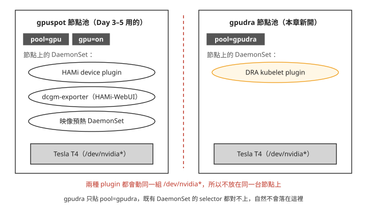
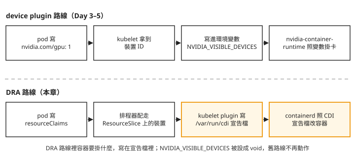
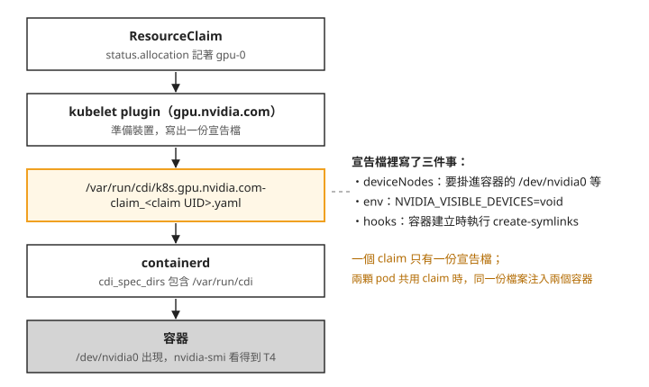

# Day 7: 在 Tesla T4 上跑 DRA——driver 部署、CDI 注入與共用一張卡

{ align=right width="95" }

一台節點上插著一張 Tesla T4。你送出一顆 pod，它的 spec 裡完全沒有寫 `nvidia.com/gpu`，只掛了一個 ResourceClaim。這顆 pod 起來之後，在容器裡跑 `nvidia-smi`，看得到那張卡嗎？

Day 6 用模擬裝置走過一遍 DRA 的物件：DeviceClass、ResourceSlice、ResourceClaim 和 CEL 選擇器。那時候的「裝置」只是 driver 記在記憶體裡的數字，claim 配置成功後，模擬 driver 注入容器的只有幾個環境變數，沒有真的裝置檔。至於既沒寫 `nvidia.com/gpu`、也沒有 claim 的容器，本來就看不到任何 GPU。這一章換成 NVIDIA 官方的 driver `dra-driver-nvidia-gpu` v0.4.1，把一張真的 T4 交到容器手上，並且一路看清楚：driver 怎麼把卡寫進 ResourceSlice、配好的卡怎麼進到容器、為什麼這個 driver 不能跟 Day 3–5 用的 device plugin 放在同一台節點上。

讀完之後，DRA 要卡失敗時，你能分辨問題出在哪一段：driver 根本沒部署到節點上（DaemonSet 的 `DESIRED` 是 0）、claim 的條件沒有裝置符合（claim 停在 `pending`），還是卡已經配好、但容器注入那一段沒接上。

## 真的 driver 要多做什麼

DRA 的物件格式是 Kubernetes 定的，driver 只負責兩件事：把節點上有哪些裝置寫成 ResourceSlice，以及在 pod 啟動前把配到的裝置準備好。Day 6 的模擬 driver 和今天的 NVIDIA driver 都做這兩件事，差別在做得多真：

| | `dra-example-driver` v0.4.0（Day 6） | `dra-driver-nvidia-gpu` v0.4.1（本章） |
|---|---|---|
| 裝置從哪來 | 值檔裡的 `numDevices` 說幾顆就幾顆 | 透過 NVML（NVIDIA Management Library，NVIDIA 提供的查詢顯示卡資訊的函式庫）列出節點上實際插著的卡 |
| 屬性怎麼填 | driver 自己編的固定字串 | `productName`、`architecture`、`capacity.memory` 這些都向硬體查 |
| 容器裡拿到什麼 | 只有 driver 注入的環境變數，沒有裝置檔 | 裝置檔和函式庫都放進容器，`nvidia-smi` 看得到卡 |

第三列就是開場那個問題。接下來九個步驟依序是：開節點池、裝 driver、讀 ResourceSlice、送出第一顆要卡的 pod、用真屬性寫 CEL 並從 `describe node` 看 DRA 的卡、兩顆 pod 共用一張卡、claim 的生命週期、舊寫法的相容設定、卸載與刪池。步驟 7 之後另有一段選讀，示範用 claim 指定共享策略。

## 步驟 1:開一個專用的 GPU 節點池

### 為什麼不能沿用 Day 3–5 的 GPU 節點

Day 3–5 的 GPU 節點上跑著 HAMi 的 device plugin。device plugin 是 Kubernetes 舊有的裝置機制：它把節點上的卡回報成 `nvidia.com/gpu` 這種整數資源，pod 寫 `nvidia.com/gpu: 1` 就分到一張。DRA 的 driver 在每台 GPU 節點上也要跑一個元件，叫 kubelet plugin，負責回報 ResourceSlice 和準備裝置。兩者都會動同一組 `/dev/nvidia*`，而且各自記帳、互相不知道對方：device plugin 把卡算進節點的 `nvidia.com/gpu`，DRA 把同一張卡寫進 ResourceSlice，兩本帳分開記，彼此不會同步。下面這段 chart 的錯誤訊息只寫了「可能衝突」（collisions），沒有說明會怎麼衝突，本課也沒有把兩者放在同一台節點上試過。所以 NVIDIA 對這個 driver 的部署位置有一條硬性規定：**device plugin 和 DRA 的 kubelet plugin 不能放在同一台節點上**。

這條規定不用自己去文件裡找，chart 在安裝前就會擋下來。不加任何設定直接 `helm template`，得到的是一段錯誤：

```console
$ helm template dra-driver-nvidia-gpu \
    oci://registry.k8s.io/dra-driver-nvidia/charts/dra-driver-nvidia-gpu --version 0.4.1
Error: execution error at (dra-driver-nvidia-gpu/templates/validation.yaml:42:4):
… when 'resources.gpus.enabled=true' this DRA driver cannot be deployed alongside the standard
GPU device plugin on the same node. To avoid potential collisions between these two components,
we will not allow this default to take effect until KEP 5004 has reached GA in upstream Kubernetes.
… you must also:    --set 'gpuResourcesEnabledOverride=true'
```


錯誤訊息裡提到的 KEP 是 Kubernetes 的功能提案，5004 號提案要讓 DRA driver 也能接住 `nvidia.com/gpu` 這種舊寫法。在它正式發布之前，chart 不讓你在沒確認過的情況下打開 GPU 功能，要你自己加 `gpuResourcesEnabledOverride=true`，意思是由你自己確認這台節點上沒有 device plugin，chart 才放行。

所以這一章另外開一個節點池 `gpudra`，只貼一個標籤 `pool=gpudra`：



我們可以從圖上看到，隔離靠的是標籤。HAMi 的 device plugin 和 HAMi-WebUI 的 dcgm-exporter 只去有 `gpu=on` 的節點，Day 3 加上的[映像預熱 DaemonSet（prepuller）](sprint1-day3-hami-memory-isolation.md)只去有 `pool=gpu` 的節點。`gpudra` 刻意不貼這兩個，也不貼 `nvidia.com/gpu.present`，既有元件的 selector 一個都對不上，自然不會跑到這台機器上。KAI 和 HAMi 的排程元件跑在 system 節點池，不受影響。

### 開池，驗四項隔離

```bash
az aks nodepool add -g <resource-group> --cluster-name <cluster> -n gpudra \
  --subscription <subscription-id> \
  --node-count 1 --node-vm-size Standard_NC4as_T4_v3 \
  --priority Spot --eviction-policy Delete --spot-max-price -1 \
  --labels pool=gpudra --no-wait
```

`--priority Spot` 跟 Day 0 的 `gpuspot` 一樣，用的是 Azure 的 Spot VM：用剩餘容量計價、比較便宜，但 Azure 需要容量時可以隨時收回，AKS 也因此會在節點上加 `kubernetes.azure.com/scalesetpriority=spot` 這個 taint。

這座叢集是 Day 0 建的 AKS，Kubernetes 1.35.6；新節點的 container runtime 是 containerd 2.3.2，開機映像內建 NVIDIA driver 580.159.04。後面步驟 4 判斷 CDI 能不能用，會用到 containerd 的版本。

GPU 節點開機比一般 CPU 節點慢幾分鐘，多出來的時間花在 driver 安裝和裝置初始化。節點 `Ready` 之後，先驗四件事，全部成立才往下走。

下面指令裡的 `<gpudra-node>` 換成你的節點名稱，用 `kubectl get nodes -l pool=gpudra` 查得到；本章輸出裡的 `aks-gpudra-34911544-vmss000000` 是課程當時那台節點的名稱。

**第一，標籤**。這一項也決定了步驟 2 的值檔怎麼寫：

```console
$ kubectl get node <gpudra-node> -o json | jq .metadata.labels
accelerator=nvidia                         ← AKS 自己貼的
kubernetes.azure.com/accelerator=nvidia    ← AKS 自己貼的
kubernetes.azure.com/scalesetpriority=spot
pool=gpudra                                ← 我們貼的,唯一一個
(沒有 nvidia.com/gpu.present;也沒有任何 feature.node.kubernetes.io/* ——叢集沒裝 NFD)
```


`accelerator=nvidia` 和 `kubernetes.azure.com/accelerator=nvidia` 是 AKS 自己貼的，我們只貼了 `pool=gpudra`。最後一行先記著：這台節點沒有 `nvidia.com/gpu.present`，也沒有任何 `feature.node.kubernetes.io/*` 標籤。後者是 NFD（Node Feature Discovery）貼的，NFD 是一個會偵測節點硬體、自動貼上對應標籤的元件，這座叢集沒有裝，步驟 2 會再提到它。

**第二，taint**：只有 `kubernetes.azure.com/scalesetpriority=spot:NoSchedule` 一個，AKS 不會替 GPU 節點池自動加 `nvidia.com/gpu` taint。

**第三，節點上沒有 device plugin**：`kubectl get pods -A -o wide | grep aks-gpudra` 只列出 AKS 自己的六個系統 DaemonSet（兩個網路元件、節點管理、兩個 CSI 儲存、kube-proxy）。HAMi 的 `hami-device-plugin` 和映像預熱 DaemonSet 在這台機器上的 `DESIRED` 都是 0。

**第四，節點的資源帳**。這是後面步驟 5 的對照基準：

```console
$ kubectl get node <gpudra-node> -o jsonpath='{.status.allocatable}'
{"cpu":"3860m","ephemeral-storage":"133788111446","hugepages-1Gi":"0",
 "hugepages-2Mi":"0","memory":"23467240Ki","pods":"250"}
```


一台插著實體 T4 的機器，`allocatable` 裡沒有 `nvidia.com/gpu`，因為這台節點上沒有 device plugin 回報它。用 DRA 時，卡會出現在 ResourceSlice 裡，不會出現在這裡。

除了部署位置，driver 的文件還列了五項叢集要先滿足的前置條件：Kubernetes ≥ 1.34.2、`DynamicResourceAllocation` 功能開啟、NVIDIA driver ≥ 565、container runtime 啟用 CDI，以及有元件替 GPU 節點貼上識別標籤。其中 CDI（Container Device Interface）是一種讓 container runtime 照宣告檔把裝置放進容器的格式，步驟 4 會實際看到。前四項 AKS 都符合，第五項不符合，步驟 2 處理。

## 步驟 2:安裝 driver

### 讀 chart：三件事決定值檔怎麼寫

**第一，GPU 功能的總開關**。`values.yaml` 裡 `resources.gpus.enabled` 預設就是 `true`，但被 `gpuResourcesEnabledOverride: false` 壓著。真正要打開的是後者，也就是步驟 1 那段錯誤訊息要你加的值。

**第二，關掉 ComputeDomain**。ComputeDomain 是給多台機器用 NVLink 把 GPU 互連起來的功能（值檔註解裡的 MNNVL 就是指這種跨機器的 NVLink），T4 用不到。關掉之後也少了一個 controller Deployment，整套 driver 只剩一個落在 `gpudra` 上的 DaemonSet。

**第三，kubelet plugin 會去哪些節點**。chart 裡 kubelet plugin 的 DaemonSet 寫死了一組 nodeAffinity（依節點標籤決定 pod 能去哪些節點的條件）。它用的是 `requiredDuringScheduling`，也就是硬性條件：不符合的節點，pod 一定不會被排上去，不是「盡量避開」。

條件有五種，節點只要有其中一種標籤就符合：

- `feature.node.kubernetes.io/pci-10de.present`
- `feature.node.kubernetes.io/pci-0302_10de.present`
- `feature.node.kubernetes.io/pci-0300_10de.present`
- `feature.node.kubernetes.io/cpu-model.vendor_id`
- `nvidia.com/gpu.present`

前四種是 NFD 貼的。NFD 在每台機器上偵測 PCI 裝置、CPU 指令集這類硬體特徵，把結果寫成 `feature.node.kubernetes.io/*` 標籤，讓其他元件用 selector 挑節點；`10de` 是 NVIDIA 的 PCI 廠商代碼。最後一種是 NVIDIA GPU Operator 貼的。

driver 的標準安裝路徑假設叢集裡已經有 NFD 或 GPU Operator。步驟 1 看到 AKS 兩種都沒有，AKS 自己貼的 `accelerator=nvidia` 也不在清單上，所以照預設安裝，沒有任何節點符合。

解法是把 chart 預設的 affinity 拿掉，改用我們自己的 `nodeSelector: pool=gpudra`。值檔（`day7-manifests/01-dra-nvidia-values.yaml`）長這樣：

```bash
cat > 01-dra-nvidia-values.yaml <<'EOF'
gpuResourcesEnabledOverride: true    # master switch; without it there are no GPU resources

resources:
  gpus:
    enabled: true
  computeDomains:
    enabled: false                   # no MNNVL hardware here; also drops the controller

nvidiaDriverRoot: /                  # AKS ships the driver in the host root via the VHD

logVerbosity: "4"

kubeletPlugin:
  affinity: null                     # see mine 1: {} would be coalesced back to the default
  nodeSelector:
    pool: gpudra
  tolerations:
  - key: nvidia.com/gpu
    operator: Exists
    effect: NoSchedule
  - key: kubernetes.azure.com/scalesetpriority
    operator: Equal
    value: spot
    effect: NoSchedule
EOF
```


`nvidiaDriverRoot` 指的是主機上 NVIDIA driver 裝在哪裡。AKS 的 GPU 節點開機映像（VHD）已經把 driver 裝在主機根目錄，所以維持預設的 `/` 就對了。文件另外提醒，GKE 要改成 `/home/kubernetes/bin/nvidia`，由 GPU Operator 管理 driver 的叢集要改成 `/run/nvidia/driver`。

值檔裡 `affinity: null` 那行註解寫的 `see mine 1`，指的是本章的疑難排解，見[疑難排解：helm 說 deployed，DaemonSet 卻是 `DESIRED 0`](#mine-1)。下一小節先把它從頭走一遍。

### 為什麼是 `affinity: null` 而不是 `{}`

值檔裡最容易寫錯的是 `affinity: null` 這一行。直覺上，想清掉一組設定會寫 `affinity: {}`。如果這樣寫，helm 會說安裝成功：

```console
$ helm install dra-driver-nvidia-gpu oci://registry.k8s.io/dra-driver-nvidia/charts/dra-driver-nvidia-gpu \
    --version 0.4.1 --create-namespace --namespace dra-driver-nvidia-gpu \
    -f 01-dra-nvidia-values.yaml --wait --timeout 6m
STATUS: deployed   REVISION: 1

$ kubectl -n dra-driver-nvidia-gpu get ds
NAME                                   DESIRED  CURRENT  READY  NODE SELECTOR
dra-driver-nvidia-gpu-kubelet-plugin   0        0        0      pool=gpudra
```


`--wait --timeout 6m` 很快就回報 `deployed`，可是 DaemonSet 的 `DESIRED` 是 0。`DESIRED` 是「符合條件、應該跑一顆 pod 的節點數」，0 表示沒有任何節點符合，也就沒有 kubelet plugin 在跑。三個 DeviceClass（`gpu.nvidia.com`、`mig.nvidia.com`、`vfio.gpu.nvidia.com`）倒是建出來了，ResourceSlice 卻一份都沒有，因為沒有人去寫。

把 DaemonSet 的 pod template 讀回來，看三個欄位：

```console
$ kubectl -n dra-driver-nvidia-gpu get ds dra-driver-nvidia-gpu-kubelet-plugin \
    -o jsonpath='{.spec.template.spec.affinity}'
{"nodeAffinity":{"requiredDuringSchedulingIgnoredDuringExecution":{"nodeSelectorTerms":[
  {"matchExpressions":[{"key":"feature.node.kubernetes.io/pci-10de.present",…}]}, … 五條原封不動 … ]}}}

$ …'{.spec.template.spec.nodeSelector}'   →  {"pool":"gpudra"}                        ← 生效了
$ …'{.spec.template.spec.tolerations}'    →  [{"key":"nvidia.com/gpu",…}, …]          ← 也生效了
```


`nodeSelector` 和 `tolerations` 都換成了值檔裡的內容，只有 `affinity` 還是 chart 原本那五條。差別在型別。helm 把你的值和 chart 的預設值合併時，遇到 **map**（鍵值對，例如 `affinity`）是逐鍵合併：`{}` 裡一個鍵都沒有，等於什麼都不覆蓋，預設值原封不動留下來。遇到 **list**（例如 `tolerations`）則是整份取代。要刪掉一整組 map 型的預設值，只能寫 YAML 的 `null`，helm 把 `null` 當成「刪除這個鍵」。

`--wait` 為什麼沒擋下來？它等的是「該就緒的 pod 都就緒」，`DESIRED` 是 0 時，0 顆 pod 全部就緒在計數上成立，helm 就回報成功。所以裝完 DaemonSet 型的元件，要自己看一次 `DESIRED` 是不是你預期的數字。

改成 `affinity: null` 再升級：

```console
$ helm upgrade dra-driver-nvidia-gpu … -f 01-dra-nvidia-values.yaml
REVISION: 2

NAME                                   DESIRED  CURRENT  READY  NODE SELECTOR
dra-driver-nvidia-gpu-kubelet-plugin   1        1        0      pool=gpudra
pod 1/1 Running
```


`DESIRED` 變成 1，kubelet plugin 起來了。它是 `1/1` 而不是文件範例裡的 `2/2`，因為 ComputeDomain 關掉了，pod 裡只剩 `gpus` 這個容器。

## 步驟 3:讀 ResourceSlice，看真卡宣告了什麼

kubelet plugin 起來之後，第一件事就是把節點上的卡寫成 ResourceSlice：

```console
$ kubectl get resourceslice -o wide
NAME                                                       NODE                            DRIVER
00000-gpu.nvidia.com-aks-gpudra-34911544-vmss000000-2ff44  aks-gpudra-34911544-vmss000000  gpu.nvidia.com
```


打開來看裡面的內容。這份就是之後寫 CEL 選擇器的依據：

```yaml
spec:
  driver: gpu.nvidia.com
  nodeName: aks-gpudra-34911544-vmss000000
  pool: { generation: 1, name: aks-gpudra-34911544-vmss000000, resourceSliceCount: 1 }
  devices:
  - name: gpu-0
    attributes:
      type:                  { string: gpu }
      uuid:                  { string: GPU-bf5809e7-… }
      productName:           { string: Tesla T4 }
      brand:                 { string: Nvidia }
      architecture:          { string: Turing }
      cudaComputeCapability: { version: 7.5.0 }
      driverVersion:         { version: 580.159.4 }
      cudaDriverVersion:     { version: 13.0.0 }
      addressingMode:        { string: HMM }
      resource.kubernetes.io/pciBusID: { string: '0001:00:00.0' }
    capacity:
      memory: { value: 16Gi }
```


跟 Day 6 模擬 driver 的 ResourceSlice 比，屬性多了不少，而且都是向硬體查來的：`productName` 是 `Tesla T4`、`architecture` 是 `Turing`、`capacity.memory` 是 `16Gi`。`addressingMode` 的值 HMM 指 Linux 的 Heterogeneous Memory Management（讓 GPU 能直接存取主機記憶體的核心功能），它和 `cudaDriverVersion` 這類屬性本章用不到。

寫選擇器時，NVIDIA 自己的屬性掛在 driver 名稱底下，例如 `device.attributes['gpu.nvidia.com'].productName`；容量是 `device.capacity['gpu.nvidia.com'].memory`；`pciBusID` 這種各廠商通用的鍵則掛在 `device.attributes['resource.kubernetes.io'].pciBusID`。

寫第一條選擇器之前，有三個值要先看清楚：

1. `driverVersion` 是 `580.159.4`，不是 `nvidia-smi` 印的 `580.159.04`。driver 把 NVML 回傳的字串轉成 semver（「主版本.次版本.修訂號」三段數字的版本格式）再轉回字串，前導零就不見了，見[疑難排解：照 `nvidia-smi` 版本號寫的選擇器永遠不成立](#mine-6)。
2. `cudaComputeCapability` 是三段式的 `7.5.0`；NVML 給的是兩段的 `7.5`，同樣被補了一段。這兩個屬性都是 version 型，CEL 裡要用版本比較，不要用字串相等。
3. `memory` 是整數的 `16Gi`，來自 NVML 回報的總量（16384 MiB），沒有先扣掉保留區。

還有一個屬性不在清單上：`pcieRoot`。PCIe Root Complex（PCIe 根節點）是 CPU 這一側連出 PCIe 匯流排的起點，`pcieRoot` 標出這張卡掛在哪一個根節點底下，多卡機器上可以用它把兩張卡配在同一條 PCIe 路徑下。整份 plugin log 只有一行警告，講的就是這件事：

```text
W0805 08:45:31.616654 nvlib.go:543] error getting PCIe root for device 0, continuing without attribute:
  failed to resolve PCIe Root Complex for PCI Bus ID 0001:00:00.0:
  symlink target for PCI Bus ID 0001:00:00.0 is invalid: it must start with devices/pci:
  devices/LNXSYSTM:00/LNXSYBUS:00/ACPI0004:00/MSFT1000:00/47505500-…/pci0001:00/0001:00:00.0
```


driver 讀 `/sys` 底下的路徑來找 PCIe 根節點，而且要求路徑以 `devices/pci` 開頭。Azure 的 GPU 虛擬機透過 VMBus（Hyper-V 在主機與虛擬機之間傳遞裝置的通道）把實體卡交給虛擬機，路徑的開頭變成 `devices/LNXSYSTM:00/…`，解析就失敗了。driver 印一行警告後繼續執行，不影響整張卡的配置；受影響的只有多卡機器上依 PCIe 拓樸挑卡的選擇器，這類選擇器在 Azure 的 N 系列機型上寫不出來。
{#mine-4}

## 步驟 4:送出一顆沒寫 `nvidia.com/gpu` 的 pod

回到開場的問題。`day7-manifests/02-gate-claimtemplate-pod.yaml` 裡的 pod，`resources` 底下沒有任何 `nvidia.com/*`，唯一的請求是一個 claim：

```bash
cat > 02-gate-claimtemplate-pod.yaml <<'EOF'
apiVersion: v1
kind: Namespace
metadata:
  name: dra-gate
---
apiVersion: resource.k8s.io/v1
kind: ResourceClaimTemplate
metadata:
  namespace: dra-gate
  name: single-gpu
spec:
  spec:
    devices:
      requests:
      - name: gpu
        exactly:
          deviceClassName: gpu.nvidia.com
---
apiVersion: v1
kind: Pod
metadata:
  namespace: dra-gate
  name: gate-smi
spec:
  restartPolicy: Never
  nodeSelector:
    pool: gpudra
  tolerations:
  - key: kubernetes.azure.com/scalesetpriority
    operator: Equal
    value: spot
    effect: NoSchedule
  containers:
  - name: ctr
    image: nvcr.io/nvidia/cuda:12.6.2-base-ubuntu24.04
    command: ["bash", "-c"]
    args:
    - |
      echo "===== nvidia-smi -L ====="; nvidia-smi -L
      echo "===== nvidia-smi ====="; nvidia-smi
      echo "===== NVIDIA env ====="; env | grep -i -E 'nvidia|gpu|cuda' | sort
      echo "===== /dev/nvidia* ====="; ls -l /dev/nvidia* 2>&1
    resources:
      claims:                             # the only "request" in this pod
      - name: gpu
  resourceClaims:
  - name: gpu
    resourceClaimTemplateName: single-gpu
EOF
```


映像用的是 NGC（NVIDIA 的容器映像倉庫）上的 `nvcr.io/nvidia/cuda`，不用登入就能拉。容器裡依序印出 `nvidia-smi`、跟 NVIDIA 有關的環境變數和 `/dev/nvidia*`：

```text
gate-smi 0/1 Completed
===== nvidia-smi -L =====
GPU 0: Tesla T4 (UUID: GPU-bf5809e7-…)
===== nvidia-smi =====
| NVIDIA-SMI 580.159.04  |  0  Tesla T4  Off | 00000001:00:00.0 Off | 0MiB / 16384MiB | 8% |
===== NVIDIA env =====
NVIDIA_DRIVER_CAPABILITIES=compute,utility
NVIDIA_VISIBLE_DEVICES=void            ← 注意這一行
LD_LIBRARY_PATH=/usr/local/nvidia/lib:/usr/local/nvidia/lib64
===== /dev/nvidia* =====
/dev/nvidia0  /dev/nvidiactl  /dev/nvidia-uvm  /dev/nvidia-uvm-tools  /dev/nvidia-caps/…
```


看得到卡。而且有三個地方可以確認，這張卡就是 DRA 配給它的那一張：

1. **UUID 對得起來**。步驟 3 的 ResourceSlice 上 `uuid` 是 `GPU-bf5809e7-…`，容器裡 `nvidia-smi -L` 印的是同一個字串。
2. **`NVIDIA_VISIBLE_DEVICES=void`**。這個變數要另外解釋，見下一段。
3. **裝置檔真的在容器的 `/dev` 底下**。

### 卡是怎麼進到容器的：CDI

容器要用 GPU，光是排程器說「這張卡歸你」不夠：`/dev/nvidia0` 這類裝置檔要放進容器、driver 的函式庫路徑要補上。Day 3–5 的做法是 device plugin 把裝置 ID 寫進環境變數 `NVIDIA_VISIBLE_DEVICES`，再由 `nvidia-container-runtime` 讀這個變數，把對應的卡掛進去。

上面的輸出裡，這個變數被設成 `void`，意思是「什麼都不要掛」，卡卻還是在容器裡。表示掛卡的不是這條舊路線，而是步驟 1 提過的 **CDI**：知道要掛什麼的元件，把「要放進哪些裝置檔、設哪些環境變數」寫成一份宣告檔，放在 container runtime 會讀的目錄；runtime 照著檔案改容器，不需要認得任何廠商的環境變數。

兩條路線並排來看：



從圖上可以看到，兩條路線前半段都是「先決定給哪張卡」，差在後半段怎麼把卡交給容器：舊路線靠環境變數傳話，DRA 路線靠一份寫在節點上的檔案。DRA 這一段再展開，由上往下是五站：



DRA 要卡失敗時，可以照這張圖一站一站查：claim 有沒有 `allocation`、節點上有沒有對應的宣告檔、containerd 有沒有讀這個目錄、容器裡有沒有裝置檔。下面兩段輸出分別對應中間兩站。

**宣告檔確實存在**。driver 為每個 claim 在節點上寫一份，檔名是 `/var/run/cdi/k8s.gpu.nvidia.com-claim_<claim UID>.yaml`，內容節錄如下：

```yaml
cdiVersion: 0.5.0
kind: k8s.gpu.nvidia.com/claim
devices:
- name: b3f7d9bb-…-gpu-0            # <claimUID>-<deviceName>
  containerEdits:
    deviceNodes: [ { path: /dev/nvidia0, major: 195, permissions: rwm } ]
containerEdits:
  env: [ NVIDIA_VISIBLE_DEVICES=void ]   # switch off the legacy path to avoid double injection
  deviceNodes: [ /dev/nvidia-uvm, /dev/nvidia-uvm-tools, /dev/nvidiactl ]
  hooks:
  - { hookName: createContainer, path: /var/lib/kubelet/plugins/gpu.nvidia.com/nvidia-cdi-hook,
      args: [nvidia-cdi-hook, create-symlinks] }
```

`devices` 底下是這個 claim 配到的 `/dev/nvidia0`。外層的 `containerEdits` 套用在「從這份檔案拿到任何一個裝置的容器」上，不是節點上所有容器：包括把 `NVIDIA_VISIBLE_DEVICES` 設成 `void`（避免舊路線又掛一次），以及一個 hook。hook 是容器建立時 runtime 會執行的一支程式，這裡的 `create-symlinks` 負責在容器裡建立函式庫需要的符號連結。

**containerd 會讀這個目錄**。下面這段是裝 driver 前抓的，在步驟 1 開好節點之後，用一顆 privileged pod 切進主機的檔案系統來看：

```text
NVIDIA-SMI 580.159.04   Driver Version: 580.159.04   CUDA Version: 13.0   Tesla T4  0MiB / 16384MiB
/dev/nvidia0  /dev/nvidiactl  /dev/nvidia-uvm  /dev/nvidia-uvm-tools  /dev/nvidia-caps/…
$ containerd config dump | grep -i cdi
    enable_cdi = true
    cdi_spec_dirs = ['/etc/cdi', '/var/run/cdi']
```

前兩行確認主機本身已經準備好：`nvidia-smi` 看得到 Tesla T4，driver 是 580.159.04、CUDA 13.0，VRAM 用量 0MiB 表示還沒有程式在用；第二行是主機上已經有的 `/dev/nvidia*` 裝置檔，也就是之後宣告檔要放進容器的那些。後兩行是 containerd 實際生效的設定：`enable_cdi = true`，`cdi_spec_dirs` 包含 `/var/run/cdi`。這個目錄在裝 driver 之前還不存在，是 driver 建的；這個節點跑的是 containerd 2.3.2，2.x 預設就會讀它，所以整條路接得起來。containerd 1.x 的叢集要自己把 `enable_cdi` 打開。

查這件事要用 `containerd config dump`（讀生效的值），不要用 `cat /etc/containerd/config.toml`：AKS 的設定檔裡沒有任何 CDI 相關的鍵，只看設定檔會以為 CDI 沒開。同一份設定檔裡有一行 `default_runtime_name = "nvidia-container-runtime"`，也就是 AKS 的 GPU 節點預設就用 NVIDIA 的 runtime，這解釋了 Day 4 的[「KAI 替共卡 pod 指定 RuntimeClass "nvidia"，AKS 沒有，pod 建不出來」](sprint1-day4-hami-kai-integration.md#mine-1)：GPU 節點根本不需要有人指名 runtime。

到這裡開場的問題有答案了：**Tesla T4 上用 DRA 配置整張卡完全正常，沒有遇到 Turing 世代或 T4 特有的限制。**

## 步驟 5:用真屬性寫 CEL，一個能滿足、一個不能

有了真的屬性，CEL 選擇器就能寫出有意義的條件。`day7-manifests/03-a-cel-real-attributes.yaml` 建兩個 template，只差 VRAM 的門檻：一個要求至少 8Gi，一個要求至少 24Gi。T4 有 16Gi，前者能滿足，後者不能：

```bash
cat > 03-a-cel-real-attributes.yaml <<'EOF'
apiVersion: v1
kind: Namespace
metadata:
  name: dra-3a
EOF

# gpu-mem-8gi:  16Gi >= 8Gi  -> satisfiable / gpu-mem-24gi: 16Gi < 24Gi -> unsatisfiable
while read -r tpl threshold; do
  cat <<EOF
---
apiVersion: resource.k8s.io/v1
kind: ResourceClaimTemplate
metadata:
  namespace: dra-3a
  name: $tpl
spec:
  spec:
    devices:
      requests:
      - name: gpu
        exactly:
          deviceClassName: gpu.nvidia.com
          selectors:
          - cel:
              expression: "device.capacity['gpu.nvidia.com'].memory.compareTo(quantity('$threshold')) >= 0"
EOF
done >> 03-a-cel-real-attributes.yaml <<'TABLE'
gpu-mem-8gi  8Gi
gpu-mem-24gi 24Gi
TABLE

while read -r pod tpl; do
  cat <<EOF
---
apiVersion: v1
kind: Pod
metadata:
  namespace: dra-3a
  name: $pod
spec:
  restartPolicy: Never
  nodeSelector:
    pool: gpudra
  tolerations:
  - key: kubernetes.azure.com/scalesetpriority
    operator: Equal
    value: spot
    effect: NoSchedule
  containers:
  - name: ctr
    image: nvcr.io/nvidia/cuda:12.6.2-base-ubuntu24.04
    command: ["bash", "-c"]
    args: ["nvidia-smi -L; trap 'exit 0' TERM; sleep 9999 & wait"]
    resources:
      claims:
      - name: gpu
  resourceClaims:
  - name: gpu
    resourceClaimTemplateName: $tpl
EOF
done >> 03-a-cel-real-attributes.yaml <<'TABLE'
pod-mem-ok         gpu-mem-8gi
pod-mem-impossible gpu-mem-24gi
TABLE
```


```console
pod/pod-mem-ok          1/1  Running   resourceclaim/pod-mem-ok-gpu-x4j2c          allocated,reserved
pod/pod-mem-impossible  0/1  Pending   resourceclaim/pod-mem-impossible-gpu-vppgv  pending
$ kubectl -n dra-3a logs pod-mem-ok
GPU 0: Tesla T4 (UUID: GPU-bf5809e7-…)
```


`pod-mem-ok` 拿到卡跑起來了；`pod-mem-impossible` 停在 `Pending`，它的 claim 停在 `pending`。driver 正常運作，只是節點上沒有一顆裝置符合這個 claim 的條件。

能滿足的那顆，配置結果寫回 claim 的 `status`：

```yaml
status:
  allocation:
    devices:
      results: [ { device: gpu-0, driver: gpu.nvidia.com, pool: aks-gpudra-…, request: gpu } ]
    nodeSelector:
      nodeSelectorTerms:
      - matchFields: [ { key: metadata.name, operator: In, values: [aks-gpudra-34911544-vmss000000] } ]
  reservedFor:
  - { name: pod-mem-ok, resource: pods }
```


`results` 記著配到哪一顆裝置（`gpu-0`），`reservedFor` 記著誰在用（`pod-mem-ok`）。另外 `allocation.nodeSelector` 用 `matchFields: metadata.name` 把 pod 綁在那台節點上：卡在哪台機器，pod 就只能去哪台。裝置配置反過來決定排程，device plugin 沒有這個方向。

不能滿足那顆，排程器的事件全文是：

```text
Warning  FailedScheduling  default-scheduler
  0/2 nodes are available: 1 cannot allocate all claims,
  1 node(s) didn't match Pod's node affinity/selector.
  still not schedulable, preemption: 0/2 nodes are available:
  2 Preemption is not helpful for scheduling.
```


這段文字跟 Day 6 模擬 driver 的訊息一字不差。換了真硬體、換了 driver、失敗原因也不同（VRAM 不夠，而不是裝置用完），事件文字都一樣。所以 Day 6 的[「`cannot allocate all claims` 不說是哪個 claim、哪條條件」](sprint1-day6-dra-simulated-devices.md#mine-2)是 Kubernetes 排程器裡 DRA 那一段本身的行為，跟 driver 無關。訊息不會告訴你是哪個 claim、哪條選擇器沒過，查法還是一樣：把 `kubectl get resourceslice -o yaml` 的屬性攤開，逐條對照選擇器。

就算選擇器的意思寫對了，claim 也可能停在 `pending`，常見原因有兩種：一是目標節點上根本沒有這個 driver 的 ResourceSlice（kubelet plugin 沒部署上去，回到步驟 2 看 `DESIRED`）；二是屬性名稱或值的大小寫、拼法跟 ResourceSlice 上不一致，例如寫成 `productname`，或把 `Tesla T4` 寫成 `tesla t4`。CEL 的字串比對是逐字元的，所以照 ResourceSlice 上印出來的字寫最保險。

### 從 `describe node` 看不到這張卡

趁 `pod-mem-ok` 還占著那張 T4，看一下節點：

```console
$ kubectl describe node <gpudra-node>
Capacity:     cpu: 4       memory: 28740840Ki   pods: 250
Allocatable:  cpu: 3860m   memory: 23467240Ki   pods: 250
Non-terminated Pods:                                        CPU Requests  Memory Requests
  dra-3a                 pod-mem-ok                         0 (0%)        0 (0%)
  dra-driver-nvidia-gpu  dra-driver-nvidia-gpu-kubelet-…    0 (0%)        0 (0%)
Allocated resources:     cpu 335m (8%)    memory 526Mi (2%)
```


一台插著 Tesla T4、而且那張卡此刻正被一顆 pod 占用的機器：`Capacity` 沒有 GPU、`Allocatable` 沒有 GPU、`Allocated resources` 也沒有 GPU，占著卡的那顆 pod 每一欄都是 `0 (0%)`。Day 6 在模擬裝置上看到的[「節點上看不到 DRA 的裝置，`describe node` 顯示 `0 (0%)`」](sprint1-day6-dra-simulated-devices.md#mine-3)，在真硬體上一樣。

用 device plugin 時，「這台機器還剩幾張卡」用 `kubectl describe node` 一眼就能算出來；用 DRA 時，node 物件上根本沒有這個數字，要拿 ResourceSlice（有哪些卡）和 ResourceClaim（哪些被配走）自己算。所以 Day 1–5 用到的工具，例如 HAMi-WebUI 的容量頁、KAI 的佇列配額計算、任何讀 `node.status.allocatable['nvidia.com/gpu']` 的儀表板或自動擴縮元件，在只用 DRA 的節點上都會回答「這台沒有 GPU」。Day 3 的[「`kubectl describe node` 查不到 VRAM 餘額」](sprint1-day3-hami-memory-isolation.md#mine-2)是比較輕微的同類問題，那時查不到的只是 VRAM 餘額，現在是整張卡。

## 步驟 6:一個 claim、兩顆 pod、同一張 T4

步驟 5 的 `pod-mem-ok` 還占著這張 T4。一個裝置同一時間只能配給一個 claim，要先把它收回來，下一個實驗才拿得到卡。刪掉整個 `dra-3a` namespace，pod 和 template 產生的 claim 會一起被刪：

```bash
kubectl delete namespace dra-3a
kubectl get resourceclaims -A
```

第二個指令列出來的 claim 裡，已經沒有 `dra-3a` 的，卡就空出來了（`dra-gate` 那顆的 claim 在 `gate-smi` 跑完時就被刪掉，原因見[疑難排解：Job 跑完之後查不到它用過哪張卡](#mine-5)）。這一步要新建的是一個具名 claim 和兩顆 pod。

到目前為止，claim 都是由 template 替每顆 pod 各建一個。claim 也可以先建好、取一個名字，讓好幾顆 pod 指名使用。`day7-manifests/03-b-sharing-one-claim-two-pods.yaml` 建一個具名的 `ResourceClaim` 叫 `shared-t4`，兩顆 pod 都寫 `resourceClaimName: shared-t4`：

```bash
cat > 03-b-sharing-one-claim-two-pods.yaml <<'EOF'
apiVersion: v1
kind: Namespace
metadata:
  name: dra-3b
---
apiVersion: resource.k8s.io/v1
kind: ResourceClaim
metadata:
  namespace: dra-3b
  name: shared-t4
spec:
  devices:
    requests:
    - name: gpu
      exactly:
        deviceClassName: gpu.nvidia.com
EOF

for pod in share-a share-b; do
  cat <<EOF
---
apiVersion: v1
kind: Pod
metadata:
  namespace: dra-3b
  name: $pod
spec:
  restartPolicy: Never
  nodeSelector:
    pool: gpudra
  tolerations:
  - key: kubernetes.azure.com/scalesetpriority
    operator: Equal
    value: spot
    effect: NoSchedule
  containers:
  - name: ctr
    image: nvcr.io/nvidia/cuda:12.6.2-base-ubuntu24.04
    command: ["bash", "-c"]
    args: ["nvidia-smi -L; nvidia-smi --query-gpu=uuid,name,memory.total --format=csv; trap 'exit 0' TERM; sleep 9999 & wait"]
    resources:
      claims:
      - name: gpu
  resourceClaims:
  - name: gpu
    resourceClaimName: shared-t4
EOF
done >> 03-b-sharing-one-claim-two-pods.yaml
```


```console
share-a 1/1 Running   share-b 1/1 Running   resourceclaim/shared-t4 allocated,reserved
$ kubectl -n dra-3b logs share-a     # share-b prints the exact same lines
GPU 0: Tesla T4 (UUID: GPU-bf5809e7-…)
uuid, name, memory.total [MiB]
GPU-bf5809e7-…, Tesla T4, 16384 MiB
```


兩顆 pod 同時在跑，印出同一個 UUID。claim 的 `reservedFor` 有兩筆，`share-a` 和 `share-b` 各一筆；claim 上沒有 ownerReference（物件上記錄「我屬於誰」的欄位，主人被刪時物件會跟著被回收），因為具名 claim 不屬於任何一顆 pod。

這件事用 device plugin 寫不出來：`nvidia.com/gpu: 1` 是整數計數，兩顆 pod 各要 1，就是要兩張卡。

共享在實作上是什麼？回頭看步驟 4 那張圖：宣告檔是一個 claim 一份，以 claim UID 命名。兩顆 pod 共用一個 claim，節點上的 `/var/run/cdi` 也確實只有一份檔案，同一份宣告檔被注入兩個容器。

## 步驟 7:claim 的生命週期

claim 什麼時候被收回？具名 claim 和 template 產生的 claim 不一樣。下面先接續步驟 6，讓 `share-a`、`share-b` 依序離開；再另外跑一顆用 template 的 pod `owner-tmpl`，然後刪掉它。`owner-tmpl` 的 manifest（`day7-manifests/03-c-lifecycle.yaml`）跟步驟 4 的寫法相同，只換了 namespace 和名稱：

```bash
cat > 03-c-lifecycle.yaml <<'EOF'
apiVersion: v1
kind: Namespace
metadata:
  name: dra-3c
---
apiVersion: resource.k8s.io/v1
kind: ResourceClaimTemplate
metadata:
  namespace: dra-3c
  name: owned-gpu
spec:
  spec:
    devices:
      requests:
      - name: gpu
        exactly:
          deviceClassName: gpu.nvidia.com
---
apiVersion: v1
kind: Pod
metadata:
  namespace: dra-3c
  name: owner-tmpl
spec:
  restartPolicy: Never
  nodeSelector:
    pool: gpudra
  tolerations:
  - key: kubernetes.azure.com/scalesetpriority
    operator: Equal
    value: spot
    effect: NoSchedule
  containers:
  - name: ctr
    image: nvcr.io/nvidia/cuda:12.6.2-base-ubuntu24.04
    command: ["bash", "-c"]
    args: ["nvidia-smi -L; trap 'exit 0' TERM; sleep 9999 & wait"]
    resources:
      claims:
      - name: gpu
  resourceClaims:
  - name: gpu
    resourceClaimTemplateName: owned-gpu
EOF
```

`share-a`、`share-b` 刪掉之後卡就空出來了，這時再 `kubectl apply -f 03-c-lifecycle.yaml`。整段的操作與觀察如下：

```console
$ kubectl -n dra-3b delete pod share-a
  shared-t4:  state=gpu-0   reservedFor=share-b      ← 還配著,因為 share-b 還在
$ kubectl -n dra-3b delete pod share-b
  shared-t4   pending   allocation=(null)  reservedFor=(空)   ← 物件還在,配置被收回

  NAME                   STATE   OWNER        FINALIZER
  owner-tmpl-gpu-jhdnp   gpu-0   owner-tmpl   resource.kubernetes.io/delete-protection
$ kubectl -n dra-3c delete pod owner-tmpl
$ kubectl -n dra-3c get resourceclaims
  No resources found in dra-3c namespace.
```


我們可以看到兩種收回方式：

- **具名 claim**：`share-a` 離開時，claim 還配著卡，因為 `share-b` 還在用；兩顆都離開後，`allocation` 清空、卡被收回，但 claim 物件本身還在。
- **template 產生的 claim**：claim 的 OWNER 是那顆 pod，上面還有一個 finalizer（物件被刪除前必須先清掉的標記，用來確保清理步驟跑完）`resource.kubernetes.io/delete-protection`。pod 被刪，claim 跟著被回收。

kubelet plugin 這一側的收回只有一行 log：`Unprepare: regular GPU: noop`。整張卡的配置不需要在硬體上做任何還原，不像 MIG（把 A100、H100 這類卡切成多個獨立區塊的硬體功能）要拆掉切出來的區塊，所以卡收回來馬上就能給下一顆 pod。

兩種 claim 的行為跟 Day 6 模擬 driver 完全一致。由此可知：忘了刪具名 claim，留下的只是一個 API 物件，卡並沒有被占住。

一次性的工作要多注意一件事。步驟 4 的 `gate-smi` 跑完之後是 `Completed`，pod 物件還在，它的 claim 卻已經不見了，事後查不到它用過哪一張卡，見[疑難排解：Job 跑完之後查不到它用過哪張卡](#mine-5)。

## 選讀：用 opaque config 指定共享策略

這一段要用到空著的卡。步驟 7 已經刪掉 `share-a`、`share-b` 和 `owner-tmpl`，`shared-t4` 雖然還在，配置已經被收回；開始前可以再用 `kubectl get resourceclaims -A` 確認，沒有任何 claim 是 `allocated,reserved`。

兩顆 pod 共用一張卡時，卡上的運算怎麼輪流，可以交給 driver 設定。v0.4.1 支援的共享策略（TimeSlicing、MPS）是透過 claim 的 **opaque config** 指定的：claim 除了寫「我要一顆裝置」，還可以附上一段只有該廠商 driver 看得懂的參數，Kubernetes 不解讀，直接轉交給 driver。

這條管道被 driver 自己的 **feature gate**（功能開關）擋著。`TimeSlicingSettings`、`MPSSupport` 這幾個開關都還在 alpha 階段，預設關閉。

這裡要分清楚兩種開關。Day 6 的[「做出裝置差異的設定都依賴被關掉的 alpha 功能」](sprint1-day6-dra-simulated-devices.md#mine-1)說的是 Kubernetes API server 的開關，AKS 不讓使用者改。driver 的開關則是 driver 程式自己讀的設定，在 chart 裡就是一個值，想開就開。用 `helm upgrade … --set featureGates.TimeSlicingSettings=true` 升級之後，plugin log 裡的 `Feature gates: map[string]bool{…, "TimeSlicingSettings":true, …}` 確認開關生效。

接著 claim 就可以帶著參數送出去（`day7-manifests/04-timeslicing-config.yaml`）：

```bash
cat > 04-timeslicing-config.yaml <<'EOF'
apiVersion: v1
kind: Namespace
metadata:
  name: dra-ts
---
apiVersion: resource.k8s.io/v1
kind: ResourceClaim
metadata:
  namespace: dra-ts
  name: shared-t4-ts
spec:
  devices:
    requests:
    - name: gpu
      exactly:
        deviceClassName: gpu.nvidia.com
    config:
    - requests: ["gpu"]
      opaque:
        driver: gpu.nvidia.com
        parameters:
          apiVersion: resource.nvidia.com/v1beta1
          kind: GpuConfig
          sharing:
            strategy: TimeSlicing
            timeSlicingConfig:
              interval: Long
EOF

for pod in ts-a ts-b; do
  cat <<EOF
---
apiVersion: v1
kind: Pod
metadata:
  namespace: dra-ts
  name: $pod
spec:
  restartPolicy: Never
  nodeSelector:
    pool: gpudra
  tolerations:
  - key: kubernetes.azure.com/scalesetpriority
    operator: Equal
    value: spot
    effect: NoSchedule
  containers:
  - name: ctr
    image: nvcr.io/nvidia/cuda:12.6.2-base-ubuntu24.04
    command: ["bash", "-c"]
    args: ["nvidia-smi -L; nvidia-smi --query-gpu=compute_mode --format=csv; trap 'exit 0' TERM; sleep 9999 & wait"]
    resources:
      claims:
      - name: gpu
  resourceClaims:
  - name: gpu
    resourceClaimName: shared-t4-ts
EOF
done >> 04-timeslicing-config.yaml
```


```console
ts-a 1/1 Running   ts-b 1/1 Running   resourceclaim/shared-t4-ts allocated,reserved
$ kubectl -n dra-ts logs ts-a
GPU 0: Tesla T4 (UUID: GPU-bf5809e7-…)
compute_mode
Default
```


設定被接受，兩顆 pod 都起來，plugin log 沒有錯誤。容器裡看到的 `compute_mode` 是 `Default`，這是預期的：TimeSlicing 的 `interval` 調的是 GPU 在不同程序之間切換的時間片長度，不會改 compute mode。compute mode 要開 MPS（Multi-Process Service，NVIDIA 讓多個程序同時共用一張卡的服務）或設成 EXCLUSIVE_PROCESS（一張卡只准一個程序使用）才會改變；MPS 需要 driver 在節點上另外起一個背景程式，本章沒有示範。

從 driver 這一側看共享，plugin log 最清楚。同一個 claim 的第二顆 pod 進來時，driver 不會重新準備裝置，直接回傳第一次準備好的結果：

```text
08:46:15.607  Returning newly prepared devices for claim 'dra-ts/shared-t4-ts:…': [gpu-0 …]
08:46:15.627  Skip prepare: claim already in PrepareCompleted state: dra-ts/shared-t4-ts:…
08:46:15.627  Returning newly prepared devices for claim 'dra-ts/shared-t4-ts:…': [gpu-0 …]
```


這組範例說明的是：opaque config 在 AKS 上是通的，claim 帶著廠商參數送進 driver，driver 收得到也認得。device plugin 只能在 DaemonSet 的設定裡做整台節點一致的設定，沒辦法讓兩顆 pod 各用不同的共享策略。

## 步驟 8:舊寫法的相容設定在 AKS 上不存在

步驟 5 看到，DRA 配出去的卡不會出現在節點的 `nvidia.com/gpu` 上。chart 替還在用舊寫法的工作負載準備了一個相容設定：在 `resource.k8s.io/v1` 的叢集上，它會在 `gpu.nvidia.com` 這個 DeviceClass 上多寫一個 `extendedResourceName: nvidia.com/gpu`，讓還在寫 `resources.limits: nvidia.com/gpu: 1` 的 pod 也能由 DRA 配卡。這就是步驟 1 錯誤訊息裡 KEP 5004 要做的事。它需要 API server 開啟 `DRAExtendedResource` 這個 alpha 開關，而 AKS 上這個開關是關的。

用一個不會影響其他東西的測試用 DeviceClass 驗證：

```console
$ kubectl apply -f - <<'EOF'
apiVersion: resource.k8s.io/v1
kind: DeviceClass
metadata: { name: extres-probe.example.com }
spec:
  selectors: [ { cel: { expression: "device.driver == 'nonexistent.example.com'" } } ]
  extendedResourceName: example.com/probe-gpu
EOF
deviceclass.resource.k8s.io/extres-probe.example.com created      ← 建立成功,沒有任何警告
$ kubectl get deviceclass extres-probe.example.com -o jsonpath='{.spec}'
{"selectors":[{"cel":{"expression":"device.driver == 'nonexistent.example.com'"}}]}
                                          ← extendedResourceName 不見了
```


物件建立成功，沒有任何警告，但讀回來時 `extendedResourceName` 不在了。API server 對「所屬功能沒開的欄位」的處理方式是直接拿掉，不報錯。chart 寫進 `gpu.nvidia.com` 的那個欄位也會遇到同樣的事，所以在 AKS 上，改用 DRA 的工作負載都要改寫成 `resourceClaims`，不能新舊寫法並行。在開了 `DRAExtendedResource` 的叢集上，欄位會留下來，這個限制就不存在。要確認一個欄位有沒有留下來，唯一的辦法是建完之後讀回來比對。

## 步驟 9:卸載與刪池

先刪掉各步驟的工作負載 namespace，再卸載 driver，並觀察 ResourceSlice 多久才消失：

```console
$ helm uninstall dra-driver-nvidia-gpu -n dra-driver-nvidia-gpu
release "dra-driver-nvidia-gpu" uninstalled
  still 1 slice(s), elapsed 3s
  still 1 slice(s), elapsed 19s
  ResourceSlice gone (elapsed 32s)

$ kubectl get resourceslice,deviceclass
No resources found
```


三個 DeviceClass 是 chart 建的物件，uninstall 時立刻消失。ResourceSlice 不是 chart 建的，是 kubelet plugin 在執行時建的。kubelet plugin 隨 uninstall 消失後，節點上的 kubelet 會先等 30 秒，才把這個 driver 的 ResourceSlice 刪掉；上面量到的時間跟這 30 秒相符。Day 6 的[「`helm uninstall` 之後 ResourceSlice 還在」](sprint1-day6-dra-simulated-devices.md#mine-4)在真 driver 上一樣成立。

這段空檔要留意：ResourceSlice 還在，但已經沒有 driver 能準備裝置。這時送進來的 claim 會被排程器配置成功，然後卡在節點上的 kubelet 那一端。要換 driver 版本或搬移 driver，先確認 ResourceSlice 歸零，再讓新的工作負載進來。

最後刪掉節點池，並確認它真的不在了：

```console
$ az aks nodepool delete -g <resource-group> --cluster-name <cluster> \
    -n gpudra --subscription <subscription-id> --no-wait
$ az aks nodepool list …  →  只剩 system 與 gpuspot(Count 0),gpudra 不在清單上
$ az aks nodepool show … -n gpudra  →  rpc error: code = NotFound desc = Agent Pool not found
$ kubectl get nodes  →  只剩 system 節點池的節點
```


## 疑難排解

### helm 說 deployed，kubelet plugin 的 DaemonSet 卻是 `DESIRED 0` {#mine-1}

步驟 2 的值檔已經寫了 `affinity: null` 和 `nodeSelector`，照做過就不會遇到。用自己的值檔、或在別的平台上安裝時，可能會看到下面的情況。
{#mine-2}

**症狀**：`helm install --wait` 很快回報 `STATUS: deployed`，DeviceClass 也建好了，但 kubelet plugin 的 DaemonSet 是 `DESIRED 0`，ResourceSlice 一份都沒有，也沒有錯誤訊息、Pending 的 pod 或事件。

**原因**：兩件事疊在一起。

- chart 的 nodeAffinity 只認五種標籤：四種 NFD 標籤（`feature.node.kubernetes.io/pci-10de.present` 這一類）和 GPU Operator 的 `nvidia.com/gpu.present`。AKS 的 GPU 節點只有 `accelerator=nvidia` 與 `kubernetes.azure.com/accelerator=nvidia`，不在其中，所以沒有節點符合。
- 想用 `affinity: {}` 清掉這組條件也沒用：helm 對 map 是逐鍵合併，`{}` 等於什麼都不改；list（例如 `tolerations`）才是整份取代。而 `DESIRED` 是 0 時，`--wait` 認為「0 顆都就緒」，照樣回報成功。

**修法**：二選一。把 affinity 改成 `null`，再用自己的 `nodeSelector` 指定節點（本章的做法，搭配專用節點池）；或者裝 NFD，讓五個條件之一成立。不論哪一種，裝完都要自己看一次 `DESIRED`。Day 0 的[「device plugin 的 desired 是 0,節點沒有 `nvidia.com/gpu`」](sprint1-day0-azure-aks-foundation.md#mine-1)是同一類問題。

### 舊寫法 `nvidia.com/gpu: 1` 的 pod 一直 Pending {#mine-3}

**症狀**：DRA driver 裝好，DeviceClass 也在。這時把 `resources.limits: nvidia.com/gpu: 1` 舊寫法的 pod 送進只有 DRA 的節點，預期會看到它停在 Pending、事件是 `Insufficient nvidia.com/gpu`；把 `gpu.nvidia.com` 這個 DeviceClass 讀回來，預期會看到沒有 `extendedResourceName` 欄位。本章實際驗證的是步驟 8 那個測試用 DeviceClass，這兩個現象是依它推得的結果，沒有實際送舊寫法的 pod。

**原因與修法**：見步驟 8 的「舊寫法的相容設定在 AKS 上不存在」。只會發生在 API server 關著 `DRAExtendedResource` 的叢集上，AKS 就是這種情況。要確認時，讀回來比對：`kubectl get deviceclass gpu.nvidia.com -o jsonpath='{.spec}'`。

### Job 跑完之後查不到它用過哪張卡 {#mine-5}

**症狀**：一次性的 pod（`restartPolicy: Never`）跑完變成 `Completed`，pod 物件還在，但 `kubectl -n dra-gate get resourceclaims` 已經是 `No resources found`。pod 的 `status.resourceClaimStatuses` 還留著 claim 的名字（`gate-smi-gpu-pcq9k`），claim 本身卻不存在。

**原因**：這是 Kubernetes 本身的行為，跟 driver 無關。kube-controller-manager 裡負責 ResourceClaim 的 controller 會在 pod 進入結束狀態時，主動刪掉 template 產生的 claim，好讓卡盡快被收回，不等 pod 物件被刪。

**修法**：想留下「這個工作當時用了哪張卡」，有三種做法：在 pod 還在跑的時候查；改用具名 claim，它不會隨 pod 消失；或從容器裡把裝置身分印進 log，本章每顆 pod 都跑 `nvidia-smi -L` 就是這個用途。Job 和 CronJob 跑完之後，沒辦法再用 `kubectl get resourceclaim` 事後查核。用 device plugin 時，pod 的 `resources` 欄位會跟著 pod 物件留下來，這一點 DRA 反而比較難查。

### 照 `nvidia-smi` 版本號寫的選擇器永遠不成立 {#mine-6}

**症狀**：`nvidia-smi` 印的 driver 版本是 `580.159.04`，ResourceSlice 上的 `driverVersion` 卻是 `580.159.4`。用 `== '580.159.04'` 寫的選擇器永遠不成立，pod 停在 Pending，事件只有那句不說原因的 `cannot allocate all claims`。

**原因**：driver 把 NVML 回傳的字串轉成 semver 再轉回字串（`cmd/gpu-kubelet-plugin/deviceinfo.go`），前導零被拿掉了。`cudaComputeCapability` 也一樣，`7.5` 變成 `7.5.0`。

**修法**：這兩個屬性都是 version 型，CEL 裡用版本比較，不要用字串相等。寫任何屬性選擇器之前，先把 ResourceSlice 印出來，照上面的值寫，不要照 `nvidia-smi` 的輸出寫。

## 想一想

- 同事在另一個雲平台上裝了 `dra-driver-nvidia-gpu`，`helm install` 回報成功，DeviceClass 也在，可是 `kubectl get resourceslice` 什麼都沒有。你會先看哪個數字？如果那個數字是 0，接著查什麼？
- 一顆 pod 的 claim 寫了 `device.attributes['gpu.nvidia.com'].productName == 'Tesla T4'`，節點上確實插著 T4，pod 卻一直 Pending，claim 是 `pending`。這是 driver 沒部署、條件沒有裝置符合，還是容器注入出了問題？你會拿什麼對照？
- 為了省一台機器，有人想把 DRA driver 直接裝到已經跑著 HAMi device plugin 的 GPU 節點上。安裝時會發生什麼事？就算硬是裝上去，你擔心的是什麼？

## 小結

DRA 的 driver 做兩件事：把節點上的卡寫成 ResourceSlice，以及在 pod 啟動前把配到的卡準備好。這一章在一張 T4 上把這兩件事都看了一遍。driver 的 kubelet plugin 要部署到節點上，靠的是節點標籤，標籤對不上時 DaemonSet 的 `DESIRED` 會是 0，而 helm 不會告訴你；ResourceSlice 上的屬性是寫選擇器唯一的依據，版本號被正規化過，要照它寫；卡進到容器靠的是 CDI 宣告檔，不是 `NVIDIA_VISIBLE_DEVICES`。之後 DRA 要卡失敗時，可以照這個順序查：DaemonSet 有沒有跑起來、claim 有沒有配到裝置、節點上有沒有宣告檔、容器裡有沒有裝置檔。另外要記得，DRA 的卡不會出現在 `describe node` 上，template 產生的 claim 在 pod 結束時就被刪掉，所有依賴 `nvidia.com/gpu` 的工具在 DRA 節點上都看不到卡。

## 延伸閱讀

想再深入，可以從這幾份開始：

- **[dra-driver-nvidia-gpu 專案首頁](https://github.com/kubernetes-sigs/dra-driver-nvidia-gpu)** —— 本章主題的原始碼與 chart，README 開頭就寫著 GPU kubelet plugin 在 chart 裡預設是關的，對應步驟 2 的總開關。
- **[dra-driver-nvidia-gpu v0.4.1 的前置條件文件](https://github.com/kubernetes-sigs/dra-driver-nvidia-gpu/blob/v0.4.1/docs/prerequisites.md)** —— Kubernetes ≥ 1.34.2、driver ≥ v565、runtime 啟用 CDI，以及把 NFD 列為需求的那句話，步驟 1 五項前置條件的出處。
- **[deviceinfo.go（v0.4.1）](https://github.com/kubernetes-sigs/dra-driver-nvidia-gpu/blob/v0.4.1/cmd/gpu-kubelet-plugin/deviceinfo.go)** —— ResourceSlice 上每個屬性怎麼組出來，`driverVersion` 與 `cudaComputeCapability` 轉成 semver 的地方就在這裡。
- **[Container Device Interface 規格](https://github.com/cncf-tags/container-device-interface/blob/main/SPEC.md)** —— `containerEdits`、`deviceNodes`、`hooks`、`env` 各欄位的定義，步驟 4 那份宣告檔照著讀就懂。

## 下一步

三套機制到這裡都實際操作過了：KAI 決定「誰先排、能不能整組一起排」，HAMi 決定「一張卡怎麼切給多個容器、切完會不會互相干擾」，DRA 決定「裝置怎麼被描述、被挑選、被交到容器手上」。三者的邊界並不像介紹文寫的那樣互不重疊：KAI 和 HAMi 這一章一直在同一座叢集裡跑著，只是被標籤隔在另一個節點池；而 DRA 想接手的能力，例如 VRAM 切分、逐 claim 的共享策略，有一部分正是 HAMi 現在提供的。

Day 8 把這三套放在同一張表上比：哪一類問題該交給誰、哪些組合可以並存、哪些組合會像 Day 4 那樣互相衝突，以及在 AKS 這種不能改 feature gate 的託管叢集上，這條 DRA 路線離正式環境還差什麼。[Day 8](sprint1-day8-decision-matrix.md)

---

!!! quote ""
    Kubernetes 標誌為 CNCF 之官方資產，此處作社群教學用途。
