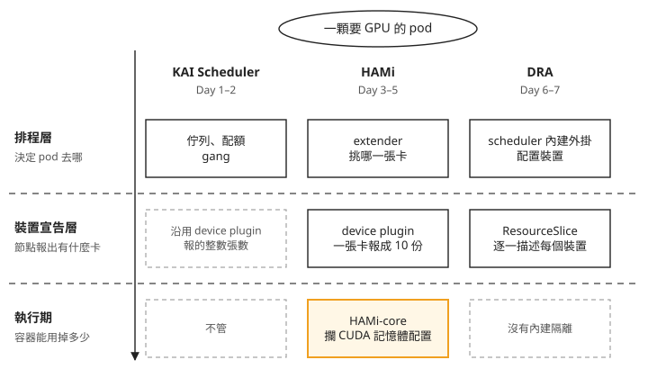
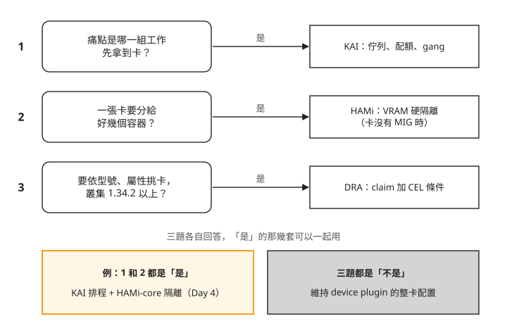
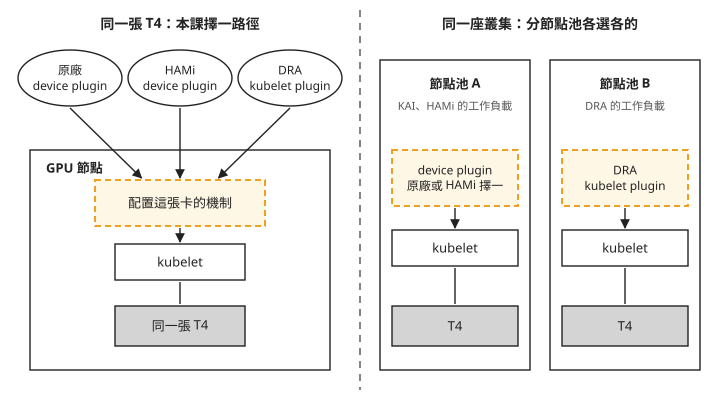

# Day 8: Sprint 1 總結——KAI、HAMi、DRA 各管哪一層、怎麼選

{ align=right width="95" }

假設同一週裡，同一座叢集收到三個需求。線上推論組抱怨，兩張 T4 常被離線批次工作佔滿，推論的 pod 進不來；另一組人有三個小模型，每個只要幾 GB 的 VRAM，想塞進同一張卡；採購那邊又說，下一批會進不同型號的卡，希望工作能指定「至少要多新的卡」。

這三個需求，前七天各有一套工具處理過：Day 1–2 的 KAI Scheduler、Day 3–5 的 HAMi、Day 6–7 的 DRA。這一章不開新的 lab，只把三套工具放在同一個問題前面比較。讀完之後，拿到一個 GPU 需求，你能說出該交給哪一套，也知道哪幾套不能裝在同一個節點上。

## 走完之後：三套工具管的是不同層

Day 1 開場的問題是「兩張 T4 被批次工作吃光，推論進不來，卡該怎麼分」。剛開始很容易把 KAI、HAMi、DRA 當成三個互相競爭的答案，好像只要挑出最好的一套就行。走完七天再回頭看，它們其實在處理一顆 GPU pod 的不同階段。

下面這張圖由上往下，是一顆要 GPU 的 pod 從送出到跑起來會經過的三層：

- **排程層**：決定 pod 放到哪個節點、哪一組工作先拿到卡。
- **裝置宣告層**：節點怎麼告訴 Kubernetes「我這裡有什麼卡、有幾張」。
- **執行期**：容器跑起來之後，實際能用掉多少 VRAM。

三個欄位是三套工具，虛線框表示那一層它沒有處理。



我們可以從圖上看到兩件事：

1. **KAI 只管排程。** 它決定誰先拿到卡、拿幾張，以及 **gang scheduling**：一組 pod 湊齊才一起排上，湊不齊就都不上。它也能按比例把一張卡分給好幾顆 pod（Day 4 的 `gpu-memory` 寫法），但不做執行期隔離：容器實際吃掉多少 VRAM，它不管。
2. **真正在容器裡擋住超額用量的，只有 HAMi 的執行期那一格。** DRA 雖然同時改寫了上面兩層：裝置用 `resource.k8s.io` 這組 API 描述，配置由 kube-scheduler 內建的 `dynamicresources` 外掛完成，但它不碰執行期。兩顆 pod 共用一張卡時，各自能吃掉多少，DRA 不管。

所以三套工具大多可以疊著用。會衝突的只有一件事：一個節點上只能有一個元件負責把卡報給 Kubernetes。細節留到後面講共存時再說。

回頭對照 Sprint 開始的時候：Day 0 能問的只有「叢集裡有沒有 GPU、pod 拿不拿得到卡」，卡是節點上的一個整數，拿到就是整張。現在同樣面對「卡不夠分」，你可以先分清楚問題出在哪一層：是誰先拿的排程問題、一張卡要不要切開的隔離問題，還是要描述哪一種卡的宣告問題，再決定交給哪一套。

## 真的要做的時候：三個問題

拿到一個 GPU 需求時，下面三個問題各問一次，大多數情況就能決定要用哪幾套。



我們可以從圖上看到，三個問題彼此獨立，每一題回答「是」，就對應一套工具，結果可以組合。最常見的情況是前兩題都回答「是」：既要分配誰先拿到卡，又要讓多個容器共用一張卡，於是 KAI 和 HAMi-core 一起用，Day 4 整天處理的就是這個組合。三題都回答「不是」，維持原本的整卡配置就好。接下來照圖上的編號，一題一題看前幾章的實測怎麼回答。

### 推論和批次搶同一批卡：交給 KAI 的佇列與配額

這是開場的第一個需求，也是 Day 1 處理的問題。KAI 讓每個佇列有一份 **quota**（保底額度）：quota 內的卡誰都拿不走；別的佇列閒置時，可以借用超過 quota 的卡，但借來的隨時會被收回。

Day 1 的實測是這樣的：`batch-eval` 的 GPU quota 只有 1，在 `inference-prod` 完全閒置時，它借到兩張卡跑滿。`inference-prod` 一送工作進來，借出去的那一張馬上被收回，quota 內的那一張則沒有被動到。收回時 KAI 發出的事件如下：

```text
Evict  Pod kai-lab/batch-hog-2 was preempted by workload kai-lab/pg-infer-claim-2-...
  Batch Eval     uses <GPU: 2, ...> with a quota of <GPU: 1, ...>, fair-share of <GPU: 1, ...> and queue priority of <100>.
  Inference Prod uses <GPU: 0, ...> with a quota of <GPU: 1, ...>, fair-share of <GPU: 1, ...> and queue priority of <200>.
```

我們可以看到，每個佇列用了幾張、quota 多少、fair-share 多少、佇列優先權多少，四個數字都列在事件訊息裡。之後有人來問「我的工作為什麼不見了」，不必翻排程器日誌，從這段訊息就能看出是哪個佇列超額借用、被誰收回。

設計佇列時有兩個常見的誤會：

- **想讓某個佇列拿到更多卡，要改 quota，不是改 priority。** 佇列優先權只決定超額的卡先分給誰，對 quota 內的卡沒有作用。見 Day 1 的[「queue priority 200 打不贏 quota 內的 100」](sprint1-day1-kai-queue-basics.md#mine-4)。
- **把工作標成不可被搶占的等級，代價是只能用 quota 內的卡。** 叢集裡明明還有一張卡在跑低優先權的工作，它也拿不到。見 Day 1 的[「`priorityClassName: inference` 反而讓 pod 卡住」](sprint1-day1-kai-queue-basics.md#mine-5)。

- **`limit` 要明寫 `-1`。** `-1` 表示可以在別人閒置時借用超過 quota 的卡；不寫等於 0，佇列就完全不能借用，對方閒著也一樣。

所以要保證服務不中斷，就用不可被搶占的等級，並把 quota 開到尖峰用量；要吞吐量，就用可被搶占的等級去借超額的卡，接受隨時被收回。

### 分散式訓練：同樣交給 KAI，用 gang

分散式訓練一次要好幾張卡，例如八個 worker 各一張。只拿到七張時，那七張卡什麼事都做不了，卻佔著別人的位置。開頭提過的 gang scheduling 就是處理這件事。

Day 2 的叢集只有兩張卡，送進一份要三張卡的工作。三顆 pod 全部 Pending，而且一張卡都沒佔。這時再送一顆不相干、只要一張卡的探測 pod，它照樣跑得起來：

```text
NAME          READY   STATUS    RESTARTS   AGE   NODE
gang-prober   1/1     Running   0          26s   aks-gpuspot-21249019-vmss000006
gang3-7z29z   0/1     Pending   0          66s   <none>
gang3-8wtjf   0/1     Pending   0          66s   <none>
gang3-8zjvx   0/1     Pending   0          66s   <none>
```

我們可以看到 `gang3-*` 三顆都停在 Pending，`gang-prober` 卻拿到了卡。PodGroup（KAI 用來代表「一組 pod」的物件）的狀態寫明原因：`Resources were found for 2 pods while 3 are required for gang scheduling`。

gang 有一個代價要先知道：整組一起上，被搶占時也是整組一起下。Day 2 的搶占者只要一張卡，兩個成員卻在同一秒一起被驅逐：

```text
08:09:05Z  Evict  Pod kai-lab/gang2-x9vkj was preempted by higher priority workload ...
08:09:05Z  Evict  Pod kai-lab/gang2-7bpkp was preempted by higher priority workload ...
```

釋出兩張卡，搶占者只用掉一張。見 Day 2 的[「搶 1 張卡，整個 gang 都被驅逐」](sprint1-day2-gang-scheduling-preemption.md#mine-3)。所以 gang 型的工作最好放進自己的佇列，並給足 quota，quota 內的卡就不會被搶。

gang 也不是裝了 KAI 就自動有。一般的 `batch/v1` Job 即使寫了 `parallelism: 3`，KAI 替它產生的 PodGroup 預設還是 `minMember: 1`，也就是一顆湊到就上（Day 2 的[「裝了 KAI、Job 寫了 `parallelism: 3`，卻沒有 gang」](sprint1-day2-gang-scheduling-preemption.md#mine-1)）。要 gang 就在 Job 上明寫 `kai.scheduler/batch-min-member`，再用下面這行確認：

```bash
kubectl -n <ns> get podgroups -o json | jq '.items[].spec.minMember'
```

印出來是 1，就代表沒有 gang，不管 Job 寫了多少 parallelism。

如果訓練跑在 **spot 節點**（雲端廠商隨時可以收回的便宜 VM）上，還要再加三件事：

- **開 cluster autoscaler**（依需求自動增減節點的元件）。spot 節點被收回之後，node pool 不會自己補回來，見 Day 2 的[「spot 節點被收走後，pool 不會補回來」](sprint1-day2-gang-scheduling-preemption.md#mine-4)。
- **在回收預告期內寫完 checkpoint。** Azure 收回 spot VM 之前會先發一則通知，Day 2 量到從通知到 VM 被收走是 39 秒，訓練程式要在這段時間內把進度存下來。
- **gang 大小留餘裕。** 別讓 `minMember` 剛好等於全部節點數，否則少了一台之後，重跑時連湊齊都湊不齊。

### 三個小模型共用一張卡：交給 HAMi

這是開場的第二個需求。先問一句：這批卡有沒有 MIG（Multi-Instance GPU）。MIG 是 A100、H100 這類資料中心卡內建的硬體分卡功能，可以把一張卡切成幾個互相隔離的執行個體，每個有自己專用的運算單元和記憶體，一個執行個體吃滿也影響不到別的。卡有 MIG，就先考慮用它。T4 和消費級顯示卡都沒有 MIG；沒有 MIG 時，要讓多個容器共用一張卡又不互相吃掉 VRAM，課程裡驗成的做法只有 HAMi。

HAMi 做兩件事：device plugin 把一張實體卡對外報成十份，讓多顆 pod 可以排上同一張卡；容器裡再放一個叫 `libvgpu.so` 的函式庫，在 CUDA 要記憶體時檢查有沒有超過這個容器的配額。Day 3 讓一顆配額 4096 MiB 的容器以 512 MiB 為單位一路加碼，同時在節點上記錄實體卡的用量：

```text
[11:17:02] 實體卡 used=4831 MiB | hog: HOG: allocated 2048 MiB total
[11:17:06] 實體卡 used=5855 MiB | hog: HOG: allocated 3072 MiB total
[11:17:10] 實體卡 used=6879 MiB | hog: HOG: allocated 3584 MiB total
[11:17:14] 實體卡 used=3193 MiB | hog: HOG: exception text = CUDA out of memory ...
```

看第三行到第四行：被擋下的那一刻，實體卡用了 6879 MiB，16384 MiB 的卡還空著 9.5 GB，容器照樣拿不到下一塊 512 MiB。攔下它的函式庫自己也印了一行：

```text
[HAMI-core ERROR (pid:1 ... allocator.c:52)]: Device 0 OOM 4401922048 / 4294967296
```

分母 `4294967296` 正好是 4 GiB，也就是這個容器的配額。上限來自容器自己的配額，不是卡上還剩多少，這就是「硬隔離」的意思。同一張卡上的另一顆 pod 經過兩次 OOM，`RESTARTS 0`，資料也沒有受影響。

這個函式庫在 HAMi 專案裡叫 **HAMi-core**。Day 3 裝的是 **HAMi 平台**，也就是整套元件：改寫 pod 的 webhook、挑卡的排程器、device plugin，加上 HAMi-core。HAMi 的排程器是標準的 kube-scheduler 加一個 **extender**（一支外掛程式，內建排程器遇到 GPU 資源時，把選哪張卡的決定交給它）。Day 4 的 KAI 官方整合則只借用 HAMi-core，排程仍由 KAI 自己做。兩條路最後擋下超額的是同一份程式碼，錯誤字串的 `allocator.c:52` 一字不差。

選哪一條路，看叢集現況：

- **沒有排程器要沿用、只想塞得密**，用 HAMi 平台。Day 4 的對照組，四顆各 4096 MiB 的 pod 剛好填滿一張 T4 的 16384 MiB。
- **已經在用 KAI 的佇列、想把分卡接進去**，走官方整合。同樣四顆 pod 只塞得下三顆，因為 KAI 把 VRAM 換算成兩位小數的 GPU 比例，4096 MiB 進位成 0.26，容器實得 4259 MiB，一張卡只夠三份。見 Day 4 的[「`gpu-memory` 換算成 GPU 比例後進位，每張卡少放一個 pod」](sprint1-day4-hami-kai-integration.md#mine-6)。

少塞一個換來的是查帳方便：HAMi 平台把已經分出去多少 VRAM 記在 extender 的記憶體和 pod annotation 裡，KAI 路徑的數字則在一個 `kubectl get cm` 就查得到的 ConfigMap 裡。

兩條路只能選一條，不能裝在同一個節點上，原因在下一節。另外，不論哪一條，導入前都要先確認三件事：

- **容器的基底映像要用 glibc。** HAMi 會在它管的每個容器寫入 `/etc/ld.so.preload`，而 `libvgpu.so` 需要 glibc。用 musl 的 busybox 或 alpine，程式還沒開始就以 exit 127 結束，看起來像映像壞了。見 Day 3 的[「busybox、alpine 映像一啟動就 exit 127」](sprint1-day3-hami-memory-isolation.md#mine-3)。
- **監控要看 annotation，不能只看 Running。** HAMi 的 webhook 設定是 `failurePolicy: Ignore`：webhook 掛掉時，pod 照樣建得起來，只是沒有配額限制，也沒有任何告警。要監控的是 pod 有沒有拿到 `hami.io/vgpu-devices-allocated` annotation。
- **配額要把 CUDA context 算進去。** 程式第一次使用 GPU 時，CUDA 會替這個 process 在卡上建立一份執行環境，叫 CUDA context，它本身就要佔 VRAM，而 HAMi 算用量時會把它算進去。Day 3 從被拒絕時的數字推算，context 大約 100 MiB。那顆 4096 MiB 的容器只拿到 3584 MiB，主要原因是每次要 512 MiB 這個單位太大，下一塊放不進剩下的空間，不是 context 吃掉了 512 MiB。規劃配額時，在模型需要的量之外多留約 100–200 MiB 給 context。

如果叢集裡的卡 VRAM 大小不一，配額就不能用同一個數字套全部，要按卡型分別設計。HAMi 把每張卡的規格寫在節點 annotation 裡，可以這樣查：

```bash
kubectl get node <gpu-node> -o json | jq -r '.metadata.annotations["hami.io/node-nvidia-register"]'
```

輸出裡的 `devmem` 欄位就是那張卡的 VRAM。

### 新進不同型號的卡：新叢集可以從 DRA 開始

這是開場的第三個需求。用 device plugin 時，一張卡在 Kubernetes 眼裡只是節點上的一個整數，`nvidia.com/gpu: 1`。工作想要「至少 Turing 世代」的卡，只能先替節點貼標籤，再用 nodeSelector 繞過去。

DRA（Dynamic Resource Allocation）換掉了這個前提：節點用 **ResourceSlice** 逐一描述每個裝置的屬性；pod 透過 **ResourceClaim**（對裝置的請求，寫法有點像 PVC 之於 PV）要裝置，並可以用 **CEL**（Common Expression Language，一種寫判斷條件的小語言）寫篩選條件。Day 6 用一條 `device.driver != 'retro-gpu.example.com'`，就排除了某一種模擬的舊卡，不必貼節點標籤，也不必分開節點池。

Day 7 換上真的 T4，NVIDIA 的 DRA driver 在 ResourceSlice 上報出的屬性裡，這幾個最常拿來篩選：

```yaml
attributes:
  productName:           { string: Tesla T4 }   # 型號,可以直接字串比對
  architecture:          { string: Turing }     # 世代,適合寫成「排掉太舊的」
  cudaComputeCapability: { version: 7.5.0 }     # version 型,要用版本比較不是字串比較
capacity:
  memory:                { value: 16Gi }        # 用 quantity() 與 compareTo() 比大小
```

`driverVersion` 不在這份清單裡，是因為它被正規化成 semver，`580.159.04` 會變成 `580.159.4`，拿字串比對一定失敗。見 Day 7 的[「照 `nvidia-smi` 版本號寫的選擇器永遠不成立」](sprint1-day7-dra-aks-real-gpu.md#mine-6)。

DRA 還有一個 device plugin 寫不出來的語意：共用。Day 6 讓兩顆 pod 共用一個具名的 claim，另外兩顆各自用 template 要一個裝置。下面上半段是 pod 狀態，下半段是每個 claim 拿到哪個裝置、被誰持有：

```text
own-a     1/1   Running
own-b     0/1   Pending      ← 最後一顆裝置被 own-a 拿走了
share-a   1/1   Running
share-b   1/1   Running

shared-gpu        gpu-6   reservedFor=share-a, share-b     ← 一顆裝置、兩個持有者
own-a-gpu-z6rlc   gpu-7   reservedFor=own-a
own-b-gpu-j5qrn   -       reservedFor=-
```

我們可以看到 `shared-gpu` 一個裝置有兩個持有者，同樣兩顆 pod，共用寫法只用掉一個裝置；`own-b` 則因為裝置用完而 Pending。不過要記得上一張分層圖：共用的兩顆 pod 在容器裡看到的都是完整的 16384 MiB，誰先吃光誰贏（Day 7），DRA 不做執行期隔離。

DRA 的缺口也要一起考慮：

- **節點上看不到裝置。** 持卡的 pod 在 `kubectl describe node` 上每一欄都是 `0 (0%)`，所有讀節點 allocatable 的儀表板與容量工具都看不到 DRA 的裝置（Day 6 的[「節點上看不到 DRA 的裝置，`describe node` 顯示 `0 (0%)`」](sprint1-day6-dra-simulated-devices.md#mine-3)）。用 template 產生的 claim 在 pod 結束時就被刪掉，事後查不到它拿過哪一個裝置（Day 7 的[「Job 跑完之後查不到它用過哪張卡」](sprint1-day7-dra-aks-real-gpu.md#mine-5)）。要留紀錄，得在 pod 還活著時抓，或把裝置 UUID 印進容器 log。
- **排不上時的訊息很少。** 事件只寫 `cannot allocate all claims`，不說是哪個 claim、哪條條件、篩掉幾個裝置。CEL 打錯字和裝置真的不夠，訊息一模一樣（Day 6 的[「`cannot allocate all claims` 不說是哪個 claim、哪條條件」](sprint1-day6-dra-simulated-devices.md#mine-2)）。
- **廠商的 driver 還早。** DRA 的核心 API 已經是 Kubernetes 的穩定功能，但 NVIDIA 的 DRA driver 還在 v0.4.x，而它的 chart 預設叢集裡已經有 GPU Operator 或 NFD（Node Feature Discovery，自動替節點貼硬體標籤的元件）。

所以 DRA 適合版本已經在 1.34.2 以上、還沒有既有 GPU 工作負載的新叢集。DRA 的核心 API 在 Kubernetes 1.34 成為正式功能，NVIDIA 的 DRA driver 則要求 1.34.2 以上，要用真卡就以後者為準。已經用 device plugin 跑得好好的叢集，維持整卡配置就好。

### 三套放在一起看

把上面幾節的結論併成一張表，表上的版本是這門課用的版本：

| | KAI Scheduler v0.16.8 | HAMi v2.9.0 | DRA（K8s 1.35.6） |
|---|---|---|---|
| 解決的問題 | 哪一組工作先拿到卡、被收回時收誰 | 一張卡分給多個容器 | 描述裝置的差異，讓工作挑裝置 |
| 要卡的寫法 | 整數張數，或用 `gpu-memory` 要一部分 | MiB | claim 加 CEL 條件 |
| 分卡 | 按比例分配 | 有 | 本課只驗到整張卡 |
| 執行期隔離 | 沒有（可借用 HAMi-core） | 有 | 沒有 |
| 已分配的量記在哪裡 | ConfigMap 與 metrics | extender 記憶體與 pod annotation | ResourceSlice 與 ResourceClaim |
| `kubectl describe node` 看到什麼 | 張數 | 切了幾份，看不到 VRAM 餘額 | 什麼都看不到 |
| 專案狀態（截至 2026-08） | CNCF sandbox | CNCF incubating | Kubernetes 內建的穩定功能 |

## 同一批 GPU 不要交給互不協調的配置機制

三套工具裝在同一座叢集時，會不會互相干擾？答案要分成節點和叢集兩個範圍來看。

device plugin 與 DRA driver 都能把 GPU 提供給工作負載，但它們各自記錄已分配的裝置，不會自動同步。同一張卡若同時被兩套機制宣告為可用，就可能重複分配。這裡要避免的是兩套機制爭用同一批 GPU，不是禁止一台節點安裝多種裝置的 driver。下圖左邊限定同一張 T4，右邊是本課分節點池的做法：



我們可以從圖上看到兩件事：

1. **同一批 GPU，本課選擇一條配置路徑。** Day 4 在同一個節點上同時留著 HAMi 平台和 KAI 整合，兩邊互相鎖死，見 Day 4 的[「兩套方案同時裝著，KAI 的 pod 無限重排」](sprint1-day4-hami-kai-integration.md#mine-3)。NVIDIA DRA driver 的 chart 預設會在 `helm template` 階段報錯，提醒 DRA 與原廠 device plugin 可能重複配置 GPU；本課先確定 DRA 節點上沒有原廠 device plugin，才設 `gpuResourcesEnabledOverride=true` 打開 GPU 功能。本課沒有把這兩者放在同一個節點上跑過。
2. **分節點池，讓兩套機制管理不同的卡。** 本課用不同標籤把 DRA 與 device plugin 隔開，三套工具可以在同一座叢集裡並存。這是本課採用的隔離方式，不是 Kubernetes 對所有 driver 的同節點限制。

下面是課程裡實際跑過的組合（DRA driver 和原廠 device plugin 同節點的情況沒有跑過，不列在表上）：

| 組合 | 在同一個節點上 | 結果 |
|---|---|---|
| KAI + HAMi 平台 | 是 | 互相鎖死 |
| KAI + HAMi-core（搭原廠 device plugin） | 是 | 正常運作 |
| DRA 在獨立節點池，KAI 與 HAMi 留在原本的池 | 否 | 互不干擾 |
| 不要 GPU 的 pod | — | 三套都不接手 |

所以想在一座正在用的叢集裡試新的機制，開一個貼不同標籤的節點池來試，比在既有節點上疊裝安全得多。

## 導入既有叢集前，先查什麼

前面的結論都來自 AKS 上的兩張 T4，用的是上表那幾個版本。要把它們用到一座已經在運作、版本可能比較舊的叢集，先查下面幾件事。

**DRA 需要的版本。** 舊版叢集可能連 `resource.k8s.io` 這組 API 都沒有。DRA 的核心 API 在 Kubernetes 1.34 成為正式功能，NVIDIA DRA driver 的官方前置條件則是 v1.34.2 以上。叢集還沒升到 1.34.2 之前，DRA 只能先規劃，要練習可以另外開一座版本夠新的測試叢集。

**已經裝著的 KAI 是哪一版。** 本課程的行為都是 KAI v0.16.8 的行為。連 chart 版本字串帶不帶 `v` 這種小地方，都會讓安裝指令抓不到 chart（Day 1 的[「`--version 0.16.8` 抓不到 chart」](sprint1-day1-kai-queue-basics.md#mine-1)）。先用兩道唯讀查詢，查出叢集上那套 KAI 的實際版本與設定，再決定要不要對齊：

```bash
helm list -A -o json | jq -r '.[] | select(.chart | test("kai")) | "\(.name) \(.chart) \(.app_version)"'
kubectl get configs.kai.scheduler -A -o yaml     # operator 實際套用的設定,不是 values 檔
```

第二行查的是 KAI operator 實際在用的設定。KAI 是 operator 架構，真正的元件由 operator 依這份設定產生，所以要看這裡，不是看當初安裝用的 values 檔。

**平台有哪些功能、少了哪些物件。** 下面兩行應該在安裝前跑，不要等裝壞了才查：

```bash
kubectl get --raw /metrics | grep kubernetes_feature_enabled | grep -i DRA   # DRA 能做到哪裡
kubectl get runtimeclass                                                     # chart 預設要的那個存不存在
```

第一行列出 API server 上 DRA 相關的功能開關。AKS 不開放改控制面的功能開關，DRA 的 alpha 功能全部關著，第一行就能看出哪些用不到。其中影響最大的是 `DRAExtendedResource`：NVIDIA DRA driver 的 chart 會在 DeviceClass 上寫 `extendedResourceName: nvidia.com/gpu`，讓 `resources.limits: nvidia.com/gpu: 1` 這種舊寫法也能由 DRA 配卡。這個開關在 AKS 上是關的，API server 會把這個欄位直接剝掉，不報錯也不警告，結果是舊寫法和 DRA 的新寫法沒辦法在同一批卡上並行（Day 7 的[「舊寫法 `nvidia.com/gpu: 1` 的 pod 一直 Pending」](sprint1-day7-dra-aks-real-gpu.md#mine-3)）。第二行查 RuntimeClass（指定容器用哪一種 runtime 執行的物件）。AKS 的 GPU 節點沒有 `nvidia` 這個 RuntimeClass，KAI 的共卡設定卻預設要它，pod 會在 API server 就被擋下（Day 4 的[「KAI 替共卡 pod 指定 RuntimeClass "nvidia"，AKS 沒有，pod 建不出來」](sprint1-day4-hami-kai-integration.md#mine-1)）。

**chart 對平台的假設。** Day 7 卡住的事情幾乎都不是硬體問題，而是 chart 預設叢集裡已經有 GPU Operator 或 NFD 幫忙認出 GPU 節點；AKS 兩者都沒有，標籤得自己補（Day 7 的[「helm 說 deployed，kubelet plugin 的 DaemonSet 卻是 `DESIRED 0`」](sprint1-day7-dra-aks-real-gpu.md#mine-2)）。DRA driver 的 driver root 路徑也依平台而不同：AKS 是預設的 `/`，GKE 要改成 `/home/kubernetes/bin/nvidia`，由 GPU Operator 管理的環境則是 `/run/nvidia/driver`。同一份 values 檔換一個平台，可能完全裝不起來。

**節點標籤下在節點池層級。** 在 AKS 上，spot 節點被收回、或節點池縮到 0 再拉起來，拿到的都是全新的 VM，用 `kubectl label nodes` 貼在單一節點上的標籤會跟著消失。HAMi、KAI 和 DRA driver 要的節點標籤，都要設在節點池上（Day 3 補 HAMi 節點標籤那一步）。

**HAMi 的排程器映像從哪裡拉。** HAMi chart 的 kube-scheduler 映像預設指向阿里雲的 registry，tag 由叢集的 Kubernetes 版本推導出來，這個 registry 不保證跟得上最新的版本。安裝前先確認那個 tag 存在；網路受限或有映像來源政策的環境，要改成自己的 registry（Day 3 安裝 HAMi 那一步）。

## 疑難排解

這一節收的是好幾章都出現過的兩種狀況。

### 安裝指令回報成功，元件卻沒有在跑

`rollout status`、`helm --wait`、`helm upgrade`、Job 的 `Complete`，這些回傳值只代表「指令跑完了」，不代表東西在跑。課程裡這種情況出現過好幾次，最典型的是 DaemonSet 的 desired 是 0，`helm install --wait` 照樣回報 deployed（Day 7 的[「helm 說 deployed，kubelet plugin 的 DaemonSet 卻是 `DESIRED 0`」](sprint1-day7-dra-aks-real-gpu.md#mine-1)）。

安裝或改設定之後，自己再數一次：Deployment 看 `Available`，DaemonSet 看 `DESIRED` 是不是大於 0，gang 看 PodGroup 的 `spec.minMember`，改完設定看 pod 的 `AGE` 有沒有歸零。

### 畫面上的數字是 0，或跟實際用量對不上

決定「還能不能再排一顆」的那份紀錄，通常不在 `kubectl describe node` 上：HAMi 的 VRAM 餘額在 extender 的記憶體和 pod annotation 裡，DRA 的裝置則完全不在節點的資源裡。連「一張卡」的意思，各系統都不一樣：原廠 device plugin 說 1，HAMi 說 10，Day 4 的 KAI 透過 HAMi 的 device plugin 看兩張實體卡，算出來是 20 張。

看到一個數字時，先問它是從哪一份紀錄算出來的。看到 0 時，先分清楚是真的沒人在用，還是資料沒有送到；這兩種情況在畫面上看起來一樣，Day 5 的[「每顆 pod 的用量永遠是 0,標籤被加上了 `exported_` 前綴」](sprint1-day5-hami-webui.md#mine-3)就是後者。

## 這門課沒教的

**MIG 和單機多卡。** T4 沒有 MIG，課程裡每台機器也只有一張卡，所以 MIG 分卡、同一台機器上多張卡的拓樸，以及 NUMA（多 CPU 插槽的機器上，記憶體和裝置靠近哪一顆 CPU 的差別）都驗不到。HAMi 的 `numa-first` 放置政策在 v2.9.0 也還沒實作。想往下學，MIG 從 NVIDIA 的 [MIG User Guide](https://docs.nvidia.com/datacenter/tesla/mig-user-guide/) 開始；Kubernetes 怎麼讓 CPU 與裝置對齊同一個 NUMA 節點，看官方文件的 [Topology Manager](https://kubernetes.io/docs/tasks/administer-cluster/topology-manager/)。

**DRA 還在 alpha 的功能。** partitionable devices（把一張卡切成多個裝置）、consumable capacity（多個 claim 依容量分用同一個裝置），以及直接用 `resources.limits` 要 DRA 裝置，都需要打開 alpha 功能開關，AKS 不開放，所以課程沒有做。各功能在哪個版本、什麼階段，看 Kubernetes 官方部落格的 [Kubernetes v1.34: DRA has graduated to GA](https://kubernetes.io/blog/2025/09/01/kubernetes-v1-34-dra-updates/)；要實際試，需要能自己設定功能開關的叢集，例如 kubeadm 架的叢集。

**MPS。** Day 7 只送過 time-slicing 的設定，從容器裡看不出差別；NVIDIA MPS 需要在節點上另外跑一個背景程式，課程沒有做。運作方式和限制見 NVIDIA 的 [Multi-Process Service](https://docs.nvidia.com/deploy/mps/index.html) 文件。

**KAI 和 HAMi 的其他分卡功能。** KAI 沒測 `gpu-fraction` 寫法，也沒測 HAMi-core 整合下的搶占與 gang，起點是 KAI 的 [GPU sharing 文件（v0.16.8）](https://github.com/NVIDIA/KAI-Scheduler/blob/v0.16.8/docs/gpu-sharing/README.md)。HAMi 沒驗算力切分 `nvidia.com/gpucores` 的實際精度、VRAM 超賣，以及不同 VRAM 的卡混在一起時的配額行為，這些設定寫在 HAMi 的 [GPU virtualization](https://project-hami.io/docs/core-concepts/gpu-virtualization) 文件裡。

## 想一想

- 一個團隊說：「我們有四張 A100，想讓十幾個做實驗的人各分一小塊來跑 notebook。」你會先問他們哪一個問題？答案會怎麼影響你選 HAMi 還是別的做法？
- 一座叢集已經用 HAMi 平台分卡一年，現在想導入 KAI 的佇列，讓推論和訓練各有保底額度。你會直接在現有節點上裝 KAI 的 HAMi-core 整合嗎？如果不會，你會怎麼安排？
- 監控畫面顯示某個 namespace 還佔著 8 GB 的 VRAM，但那個 namespace 裡已經沒有任何 pod。你會先去哪裡查，才能確定這個數字是真的？

## 小結

KAI、HAMi、DRA 不是三選一的競品，而是管一顆 GPU pod 的不同層：KAI 決定哪一組工作先拿到卡、湊不齊要不要一起等；HAMi 讓多個容器共用一張卡，並在執行期擋住超額的 VRAM；DRA 讓卡從一個整數變成可以描述、篩選、共用的裝置。組合時要確認誰負責配置同一批 GPU，避免各自記帳造成重複分配；本課用分節點池的方式讓 DRA 與 device plugin 管理不同的卡。之後遇到 GPU 需求時，先問痛點是誰先拿到卡、一張卡要不要分、叢集版本夠不夠新。裝好之後，用 `kubectl` 自己確認元件真的在跑，查用量時也先弄清楚那個數字來自哪一份紀錄。

## 延伸閱讀

想再深入，可以從這幾份開始：

- **[Dynamic Resource Allocation | Kubernetes](https://kubernetes.io/docs/concepts/scheduling-eviction/dynamic-resource-allocation/)** —— DeviceClass、ResourceClaim、ResourceSlice 的官方定義，以及 CEL 篩選與裝置共享的說明；還在 alpha 的功能也列在這裡。
- **[HAMi 官方的 KAI Scheduler 整合指南](https://project-hami.io/docs/next/userguide/kai-scheduler/how-to-use-kai-scheduler)** ——（HAMi 文件站僅 next 版本收錄此頁，對應版本路徑不存在，截至 2026-08）官方說明這個整合用的是 HAMi-core 而不是整套 HAMi 平台，以及 `gpu-memory` annotation 的寫法和比例換算的警告。
- **[DRA Driver for NVIDIA GPUs 的前置條件](https://github.com/kubernetes-sigs/dra-driver-nvidia-gpu/blob/v0.4.1/docs/prerequisites.md)** —— Kubernetes 版本下限、driver 版本、CDI、NFD，以及各平台的 driver root 路徑。
- **[KAI Scheduler 的 CNCF 專案頁](https://www.cncf.io/projects/kai-scheduler/)** —— 進入 sandbox 的日期與社群活躍度資料。
- **[HAMi 成為 CNCF incubating 專案](https://www.cncf.io/blog/2026/07/15/hami-becomes-a-cncf-incubating-project/)** —— TOC 通過的公告與專案定位說明，和上一條一起看，可以比較兩個專案的成熟度。

## 下一步

Sprint 1 到這裡結束。課程裡的每個數字都來自同一座只有兩張 T4 的 AKS 叢集，換一個平台或換一批卡，都值得重新量一次。

下一個 sprint 往更底層走：卡分好了、工作也跑起來之後，要怎麼知道它們在節點上實際做了什麼？Sprint 2 從 eBPF 和執行期安全開始。

---

!!! quote ""
    Kubernetes 標誌為 CNCF 之官方資產,此處作社群教學用途。
