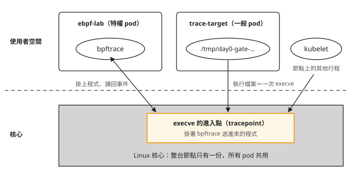
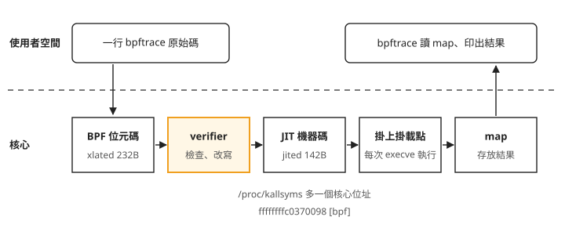
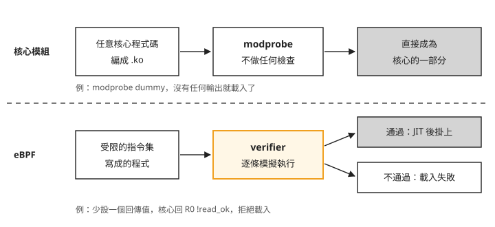
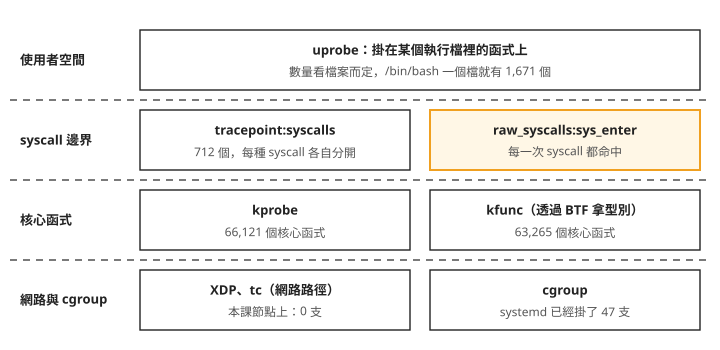
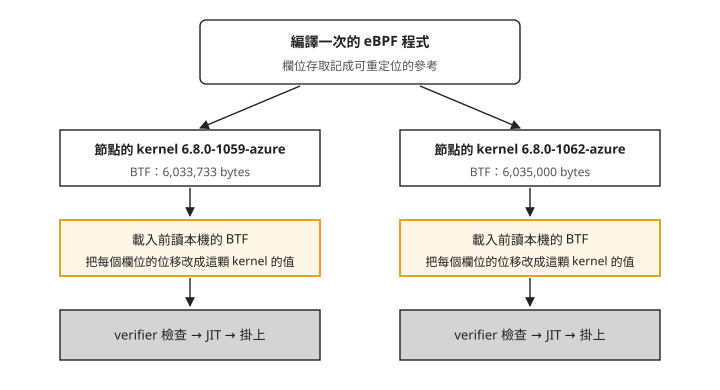

# Day 0: eBPF 是什麼——程式怎麼進到核心、verifier 擋什麼、掛在哪裡比較貴

{ align=right width="130" }
{ align=right width="130" }

前一個 sprint 處理 GPU 資源配置，這個 sprint 轉向觀察節點與容器執行時的行為。同一台節點上跑著一顆你沒寫過、也不能改的 pod。你想知道它剛剛執行了哪些程式，但不想改它的映像、不在它裡面裝東西，也沒辦法 SSH 進節點。這個 sprint 後面要用的 Falco、Tetragon、Cilium 都在做類似的事，而它們的安裝說明都會要求特權容器、要求節點的 kernel 有 BTF（BPF Type Format），也就是描述核心資料結構與函式型別的資訊。這些要求都來自它們共同的基礎：eBPF。

這一章會用到 bpftrace：一個命令列工具，你用一行簡短的腳本描述要掛在哪裡、觸發時做什麼，它負責把腳本編譯成 eBPF 程式並載入核心。bpftrace 把掛在某個掛載點上的程式叫做探針（probe）。這一章先部署一顆特權 pod，用一行 bpftrace 看到另一顆 pod 執行的檔案，再回頭看這一行在核心裡變成了什麼：誰負責檢查它、它能掛在哪些位置、掛在不同位置要付出多少效能，以及同一支程式為什麼換一台節點還能跑。

核心裡負責檢查 eBPF 程式的元件叫 verifier，它在載入時分析程式是否會越界存取、能否結束。讀完之後，遇到 eBPF 工具裝不起來、探針掛不上，或掛上之後節點變慢，你能分辨問題出在 pod 的權限與掛載、verifier 拒絕載入，還是探針掛在太常被觸發的位置。

## 只有核心看得到每一顆 pod 在做什麼

一台 Linux 機器上，最底層的程式是**核心**（kernel），它管 CPU、記憶體、網卡和磁碟。其他程式都跑在核心之上，這一層叫**使用者空間**（user space）。使用者空間的程式不能直接碰硬體，要開檔案、送封包、執行另一個程式，都得請核心代勞，這種請求叫 **system call**（系統呼叫）。執行一個程式用的 system call 叫 `execve`。

容器沒有改變這件事。同一台節點上的每一顆 pod 用的是同一個核心，pod 之間彼此看不到，這種隔離也是核心做的。所以不管哪一顆 pod 執行程式，最後都會進到核心裡同一段 `execve` 的程式碼。想知道「這台節點上誰執行了什麼」，最直接的位置就在核心裡。

要在核心裡加上自己的程式，傳統做法是寫一個核心模組（kernel module）載進去。模組載入之後就是核心的一部分，寫錯一行就可能讓整台機器當掉。**eBPF** 是另一種做法：你把一小段程式交給核心，核心先檢查它安不安全，通過了才把它掛在你指定的位置；之後核心每次執行到那個位置，就順便執行你的程式。這些可以掛程式的位置叫**掛載點**（hook）。

網頁上的 JavaScript 和瀏覽器的關係可以拿來對照：JavaScript 跑在瀏覽器裡，但只能呼叫瀏覽器開放的 API，只能在瀏覽器允許的事件上執行，也不能直接改瀏覽器的記憶體。eBPF 程式和核心也是這樣：核心提供執行環境、一組可以呼叫的函式（叫 helper），以及由核心決定開在哪裡的掛載點。

eBPF 是從 tcpdump 用來過濾封包的 BPF 擴充而來，核心和工具裡多半還是叫它 BPF，後面的輸出看到 `bpf`、`BPF` 指的都是同一件事。

## 步驟 1：準備一顆看得到節點的特權 pod {#step-1}

AKS 預設不開放節點的 SSH。要從節點的角度載入 eBPF 程式，標準做法是開一顆**特權 pod**：容器拿到和節點上 root 一樣的權限，再透過它操作節點的核心。

先開一個 CPU 節點池，eBPF 不需要 GPU。指令裡的 `<cluster>`、`<resource-group>`、`<subscription-id>` 換成你自己的叢集名稱、資源群組與訂閱 ID：

```console
$ az aks nodepool add -g <resource-group> --cluster-name <cluster> -n ebpf \
    --subscription <subscription-id> \
    --node-count 2 --node-vm-size Standard_D2as_v5 \
    --priority Spot --eviction-policy Delete --spot-max-price -1 \
    --labels pool=ebpf
```

本課的節點是 Ubuntu 24.04、kernel `6.8.0-1062-azure`。你開出來的節點映像可能比較新，後面各項數字會有些出入。

特權 pod 寫成 DaemonSet，讓每台節點各跑一顆。它只需要四項設定：`privileged: true` 給容器完整權限；`hostPID: true` 讓容器看得到節點上所有行程；`/sys` 和 `/sys/kernel/debug` 兩個 hostPath 讓容器讀得到核心公開的資訊。`/sys/kernel/debug` 是 debugfs 的掛載位置，debugfs 是核心用來公開除錯與追蹤資訊的特殊檔案系統，bpftrace 要從這裡讀出可以掛的位置清單。

```bash
cat > 01-ebpf-lab-daemonset.yaml <<'EOF'
apiVersion: v1
kind: Namespace
metadata:
  name: ebpf-lab
---
apiVersion: apps/v1
kind: DaemonSet
metadata:
  name: ebpf-lab
  namespace: ebpf-lab
  labels:
    app: ebpf-lab
spec:
  selector:
    matchLabels:
      app: ebpf-lab
  template:
    metadata:
      labels:
        app: ebpf-lab
    spec:
      hostPID: true
      nodeSelector:
        pool: ebpf
      tolerations:
      - key: kubernetes.azure.com/scalesetpriority
        operator: Equal
        value: spot
        effect: NoSchedule
      containers:
      - name: probe
        image: mcr.microsoft.com/mirror/docker/library/ubuntu:24.04
        command: ["sleep", "infinity"]
        securityContext:
          privileged: true
        resources:
          requests:
            cpu: 50m
            memory: 128Mi
        volumeMounts:
        - name: sys
          mountPath: /sys
        - name: debugfs
          mountPath: /sys/kernel/debug
      volumes:
      - name: sys
        hostPath:
          path: /sys
          type: Directory
      - name: debugfs
        hostPath:
          path: /sys/kernel/debug
          type: Directory
EOF
```

映像用的是 MCR（Microsoft Container Registry）上的 Ubuntu 官方映像的同步副本，不直接從 Docker Hub 拉，避免卡在匿名拉取的速率限制。另外開一顆沒有任何特權的 `trace-target`，步驟 2 要在它裡面執行程式，讓特權 pod 去追蹤。它和特權 pod 用同一個映像、同一組 nodeSelector 與 toleration，只是少了 `hostPID`、`privileged` 和兩個 hostPath：

```bash
cat > 02-target-pod.yaml <<'EOF'
apiVersion: v1
kind: Pod
metadata:
  name: trace-target
  namespace: ebpf-lab
  labels:
    app: trace-target
spec:
  nodeSelector:
    pool: ebpf
  tolerations:
  - key: kubernetes.azure.com/scalesetpriority
    operator: Equal
    value: spot
    effect: NoSchedule
  containers:
  - name: target
    image: mcr.microsoft.com/mirror/docker/library/ubuntu:24.04
    command: ["sleep", "infinity"]
    resources:
      requests:
        cpu: 50m
        memory: 64Mi
EOF
```

```console
$ kubectl apply -f 01-ebpf-lab-daemonset.yaml -f 02-target-pod.yaml
$ kubectl -n ebpf-lab get pods -o wide
NAME             READY   STATUS    NODE
ebpf-lab-g2g4r   1/1     Running   aks-ebpf-80832270-vmss000001
ebpf-lab-rq6sg   1/1     Running   aks-ebpf-80832270-vmss000000
trace-target     1/1     Running   aks-ebpf-80832270-vmss000001
```

兩顆 `ebpf-lab` 各在一台節點上。步驟 2 要用的是和 `trace-target` 在同一台節點的那一顆，上面的輸出裡是 `ebpf-lab-g2g4r`。你的 pod 名稱會不同，對照 `NODE` 欄找出和 `trace-target` 同一台的那顆，後面指令裡的 `<ebpf-lab-pod>` 都換成它。

接著在這顆特權 pod 裡確認三件事：核心有沒有 BTF 型別資訊檔案、debugfs 有沒有掛進來、bpftrace 裝不裝得起來。下面的區塊從第二行起，`...` 代表第一行的 `kubectl -n ebpf-lab exec <ebpf-lab-pod>`，這樣寫是為了把指令和輸出對在一起。`<` 與 `&&` 如果直接在你自己的電腦上打，會在本機執行，不會進到 pod 裡；所以實際操作時先進到 pod 的 shell，先更新套件清單，再在裡面執行 `--` 後面的部分：

```bash
kubectl -n ebpf-lab exec -it <ebpf-lab-pod> -- bash
# inside the pod
apt-get update -qq
```

```console
$ kubectl -n ebpf-lab exec <ebpf-lab-pod> -- ls -l /sys/kernel/btf/vmlinux
-r--r--r-- 1 root root 6035000 Aug  6 03:25 /sys/kernel/btf/vmlinux
$ ... -- mount | grep -c debugfs
2
$ ... -- wc -l < /sys/kernel/debug/tracing/available_events
2153
$ ... -- apt-get install -y bpftrace && bpftrace --version
bpftrace v0.20.2
```

<span id="mine-1"></span>BTF 檔案在，debugfs 掛進來了，`available_events` 是核心列出的掛載點清單，讀得到 2,153 行。bpftrace 裝在容器自己的檔案系統裡，節點上的檔案沒有被改動，pod 刪掉就跟著消失。

## 步驟 2：在另一顆 pod 裡看到你執行的檔案

這一步用的 bpftrace 只有一行：

- `tracepoint:syscalls:sys_enter_execve` 是掛載點的名字，意思是「每次有程式呼叫 `execve`、剛進入核心的那一刻」。
- 大括號裡是每次觸發時要做的事：印出行程編號（`pid`）、行程名稱（`comm`），以及要執行的檔名。

這一步的安排畫成圖是這樣，上半部是兩顆 pod 裡的程式，下半部是它們共用的核心：



照著箭頭看：bpftrace 把程式掛到核心的 `execve` 進入點；`trace-target` 執行檔案時會經過這個點，節點上 kubelet 這類行程執行程式時也一樣，所以掛在那裡的程式全部看得到。

節點上本來就有其他行程不斷在執行 `ls` 之類的指令，隨便跑一個 `ls` 沒辦法確定看到的是自己那一筆。所以先造一個這台機器上不可能有第二份的檔名，再到另一顆 pod 裡執行它。A 那行在 `<ebpf-lab-pod>` 裡執行並保持執行；另開一個終端機進 `trace-target`，在那邊設定 `MARK` 並執行 B 那行。進入兩顆 pod 的指令分別是：

```bash
kubectl -n ebpf-lab exec -it <ebpf-lab-pod> -- bash   # A
kubectl -n ebpf-lab exec -it trace-target -- bash     # B
```

兩邊要執行的內容如下：

```bash
MARK="day0-gate-$(date '+%H%M%S')"        # a filename nothing else on this node has
# A: the privileged pod attaches the probe
bpftrace -e 'tracepoint:syscalls:sys_enter_execve {
    printf("%-6d %-16s -> %s\n", pid, comm, str(args.filename)); }' -o /tmp/gate.out
# B: another pod on the same node runs that file
cp /bin/echo /tmp/$MARK && /tmp/$MARK hello-from-trace-target
```

做完 B，回到 A 按 Ctrl-C 結束 bpftrace，再到輸出檔裡找你那個檔名。`<HHMMSS>` 只填你在 `trace-target` 裡設定的 `MARK` 最後六位時間，例如 `MARK` 是 `day0-gate-112742`，就填 `112742`；搜尋模板已經有 `day0-gate-` 前綴：

```console
$ kubectl -n ebpf-lab exec <ebpf-lab-pod> -- grep -n 'day0-gate-<HHMMSS>' /tmp/gate.out
32:7826   bash             -> /tmp/day0-gate-112742
```

這一行輸出可以讀出三件事：

1. **探針看得到別的 pod。** 探針跑在特權 pod 裡，被記錄的動作發生在 `trace-target`。兩顆 pod 各自隔離，但 eBPF 程式掛在核心的 `execve` 進入點，那是所有容器共用的同一段程式碼。
2. **PID 是節點上的編號。** 7826 是節點看到的行程編號，不是 `trace-target` 容器裡看到的號碼。
3. **`comm` 是 `bash`。** 進入 `execve` 的那一刻，行程還是原本的 `bash`，只是要執行的檔名換成了新的。

同一份輸出裡其他幾十筆都是節點自己的活動，其中有 `7793 kubelet -> /usr/sbin/ip6tables` 和 `7794 kubelet -> /usr/sbin/iptables`。也就是說，在一顆 pod 裡跑一行指令，就看得到 kubelet 呼叫 iptables。能掛探針的容器看得到整台節點上所有行程的動作，這是後面每一章討論權限時的起點。反過來，把同一行交給沒有特權的 pod，會拿到一則容易誤解的錯誤，見[對照實驗：一般 pod 裡回 tracepoint not found](#mine-7)。

## 這一行在核心裡變成了什麼

要看核心裡載入了哪些 eBPF 程式，用的是 `bpftool`，它是 Linux 核心專案自己附的管理工具。AKS 節點上內建一支，所以不在容器裡裝，而是從特權 pod 借用節點的檔案系統去執行它：

```console
$ kubectl -n ebpf-lab exec <ebpf-lab-pod> -- \
    nsenter -t 1 -m -- bpftool prog list
```

`nsenter -t 1 -m` 的意思是「進到節點上 1 號行程的檔案系統視角」，因為 pod 設了 `hostPID: true`，1 號行程就是節點本身的第一個行程。接下來的區塊為了好讀，只寫 `bpftool` 本身，前面這段前綴請自行補上。

先看還沒掛任何探針時，核心裡已經有幾支程式。`grep -c` 數的是以編號開頭的行，一行就是一支程式；第二個指令把程式依種類分組：

```console
$ bpftool prog list | grep -cE '^[0-9]+:'
52
$ bpftool prog list | grep -oE '^[0-9]+: [a-z_]+' | awk '{print $2}' | sort | uniq -c | sort -rn
     41 cgroup_device
      6 cgroup_skb
      1 tracing
```

還沒裝任何追蹤工具，節點上就已經有 52 支。分組和計數不是同一刻取的，加起來對不上 52 是正常的。這些程式是誰放的，掛載點那一節再看。

bpftrace 跑著的時候再列一次。下面這次跑的是一支同時統計 `execve` 與 `openat` 次數、每秒印一次結果的 bpftrace（腳本本身不在本章，`@opens` 就是它統計 `openat` 用的變數），程式總數從 52 變成 55。這一節後面的幾段輸出來自不同次執行，程式與 map 的編號（46、56、68、488）因此對不起來，對照時看名稱就好：

```console
$ bpftool prog list | grep -A1 -E '^[0-9]+: (tracepoint|perf_event)'
470: tracepoint  name tracepoint_syscalls_sys_enter_openat  tag afe1b01453072a6e  gpl
	xlated 232B  jited 142B  memlock 4096B  map_ids 46
471: tracepoint  name tracepoint_syscalls_sys_enter_execve  tag afe1b01453072a6e  gpl
	xlated 232B  jited 142B  memlock 4096B  map_ids 45
472: perf_event  name 1  tag 8c75940e7e21306d  gpl
	xlated 192B  jited 117B  memlock 4096B  map_ids 47
```

一行 bpftrace 變成三支獨立的核心程式：兩支掛在 tracepoint 上，一支是每秒觸發一次的計時器（`perf_event`）。每一支的第二行都有兩個長度：

- `xlated 232B` 是**位元碼**的長度。eBPF 程式送進核心時是一種虛擬的指令格式，核心看得懂，CPU 不能直接執行。
- `jited 142B` 是 **JIT** 之後的長度。JIT 指核心在載入時把位元碼翻成這台 CPU 的機器碼，之後每次觸發都直接執行機器碼。

兩個長度並排出現，代表 JIT 確實做了。`tag afe1b01453072a6e` 是位元碼內容的雜湊值，`map_ids` 等一下再講。

JIT 產生的機器碼會登記在核心的符號表 `/proc/kallsyms` 裡：

```console
$ grep bpf_prog /proc/kallsyms | grep -i execve
ffffffffc0370098 t bpf_prog_afe1b01453072a6e_tracepoint_syscalls_sys_enter_execve	[bpf]
```

`ffffffffc0370098` 是一個真實的核心位址，`[bpf]` 標明它來自 eBPF，符號名裡的 `afe1b01453072a6e` 就是上面的 tag。AKS 節點的 kernel 編譯時把 JIT 設成永遠開啟（`CONFIG_BPF_JIT_ALWAYS_ON=y`），JIT 不能關掉，所以網路上常見的「先確認 `net.core.bpf_jit_enable=1`」這一步可以跳過。

把這一段畫成圖，左上是你寫的那一行，沿著箭頭一路走到右上的輸出：



我們可以從圖上看到兩件事。第一，位元碼和機器碼之間隔著 verifier，沒有通過它的程式到不了 JIT 這一步，下一節專門講它。第二，結果回到使用者空間只有一條路：核心裡的程式不能直接把字印到終端機，只能寫進 **map**，再由使用者空間的 bpftrace 去讀。map 是核心裡的一塊記憶體，核心裡的程式和使用者空間的程式都能存取。

先讓探針保持執行，在同一台節點查 `bpftool prog list`，用程式名稱找出目標探針，記下行首的程式 ID 與它的 `map_ids`。再用下面的 `bpftool map list` 找 `AT_opens`，確認它的 ID 出現在目標程式的 `map_ids` 裡。若有多支同名探針，先比對掛探針前後的清單，找出這次新增的物件。

下面的清單與 `show` 是不同次執行的紀錄。操作時，將 `bpftool map show id 56` 的 `56` 換成你剛查到的 map ID；不要直接沿用範例數字：

```console
$ bpftool map list | grep -E '^[0-9]+:'
46: percpu_hash  name AT_opens         flags 0x0
48: ringbuf      name ringbuf          flags 0x0
$ bpftool map show id 56
56: percpu_hash  name AT_opens  flags 0x0
	key 16B  value 8B  max_entries 4096  memlock 427008B
```

bpftrace 把腳本裡的 `@opens` 變成名叫 `AT_opens` 的 map（`@` 換成 `AT_`）。那個 `ringbuf` 也是 bpftrace 建的，用來送出 `printf` 這類逐筆事件，所以同一支程式用了兩種回傳方式：統計數字放 map，逐筆事件走 ring buffer。ring buffer 是一段環狀的緩衝區，核心依序寫入事件，使用者空間依序讀出。

`map show` 的第二行是這個 map 的規格：

- `key 16B`：key 存的是行程名稱，Linux 的行程名稱最長就是 16 bytes。
- `value 8B`：一個 64 位元的計數器。
- `max_entries 4096`：map 有容量上限，第 4,097 個不同的行程名稱會被丟掉。
- `memlock 427008B`：這一個計數用的 map 就佔了 417 KB 的核心記憶體。

保持同一支探針執行，把 map 裡的原始內容印出來。下方 `bpftool map dump id 56` 的 `56` 也要換成剛才確認的 map ID，和 `show` 查同一個 map：

```console
$ bpftool map dump id 56
key:
63 6f 6e 74 61 69 6e 65  72 64 00 00 00 00 00 00
value (CPU 00): 84 00 00 00 00 00 00 00
value (CPU 01): b6 02 00 00 00 00 00 00
```

`63 6f 6e 74 61 69 6e 65 72 64` 是 `containerd` 這幾個字母的編碼。map 裡沒有「字串」這種型別，只有固定長度的位元組，16 bytes 的 key 不夠長的部分補零。`value (CPU 00)` 和 `value (CPU 01)` 兩行，是因為這個 map 的類型是 `percpu_hash`：每顆 CPU 各有一份計數器，在核心裡加一時不必和其他 CPU 搶同一個位置，使用者空間要看的時候才把各 CPU 的值加總。這台機器有兩顆 vCPU，所以是兩行。

bpftrace 結束時印出的 `@opens[kubelet]: 1759`、`@opens[containerd-shim]: 10499` 這類統計，讀的就是這個 map。程式的 `map_ids` 指向它，`bpftool map dump` 看到的是位元組，bpftrace 看到的是「行程名稱對應次數」，三者是同一塊記憶體。

<span id="mine-6"></span>這些程式和 map 什麼時候會被移除，看的是有沒有行程還開著它們的檔案描述子（fd）：bpftrace 行程結束，核心就把它載入的程式收回。行程如果沒有真的結束，程式就一直掛著。

## 誰保證它不會把機器弄壞：verifier

開頭提過，把程式放進核心原本就做得到，用的是核心模組。在同一顆特權 pod 裡實際載入一個看看。`dummy` 是核心自帶的假網路裝置模組，載入和卸載都不會影響節點。這幾行和 `bpftool` 一樣，要加上 `nsenter -t 1 -m --` 前綴，在節點的檔案系統裡執行：

```console
$ lsmod | tail -n +2 | wc -l
82
$ modprobe dummy
(沒有任何輸出)
$ lsmod | grep '^dummy'
dummy                  16384  0
$ rmmod dummy
(沒有任何輸出)
```

節點上已經載入了 82 個模組，`modprobe` 一行就多載入一個。沒有輸出不代表沒有檢查：核心載入模組時可依設定驗證簽章，見 [Linux 核心模組簽章文件](https://docs.kernel.org/admin-guide/module-signing.html)。這類檢查不包含 eBPF verifier 那種程式安全分析。模組裡的程式碼是完整的核心程式碼，可以讀寫任何記憶體，也可以讓整台機器停擺。

換成 eBPF 的載入方式。下面這支程式只有一條指令：直接結束（`exit`），沒有先設定回傳值。正常的程式在結束前要把回傳值放進 `r0` 這個暫存器，這支少了這一步，核心拒絕載入，回傳錯誤碼 13（`EACCES`，權限不足）：

```console
## R1 沒設定回傳值就 exit(r0 未初始化)
0: R1=ctx() R10=fp0
0: (95) exit
R0 !read_ok
```

拒絕它的是核心裡的 **verifier**：每一支 eBPF 程式在載入前都要通過它的檢查，不通過就載入失敗。兩條載入路徑畫在一起，上面是核心模組，下面是 eBPF：



兩條路的差別在中間那一格。核心模組載入時可做簽章驗證，eBPF 則會經過 verifier 分析程式的執行路徑與記憶體存取。代價寫在下面那條路的第一格：eBPF 只能用受限的指令集，能做的事比核心模組少得多。這個 sprint 的所有工具都在這個限制下運作，程式寫錯時，載入會失敗，已經在跑的核心不受影響。

### verifier 怎麼檢查

用 bpftrace 幾乎寫不出會被 verifier 拒絕的程式：永遠不會結束的迴圈會在編譯時被編譯器刪掉，太長的字串在 bpftrace 自己這一層就被擋下（`'BPFTRACE_MAX_STRLEN' 512 exceeds the current maximum of 200 bytes`），讀取任意位址則會被包成「試著讀，失敗就回 0」的安全讀取。日常使用這是好事，但也表示只用 bpftrace 看不到 verifier 的檢查過程。

所以這一節的例子改用 Python 直接呼叫 `bpf()` 這個 system call，把手寫的位元碼送進核心。<span id="mine-3"></span>這樣做時如果核心回傳錯誤，但 verifier 的紀錄（log）是空的，代表程式根本還沒進到 verifier，該查的是 system call 的呼叫方式（例如位址傳錯），不是程式本身。判斷條件是：log 有內容，代表程式進到了 verifier，問題在程式；log 空白、錯誤碼又是 `EFAULT` 或 `EINVAL`，代表程式還沒進到 verifier，問題在呼叫方式。

這兩支腳本要在步驟 1 的特權 pod 內執行，容器內需有 Python 3，節點架構必須是 x86_64；腳本把這個架構的 `bpf()` system call 編號寫成 `321`。將下列內容分別存成 pod 內的 `/tmp/06-verifier-raw-bpf.py` 與 `/tmp/07-verifier-raw-bpf-round2.py`，在 pod 的 shell 依序執行 `python3 /tmp/06-verifier-raw-bpf.py`、`python3 /tmp/07-verifier-raw-bpf-round2.py`。腳本內容沿用驗證素材，執行後會逐案印出載入結果與 verifier log。

第一支包含合法對照組、未初始化暫存器、迴圈與 stack 存取案例：

```python
#!/usr/bin/env python3
"""Day 0 item (c): call bpf(BPF_PROG_LOAD) directly and print the kernel verifier's log.

bpftrace never lets a bad program reach the verifier (front-end limits, LLVM, and
bpf_probe_read wrapping all intervene first), so to SEE the verifier we hand-assemble
BPF bytecode and make the syscall ourselves. No compiler, no headers, no libbpf.
"""
import ctypes, struct, os

NR_BPF = 321                 # x86_64
BPF_PROG_LOAD = 5
BPF_PROG_TYPE_SOCKET_FILTER = 1

BPF_ALU64, BPF_JMP, BPF_LDX, BPF_STX = 0x07, 0x05, 0x01, 0x03
BPF_MOV, BPF_K, BPF_EXIT, BPF_JA = 0xb0, 0x00, 0x90, 0x00
BPF_MEM, BPF_DW = 0x60, 0x18

MOV64_IMM = BPF_ALU64 | BPF_MOV | BPF_K   # 0xb7
EXIT      = BPF_JMP | BPF_EXIT            # 0x95
JA        = BPF_JMP | BPF_JA              # 0x05
LDX_DW    = BPF_LDX | BPF_MEM | BPF_DW    # 0x79
STX_DW    = BPF_STX | BPF_MEM | BPF_DW    # 0x7b

libc = ctypes.CDLL("libc.so.6", use_errno=True)
# argtypes are mandatory: without them ctypes narrows pointer args to 32 bits and
# every bpf() call comes back EFAULT.
libc.syscall.restype = ctypes.c_int
libc.syscall.argtypes = [ctypes.c_long, ctypes.c_long, ctypes.c_void_p, ctypes.c_ulong]


def insn(code, dst=0, src=0, off=0, imm=0):
    return struct.pack("<BBhi", code, ((src & 0xF) << 4) | (dst & 0xF), off, imm)


def prog_load(insns, name):
    blob = b"".join(insns)
    ibuf = ctypes.create_string_buffer(blob, len(blob))
    lic = ctypes.create_string_buffer(b"GPL")
    log = ctypes.create_string_buffer(262144)
    attr = struct.pack(
        "<IIQQIIQII16sII",
        BPF_PROG_TYPE_SOCKET_FILTER,          # prog_type
        len(insns),                           # insn_cnt
        ctypes.addressof(ibuf),               # insns
        ctypes.addressof(lic),                # license
        1,                                    # log_level
        len(log),                             # log_size
        ctypes.addressof(log),                # log_buf
        0,                                    # kern_version
        0,                                    # prog_flags
        name.encode()[:15],                   # prog_name[16]
        0,                                    # prog_ifindex
        0,                                    # expected_attach_type
    )
    attr += b"\x00" * (128 - len(attr))
    abuf = ctypes.create_string_buffer(attr, len(attr))
    ctypes.set_errno(0)
    fd = libc.syscall(NR_BPF, BPF_PROG_LOAD, ctypes.addressof(abuf), len(attr))
    return fd, ctypes.get_errno(), log.value.decode(errors="replace")


CASES = [
    ("V0 合法對照組：r0 = 0; exit",
     [insn(MOV64_IMM, dst=0, imm=0), insn(EXIT)]),
    ("R1 沒設定回傳值就 exit（r0 未初始化）",
     [insn(EXIT)]),
    ("R2 無界迴圈：ja -1（跳回自己）",
     [insn(MOV64_IMM, dst=0, imm=0), insn(JA, off=-1), insn(EXIT)]),
    ("R3 讀沒寫過的 stack（r10-8）",
     [insn(LDX_DW, dst=0, src=10, off=-8), insn(EXIT)]),
    ("R4 越界 stack 存取（r10-600，stack 只有 512 bytes）",
     [insn(STX_DW, dst=10, src=0, off=-600), insn(MOV64_IMM, dst=0, imm=0), insn(EXIT)]),
    ("R5 寫入唯讀的 frame pointer r10",
     [insn(MOV64_IMM, dst=10, imm=0), insn(EXIT)]),
]

for title, prog in CASES:
    print("#" * 70)
    print("## " + title)
    print("## 指令組（%d 條）: %s" % (len(prog), " ".join(b.hex() for b in prog)))
    fd, err, log = prog_load(prog, "day0probe")
    if fd >= 0:
        print("## 結果: 載入成功，prog fd = %d" % fd)
        os.close(fd)
    else:
        print("## 結果: 被拒絕，errno = %d (%s)" % (err, os.strerror(err)))
    print("--- kernel verifier log ---")
    print(log.strip() if log.strip() else "(空)")
    print()
```

第二支補上會到達迴圈與越界檢查的案例，並各附一個合法對照組：

```python
#!/usr/bin/env python3
"""Day 0 item (c), round 2: the two rejections round 1 missed.

Round 1's loop case was caught by the *pre-check* ("unreachable insn 2") before the
loop detector ever ran, and its out-of-bounds stack write tripped on an uninitialised
r0 first. Both are fixed here so the verifier reports the reason we were aiming at.
"""
import ctypes, struct, os

NR_BPF, BPF_PROG_LOAD, SOCKET_FILTER = 321, 5, 1
MOV64_IMM = 0xb7        # BPF_ALU64|BPF_MOV|BPF_K
ADD64_IMM = 0x07        # BPF_ALU64|BPF_ADD|BPF_K
JGT_IMM   = 0x25        # BPF_JMP|BPF_JGT|BPF_K
JA        = 0x05        # BPF_JMP|BPF_JA
STX_DW    = 0x7b        # BPF_STX|BPF_MEM|BPF_DW
EXIT      = 0x95        # BPF_JMP|BPF_EXIT

libc = ctypes.CDLL("libc.so.6", use_errno=True)
libc.syscall.restype = ctypes.c_int
libc.syscall.argtypes = [ctypes.c_long, ctypes.c_long, ctypes.c_void_p, ctypes.c_ulong]


def insn(code, dst=0, src=0, off=0, imm=0):
    return struct.pack("<BBhi", code, ((src & 0xF) << 4) | (dst & 0xF), off, imm)


def prog_load(insns, name):
    blob = b"".join(insns)
    ibuf = ctypes.create_string_buffer(blob, len(blob))
    lic = ctypes.create_string_buffer(b"GPL")
    log = ctypes.create_string_buffer(262144)
    attr = struct.pack("<IIQQIIQII16sII", SOCKET_FILTER, len(insns),
                       ctypes.addressof(ibuf), ctypes.addressof(lic),
                       1, len(log), ctypes.addressof(log), 0, 0,
                       name.encode()[:15], 0, 0)
    attr += b"\x00" * (128 - len(attr))
    abuf = ctypes.create_string_buffer(attr, len(attr))
    ctypes.set_errno(0)
    fd = libc.syscall(NR_BPF, BPF_PROG_LOAD, ctypes.addressof(abuf), len(attr))
    return fd, ctypes.get_errno(), log.value.decode(errors="replace")


CASES = [
    ("R2b 真正的無界迴圈：條件永遠不成立，但出口指令可達",
     [insn(MOV64_IMM, dst=0, imm=0),      # 0: r0 = 0
      insn(JGT_IMM, dst=0, imm=10, off=1),# 1: if r0 > 10 goto 3
      insn(JA, off=-2),                   # 2: goto 1   <- back-edge
      insn(EXIT)]),                       # 3: exit
    ("R2c 有界迴圈對照組：同樣的 back-edge，但計數器真的會增加",
     [insn(MOV64_IMM, dst=0, imm=0),      # 0: r0 = 0
      insn(JGT_IMM, dst=0, imm=10, off=2),# 1: if r0 > 10 goto 4
      insn(ADD64_IMM, dst=0, imm=1),      # 2: r0 += 1
      insn(JA, off=-3),                   # 3: goto 1   <- back-edge
      insn(MOV64_IMM, dst=0, imm=0),      # 4: r0 = 0
      insn(EXIT)]),                       # 5: exit
    ("R4b 越界 stack 寫入：r10-600，但 BPF stack 只有 512 bytes",
     [insn(MOV64_IMM, dst=0, imm=0),      # 0: r0 = 0
      insn(STX_DW, dst=10, src=0, off=-600),
      insn(EXIT)]),
    ("R4c 合法 stack 寫入對照組：r10-8",
     [insn(MOV64_IMM, dst=0, imm=0),
      insn(STX_DW, dst=10, src=0, off=-8),
      insn(EXIT)]),
]

for title, prog in CASES:
    print("#" * 70)
    print("## " + title)
    print("## 指令組（%d 條）: %s" % (len(prog), " ".join(b.hex() for b in prog)))
    fd, err, log = prog_load(prog, "day0probe")
    if fd >= 0:
        print("## 結果: 載入成功，prog fd = %d" % fd)
        os.close(fd)
    else:
        print("## 結果: 被拒絕，errno = %d (%s)" % (err, os.strerror(err)))
    print("--- kernel verifier log ---")
    print(log.strip() if log.strip() else "(空)")
    print()
```

先送一支合法的兩行程式當對照組，設定 `r0 = 0` 再結束：

```console
## V0 合法對照組:r0 = 0; exit —— 載入成功,prog fd = 3
--- kernel verifier log ---
processed 2 insns (limit 1000000) max_states_per_insn 0 total_states 0 peak_states 0 mark_read 0
```

`limit 1000000` 是 verifier 的上限：它最多檢查一百萬條指令，超過就放棄並拒絕載入。接著送進四支有問題的程式。表裡的錯誤碼 13 是 `EACCES`（權限不足），22 是 `EINVAL`（參數無效）；`r10` 是指向這支程式 stack 的暫存器，也叫 frame pointer，程式只能讀它、不能改它：

| 送進去的程式 | 核心的回覆 | 錯誤碼 |
|---|---|---|
| 沒設回傳值就 `exit` | `R0 !read_ok` | 13 |
| 條件永遠不成立的迴圈 | `infinite loop detected at insn 1` | 22 |
| 寫入 `r10-600`（stack 只有 512 bytes） | `invalid write to stack R10 off=-600 size=8` | 13 |
| 寫入唯讀的 frame pointer | `frame pointer is read only` | 13 |

第一則的 `R0 !read_ok` 意思是「`r0` 不可讀」，因為程式從來沒寫過它，可見 verifier 會追蹤每個暫存器有沒有被設定過。第三則連寫入的大小（`size=8`）都算進去了。eBPF 程式的 stack 上限是 512 bytes，這也是前面 bpftrace 限制字串長度的原因：字串放在 stack 上，512 這個數字是 verifier 訂的。

第二則的紀錄最能看出 verifier 怎麼做判斷。這支程式先把 `r0` 設成 0，然後不斷檢查「`r0` 大於 10 嗎」，不大於就跳回去再檢查一次（往回跳的指令叫 back-edge），而 `r0` 從頭到尾不會改變（原始紀錄繞了四圈，這裡節錄三圈）：

```console
## R2b 真正的無界迴圈:條件永遠不成立,但出口指令可達 —— 被拒絕,errno = 22
--- kernel verifier log ---
0: R1=ctx() R10=fp0
0: (b7) r0 = 0                        ; R0_w=0
1: (25) if r0 > 0xa goto pc+1         ; R0_w=0
2: (05) goto pc-2
1: (25) if r0 > 0xa goto pc+1         ; R0_w=0
2: (05) goto pc-2
1: (25) if r0 > 0xa goto pc+1         ; R0=0
2: (05) goto pc-2
infinite loop detected at insn 1
cur state: R0=0 R1=ctx() R10=fp0
old state: R0_rw=P0 R1=ctx() R10=fp0
processed 10 insns (limit 1000000) max_states_per_insn 0 total_states 1 peak_states 1 mark_read 1
```

verifier 並沒有真的執行這支程式，而是一條一條推算每個暫存器在那一刻可能是什麼值，這種做法叫符號執行。每一行分號後面的 `R0_w=0` 就是它推算的結果。繞了幾圈之後，`cur state`（現在的狀態）和 `old state`（上一圈的狀態）一模一樣，表示每繞一圈什麼都沒改變，這個迴圈不會結束，於是判定 `infinite loop detected at insn 1`。

同樣的 back-edge、同樣的跳躍指令，只把計數器改成每圈真的會加一：

```console
## R2c 有界迴圈對照組:同樣的 back-edge,但計數器真的會增加 —— 載入成功
--- kernel verifier log ---
processed 37 insns (limit 1000000) max_states_per_insn 1 total_states 2 peak_states 2 mark_read 1
```

這次通過，verifier 檢查了 37 條指令。可見 verifier 允許迴圈，條件是它能證明迴圈會結束，判斷依據是每繞一圈狀態有沒有往前走。寫 eBPF 程式時，所有迴圈都要有看得出來的上限，原因就在這裡。

<span id="mine-4"></span>看 verifier 的紀錄還要知道一件事：它遇到第一個問題就停。如果你想測迴圈，把程式寫成「跳回自己」，拿到的會是 `unreachable insn 2`，因為後面的 `exit` 永遠執行不到，在迴圈檢查之前就被擋下；想測越界寫入但沒先設定 `r0`，拿到的會是 `R0 !read_ok`。紀錄最後一行是 verifier 遇到的第一個問題，不一定是程式裡唯一或最嚴重的問題，修掉一個再載入，可能出現另一個。

### verifier 也會改寫程式

在 bpftrace 探針仍執行時，回到同一台節點的 `bpftool prog list`，以 `tracepoint_syscalls_sys_enter_execve` 名稱找出程式，再核對它的 `map_ids` 是否對應這次建立的 map；若有同名程式，就比對掛探針前後清單。下方 `bpftool prog dump xlated id 488` 的 `488` 要換成你查到的程式 ID，不能沿用紀錄裡的編號。把載入成功的程式印出來，內容已經和送進去的位元碼不一樣：

```console
$ bpftool prog dump xlated id 488
int64 tracepoint_syscalls_sys_enter_execve(int8 * var1):
   0: (b7) r1 = 0
   ...
   7: (85) call bpf_get_current_comm#249920
   8: (18) r1 = map[id:68]
  11: (85) call htab_percpu_map_lookup_elem#295936
  12: (15) if r0 == 0x0 goto pc+4
  ...
  28: (95) exit
```

這是 bpftrace 腳本裡 `@opens[comm] = count()` 這一行展開後的 29 條指令，裡面看得到 verifier 做的兩處改寫。原本「使用某個 map」的地方，變成 `r1 = map[id:68]`，直接指向那個 map。原本呼叫的是通用的 `bpf_map_lookup_elem` helper，變成 `htab_percpu_map_lookup_elem`：verifier 檢查到這個 map 是 `percpu_hash`，就換成這種 map 專用的實作，少一層轉呼叫。所以載入這一步同時做了檢查和最佳化。

### verifier 的嚴格程度看權限

<span id="mine-5"></span>verifier 不是對每個人都一樣嚴格。下面這支程式讀取一段從來沒寫過的 stack。這種讀取一般會被拒絕，但從特權 pod 送出時載入成功了：

```console
## R3 讀沒寫過的 stack(r10-8)—— 載入成功,prog fd = 3
--- kernel verifier log ---
processed 2 insns (limit 1000000) …
```

送出這支程式的 pod 是特權的，它擁有全部 41 項 capability（Linux 把 root 的權限拆成的一項項能力）。核心據此判斷這個呼叫者本來就能讀到核心的位址，讀未初始化的 stack 頂多讀到殘留的值，不算洩漏資訊，於是放行。同一段位元碼由非特權的呼叫者送出，會被拒絕。

Falco 和 Tetragon 都跑在特權容器裡，適用的是最寬鬆的那一組檢查。verifier 保證的是程式不會讓核心崩潰、不會越界存取，不代表「裝了 eBPF 工具就安全」。verifier 本身也是核心裡相當複雜的一段程式，歷史上出過讓人提升權限或越界存取的漏洞。所以載入 eBPF 需要 `CAP_BPF`、`CAP_PERFMON` 這類 capability，多數發行版預設不讓非特權使用者載入。放到 Kubernetes 上，結果就是一般 pod 掛不上探針（見[對照實驗：一般 pod 裡回 tracepoint not found](#mine-7)），負責掛探針的元件一定是特權 DaemonSet。

## 掛載點：能掛在哪裡，掛在哪裡比較貴

eBPF 程式不能掛在核心的任意一行。掛載點是核心定義好的一份清單，分成幾類，每一類能拿到哪些參數、能呼叫哪些 helper 也是規定好的。bpftrace 可以把這台機器上所有能掛的位置列出來，第二個指令依種類分組：

```console
$ bpftrace -l | wc -l
133022
$ bpftrace -l | awk -F: '{print $1}' | sort | uniq -c | sort -rn
  66121 kprobe
  63265 kfunc
   2153 tracepoint
   1441 rawtracepoint
     16 iter
     14 software
     12 hardware
```

四類主要的掛載點：

- **kprobe**：掛在核心函式的進入點，幾乎任何核心函式都能掛，所以數量最多。代價是不穩定：核心內部的函式會改名，也可能被編譯器併進別的函式裡，換一版 kernel 就可能找不到。
- **kfunc**：同樣掛在核心函式上，但透過 BTF 取得參數的型別，可以直接寫 `args.file->f_inode` 這種欄位存取；kprobe 只給一串暫存器的值。BTF 是下一節的主題。
- **tracepoint**：核心開發者刻意留在程式碼裡的固定掛點，跨 kernel 版本會保留下來，所以穩定。`rawtracepoint` 是同一批掛點的低階版本。
- **hardware、software**：CPU 的效能計數器（cache miss、指令數）和核心的軟體事件（page fault、context switch），換一種 CPU，hardware 那一組就跟著換。

`uprobe` 不在上面的清單裡，因為它掛在使用者空間的執行檔上，數量看你指定哪個檔案：

```console
$ bpftrace -l 'uprobe:/bin/bash:*' | wc -l
1671
```

光是 `/bin/bash` 一個檔案就有 1,671 個可以掛的函式。

tracepoint 依核心的子系統分組，前五名是：

```console
$ bpftrace -l 'tracepoint:*' | awk -F: '{print $2}' | sort | uniq -c | sort -rn | head -5
    712 syscalls
    188 cfg80211
    136 sunrpc
    113 ext4
     91 kvm
```

三分之一的 tracepoint 在 `syscalls` 這一組，大多數 system call 的進入與離開各有一個。這也是執行期安全工具多半從 system call 下手的原因：這裡的掛點最密、最穩定，而且所有容器都會經過。這個 2,153 和步驟 1 從 `available_events` 讀到的行數一樣，bpftrace 列出的清單就是核心提供的清單。

還記得那 52 支沒人裝過就在跑的程式嗎？分組結果裡有 47 支掛在 cgroup 這一類掛載點上（41 支 `cgroup_device` 加 6 支 `cgroup_skb`），另外 1 支 `tracing` 是核心自帶的。cgroup 是核心把一組行程歸在一起、統一限制資源的機制，systemd 的每個 service、每顆 pod 的容器都各自在一個 cgroup 裡。看那些程式掛在哪些 cgroup 上：

```console
$ bpftool cgroup tree | head -7
CgroupPath
ID       AttachType      AttachFlags     Name
/sys/fs/cgroup/system.slice/systemd-networkd.service
    284      cgroup_device   multi           sd_devices
/sys/fs/cgroup/system.slice/systemd-udevd.service
    277      cgroup_inet_ingress multi        sd_fw_ingress
    276      cgroup_inet_egress  multi        sd_fw_egress
```

`sd_devices` 管每個 service 能存取哪些裝置，`sd_fw_ingress`、`sd_fw_egress` 是每個 service 的封包進出過濾，全部由 systemd 在開機時載入。也就是說，在你決定要不要用 eBPF 之前，節點上的 systemd 已經在用它了。網路這一類目前是空的：`ip -d link show` 在 `lo`、`eth0`、`azv*` 上都找不到 XDP 程式，`tc filter show dev eth0 ingress` 也沒有輸出。XDP 和 tc 是網卡收發封包路徑上的掛載點，本課叢集用的 Azure CNI 不用 eBPF 處理封包，所以是 0 支。Day 7 換上 Cilium 之後再看，這裡就不會是空的。

把這些掛載點依位置分層畫出來，由上到下從使用者空間到網路路徑：



這個 sprint 的工具分別用到其中幾層：Day 1 的 bpftrace 工具用 syscall 邊界的 tracepoint 和核心函式上的 kprobe；[Day 2](sprint2-day2-bpftrace-kubernetes.md) 用 cgroup 把事件對應回 pod；Day 7 到 Day 9 的 Cilium 把程式掛在 XDP 和 tc 上，接手封包的處理。圖上沒有畫的還有一類 LSM 掛載點，掛在核心做權限檢查的地方，程式可以在那裡直接拒絕一個動作，[Day 6](sprint2-day6-tetragon-enforcement.md) 的攔截靠的就是它。本課節點的開機參數裡有 `lsm=bpf`，表示這類掛載點可用，但這一章沒有實際掛過 LSM 程式。

### 掛在哪裡決定開銷

圖上用橘色標出的 `raw_syscalls:sys_enter`，是每一次 system call 都會觸發的掛載點。掛在它上面和掛在只有執行程式時才觸發的 `sys_enter_execve` 上，開銷差多少？量法是在非特權的 `trace-target` 裡跑固定的工作，同一台節點的特權 pod 掛不同的探針，各量三輪。工作是用 `dd` 讀寫 400 萬次：

```bash
dd if=/dev/zero of=/dev/null bs=512 count=2000000    # 2M reads + 2M writes = 4M syscalls
```

| 狀態 | 三輪（秒） | 平均 | 相對 A |
|---|---|---|---|
| A. 不追蹤 | 2.43434 / 2.39734 / 2.44853 | 2.427 | — |
| B. 只掛 `sys_enter_execve` | 2.52514 / 2.51548 / 2.51326 | 2.518 | +3.8% |
| C. 掛 `raw_syscalls:sys_enter` | 3.72147 / 3.94398 / 3.78143 | 3.816 | +57.2% |
| D. 再回到不追蹤 | 2.51958 / 2.39927 / 2.40542 | 2.441 | +0.6% |

`dd` 從頭到尾沒有執行任何程式，所以 B 的探針一次都沒被觸發；C 的探針在每一次 system call 都會執行，而 `dd` 做的事幾乎全是 system call，這是刻意挑的最壞情況。D 回到 A 的水準，表示 C 變慢不是機器本身變慢。從 C 和 A 的差可以算出每一次觸發的成本：(3.816 − 2.427) 秒 ÷ 4,000,000 次，約 347 奈秒，包含進入掛載點、執行那 29 條 JIT 過的指令、取得行程名稱，以及 map 的查詢與加一。C 的探針自己也數了次數，得到 `@s[dd]: 12000144`，三輪各 400 萬次共 1,200 萬次，多出的 144 次是 `dd` 自己開檔與結束時的呼叫。

這組數字只能看量級。量的是實際經過的時間，不是 CPU 時間，也沒有排除其他程式的干擾；本課節點只有 2 個 vCPU，B 多出的 3.8% 很可能有一部分是 bpftrace 行程本身在和 `dd` 搶 CPU。可以帶走的是這個關係：**開銷和觸發次數成正比**。掛在很少發生的事件上幾乎沒有成本，掛在每次 system call 上就很貴。Day 1 挑探針、Day 3 之後寫規則時，都要考慮這一點。

### verifier 不保證便宜

C 那支讓 `dd` 慢了 57% 的程式完全合法，verifier 檢查時沒有拒絕它，它只是掛在每次都會觸發的位置上。verifier 檢查的是程式會不會結束、會不會越界存取，不檢查它被觸發得多頻繁。而 eBPF 程式掛在節點的核心上，寫得太貴的程式不會只拖慢某一顆 pod，整台節點上的每一顆 pod 都會受影響。[Day 5](sprint2-day5-tetragon-basics.md) 與 [Day 6](sprint2-day6-tetragon-enforcement.md) 裝 Tetragon 時，會再碰到這件事。

## BTF：同一支程式怎麼在不同 kernel 上跑

eBPF 程式常常要讀核心裡的資料結構，例如從一個開啟的檔案找到它的 inode 編號。結構裡每個欄位放在第幾個 byte，每一版 kernel 都可能不同。舊做法是在每台機器上安裝 kernel headers（描述這些結構的 C 標頭檔），當場編譯，換一版 kernel 就重新編譯一次。現在的做法是讓核心自己帶一份型別表，叫 **BTF**（BPF Type Format），放在 `/sys/kernel/btf/vmlinux`：

```console
$ ls -l /sys/kernel/btf/vmlinux
-r--r--r-- 1 root root 6035000 Aug  6 03:25 /sys/kernel/btf/vmlinux
$ ls /sys/kernel/btf/ | wc -l
83
$ bpftool btf dump file /sys/kernel/btf/vmlinux format raw | grep -cE '^\[[0-9]+\]'
138057
$ ... | grep -oE '^\[[0-9]+\] [A-Z_]+' | awk '{print $2}' | sort | uniq -c | sort -rn | head -4
  62382 FUNC
  33108 FUNC_PROTO
  16220 PTR
  11714 STRUCT
```

這份 6 MB 的檔案裡有 13.8 萬個型別定義，其中 `FUNC` 是核心函式，數量和上一節 `kfunc` 的掛載點相近：kfunc 能掛在哪些函式、能拿到什麼參數型別，都來自這份表。

BTF 可以轉回 C 標頭檔：

```console
$ bpftool btf dump file /sys/kernel/btf/vmlinux format c | head -8
#ifndef __VMLINUX_H__
#define __VMLINUX_H__

#ifndef BPF_NO_PRESERVE_ACCESS_INDEX
#pragma clang attribute push (__attribute__((preserve_access_index)), apply_to = record)
#endif

typedef unsigned char __u8;

$ ... | grep -A4 '^struct task_struct {'
struct task_struct {
	struct thread_info thread_info;
	unsigned int __state;
	unsigned int saved_state;
	void *stack;
```

這份輸出就是 eBPF 程式常用的 `vmlinux.h`，由執行中的核心當場產生。下半段是這台機器上 `struct task_struct` 的實際欄位順序，來源是核心本身，不是文件或另外安裝的 headers。

上半段那行 `preserve_access_index` 是 **CO-RE**（Compile Once, Run Everywhere）的關鍵。它要求編譯器不要把欄位的位置寫死，而是記成「要存取哪個結構的哪個欄位」；程式載入前，再由 libbpf（載入 eBPF 程式常用的函式庫）讀當下這顆 kernel 的 BTF，把每個欄位改成正確的位置。

在 bpftrace 裡，BTF 的效果是這樣：

```console
$ bpftrace -e 'kfunc:vmlinux:vfs_read {
      printf("%s reads fd on inode %d\n", comm, args.file->f_inode->i_ino); exit(); }'
Attaching 1 probe...
containerd reads fd on inode 55
```

`args.file->f_inode->i_ino` 一路往下讀了三層結構，而這個容器裡沒有安裝 kernel headers、沒有 `#include`，也沒有另外的編譯步驟，型別全部來自 `/sys/kernel/btf/vmlinux`。

不同 kernel 的情況，在同一座叢集裡就會遇到。本課叢集的 system 節點池是 kernel `6.8.0-1059-azure`，BTF 6,033,733 bytes；`ebpf` 節點池是 `6.8.0-1062-azure`，BTF 6,035,000 bytes。同一支程式要在這兩種節點上跑，過程畫成圖是這樣：



我們可以看到，兩邊載入的是同一份編譯好的程式，不同的是中間那一步讀到的 BTF。這是 libbpf 的做法，能搬到另一台機器上的是編譯好的程式。bpftrace 走另一條路：它在每台節點上對著那台的 BTF 重新編譯一次，能搬的是腳本原始碼。兩種做法都不需要在節點上安裝 kernel headers，但只有前者是一份編譯好的程式到處都能跑。[Day 1](sprint2-day1-bpftrace-basics.md) 會在這兩種 kernel 上跑同一支 bpftrace 腳本比對結果。為什麼同一座叢集會有兩種 kernel，以及怎麼查，見[疑難排解：兩台節點的 kernel 不同](#mine-8)。

## 對照實驗：一般 pod 裡的 bpftrace 回 `tracepoint not found` {#mine-7}

接著用沒有 `privileged`、`hostPID` 和 hostPath 的 pod，對照步驟 2 的結果。在本機把以下 manifest 存成 `03-unprivileged-probe.yaml`，內容與驗證素材相同：

```yaml
apiVersion: v1
kind: Pod
metadata:
  name: ebpf-unpriv
  namespace: ebpf-lab
  labels:
    app: ebpf-unpriv
spec:
  nodeSelector:
    pool: ebpf
  tolerations:
  - key: kubernetes.azure.com/scalesetpriority
    operator: Equal
    value: spot
    effect: NoSchedule
  containers:
  - name: probe
    image: mcr.microsoft.com/mirror/docker/library/ubuntu:24.04
    command: ["sleep", "infinity"]
    resources:
      requests:
        cpu: 50m
        memory: 128Mi
```

在本機執行 `kubectl apply -f 03-unprivileged-probe.yaml`，用 `kubectl -n ebpf-lab get pods -o wide` 確認 `ebpf-unpriv` 已是 Running，再以 `kubectl -n ebpf-lab exec -it ebpf-unpriv -- bash` 進入它的 shell。接下來的安裝與檢查都在這顆一般 pod 內執行；安裝指令取自驗證素材的 `05-install-bpftrace.sh`：

```bash
apt-get update -qq
DEBIAN_FRONTEND=noninteractive apt-get install -y -qq bpftrace
bpftrace --version
dpkg -l bpftrace | tail -1
```

依序檢查 BTF、debugfs 與探針清單，最後嘗試掛上與步驟 2 相同的 tracepoint。以下保留原有的指令與失敗輸出：

```console
$ ls -l /sys/kernel/btf/vmlinux
-r--r--r-- 1 root root 6035000 Aug  6 03:40 /sys/kernel/btf/vmlinux     ← 讀得到
$ ls /sys/kernel/debug
(空的)
$ bpftrace -l | head -2
hardware:backend-stalls:
hardware:branch-instructions:                  ← 只剩 hardware:
$ bpftrace -e 'tracepoint:syscalls:sys_enter_execve { printf("%s\n", comm); }'
ERROR: Unknown error -1: couldn't set RLIMIT_MEMLOCK for bpftrace.
stdin:1:1-37: ERROR: tracepoint not found: syscalls:sys_enter_execve
```

**判讀**：`/sys/kernel/btf/vmlinux` 人人可讀，又位在每個容器都會自動掛載的 `/sys` 底下，所以任何容器都讀得到 BTF，看得到 BTF 不代表掛得上探針。沒有 hostPath 就沒有 debugfs，bpftrace 列不出任何 tracepoint，只剩不需要 debugfs 的 12 個 `hardware:`。於是掛探針失敗時，錯誤訊息說的是「tracepoint not found」，看起來像 kernel 少了這個 tracepoint，實際原因是這顆 pod 的權限與掛載不夠。上面那行 `RLIMIT_MEMLOCK` 的警告也一樣容易誤導，新版核心不再用這個限制計算 eBPF 的記憶體，照它建議 `ulimit -l 8192` 沒有作用。

**接下來的操作**：先看 `ls /sys/kernel/debug` 有沒有內容，再看 `bpftrace -l | wc -l` 是不是只剩十幾行。兩者都成立，就照步驟 1 改用特權 pod，不必去查 kernel 版本。

## 步驟 3：確認核心沒有殘留，再把節點池縮到 0

bpftrace 結束之後，在兩顆特權 pod 裡各查一次：還有沒有 bpftrace 行程、`bpftool prog list` 的程式總數、其中 tracepoint 類的程式數，以及名稱以 `AT_` 開頭的 map 數。後三項的 `bpftool` 一樣要加 `nsenter -t 1 -m --` 前綴：

```bash
pgrep -c -x bpftrace
bpftool prog list | grep -cE '^[0-9]+:'
bpftool prog list | grep -cE '^[0-9]+: tracepoint'
bpftool map list | grep -c 'name AT_'
```

兩台節點的結果整理如下：

```console
（bpftrace 結束後,兩顆節點各查一次）
--- 節點 A ---
bpftrace 行程=0   prog 總數=52   tracepoint 程式=0   AT_ 開頭的 map=0
--- 節點 B ---
bpftrace 行程=0   prog 總數=53   tracepoint 程式=0   AT_ 開頭的 map=0
```

兩台節點的 tracepoint 程式和 `AT_` map 都是 0，bpftrace 載入的東西全部收回了。總數一台 52、一台 53，而且會隨節點上其他元件變動，所以要看的是自己掛的那一類有沒有歸零，不是總數回到某個數字。若仍找到本章啟動的 bpftrace 行程，回到啟動它的終端機按 Ctrl-C，再查一次。

確認乾淨之後，刪掉這一章的 namespace，再把節點池縮到 0：

```console
$ kubectl delete ns ebpf-lab
namespace "ebpf-lab" deleted

$ az aks nodepool scale -g <resource-group> --cluster-name <cluster> \
    -n ebpf --subscription <subscription-id> --node-count 0
```

節點池的設定保留，節點數是 0，Day 1 把它拉回 2 台就能接著用。

## 疑難排解

### 同一座叢集裡，兩台節點的 kernel 不同 {#mine-8}

**症狀**：同一座 AKS、同一個 Kubernetes 版本、同樣是 Ubuntu 24.04，兩個節點池的 kernel 和 BTF 卻不一樣（三欄依序是 kernel 版本、BTF 大小、BTF 的 md5）：

```console
（system pool,node image 202607.09.0）
6.8.0-1059-azure   6033733   d504cbf3e69ff93ece1d9f3c56f39924  /sys/kernel/btf/vmlinux
（ebpf pool,node image 202607.20.0）
6.8.0-1062-azure   6035000   6f631a7b3710f60599990d4c856f423c  /sys/kernel/btf/vmlinux
```

**原因**：節點池建立或更新的時間不同，使用的節點映像、kernel 和 BTF 就可能不同。既有節點是否自動更新取決於節點 OS 升級通道與維護排程；例如 `NodeImage` 通道會自動更新節點映像，詳見 [AKS 節點 OS 自動升級文件](https://learn.microsoft.com/en-us/azure/aks/auto-upgrade-node-os-image)。上面的版本差異無法判斷叢集採用了哪個升級通道。

**修法**：`kubectl get nodes` 預設不顯示 kernel 與節點映像版本，要自己指定欄位：

```console
$ kubectl get nodes \
    -o custom-columns='NODE:.metadata.name,KERNEL:.status.nodeInfo.kernelVersion,IMAGE:.metadata.labels.kubernetes\.azure\.com/node-image-version'
NODE                             KERNEL             IMAGE
aks-ebpf-80832270-vmss000000     6.8.0-1062-azure   AKSUbuntu-2404gen2containerd-202607.20.0
aks-system-35459509-vmss000001   6.8.0-1059-azure   AKSUbuntu-2404gen2containerd-202607.09.0
```

本課用到的腳本在這兩種節點上都正常執行。之後如果同一支腳本在不同節點上結果不一樣，先用這個指令確認兩邊的 kernel 是否相同。

## 想一想

- 同事在一顆沒有設定 `privileged` 的 pod 裡跑 bpftrace，拿到 `tracepoint not found: syscalls:sys_enter_openat`，他認為 AKS 的 kernel 拿掉了這個 tracepoint，打算去查 kernel 版本。你會建議他先檢查哪兩件事？
- 有人想找出節點上哪個行程讀檔案最多，把一支 bpftrace 掛在 `raw_syscalls:sys_enter` 上，放在正式環境的節點跑。verifier 讓它通過了，這代表它對節點沒有影響嗎？改掛 `tracepoint:syscalls:sys_enter_read` 會比較好嗎？還要注意什麼？
- 一支用 libbpf 編譯好的 eBPF 程式在舊節點池上正常，新開的節點池 kernel 版本不同。要讓它在新節點上跑，需要在新節點上重新編譯嗎？如果換成 bpftrace 腳本呢？

## 小結

eBPF 讓你把一小段程式送進核心，掛在核心定義好的掛載點上，由於所有 pod 共用同一個核心，一顆特權 pod 就能看到整台節點上的動作。程式送進核心時是位元碼，先經過 verifier 逐條推算，確認它會結束、不會越界才放行，再 JIT 成機器碼；結果透過 map 回到使用者空間。verifier 的檢查有前提：它隨呼叫者的權限放寬，也不管程式被觸發得多頻繁，開銷和觸發次數成正比，掛在每次 system call 上的探針可以讓整台節點變慢。BTF 提供核心型別資訊；採用 CO-RE 的預編譯程式可在載入時調整相容的型別存取，bpftrace 腳本則仍在執行時編譯。之後遇到 eBPF 工具出問題，先看 pod 有沒有特權與 debugfs，再看 verifier 的紀錄，最後看探針掛在哪裡、多久觸發一次。

## 延伸閱讀

想再深入，可以從這幾份開始：

- **[eBPF 官方導論：What is eBPF?](https://ebpf.io/what-is-ebpf/)** —— verifier、JIT、hook、map 四個部分的定義，本章的觀念都對得上這一頁。
- **[Linux 核心文件：eBPF verifier](https://docs.kernel.org/bpf/verifier.html)** —— 符號執行、暫存器狀態追蹤與 state pruning 的說明，本章那幾則拒絕訊息背後的規則寫在這裡。
- **[Linux 核心文件：BTF（BPF Type Format）](https://docs.kernel.org/bpf/btf.html)** —— `/sys/kernel/btf/vmlinux` 的格式定義，以及 `FUNC`、`STRUCT` 這些種類各自記錄了什麼。
- **[BPF CO-RE 參考指南（Andrii Nakryiko，2021-10）](https://nakryiko.com/posts/bpf-core-reference-guide/)** —— libbpf 作者寫的 CO-RE 手冊，`preserve_access_index` 與載入時欄位重定位的細節，搭配本章那段 `vmlinux.h` 一起讀。

## 下一步

這一章只用了一行 bpftrace。Day 1 用 bpftrace 的三支現成工具：`execsnoop` 和本章步驟 2 掛在同一個 tracepoint 上，`opensnoop` 用 map 暫存進入 syscall 時的檔名，再與離開時的結果對上，`tcpconnect` 則把探針移到核心的網路函式上，也就是會隨 kernel 版本變動的那一類。讀懂一支 `.bt` 腳本由哪幾部分組成之後，再自己寫一支「誰在寫這個目錄」的腳本。[Day 1](sprint2-day1-bpftrace-basics.md)

---

!!! quote ""
    eBPF 標誌為 eBPF 專案之官方資產，此處作社群教學用途。
