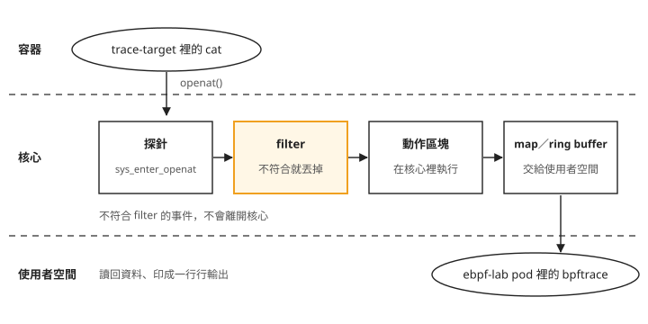
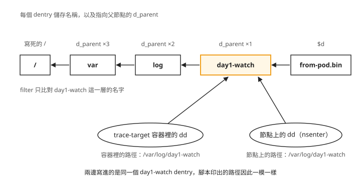

# Day 1: bpftrace——現成工具漏掉什麼、`.bt` 腳本怎麼讀、自己寫一支追蹤腳本

{ align=right width="150" }
{ align=right width="150" }

假設節點上某個目錄一直被寫進來路不明的檔案，或者你懷疑某個容器在做奇怪的事。你想問三個問題：這台機器剛剛執行了什麼、誰開了哪些檔案、這個容器連去哪裡。[Day 0](sprint2-day0-ebpf-concepts.md) 用一行 bpftrace 在一顆 pod 裡追到另一顆 pod 的 execve，但那一行只回答得了第一個問題的一部分。

Ubuntu 的 bpftrace 套件附了一批現成的追蹤工具，三個問題各有一支對應的工具。這一章先把三支都跑一次，看它們的輸出各漏掉了什麼；再拆開其中一支的原始碼，學會讀 `.bt` 腳本；最後自己寫一支「誰在寫這個目錄」，並且把它和 bcc（BPF Compiler Collection）比較。bcc 是另一套 eBPF 工具集，也提供追蹤行程執行、開檔與連線的工具。讀完這一章，看到一份追蹤輸出時，你能從工具掛在哪個探針判斷它漏掉哪些事件，並在現成工具不夠時自己寫一支腳本補上。

## 步驟 1:把實驗環境接回來，確認用的是哪一支 bpftrace

Day 0 收尾時把 `ebpf` 節點池縮到 0，先拉回 2 台：

```bash
az aks nodepool scale -g <resource-group> --cluster-name <cluster> -n ebpf \
    --subscription <subscription-id> --node-count 2
```

如果你在兩次練習之間用 `az aks stop` 停過整座叢集，重新啟動後 `kubectl` 可能連不上，錯誤訊息還會把你帶往錯的方向，見[疑難排解：`kubectl` 回 `no such host`](#mine-1)。

用完整欄位路徑列出節點名稱、kernel 與 AKS node image 版本（依官方文件補上，本課沒有實跑）：

```bash
kubectl get nodes -o custom-columns='NODE:.metadata.name,KERNEL:.status.nodeInfo.kernelVersion,IMAGE:.metadata.labels.kubernetes\.azure\.com/node-image-version'
```

語法與欄位依據 [Kubernetes 1.35 kubectl get 文件](https://v1-35.docs.kubernetes.io/docs/reference/kubectl/generated/kubectl_get/)、[1.35.6 的 Node 欄位定義](https://github.com/kubernetes/api/blob/v0.35.6/core/v1/types.go)與 [AKS node image 查詢說明](https://learn.microsoft.com/en-us/azure/aks/upgrade-node-image#upgrade-all-node-images-in-all-node-pools)；`IMAGE` 取自 `kubernetes.azure.com/node-image-version` label。

節點就緒後，連同 system pool 一起列出三台節點的 kernel：

```console
$ kubectl get nodes -o custom-columns='NODE:…,KERNEL:…,IMAGE:…'
NODE                             KERNEL             IMAGE
aks-ebpf-80832270-vmss000002     6.8.0-1062-azure   AKSUbuntu-2404gen2containerd-202607.20.0
aks-ebpf-80832270-vmss000003     6.8.0-1062-azure   AKSUbuntu-2404gen2containerd-202607.20.0
aks-system-35459509-vmss000002   6.8.0-1059-azure   AKSUbuntu-2404gen2containerd-202607.09.0
```


節點名稱最後的 `vmss000002` 這類編號是 VMSS 實例編號。`az aks stop`／`start` 或把節點池縮到 0 再拉回來之後，編號會換掉，所以節點名稱不能當成穩定的識別，每次都重新查。

`ebpf` 節點池的兩台是 kernel `6.8.0-1062-azure`，system pool 那台是 `6.8.0-1059-azure`。這是 Day 0 的[「同一座叢集裡，兩台節點的 kernel 不同」](sprint2-day0-ebpf-concepts.md#mine-8)提過的落差，步驟 4 會用到它。

接著部署這一章要用的三種 pod。特權 DaemonSet 沿用 Day 0 的 `01-ebpf-lab-daemonset.yaml`，每台 `ebpf` 節點各一顆，追蹤工具都在這裡跑。被追蹤的 `trace-target` 也沿用 Day 0 的檔案，只多掛一個 hostPath 目錄給步驟 3 用，容器裡的掛載路徑刻意和節點上的路徑寫成同一個：

```yaml
# 02-target-pod.yaml:Day 0 那份的 containers[0] 與 spec 各補一段
    volumeMounts:
    - name: watch
      mountPath: /var/log/day1-watch
  volumes:
  - name: watch
    hostPath:
      path: /var/log/day1-watch
      type: DirectoryOrCreate
```


步驟 4 要在另一顆 kernel 上跑同一支腳本，所以在 system pool 也放一顆特權 pod。system pool 的節點上已經跑著叢集自己的元件，要求量壓低一點才排得上：

```bash
cat > 05-ebpf-lab-system.yaml <<'EOF'
apiVersion: v1
kind: Pod
metadata:
  name: ebpf-lab-system
  namespace: ebpf-lab
  labels:
    app: ebpf-lab-system
spec:
  hostPID: true
  nodeSelector:
    kubernetes.azure.com/agentpool: system
  containers:
  - name: probe
    image: mcr.microsoft.com/mirror/docker/library/ubuntu:24.04
    command: ["sleep", "infinity"]
    securityContext:
      privileged: true
    resources:
      requests:
        cpu: 10m
        memory: 64Mi
    volumeMounts:
    - name: sys
      mountPath: /sys
    - name: debugfs
      mountPath: /sys/kernel/debug
    - name: watch
      mountPath: /var/log/day1-watch
  volumes:
  - name: sys
    hostPath:
      path: /sys
      type: Directory
  - name: debugfs
    hostPath:
      path: /sys/kernel/debug
      type: Directory
  - name: watch
    hostPath:
      path: /var/log/day1-watch
      type: DirectoryOrCreate
EOF
```


三個檔案一起套用：

```bash
kubectl apply -f 01-ebpf-lab-daemonset.yaml -f 02-target-pod.yaml -f 05-ebpf-lab-system.yaml
```

```console
$ kubectl -n ebpf-lab get pods -o wide
NAME              READY   STATUS    AGE   NODE
ebpf-lab-548l5    1/1     Running   19s   aks-ebpf-80832270-vmss000002
ebpf-lab-przdr    1/1     Running   19s   aks-ebpf-80832270-vmss000003
ebpf-lab-system   1/1     Running   19s   aks-system-35459509-vmss000002
trace-target      1/1     Running   19s   aks-ebpf-80832270-vmss000003
```


DaemonSet 的 pod 名稱是隨機產生的，你的會不一樣。從 `NODE` 欄找出和 `trace-target` 在同一台節點的那一顆 DaemonSet pod，下面的指令用 `<ebpf-lab-pod>` 代表它；上面的範例裡是 `ebpf-lab-przdr`，所以輸出裡會看到這個名字。步驟 2、3 的追蹤都跑在這顆 pod 裡，被追蹤的動作都發生在 `trace-target`。

照 Day 0 的方式在特權 pod 裡裝 bpftrace（`ebpf-lab-system` 也要裝，步驟 4 會用）：

```bash
kubectl -n ebpf-lab exec <ebpf-lab-pod> -- bash -c 'apt-get update -qq && apt-get install -y -qq bpftrace'
```

裝好之後，先確認手上這支是哪一支：

```console
$ kubectl -n ebpf-lab exec ebpf-lab-przdr -- which -a bpftrace
/usr/bin/bpftrace
/bin/bpftrace                         ← 同一個檔案(/bin 是 /usr/bin 的 symlink)

$ kubectl -n ebpf-lab exec ebpf-lab-przdr -- bpftrace --version
bpftrace v0.20.2
$ kubectl -n ebpf-lab exec ebpf-lab-przdr -- bpftrace -l | wc -l
133022                                ← 與 Day 0 量到的數字相同

$ kubectl -n ebpf-lab exec ebpf-lab-przdr -- \
    nsenter -t 1 -m -- bash -lc 'which -a bpftrace; /usr/local/bin/bpftrace --version'
/usr/local/bin/bpftrace
bpftrace v0.9.4                       ← 節點上那支,還在
```


容器裡的是 v0.20.2，列得出 133,022 個掛載點。節點上還有一支 2019 年的 v0.9.4，Day 0 的[「節點上直接執行 `bpftrace`，`kfunc:` 探針回 `Invalid provider`」](sprint2-day0-ebpf-concepts.md#mine-1)講過它少掉整類 `kfunc` 掛載點。容器裡的 PATH 找不到節點那支，所以在容器裡執行就不會用錯；但只要用 `nsenter` 或 `chroot` 進到節點上執行 `bpftrace`，拿到的就是 v0.9.4。每次開始前都用 `--version` 確認一次。

## 步驟 2:execsnoop、opensnoop、tcpconnect 各跑一次

Ubuntu 的 bpftrace 套件把 Brendan Gregg 寫的一整套工具裝在 `/usr/sbin`，`dpkg -L bpftrace | grep -c '\.bt$'` 數得到 39 支。這一步挑三支，對應開場的三個問題。驗法都一樣：追蹤跑在 `<ebpf-lab-pod>`，動作在 `trace-target` 裡做，而且動作要帶一個節點上不可能有第二份的名字（Day 0 用過的做法），這樣才認得出哪幾行是自己造成的。

### `execsnoop`：剛剛執行了什麼

開兩個終端機，一個進追蹤用的特權 pod，一個進 `trace-target`：

```bash
kubectl -n ebpf-lab exec -it <ebpf-lab-pod> -- bash
kubectl -n ebpf-lab exec -it trace-target -- bash
```

在 `<ebpf-lab-pod>` 裡啟動 execsnoop，輸出寫進檔案：

```bash
execsnoop.bt -o /tmp/execsnoop.out
```

然後在 `trace-target` 裡一次做四件事：執行一支正常的腳本、帶 20 個參數再執行一次、執行一個不存在的檔案，以及用 shell 內建的 `printf` 寫檔。下面的指令要先自己設好 `MARK`，用 Day 0 的做法帶上時間，例如 `MARK=d1x-$(date +%H%M%S)`；`a01 … a20` 是 20 個參數的簡寫，可以用 `$(seq -f 'a%02g' 1 20)` 產生：

```bash
# MARK=d1x-122216, run inside trace-target
printf '#!/bin/bash\necho hello-from-target\n' > /tmp/$MARK.sh
chmod +x /tmp/$MARK.sh
/tmp/$MARK.sh
/tmp/$MARK.sh a01 a02 … a20
/tmp/$MARK-does-not-exist
```


從 execsnoop 的輸出可以看出，這幾行是包在同一個 `bash -c '…'` 裡一次送進 `trace-target` 執行的。做完之後回到 `<ebpf-lab-pod>` 按 Ctrl-C 結束 execsnoop，再用 `grep d1x- /tmp/execsnoop.out` 找出自己那幾行。後面的 opensnoop、tcpconnect 也用同樣的方式啟動（`opensnoop.bt -o …`、`tcpconnect.bt -o …`）、結束與查看，每支工具換一個 `MARK` 開頭。

execsnoop 的輸出裡同時有節點上其他行程的紀錄，下面只摘出屬於這一段的幾行。欄位依序是 `TIME`（到微秒）、`PID`、`PPID`（父行程的 PID）、`ARGS`：

```console
04:22:25.829588 13685   9942    /usr/bin/runc --root /run/containerd/runc/k8s.io … exec … af6ba13cacfa…
04:22:25.835088 13694   13685   /usr/bin/runc init
04:22:25.841195 13698   13685   bash -c
printf '#!/bin/bash\necho hello-from-target\n' > /tmp/d1x-122216.sh
chmod +x /tmp/d1x-122216.sh
/tmp/d1x-122216.sh
/tmp/d1x-122216.sh a01 a02 … a20
/tmp/d1x-122216-does-not-exist 2>/dev/null; echo "failed-exec rc=$?"

04:22:25.848495 13704   13698   chmod +x /tmp/d1x-122216.sh
04:22:25.849329 13705   13698   /tmp/d1x-122216.sh
04:22:25.850823 13706   13698   /tmp/d1x-122216.sh a01 a02 a03 a04 a05 a06 a07 a08 a09 a10 a11 a12 a13 a14 a15
04:22:25.852292 13707   13698   /tmp/d1x-122216-does-not-exist
```


前兩行是 runc，它負責在容器裡建立行程；`kubectl exec` 進容器時，容器裡的 `bash -c` 就是由它開出來的。照著 `PPID` 欄往回看，父子關係連得起來：13685（runc）→ 13698（`bash -c`）→ 13704 到 13707（各個子指令）。

這份輸出有四個地方跟你預期的不一樣：

1. **成功與失敗印得一樣。** 最後一行 `/tmp/d1x-122216-does-not-exist` 跟上面幾行長得一模一樣，但這個 exec 失敗了，回傳碼是 127。`execsnoop.bt` 開頭的註解也寫了：`Note that the return value is not currently traced, so the exec() may have failed.`
2. **參數被截斷。** 傳了 20 個參數，輸出停在 `a15`。`join()` 只印 argv[0] 加 15 個參數，後面的直接消失，也沒有任何截斷標記。
3. **一個事件印成好幾行。** `bash -c` 那一筆的參數裡有換行，`join()` 原樣印出，於是一個事件佔了 6 行。用 `wc -l` 數事件、或逐行解析輸出的程式，都會在這裡算錯。
4. **看不到 shell 內建指令。** `printf '…' > /tmp/…` 沒有出現，因為 `printf` 是 bash 內建的，不會發出 execve。所以 execsnoop 能回答的是「開了哪些新行程」，不是「執行了哪些指令」。

另外，整份輸出唯一跟容器沾上邊的字串，是 runc 那一行參數裡的 `af6ba13cacfa…`。那是 runc 自己的命令列，不是 execsnoop 提供的欄位。

第一點的原因，要等看完下一支工具再一起說明。

### `opensnoop`：誰開了哪些檔案

這次在 `trace-target` 裡寫一個檔案、讀它、讀一個不存在的檔案，再換到 `/tmp` 用相對路徑讀一次：

```bash
# MARK=d1o-122309, run inside trace-target
echo 'day1 opensnoop payload' > /tmp/$MARK.txt
cat /tmp/$MARK.txt
cat /tmp/$MARK-missing.txt
cd /tmp && cat ./$MARK.txt
```


```console
PID    COMM               FD ERR PATH
14885  bash                3   0 /tmp/d1o-122309.txt
14891  cat                 3   0 /tmp/d1o-122309.txt
14892  cat                -1   2 /tmp/d1o-122309-missing.txt
14893  cat                 3   0 ./d1o-122309.txt
```


第一行的 `COMM`（行程名稱）是 `bash` 不是 `echo`：`>` 重導向由 shell 自己開檔，所以開檔的是 shell。第三行是讀不存在的檔案，`FD` 是 -1、`ERR` 是 2（ENOENT，找不到檔案），opensnoop 分得出成功與失敗。

第四行是它漏掉的地方：`./d1o-122309.txt`。opensnoop 印出的是程式傳給 `openat()` 的那個字串，不是解析後的絕對路徑。同一個檔案，換個工作目錄就變成另一個字串。如果你要判斷「有沒有人碰過某個目錄」，只靠 opensnoop 會漏掉所有用相對路徑進來的存取。

### 為什麼一支分得出成敗，另一支分不出

一次 system call 在核心裡有兩個時間點可以掛探針：剛進來的時候，叫**進入端**（tracepoint 名稱是 `sys_enter_*`），這時只知道參數，例如要開的檔名、要執行的 argv；處理完要回去的時候，叫**離開端**（`sys_exit_*`），這時才知道結果，例如拿到的 fd 或錯誤碼。同一次 syscall 的進入端和離開端由同一條執行緒執行，所以用執行緒 id（bpftrace 裡寫作 `tid`）就能把兩端對起來。下面這張圖把兩個時間點畫成兩條虛線，再標出兩支工具各掛在哪裡：

![一次 syscall 分成進入端與離開端：execsnoop 只掛進入端，印出 argv 時還不知道成功或失敗；opensnoop 兩端都掛，進入端用 @filename[tid] 存下檔名，離開端用同一個 tid 取出，連同 FD 與 ERR 一起印；tcpconnect 掛在核心的 tcp_connect 函式，在送出 SYN 之前觸發，不知道握手結果，走 UDP 的 DNS 也不經過這裡](../assets/diagrams/s2d1-enter-exit.svg)

圖上有兩件事要注意：

1. execsnoop 只掛 `sys_enter_exec*`。它印出那一行時，exec 還沒執行，當然不知道會不會失敗。
2. opensnoop 兩端都掛。檔名只在進入端拿得到，結果只在離開端拿得到，所以它在進入端把檔名存起來，到離開端再取出來一起印。怎麼存、怎麼對上，下一節讀它的原始碼時會看到。

圖的最下面一列是下一支工具 tcpconnect，它掛的不是 syscall 的進出口，而是核心處理 TCP 連線時的一個函式。

### `tcpconnect`：連去哪裡

為了讓哪幾行是自己造成的一眼就認得出來，這次連行程名稱都造一個唯一的：把 `/bin/bash` 複製成 `d1t-122357`，用它連一個會成功的位址、一個一定被拒絕的位址，再做一次 DNS 查詢：

```bash
# inside trace-target
MARK=d1t-122357
cp /bin/bash /tmp/$MARK
/tmp/$MARK -c 'exec 3<>/dev/tcp/1.1.1.1/80'      # 成功
/tmp/$MARK -c 'exec 3<>/dev/tcp/127.0.0.1/9'     # 一定被拒絕
getent ahostsv4 example.com                       # DNS,走 UDP
```

```console
TIME     PID      COMM             SADDR            SPORT  DADDR         DPORT
04:24:07 15852    d1t-122357       10.244.1.238     36088  1.1.1.1       80
04:24:07 15853    d1t-122357       127.0.0.1        56778  127.0.0.1     9
```


第二行是被拒絕的連線，照樣印了一行。`tcpconnect.bt` 開頭的註解寫明了：`All connection attempts are traced, even if they ultimately fail.` 它掛的 `kprobe:tcp_connect` 在送出 SYN（TCP 握手的第一個封包）之前觸發，握手成不成功它不知道；要區分，得另外追 `tcp_set_state` 或回傳值。

它漏掉的東西要看整份輸出：97 行裡，目的 port 是 53（DNS）的一行都沒有。`getent` 的 DNS 查詢走 UDP，而 tcpconnect 只掛 TCP 的連線函式。如果只看 tcpconnect 回答「這個 pod 連去哪裡」，所有 DNS 查詢、所有走 UDP 的流量（例如 HTTP/3 用的 QUIC）都不會出現。

`SADDR` 欄的 `10.244.1.238` 剛好是 `trace-target` 的 pod IP。這是三支工具裡唯一能反推到 pod 的欄位，但它只是因為 pod 有自己的網路命名空間才看得到，工具本身沒有提供 pod 身分。

### 三支工具放在一起比

| | `execsnoop` | `opensnoop` | `tcpconnect` |
|---|---|---|---|
| 掛載點 | `tracepoint:syscalls:sys_enter_exec*` | `sys_enter/exit_open(at)` | `kprobe:tcp_connect` |
| 分得出成功／失敗 | 否 | 是（`ERR` 欄） | 否 |
| 一個事件一行 | 否 | 是 | 是 |
| 同樣 22 秒、幾乎閒置的節點，輸出行數 | 337 | 24,350 | 97 |
| 容器／pod 身分 | 無 | 無 | 只有 pod IP |

前兩列都由掛載點決定：只掛進入端的就分不出成敗，只掛 TCP 函式的就看不到 UDP。印出來的目標本身也各有偏差：execsnoop 的參數截在第 16 個，opensnoop 給的是原樣字串、相對路徑不會還原，tcpconnect 的 IP 可信但只涵蓋 TCP。

事件密度會影響追蹤成本。同一台幾乎閒置的節點，開檔事件比執行新行程多了約 70 倍，一秒約 1,100 筆。事件越密的追蹤，開著的成本越高，越不適合整天掛著。本章沒有測更高的事件量，map 滿了或事件來不及處理時會怎樣，這裡沒有驗證。

最後一列是三支工具共同的空白：沒有一支說得出「這是哪一顆 pod」。它們掛在核心的 syscall 與網路函式上，比容器這一層更低，這些事件的資料裡沒有 Kubernetes pod 的欄位。要把事件接回 pod，得自己補上對應關係，那是 Day 2 的題目。

## 一支 `.bt` 腳本怎麼讀

現成工具不夠時，就要自己寫。動手之前，先把剛跑過的 `opensnoop.bt` 拆開來看，它只有 46 行，卻用到了 bpftrace 大部分的語法。

先看一個事件從發生到印出來經過哪幾站。下圖由上往下分成三層：容器、核心、使用者空間：



我們可以從圖上看到，中間那一整排都在核心裡：判斷要不要這個事件（filter）、處理它（動作區塊），都在核心裡完成，只有結果透過 map 或 ring buffer（Day 0 看過的兩種回傳管道）交給使用者空間。不符合條件的事件不會被送出核心，這是 eBPF 追蹤負擔低的主要原因。

一支 `.bt` 腳本就是由這幾段組成的，形狀借自 awk 的 `BEGIN {} /pattern/ {action} END {}`。以下每一段都是 `/usr/sbin/opensnoop.bt` 的原文。

### `BEGIN`：探針掛上去之前跑一次

```awk
BEGIN
{
	printf("Tracing open syscalls... Hit Ctrl-C to end.\n");
	printf("%-6s %-16s %4s %3s %s\n", "PID", "COMM", "FD", "ERR", "PATH");
}
```


`BEGIN` 不是探針，它在所有探針掛上之前執行一次，通常用來印表頭；對應的 `END` 在程式結束時執行一次。

### 探針：型別加目標

```awk
tracepoint:syscalls:sys_enter_open,
tracepoint:syscalls:sys_enter_openat
{
	@filename[tid] = args.filename;
}
```


一個探針由兩部分組成，用冒號分開。前面的 `tracepoint` 是**探針型別**，Day 0 看過的幾種都可以寫在這個位置：`kprobe:`、`kfunc:`、`uprobe:`（使用者空間的函式）。後面的 `syscalls:sys_enter_openat` 是**目標**：tracepoint 的目標寫成「`類別:名稱`」，kprobe 的目標就是函式名，例如 tcpconnect 用的 `kprobe:tcp_connect`。

兩個探針之間的逗號，表示這兩個探針共用同一個動作區塊，這裡一次處理 `open` 與 `openat` 兩個 syscall。`args.filename` 是這個 tracepoint 提供的參數，參數格式由核心公布在 `/sys/kernel/debug/tracing/events/…/format`。tracepoint 是核心刻意留下的穩定掛點，跨版本不容易變，所以官方工具能用 tracepoint 就不用 kprobe。

### 動作區塊與 map：把進入端知道的東西留給離開端

動作區塊只有一行：`@filename[tid] = args.filename;`。

`@` 開頭的名字是 map，Day 0 看過它是核心與使用者空間共用的記憶體；`$` 開頭的是區域變數，只在這一次探針執行裡有效。`[tid]` 是 key，用執行緒 id 當 key，把進入端知道的檔名存起來，等同一條執行緒走到離開端時再取出來。這就是 syscall 進出那張圖裡 opensnoop 那一列的「用 tid 對上同一次呼叫」。

map 不需要宣告型別和大小，bpftrace 從第一次賦值推導型別，自動建立。

### filter：探針和動作之間的條件

```awk
tracepoint:syscalls:sys_exit_open,
tracepoint:syscalls:sys_exit_openat
/@filename[tid]/
{
	$ret = args.ret;
	$fd = $ret >= 0 ? $ret : -1;
	$errno = $ret >= 0 ? 0 : - $ret;

	printf("%-6d %-16s %4d %3d %s\n", pid, comm, $fd, $errno,
	    str(@filename[tid]));
	delete(@filename[tid]);
}
```


探針和 `{` 之間那對斜線 `/…/` 是 **filter**（官方文件叫 predicate），在動作區塊之前判斷，結果為假就跳過這個事件。`/@filename[tid]/` 讀作「這條執行緒有存過檔名嗎」：追蹤剛啟動時，有些 syscall 已經進來了才掛上探針，它們只有離開端沒有進入端，這個條件把它們丟掉。

動作區塊裡其他幾樣：`$ret`、`$fd`、`$errno` 是區域變數，`? :` 和 C 的寫法一樣；`str()` 從指標指向的位址讀出字串，`args.filename` 是程式傳進來、指向使用者空間記憶體的指標，map 裡存的就是這個指標，印的時候才去讀；`delete()` 把用完的 key 刪掉，不刪的話 map 會一直變大，而 map 有容量上限。

### `END`：收尾

腳本最後一段是 `END { clear(@filename); }`。bpftrace 在程式結束時，預設會把所有還有內容的 map 印出來，而 `@filename` 只是內部暫存，印出來沒有意義，所以先用 `clear()` 清空。這一步跟釋放核心記憶體無關，程式一結束核心就會回收。

## 步驟 3:自寫腳本，找出誰在寫指定目錄

現在用剛學的語法回答一個現成工具答不好的問題：誰在寫 `/var/log/day1-watch`？要印出寫入者的 PID、`comm` 與完整路徑，而且容器裡和節點上的寫入都要抓到。這個目錄在步驟 1 已經用 hostPath 掛進 `trace-target`，容器內外是同一個路徑。

opensnoop 給的是原樣字串，碰到相對路徑就認不出目錄，所以這次不從 syscall 的參數下手，改掛核心真正寫檔的函式 `vfs_write`。它的參數是一個 `struct file`，代表已經開好的檔案，跟程式當初用什麼字串開檔無關。`vfs_write` 只在寫入時觸發；要追讀取，得換成讀取路徑上的函式（例如 `vfs_read`），本課沒有驗證讀取的版本。

### `path()` 在編譯時就被擋下

最直覺的寫法，是用 bpftrace 內建的 `path()` 把 `struct file` 轉成路徑：

```console
$ kubectl -n ebpf-lab exec ebpf-lab-przdr -- \
    bpftrace -e 'kfunc:vmlinux:vfs_write { printf("%d %s %s\n", pid, comm, path(args.file->f_path)); exit(); }'
stdin:1:59-82: ERROR: BPF_FUNC_d_path not available for your kernel version
```


錯誤訊息說你的 kernel 版本不支援，但核心自己的檢查結果不是這樣，見[疑難排解：`path()` 回報 kernel 版本不支援](#mine-3)。換一種寫法：自己把路徑組出來。

### 核心裡的路徑是一條 dentry 鏈

核心裡沒有完整的路徑字串。每一層目錄或檔案在核心裡是一個 **dentry**（directory entry），儲存名稱（`d_name`）以及指向父節點的指標（`d_parent`）。`path()` 做的事，就是從檔案沿著 `d_parent` 一路往上走，把名字串起來。下圖是 `/var/log/day1-watch/from-pod.bin` 這條鏈，每個方塊上方標的是下面的腳本要走幾次 `d_parent` 才到得了它：



照著圖由右往左看：腳本裡的 `$d` 是檔案本身的 dentry，`$d->d_parent` 是 `day1-watch`，再往上兩層是 `log` 和 `var`。filter 只需要看 `day1-watch` 那一層的名字，就知道這次寫入是不是落在監看的目錄裡。圖的下半部，等跑完腳本再回來看。

### 腳本

```bash
cat > whowrites.bt <<'EOF'
#!/usr/bin/env bpftrace
/*
 * whowrites.bt - who is writing into a watched directory?
 *
 * Prints PID, comm and the path for every write whose immediate parent
 * directory is WATCHDIR. Reconstructs the path by walking the dentry chain
 * instead of calling path(): bpftrace 0.20.2 reports `dpath: no` and refuses
 * path() everywhere, even though the kernel exports bpf_d_path.
 */

#define WATCHDIR "day1-watch"
#define WATCHLEN 11

BEGIN
{
	printf("watching writes into .../%s\n", WATCHDIR);
	printf("%-9s %-7s %-16s %-8s %s\n", "TIME", "PID", "COMM", "BYTES", "PATH");
}

kfunc:vmlinux:vfs_write
/strncmp(str(args.file->f_path.dentry->d_parent->d_name.name), WATCHDIR, WATCHLEN) == 0/
{
	$d = args.file->f_path.dentry;
	time("%H:%M:%S ");
	printf("%-7d %-16s %-8d /%s/%s/%s/%s\n", pid, comm, args.count,
	    str($d->d_parent->d_parent->d_parent->d_name.name),
	    str($d->d_parent->d_parent->d_name.name),
	    str($d->d_parent->d_name.name),
	    str($d->d_name.name));
	@bytes[comm, pid] = sum(args.count);
}

END
{
	printf("\n-- bytes written per (comm, pid) --\n");
}
EOF
```


除了上一節看過的語法，這支腳本有三個地方值得說明：

- **filter 只比對直屬父目錄的名字。** `WATCHDIR` 是 `day1-watch`，`WATCHLEN` 是 11，比字串長度多 1，連結尾的 NUL 字元一起比，所以是完全相符，`day1-watch-old` 這種名字不會被當成同一個目錄。判斷在核心裡做，其他目錄的寫入不會送出核心。
- **用 `kfunc:` 而不是 `kprobe:`。** Day 0 提過，`kfunc` 透過 BTF 取得參數的型別，所以可以直接寫 `args.file->f_path.dentry`。用 `kprobe` 取得的是原始參數，得自行轉型，例如 `((struct file *)arg0)`；有 BTF 時，核心型別可直接使用，不必用 `#include` 引入標頭檔，見 [bpftrace v0.20.2 的 BTF 說明](https://github.com/bpftrace/bpftrace/blob/v0.20.2/docs/reference_guide.md#btf-support)。
- **map 的第二種用法：聚合。** opensnoop 的 map 是暫存；這裡的 `@bytes[comm, pid] = sum(args.count);` 是聚合，`sum()` 把每次寫入的位元組數加總，key 是 `comm` 與 `pid` 兩個欄位組成的 tuple。同類的聚合函式還有 `count()`、`avg()`、`hist()`、`lhist()`。加總在核心裡做，使用者空間只在最後讀一次結果，事件再多也不必一筆一筆送出來。

### 兩個寫入者，一份輸出

把腳本複製進 `<ebpf-lab-pod>` 並執行，輸出寫到檔案：

```bash
kubectl -n ebpf-lab cp whowrites.bt <ebpf-lab-pod>:/tmp/whowrites.bt
kubectl -n ebpf-lab exec <ebpf-lab-pod> -- bpftrace /tmp/whowrites.bt -o /tmp/whowrites.out
```

然後從兩個地方寫入：(a) 在 `trace-target` 容器裡執行；(b) 用 `nsenter` 進入節點的 mount namespace，直接在節點上寫。`nsenter -t 1` 需要 `hostPID` 與特權，`trace-target` 兩者都沒有，所以 (b) 要在另一個終端機進 `<ebpf-lab-pod>` 執行，它和 `trace-target` 在同一台節點。兩邊都先把 `dd` 複製成唯一的名字，輸出裡的 `COMM` 才分得出是誰：

```bash
# (a) inside trace-target
cp /bin/dd /tmp/d1w-pod-122627
/tmp/d1w-pod-122627 if=/dev/zero of=/var/log/day1-watch/from-pod.bin bs=4096 count=1
echo 'plain shell redirect from pod' > /var/log/day1-watch/from-pod.txt

# (b) on the node itself
nsenter -t 1 -m -- bash -c 'cp /bin/dd /tmp/d1w-nod-122627;
  /tmp/d1w-nod-122627 if=/dev/zero of=/var/log/day1-watch/from-node.bin bs=8192 count=1'
```


```console
watching writes into .../day1-watch
TIME      PID     COMM             BYTES    PATH
04:26:37 19878   d1w-pod-122627   4096     /var/log/day1-watch/from-pod.bin
04:26:37 19871   bash             30       /var/log/day1-watch/from-pod.txt
04:26:37 19899   d1w-nod-122627   8192     /var/log/day1-watch/from-node.bin

-- bytes written per (comm, pid) --
@bytes[bash, 19871]: 30
@bytes[d1w-pod-122627, 19878]: 4096
@bytes[d1w-nod-122627, 19899]: 8192
```


PID、`comm`、路徑都有了，容器裡的寫入者（19878）和節點上的寫入者（19899）都抓到了，位元組數也對得上：4096 與 8192 是 `dd` 的 `bs`，30 是 `echo` 那句字串加一個換行。

中間那一行的 `COMM` 是 `bash` 不是 `echo`，原因跟 opensnoop 那邊一樣，重導向由 shell 開檔寫入。最後三行 `@bytes[…]` 是程式結束時 bpftrace 自動印出的聚合結果，也就是上一節 `END` 裡 `clear()` 要避免的那種輸出，這裡正是我們想看的。

回頭看 dentry 那張圖的下半部：容器裡的 `dd` 透過 hostPath 寫入，節點上的 `dd` 直接寫入，兩邊寫進的是同一個 `day1-watch` dentry，走到的是同一條鏈。所以輸出裡兩個寫入者的路徑字串一模一樣，沒有任何欄位分得出是從容器裡寫的，還是從節點上寫的。就算 hostPath 在容器裡掛在別的路徑，腳本走的仍然是節點上那條 dentry 鏈，印出的還是節點的路徑。核心看到的是檔案系統的結構，不是某個行程眼中的路徑，這跟三支現成工具說不出 pod 身分是同一個原因。

## 步驟 4:同一支腳本放到兩個不同的 kernel 上

這一步需要兩種 kernel、各自的 BTF，以及各節點上的特權 pod；兩邊的 bpftrace 都使用 v0.20.2。以下對照步驟 1 的兩種版本：`ebpf` 節點池的 `6.8.0-1062-azure` 與 system pool 的 `6.8.0-1059-azure`。如果所有節點都是同一版本，就無法做這裡的跨版本對照。把步驟 3 的同一份 `whowrites.bt` 用 `kubectl cp` 也放進 `ebpf-lab-system`，比較它在兩邊能否載入並追到寫入事件。

下面是本課量測時用的腳本 `06-core-portability.sh`，用 `kubectl cp` 放進兩顆特權 pod 後各執行一次，參數是一個節點上不會重複的名字。它在背景執行 `whowrites.bt`，趁程式還掛著時用節點的 bpftool 查出載入的程式與它的指令（`bpftool prog dump xlated`），再用改名的 `dd` 自己寫一筆，最後結束 bpftrace：

```bash
#!/bin/bash
# Run INSIDE a privileged lab pod (hostPID) on each node pool.
# Loads the byte-identical /tmp/whowrites.bt and reports what the kernel got:
# kernel version, BTF blob identity, the loaded program's tag (a hash of the
# instruction stream) and the md5 of its xlated dump. Comparing the two pools'
# output shows whether one unmodified script survives two kernels.
set -u
echo "### node   : $(uname -r)"
echo "### btf    : $(stat -c '%s' /sys/kernel/btf/vmlinux) bytes  $(md5sum /sys/kernel/btf/vmlinux | cut -d' ' -f1)"
echo "### script : $(md5sum /tmp/whowrites.bt | cut -d' ' -f1)"
echo "### bpftrace: $(bpftrace --version)"

BEFORE=$(nsenter -t 1 -m -- bpftool prog list | grep -c '^[0-9]')
echo "### prog count before: $BEFORE"

bpftrace /tmp/whowrites.bt -o /tmp/core.out &
BP=$!
sleep 8

echo "### loaded tracing programs:"
nsenter -t 1 -m -- bpftool prog list | grep -A2 'tracing' | grep -E 'tracing|tag' | tail -6
TRACING_ID=$(nsenter -t 1 -m -- bpftool prog list | awk -F: '/tracing/{id=$1} END{print id}')
echo "### tracing prog id: $TRACING_ID"
nsenter -t 1 -m -- bpftool prog show id "$TRACING_ID"
echo "### xlated md5: $(nsenter -t 1 -m -- bpftool prog dump xlated id "$TRACING_ID" | md5sum | cut -d' ' -f1)"
echo "### xlated first 8 insns:"
nsenter -t 1 -m -- bpftool prog dump xlated id "$TRACING_ID" | head -8

# self-inflicted write so this node produces a line of its own
cp /bin/dd "/tmp/$1"
"/tmp/$1" if=/dev/zero of=/var/log/day1-watch/core-probe.bin bs=2048 count=1 status=none
rm -f "/tmp/$1"

sleep 3
kill -INT $BP
wait $BP 2>/dev/null
echo "### prog count after : $(nsenter -t 1 -m -- bpftool prog list | grep -c '^[0-9]')"
echo "### leftover bpftrace: $(pgrep -x bpftrace | wc -l)"
echo "### ---- script output ----"
cat /tmp/core.out
```

兩台節點都成功掛上，各自抓到自己節點上的寫入。下面是兩邊另外各用一支改名的 `dd` 寫一筆 2048 bytes 的結果，`ebpf` 節點池那一筆從 `trace-target` 寫，system pool 那一筆從該節點上的 pod 寫：

```console
(ebpf pool,寫入來自 trace-target)
04:28:37 23237   d1c-tgt-122825   2048     /var/log/day1-watch/core2-pod.bin

(system pool,寫入來自該節點上的 pod)
04:28:37 26707   d1c-sys-122825   2048     /var/log/day1-watch/core2-sys.bin
```


兩筆輸出顯示，同一份 `whowrites.bt` 在這兩種 kernel 上都能追到寫入事件。bpftrace 在每台節點上，對照本機的 BTF 各編譯一次，不需要另外安裝 kernel headers。這是原始碼層的可攜性；libbpf（另一套 eBPF 開發函式庫）的 CO-RE 則使用預先編好的 `.o` 目的檔，在載入時依本機 BTF 調整欄位位移。

這次只驗證了上述兩種 kernel，不能推論所有版本都能執行。同一份 `.bt` 在不同節點編譯出的指令也不必相同；若結構欄位的位置改變，bpftrace 會依當地 BTF 使用相應的位移，仍須確認腳本用到的函式與欄位是否存在。

<details markdown="1">
<summary>載入程式與位元碼的比對輸出</summary>

以下保留兩種 kernel 的比對結果。第一份輸出是載入的 `vfs_write` 程式資訊，第二份摘出指令差異，箭頭左邊是 `ebpf` pool，右邊是 system pool：

```console
(ebpf pool)                                (system pool)
842: tracing  name vfs_write               652: tracing  name vfs_write
     tag 069eb0688ab16f62  gpl                  tag 069eb0688ab16f62  gpl
     xlated 2584B  jited 1739B                  xlated 2584B  jited 1739B
     map_ids 105,106,104                        map_ids 121,122,120
     btf_id 109                                 btf_id 87
```


```diff
  48: (18) r1 = map[id:109]        →   48: (18) r1 = map[id:125]
  54: (85) call bpf_ringbuf_output#340416  →  #340176
  73: (85) call bpf_get_current_pid_tgid#249424  →  #249184
 303: (18) r1 = map[id:108]        →  303: (18) r1 = map[id:124]
 307: (85) call htab_percpu_map_lookup_elem#295936  →  #295696
```


兩邊的 `tag` 與程式長度相同；列出的差異是載入時配置的 map 編號與核心函式的呼叫位置。這些結果只描述這一組 kernel，原始碼可攜不要求位元碼相同。

</details>

## 步驟 5:和 bcc 比一比

execsnoop、opensnoop、tcpconnect 都有 bcc 版，在 Ubuntu 上叫 `execsnoop-bpfcc` 這類名字。bcc 的工具是 Python 程式，裡面嵌著一段 C 原始碼，每次啟動時編譯成 BPF 程式；編譯時需要的核心結構定義，從 **kernel headers**（描述核心內部結構的 C 標頭檔，Ubuntu 上的套件是 `linux-headers-<kernel 版本>`）讀取。

常聽到不選 bcc 的理由有兩個：「bcc 要靠 kernel headers 編譯，雲端節點裝不了」，以及「bcc 要編譯器，bpftrace 不用」。這一步在同一座叢集上把兩句都檢查一次。

### 安裝

在 `<ebpf-lab-pod>` 裡安裝：

```console
$ apt-get install -y bpfcc-tools
1 upgraded, 22 newly installed, 0 to remove
Need to get 13.9 MB of archives.
  完成(9.2 秒)
```


只多下載 13.9 MB，比想像中小。原因要看兩邊的相依套件：

<span id="mine-7"></span>

```console
$ apt-cache depends bpftrace | grep -iE 'llvm|clang'
  Depends: libclang1-18
  Depends: libllvm18
$ apt-cache depends libbpfcc | grep -iE 'llvm|clang'
  Depends: libclang-cpp18
  Depends: libllvm18
```


bpftrace 和 bcc 都依賴 `libllvm18`。LLVM 是編譯器的後端，兩支工具都在執行時把原始碼編譯成 BPF 位元碼，bpftrace 只是把編譯器包在單一個執行檔裡，你看不到而已。所以「bcc 要編譯器，bpftrace 不用」這句話不成立。bcc 只多下載 13.9 MB，是因為約 120 MB 的 LLVM 18 已經跟著 bpftrace 裝進來了，新裝的 22 個套件大多是 Python 3 的執行環境。在一個什麼都沒裝的 `ubuntu:24.04` 容器裡，bcc 連同 LLVM 18 一起裝，約 190 MB。

### 在容器裡跑起來

直接在容器裡執行：

```console
$ execsnoop-bpfcc
sh: 1: modprobe: not found
chdir(/lib/modules/6.8.0-1062-azure/build): No such file or directory
Unable to find kernel headers. Try rebuilding kernel with CONFIG_IKHEADERS=m (module)
or installing the kernel development package for your running kernel version.
Exception: Failed to compile BPF module <text>
```


失敗訊息依序透露了 bcc 去哪裡找 headers：先試 `modprobe kheaders`（載入一個把 headers 打包在核心裡的模組，但容器裡沒有 `modprobe`），再找 `/lib/modules/$(uname -r)/build`（容器的檔案系統裡沒有），然後放棄。

節點上其實有 headers，在 `/usr/src/linux-headers-6.8.0-1062-azure`。Day 0 的特權 pod 設了 `hostPID: true`，`/proc/1/root` 就是節點的根目錄，用 symlink 把節點的 headers 接到 bcc 找的位置。指令裡的 `$KV` 是 kernel 版本，先設 `KV=$(uname -r)`；容器和節點共用同一個核心，在容器裡執行 `uname -r` 得到的就是節點的版本：

```console
$ ln -sfn /proc/1/root/usr/src/linux-headers-$KV /lib/modules/$KV/build
$ execsnoop-bpfcc
PCOMM            PID     PPID    RET ARGS
date             29421   978       0 /usr/bin/date +%s
flock            29422   978       0 /usr/bin/flock -e 10
```


bcc 每次啟動都要重新編譯，headers 是執行時的需求。節點升級 kernel 時，也要提供與新版本相符的 headers。

到這裡，第一句理由也不成立：只要把節點的 headers 接進容器，bcc 在 AKS 上編譯得起來。

### 啟動時間與輸出

兩支同名的 execsnoop，各量三次從啟動到輸出第一個位元組的時間。兩邊都要先編譯、通過 verifier、掛上探針才會有輸出，所以比的是同一件事。bpftrace 版三次是 148、158、157 ms，中位數 157 ms；bcc 版是 2,622、2,182、2,110 ms，中位數 2,182 ms，約 14 倍。出問題時你可能會連續換十種寫法去追，bpftrace 幾乎立即有輸出，bcc 每次要等兩秒多。

同一段動作（一支名字唯一的腳本，加一個必定失敗的 exec），bcc 版的輸出：

```console
PCOMM            PID     PPID    RET ARGS
bash             39632   9925      0 /usr/bin/bash -c \nprintf '#!/bin/bash\necho bcc-side\n' > /tmp/d1b-123744.sh; chmod +x /tmp/d1b-123744.sh\n/tmp/d1b-123744.sh\n/tmp/d1b-123744-does
chmod            39638   39632     0 /usr/bin/chmod +x /tmp/d1b-123744.sh
d1b-123744.sh    39639   39632     0 /tmp/d1b-123744.sh
```


和 bpftrace 版相比，bcc 版多了一個 `RET` 欄（exec 的回傳值），參數裡的換行被轉成 `\n`，一個事件一定只佔一行，這兩點都比 bpftrace 版好用。但那個失敗的 exec 整行不見了：bcc 版預設只印成功的。拿兩個版本的輸出對照，會以為其中一支漏抓了事件，見[疑難排解：兩個 execsnoop 對失敗的 exec 一個有一個沒有](#mine-2)。

回頭看步驟 5 開頭那兩句理由：bcc 只要把節點的 headers 接進容器就編譯得起來，而 bpftrace 和 bcc 一樣依賴 LLVM。兩句都不成立。量到的差別是另外三件事：型別從哪裡來（bpftrace 讀 `/sys/kernel/btf/vmlinux`，bcc 讀 kernel headers，所以 bpftrace 在容器裡直接能跑，bcc 要先把 headers 接進來）、啟動時間（中位數 157 ms 對 2,182 ms），以及同名工具對失敗 exec 的預設行為（bpftrace 版全印，bcc 版預設不印）。型別來源影響最大：BTF 由執行中的核心自己提供，一定跟 kernel 同版；kernel headers 是另外安裝的套件，節點升級 kernel 而 headers 沒跟著換，所有 bcc 工具會在下一次啟動時一起失效。這門課用 bpftrace，理由是這兩點，不是 bcc 編譯不起來。

## 步驟 6:收尾，先確認沒有殘留再刪

Day 0 的[「bpftrace 應該已經結束，核心裡的程式卻還在」](sprint2-day0-ebpf-concepts.md#mine-6)講過，BPF 程式的生命週期跟著 fd，不跟著終端機。所以刪 pod 之前，先在三顆特權 pod 裡各檢查一次：`pgrep -x bpftrace` 與 `pgrep -f '[e]xecsnoop-bpfcc'` 確認沒有還在跑的追蹤行程；`nsenter -t 1 -m -- bpftool prog list` 列出核心裡的程式，數一數總數，以及 `tracing`、`tracepoint`、`kprobe` 三類各有幾支。三台的結果整理如下：

```console
--- ebpf-lab-przdr (vmss000003, kernel 6.8.0-1062) ---
bpftrace 行程=0  bcc 行程=0  prog 總數=53  tracing=1  tracepoint=0  kprobe=0
--- ebpf-lab-548l5 (vmss000002, kernel 6.8.0-1062) ---
bpftrace 行程=0  bcc 行程=0  prog 總數=48  tracing=1  tracepoint=0  kprobe=0
--- ebpf-lab-system (system pool, kernel 6.8.0-1059) ---
bpftrace 行程=0  bcc 行程=0  prog 總數=135 tracing=1  tracepoint=0  kprobe=0
```


三台都還有一支 `tracing` 程式，先確認它是什麼，免得當成殘留：

```console
$ kubectl -n ebpf-lab exec ebpf-lab-przdr -- \
    nsenter -t 1 -m -- bpftool prog list | grep ' tracing '
2: tracing  name hid_tail_call  tag 7cc47bbf07148bfe  gpl   ← prog id 2,開機就在
```


它是核心自帶的 `hid_tail_call`，id 是 2，開機就在，兩顆 kernel 上的 tag 也相同。同一份清單用 `grep -c vfs_write` 數，結果是 0，這一章載入的程式都已經卸下。

`prog 總數` 會自己變動：`ebpf` 節點池那台在練習過程中從 52 變成 53，多出來的是一支 `cgroup_device` 程式。這類程式由容器執行環境掛在各個容器的 cgroup 上，用來限制容器能存取哪些裝置，節點上有 46 支，隨容器啟動、結束而增減。所以檢查殘留時，看自己掛的那一類程式有沒有歸零，不要拿總數跟開始時比。

確認之後清掉實驗場。`/var/log/day1-watch` 建在節點上，`ebpf` 節點池縮到 0 時那兩台節點會被刪除，但 system pool 那台會留下來，所以先趁 `ebpf-lab-system` 還在，把它的目錄刪掉；`ebpf` 節點池保留定義、節點數縮到 0，Day 2 會再拉回來：

```bash
kubectl -n ebpf-lab exec ebpf-lab-system -- nsenter -t 1 -m -- rm -rf /var/log/day1-watch
kubectl delete ns ebpf-lab
az aks nodepool scale -g <resource-group> --cluster-name <cluster> -n ebpf \
    --subscription <subscription-id> --node-count 0
```

## 疑難排解

### `az aks start` 之後 `kubectl` 回 `no such host`，`nslookup` 卻解得到 {#mine-1}

**症狀**：`az aks start` 完成，`az aks show` 回報 `Running`，`kubectl` 卻一直回 `no such host`。用 `nslookup` 或 `dig` 查 API server 的名字，又查得到 IP。

**原因**：AKS 停機時會撤掉 API server 名稱（FQDN）的 A 紀錄，也就是「這個名字對應到哪個 IP」的那筆 DNS 紀錄。停機期間，你的電腦只要有程式查過這個名字（例如停機前最後一次 `kubectl`），系統的解析器就會把「查無此名」也記進快取，這叫負向快取。叢集啟動後 A 紀錄回來了，TTL 只有 60 秒，但負向快取不照這個 TTL 過期。`dig` 與 `nslookup` 自己直接問 DNS 伺服器，不經過系統解析器，所以查得到；`kubectl`、`curl` 走系統解析器，讀到的是快取，所以一直找不到主機。

**修法**：不需要 sudo 的做法是跳過名字解析，但不跳過 TLS 驗證：

```bash
IP=$(dig +short <api-fqdn> | head -1)
kubectl --server "https://$IP:443" --tls-server-name <api-fqdn> get nodes
```


`--tls-server-name` 讓 TLS 的 SNI（連線時告訴伺服器要連哪個名字）和憑證驗證仍然用原本的名字，只有連線目標換成 IP，安全性沒有降低。API server 的 IP 每次停機再啟動都可能不同，每次都要重新查。

### 兩個 execsnoop 對失敗的 exec 一個有一個沒有 {#mine-2}

**症狀**：同一段動作（執行一個不存在的檔案），bpftrace 版的 `execsnoop.bt` 印出一行，bcc 版的 `execsnoop-bpfcc` 什麼都沒印，看起來像是其中一支漏抓了事件。

**原因**：`execsnoop.bt` 只掛進入端，拿不到回傳值，成功與失敗都印（步驟 2）；`execsnoop-bpfcc` 兩端都掛，拿得到回傳值，預設只印成功的（步驟 5）。

**修法**：bcc 版加 `-x`（`--fails`）才會印出失敗的 exec；bpftrace 版要分辨成敗，得自己再掛離開端。在文件或監控規則裡提到 execsnoop，要寫明是哪一個版本。兩份「這台機器執行過什麼」的清單，在「有人嘗試執行但失敗了」這類事件上會得到相反的結論，而入侵偵測最在意的正是這類事件，例如打錯路徑的攻擊工具、被權限擋下的提權嘗試。

### `path()` 回報 kernel 版本不支援 {#mine-3}

**症狀**：任何用到 `path()` 的腳本在編譯時就被擋下，訊息是 `ERROR: BPF_FUNC_d_path not available for your kernel version`。換成核心允許呼叫這個 helper 的函式（例如 `security_file_permission`）再試，結果一樣。

**原因**：兩個能力檢查的結果相反。`bpftool feature probe kernel` 列得出 `bpf_d_path`，表示核心提供這個 helper；`bpftrace --info` 的能力表卻寫著 `dpath: no`：

```console
$ nsenter -t 1 -m -- bpftool feature probe kernel | grep -i d_path
	- bpf_d_path                                ← 核心說有

$ bpftrace --info | sed -n '/Kernel helpers/,/^$/p'
  dpath: no                                     ← bpftrace 說沒有
```


擋下腳本的是 bpftrace 0.20.2 自己的能力偵測，不是核心，錯誤訊息點名的 kernel 不是出問題的地方，所以升級 kernel 也沒有用。bpftrace 的偵測為什麼得到 `no`，本課沒有查到確切原因。

**修法**：不要用 `path()`，改從 dentry 鏈自己組出路徑，寫法見步驟 3 的腳本。

## 想一想

- 同事用 execsnoop 抓了一小時的紀錄，說某個可疑的程式「被執行了三次」。他用的是 bpftrace 版。在你接受這個結論之前，還需要確認什麼？如果他用的是 bcc 版，結論又可能錯在哪個方向？
- 你想知道一個容器有沒有去讀 `/etc/shadow`，打算用 opensnoop 的輸出 `grep /etc/shadow`。這個做法會漏掉哪一種存取？如果改用 `whowrites.bt` 的做法，從 dentry 比對目錄與檔名，腳本裡哪一個地方一定要換掉？
- 下週節點池要升級到新的 node image，kernel 會換版。你維護的兩支監控腳本，一支是 bpftrace 的 `.bt`，一支是 bcc 的工具。升級後哪一支比較可能突然不能跑？你會在升級前先確認什麼？

## 小結

每一支追蹤工具的輸出，都由它掛的探針決定：只掛 syscall 進入端的，分不出成功與失敗；只掛 TCP 連線函式的，看不到走 UDP 的 DNS；只看 execve 的，看不到 shell 內建指令。現成工具不夠時，可以用 `.bt` 自己寫，一支腳本就是探針、filter、動作區塊與 map 這幾段，判斷與聚合都在核心裡完成。核心裡沒有路徑字串，只有一條 dentry 鏈，所以容器裡和節點上寫入同一個檔案，印出來的路徑完全一樣，事件屬於哪一顆 pod 得從別的地方補上。之後看到一份追蹤輸出，先問它掛在哪裡，再判斷它少了什麼；要在 bpftrace 與 bcc 之間選擇時，比較的是型別來源和啟動時間，兩者都需要編譯器。

## 延伸閱讀

想再深入，可以從這幾份開始：

- **[bpftrace v0.20.2 參考手冊](https://github.com/bpftrace/bpftrace/blob/v0.20.2/docs/reference_guide.md)** —— 本課程用的版本自帶的語法說明：探針型別、filter、map 與聚合函式、`str()` 與 `path()` 的定義都在這裡，對應本章「一支 `.bt` 腳本怎麼讀」那一節。
- **[bpftrace 的完整入門（Brendan Gregg，2019）](https://www.brendangregg.com/blog/2019-08-19/bpftrace.html)** —— 這套工具作者的第一手介紹，含 one-liner 教學與隨附工具導覽，末段對 bpftrace 與 bcc 的分工判斷可以跟本章步驟 5 的量測對照著讀。
- **[bcc 官方教學](https://github.com/iovisor/bcc/blob/master/docs/tutorial.md)** —— bcc 那一族工具的定位與逐支輸出範例（`execsnoop`、`opensnoop`、`tcpconnect` 都在前幾節），可以跟本章步驟 5 量到的啟動時間與預設行為差異對照著看。
- **[BPF CO-RE：編譯一次，到處執行（Andrii Nakryiko，2020）](https://nakryiko.com/posts/bpf-portability-and-co-re/)** —— libbpf 作者解釋 BTF 與 CO-RE 如何取代 bcc 的執行期編譯，對應本章步驟 4 原始碼層可攜與目的檔層可攜的差別。

## 下一步

這一章的工具和自寫腳本，沒有一個欄位說得出事件屬於哪一顆 pod，容器裡和節點上的寫入者甚至印出同一個路徑。[Day 2](sprint2-day2-bpftrace-kubernetes.md) 從這裡接下去：cgroup id 與各種 namespace 在核心裡是什麼樣子，怎麼從一個事件反查回 pod。

---

!!! quote ""
    bpftrace 標誌為 bpftrace 專案之官方資產，此處作社群教學用途。
