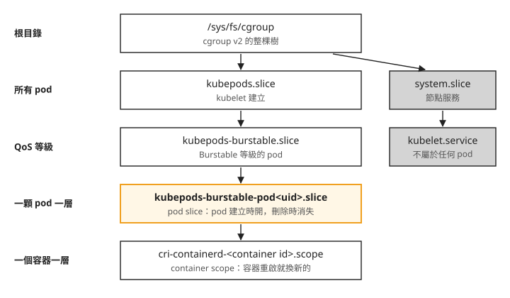
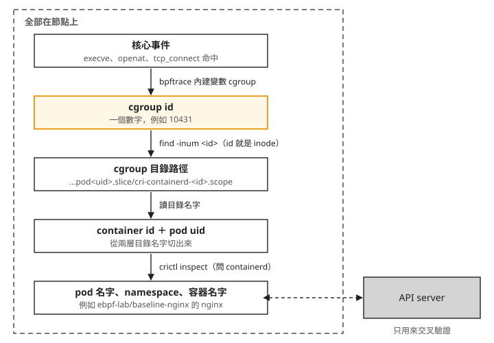
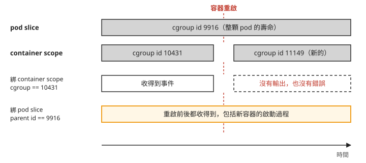

# Day 2: 把核心事件接回 Kubernetes——用 cgroup id 查出 pod、只追蹤一顆 pod

{ align=right width="95" }

[Day 1](sprint2-day1-bpftrace-basics.md) 的 `opensnoop` 能看到節點上的開檔事件。假設其中一行寫著某個 `cat` 開了 `/etc/shadow`：你看得到 PID、行程名稱和路徑，卻看不出是哪一顆 pod 做的。這台節點上同時跑著好幾顆 pod，還有 kubelet 這類節點自己的服務，而三支經典工具都沒有「pod」這個欄位。

這一章把核心事件接回 Kubernetes，選用 cgroup id 對應容器。我們會從這個數字一路查到 pod 名字，全程只用節點上的檔案和工具，不呼叫 API server。查得到身分之後，再寫一支只追蹤一顆 pod 的 bpftrace 腳本，記下 nginx 啟動時執行了哪些程式、開了哪些檔案、連到哪裡，最後故意在 pod 裡做幾件不尋常的事，看這份紀錄抓不抓得到。

讀完之後，看到一筆帶 cgroup id 的核心事件，你能查出它來自哪顆 pod 的哪個容器，或是節點自己的服務；要追蹤一顆 pod 時，你能判斷過濾條件該綁在哪一層，也知道這種追蹤看不見哪些動作。

## 開始之前

這一章沿用 Day 1 的 AKS 叢集與 Ubuntu 24.04 一般 CPU 節點。`ebpf` 節點需使用 cgroup v2，kubelet 與 containerd 都使用 systemd cgroup driver，後面的 `.slice`、`.scope` 路徑才會符合本章寫法。先把 `ebpf` 節點池拉回 2 台：

```console
$ az aks nodepool scale -g <resource-group> --cluster-name <cluster> -n ebpf \
    --subscription <subscription-id> --node-count 2
```

再套用 Day 0 起使用的特權 DaemonSet `01-ebpf-lab-daemonset.yaml`（`privileged`、`hostPID: true`、掛載節點的 `/sys`），它會在每台 `ebpf` 節點上各放一顆追蹤 pod：

```console
$ kubectl apply -f 01-ebpf-lab-daemonset.yaml
```

接著在每顆追蹤 pod 裡安裝 bpftrace，內容跟 Day 0 的安裝腳本相同：

```bash
apt-get update -qq
DEBIAN_FRONTEND=noninteractive apt-get install -y -qq bpftrace
bpftrace --version
nsenter -t 1 -m -- bpftool version
```

本章使用容器裡裝好的 bpftrace v0.20.2，執行前確認版本，避免誤用節點 `/usr/local/bin` 裡的舊版。`bpftool` 不另外裝，用 `nsenter -t 1 -m` 借用節點上內建的那支。

本章用 `cat > 檔名 <<'EOF'` 建立的檔案都在工作站上建立：YAML 用 `kubectl apply` 套用，`.sh` 和 `.bt` 要在追蹤 pod 裡執行，得自己複製進追蹤 pod（例如用 `kubectl cp`）。步驟 5 的腳本預設 `05-podtrace.bt` 放在追蹤 pod 的 `/tmp/podtrace.bt`，複製時直接用這個路徑最省事。

叢集重新啟動後，若 `kubectl` 因 DNS 解析失敗而連不到 API server，處理方式見 Day 1 的[「`az aks start` 之後 `kubectl` 回 `no such host`，`nslookup` 卻解得到」](sprint2-day1-bpftrace-basics.md#mine-1)。使用 `--server` 加 `--tls-server-name` 直接連 IP 前，先重新查詢 API server 的 IP，不要沿用停機前的位址。

## 步驟 1：部署被觀察的 nginx

被觀察的對象選 nginx，原因有三個。第一，官方映像的 `/docker-entrypoint.sh` 在主程式啟動前會先跑一串 shell 腳本，啟動期間真的有事情可看。第二，它開的檔案不多，整理出來的清單一頁看得完；Python 應用光是 import 就可能開幾百個檔。第三，設定檔裡可以放一條 `proxy_pass`，讓 nginx 自己對外連線，連線那一欄才不會是空的。上游位址寫成 IP `1.1.1.1` 而不是網域，nginx 就不必先查 DNS，紀錄裡那筆連線的來源很單純。

映像從 MCR（Microsoft Container Registry，微軟的公開映像倉庫）上的 Docker Hub mirror（`mcr.microsoft.com/mirror/docker/library/`）拉，課程用它避開 Docker Hub 的匿名拉取限制。這個 mirror 的 nginx 在本課驗證時只到 1.25，寫成較新的 tag 會拉不到，`describe` 看到的錯誤長這樣：

```console
$ kubectl -n ebpf-lab describe pod baseline-nginx | tail -3
Failed to pull image "mcr.microsoft.com/mirror/docker/library/nginx:1.27":
  failed to resolve image: … not found
```


訊息跟 tag 打錯字一模一樣。怎麼查 mirror 實際有哪些 tag，見[疑難排解：MCR mirror 拉不到較新的 nginx](#mine-1)。完整的定義如下，用的是 1.25：

```bash
cat > 02-nginx-baseline.yaml <<'EOF'
# nginx is picked over a synthetic sleep-pod because its startup is genuinely
# non-trivial: /docker-entrypoint.sh execs a chain of shell helpers before the
# master process ever reads nginx.conf. The proxy_pass location gives the pod a
# real upstream dependency, so a warm-up request produces an outbound TCP
# connection inside the startup window.
#
# QoS is deliberately Burstable (requests only, no limits) so the pod lands in
# kubepods-burstable.slice; a Guaranteed pod sits one level higher in the cgroup
# tree and the level numbers quoted below would not match.
apiVersion: v1
kind: ConfigMap
metadata:
  name: nginx-baseline-conf
  namespace: ebpf-lab
data:
  default.conf: |
    server {
        listen 8080;
        server_name _;

        location / {
            return 200 "day2 baseline subject\n";
        }

        # real upstream dependency, literal IP so no resolver is needed
        location /up {
            proxy_pass http://1.1.1.1/;
            proxy_connect_timeout 3s;
        }
    }
---
apiVersion: v1
kind: Pod
metadata:
  name: baseline-nginx
  namespace: ebpf-lab
  labels:
    app: baseline-nginx
spec:
  nodeSelector:
    pool: ebpf
  tolerations:
  - key: kubernetes.azure.com/scalesetpriority
    operator: Equal
    value: spot
    effect: NoSchedule
  containers:
  - name: nginx
    image: mcr.microsoft.com/mirror/docker/library/nginx:1.25
    ports:
    - containerPort: 8080
    resources:
      requests:
        cpu: 50m
        memory: 64Mi
    volumeMounts:
    - name: conf
      mountPath: /etc/nginx/conf.d
  volumes:
  - name: conf
    configMap:
      name: nginx-baseline-conf
EOF
```


註解提到 QoS 等級會影響 cgroup 的層數，下一節就會看到這一層。用 `kubectl apply -f 02-nginx-baseline.yaml` 套用之後，看 pod 落在哪一台節點：

```console
$ kubectl -n ebpf-lab get pods -o wide
NAME             READY   STATUS    NODE
baseline-nginx   1/1     Running   aks-ebpf-80832270-vmss000005
ebpf-lab-dt5b9   1/1     Running   aks-ebpf-80832270-vmss000004
ebpf-lab-v6dtk   1/1     Running   aks-ebpf-80832270-vmss000005    ← 與 nginx 同節點
```


eBPF 程式看到的是它所在那台節點的核心，所以追蹤要在跟 `baseline-nginx` 同一台節點的 DaemonSet pod 裡做。對照 `NODE` 欄找出那一顆（上面是 `ebpf-lab-v6dtk`，你的環境名字會不同），接下來的 bpftrace 指令都用 `kubectl exec` 進到它裡面執行。

## 一顆 pod 在節點上是幾層目錄

要把事件對回 pod，得先知道節點怎麼記「這個行程屬於哪顆 pod」。答案是 **cgroup**（control group）：Linux 用它把行程分組，替每一組計算並限制 CPU、記憶體等資源。pod 寫的 limits 和 CPU requests，最後就是寫成 cgroup 的設定才生效。

本課的節點用 cgroup v2。v2 只有一棵樹，掛在 `/sys/fs/cgroup`：每個 cgroup 就是一個目錄，建一個子目錄就多一個子 cgroup，每個行程恰好屬於其中一個。kubelet 替每顆 pod 開一層目錄，容器執行期（這裡是 containerd）再在底下替每個容器各開一層。把 `baseline-nginx` 所在的那一串目錄畫出來，由上往下是從根走到 nginx 容器：



照著圖由上往下看：

1. 第二層是 QoS 等級。Kubernetes 依 requests 與 limits 的寫法把 pod 分成 Guaranteed、Burstable、BestEffort 三級；`baseline-nginx` 只寫 requests，屬於 Burstable。Guaranteed 的 pod 少這一層，直接放在 `kubepods.slice` 底下。
2. 第三層一顆 pod 一個目錄，名字以 `.slice` 結尾，本章叫它 **pod slice**；第四層一個容器一個目錄，以 `.scope` 結尾，叫 **container scope**。slice、scope 是 systemd 的命名方式：這台節點的 kubelet 和 containerd 透過 systemd 建立 cgroup（設定上叫 systemd cgroup driver），目錄名字就照 systemd 的規則取。
3. kubelet 這類節點服務在右邊的 `system.slice` 底下，不屬於任何 pod。

pod slice 和 container scope 的壽命不同，後面的步驟都會用到這個差別：pod slice 在 pod 建立時由 kubelet 開好，pod 刪除時才消失；container scope 跟著容器，容器重啟一次就換一個新目錄。

## 步驟 2：從一個核心事件走到 pod 名字

先看核心那端給了什麼。在追蹤 pod 裡掛一支 execve 探針，然後用 `kubectl exec` 在 `baseline-nginx` 裡叫 bash 執行一個節點上不會有第二份的檔名，例如 `/tmp/d2m-140816`。這個檔案不必存在：`sys_enter_execve` 在核心尋找檔案之前就觸發，找不到檔案的 exec 一樣會被記下來（步驟 6 會再看到這件事）。探針輸出裡找那個檔名：

```console
$ bpftrace -e 'tracepoint:syscalls:sys_enter_execve {
    printf("EXEC cgroup=%d pid=%d comm=%s file=%s\n", cgroup, pid, comm, str(args.filename)); }'
…
EXEC cgroup=10431 pid=16585 comm=bash file=/tmp/d2m-140816
```


`cgroup` 是 bpftrace 的內建變數，背後是核心的 `bpf_get_current_cgroup_id()`，回傳目前這個行程所在 cgroup 的編號。bpftrace 也提供 `pid`、`tid`、`uid` 等身分欄位，定義見[官方手冊的變數說明](https://github.com/bpftrace/bpftrace/blob/v0.20.2/docs/reference_guide.md#variables)。本章選用 cgroup id 對應容器；上面的事件沒有直接帶出 pod 名字或 Kubernetes namespace，要從 10431 這個編號繼續查。

這個數字可以直接從核心的資料結構讀出來。核心用 `task_struct` 這個結構描述每一個行程，bpftrace 的 `curtask` 就是指向目前行程那份 `task_struct` 的指標。沿著指標往下走：`cgroups->dfl_cgrp` 是這個行程在 cgroup v2 樹上所屬的 cgroup，`kn` 是這個 cgroup 在 kernfs 裡對應的那一筆項目（kernfs 是什麼，下一小節說明），`id` 是那筆項目的編號。讀出來的值和 `cgroup` 相同：

```console
$ bpftrace -e 'tracepoint:syscalls:sys_enter_execve {
    printf("leaf_builtin=%d leaf_curtask=%d\n", cgroup, curtask->cgroups->dfl_cgrp->kn->id); exit(); }'
leaf_builtin=3670 leaf_curtask=3670
```


`exit()` 讓探針抓到第一筆就結束，那一筆剛好是別的行程，所以數字不是 10431；要看的是同一行的兩個值相等。

### cgroup id 就是目錄的 inode

`/sys/fs/cgroup` 不是磁碟上的檔案系統，而是核心用 kernfs 在記憶體裡提供的虛擬檔案系統。kernfs 直接拿每筆項目的 `id` 當作檔案系統上的 inode 號碼。所以核心給的 cgroup id，可以直接用 `find -inum` 找出是哪個目錄，再用 `stat` 讀回 inode 對照：

```console
$ find /sys/fs/cgroup -xdev -inum 10431 -print -quit
/sys/fs/cgroup/kubepods.slice/kubepods-burstable.slice/
  kubepods-burstable-podda6a37ba_5d51_4c09_ab10_229b628ad4e1.slice/
  cri-containerd-ceab0423d28c4fed5cf0ea2a41ba5fe4e6fe95b0a88d4081fe0a09833ffd4964.scope
$ stat -c %i <上面那條路徑>
10431                                        ← 對得起來
```


找到的正是 nginx 容器那一層，inode 也是 10431。每一層目錄都有自己的 inode，也就是自己的 cgroup id。把整條路徑攤開：

| 層 | cgroup 目錄 | inode（＝cgroup id） | 這一層代表什麼 |
|---|---|---|---|
| 0 | `/sys/fs/cgroup` | 1 | 根 |
| 1 | `kubepods.slice` | 6780 | 所有 pod |
| 2 | `kubepods-burstable.slice` | 7068 | 該 QoS 等級的 pod |
| 3 | `kubepods-burstable-podda6a…e1.slice` | **9916** | pod slice，一個 pod 一個 |
| 4 | `cri-containerd-ceab0423….scope` | **10431** | container scope，一個容器一個 |

9916 是 `baseline-nginx` 的 pod slice，步驟 4 的過濾條件就綁在它上面。

### 從目錄名字讀出 container id 與 pod uid

`find` 印出的路徑已經帶著兩個 Kubernetes 的識別碼，因為 systemd cgroup driver 把它們編進了目錄名字：

- container scope `cri-containerd-<64 個十六進位字元>.scope` 的中段是 **container id**，這裡是 `ceab0423d28c…4964`。
- pod slice `kubepods-<qos>-pod<uid>.slice` 的中段是 **pod uid**，只是破折號換成了底線；換回來就是 `da6a37ba-…-229b628ad4e1`（中段省略）。

### 用 crictl 換成 pod 名字

最後一步把 container id 換成 pod 名字。**crictl** 是節點上直接查詢容器執行期的命令列工具，它透過 CRI（kubelet 跟容器執行期溝通的介面）連到節點上的 containerd，不經過 API server。追蹤 pod 開了 `hostPID`，用 `nsenter -t 1 -m` 借節點的檔案系統，就能執行節點上的 `crictl`，Day 1 也是這樣執行節點上的程式：

```console
$ nsenter -t 1 -m -- crictl inspect ceab0423d28c…4964 | grep io.kubernetes
"io.kubernetes.container.name": "nginx",
"io.kubernetes.pod.name": "baseline-nginx",
"io.kubernetes.pod.namespace": "ebpf-lab",
"io.kubernetes.pod.uid": "da6a37ba-…-229b628ad4e1"
```


pod 名字、namespace、容器名字都有了。拿 API server 那邊的資料交叉驗證，container id 對得上；這一步只是確認，查詢本身用不到它：

```console
$ kubectl -n ebpf-lab get pod baseline-nginx \
    -o jsonpath='{.status.containerStatuses[*].containerID}'
containerd://ceab0423d28c4fed5cf0ea2a41ba5fe4e6fe95b0a88d4081fe0a09833ffd4964
```


把剛才幾個指令畫成一條查詢鏈，由上往下是查詢的順序：



照著箭頭往下走，每一步的輸入都是上一步的輸出，用到的只有核心事件、節點上的 `/sys/fs/cgroup` 和 `crictl`。對一直跑在節點上的偵測工具來說，這代表 API server 連不上的時候，節點上的身分查詢照樣能做。

### 換成節點上本來就有的事件

上面的事件是我們自己製造的。把整條鏈包成腳本 `04-cgroup-to-pod.sh`，拿節點上本來就在發生的事件再驗一次。腳本在追蹤 pod 裡執行：

```bash
cat > 04-cgroup-to-pod.sh <<'EOF'
#!/bin/bash
# Turn a kernel-side cgroup id into a Kubernetes pod name.
# Run INSIDE the privileged ebpf-lab pod (needs hostPID and the node's /sys).
set -u
CGID="${1:?usage: cgroup-to-pod.sh <cgroup-id>}"

echo "== 1. cgroup id -> cgroup path (kernfs id == cgroupfs inode number)"
CGPATH=$(find /sys/fs/cgroup -xdev -inum "$CGID" -print -quit 2>/dev/null)
[ -n "$CGPATH" ] || { echo "no cgroup with inode $CGID on this node"; exit 1; }
echo "$CGPATH"

echo "== 2. cgroup path -> container id"
LEAF=$(basename "$CGPATH")
case "$LEAF" in
  cri-containerd-*.scope) CID=${LEAF#cri-containerd-}; CID=${CID%.scope} ;;
  docker-*.scope)         CID=${LEAF#docker-};         CID=${CID%.scope} ;;
  *) CID="" ;;
esac
echo "leaf=$LEAF"
echo "container id=${CID:-<none: this cgroup is not a container scope>}"

echo "== 3. cgroup path -> pod uid (the systemd cgroup driver encodes it in the slice name)"
POD_SLICE=$(dirname "$CGPATH")
SLICE=$(basename "$POD_SLICE")
UID_RAW=$(echo "$SLICE" | sed -n 's/^kubepods-\(besteffort-\|burstable-\)\?pod\(.*\)\.slice$/\2/p')
POD_UID=$(echo "$UID_RAW" | tr '_' '-')
echo "pod slice=$SLICE"
echo "pod uid=${POD_UID:-<none>}"
echo "pod slice cgroup id=$(stat -c %i "$POD_SLICE")"

echo "== 4. container id -> pod name/namespace, no API server (crictl on the node)"
if [ -n "$CID" ]; then
  nsenter -t 1 -m -- crictl inspect "$CID" 2>/dev/null \
    | grep -E '"io.kubernetes.pod.(name|namespace|uid)"|"io.kubernetes.container.name"' \
    | sed 's/^ *//'
fi
EOF
chmod +x 04-cgroup-to-pod.sh
```


先看 6 秒內的 execve 落在哪些 cgroup：

```console
$ bpftrace -e 'tracepoint:syscalls:sys_enter_execve { @[cgroup, comm] = count(); }
               interval:s:6 { exit(); }'
@[3670, aznfswatchdogv4]: 8
@[6514, kubelet]: 2
@[9856, node-problem-de]: 14
…
```


把三個 id 丟進腳本，結果都不是 pod：

```console
cgroup 9856 → /sys/fs/cgroup/system.slice/node-problem-detector.service
cgroup 6514 → /sys/fs/cgroup/system.slice/kubelet.service
cgroup 3670 → /sys/fs/cgroup/system.slice/aznfswatchdogv4.service
(leaf 不是 cri-containerd-*.scope → 腳本回報「這個 cgroup 不是容器」)
```


一台閒置節點上的 execve 大多來自節點常駐服務。它們在 `system.slice` 底下，目錄名字就是 systemd unit 的名字。同一條鏈也能回答「這不是 pod 做的」，這跟查出是哪顆 pod 一樣重要，否則節點自己的活動會被算到某顆 pod 頭上。

再從 cgroup 樹上隨機挑一個容器：

```console
$ find /sys/fs/cgroup/kubepods.slice -name 'cri-containerd-*.scope' | shuf -n 1 | xargs stat -c %i
8465
$ ./04-cgroup-to-pod.sh 8465
container id = e76bf071ce8d…a796
pod uid      = 21902a52-…-38647038fde4
"io.kubernetes.pod.name": "csi-azuredisk-node-l8b5k"
"io.kubernetes.pod.namespace": "kube-system"
"io.kubernetes.container.name": "liveness-probe"

$ kubectl get pod -A … | grep 21902a52-
kube-system csi-azuredisk-node-l8b5k 21902a52-…-38647038fde4          ← 對上
$ kubectl -n kube-system get pod csi-azuredisk-node-l8b5k \
    -o jsonpath='{.status.containerStatuses[*].name}'
azuredisk liveness-probe node-driver-registrar                        ← 三個容器,命中第二個
```


一顆完全沒碰過的 kube-system pod，連是它三個容器裡的哪一個都查得出來。

## 步驟 3：為什麼不用 pid 查身分

核心事件也帶著 `pid`，而 `/proc/<pid>/` 底下有這個行程的各種資訊，看起來也能用來查身分。這一步把這條路走一遍，看它卡在哪裡。

先要知道容器裡的行程編號跟節點上的不一樣。Linux 用 **namespace** 讓一組行程看到自己的一份系統資源：PID namespace 有自己的一套行程編號，mount namespace 有自己的檔案系統，UTS namespace 有自己的 hostname，network namespace 有自己的網路。在 Kubernetes 裡，PID 和 mount namespace 是每個容器各一份；network、UTS（hostname）和 IPC（行程間通訊，Inter-Process Communication）則由同一顆 pod 裡的容器共用。追蹤 pod 開了 `hostPID: true`，所以它跟節點共用同一個 PID namespace，nginx 則有自己的。nginx 主行程在節點上的 pid，可以在追蹤 pod 裡用 `nsenter -t 1 -m -p -- pgrep -a nginx` 查，選 `nginx: master process` 那一行，這裡是 13581：

```console
host pid 1        : pid:[4026531836]
this lab shell    : pid:[4026531836]          ← 追蹤器與節點同一個 pidns
nginx master 13581: pid:[4026532393]          ← nginx 自己一個

$ grep -E '^NSpid|^NStgid' /proc/13581/status
NStgid: 13581  1
NSpid:  13581  1                              ← 節點看到 13581,容器裡自己是 1
```


前三行是用 `readlink /proc/<pid>/ns/pid` 讀出的 PID namespace 編號：追蹤 pod 和節點的 1 號行程相同，nginx 不同。`NSpid` 列出同一個行程在每一層 PID namespace 裡的編號，節點上看到的 13581，在容器裡是 1 號。

`nsenter` 可以讓一個指令加入另一個行程的 namespace。`-t 13581` 指定目標行程，`-m -u -p` 分別是 mount、UTS、PID namespace：

```console
$ nsenter -t 13581 -m -u -p -- sh -c 'hostname; ls /etc/nginx/conf.d'
baseline-nginx
default.conf
```


hostname 是 pod 名字（UTS namespace 由整顆 pod 共用，所以 hostname 就是 pod 名字），也看得到 ConfigMap 掛進去的設定檔，看起來確實「在容器裡」了。但一個行程「屬於哪個 cgroup」不是 namespace 決定的。比對追蹤 pod 自己和 `nsenter` 之後的 `/proc/self/cgroup`（行程所屬 cgroup 的路徑）：

```console
$ cat /proc/self/cgroup                       (追蹤器 pod 自己)
0::/kubepods.slice/…/kubepods-burstable-pod22e306e7_…_975bb8cee3a2.slice/cri-containerd-14acd5ee….scope

$ nsenter -t 13581 -m -u -p -- cat /proc/self/cgroup
0::/kubepods.slice/…/kubepods-burstable-pod22e306e7_…_975bb8cee3a2.slice/cri-containerd-14acd5ee….scope
                                              ↑ 還是追蹤器自己的,不是 nginx 的

$ nsenter -t 13581 -m -u -p -C -- cat /proc/self/cgroup
0::/../../kubepods-burstable-pod22e306e7_…slice/cri-containerd-14acd5ee….scope
                                              ↑ 加 -C 只換視角,成員身分沒動
```


`nsenter` 之後印出的仍是追蹤 pod 自己的路徑。要分清楚兩件事：cgroup 是行程實際所屬的那一組；cgroup namespace 只決定行程看 cgroup 路徑時以哪一層當根。所以加上 `-C`（進入 nginx 的 cgroup namespace）只改了路徑的顯示方式，變成相對於 nginx 那層的 `/../../…`，行程還是待在原來的 cgroup。`nsenter` 沒有加入其他 cgroup 的選項，要真的換，得把 pid 寫進目標目錄的 `cgroup.procs`。步驟 7 會看到這件事對追蹤的影響。

pid 這條路還有一個更直接的問題：時間差。用 pid 查身分要在使用者空間讀 `/proc/<pid>/cgroup`，可是很多行程活得比這次讀取還短。在 pod 裡跑 5 次 `/usr/bin/true`，bpftrace 收到每一筆事件後，立刻回頭檢查 `/proc/<pid>` 還在不在。本課沒有附這個實驗的腳本，它只用來說明時間差，跳過不影響後面的步驟：

```console
(pod 內跑 5 次 /usr/bin/true,bpftrace 全部抓到;此處節錄頭尾)
37651 bash /usr/bin/true
…
37655 bash /usr/bin/true

(收到事件之後立刻回頭查 /proc)
pid 37651: /proc/37651 GONE
…
pid 37655: /proc/37655 GONE            ← 5/5 全部來不及
```


5 次全部來不及，行程已經結束。兩條路擺在一起比：

| | cgroup id | pid → `/proc` |
|---|---|---|
| 取得位置 | 核心裡（`bpf_get_current_cgroup_id()`） | 使用者空間 |
| 能不能在核心裡過濾 | 能，不符合的事件一個位元組都不送 | 不能，一定要先撈出來 |
| 短命行程 | 不受影響 | 本課 5/5 查無此 pid |
| 識別碼會不會重複使用 | 不會 | 會 |
| 看得見 `nsenter` 進來的動作 | 看不見 | 看得見 |
| 解析成本 | 一次 `find -inum`，之後可快取 | 每個事件一次 `open()` ＋ `read()` |

前四列讓每台節點跑一份的追蹤器（例如本課的 DaemonSet）只能拿 cgroup id 當主要的身分，pid 只當輔助欄位。第五列是選 cgroup 的代價，要靠節點層的存取控制補，追蹤器本身補不了。

## 步驟 4：只追蹤一顆 pod

### 過濾條件要綁在哪一層

每個事件都帶著 cgroup id，bpftrace 的 filter（Day 1 介紹過，寫在探針與動作區塊之間、在核心裡求值的判斷式）就能只留一顆 pod 的事件。最直覺的寫法是 `/cgroup == <container scope id>/`，容器正在跑的時候，這樣寫沒有問題。

問題出在容器重啟。讓 nginx 主行程（容器裡的 1 號行程）結束，kubelet 會在同一顆 pod 裡重建容器：

```console
$ kubectl -n ebpf-lab exec baseline-nginx -- kill -TERM 1
```

重啟前後各用步驟 2 的方法查一次：

```console
(第一次)  container id ceab0423…4964   leaf cgroup id 10431
(重啟後)  container id 2572577c…2ed3   leaf cgroup id 11149
          pod slice cgroup id           9916  ← 兩次都一樣
```


container id 和 container scope 的 cgroup id 都換了，pod slice 的 9916 沒變。把這件事放到時間軸上：



圖上有兩件事要注意：

1. 綁在 10431 的過濾器，容器重啟後就再也收不到事件，而且不會回報錯誤。
2. 想看容器啟動時做了什麼，綁在容器那一層本來就來不及：那個 cgroup 要等容器建立才存在，等你查到號碼、掛好探針，啟動早就跑完了。

綁在 pod slice 上就沒有這兩個問題，可以先掛好探針，再讓容器重啟。在 filter 裡拿到 pod slice 的 id，只要從容器那一層再往上走一步，取 `parent`：

```awk
curtask->cgroups->dfl_cgrp->kn->parent->id     ← 這個 task 所屬 pod 的 slice id
```


這個寫法剛好只往上一層。如果容器裡自己再開 cgroup，例如容器裡跑 systemd，或在容器裡再跑容器，行程會落在 pod slice 底下第二層以後，這個過濾條件就漏掉它們。

### 本章的追蹤腳本

`05-podtrace.bt` 追三類事件：執行程式（EXEC）、開檔（OPEN）、對外連線（CONN），每一類都在核心裡用 pod slice id 過濾，`$1` 是從命令列傳進來的 id：

```bash
cat > 05-podtrace.bt <<'EOF'
#!/usr/bin/env bpftrace
/*
 * podtrace.bt - everything one pod does, and nothing else.
 *
 *   bpftrace podtrace.bt <pod-slice-cgroup-id>
 *
 * The filter is written out four times instead of hiding behind a #define on
 * purpose: one #define anywhere in this file makes bpftrace 0.20.2 lose
 * `struct task_struct` and refuse to compile.
 *
 * Known limits: exactly one level up, so a workload running its own cgroup
 * manager sits too deep to match; and this is cgroup membership, not namespace
 * membership, so work done through `nsenter -t <pid>` from the node stays in
 * the caller's cgroup and is invisible here.
 */

BEGIN
{
	printf("# podtrace: pod slice cgroup id = %d\n", $1);
	printf("# CLASS TIME PID COMM DETAIL\n");
}

tracepoint:syscalls:sys_enter_execve
/curtask->cgroups->dfl_cgrp->kn->parent->id == $1/
{
	printf("EXEC %s %-7d %-16s %s\n", strftime("%H:%M:%S", nsecs), pid, comm,
	    str(args.filename));
}

tracepoint:syscalls:sys_enter_openat
/curtask->cgroups->dfl_cgrp->kn->parent->id == $1/
{
	@fn[tid] = args.filename;
}

tracepoint:syscalls:sys_exit_openat
/@fn[tid]/
{
	$ret = args.ret;
	printf("OPEN %s %-7d %-16s %-4d %s\n", strftime("%H:%M:%S", nsecs), pid,
	    comm, $ret >= 0 ? 0 : - $ret, str(@fn[tid]));
	delete(@fn[tid]);
}

kfunc:vmlinux:tcp_connect
/curtask->cgroups->dfl_cgrp->kn->parent->id == $1/
{
	$sk = args.sk;
	$dport = bswap($sk->__sk_common.skc_dport);
	printf("CONN %s %-7d %-16s tcp %s:%d\n", strftime("%H:%M:%S", nsecs), pid,
	    comm, ntop($sk->__sk_common.skc_daddr), $dport);
}

kfunc:vmlinux:udp_sendmsg
/curtask->cgroups->dfl_cgrp->kn->parent->id == $1 && args.sk->__sk_common.skc_daddr != 0/
{
	$sk = args.sk;
	$dport = bswap($sk->__sk_common.skc_dport);
	printf("CONN %s %-7d %-16s udp %s:%d\n", strftime("%H:%M:%S", nsecs), pid,
	    comm, ntop($sk->__sk_common.skc_daddr), $dport);
}

END
{
	clear(@fn);
}
EOF
```


`OPEN` 沿用 Day 1 拆解過的 enter／exit 配對：進入 `openat` 時把檔名存進 `@fn[tid]`，離開時取出來，連同錯誤碼一起印。連線掛了 `tcp_connect` 和 `udp_sendmsg` 兩支 `kfunc`（Day 0 介紹過，帶型別的核心函式探針）。UDP 是刻意加的：Day 1 量到 `tcpconnect.bt` 對 DNS 查詢是 0 筆，因為 DNS 走 UDP，只追 TCP 會漏掉 pod 查過哪些名字。

腳本裡有三處寫法看起來繞路，各自避開一個常見的錯誤：

- 同一個過濾條件寫了四次，沒有用 `#define` 收成一個名字。在 bpftrace 0.20.2，`.bt` 檔裡只要有 `#define`，用到 `curtask` 的地方就編不過，見[疑難排解：加了 `#define` 之後認不得 `struct task_struct`](#mine-4)。
- port 用 `bswap()` 轉換位元組順序，沒有用網路上常見的手寫位移。手寫位移指派回同一個變數時什麼都沒做，見[疑難排解：port 印出 20480、13568 這類數字](#mine-5)。
- 時間用 `strftime()` 放進同一個 `printf`，沒有像官方工具那樣先呼叫 `time()`。分成兩次輸出的話，多顆 CPU 同時命中探針時會交錯，見[疑難排解：一行裡出現兩次時間](#mine-6)。

## 步驟 5：過濾省下多少

要知道過濾的效果，得在同一段時間、同一台節點上，同時跑過濾和不過濾兩份。`06-noise-compare.sh` 用 sed 刪掉 `05-podtrace.bt` 裡的過濾條件，產生不過濾的版本，兩份腳本除了過濾條件之外完全相同，再同時掛上、同時停止。腳本讀的是追蹤 pod 裡的 `/tmp/podtrace.bt`，也就是複製進去的 `05-podtrace.bt`；兩個參數是 pod slice 的 id 和要記錄幾秒：

??? note "完整腳本：06-noise-compare.sh"

    ```bash
    cat > 06-noise-compare.sh <<'EOF'
    #!/bin/bash
    # noise-compare.sh - how much does the cgroup filter actually buy?
    #
    # Run INSIDE the privileged ebpf-lab pod, with /tmp/podtrace.bt already there.
    #   noise-compare.sh <pod-slice-cgroup-id> <seconds>
    #
    # Both tracers attach the same probes over the same window on the same node.
    # The unfiltered variant is generated from podtrace.bt by deleting the predicate
    # lines, so "same script minus the filter" is literally true and nobody has to
    # trust two hand-written files to be equivalent.
    set -u
    CGID="${1:?usage: noise-compare.sh <pod-slice-cgroup-id> <seconds>}"
    SECS="${2:-30}"

    sed -e '/^\/curtask->cgroups->dfl_cgrp->kn->parent->id == \$1\/$/d' \
        -e 's#^/curtask->cgroups->dfl_cgrp->kn->parent->id == \$1 && \(.*\)/$#/\1/#' \
        /tmp/podtrace.bt > /tmp/alltrace.bt
    echo "predicates left in unfiltered variant: $(grep -c "^/curtask" /tmp/alltrace.bt)"

    bpftrace /tmp/alltrace.bt "$CGID" > /tmp/all.out 2>/tmp/all.err &
    ALL=$!
    bpftrace /tmp/podtrace.bt "$CGID" > /tmp/one.out 2>/tmp/one.err &
    ONE=$!

    # both need to be attached before the workload starts, or the window is unfair
    sleep 8
    echo "ARMED $(date +%T)"
    sleep "$SECS"
    kill -INT $ALL $ONE 2>/dev/null
    wait $ALL $ONE 2>/dev/null
    echo "STOPPED $(date +%T)"

    for f in all one; do
      o=/tmp/$f.out
      printf '%-10s total=%-7s EXEC=%-6s OPEN=%-7s CONN=%-5s distinct-comm=%s\n' \
        "$f" \
        "$(grep -cE '^(EXEC|OPEN|CONN)' $o)" \
        "$(grep -c '^EXEC' $o)" "$(grep -c '^OPEN' $o)" "$(grep -c '^CONN' $o)" \
        "$(awk '/^(EXEC|OPEN|CONN)/{print $4}' $o | sort -u | wc -l)"
    done
    EOF
    ```

腳本掛好探針後印出 `ARMED`，接著記錄指定的秒數。在這段時間裡，nginx pod 要跑一段固定的工作負載：本課是 20 輪讀設定檔、查 DNS、對外 TCP 連線，以及打自己的 `/up` 讓 nginx 去 proxy。這段工作負載本課沒有附腳本，換成你自己的幾個動作也可以，只是數字會不同。

新建的腳本不一定有執行權限，請用 `bash 06-noise-compare.sh <pod-slice-cgroup-id> 30` 執行，將 `<pod-slice-cgroup-id>` 換成步驟 2 的 `04-cgroup-to-pod.sh` 輸出中 `pod slice cgroup id=` 後面的數字；該值是用 `stat -c %i "$POD_SLICE"` 取得的 inode，不要填 container scope 的 id。修正後的寫法本課沒有實跑。下方保留原始執行紀錄，9916 是當時的 pod slice id。

輸出最後兩行，`all` 是不過濾，`one` 是只看 pod slice 9916：

```console
$ ./06-noise-compare.sh 9916 30
predicates left in unfiltered variant: 0
ARMED 06:15:01
STOPPED 06:15:32
all   total=50334  EXEC=971  OPEN=48966  CONN=397  distinct-comm=99
one   total=1036   EXEC=124  OPEN=652    CONN=260  distinct-comm=12
```


| | 未過濾 | pod slice 過濾 | 倍數 |
|---|---|---|---|
| 事件總數 | 50,334 | 1,036 | 48.6× |
| EXEC | 971 | 124 | 7.8× |
| OPEN | 48,966 | 652 | 75.1× |
| CONN | 397 | 260 | 1.5× |
| 不同 comm | 99 | 12 | 8.3× |
| 輸出位元組 | 4,556,335 | 62,385 | 73.0× |

OPEN 差了 75 倍，節點上的開檔幾乎都是別人的。CONN 只差 1.5 倍，因為這段時間裡會對外連線的，主要就是這段工作負載本身。不過濾那份裡，次數最多的行程名稱是：

```console
14613 containerd-shim      5579 awk       4731 jq        3997 curl
 2493 containerd           2096 kubelet   1860 cat       1791 sed
 1516 check_scheduled       887 bash       807 check_spot_evic
```


這些都不是 nginx pod 裡的程式：containerd-shim 和 containerd 是容器執行期，kubelet 是節點服務，`check_scheduled`、`check_spot_evic` 是 node-problem-detector（AKS 在每台節點上跑的服務，定期執行檢查腳本，回報節點的健康狀況）的檢查腳本，awk、jq、curl 也不在過濾後的清單裡。過濾後剩下的 12 個行程名稱，每一個都說得出來源：`bash`、`getent`、`cat`、`sleep`、`head`、`nginx`、`seq`、`date` 是工作負載本身，`runc:[…]`、`6`、`runc` 是 `kubectl exec` 進 pod 時容器執行期留下的。連線目標短到可以直接讀：

```console
200  udp 10.0.0.10:53        ← kube-dns
 40  tcp 1.1.1.1:80          ← 20 次自己連 ＋ 20 次 nginx proxy
 20  tcp 127.0.0.1:8080      ← 打自己
```


Day 1 的結論是追蹤只能臨時開，因為 22 秒就印出 24,350 行。只看一顆 pod 時，同一段時間的輸出量降到原來的五十分之一左右。本課沒有測過長時間開著的情況，但至少輸出量不再是只能臨時開的理由。

## 步驟 6：替 nginx 做一份啟動行為基線

**行為基線**是一份清單，記下一個工作負載正常情況下會做什麼：執行哪些程式、開哪些檔案、連到哪些位址。有了它，要判斷一件事正不正常，不必先想好規則，只要看它在不在清單上。這一步記下 nginx 從容器啟動到服務第一個請求為止的行為。

### 在容器建立之前就開始記錄

要記下啟動，探針得在容器啟動之前就掛好，這正是步驟 4 把過濾綁在 pod slice 上的原因。做法如下：

```
1. 先讓 pod 跑起來(pod slice 誕生,id = 9916)
2. 拿 pod slice id 架好 05-podtrace.bt        ← 容器還是舊的那個
3. kubectl exec -- kill -TERM 1               ← nginx master 結束,容器跟著結束
4. kubelet 在同一個 pod slice 裡重建容器       ← 全新的 container scope,全新的啟動
5. 從另一顆 pod 打一次暖機請求(不走 kubectl exec,避免把 runc 的雜訊算進來)
6. 收工
```


`05-podtrace.bt` 的用法是 `bpftrace podtrace.bt <pod-slice-cgroup-id>`，最後一個參數填步驟 2 查到的 pod slice id。背景擷取與存檔的寫法可對照步驟 5 的 `06-noise-compare.sh`：它用 `bpftrace /tmp/podtrace.bt "$CGID" > /tmp/one.out 2>/tmp/one.err &` 啟動追蹤，把事件寫入 `/tmp/one.out`、錯誤訊息寫入 `/tmp/one.err`，再用 `ONE=$!` 保存追蹤器的行程編號。腳本最後用 `kill -INT $ALL $ONE 2>/dev/null` 停止兩份追蹤，並以 `wait $ALL $ONE 2>/dev/null` 等待結束。這是步驟 5 已有的擷取方式；上述重啟與暖機流程的完整操作指令，以及擷取檔取回工作站的指令，驗證素材沒有保存。

第 5 步的暖機請求，是從叢集裡另一顆 pod 對 `baseline-nginx` 的 8080 port 發一個 HTTP 請求到 `/up`。不在 `baseline-nginx` 裡用 `kubectl exec` 發，是因為那樣容器執行期進入 pod 的事件也會被記進去。發請求的那顆 pod 要有 HTTP 客戶端：DaemonSet 用的 ubuntu 映像預設沒有 `curl`，要自己裝，或另外準備一顆帶 `curl` 的 pod。記錄的結果：

```console
14:18:10 armed
14:18:11 TERM sent
14:18:2x RESTARTS=2  containerID=containerd://012ac94da423…b667
14:18:27 warm-up: HTTP/1.1 301 Moved Permanently        ← 1.1.1.1 回的,證明 proxy 真的連出去了
         lines=204  (198 筆事件,0 行畸形)
```


容器換了新的 container id，pod slice 沒變，紀錄一路沒斷。暖機請求拿到 `301`，是 1.1.1.1 回的，代表 nginx 的 proxy 真的連出去了；整份輸出沒有格式錯亂的行。

原始紀錄還不是基線。204 行裡有 106 筆是 runc 和 containerd 建立容器時的動作，每一顆 pod 都一樣。`07-baseline-build.sh` 在工作站上處理擷取下來的檔案：從 entrypoint 開始執行的那一筆起算，並把屬於容器執行期的事件分出去丟掉，最後留下 87 筆，輸出成 `08-nginx-startup-baseline.md`。第一個參數是要讀取的擷取檔，接著依序是 pod 名字、映像、container id 和 pod slice id，後四項只用來填表頭：

??? note "完整腳本：07-baseline-build.sh"

    ```bash
    cat > 07-baseline-build.sh <<'EOF'
    #!/bin/bash
    # baseline-build.sh - turn one podtrace capture into a readable behaviour baseline.
    #
    #   baseline-build.sh <podtrace-output> <pod> <image> <container-id> <cgid> [start-regex]
    #
    # Runs on the workstation against a captured file. Three tiers, because a raw
    # capture is not a baseline:
    #
    #   1. runtime tier  - runc / containerd doing container setup. Identical for
    #                      every pod on the cluster, so it is counted and dropped.
    #   2. app tier      - what the workload itself did. This is the baseline.
    #   3. summary       - distinct binaries executed, distinct files opened,
    #                      distinct outbound peers.
    #
    # Anything a human is expected to read lives in tier 2 and 3.
    set -u
    CAP0="${1:?usage: baseline-build.sh <capture> <pod> <image> <container-id> <cgid> [start-regex]}"
    POD="${2:-?}"; IMG="${3:-?}"; CID="${4:-?}"; CGID="${5:-?}"
    # The capture starts when the tracer attaches, the baseline starts when the
    # container's entrypoint runs. Everything in between belongs to whatever
    # triggered the restart, not to the workload.
    START="${6:-EXEC .*docker-entrypoint\\.sh}"
    CAP=$(mktemp)
    awk -v re="$START" 'f || $0 ~ re {f=1; print}' "$CAP0" > "$CAP"
    trap 'rm -f "$CAP"' EXIT

    # Classifying an event as "container runtime" cannot be done on comm alone.
    # execve keeps the OLD comm until the new image is loaded, so the shell that
    # `kubectl exec` starts is reported with comm=runc:[2:INIT] -- the single event
    # an intrusion baseline cares about most would be filtered away as plumbing.
    # EXEC is therefore classified on the binary being executed, everything else on
    # comm.
    is_runtime='$1 == "EXEC" ? $5 ~ /^\/proc\/self\/fd\// : ($4 ~ /^runc/ || $4 == "6" || $4 ~ /^containerd/)'

    tot=$(grep -cE '^(EXEC|OPEN|CONN)' "$CAP")
    rt=$(awk "/^(EXEC|OPEN|CONN)/ && ($is_runtime)" "$CAP" | wc -l | tr -d ' ')
    app=$((tot - rt))

    echo "# Behaviour baseline — \`$POD\`"
    echo
    echo "| field | value |"
    echo "|---|---|"
    echo "| image | \`$IMG\` |"
    echo "| container id | \`${CID:0:16}…\` |"
    echo "| pod slice cgroup id | \`$CGID\` |"
    echo "| window | entrypoint exec → first request served |"
    echo "| raw events | $tot |"
    echo "| container-runtime events (dropped) | $rt |"
    echo "| workload events (the baseline) | $app |"
    echo
    echo "## Executed binaries"
    echo
    echo "| # | binary | executed by |"
    echo "|---|---|---|"
    awk "/^EXEC/ && !($is_runtime) {print \$5, \$4}" "$CAP" | awk '{c[$1" "$2]++} END {for (k in c) print c[k], k}' \
      | sort -k2 | awk '{printf "| %s | `%s` | `%s` |\n", $1, $2, $3}'
    echo
    echo "## Files opened"
    echo
    echo "| path | errno | opened by |"
    echo "|---|---|---|"
    awk "/^OPEN/ && !($is_runtime) {print \$6, \$5, \$4}" "$CAP" | sort -u \
      | awk '{printf "| `%s` | %s | `%s` |\n", $1, $2, $3}'
    echo
    echo "## Outbound connections"
    echo
    echo "| proto | peer | by |"
    echo "|---|---|---|"
    awk "/^CONN/ && !($is_runtime) {print \$5, \$6, \$4}" "$CAP" | sort -u \
      | awk '{printf "| %s | %s | `%s` |\n", $1, $2, $3}'
    echo
    echo "## Summary the gate is judged on"
    echo
    echo "| metric | count |"
    echo "|---|---|"
    printf '| distinct binaries | %s |\n' "$(awk "/^EXEC/ && !($is_runtime) {print \$5}" "$CAP" | sort -u | wc -l | tr -d ' ')"
    printf '| distinct files | %s |\n' "$(awk "/^OPEN/ && !($is_runtime) {print \$6}" "$CAP" | sort -u | wc -l | tr -d ' ')"
    printf '| distinct outbound peers | %s |\n' "$(awk "/^CONN/ && !($is_runtime) {print \$5\" \"\$6}" "$CAP" | sort -u | wc -l | tr -d ' ')"
    EOF
    ```

若要先做離線整理，驗證素材目錄 `docs/plans/verify-logs/sprint2-day2-manifests/` 已有 `10-baseline-capture.txt` 和 `11-deviation-capture.txt`。取得這兩份檔案後，與本章的 `07-baseline-build.sh`、`09-deviation-check.sh` 放在工作站的同一個目錄，以下路徑都以該目錄為準。

用 `bash` 執行 `07-baseline-build.sh`，第一個參數填 `10-baseline-capture.txt`；後四項填這份擷取對應的 pod 名字、映像、container id 和 pod slice id，可對照素材中的 `08-nginx-startup-baseline.md` 表頭。腳本將 Markdown 寫到標準輸出，需在呼叫時加上 `> 08-nginx-startup-baseline.md`，基線檔才會儲存在工作站目前目錄。第六個參數可省略，腳本預設從符合 `EXEC .*docker-entrypoint\.sh` 的第一筆事件開始整理。

丟掉容器執行期這一層是取捨：丟了清單才讀得完，但也就看不到有人在 runc 那一層動手腳。分類時不能只看行程名稱，原因見[疑難排解：kubectl exec 開的 shell 從紀錄裡消失](#mine-7)。

### 基線的內容

執行過的程式共 12 支，依呼叫關係排起來：

```
/docker-entrypoint.sh                                    ← runc 執行的第一支
  ├─ /usr/bin/find ×2  /usr/bin/sort                     ← 列出 /docker-entrypoint.d/
  ├─ 10-listen-on-ipv6-by-default.sh → basename, touch
  ├─ 20-envsubst-on-templates.sh     → basename, awk
  ├─ 30-tune-worker-processes.sh     → basename
  └─ /usr/local/sbin/nginx → /usr/local/bin/nginx → /usr/sbin/nginx
```


最後一行的三個 nginx 是同一支程式。`exec nginx` 照 PATH 依序試三個目錄，前兩次找不到檔案（ENOENT），第三次才成功。EXEC 事件掛在 `sys_enter_execve`，進入時還不知道會不會成功，所以三次都被記下來，這就是 Day 1 講過的[「兩個 execsnoop 對失敗的 exec 一個有一個沒有」](sprint2-day1-bpftrace-basics.md#mine-2)。只看 EXEC 會以為容器裡啟動了三個 nginx。

開過的檔案共 32 個不同路徑，挑幾個來看：

| 路徑 | errno | 開檔者 | 為什麼值得看 |
|---|---|---|---|
| `/etc/nginx/nginx.conf` | 0 | `nginx` | 主設定檔 |
| `/etc/nginx/conf.d/default.conf` | 0 | `nginx` | 掛進去的 ConfigMap |
| `/etc/nginx/conf.d/default.conf` | 30 | `touch` | errno 30 ＝ EROFS |
| `/docker-entrypoint.d/15-local-resolvers.envsh` | 0 | `docker-entrypoi` | 被讀了，但沒有出現在 exec 清單裡 |
| `/etc/localtime`、`/etc/nsswitch.conf`、`/etc/passwd`、`/etc/group` | 0 | `nginx` | 一般程式啟動時都會讀的系統檔 |
| `/var/log/nginx/{access,error}.log`、`/var/run/nginx.pid` | 0 | `nginx` | 唯一會被寫的三個檔 |
| `/usr/lib/ssl/openssl.cnf` | 0 | `nginx` | 即使沒設定 TLS 也會讀 |
| `/sys/devices/system/cpu/online` | 0 | `nginx` | worker 數量是這樣決定的 |

第三、四列是基線順帶抓到的兩件事。`10-listen-on-ipv6-by-default.sh` 想 `touch` 設定檔，但 ConfigMap 掛載是唯讀的，於是拿到 errno 30（EROFS，唯讀檔案系統）。entrypoint 預期到這種情況，只在 log 印一行 info 就繼續，容器照常啟動，`kubectl get pod` 也一切正常；從 syscall 這一層看，才知道失敗的是哪個檔案、錯誤碼是什麼。`15-local-resolvers.envsh` 被讀了，卻沒出現在執行清單裡，因為 entrypoint 對 `.envsh` 檔是用 `.` 載入到自己的 shell 裡（source），不是另外執行一支程式，所以只有開檔、沒有 execve。這件事要把開檔清單和執行清單並排才看得出來。

對外連線只有一筆：`tcp 1.1.1.1:80`，由 nginx 發出。沒有 DNS 查詢，因為設定檔寫的是 IP。基線最後的統計是 12 支執行檔、32 個檔案、1 個對外連線，給一個 pod 名字 `baseline-nginx`，就列得出它啟動期間的行為，一頁看得完。

## 步驟 7：拿基線比對不尋常的動作

在同一顆 pod 裡，用 `kubectl exec` 開一個 shell，故意做三件基線裡沒有的事：讀一個 nginx 從來不碰的檔案、連一個基線裡沒有的位址、執行 `id`：

```bash
wc -l < /etc/shadow                        # a file nginx never opens
exec 3<>/dev/tcp/<public-dns-a>/53         # a peer not in the baseline
id
```


`<public-dns-a>` 和後面的 `<public-dns-b>` 是兩個公共 DNS 服務的位址，自己挑兩個即可；它們只要不在基線清單上，兩次用不同的位址，是為了分辨事件來自哪一次。這段期間同樣用 `05-podtrace.bt` 記錄。`09-deviation-check.sh` 在工作站上執行，兩個參數依序是基線的原始擷取和這次的擷取；它把兩份逐類比對，用三次 `comm -13` 列出只出現在這次擷取裡的項目。離線比對時，用 `bash` 執行這支腳本，第一個參數填同目錄的 `10-baseline-capture.txt`，第二個填 `11-deviation-capture.txt`，第三個參數省略即可沿用步驟 6 的起點。第一個輸入必須是原始擷取，不能填整理後的 `08-nginx-startup-baseline.md`：

??? note "完整腳本：09-deviation-check.sh"

    ```bash
    cat > 09-deviation-check.sh <<'EOF'
    #!/bin/bash
    # deviation-check.sh - diff a live podtrace capture against the startup baseline.
    #
    #   deviation-check.sh <baseline-capture> <live-capture> [baseline-start-regex]
    #
    # This is the whole "rule engine" of Day 2: three `comm -13` calls. It is
    # deliberately this small, because the point is what the small
    # version can and cannot do.
    set -u
    BASE0="${1:?usage: deviation-check.sh <baseline-capture> <live-capture> [start-regex]}"
    LIVE="${2:?usage: deviation-check.sh <baseline-capture> <live-capture> [start-regex]}"
    # Same window trim as baseline-build.sh. Without it the baseline silently
    # absorbs whatever ran before the container did -- including, in this lab, the
    # shell that triggered the restart, which is exactly what step 5 wants to catch.
    START="${3:-EXEC .*docker-entrypoint\\.sh}"
    BASE=$(mktemp)
    awk -v re="$START" 'f || $0 ~ re {f=1; print}' "$BASE0" > "$BASE"
    trap 'rm -f "$BASE"' EXIT

    # Classifying an event as "container runtime" cannot be done on comm alone.
    # execve keeps the OLD comm until the new image is loaded, so the shell that
    # `kubectl exec` starts is reported with comm=runc:[2:INIT] -- the single event
    # an intrusion baseline cares about most would be filtered away as plumbing.
    # EXEC is therefore classified on the binary being executed, everything else on
    # comm.
    is_runtime='$1 == "EXEC" ? $5 ~ /^\/proc\/self\/fd\// : ($4 ~ /^runc/ || $4 == "6" || $4 ~ /^containerd/)'

    field() { awk "/^$1/ && !($is_runtime) {print $2}" "$3" | sort -u; }

    for class in EXEC:'$5':binaries OPEN:'$6':files CONN:'$5" "$6':peers; do
      cls=${class%%:*}; rest=${class#*:}; col=${rest%%:*}; label=${rest##*:}
      echo "== new ${label} (in live, not in baseline) =="
      comm -13 <(field "$cls" "$col" "$BASE") <(field "$cls" "$col" "$LIVE") \
        | sed 's/^/  /'
      echo
    done
    EOF
    ```

輸出：

```console
== new binaries (in live, not in baseline) ==
  /usr/bin/bash
  /usr/bin/id
  /usr/bin/wc

== new files (in live, not in baseline) ==
  /dev/tty
  /etc/shadow
  /lib/x86_64-linux-gnu/libtinfo.so.6

== new peers (in live, not in baseline) ==
  tcp <public-dns-a>:53
```


三件事都出現了，另外還多了兩個沒有刻意做的：`/dev/tty` 和 `libtinfo.so.6`。bash 以互動模式啟動時會打開終端機、載入終端機控制函式庫，只跑 nginx 的容器不會碰這兩個檔。沒有人寫過「有人開了 shell」的規則，它還是被抓出來，因為它不在清單上。

分類事件時有個陷阱：`kubectl exec` 開的那個 bash，在 EXEC 事件裡的行程名稱是 `runc:[2:INIT]`。如果用行程名稱過濾容器執行期的事件，剛好會把這一筆刪掉，見[疑難排解：kubectl exec 開的 shell 從紀錄裡消失](#mine-7)。

### 同一組動作改走 nsenter

再做一次同樣的事，這次不經過 `kubectl exec`，改從節點上的追蹤 pod 用 `nsenter` 進入 nginx 的 namespace，多加 `-n` 連網路 namespace 一起進去。`<nginx master pid>` 是 nginx 主行程在節點上的 pid，查法同步驟 3 的 `pgrep`（容器重啟過，pid 會跟當時不同）：

```console
$ nsenter -t <nginx master pid> -m -u -p -n -- bash -c \
    'wc -l < /etc/shadow; exec 3<>/dev/tcp/<public-dns-b>/53 && echo connected-<public-dns-b>-via-nsenter'
19
connected-<public-dns-b>-via-nsenter                        ← 動作確實成功了
```


讀檔和連線都成功了。同一份紀錄裡：

```console
<public-dns-b> 的筆數 : 0
/etc/shadow 的筆數    : 1        ← 只有 kubectl exec 那一筆
```


`/etc/shadow` 只有 `kubectl exec` 那一次，`<public-dns-b>` 一筆都沒有。原因在步驟 3：`nsenter` 換了 namespace，行程卻還在追蹤 pod 自己的 cgroup，綁在 pod slice 9916 的過濾條件看不到它。拿得到節點 root 權限的人，都能用這個方式避開以 cgroup 為範圍的追蹤，見[疑難排解：從節點 nsenter 進去的動作沒有被記錄](#mine-2)。

### 這套做法還缺什麼

這一章的做法能用，但離常駐的執行期偵測還差不少：

| 缺什麼 | 今天的實況 |
|---|---|
| 沒有持久化 | 輸出是某顆 pod 的 `/tmp/*.out`；pod 被重排、節點被 spot 回收，證據就不見了 |
| 沒有告警 | 偏離要有人執行 `09-deviation-check.sh` 才會被看到，沒有 webhook、沒有分級、沒有去重 |
| 沒有規則引擎 | 「規則」是三個 `comm -13`，寫不出「連到私有網段以外才算」「一分鐘內超過 N 次才算」「這個 namespace 例外」 |
| 必須剛好在看 | 探針要先掛好，掛上去之前發生的事完全不存在；為了抓啟動還得刻意讓容器重啟一次 |
| 一次一顆 pod | 過濾器是單一 cgroup id，要監控整個 namespace 得自己維護「pod → cgroup id」並在 pod 生滅時更新 |
| 基線是一張快照 | 沒有「允許但罕見」這個概念；暖機請求沒去 DNS，於是任何一次 DNS 查詢都會被判成偏離 |
| 看不見 `nsenter` | 見上一節 |

前四列是常駐的偵測工具要解決的：保存紀錄、送出告警、規則語言、開機就掛好探針。第五列是容器身分應該由容器執行期提供，不必自己算。第六列是規則調校。第七列前面的工具都解決不了，要靠節點層的存取控制。Day 3 之後的幾章，會拿這張表逐項對照。

## 步驟 8：收尾

刪除之前，先確認 BPF 程式沒有殘留。在追蹤 pod 裡用節點上的 `bpftool` 列出核心裡的 BPF 程式，挑出 tracepoint 和 tracing 兩類，在 bpftrace 還掛著時和按 Ctrl-C（`SIGINT`）之後各看一次：

```console
$ nsenter -t 1 -m -- bpftool prog list | grep -E '^[0-9]+: (tracepoint|tracing)'
```

Day 1 看過，核心裡的程式總數會隨其他元件增減，要看的是自己掛的那幾支有沒有歸零：

```console
--- WHILE ATTACHED ---
prog total=58
  558: tracepoint  name tracepoint_syscalls_sys_enter_execve    tag 5e916e4355a4d258
  559: tracepoint  name tracepoint_syscalls_sys_enter_openat    tag 694a0f58b7ffa490
  560: tracepoint  name tracepoint_syscalls_sys_exit_openat     tag db7ad05e995636f3
  561: tracing     name udp_sendmsg                             tag ca8c55774b92e4cd
  562: tracing     name tcp_connect                             tag 06e1380de587f59b
--- AFTER SIGINT ---
prog total=53
  2:   tracing     name hid_tail_call                          tag 7cc47bbf07148bfe
bpftrace procs=0
```


掛著時有 5 支是 `05-podtrace.bt` 的（3 支 tracepoint、2 支 tracing），`SIGINT` 之後全部收回。總數停在 53，比掛探針前多一支，多出來的是一支 `cgroup_device` 類型的程式。這類程式掛在 cgroup 上、管控容器能存取哪些裝置，Day 0 看過節點上有幾十支，會隨容器建立、刪除而增減，所以總數不能拿來判斷有沒有殘留。清單裡剩下的那支 `tracing` 是核心自帶的 `hid_tail_call`，Day 1 看過同一個 tag。兩台節點都要各查一次。

接著刪掉 `ebpf-lab` namespace，把 `ebpf` 節點池縮回 0：

```console
$ kubectl delete namespace ebpf-lab
$ az aks nodepool scale -g <resource-group> --cluster-name <cluster> -n ebpf \
    --subscription <subscription-id> --node-count 0
```

縮完用 `az aks nodepool show` 確認 `count` 是 0。節點池的設定都保留，Day 3 繼續用。今天不再使用叢集的話，可以把整座叢集停機，下次用 `az aks start` 開回來：

```console
$ az aks stop -g <resource-group> -n <cluster> --subscription <subscription-id>
```

## 疑難排解

### MCR mirror 拉不到較新的 nginx {#mine-1}

**症狀**：`mcr.microsoft.com/mirror/docker/library/nginx:<tag>` 拉不到，`describe pod` 的訊息是 `failed to resolve image: … not found`，跟 tag 打錯字一模一樣（步驟 1）。

**原因**：MCR 的 Docker Hub mirror 不是整體同步的，每個 repo 停在各自的版本。本課驗證時，`ubuntu` 已經有 2026 年的版本，nginx 卻只到 1.25。錯誤訊息跟拼錯 tag、沒有權限長得一樣，很難想到是 mirror 沒有這個 tag。

**修法**：部署前先查 mirror 實際有哪些 tag：

```console
$ curl -s https://mcr.microsoft.com/v2/mirror/docker/library/nginx/tags/list
{"tags":["1.20","1.20-alpine","1.21","1.21-alpine","1.22","1.23","1.24","1.25"]}
```

用 mirror 避開速率限制，映像版本也就停在 mirror 最後一次同步的時候。需要上游較新的版本時，要改從其他來源拉。

### 從節點 nsenter 進去的動作沒有被記錄 {#mine-2}

**症狀**：從節點用 `nsenter -t <pid> -m -u -p -n` 進到容器裡，hostname、檔案系統、網路都是那個容器的，但以 cgroup 為範圍的追蹤一筆都沒記到（步驟 7）。另一個相關現象：在 `nsenter` 裡跑的 CPU 與記憶體算在呼叫端 pod 的 limit 上，拿它做壓力測試會壓到錯的 pod。

**原因**：`nsenter` 只換 namespace，不換 cgroup，加 `-C` 也只改路徑的顯示方式（步驟 3）。

**修法**：追蹤器這一層沒有修法。要守住這個缺口，得限制誰能拿到節點的 root 權限；要讓資源算在目標容器上，得把 pid 寫進目標 cgroup 的 `cgroup.procs`。

### 容器重啟後，過濾器不回報錯誤也不再輸出 {#mine-3}

**症狀**：用 `/cgroup == <container scope id>/` 追一個容器，抓不到它的啟動；容器重啟之後，再也沒有任何輸出。

**原因**：container scope 的 cgroup id 每次重啟都會換，只有 pod slice 的 id 跟 pod 活得一樣久（步驟 4）。

**修法**：過濾條件改用 pod slice 的 id，寫法見步驟 4。

### 加了 `#define` 之後認不得 `struct task_struct` {#mine-4}

**症狀**：把過濾條件那條指標鏈包成 `#define PODCG …`，整支腳本編不過，錯誤訊息指著用到它的那一行：

```console
/tmp/podtrace.bt:45:1-23: ERROR: Unknown struct/union: 'struct task_struct'
/PODCG == $1/
```


同樣的運算式，寫成 one-liner 或在 `.bt` 檔裡展開成原文都能掛上，只有加了 `#define` 的版本失敗：

```console
T1  one-liner,filter 裡用 curtask                     → Attaching 1 probe...  ✅
T2  .bt 檔,有 #define                                 → Unknown struct/union  ❌
T3  .bt 檔,把 #define 展開成原文                       → Attaching 1 probe...  ✅
```


**原因**：bpftrace 只有在程式含 `#include` 或 `#define` 時才會啟動 C 前處理器；一旦啟動，型別解析改由 Clang 處理，而核心 BTF 裡的 `struct task_struct` 不會被自動帶進去。[Day 1](sprint2-day1-bpftrace-basics.md) 的 `whowrites.bt` 也有 `#define` 卻沒事，因為它只用到 `kfunc` 的 `args.file`，型別來自探針本身的 BTF 資訊，不必查 `struct task_struct`。

用 `#include` 補上型別也不行，`/usr/include/linux/sched.h` 是給使用者程式用的標頭，裡面沒有核心內部的 `task_struct`：

```console
#include <linux/sched.h>   →  /usr/include/linux/sched.h:93: error: unknown type name '__aligned_u64'
```


**修法**：用到 `curtask` 的腳本不要用 `#define`，把運算式原文寫出來，`05-podtrace.bt` 就是這樣寫的。

### port 印出 20480、13568 這類數字 {#mine-5}

**症狀**：連線的 port 印出來全是不對的數字，例如 `10.0.0.10:13568`、`1.1.1.1:20480`。13568 是 0x3500，正是 53 沒有交換位元組順序的樣子。腳本裡用的是網路教學常見的寫法：

```awk
$dport = $sk->__sk_common.skc_dport;
$dport = ($dport >> 8) | (($dport << 8) & 0xff00);     ← 這一行什麼都沒做
```


**原因**：在 bpftrace 0.20.2，當變數的型別來自結構體的 16-bit 欄位（例如 `skc_dport`），把手寫位移的結果指派回同一個變數，值不會改變，也沒有警告。連到 `1.1.1.1:80` 時把四種寫法並排印出來：

```console
raw=20480  newvar_shift=80  selfassign_shift=20480  selfassign_bswap=80
```


指派給新變數或改用 `bswap()` 都得到 80，只有手寫位移指派回原變數時還是 20480。一般整數的自我指派（例如 `$x = $x + 1`）沒有這個問題。

**修法**：一律用 `bswap()`，Ubuntu 內建的 `/usr/sbin/tcpconnect.bt` 也是這樣寫。錯的數字都在合法 port 範圍內，不會回報錯誤，從網路上抄來的片段要特別檢查這一行。

### 一行裡出現兩次時間 {#mine-6}

**症狀**：紀錄裡偶爾出現一行欄位錯位的資料，197 行裡有 1 行長這樣：

```console
OPEN 06:16:19 OPEN 06:16:19 29710   sort             0    /etc/ld.so.cache
```


**原因**：`time("OPEN %H:%M:%S ")` 後面接 `printf(…)` 是官方工具的常見寫法（`opensnoop.bt`、`tcpconnect.bt` 都這樣寫），但那是兩次獨立的輸出。兩顆 CPU 同時命中探針時，一邊的 `time()` 會落在另一邊的 `time()` 和 `printf()` 之間。

**修法**：把時間放進同一個 `printf`：`printf("OPEN %s …", strftime("%H:%M:%S", nsecs), …)`，`05-podtrace.bt` 就是這樣寫的，每一行 OPEN 都會是完整的 6 個欄位。這種錯位很少見，肉眼不容易發現，但逐行解析的程式會多出一筆欄位錯位的資料，拿去和基線比對時就會出錯。

### kubectl exec 開的 shell 從紀錄裡消失 {#mine-7}

**症狀**：用行程名稱區分工作負載和容器執行期的事件（`comm ~ /^runc/` 就丟掉），結果 `kubectl exec` 開的那個 shell 整筆不見。

**原因**：

```console
EXEC 06:20:09 35665   runc:[2:INIT]    /usr/bin/bash
```


`execve` 的進入點觸發時，新的程式還沒載入，`comm` 仍是舊行程的名字 `runc:[2:INIT]`。所以「丟掉 runc 的事件」這條看起來合理的規則，剛好刪掉了「有人在這個容器裡開了 shell」這一筆。

**修法**：EXEC 事件看被執行的檔案（只有 `/proc/self/fd/*` 這種 runc 重新執行自己的情況算容器執行期），其他事件才看 `comm`。`07-baseline-build.sh` 和 `09-deviation-check.sh` 都照這個規則分類，所以 `/usr/bin/bash` 會出現在步驟 7 偏離清單的第一行。

## 想一想

- 你在節點上看到 `cgroup` 為某個數字的 execve 執行了 `/usr/bin/curl`，用 `04-cgroup-to-pod.sh` 查出路徑在 `/sys/fs/cgroup/system.slice/` 底下的某個 `.service`，腳本回報「不是容器」。這筆事件該算在哪一顆 pod 頭上？它跟節點上的什麼有關？
- 同事想看一個反覆 CrashLoopBackOff 的容器每次啟動時做了什麼，用 `crictl` 查到目前的 container id，再算出它的 cgroup id，寫成 `/cgroup == <那個 id>/`。幾分鐘後輸出完全停了，也沒有錯誤訊息。為什麼？要怎麼改？
- 基線比對的結果是什麼偏離都沒有，但節點的登入紀錄顯示有人拿到節點 root 權限、進過這顆 pod 所在的節點。「沒有偏離」能不能當作這顆 pod 沒被動過的證據？為什麼？

## 小結

本章選用核心事件中的 cgroup id 對應容器，這個數字就是 `/sys/fs/cgroup` 底下某個目錄的 inode。順著它找到目錄，目錄名字裡有 container id 和 pod uid，再用 `crictl` 換成 pod 名字，整條查詢都在節點上完成；查到 `system.slice` 底下，就代表事件來自節點服務而不是 pod。要追蹤一顆 pod，過濾條件要綁在 pod slice 上，因為容器那一層的 id 每次重啟都會換。有了只屬於一顆 pod 的紀錄，就能做出行為基線，抓出不在清單上的動作。之後看到一筆不知來源的核心事件，或是一個追蹤突然沒了輸出，就回頭想這條查詢鏈和那兩層目錄的壽命；也要記得，這種以 cgroup 為範圍的追蹤，看不見從節點 `nsenter` 進來的動作。

## 延伸閱讀

想再深入，可以從這幾份開始：

- **[Linux 核心文件：cgroup v2](https://docs.kernel.org/admin-guide/cgroup-v2.html)** —— 統一階層的定義：每個 cgroup 是一個目錄、子 cgroup 用建目錄產生、每個行程恰好屬於一個 cgroup，以及 `cgroup.procs` 這個成員清單檔案。本章「要真的加入某個 cgroup 得把 pid 寫進 `cgroup.procs`」這句話的出處。
- **[Kubernetes 官方文件：About cgroup v2](https://kubernetes.io/docs/concepts/architecture/cgroups/)** —— kubelet 與容器執行期都要設成 systemd cgroup driver 這項前提就列在這一頁，同時說明 kubelet 會自行偵測節點跑的是不是 v2、不需要額外設定。本章那棵 `kubepods*.slice` 目錄樹的成因。
- **[crictl 使用說明（cri-tools）](https://github.com/kubernetes-sigs/cri-tools/blob/master/docs/crictl.md)** —— `crictl` 走 CRI API、連的是節點上的 `unix:///run/containerd/containerd.sock`，`inspect` 的定位寫成「顯示一或多個容器的狀態」。本章最後一步不必經過 API server，原因就在這個連線目標。
- **[bpftrace v0.20.2 參考手冊](https://github.com/bpftrace/bpftrace/blob/v0.20.2/docs/reference_guide.md)** —— 本課版本自帶的定義：`cgroup`（目前行程的 cgroup id）與 `curtask` 在變數那一節，疑難排解用到的 `bswap()` 與 `strftime()` 在函式那一節。

## 下一步

這一章的過濾器要人架、要人看、要人比對，而且一次只認一顆 pod。步驟 7 那張表的前四列，沒有持久化、沒有告警、沒有規則語言、必須剛好在看，正是常駐偵測工具要解決的事。[Day 3](sprint2-day3-falco-basics.md) 換上 Falco：同樣看 syscall 這一層的事件，但容器身分由執行期提供，規則寫成檔案，輸出送得出節點。可以留意的是，從只看一顆 pod 換成整座叢集的規則之後，輸出量會變成什麼樣子。

---

!!! quote ""
    Kubernetes 標誌為 CNCF 之官方資產，此處作社群教學用途。
