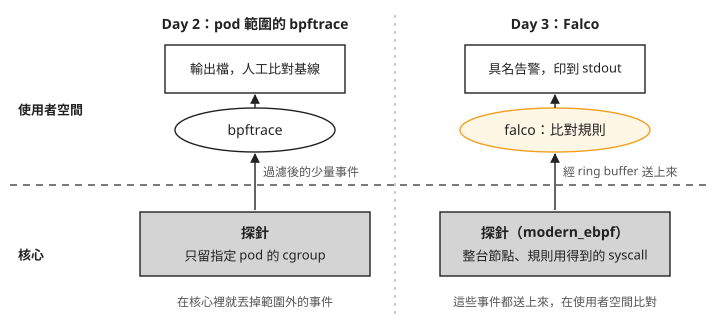
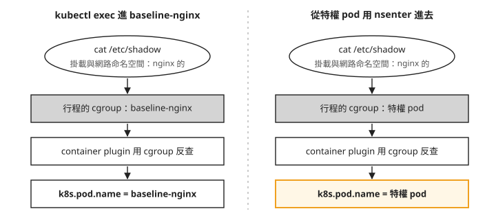

# Day 3: 安裝 Falco——預設規則與規則語言結構

{ align=right width="95" }

Day 2 的手工基線抓得到偏離，但要有人先掛好探針、有人比對清單，而且一次只看一顆 pod。這一章換上 Falco：一個常駐在每顆節點上的偵測元件，規則寫成檔案，事件符合規則就印出一筆告警。

裝好之後，同事多半會問：「有人進容器開 shell、從容器連到沒見過的位址，Falco 會不會報？」如果你寫一支腳本，用 `kubectl exec -t` 進容器開 shell 來測，Falco 一筆都不會報。Falco 本身沒有壞，報不報是規則裡那幾行 `condition` 決定的。這一章安裝 Falco，逐行讀一條預設規則，觸發它，再把 Day 2 的四個偏離動作拿來測一次。

讀完之後，Falco 該報卻沒報、或報了卻指向錯的 pod 時，你能分辨是預設規則根本沒寫這件事、規則的條件把這次動作排除了，還是告警裡的 pod 欄位指向了發起動作的那一端。

## 從隨用的探針換成常駐的元件

Day 2 結尾那張「辦不到的七件事」表，列出了沒有告警、沒有規則語言、必須剛好在看等限制。Falco 用一個 DaemonSet 在每顆節點跑一份，從 pod 啟動起持續偵測，規則寫在檔案裡，符合規則的事件印成告警。本章沒有配置告警的外部保存，持久化仍需另外處理。

兩種做法最大的差別，在事件是在哪裡被過濾掉的。把 Day 2 和今天的做法並排，上半是使用者空間，下半是核心：



我們可以從圖上看到兩件事：

1. Day 2 的過濾器掛在 pod 的 cgroup 上，範圍外的事件在核心裡就丟掉，送上來的量很少；不跑的時候也不佔任何資源。
2. Falco 把整台節點上規則用得到的那幾類 syscall（例如 `execve`、`openat`、`connect`）都送到使用者空間，中間經過一塊叫 ring buffer 的緩衝區（步驟 2 會看到它的大小），再拿規則一條條比對。好處是不必事先指定看哪顆 pod；代價是節點上每一個 `execve` 都要送上來比對一次，不管最後有沒有告警。步驟 6 會量這筆資源。

Falco 也能讀 Kubernetes 的稽核日誌（`k8saudit` 這個事件來源），但 AKS 的稽核日誌要另外經 Azure 的服務轉出來。本課只用 syscall 這個來源。

## 步驟 1: 明確指定已驗證的 driver

Falco 要拿到 syscall 事件，得先在核心裡放一段程式，把事件送到使用者空間，這段程式叫 **driver**。本章使用的 [chart 9.1.0 設定檔](https://github.com/falcosecurity/charts/blob/falco-9.1.0/charts/falco/values.yaml#L293-L299) 列出兩種 driver：

| driver | 怎麼運作 | 本章的驗證範圍 |
|---|---|---|
| `kmod` | 載入一個 out-of-tree 核心模組（不隨核心一起發布、另外編譯的模組） | 沒有實際安裝 |
| `modern_ebpf` | CO-RE（Day 0 講過的「編譯一次、到處執行」）：一份預先編好的 probe，靠 BTF 在載入時對上這台的核心結構 | 已實際安裝並觸發告警；[Day 0](sprint2-day0-ebpf-concepts.md) 已確認節點有 BTF |

這個版本的預設值仍是 `kind: auto`，但列出的 driver 選項不含 legacy `ebpf`。本章明確指定已驗證的 `modern_ebpf`，讓安裝設定與後面的實驗一致：

```bash
cat > falco-values.yaml <<'EOF'
driver:
  enabled: true
  kind: modern_ebpf

# Without a tty, Falco's stdout is block-buffered and alerts sit in the buffer.
tty: true

# The lab node pool is Spot and carries a NoSchedule taint; the chart's default
# tolerations only cover control-plane nodes.
tolerations:
  - key: kubernetes.azure.com/scalesetpriority
    operator: Equal
    value: spot
    effect: NoSchedule
EOF
```

另外兩項也不是預設值：

- `tty: true`：Falco 的 stdout 沒接終端機時是整塊緩衝的，告警會壓在緩衝區裡，不會馬上出現在 `kubectl logs`。
- `tolerations`：本課的 `ebpf` 節點池是 spot，節點帶著 `NoSchedule` 的 taint，而 chart 預設的 toleration 只涵蓋 control-plane 節點。少了這一段，DaemonSet 只會跑在沒有 taint 的節點上，`kubectl get ds` 照樣顯示 `DESIRED 1 / READY 1`，看起來完全健康，但你要觀察的節點上根本沒有 Falco。這種失敗不顯示錯誤，後面的實驗只會一直沒有資料。你的節點池如果不是 spot，這一段可以拿掉。

後面的步驟要用 JSON 讀告警，也要用腳本數告警，所以再讓 Falco 輸出 JSON：

```bash
cat >> falco-values.yaml <<'EOF'

falco:
  json_output: true
  json_include_output_property: true
EOF
```

節點映像升級後，用下一步的啟動日誌確認 Falco 使用的 driver。

## 步驟 2: 安裝，以及它裝出了什麼

如果沿用 Day 2 收尾後的環境，先啟動叢集，再把 `ebpf` 節點池從 0 台恢復為 2 台。將 `<resource-group>`、`<cluster-name>` 與 `<sub>` 換成自己的資源群組、叢集名稱與訂閱：

```console
$ az aks start -g <resource-group> -n <cluster-name> --subscription <sub>
```

接著執行 `az aks nodepool scale -g <resource-group> --cluster-name <cluster-name> --subscription <sub> -n ebpf --node-count 2`。驗證紀錄保留了擴至兩台的操作，但省略部分參數；這裡依 [Azure CLI 文件](https://learn.microsoft.com/en-us/cli/azure/aks/nodepool#az-aks-nodepool-scale) 補齊，修正後的寫法本課沒有實跑。

查詢節點狀態，等兩顆 `ebpf` 節點及 system 節點都顯示 `Ready` 才安裝。以下是驗證紀錄使用的查詢方式；`<context>` 填叢集的 kubeconfig context，`<api-ip>` 與 `<api-fqdn>` 填目前 API server 的 IP 與完整網域名稱：

```console
$ kubectl --context <context> --server https://<api-ip>:443 \
    --tls-server-name <api-fqdn> get nodes -o wide
```

確認節點就緒後安裝 Falco：

```console
$ helm repo add falcosecurity https://falcosecurity.github.io/charts && helm repo update
$ helm install falco falcosecurity/falco --version 9.1.0 \
      -n falco --create-namespace -f falco-values.yaml --wait --timeout 8m
NAME: falco
STATUS: deployed
CHART: falco-9.1.0
APP VERSION: 0.44.1
```

裝出來的是一個 DaemonSet。`get ds` 列出每顆 pod 的兩個常駐容器：

```console
$ kubectl -n falco get ds falco -o wide
NAME    DESIRED   CURRENT   READY   CONTAINERS                       IMAGES
falco   3         3         3       falco,falcoctl-artifact-follow   falcosecurity/falco:0.44.1,
                                                                     falcosecurity/falcoctl:0.13.0
```

另外還有一個 init 容器，pod 啟動前先跑完。它會下載規則與 **plugin**；plugin 是 Falco 執行時載入的擴充模組。三個容器各自的工作：

| 容器 | 工作 |
|---|---|
| `falcoctl-artifact-install`（init） | 把規則檔與 plugin 從 OCI registry（存放容器映像的倉庫，Falco 把規則也當成一個檔案包放在那裡）拉下來，放進 pod 內的暫存目錄 |
| `falco` | 本體：載入 eBPF probe、讀規則、比對事件、印出告警 |
| `falcoctl-artifact-follow`（sidecar） | 持續檢查 registry，規則有新版就下載換上 |

所以規則不在映像裡，是 pod 啟動時從 registry 拉的，而且會驗證簽章。看 init 容器的日誌：

```console
$ kubectl -n falco logs -l app.kubernetes.io/name=falco -c falcoctl-artifact-install --tail=20
{"msg":"Artifact successfully installed","name":"ghcr.io/falcosecurity/rules/falco-rules:5",
 "digest":"sha256:36d143c0…","directory":"/rulesfiles","type":"rulesfile"}
{"msg":"Verifying signature for artifact","ref":"…/plugins/plugin/container@sha256:f3d531f3…"}
{"msg":"Signature successfully verified!"}
```

第一行的 `falco-rules:5` 是規則的版本，跟 Falco 本體的 0.44.1 各自發版。之後追查「為什麼這條規則沒報」，要查的是規則版本，不是 Falco 版本。

### 確認 driver 真的是 modern eBPF

values 寫了 `kind: modern_ebpf`，只表示你要它用這一種；實際用了哪一種，要看 Falco 自己的啟動日誌：

```console
$ kubectl -n falco logs -l app.kubernetes.io/name=falco -c falco --tail=30
… Falco version: 0.44.1 (x86_64)
… Loaded plugin 'container@0.7.1' from file /usr/share/falco/plugins/libcontainer.so
… Loading rules from:
…    /etc/falco/falco_rules.yaml | schema validation: ok
… The chosen syscall buffer dimension is: 8388608 bytes (8 MBs)
… Opening 'syscall' source with modern BPF probe.
… One ring buffer every '2' CPUs.
… [libs]: libpman: disabled BPF iterators (not running in the root PID namespace…)
```

從 `Opening 'syscall' source with modern BPF probe.` 這一行確認 Falco 使用 modern eBPF driver。上一行的 8 MB 是 **ring buffer** 的大小：核心裡的 probe 把事件寫進這塊環狀的緩衝區，Falco 從另一端讀出來。Falco 讀得比事件產生得慢，緩衝區滿了，新的事件就會被丟掉。

最後那行 `disabled BPF iterators` 不是錯誤。BPF iterator 是用 BPF 程式一次列出核心裡所有行程的方法；Falco 跑在 pod 自己的 PID namespace 裡，所以不用它掃節點上既有的行程，改讀 `/proc`。功能沒少，只是啟動時多花一點時間建行程表。

第二個佐證是 Falco 實際讀到的設定檔。values 經過 chart 模板之後長什麼樣，看這個最準：

```console
$ kubectl -n falco exec <falco-pod> -c falco -- cat /etc/falco/falco.yaml
engine:
  kind: modern_ebpf
  modern_ebpf:
    buf_size_preset: 4
    cpus_for_each_buffer: 2
```

`buf_size_preset: 4` 就是日誌裡那個 8 MB 的 ring buffer；`cpus_for_each_buffer: 2` 對上日誌的 `One ring buffer every '2' CPUs.`：每兩顆 CPU 共用一個 ring buffer，2 vCPU 的節點就只有一個 8 MB 的緩衝區。

從 `helm install` 到日誌出現 `Opening 'syscall' source` 那一行，本課量到 26 秒。Falco pod 每次重建都會有這樣一段沒有監控的空檔，Day 4 改規則觸發滾動更新時會再遇到。

裝完之後，確認每顆要觀察的節點上都有一顆 Running 的 Falco pod。節點 CPU 吃緊時，DaemonSet 的 READY 數不一定反映這件事，見[疑難排解：Falco pod 被搶佔，DaemonSet 卻顯示全部就緒](#mine-1)。

## 步驟 3: 讀懂預設規則 {#step-3}

### 先數一數手上有幾條

```console
$ kubectl -n falco exec <falco-pod> -c falco -- ls -la /etc/falco/
-rw-r--r--  root     root      2909  falco.yaml
-rw-r--r--  nonroot  nonroot  63642  falco_rules.yaml
```

只有一個規則檔，63 KB。用 `grep` 數，裡面有 25 條 rule（規則）、87 個 macro（一段取了名字、可重複引用的條件）、49 個 list（一組只列項目、不含邏輯的資料）；25 條 rule 全部啟用，而且全部標著 `maturity_stable`。

maturity 是規則的成熟度。Falco 的規則分成 stable、incubating、sandbox 三級，預設只裝 stable 這一級，另外兩級要自己用 `falcoctl artifact install` 裝。完整的 25 條規則列在章末的[延伸閱讀](#default-rule-list)。

這些規則的共同點是：每一條描述的都是一種已知的攻擊手法，例如載入核心模組、`release_agent` 容器逃逸、`memfd_create` 無檔案執行、翻找私鑰、清日誌。沒有一條在管「這個容器今天做了以前沒做過的事」，而那正是 Day 2 手工基線在做的事。步驟 5 會實際比一次。

### 一條規則的五個欄位

拿步驟 4 要觸發的那條來看。以下逐字取自執行中容器裡的 `/etc/falco/falco_rules.yaml`：

```yaml
- rule: Terminal shell in container
  desc: >
    A shell was used as the entrypoint/exec point into a container with an attached terminal.
    Parent process may have legitimately already exited and be null (read container_entrypoint macro).
    Common when using "kubectl exec" in Kubernetes. …
  condition: >
    spawned_process
    and container
    and shell_procs
    and proc.tty != 0
    and container_entrypoint
    and not user_expected_terminal_shell_in_container_conditions
  output: A shell was spawned in a container with an attached terminal |
    evt_type=%evt.type user=%user.name user_uid=%user.uid user_loginuid=%user.loginuid
    process=%proc.name proc_exepath=%proc.exepath parent=%proc.pname command=%proc.cmdline
    terminal=%proc.tty exe_flags=%evt.arg.flags
  priority: NOTICE
  tags: [maturity_stable, container, shell, mitre_execution, T1059]
```

以 `- rule:` 開頭的這一整個項目就是一條 **rule**。它的五個欄位各管一件事：

| 欄位 | 管什麼 |
|---|---|
| `condition` | **要不要報**。一個布林運算式，欄位取自當下這個事件 |
| `output` | **報什麼**。`%` 開頭的都是欄位，事件發生時填入當時的值 |
| `priority` | **多嚴重**。決定 Falco 要不要輸出，以及下游怎麼分流 |
| `tags` | **怎麼分類**。這裡同時帶了成熟度、作用範圍與 MITRE ATT&CK 的編號。MITRE ATT&CK 是一套公開的攻擊手法分類，`T1059` 是其中「透過命令直譯器執行指令」那一項 |
| `desc` | 給人看的說明。這條的 `desc` 提到了 `container_entrypoint`，步驟 4 會用到 |

### condition 裡的名字從哪來

`condition` 的前三行 `spawned_process`、`container`、`shell_procs` 都是 macro；`shell_procs` 裡的 `shell_binaries` 則是 list。把它們一個個展開：

```yaml
- macro: spawned_process
  condition: (evt.type in (execve, execveat))

- macro: container
  condition: (container.id != host)

- macro: shell_procs
  condition: (proc.name in (shell_binaries))
- list: shell_binaries
  items: [ash, bash, csh, ksh, sh, tcsh, zsh, dash]

- macro: container_entrypoint
  condition: (not proc.pname exists or proc.pname in (runc:[0:PARENT], runc:[1:CHILD], runc,
              docker-runc, exe, docker-runc-cur, containerd-shim, systemd, crio, conmon))

- macro: user_expected_terminal_shell_in_container_conditions
  condition: (never_true)
- macro: never_true
  condition: (evt.num=0)
```

全部展開之後，`condition` 只剩欄位的比較：

```text
evt.type in (execve, execveat)                       ← 有人執行了一支新的執行檔
and container.id != host                             ← 而且是在某個容器裡
and proc.name in (ash,bash,csh,ksh,sh,tcsh,zsh,dash) ← 被執行的是 shell
and proc.tty != 0                                    ← 而且接著一個終端機
and (not proc.pname exists or proc.pname in (runc, containerd-shim, …))
                                                     ← 而且它的父行程是容器執行期
and not (evt.num = 0)                                ← 使用者自訂例外(預設永不成立)
```

把這條規則的引用關係畫出來，由上往下依序是 rule、macro、list，最底下是事件的欄位：


照著圖由上往下看：rule 的 `condition` 引用了五個 macro，另外直接寫了一個欄位 `proc.tty`。第五個 macro `user_expected_terminal_shell_in_container_conditions` 是留給使用者自訂例外的，預設永不成立，圖上沒有畫出來。前四個 macro 最後都落到某個欄位上，`shell_procs` 中間多經過一個 list。整份規則檔都是這個結構：25 條 rule 用到 87 個 macro 和 49 個 list，檔案裡大部分的內容是 macro 和 list，用來讓 `condition` 讀起來像一句話。Day 4 自己寫規則時，也是用這三層。

展開後的條件裡有兩行要先記下來，步驟 4 都會遇到：`proc.tty != 0` 要求 shell 接著一個終端機；`container_entrypoint` 要求 shell 的父行程是容器執行期（runc、containerd-shim 這類行程）。

## 步驟 4: 觸發第一條規則

部署被觀察的 pod，沿用 [Day 2](sprint2-day2-bpftrace-kubernetes.md) 的 `baseline-nginx`，兩章比的才是同一個對象。`nodeSelector` 與 toleration 讓它排到 `ebpf` 節點池，步驟 5 的特權 pod 也在那裡：

```bash
kubectl create namespace ebpf-lab
cat > baseline-nginx.yaml <<'EOF'
# Baseline subject for Day 2.
#
# nginx is picked over a synthetic sleep-pod because its startup is genuinely
# non-trivial: /docker-entrypoint.sh execs a chain of shell helpers before the
# master process ever reads nginx.conf. The proxy_pass location gives the pod a
# real upstream dependency, so a warm-up request produces an outbound TCP
# connection inside the startup window -- otherwise the connection row of the
# baseline would be empty and step 5's deviation test would have nothing to
# deviate from.
#
# QoS is deliberately Burstable (requests only, no limits) so the pod lands in
# kubepods-burstable.slice; a Guaranteed pod sits one level higher in the cgroup
# tree and the level numbers quoted in the log would not match.
apiVersion: v1
kind: ConfigMap
metadata:
  name: nginx-baseline-conf
  namespace: ebpf-lab
data:
  default.conf: |
    server {
        listen 8080;
        server_name _;

        location / {
            return 200 "day2 baseline subject\n";
        }

        # real upstream dependency, literal IP so no resolver is needed
        location /up {
            proxy_pass http://1.1.1.1/;
            proxy_connect_timeout 3s;
        }
    }
---
apiVersion: v1
kind: Pod
metadata:
  name: baseline-nginx
  namespace: ebpf-lab
  labels:
    app: baseline-nginx
spec:
  nodeSelector:
    pool: ebpf
  tolerations:
  - key: kubernetes.azure.com/scalesetpriority
    operator: Equal
    value: spot
    effect: NoSchedule
  containers:
  - name: nginx
    image: mcr.microsoft.com/mirror/docker/library/nginx:1.25
    ports:
    - containerPort: 8080
    resources:
      requests:
        cpu: 50m
        memory: 64Mi
    volumeMounts:
    - name: conf
      mountPath: /etc/nginx/conf.d
  volumes:
  - name: conf
    configMap:
      name: nginx-baseline-conf
EOF
kubectl apply -f baseline-nginx.yaml
```

### 先確認 shell 拿得到終端機

規則的第四行要求 `proc.tty != 0`，也就是 shell 要接著一個終端機（tty）。`kubectl exec` 給不給終端機，由下指令的那一端決定。先看腳本裡常見的 `-t` 寫法會得到什麼：

```console
$ kubectl -n ebpf-lab exec -t baseline-nginx -- bash -c 'echo "tty=$(tty)"'
tty=not a tty                      ← -t 沒有生效
```

`-t` 要求在容器裡配置終端機，但 kubectl 要 `-i` 和 `-t` 一起用，而且自己的 stdin 本身是終端機，才會把這個要求送出去。在腳本、CI 或其他自動化工具裡，stdin 都不是終端機，`-t` 就被略過，而且不會有任何訊息。少了任何一個條件，開出來的 shell `proc.tty` 都是 0，規則的第四行不成立。

要在腳本裡也拿到終端機，先用 `script` 在本機開一個虛擬終端機（pty），再讓 kubectl 在裡面跑 `-it`。下一節觸發用的第一個指令就是這樣寫的，它輸出的第一行 `tty=/dev/pts/0` 就表示終端機配到了。

### 觸發

開一個帶終端機的 shell，再從容器裡讀一次 `/etc/shadow`：

```console
$ script -q /dev/null kubectl -n ebpf-lab exec -it baseline-nginx -- bash -c 'echo "tty=$(tty)"; id'
tty=/dev/pts/0
uid=0(root) gid=0(root) groups=0(root)

$ kubectl -n ebpf-lab exec baseline-nginx -- bash -c 'cat /etc/shadow > /dev/null'
```

Falco 的日誌裡多了兩筆告警。步驟 1 開了 JSON 輸出，所以每筆都是一個 JSON 物件，命中的規則在 `rule`，填入的欄位值在 `output_fields`：

```json
{
  "time": "2026-08-06T10:25:54.090901419Z",
  "rule": "Terminal shell in container",
  "priority": "Notice",
  "source": "syscall",
  "hostname": "<node-a>",
  "tags": ["T1059","container","maturity_stable","mitre_execution","shell"],
  "output_fields": {
    "evt.type": "execve",
    "proc.name": "bash",
    "proc.exepath": "/usr/bin/bash",
    "proc.pname": "containerd-shim",
    "proc.cmdline": "bash -c echo \"tty=$(tty)\"; id",
    "proc.tty": 34816,
    "user.name": "root", "user.uid": 0, "user.loginuid": -1,
    "container.id": "0cee1cad9371",
    "container.name": "nginx",
    "container.image.repository": "mcr.microsoft.com/mirror/docker/library/nginx",
    "container.image.tag": "1.25",
    "k8s.pod.name": "baseline-nginx",
    "k8s.ns.name": "ebpf-lab"
  }
}
```

```json
{
  "time": "2026-08-06T10:25:54.539171208Z",
  "rule": "Read sensitive file untrusted",
  "priority": "Warning",
  "tags": ["T1555","container","filesystem","host","maturity_stable","mitre_credential_access"],
  "output_fields": {
    "evt.type": "openat",
    "fd.name": "/etc/shadow",
    "proc.name": "cat", "proc.pname": "bash", "proc.cmdline": "cat /etc/shadow",
    "proc.aname[2]": "containerd-shim", "proc.aname[3]": "systemd",
    "container.id": "0cee1cad9371", "k8s.pod.name": "baseline-nginx", "k8s.ns.name": "ebpf-lab"
  }
}
```

兩個指令各命中一條規則：開 shell 命中 `Terminal shell in container`，讀 `/etc/shadow` 命中 `Read sensitive file untrusted`。每個欄位都對得回剛才做的事：

| 告警欄位 | 值 | 對應哪個動作 |
|---|---|---|
| `evt.type` | `execve` | `bash -c …` 這個執行動作本身 |
| `proc.name` / `proc.exepath` | `bash` / `/usr/bin/bash` | 執行的是 bash，命中 `shell_binaries` |
| `proc.cmdline` | `bash -c echo "tty=$(tty)"; id` | 逐字就是打進去的那一串 |
| `proc.tty` | `34816` | `script` 配出來的 pty。34816 = 136×256+0，major 136、minor 0，對上容器裡 `tty` 回報的 `/dev/pts/0` |
| `proc.pname` | `containerd-shim` | `kubectl exec` 的行程是 containerd 生的，命中 `container_entrypoint` |
| `user.loginuid` | `-1` | 沒有經過互動式登入，`kubectl exec` 進來的行程是 -1 |
| `fd.name` | `/etc/shadow` | 第二條規則抓到的那次 `openat` |
| `proc.aname[2]` / `[3]` | `containerd-shim` / `systemd` | 往上兩層與三層的祖先行程 |

告警裡用來辨認 pod 的是這四個欄位：

```text
container.id   = 0cee1cad9371      ← container plugin 從行程的 cgroup 反查出來的
container.name = nginx             ← pod spec 裡的容器名
k8s.pod.name   = baseline-nginx    ← pod 名字
k8s.ns.name    = ebpf-lab          ← namespace
```

`hostname` 則是報出這筆告警的 Falco 所在的節點。安裝與觸發時都沒有提供 pod 名字，這些資訊是 Falco 自己查出來的。

### pod 身分是查出來的

告警裡的欄位有兩個來源，Day 4 寫規則時這個區分很要緊：

| 欄位家族 | 從哪來 | 例子 |
|---|---|---|
| `evt.*` / `proc.*` / `fd.*` / `user.*` | **核心事件本身**，probe 直接送上來 | `evt.type=execve`、`proc.tty=34816`、`fd.name=/etc/shadow` |
| `container.*` / `k8s.*` | **container plugin 事後查出來的**，靠行程的 cgroup 反查容器執行期 | `container.id`、`k8s.pod.name` |

步驟 2 的啟動日誌裡那行 `Loaded plugin 'container@0.7.1'` 就是 container plugin。它做的事，[Day 2](sprint2-day2-bpftrace-kubernetes.md) 你親手做過一遍：`cgroup` builtin 拿到 inode、`find -inum` 找出路徑、從路徑裡取出 container id 與 pod uid、`crictl inspect` 換成 pod 名字。在 Falco 裡，這整串變成 `output` 裡的一個 `%container.id`。

既然第二類欄位還是靠 cgroup 查出來的，Day 2 的[「從節點 nsenter 進去的動作沒有被記錄」](sprint2-day2-bpftrace-kubernetes.md#mine-2)在 Falco 身上也成立。步驟 5 會驗證它的後果。

Day 2 還有一個問題，在這裡沒有出現：[「kubectl exec 開的 shell 從紀錄裡消失」](sprint2-day2-bpftrace-kubernetes.md#mine-7)。Falco 的規則用的是 `proc.name`（新行程的名字）與 `proc.pname`（父行程），上面告警裡的 `proc.name` 是 `bash`，是正確的值。`proc.pname` 比較不可靠：行程用 `execve` 取代自己的那一刻，父行程欄位可能還留著舊的值，跟 Day 2 的 `comm` 是同一類問題，所以同一類動作，父行程有時記成 `containerd-shim`，有時記成 `runc`，不能拿它當可靠的行程血緣證據。

### 撈告警的小腳本

接下來要反覆從各節點的 Falco 日誌裡撈告警。下方保留的腳本有三個問題：`kubectl logs` 帶 selector 時，預設只取各 pod 最後 10 行；空的 `LINES` 經 `echo` 仍會印出一個換行；`2>/dev/null` 與 `|| true` 則會隱藏讀取失敗。[kubectl 官方文件](https://kubernetes.io/docs/reference/kubectl/generated/kubectl_logs/) 說明了 selector 的預設行數限制。

當日驗證使用的 `04-falco-alerts.sh` 是逐顆 pod 讀取、直接輸出符合條件的日誌，所以沒有前兩個問題，但同樣需要補上錯誤傳遞。要使用下方腳本，先依序修正以下幾處；修正後的寫法本課沒有實跑：

1. 在 `LINES` 前先取 pod 清單：`PODS=$(kubectl -n falco get pods -l app.kubernetes.io/name=falco -o name) || exit "$?"`。接著用 `[ -n "$PODS" ] || { printf 'No Falco pods found\n' >&2; exit 1; }`，避免把找不到 pod 當成零告警。
2. 將整段 `LINES=$(...)` 換成 `LINES=$(for pod in $PODS; do kubectl -n falco logs "$pod" -c falco --since="$SINCE" --tail=-1 --prefix=false || exit "$?"; done | sed -n '/"rule"/p') || exit "$?"`。逐顆讀取並保留 stderr；`sed` 沒找到告警時正常結束，讀取失敗則透過原有的 `pipefail` 與 `exit` 傳回非零狀態。
3. 兩處 `echo "$LINES"` 都換成 `printf '%s\n' "$LINES"`，並在整個 `if [ "$MODE" = rules ]; then … fi` 外再包一層 `if [ -n "$LINES" ]; then … fi`，讓空結果完全不輸出。

```bash
cat > falco-alerts.sh <<'EOF'
#!/usr/bin/env bash
# Pull JSON alerts out of every Falco pod's stdout.
#   --rules   histogram by rule name instead of raw lines
#   --since   passed straight to kubectl logs (default 1h)
set -euo pipefail
SINCE=1h; MODE=raw
while [ $# -gt 0 ]; do
  case "$1" in
    --rules) MODE=rules ;;
    --since) SINCE="$2"; shift ;;
  esac
  shift
done
LINES=$(kubectl -n falco logs -l app.kubernetes.io/name=falco -c falco \
          --since="$SINCE" --prefix=false 2>/dev/null | grep '"rule"' || true)
if [ "$MODE" = rules ]; then
  echo "$LINES" | sed -n 's/.*"rule":"\([^"]*\)".*/\1/p' | sort | uniq -c | sort -rn
else
  echo "$LINES"
fi
EOF
chmod +x falco-alerts.sh
```

不加參數印出最近一小時的每一筆 JSON 告警；`--rules` 改成依規則名稱計數；`--since` 縮小時間範圍。

### 規則抓不到的那一層 shell

回到 `condition` 的第五行 `container_entrypoint`：它要求 shell 的父行程是容器執行期。換句話說，只有容器執行期直接生出來的 shell 才會被報。容器裡已經在跑的程式再開一個 shell，父行程是那支程式，這條規則就不成立。

用巢狀的 `bash -c` 測，會看到兩層都報（輸出是把告警整理成一行一筆的結果）：

```console
$ script -q /dev/null kubectl exec -n ebpf-lab -it baseline-nginx -- bash -c 'bash -c "echo inner-shell-ran"'
Terminal shell in container   proc=bash pname=runc              cmd=bash -c bash -c "echo inner-shell-ran"
Terminal shell in container   proc=bash pname=containerd-shim   cmd=bash -c echo inner-shell-ran
```

這個實驗測不到想測的東西。外層 `bash -c` 只有一個指令時，bash 不會 fork 子行程，而是直接 `execve` 成內層的 bash（implicit exec），內層的父行程仍然是容器執行期。兩筆的 `pname` 一個是 `runc`、一個是 `containerd-shim`，就是上一節說的父行程記錄不穩定，兩者都屬於容器執行期，所以都符合 `container_entrypoint`。要讓它真的 fork，加一個 `&`。下面第二個指令底下的內容，不是 `falco-alerts.sh` 原樣印出的 JSON，而是把告警整理成一行一筆，最後一行是對照執行次數後加上的註記：

```console
$ script -q /dev/null kubectl exec -n ebpf-lab -it baseline-nginx -- \
      bash -c 'bash -c "echo forked-shell-ran" & wait; echo done'
forked-shell-ran
done

$ ./falco-alerts.sh --since 25s
Terminal shell in container   proc=bash pname=runc   cmd=bash -c bash -c "echo forked-shell-ran" & wait; echo done
--- 1 alert(s); 2 bash execve happened ---
```

兩次 `bash` 的 `execve`，只有一筆告警。被 fork 出來的那個 shell，父行程是 bash，不在 `container_entrypoint` 的名單裡，所以不報。

另一條 shell 規則 `Run shell untrusted` 也補不上，它把這種情況明確排除了：

```yaml
  condition: >
    spawned_process and shell_procs and proc.pname exists
    and protected_shell_spawner                        ← 父行程要在特定應用程式清單裡
    and not proc.pname in (shell_binaries, …)          ← shell 生 shell 明確排除
```

實際的影響是：用 `kubectl exec` 進容器開 shell 會被抓到，但透過 web shell（攻擊者放進網站程式裡、能用 HTTP 請求執行指令的後門）、被竄改的 entrypoint，或任何已經能在容器裡執行程式的方式再開 shell，這條規則都不會報。這是規則刻意收窄的範圍，`desc` 裡寫了 `read container_entrypoint macro`，官方也建議把這條規則當成稽核用的通用規則，搭配同一個容器、同一個 tty 的其他告警一起看。規則能抓到什麼，就看 `condition` 寫了什麼，Day 4 會自己寫一條規則補上這一層。

## 步驟 5: 跟 Day 2 的手工基線對照

拿 Day 2 的四個偏離動作來測。Day 2 用 bpftrace 加上手工基線比對，今天用 Falco 的預設規則：

| 偏離動作 | Day 2 手工基線 | Falco 0.44.1 預設規則 |
|---|---|---|
| 容器內開互動式 shell | 抓到 | 抓到，具名 `Terminal shell in container` |
| 讀 `/etc/shadow` | 抓到 | 抓到，具名 `Read sensitive file untrusted` |
| 對 8.8.8.8:53 建立連線 | 抓到 | **沒報** |
| 經 `nsenter` 進容器做同樣的事 | **一筆都沒有** | 有報，但指向錯的 pod |

前兩列兩邊都抓到，差別在 Falco 說得出這是什麼。Day 2 的產出是「多了一個沒見過的檔案 `/etc/shadow`」，要人去判斷這是不是壞事；Falco 的產出是「`Read sensitive file untrusted`，MITRE T1555，credential access」，分類、嚴重度、對應的攻擊手法都附在告警上。後兩列各用一節說明。

### 連到沒連過的位址

從容器連一個 nginx 平常不會連的位址：

```console
$ kubectl -n ebpf-lab exec baseline-nginx -- bash -c 'exec 3<>/dev/tcp/8.8.8.8/53 && echo connect-ok'
connect-ok

$ ./falco-alerts.sh --since 20s --rules
（空）
```

連線成功，Falco 沒有任何告警。回頭看 25 條規則，跟網路有關的只有三條：`Contact K8S API Server From Container`（連 API server）、`Netcat Remote Code Execution in Container`（netcat 反向 shell）、`Disallowed SSH Connection Non Standard Port`（非標準埠的 SSH）。三條都在描述一種具體的手法，沒有一條在管「這個容器以前沒連過這裡」。Day 2 的基線抓得到，因為基線比的就是「有沒有見過」。

兩種做法的取捨並排看：

| | 抓什麼 | 誤報 | 漏抓 | 要維護什麼 |
|---|---|---|---|---|
| **基線比對**（Day 2） | 沒見過的行為 | 高 | 低，但只在抓過基線的那顆 pod 上 | 每個工作負載一份基線，改版就要重抓 |
| **規則引擎**（Day 3） | 已知壞的行為 | 低 | **高——沒寫規則的事一律看不見** | 規則庫，但可以全叢集共用 |

Day 2 那張表的第六列「基線沒有『允許但罕見』的概念」，Falco 也沒有解決：Falco 沒有「罕見」這個概念，只看事件符不符合清單上的某條規則。兩種做法各補對方的缺口，不能用一種取代另一種，這也是 Day 4 要自己寫規則的原因。

### 從特權 pod 用 nsenter 進去

Day 2 在這一項是一筆都沒抓到。這次要從節點上的特權 pod 進到 nginx 容器裡，所以先套用 [Day 0](sprint2-day0-ebpf-concepts.md#step-1) 的特權 DaemonSet（`hostPID: true`，`ebpf` 節點池每顆節點一顆）：

```console
$ kubectl apply -f 01-ebpf-lab-daemonset.yaml
```

用 `kubectl -n ebpf-lab get pods -o wide` 找出跟 `baseline-nginx` 在同一顆節點上的那顆特權 pod，下面寫成 `<privileged-pod>`。接著查 nginx 在節點上的 pid：先拿到 nginx 容器的 container id，再從特權 pod 裡掃節點的 `/proc`，找出 cgroup 路徑含有這個 id 的行程。印出的第一欄就是 `<nginx-pid>`：

```console
$ kubectl -n ebpf-lab get pod baseline-nginx \
    -o jsonpath='{.status.containerStatuses[0].containerID}'
$ kubectl -n ebpf-lab exec <privileged-pod> -- bash -c 'for p in /proc/[0-9]*; do
    grep -qs <container-id> $p/cgroup && echo "$(basename $p) $(cat $p/comm)"; done'
```

`<container-id>` 填第一個指令輸出裡 `containerd://` 後面那一串。然後用 `nsenter` 進入 nginx 的命名空間，讀同一個檔案：

```console
$ script -q /dev/null kubectl -n ebpf-lab exec -it <privileged-pod> -- \
      nsenter -t <nginx-pid> -m -u -i -n -p /bin/bash -c 'hostname; cat /etc/shadow > /dev/null'
baseline-nginx           ← hostname 回報的是 nginx 容器
```

`hostname` 回報 `baseline-nginx`，讀到的也是 nginx 容器的 `/etc/shadow`。Falco 的告警是這樣（這裡只列相關欄位）：

```text
Warning  Read sensitive file untrusted
    file=/etc/shadow  proc=cat  pname=bash
    k8s.pod.name  = <privileged-pod>     ← 呼叫端的 pod
    container.name = probe               ← 呼叫端的容器
```

這筆告警說明了兩件事。第一，Falco 看到了：Day 2 的過濾器掛在 pod 的 cgroup 上，`nsenter` 進來的行程不在那個 cgroup 裡，所以一筆都沒有；Falco 收的是整台節點的事件，沒有事先劃定範圍，也就沒有範圍外。

第二，`k8s.pod.name` 是錯的。把兩種進入方式並排，看 container plugin 各查到什麼：



我們可以從圖上看到，兩邊的行程都在 nginx 的命名空間裡，差別在 cgroup。`nsenter` 只換命名空間，行程的 cgroup 仍然屬於特權 pod，container plugin 照 cgroup 反查，查到的就是特權 pod。

所以告警指向的是發起動作的 pod，不是被讀檔的那一顆。照著 `k8s.pod.name` 去查，會看到一顆只跑著 `sleep infinity` 的特權容器，真正被讀檔的 `baseline-nginx` 在告警裡沒有出現。不過 `proc.name`、`proc.pname`、`fd.name` 這些核心事件帶上來的欄位都是對的，而且「特權容器裡執行 `nsenter`」本身就很可疑，只是預設的 25 條規則沒有一條在看 `nsenter`。這次也沒有觸發 `Terminal shell in container`，原因跟步驟 4 最後一節相同：shell 的父行程是 `nsenter`。

## 步驟 6: 噪音與資源

### 沒有人操作時有多少告警

這個量測是在裝好 Falco、還沒做步驟 4 之前做的：在沒有任何人操作的 8 分 28 秒裡，三顆節點的告警數如下。零告警與後面的規則計數來自驗證素材的 `04-falco-alerts.sh`，並非上面保留的舊腳本；六筆原始告警也與規則計數相符。如果你已經做完前面的步驟，先等一段時間不做任何操作，再用 `--since` 指定這段時間來數。

計數前先完成步驟 4 的腳本修正。在 Bash 中用 `set -o pipefail; ./falco-alerts.sh | wc -l`，讓讀取失敗能傳到整個管線；只有結束狀態為 0 時，數字才可採用。這個修正後的計數寫法本課沒有實跑，下方保留原有指令與紀錄：

```console
$ ./falco-alerts.sh | wc -l
0
```

0 筆。做完前面所有步驟後，整座叢集的告警依規則計數：

```console
$ ./falco-alerts.sh --rules
   4 Terminal shell in container
   2 Read sensitive file untrusted
```

6 筆都對得上本章做過的動作：步驟 4 的開 shell 與讀 `/etc/shadow` 各一筆、巢狀 `bash -c` 兩筆、fork 實驗一筆、`nsenter` 讀檔一筆。沒有一筆是背景的正常活動造成的。

這個結果只適用於工作負載很單純的實驗叢集。正式環境會有 CI 跑腳本、備份工具讀檔案、健康檢查開 shell，`Read sensitive file untrusted` 與 `Run shell untrusted` 都可能被觸發。`Run shell untrusted` 的 `desc` 就寫了 "This rule can be noisier… Allocate time to tune this rule"，它的排除清單在規則檔裡佔了三十幾行。

所以「Falco 一裝下去就被告警淹沒」這個說法，對預設的 25 條 stable 規則、在沒有自動化流量的叢集上不成立。incubating 與 sandbox 規則裝上去之後會多吵，本課沒有驗證。要放進正式環境，先在一座有真實流量的叢集上量一段時間，再決定要調哪幾條。

### 實際用量與保留量

用 `kubectl top` 每兩分鐘取樣一次，涵蓋整段閒置時間，再跟 chart 預設的 `requests`、`limits` 並排：

| | CPU | 記憶體 |
|---|---|---|
| chart `requests` | 100m | 512Mi |
| chart `limits` | 1000m | 1Gi |
| **實測（閒置）** | **14–24m** | **84–90Mi**（含 sidecar 約 110Mi） |
| 超額倍數 | 約 4–7 倍 | 約 5–6 倍 |

這張表有兩件事要看：

- **CPU 用量跟著節點的忙碌程度走。** 三顆節點裡，跑的 pod 最多的那一顆，Falco 用量比另外兩顆高 50% 到 100%。Falco 的工作量跟節點上發生的 syscall 數量成正比，跟有沒有告警無關。沒有告警的那八分多鐘裡，每一個 `execve` 一樣要送上來比對規則。
- **記憶體幾乎不動。** 主要是 ring buffer（8 MB）與行程表這類啟動時就配置好的結構。

`requests` 是向排程器保留的量，就算用不到也會被佔住。換算到一座 100 節點的叢集，Falco 預設會保留 10 vCPU 與 51.2 GB 記憶體，實際用掉大約 2 vCPU 與 11 GB。Day 2 那種要用時才進去跑 bpftrace 的做法不佔這些資源，代價是要有人剛好在看。

## 收尾

刪掉今天的測試 namespace，Falco 保留給 Day 4 使用：

```console
$ kubectl delete namespace ebpf-lab
```

節點池照前幾章的做法縮回 0。Day 4 把節點池拉回來時，Falco 的 DaemonSet 會自動在新節點上建立 pod，不需要重裝。

## 疑難排解

### Falco pod 被搶佔，DaemonSet 卻顯示全部就緒 {#mine-1}

**症狀**：裝完不久，某顆節點上的 Falco pod 不見了：

```console
$ kubectl -n falco get events --sort-by=.lastTimestamp
Normal    Preempted          pod/falco-d82mq   Preempted by pod c240c0d4-… on node <node-system>
Normal    Killing            pod/falco-d82mq   Stopping container falco
Warning   FailedScheduling   pod/falco-jl5kz   0/3 nodes are available: 1 Insufficient cpu,
                                               2 node(s) didn't satisfy plugin(s) [NodeAffinity]
```

同一段時間，`kubectl get ds falco` 仍然顯示 `DESIRED 3 CURRENT 3 READY 3`。DaemonSet 的狀態不會告訴你有一顆節點沒有監控。

**原因**：兩件事加在一起。第一，那顆節點可配置的 CPU 已經被既有的 pod 保留了 99%：

```console
$ kubectl describe node <node-system>
Allocatable:  cpu: 1900m
Allocated resources:
  cpu     1885m (99%)
```

第二，資源不夠時誰該讓出位置，由 pod 的 priority 決定，而 Falco chart 預設不設 `priorityClassName`：

```console
$ kubectl get pods -A --field-selector spec.nodeName=<node-system> \
    -o 'custom-columns=NAME:.metadata.name,PRIO:.spec.priorityClassName,PVAL:.spec.priority'
NAME                        PRIO                   PVAL
falco-jl5kz                 <none>                 0            ← Falco
coredns-648978f94d-5nzrt    system-node-critical   2000001000
csi-azuredisk-node-hvn8c    system-node-critical   2000001000
…
```

priority 0 比每一個系統元件都低，節點滿載時，排程器要替其他 pod 騰出位置，第一個被搶佔（preempt）的就是它。搶佔它的 pod 跑完離開後，Falco 才排得回去。會遇到這種情況的，是 CPU 已經配置滿的節點，也就是工作負載最多的節點。

**修法**：把 Falco 的 priority 調高，例如設成 `system-node-critical`，可以讓它不被搶佔，但 CPU 不會變多，被擠掉的會換成節點上其他的工作負載；設定之後哪個元件會被擠掉，本課沒有實際驗證。比較實際的做法是讓節點有足夠的可配置 CPU 給 Falco：100m CPU 加 512Mi 記憶體在 2 vCPU 的節點上約佔 5%，而且這是保留量，不是實際用量（見[疑難排解：節點的 CPU 實際用量不高，Falco 卻排不進去](#mine-7)）。不管怎麼調，確認監控有沒有涵蓋每顆節點，要看每顆節點上的 Falco pod 是否 Running，不能只看 DaemonSet 的 READY 數。

### 確信該報的動作，Falco 沒報 {#mine-2}

**症狀**：做了一個確信會觸發告警的動作，Falco 什麼都沒報，於是懷疑安裝壞了。

**原因**：預設只裝 stable 這一級的 25 條規則，大多數「Falco 沒報」的情況，只是手上沒有那條規則（步驟 3）。規則版本（`falco-rules:5`）與 Falco 本體各自發版，升級 Falco 不代表規則也升級（步驟 2）。

**修法**：先確認手上有哪些規則，再判斷是不是 Falco 的問題：

```console
$ kubectl -n falco exec <falco-pod> -c falco -- \
    grep -c '^- rule:' /etc/falco/falco_rules.yaml
25
```

數字對得上之後，回到規則清單找有沒有描述這個動作的規則。沒有的話，要不是另外裝 incubating、sandbox 規則，就是像 Day 4 一樣自己寫。

### 用 `kubectl exec -t` 開 shell，Falco 沒報 {#mine-3}

**症狀**：用看起來合理的寫法觸發，指令成功、bash 也確實在容器裡執行了，Falco 沒有告警：

```console
$ kubectl -n ebpf-lab exec -t baseline-nginx -- bash -c 'id; hostname'
uid=0(root) gid=0(root) groups=0(root)
baseline-nginx
```

**原因**：kubectl 要 `-i`、`-t` 一起用，而且自己的 stdin 是終端機，才會在容器裡配置終端機；少了任何一個條件，開出來的 shell `proc.tty` 都是 0，規則的第四行不成立（步驟 4）。

**修法**：用 `script -q /dev/null` 包一層 pty，再用 `-it`。先確認容器裡拿得到終端機：

```console
$ script -q /dev/null kubectl -n ebpf-lab exec -it baseline-nginx -- bash -c 'echo "tty=$(tty)"'
tty=/dev/pts/0
```

輸出 `/dev/pts/0` 這類路徑，就表示配到了。反過來說，真人在終端機打 `kubectl exec -it` 一定會被這條規則抓到，腳本裡的 `exec` 不會。

### 從容器連到沒連過的位址，Falco 沒報 {#mine-4}

**症狀**：從容器連一個從沒連過的位址，連線成功，Falco 沒有告警。

**原因**：預設 25 條規則裡跟網路有關的三條，都在描述具體的攻擊手法，沒有一條在管「新的對外連線」（步驟 5）。

**修法**：自己寫規則，[Day 4](sprint2-day4-falco-custom-rules.md) 補的就是這一條。

### `nsenter` 進容器的告警，pod 欄位是發起端 {#mine-5}

**症狀**：從特權 pod 用 `nsenter` 進入另一個容器讀敏感檔，Falco 有報，但 `k8s.pod.name` 與 `container.name` 是特權 pod 自己的。

**原因**：`container.*` 與 `k8s.*` 是 container plugin 用行程的 cgroup 反查的，而 `nsenter` 不換 cgroup（步驟 5）。

**修法**：告警的 pod 是特權 pod 時，不要只查那顆 pod。看 `proc.*` 與 `fd.*` 這些核心事件帶上來的欄位，並把「特權容器裡執行 `nsenter`」當成需要調查的訊號；預設規則沒有偵測 `nsenter`，要自己寫規則。

### 容器裡的程式再開 shell，`Terminal shell in container` 不報 {#mine-6}

**症狀**：同一次 `kubectl exec` 裡有兩次 `bash` 的 `execve`，Falco 只報一筆；用巢狀 `bash -c` 測卻兩筆都報。

**原因**：`container_entrypoint` 要求 shell 的父行程是容器執行期，被 fork 出來的 shell 父行程是 bash；巢狀 `bash -c` 因為 implicit exec 沒有真的 fork（步驟 4）。

**修法**：驗證時加 `&` 讓 bash 真的 fork。要抓到這一層 shell，得自己寫規則，Day 4 會寫。

### 節點的 CPU 實際用量不高，Falco 卻排不進去 {#mine-7}

**症狀**：節點的實際 CPU 用量看起來還有餘裕，Falco 卻因為 `Insufficient cpu` 排不進去，或被搶佔。

**原因**：排程器看的是 `requests`，不是實際用量。Falco 實際只用 14–24m，卻向排程器要 100m（步驟 6），節點剩下的可配置 CPU 不到 100m 就排不進去。這就是[疑難排解：Falco pod 被搶佔](#mine-1)的直接原因。

**修法**：把 request 調低到貼近實測的值，能不能排進去要看節點剩下多少可配置 CPU；代價是事件量突然變大時，Falco 沒有預留的 CPU 可用，處理不及時 ring buffer 會滿，事件就被丟掉。調多少要看節點上的工作負載，沒有一個通用的值。

## 想一想

- 同事的 CI 每天用 `kubectl exec -t <pod> -- bash -c '…'` 進容器做檢查，他說「Falco 從來沒報過，可見它沒在看」。你會怎麼回答？要讓這支腳本開的 shell 也被 `Terminal shell in container` 抓到，要改哪裡？
- 一筆 `Read sensitive file untrusted` 告警的 `k8s.pod.name` 是一顆只跑著 `sleep infinity` 的特權 pod，你進去看，裡面什麼可疑的東西都沒有。接下來你會看告警裡的哪些欄位，為什麼不能只相信 `k8s.pod.name`？
- 一個 web 應用被植入了 web shell，攻擊者透過它在容器裡執行 `bash`。預設的 `Terminal shell in container` 會不會報？從 `condition` 的哪幾行可以判斷？

## 小結

Falco 在每顆節點上把所有 syscall 事件送到使用者空間，逐條比對規則，命中就印出一筆附了規則名、嚴重度和 pod 身分的告警。報不報完全由規則的 `condition` 決定：預設只有 25 條 stable 規則，都在描述已知的攻擊手法；`Terminal shell in container` 只抓帶終端機、由容器執行期直接生出來的 shell；告警裡的 pod 欄位是 container plugin 用 cgroup 反查的，`nsenter` 會讓它指向發起端。之後遇到 Falco 該報卻沒報，先查手上有沒有那條規則，再把它的 `condition` 展開，看這次的動作卡在哪一行；報了卻指錯 pod，就改看核心事件帶上來的 `proc.*` 與 `fd.*` 欄位。

## 延伸閱讀

想再深入，可以從這幾份開始：

- **[Falco 規則的三個基本元件](https://falco.org/docs/concepts/rules/basic-elements/)** —— 官方對 rule、macro、list 的定義，以及 `condition`／`output`／`priority`／`tags` 各自的角色，對得上步驟 3 的拆解。
- **[核心事件來源與 driver 選擇](https://falco.org/docs/concepts/event-sources/kernel/)** —— 說明 modern eBPF probe 需要 BTF 與 ring buffer 支援，以及它靠 CO-RE 免去逐核心版本編譯，正是步驟 1 寫死 `modern_ebpf` 的依據。
- **[預設規則清單與成熟度分級](https://falco.org/docs/reference/rules/default-rules/)** —— 官方明載「預設只載入 stable 規則」，incubating 與 sandbox 要另外安裝，對應步驟 3 數到的 25 條。
- **[事件與條件可用的欄位總表](https://falco.org/docs/reference/rules/supported-fields/)** —— 寫規則時查欄位名稱用；`evt.*`／`proc.*` 與 `container.*`／`k8s.*` 分屬不同來源，在這裡看得最清楚。
- **[Falco Helm chart 的參數表](https://github.com/falcosecurity/charts/tree/master/charts/falco)** —— `driver.kind` 預設 `auto`、`customRules` 的用法都在這份 README 的參數表裡，Day 4 會直接用到。

### 本章載入的 25 條 stable 規則 {#default-rule-list}

以下是步驟 3 的完整清單，供查找規則名稱時對照：

```text
 1 Directory traversal monitored file read      14 Packet socket created in container
 2 Read sensitive file trusted after startup    15 Redirect STDOUT/STDIN to Network Connection in Container
 3 Read sensitive file untrusted                16 Linux Kernel Module Injection Detected
 4 Run shell untrusted                          17 Debugfs Launched in Privileged Container
 5 System user interactive                      18 Detect release_agent File Container Escapes
 6 Terminal shell in container                  19 PTRACE attached to process
 7 Contact K8S API Server From Container        20 PTRACE anti-debug attempt
 8 Netcat Remote Code Execution in Container    21 Find AWS Credentials
 9 Search Private Keys or Passwords             22 Execution from /dev/shm
10 Clear Log Activities                         23 Drop and execute new binary in container
11 Remove Bulk Data from Disk                   24 Disallowed SSH Connection Non Standard Port
12 Create Symlink Over Sensitive Files          25 Fileless execution via memfd_create
13 Create Hardlink Over Sensitive Files
```

## 下一步

今天在預設規則裡找到兩個空白：它不管「沒連過的對外連線」（[疑難排解：從容器連到沒連過的位址](#mine-4)），也抓不到「容器裡已經在跑的程式再開 shell」（[疑難排解：容器裡的程式再開 shell](#mine-6)）。兩者都是規則寫定的範圍，而規則可以自己寫。[Day 4](sprint2-day4-falco-custom-rules.md) 用今天讀過的 `list`、`macro`、`rule` 三層結構把這兩個空白補起來，再處理寫規則最花時間的部分：誤報，以及為了減少誤報而放掉的偵測範圍。

---

!!! quote ""
    Falco 標誌為 Falco 專案之官方資產（CNCF artwork），此處作社群教學用途。
