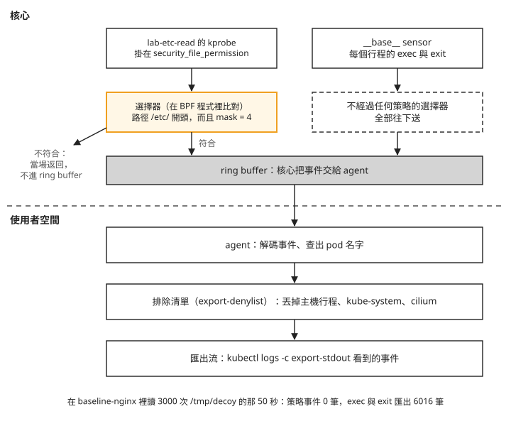
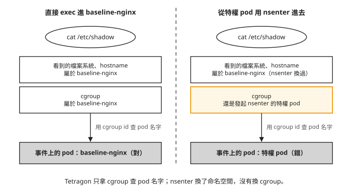

# Day 5: Tetragon 與 TracingPolicy——事件在哪裡被過濾、pod 名字從哪裡來

{ align=right width="95" }

Falco 跑了兩天，你已經知道它的限制：沒寫規則的事，它一律看不見（Day 3 的[「從容器連到沒連過的位址，Falco 沒報」](sprint2-day3-falco-basics.md#mine-4)）。有人建議換 Tetragon：它一樣用 eBPF，但過濾在核心裡做完，聽起來比較省，也比較準。你把它裝上去，閒置兩分多鐘，匯出的事件一筆都沒有，比 Falco 還安靜。

這一章把 Tetragon 裝在同一座叢集上，Falco 維持 Day 4 結束時的樣子，兩邊同時看同一批動作。我們要回答兩個問題：Tetragon 的安靜是怎麼來的？它把一個動作記在哪一顆 pod 上，準不準？

讀完之後，看到 Tetragon 的匯出事件很安靜、或某筆事件掛著某顆 pod 的名字時，你能判斷這筆事件是在核心裡被策略擋掉、在匯出前被排除清單丟掉，還是根本沒發生，也知道那個 pod 名字在什麼情況下不能直接相信。

## 開始之前

這一章沿用前幾天的叢集與工作負載：

- **Falco** 維持 [Day 4](sprint2-day4-falco-custom-rules.md) 結束時的狀態：25 條預設規則加 2 條自訂規則。它是這一章的對照組，全程不改。
- **`ebpf-lab` 特權 DaemonSet**：[Day 2](sprint2-day2-bpftrace-kubernetes.md) 用過的那組特權 pod（`hostPID`、掛節點的 `/sys`），Day 2 結束時已經跟著 namespace 一起刪掉，這裡重新建立。它只排到帶 `pool=ebpf` 標籤的節點上。步驟 5 要從它身上用 `nsenter` 進 `baseline-nginx`。
- **`ebpf-lab` namespace 裡的 `baseline-nginx`**：被觀察的對象，照 [Day 3 步驟 4](sprint2-day3-falco-basics.md) 建立。因為 namespace 已經由下面的檔案建好，Day 3 那行 `kubectl create namespace ebpf-lab` 可以略過。它必須跟特權 pod 排在同一個 `ebpf` 節點池上；如果你的 `baseline-nginx` 沒有指定節點，在 pod spec 補上跟下面 DaemonSet 一樣的 `nodeSelector` 與 spot 的 toleration。

```bash
cat > ebpf-lab-daemonset.yaml <<'EOF'
apiVersion: v1
kind: Namespace
metadata:
  name: ebpf-lab
---
apiVersion: apps/v1
kind: DaemonSet
metadata:
  name: ebpf-lab
  namespace: ebpf-lab
  labels:
    app: ebpf-lab
spec:
  selector:
    matchLabels:
      app: ebpf-lab
  template:
    metadata:
      labels:
        app: ebpf-lab
    spec:
      hostPID: true
      nodeSelector:
        pool: ebpf
      tolerations:
      - key: kubernetes.azure.com/scalesetpriority
        operator: Equal
        value: spot
        effect: NoSchedule
      containers:
      - name: probe
        image: mcr.microsoft.com/mirror/docker/library/ubuntu:24.04
        command: ["sleep", "infinity"]
        securityContext:
          privileged: true
        resources:
          requests:
            cpu: 50m
            memory: 128Mi
        volumeMounts:
        - name: sys
          mountPath: /sys
        - name: debugfs
          mountPath: /sys/kernel/debug
      volumes:
      - name: sys
        hostPath:
          path: /sys
          type: Directory
      - name: debugfs
        hostPath:
          path: /sys/kernel/debug
          type: Directory
EOF
kubectl apply -f ebpf-lab-daemonset.yaml
```

## 步驟 1: 安裝 Tetragon

Tetragon 是 Cilium 專案底下的 eBPF 安全觀測工具。跟 Falco 一樣，它在每個節點跑一顆 agent，把核心裡發生的事變成事件。它跟 Cilium 出自同一個組織，但**不需要 Cilium 當網路外掛（CNI）**：課程的 AKS 叢集用的是 Azure CNI overlay，Tetragon 裝下去沒有報錯，設定裡也沒有一處提到 CNI。

先查有哪些版本：

```console
$ helm repo add cilium https://helm.cilium.io/ && helm repo update cilium
$ helm search repo cilium/tetragon --versions | head -3
cilium/tetragon   1.7.0   1.7.0   Helm chart for Tetragon
cilium/tetragon   1.6.1   1.6.1
cilium/tetragon   1.6.0   1.6.0
```

第二欄是 chart 版本，第三欄是 Tetragon 本身的版本，兩者同號。Falco 不是這樣（chart `falco-9.1.0` 裝的是 Falco `0.44.1`），看升級範圍時不要把兩種習慣搞混。

安裝時不帶任何調整事件的設定。這一章要量的是「照 chart 預設裝好之後，它會送出什麼」，先動了設定就量不到：

```console
$ helm install tetragon cilium/tetragon --version 1.7.0 -n tetragon --create-namespace --wait
STATUS: deployed
```

### 它建了什麼

```console
$ helm template cilium/tetragon --version 1.7.0 | grep '^kind:' | sort | uniq -c
   2 ClusterRole        2 ClusterRoleBinding    2 ConfigMap
   1 DaemonSet          1 Deployment            1 Role
   1 RoleBinding        2 Service               2 ServiceAccount
```

工作負載有兩個。`tetragon` 是 DaemonSet，每個節點一顆，裡面有兩個容器：`tetragon` 是 agent 本體，以特權模式把 BPF 程式載進核心；`export-stdout` 負責把事件印出來，步驟 2 會看到它的作用。`tetragon-operator` 是單副本的 Deployment，只負責建立 Tetragon 的 CRD，建完之後幾乎閒置（實測 1m CPU、19Mi 記憶體）。

指令裡的 `<tetragon-pod>` 換成 `kubectl -n tetragon get pods` 列出的任一顆 `tetragon-` 開頭的 pod（不是 `tetragon-operator`）；要看特定節點時，加 `-o wide` 對 `NODE` 欄。

CRD 由 operator 在執行期建立、不是 Helm 安裝的，這件事在自動化流程裡會出問題，見[疑難排解：`helm install --wait` 成功，套用策略卻找不到資源類型](#mine-1)。

### 啟動日誌

```console
$ kubectl -n tetragon logs <tetragon-pod> -c tetragon | head -60
```

```text
msg="BTF discovery: default kernel btf file found" btf-file=/sys/kernel/btf/vmlinux
msg="BPF detected features: override_return: true, buildid: true, kprobe_multi: false,
     uprobe_multi: true, fmodret: true, fmodret_syscall: true, signal: true, large: true,
     link_pin: true, lsm: true, …"
msg="Loading sensor" name=__base__
msg="Available sensors" sensors=__base__
```

從上往下看，有三件事：

1. **BTF 用的是節點自帶的 `/sys/kernel/btf/vmlinux`**，就是 [Day 0](sprint2-day0-ebpf-concepts.md) 檢查過的那個檔案。Tetragon 靠它讀懂這顆核心的資料結構，不必為每個核心版本另外編譯。
2. **`lsm: true`、`override_return: true`、`signal: true`、`fmodret: true`**：Day 0 從開機參數推論 BPF LSM 是開的，這裡 Tetragon 自己偵測，得到同樣的答案。這四項是 Day 6 攔截要用的核心能力，這一章一項都不用。
3. **`kprobe_multi: false`**：這顆核心不支援「一支程式一次掛很多個函式」，所以每個函式要各掛一支 kprobe。這一章只掛一個函式，沒有影響；策略寫到幾十個掛載點時，載入時間和核心記憶體會比較多。

最後兩行出現 **sensor** 這個詞。sensor 是 Tetragon 對「一組載入核心的 BPF 程式」的叫法。`__base__` 是內建的那一組，記錄每一個行程的 exec（開始執行一支程式）與 exit（結束）。還沒寫任何策略時，載入的只有它，這就是接下來要量的預設狀態。

## 步驟 2: 預設狀態下，它送出多少事件 {#step-2}

要量事件，得先知道去哪裡看。Tetragon 的事件有兩個出口：

- **匯出流**：agent 先照設定過濾一輪，再把事件寫成節點上的一個 JSON 檔。`export-stdout` 容器用 `tail -q -F` 把這個檔案印到 stdout，所以 `kubectl logs -c export-stdout` 看到的就是這一份。接到記錄系統的通常也是它。
- **`tetra` CLI**：Tetragon 的命令列工具，直接連到 agent 的 unix socket（同一台機器上行程之間溝通用的檔案），拿到的是**還沒經過匯出過濾**的事件。

`tetra` 不必另外下載，agent 映像裡就有，版本自動跟 agent 一致：

```console
$ kubectl -n tetragon exec <tetragon-pod> -c tetragon -- tetra version
CLI version: v1.7.0
```

把兩個出口畫出來，由上往下是事件的流向。最上面的 ring buffer 是 Day 3 看過的那塊核心與使用者空間程式共用的記憶體，BPF 程式把事件放進去，agent 從另一頭讀出來：

```text
BPF programs (ring buffer)
        │
        ▼
  tetragon agent  ──── gRPC unix socket ────►  tetra getevents   ← 沒有過濾
        │
        ├── export-allowlist / export-denylist / field-filters
        ▼
  節點上的 JSON 檔
        │
        ▼
  export-stdout (tail -q -F)  ──►  kubectl logs   ← 過濾之後
```

兩條路從 agent 分開。往右的 `tetra getevents` 不經過任何過濾；往下的那條，先經過三個匯出設定，才寫進檔案：`export-allowlist` 只放行列出的事件，`export-denylist` 丟掉符合條件的事件，`field-filters` 從事件裡拿掉指定的欄位。這一章會看到的是 `export-denylist` 的影響。

看匯出流時要注意一件事：`kubectl logs <tetragon-pod>` 不加 `-c`，拿到的是第一個容器，也就是 agent 自己的文字日誌，**裡面一筆事件都沒有**。要看事件一定要加 `-c export-stdout`。下面這支腳本把這件事包起來，後面幾章都會用：

```bash
cat > tetra-events.sh <<'EOF'
#!/usr/bin/env bash
# Pull Tetragon events out of the export-stdout sidecar (NOT the agent container).
#   --types    histogram by event type
#   --compact  one line per event: time, pod, binary, args
#   --since    passed to kubectl logs (default 10m)
set -euo pipefail
SINCE=10m; MODE=raw
while [ $# -gt 0 ]; do
  case "$1" in
    --types) MODE=types ;;
    --compact) MODE=compact ;;
    --since) SINCE="$2"; shift ;;
  esac
  shift
done
EV=$(kubectl -n tetragon logs -l app.kubernetes.io/name=tetragon -c export-stdout \
       --since="$SINCE" --prefix=false 2>/dev/null | grep '^{' || true)
case "$MODE" in
  types)   echo "$EV" | jq -r 'keys[] | select(startswith("process_"))' | sort | uniq -c ;;
  compact) echo "$EV" | jq -r '(.process_exec//.process_exit//.process_kprobe) as $p
             | "\(.time)  \($p.process.pod.namespace // "-")/\($p.process.pod.name // "-")  \($p.process.binary) \($p.process.arguments // "")"' ;;
  *)       echo "$EV" ;;
esac
EOF
chmod +x tetra-events.sh
```

### 先看匯出流

裝好之後閒置兩分多鐘，不做任何動作，數這段時間匯出流裡新增的事件，同時數 Falco 的告警。Tetragon 這邊數 `tetra-events.sh` 輸出的行數，每一行是一筆事件，閒置前後各數一次相減；Falco 用 Day 3 的 `falco-alerts.sh` 數，例如 `./falco-alerts.sh | wc -l`。後面幾步的事件數都用這兩支腳本這樣數，只看策略事件時，看 `./tetra-events.sh --types` 裡 `process_kprobe` 那一列：

```text
Tetragon 匯出事件:0 筆 / 132 秒
同窗口 Falco 告警:0 筆
```

兩邊都是零。如果只量到這裡，結論會是「Tetragon 預設跟 Falco 一樣安靜」。先別下結論，看完另一個出口再說。

「新增 0 筆」不代表匯出流是空的。開始閒置之前，匯出流裡已經有 23 筆，是安裝當下寫進去的；閒置期間一筆都沒有再增加。這 23 筆裡，有幾筆的時間比 Tetragon 自己啟動還早：

```text
03:12:36  process_exec  kai-scheduler/binder-…/binder    /workspace/app
03:16:26  process_exec  falco/falco-…/falco              /usr/bin/falco
03:17:26  process_exec  tetragon/tetragon-…/…            /bin/sh …
```

名單裡的行程會隨你的叢集而不同。啟動日誌裡有原因：

```text
msg="Read ProcFS /procRoot appended 182/244 entries"
```

Tetragon 啟動時會掃一遍 `/proc`，把節點上已經在跑的行程記進自己的行程表，而且把它們當成事件送出來。Falco 啟動時也會重建行程表，但不會把它當告警。事故調查時這份清單有用，Tetragon 一起來你就知道節點上有哪些行程在跑；接在告警系統後面時，它是雜訊，DaemonSet 每重新部署一次，每個節點就多出上百筆。

### 再看 agent 裡面

接著用 `tetra getevents` 直接連 agent 收 60 秒。`<tetragon-pod>` 任挑一顆，量到的是那顆 pod 所在節點上的事件：

```console
$ kubectl -n tetragon exec <tetragon-pod> -c tetragon -- timeout 60 tetra getevents
```

| 量到的東西 | 數字 |
|---|---|
| 事件數 | **1915 筆 / 60 秒 = 1915 筆/分鐘/節點** |
| 平均大小 | 3556 B/筆 |
| 換算 | 6.8 MB/分鐘/節點 ≈ **9.8 GB/天/節點** |
| `process_exit` | 1175 |
| `process_exec` | 740 |
| 命名空間為空字串（主機行程） | **1898（99.1%）** |
| 任何應用命名空間 | **0** |

同一個節點、什麼都沒做，匯出流是 0 筆，agent 裡面是每分鐘 1915 筆。每天 9.8 GB 是拿這 60 秒換算的，本課沒有連續量一整天。

這些事件全部是 `__base__` 記下的 exec 與 exit。看是哪些程式：

```text
376  /usr/bin/jq
210  /etc/node-problem-detector.d/plugin/check_spot_eviction.sh
204  /etc/node-problem-detector.d/plugin/check_scheduledevent.sh
202  /usr/bin/curl
180  /etc/node-problem-detector.d/plugin/check_scheduledevent_consolidated.sh
 86  /usr/bin/cat        62 /usr/bin/dirname     60 /usr/bin/uuidgen
```

排在前面的都是節點自己的程式。node-problem-detector（AKS 在節點上跑的健康檢查程式）每隔幾秒跑一輪 shell script，每個 script 再呼叫 `curl`、`jq`、`mktemp`、`uuidgen`。這是受管節點的正常狀態，跟工作負載無關。表格裡「命名空間為空字串」的 1898 筆，就是這些不屬於任何 pod、直接跑在主機上的行程。

### 兩個數字差在哪裡

差別出在匯出前的那一關。Tetragon chart 的預設值裡有一份**排除清單**（`export-denylist`），符合清單的事件不會寫進匯出流：

```yaml
export-denylist: |-
  {"health_check":true}
  {"namespace":["", "cilium", "kube-system"]}
```

第一行 `{"health_check":true}` 丟掉 Kubernetes 健康檢查（exec 類型的 probe）產生的行程事件。第二行排除了三個命名空間。`cilium` 和 `kube-system` 好懂，第一個空字串 `""` 才是重點：**空字串命名空間代表「這個行程不屬於任何 pod」，也就是主機上的每一個行程**。上面那 1898 筆全部被這一項丟掉。

排除主機行程有它的道理，沒有人想每天收 9.8 GB 的健康檢查紀錄。但這份預設有三件事要知道：

1. **這是 chart 的預設，不是 Tetragon 程式本身的預設。** 讀 Tetragon 的觀念文件不會知道，`kubectl get ds` 看不到，agent 啟動日誌裡雖然有，但跟另外四十幾個設定擠在同一行。
2. **它在最後一關才丟。** BPF 程式跑過了、事件進過 ring buffer、agent 也解碼並查過 pod 名字，才在匯出前丟掉。被丟掉的事件，該花的成本都花了。
3. **它讓整台主機從匯出流裡消失。** 有人在節點上直接執行程式、沒有經過任何容器，這個行程的命名空間就是空字串，預設設定下它一筆都不會出現在匯出流裡。

還有一個細節：chart 預設把 Tetragon 裝在 `kube-system`，所以它自己的行程也被排除。這一章裝在 `tetragon` 命名空間，不在清單上，所以匯出流裡會看到 Tetragon 自己的事件，前面那 23 筆裡就有幾筆是它自己。

每筆事件的大小也值得注意：平均 3556 B，比一般想像的大，原因見[疑難排解：事件比預期大，一半是節點標籤](#mine-3)。

## 步驟 3: 一次 `kubectl exec` 在事件流裡長什麼樣

現在對 `baseline-nginx` 做一個最普通的動作：

```console
$ kubectl -n ebpf-lab exec baseline-nginx -- cat /etc/shadow
```

這顆 pod 在 `ebpf-lab` 命名空間，不在排除清單上，所以事件會出現在匯出流。下面這幾筆取自步驟 5 的動作 D，跑的是同一個指令，所以時間比步驟 4 晚；這裡只列 exec 與 exit，每筆一行：

```text
03:31:22.949  process_exec  ebpf-lab/baseline-nginx/nginx  /proc/self/fd/6 'init'   parent=/usr/bin/runc
03:31:22.951  process_exit  ebpf-lab/baseline-nginx/nginx  /proc/self/fd/6 'init'   parent=/usr/bin/runc
03:31:22.962  process_exec  ebpf-lab/baseline-nginx/nginx  /usr/bin/cat '/etc/shadow'  parent=/usr/bin/containerd-shim-runc-v2
03:31:22.964  process_exit  ebpf-lab/baseline-nginx/nginx  /usr/bin/cat '/etc/shadow'  parent=/usr/bin/containerd-shim-runc-v2
```

一個指令產生兩組 exec／exit。前兩筆是 runc 進入容器時跑的輔助程式，後兩筆才是 `cat`。注意 `cat` 的 `parent=containerd-shim-runc-v2`：Falco 的 `container_entrypoint` macro 判斷的也是這件事（Day 3 的[「容器裡的程式再開 shell，`Terminal shell in container` 不報」](sprint2-day3-falco-basics.md#mine-6)）。Falco 把它寫進規則條件，自己做判斷；Tetragon 只把父行程印出來，判斷留給你。

### pod 名字從哪裡來

每筆事件都帶著一段 pod 資訊：

```json
"pod": {
  "namespace": "ebpf-lab", "name": "baseline-nginx",
  "container": { "id": "containerd://ce8a862c00d9…", "name": "nginx",
    "image": { "name": "mcr.microsoft.com/mirror/docker/library/nginx:1.25" },
    "pid": 23 },
  "pod_labels": {"app": "baseline-nginx"},
  "workload": "baseline-nginx", "workload_kind": "Pod"
}
```

比 Falco 多了幾樣：容器內看到的 pid（`23`，不是主機上的 pid）、pod labels、workload 與 workload kind。Falco 的 `container.*` 欄位給不到後兩者。

但核心並不知道 pod 是什麼，這段資訊是後來補上去的。兩個工具補的方法不一樣：

| | Falco | Tetragon |
|---|---|---|
| 核心事件帶了什麼 | pid、cgroup id | pid、cgroup id（BPF 在 `execve` 當下記下來） |
| 誰把它變成 pod 名字 | container plugin 從 cgroup 路徑取出 container id，再問容器執行期 | agent 從 Kubernetes API 持續取得 pod 清單，維護一張「cgroup id 對 pod」的表，事件出核心後查表 |
| 查表在哪一層 | 使用者空間 | 使用者空間 |
| **pod 名字的依據** | **cgroup** | **cgroup** |

做法差很多，最後一列卻一樣：兩邊都靠行程所屬的 cgroup 決定它是哪顆 pod。Day 2 的[「從節點 nsenter 進去的動作沒有被記錄」](sprint2-day2-bpftrace-kubernetes.md#mine-2)已經說過，有一種動作會讓這個依據失準。步驟 5 會實際測。

## 步驟 4: 第一條 TracingPolicy {#step-4}

到這裡看到的都是 `__base__` 記錄的 exec 與 exit。想看更細的事，例如「誰讀了 `/etc/` 底下的檔案」，就要寫 **TracingPolicy**。它是 Tetragon 的 Kubernetes 自訂資源，內容說明三件事：要掛在哪個核心函式上、要讀這個函式的哪幾個參數、符合什麼條件才送出事件。

這一章的目標是：`ebpf-lab` 裡任何 pod 讀 `/etc/` 底下的檔案，都要留下一筆事件，其他的不要。

```bash
cat > tracingpolicy-file-open.yaml <<'EOF'
apiVersion: cilium.io/v1alpha1
kind: TracingPolicyNamespaced          # scoped to one namespace, not the cluster
metadata:
  name: lab-etc-read
  namespace: ebpf-lab
spec:
  kprobes:
    - call: "security_file_permission"
      syscall: false                   # kernel-function ABI, not the syscall ABI
      return: true
      args:
        - index: 0
          type: "file"                 # struct file * — CO-RE resolves f_path to a string
        - index: 1
          type: "int"                  # mask: MAY_EXEC=1, MAY_WRITE=2, MAY_READ=4
      returnArg:
        index: 0
        type: "int"
      selectors:
        - matchArgs:                   # both entries in one selector are AND-ed
            - index: 0
              operator: "Prefix"
              values: ["/etc/"]
            - index: 1
              operator: "Equal"
              values: ["4"]
EOF
kubectl apply -f tracingpolicy-file-open.yaml
```

由上往下看每一段為什麼這樣寫。

**`kind: TracingPolicyNamespaced`**：只對一個命名空間生效的 TracingPolicy。它的範圍限制發生在核心裡：Tetragon 在核心裡維護一張表，記著「這條策略適用哪些 cgroup id」，內容由 agent 依 Kubernetes 的 pod 清單填入。BPF 程式一被觸發，第一件事就是查這張表，不在名單上的 cgroup 直接返回，事件根本不會離開核心。Falco 寫 `k8s.ns.name = "ebpf-lab"` 也能限定命名空間，但那個條件是在事件已經複製到使用者空間、pod 資訊也查完之後才比對的。

**`call: "security_file_permission"`**：要掛的核心函式。用 `read`、`write` 這類系統呼叫存取已開啟的檔案時，核心都會經過 `security_file_permission` 做權限檢查，不管檔案是用 `open`、`openat` 還是 `openat2` 開的。用 `mmap` 把檔案映射進記憶體走的是另一個檢查點（`security_mmap_file`），不在這條策略的範圍內。代價是它被呼叫得非常頻繁，所以需要下面的選擇器。這個函式是 LSM 的檢查點，但這裡掛的是 kprobe，只觀察、不攔截；Day 6 的攔截走另一種掛法。

**`syscall: false`**：告訴 Tetragon 這是一般的核心函式，要照核心函式的方式讀參數，不是照 system call 的方式。寫錯不會載入失敗，而是讀到看起來很合理、其實是錯的值。

**`type: "file"`**：第一個參數是 `struct file *`。Tetragon 靠 Day 0 講過的 BTF 找到裡面的路徑欄位，換成字串給你。策略檔裡沒有任何內容跟這顆核心的版本有關。

**`selectors`**：**選擇器**，決定哪些呼叫要送出事件。比對寫在 BPF 程式裡，在核心裡當場完成。組合規則要記住：**同一個選擇器裡的多個 `matchArgs` 是 AND，不同選擇器之間是 OR**。所以上面這段讀作「路徑以 `/etc/` 開頭，**而且** mask 等於 4（讀取）」。

套用之後，`kubectl apply` 回報成功並不代表策略已經生效（原因見[疑難排解：`kubectl apply` 成功，策略卻沒有載入](#mine-4)）。要問 agent：

```console
$ kubectl -n tetragon exec <tetragon-pod> -c tetragon -- tetra tracingpolicy list
ID  NAME          STATE     FILTERID  NAMESPACE  SENSORS         KERNELMEMORY  MODE
3   lab-etc-read  enabled   3         ebpf-lab   generic_kprobe  462.15 kB     monitor_only
```

`STATE` 是 `enabled` 才算載入成功。`MODE` 的 `monitor_only` 是 agent 依策略內容標的：這條策略裡沒有任何攔截動作，所以只觀察。`FILTERID` 是這條策略在前面那張「策略適用哪些 cgroup id」表裡的編號。`KERNELMEMORY` 的 462.15 kB 是這條策略在核心裡佔的記憶體，Falco 的規則全在使用者空間，沒有對應的數字。

`tetra tracingpolicy list -o json` 還有一個 `stats.action_counters.post` 計數，它不等於事件數：讀一次檔，它增加 5，匯出事件只多 1。拿它估事件量會高估好幾倍，多出來的原因本課沒有查清楚。

### 讀一次 `/etc/shadow`

```console
$ kubectl -n ebpf-lab exec baseline-nginx -- cat /etc/shadow > /dev/null
```

匯出流裡多了一筆 `process_kprobe` 事件，也就是 TracingPolicy 的 kprobe 產生的事件：

```json
{
  "process_kprobe": {
    "process": {
      "pid": 25115, "uid": 0, "binary": "/usr/bin/cat", "arguments": "/etc/shadow",
      "pod": { "namespace": "ebpf-lab", "name": "baseline-nginx",
               "container": { "name": "nginx", "pid": 23 } }
    },
    "parent": { "pid": 21569, "binary": "/usr/bin/containerd-shim-runc-v2" },
    "function_name": "security_file_permission",
    "args": [ {"file_arg": {"path": "/etc/shadow", "permission": "-rw-r-----"}},
              {"int_arg": 4} ],
    "return": {"int_arg": 0},
    "action": "KPROBE_ACTION_POST",
    "policy_name": "lab-etc-read"
  },
  "node_name": "<node-a>",
  "time": "2026-08-07T03:26:20.860883032Z"
}
```

逐項對回剛才的動作：`policy_name` 是剛寫的策略，`function_name` 是掛的那個函式，`file_arg.path` 是讀的檔案，`int_arg: 4` 是選擇器要求的 mask，`binary` 和 `arguments` 是下的指令，`pod` 是 exec 進去的那顆。從動作到事件產生相隔 1.0 毫秒。

`return.int_arg: 0` 是這次掛載函式回傳值的紀錄。Day 6 會在策略的 `matchActions` 加入攔截動作；輸出事件中的 `return.int_arg` 本身不是設定欄位。

### 讀 3000 次不符合的檔案

選擇器只放行 `/etc/` 開頭的路徑。在同一顆 pod 裡，讀 3000 次 `/tmp` 底下的檔案：

```console
$ kubectl -n ebpf-lab exec baseline-nginx -- bash -c \
      'echo hello > /tmp/decoy; for i in $(seq 1 3000); do cat /tmp/decoy > /dev/null; done'

策略 kprobe 事件增量:0
```

一筆都沒有。`security_file_permission` 至少被呼叫了 3000 次，每一次 BPF 程式都比對了路徑前綴，不符合就返回，事件連 ring buffer 都沒進。Falco 要做同樣的篩選，得先把每個事件搬到使用者空間、補完行程與容器資訊，再拿每條規則的條件去比，所以 Falco 沒有告警時也照樣在花 CPU（Day 3 的[「節點的 CPU 實際用量不高，Falco 卻排不進去」](sprint2-day3-falco-basics.md#mine-7)量過這件事）。

這段時間裡策略倒是產生了 6 筆事件，都來自 `bash` 自己：`/etc/nsswitch.conf` 四次、`/etc/passwd` 兩次，是 bash 啟動時查使用者資訊讀的。可見 `/etc/` 這個前綴對任何會跑 shell 的容器都不算少見。真要放到正式環境，前綴要縮到 `/etc/shadow` 這種程度，或加上 `matchBinaries`（依執行檔路徑比對的選擇器條件）排除 shell 自己的查詢。

同一段時間（約 50 秒），把三個數字並排：

| | 事件數 |
|---|---|
| 策略產生的 `process_kprobe` | **0** |
| Tetragon 匯出的總事件 | **6016** |
| Falco 告警 | **0** |

策略沒有送出事件，匯出流卻多了 6016 筆。這 6016 筆是 3000 次 `cat` 各自的 exec 與 exit，來自步驟 1 看到的 `__base__`。下面這張圖把兩種事件來源分開畫，看它們各自在哪一關被篩：



圖上有兩件事要注意。第一，選擇器只管它所屬的那條策略；`__base__` 的事件走右邊那一欄，不受任何 TracingPolicy 影響。第二，`__base__` 事件唯一的關卡是最下面的排除清單，而那是使用者空間的設定，事件到那裡時，核心和 agent 的工作都已經做完了。

所以：

1. **「只裝了一條很窄的策略，所以很省」不成立。** 事件量取決於工作負載多常啟動新程式。一個會不斷 fork 的 CI runner、一個大量呼叫 shell 的啟動腳本，就足以把量拉上去。
2. **刪掉策略也不會變安靜。** 回到零策略，就是回到步驟 2 那每分鐘 1915 筆。
3. **要降低事件量，調的是 chart 的匯出設定**（排除清單、欄位過濾、速率限制），不是 TracingPolicy。這些設定都在使用者空間，省的是下游的頻寬與儲存，不省核心和 CPU。

跟 Falco 比，成本落在不同的地方：Falco 對每個事件都要比對所有規則，CPU 是固定開銷，輸出卻接近零；Tetragon 在核心裡的成本很低，輸出量則跟著工作負載啟動程式的頻率走。

## 步驟 5: 四個動作，兩套工具同時看

接下來做 Day 3、Day 4 做過的四個動作，Falco（25 條預設加 2 條自訂）和 Tetragon（`__base__` 加 `lab-etc-read`）同時在看。四個動作是：

- **A**：帶終端機 exec 進去，在 shell 裡用 `&` fork 出另一個 shell。`script -q /dev/null` 替 `kubectl` 配一個終端機（Day 3 的[「用 `kubectl exec -t` 開 shell，Falco 沒報」](sprint2-day3-falco-basics.md#mine-3)）。
- **B**：同樣的 fork，但不配終端機，模擬透過 web shell 下指令。
- **C**：從同一個節點上的 `ebpf-lab` 特權 pod，用 `nsenter` 進入 `baseline-nginx` 的命名空間讀 `/etc/shadow`。`-t` 後面要填 `baseline-nginx` 的 nginx 主行程在主機上的 pid，可以在特權 pod 裡用 `ps` 找。
- **D**：直接 exec 進 `baseline-nginx` 讀 `/etc/shadow`。

```console
$ script -q /dev/null kubectl -n ebpf-lab exec -it baseline-nginx -- \
    bash -c 'bash -c "echo forked-shell-ran" & wait; echo done'
$ kubectl -n ebpf-lab exec baseline-nginx -- \
    bash -c 'bash -c "echo webshell-no-tty" & wait; echo done'
$ kubectl -n ebpf-lab exec <ebpf-lab-pod> -- \
    bash -c "ps -eo pid,comm --no-headers | awk '\$2==\"nginx\"{print \$1; exit}'"
$ kubectl -n ebpf-lab exec <ebpf-lab-pod> -- \
    nsenter -t <nginx-host-pid> -m -u -i -n -p /bin/bash -c \
    'hostname; cat /etc/shadow > /dev/null; echo nsenter-ok'
$ kubectl -n ebpf-lab exec baseline-nginx -- cat /etc/shadow > /dev/null
```

`<ebpf-lab-pod>` 是跟 `baseline-nginx` 在同一個節點上的那顆特權 pod：用 `kubectl -n ebpf-lab get pods -o wide` 對 `NODE` 欄找。`<nginx-host-pid>` 是第三行指令印出的數字。兩套工具的結果：

| 偏離 | Falco 說了什麼 | 怪到哪顆 pod | Tetragon 說了什麼 | 怪到哪顆 pod |
|---|---|---|---|---|
| **A** `bash -c "…" & wait`（有 pty） | 2 筆：預設 `Terminal shell in container` 加自訂 `Shell spawned by non-runtime parent` | `baseline-nginx` ✓ | **18 筆**：3 exec、3 exit、12 kprobe。無規則名、無嚴重度 | `baseline-nginx` ✓ |
| **B** 同上但**無終端機** | **1 筆**：只有自訂規則。預設規則靜音 | `baseline-nginx` ✓ | **18 筆，與 A 完全相同的組成** | `baseline-nginx` ✓ |
| **C** `nsenter` 進 `baseline-nginx` 讀 `/etc/shadow` | 2 筆 | **呼叫端** ✗ | **34 筆**，含 `nsenter` 指令與完整參數 | **呼叫端** ✗ |
| **D** 直接在 `baseline-nginx` 裡讀 `/etc/shadow` | 1 筆 | `baseline-nginx` ✓ | **8 筆**：2 exec、2 exit、**4 kprobe（策略產生的）** | `baseline-nginx` ✓ |

表中的「呼叫端」是發起 `nsenter` 的那顆 `ebpf-lab` 特權 pod。先看 C，再看 A 和 B。

### C：`nsenter` 讀的檔，記到了哪顆 pod {#step-5-nsenter}

Day 3 看過 Falco 在這一格認錯 pod（Day 3 的[「`nsenter` 進容器的告警，pod 欄位是發起端」](sprint2-day3-falco-basics.md#mine-5)）。Tetragon 的做法不同：cgroup id 是 BPF 程式在 `execve` 當下就在核心裡記下的，不是事後去問容器執行期。聽起來應該比較準。實際的事件：

```text
03:31:22.303  process_exec  <呼叫端 pod>  /usr/bin/nsenter
              '-t 21743 -m -u -i -n -p /bin/bash -c "hostname; cat /etc/shadow …"'
03:31:22.341  process_kprobe <呼叫端 pod>  /usr/bin/cat '/etc/shadow'
              fn=security_file_permission  policy=lab-etc-read
```

讀 `/etc/shadow` 的那筆，pod 欄位是發起的特權 pod。可是事情到底發生在哪裡，指令自己的輸出已經回答了：

```console
$ … nsenter -t 21743 -m -u -i -n -p /bin/bash -c 'hostname; cat /etc/shadow …'
baseline-nginx                    ← hostname 回報的是被進入的那顆
```

再對照 D，直接 exec 進去做同一件事：

```text
03:31:22.964  process_kprobe  ebpf-lab/baseline-nginx/nginx  /usr/bin/cat '/etc/shadow'
```

兩筆事件是同一個檔案、同一支程式，前後不到一秒，卻掛著兩個不同的 pod 名字，C 那筆是錯的。把兩條路徑並排畫出來：



照著圖上兩欄比：`nsenter` 換掉的是上面那一格，也就是行程看到的檔案系統、hostname 這些命名空間；下面那一格的 cgroup 沒有變。Tetragon 查 pod 名字只看 cgroup，所以查到的是發起者。核心只知道 pid、命名空間和 cgroup，「這是哪顆 pod」一定是把 cgroup 對到 Kubernetes 物件推出來的。在核心裡把 cgroup id 記得再早、再準，記到的都是發起者的 cgroup。

到這裡，課程用過的三個工具都在這一格失準了：

| | 結果 |
|---|---|
| Day 2 bpftrace（綁 cgroup 過濾） | **完全看不到** |
| Day 3 Falco（全節點探針加執行期反查） | 看得到，**pod 認錯** |
| Day 5 Tetragon（全節點探針加核心層 cgroup id） | 看得到，**pod 認錯** |

訊號本身沒有消失，只是標錯 pod。而 Tetragon 多給了一樣 Falco 沒有的東西：`nsenter` 這個指令連同完整參數，本身就是一筆事件，不需要任何策略或規則。Day 3 的 Falco 預設規則沒有一條在看 `nsenter`；Tetragon 不需要有人事先想到要看它。調查時拿到錯的 pod 名字之後，往上看父行程是 `/usr/bin/nsenter`，再看它的參數 `-t 21743`，真正的目標就在裡面。

Tetragon 有一個 `enable-process-ns` 選項（預設關閉），開啟後事件會附上行程的命名空間資訊。它不會改事件的 pod 欄位；可能的用法是拿事件裡 mount、UTS 命名空間的 inode，跟目標容器主行程的比對，找出真正進入的是哪顆 pod。這個做法本課沒有驗證。

### A 和 B：有沒有終端機，Tetragon 分不出來 {#step-5-tty}

A（有終端機）和 B（沒有終端機）在 Tetragon 的事件流裡組成完全一樣：各 3 筆 exec、3 筆 exit、12 筆 kprobe，程式、父行程、pod、參數全部相同，只有時間和 pid 不同。原因是事件的 `process` 結構裡根本沒有終端機這個欄位：

```text
process struct keys: arguments, auid, binary, cwd, docker, exec_id, flags,
                     in_init_tree, parent_exec_id, pid, pod, refcnt,
                     start_time, tid, uid
```

Day 4 用 `tty=0` 分辨「不是真人打的 `kubectl exec`」，這個訊號在 Tetragon 的預設事件裡不存在。

反過來，B 也是 Falco 預設規則表現最差的一格：只報 1 筆，還是 Day 4 的自訂規則報的；預設的 `Terminal shell in container` 因為條件裡有 `proc.tty != 0`，完全沒有反應。Tetragon 的 18 筆沒有任何判斷，但 bash 的 exec 事件不會因為沒有終端機就不見。這一格要分辨有沒有終端機，得靠 Falco 的 tty 欄位；要確定 shell 有沒有被執行過，Tetragon 的紀錄比較完整。

### 總數

把四個動作的結果加總：

| | Falco | Tetragon |
|---|---|---|
| 事件或告警總數 | **6** | **78** |
| 每一筆都對得回一個動作嗎 | 是 | 是 |
| 帶規則名與嚴重度嗎 | **是**（含 MITRE T1059 / T1555） | **否** |
| 需要人再判斷嗎 | 否 | **是** |

MITRE T1059、T1555 是 MITRE ATT&CK 攻擊手法分類的編號，分別是「用命令列或腳本直譯器執行指令」和「從密碼儲存處取得憑證」。

同樣四個動作，Tetragon 的事件數是 Falco 的 13 倍，而且每一筆都要人判斷。這還只是一條窄策略、四個動作、十秒鐘內的量；步驟 4 那 3000 次讀取的 6016 筆，才比較接近正式環境的規模。Falco 的告警帶規則名、嚴重度、MITRE 分類，看了就知道發生什麼事，但沒寫規則的事看不見。Tetragon 的事件帶執行了什麼、參數、父行程、哪顆 pod，是否可疑要另外判斷。

## 步驟 6: 資源用量

閒置、載入一條策略時，兩套工具的用量如下。本章沒有附量用量的原始指令；要自己量，叢集需要有 metrics-server（AKS 預設會裝）提供 pod 的用量：

| 元件 | CPU | 記憶體 | QoS |
|---|---|---|---|
| **Tetragon** agent（每節點） | **5–11m** | **83–120Mi** | **BestEffort** |
| Tetragon `export-stdout`（每節點） | 1m | <1Mi | — |
| Tetragon operator（單顆） | 1m | 19Mi | Burstable |
| **Falco**（每節點） | **13–27m** | **84–90Mi** | Burstable |

Tetragon 的 CPU 比 Falco 低。Falco 對每一個 `execve` 都要在使用者空間把 27 條規則跑一遍；Tetragon 沒有策略時，只是把事件搬出來。記憶體則是 Tetragon 稍高，它的行程表與核心裡的對照表都是預先配置的。另外再加上每條策略的核心記憶體，`lab-etc-read` 是 462.15 kB。

上表排除了一顆 agent：它剛被 `tetra getevents` 連續收過兩輪事件，記憶體量到 163Mi，另外兩顆是 88Mi 與 120Mi，收完之後也沒有馬上降回來。`tetra getevents` 會吃 agent 的記憶體，在記憶體吃緊的節點上，對一顆 BestEffort 的 agent 開事件串流，可能讓它被 OOM kill。BestEffort 是怎麼來的，見[疑難排解：agent 是 BestEffort，節點吃緊時第一個被踢](#mine-8)。

最後是閒置時的匯出量。零策略時，132 秒內 Tetragon 匯出 0 筆、Falco 0 筆告警。載入一條策略後再閒置 195 秒，Tetragon 匯出 4 筆、Falco 仍是 0 筆。那 4 筆來自查策略狀態時 `kubectl exec` 進 `tetragon` 命名空間的動作，這個命名空間不在預設的排除清單上；扣掉之後，兩種狀態都是零。但步驟 2 已經知道，這個零是排除清單丟掉的結果，agent 裡面每分鐘仍有 1915 筆。

## 疑難排解

### `helm install --wait` 成功，套用策略卻找不到資源類型 {#mine-1}

**症狀**：自動化流程裡 `helm install --wait` 回報成功，接著套用 TracingPolicy，可能失敗，說找不到這個資源類型。

**原因**：Helm 只會自動安裝 chart 裡 `crds/` 目錄的 CRD，這個 chart 把 CRD 放在 `crds-yaml/`：

```console
$ helm pull cilium/tetragon --version 1.7.0 --untar && ls tetragon/
Chart.yaml  crds-yaml/  LICENSE  README.md  templates/  values.yaml
                ↑ 不是 crds/

$ helm template cilium/tetragon --version 1.7.0 --include-crds | grep -c CustomResourceDefinition
0
```

CRD 改由 operator 啟動後建立。一次安裝的時間順序：

```text
11:17:19  helm install 開始
11:17:27  tracingpolicies.cilium.io          建立
11:17:29  tracingpoliciesnamespaced.cilium.io 建立
11:17:40  helm 回 STATUS: deployed
```

這次 CRD 剛好在 Helm 回報完成之前就建好了，但這不是保證：`--wait` 等的是 DaemonSet 與 Deployment 就緒，不是 CRD 存在。同樣的原因，`helm template --include-crds` 印不出這兩個 CRD，依 manifest 管理資源的 GitOps 工具不會管到它們，`helm uninstall` 也不會刪掉它們。

**修法**：同一份自動化流程裡先裝 Tetragon、再套策略時，自己等 CRD 出現，不要只靠 `helm --wait`。

### 匯出流閒置時幾乎沒有事件 {#mine-2}

chart 預設的排除清單把空字串命名空間（主機上的所有行程）、`kube-system`、`cilium` 都丟掉了，agent 裡其實每分鐘有上千筆。要看還沒過濾的事件，用 `tetra getevents`。說明與數字見[步驟 2](#step-2)。

### 事件比預期大，一半是節點標籤 {#mine-3}

**症狀**：拿文件裡的範例事件大小估算儲存量，實際用量多出一倍。

```console
$ ./tetra-events.sh --size
events=23  total=101694 B  avg=4421 B/event  node_labels=2158 B/event (49%)
```

（步驟 2 的腳本沒有 `--size` 這個選項。要自己量，把匯出流每一行 JSON 的長度，和其中 `node_labels` 欄位的長度分別加總，就得到上面的數字。）

**原因**：一筆平均 4421 B 的事件裡，2158 B 是 `node_labels`，也就是雲端供應商掛在節點上的四十幾個標籤，每筆事件都重複帶一次。照步驟 2 每分鐘 1915 筆的速率算，光節點標籤每天每節點就約 5.9 GB。標籤有多少由雲端供應商決定，不在你的設定檔裡；節點標籤少的叢集，同樣的事件會小很多，全部拿掉最多小將近一半。

**修法**：匯出設定裡的 `field-filters` 可以拿掉指定欄位，但它的預設是空的，要自己寫欄位路徑清單，也沒有任何預設值或範例把 `node_labels` 列進去。這份設定的寫法，跟下面 resources 的補法一樣，本課都沒有驗證。

### `kubectl apply` 成功，策略卻沒有載入 {#mine-4}

**症狀**：Kubernetes 這一側看起來一切正常。

```console
$ kubectl apply -f tracingpolicy-file-open.yaml
tracingpolicynamespaced.cilium.io/lab-etc-read created      ← 成功
$ kubectl -n ebpf-lab get tracingpoliciesnamespaced
lab-etc-read   8s                                           ← 存在
$ kubectl -n ebpf-lab get tracingpolicynamespaced lab-etc-read -o json | jq .status
<absent>                                                    ← 沒有 status
$ kubectl -n ebpf-lab describe tracingpolicynamespaced lab-etc-read | tail -1
Events:  <none>                                             ← 沒有 event
```

**原因**：這一版策略帶了 `returnArgAction: "Post"`，這是網路上檔案監控範例很常見的寫法，但 Tetragon 1.7.0 不接受。實際狀態只有 agent 知道：

```console
$ kubectl -n tetragon exec <tetragon-pod> -c tetragon -- tetra tracingpolicy list
ID  NAME          STATE        FILTERID  NAMESPACE  SENSORS  KERNELMEMORY  MODE
2   lab-etc-read  load_error   2         ebpf-lab            0 B           unknown
```

```text
level=warn msg="adding tracing policy failed"
  error="… ReturnArgAction type 'Post' unsupported;
         omit returnArgAction or use 'TrackSock'/'UntrackSock'"
```

CRD schema 裡，這個欄位的說明文字其實寫了可用的值，但欄位型別只宣告為字串，沒有列出允許值（`enum`），所以 API server 什麼字串都收。這跟 Day 4 的[「`evt.dir` 已經淘汰，規則照樣「載入成功」」](sprint2-day4-falco-custom-rules.md#mine-2)是同一類問題，而且更難發現：Falco 至少把警告印在 pod 自己的日誌裡；這裡的 CRD 不會有 status，GitOps 面板會顯示正常，`kubectl wait` 也沒有東西可以等。

**修法**：拿掉 `returnArgAction`。它只接受 `TrackSock`、`UntrackSock`，這兩個值用來追蹤函式回傳的 socket，跟檔案監控無關。每次套用策略後，用 `tetra tracingpolicy list` 確認 `STATE` 是 `enabled`，見[步驟 4](#step-4)。

### 只裝了一條很窄的策略，匯出量還是很大 {#mine-5}

匯出量的大宗來自永遠開著的 `__base__`，它記錄每個行程的 exec 與 exit，不受任何 TracingPolicy 影響。要降低匯出量，調的是 chart 的匯出設定，不是策略。說明與數字見[步驟 4](#step-4) 的 3000 次讀取實驗。

### `nsenter` 進去讀的檔，事件記在發起的 pod 上 {#mine-6}

Tetragon 用行程的 cgroup 決定 pod 名字，而 `nsenter` 只換命名空間、不換 cgroup，所以事件記在發起 `nsenter` 的 pod 上。往上看父行程和 `nsenter` 的 `-t` 參數，可以找回真正的目標。見[步驟 5 的 C](#step-5-nsenter)。

### 事件裡找不到 tty，分不出有沒有終端機 {#mine-7}

Tetragon 事件的 `process` 結構沒有終端機欄位，有終端機的 shell 和 web shell 在事件流裡長得一樣。需要這個訊號時要靠 Falco。見[步驟 5 的 A 和 B](#step-5-tty)。

### agent 是 BestEffort，節點吃緊時第一個被踢 {#mine-8}

**症狀**：照 chart 預設安裝，agent 的 QoS 是 BestEffort。

```console
$ kubectl -n tetragon get pod <tetragon-pod> -o jsonpath='{.status.qosClass} prio={.spec.priority}'
BestEffort prio=0
$ kubectl -n falco get pod <falco-pod> -o jsonpath='{.status.qosClass} prio={.spec.priority}'
Burstable prio=0
```

**原因**：chart 給 agent 容器的是 `resources: {}`，也沒有設 `priorityClassName`。沒有 requests 的 pod 是 BestEffort，節點記憶體不足時最先被 OOM kill。Falco 的 chart 至少給了 requests（還給多了，見 Day 3 的[「節點的 CPU 實際用量不高，Falco 卻排不進去」](sprint2-day3-falco-basics.md#mine-7)），所以是 Burstable。priority 兩邊都是 0，低於所有系統元件。

chart 還設了 `tolerations: [{operator: Exists}]`，表示它可以排到任何節點。好處是不用像 Day 3 那樣替 Falco 補 toleration；壞處是你不想放監控的節點也會被排上去。

把步驟 6 的表加起來，兩套工具每節點合計約 19–39m CPU、167–211Mi 記憶體，但向排程器宣告的 requests 只有 Falco 那一份，排程器在分配節點資源時算不到 Tetragon。

agent 被踢掉之後，chart 1.7.0 的預設（`enableKeepSensorsOnExit: false`）會讓它在結束時卸載 BPF 程式。後果是在 DaemonSet 把 agent 重建起來之前，這個節點完全沒有 Tetragon 的監控。

**修法**：在 chart values 裡自己補上 agent 的 `resources` 與 `priorityClassName`，數字可以參考步驟 6 的實測用量。

## 想一想

1. 同事照 chart 預設把 Tetragon 裝在 `kube-system`，匯出流接上了記錄系統，一週下來只有零星幾筆，他的結論是「節點很乾淨」。如果有人 SSH 登入某個節點、直接在主機上執行了一支可疑程式，這件事會出現在他收到的事件裡嗎？要讓這類事件以後收得到，你會改哪個設定，代價是什麼？
2. 某個節點專門跑 CI runner，每分鐘啟動上千個短命的行程。叢集上只有一條 TracingPolicy，只看 `/etc/shadow` 的讀取。有人說「策略這麼窄，Tetragon 在這個節點上的事件量一定很小」，你同意嗎？如果要降低送到記錄系統的量，你會去改哪裡，這樣改能省下節點上的 CPU 嗎？
3. 一筆 Tetragon 事件顯示，特權 pod `debug-tools` 讀了 `/etc/shadow`，但 `debug-tools` 的映像裡有沒有這個檔案你也不確定。你會在事件流裡找哪些線索，判斷真正被讀的是不是另一顆 pod 的檔案？

## 小結

這一章把 Tetragon 和 Falco 放在同一批動作前面比。Tetragon 的「安靜」有兩個來源，要分開看：策略的選擇器在核心裡比對，不符合的呼叫連 ring buffer 都不進，這是真的省；但 `__base__` 記錄的 exec 與 exit 不歸任何策略管，它們的去留只取決於匯出前的排除清單，而 chart 預設把主機行程整個丟掉，匯出流的零往往只是被丟掉的結果。pod 名字方面，Tetragon 跟 Falco 一樣靠 cgroup 決定，`nsenter` 這類只換命名空間的動作會讓它記到發起者身上，「在核心裡記錄」改變不了這一點。以後看到匯出流安靜得不合理，先用 `tetra getevents` 看 agent 裡面；看到一筆事件指向某個特權 pod，先查父行程有沒有 `nsenter`。本章只用了一個 kprobe 掛載點，tracepoint、uprobe、LSM 掛載點的過濾行為沒有驗證。

## 延伸閱讀

想再深入，可以從這幾份開始：

- **[TracingPolicy 的概念與組成](https://tetragon.io/docs/concepts/tracing-policy/)** —— 官方對「掛勾點加上核心內過濾的選擇器」這個結構的說明，對得上步驟 4 的逐段說明。
- **[選擇器的完整語法](https://tetragon.io/docs/concepts/tracing-policy/selectors/)** —— `matchArgs`、`matchBinaries`、`matchPIDs` 等各種過濾器與運算子；官方明載同一個選擇器內的條件是 AND、多個選擇器之間是 OR。
- **[Helm chart 參數表](https://tetragon.io/docs/reference/helm-chart/)** —— 排除清單與 resources 兩項疑難排解的一手來源：`exportDenyList` 的預設值（含那個空字串命名空間）與 `resources` 的空物件預設，都逐字列在這份表裡。
- **[Falco 規則的三個基本元件](https://falco.org/docs/concepts/rules/basic-elements/)** —— 對照組。把它跟 TracingPolicy 的結構並排讀，可以看出一個是比對條件、送出判斷，一個是指定掛載點、送出紀錄。

## 下一步

這一章的策略只觀察，`MODE` 全程是 `monitor_only`；agent 回報的 `lsm`、`override_return`、`signal`、`fmodret` 四項核心能力都具備，但一項都沒用。Tetragon 和 `ebpf-lab` namespace 都留給 Day 6 用，只把這一章的策略刪掉：

```console
$ kubectl -n ebpf-lab delete tracingpolicynamespaced lab-etc-read
```

[Day 6](sprint2-day6-tetragon-enforcement.md) 在策略加入 `Sigkill` 動作，對符合條件的行程送出 SIGKILL，並比較 `Override` 改寫回傳值的方式，然後回答兩個問題：SIGKILL 是擋住了操作，還是只在事後把行程殺掉？寫錯一條攔截規則，從應用程式那一側看起來是什麼樣子？這一章量到的 `nsenter` 歸屬錯誤，到了攔截的情境也會帶來不同的後果。

---

!!! quote ""
    Tetragon 標誌為 Tetragon 專案之官方資產，此處作社群教學用途。
