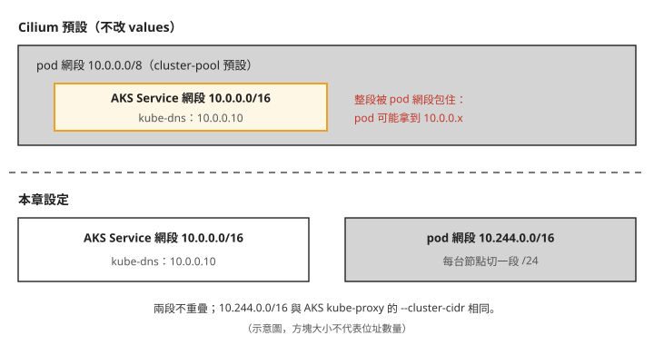
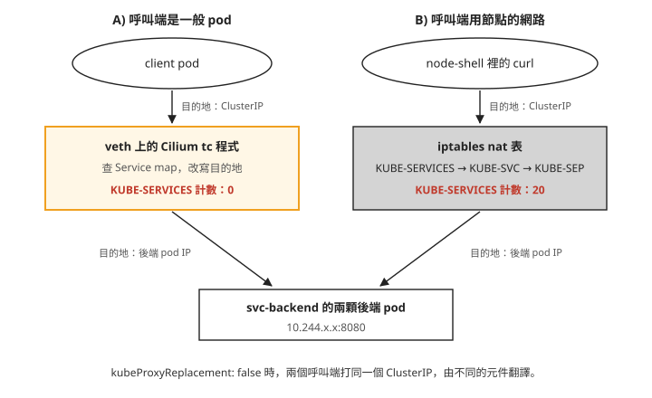
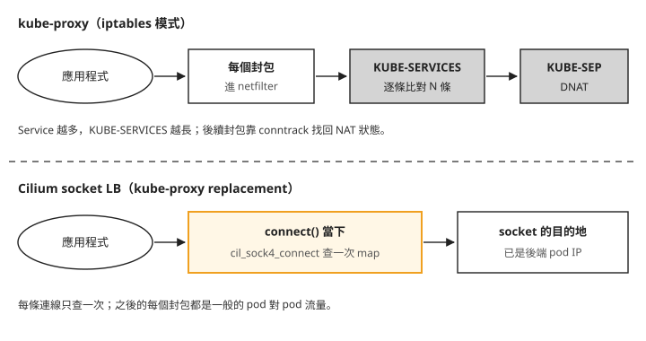

# Day 7: 換掉資料平面——BYOCNI、Cilium 與 kube-proxy replacement

{ align=right width="95" }

你想試 Cilium 的 L7 網路政策，順便把 kube-proxy 換掉。團隊裡有人提醒：「kube-proxy 現在負責 ClusterIP 的轉送，開了 kube-proxy replacement 才會換成 Cilium 接手，所以先別開，比較保守。」這句話聽起來很合理，要確認它對不對，得先有一座自己裝 Cilium 的叢集，再實際量一次：一個打到 ClusterIP 的請求，現在到底是誰把目的地改成後端 pod 的。

Day 0 到 Day 6 的工具都掛在 syscall 與 LSM 那一層，觀察行程做了什麼。這一章把 eBPF 放進網路路徑：建一座不帶網路外掛的 AKS 叢集，自己裝 Cilium，跑完連通性測試，再把 kube-proxy 換掉，比較換之前和換之後 Service 的位址翻譯走哪條路。

讀完之後，看到一座 Cilium 叢集裡的 ClusterIP 請求，你能判斷這次翻譯是 kube-proxy 的 iptables 做的，還是 Cilium 的 eBPF 做的；也會知道在 AKS 上拿掉 kube-proxy 之前要先補哪些設定，拿掉之後要清哪些東西。

## 為什麼要另開一座叢集

pod 一建立，就有自己的 IP，可以跟其他 pod 互通。這件事不是 kubelet 自己做的：kubelet 會呼叫一個 **CNI**（Container Network Interface）外掛，由它替 pod 配 IP、接好網路介面、設定路由。AKS 預設用的是 Azure 自己的 CNI，Cilium 則是另一套 CNI，用 eBPF 程式實作這些網路功能。

在 AKS 上用 Cilium 有兩條路：

- **受管的「Azure CNI powered by Cilium」**：可以在既有叢集上開啟，但 Cilium 的 L7 政策與 Hubble UI（Hubble 是 Cilium 內建的流量觀測元件，Hubble UI 是它的網頁介面）要另外付費的附加元件，而這兩項正是 Day 8、Day 9 要學的部分。
- **自管的 BYOCNI**（bring your own CNI）：建叢集時指定 `--network-plugin none`，AKS 不裝任何 CNI，由你自己裝。這個選項只能在建立叢集時決定，既有叢集轉換不了。

這一章走 BYOCNI。前六天的叢集上還裝著 Falco 與 Tetragon，換資料平面會影響它們，所以另外建一座叢集，Day 7 到 Day 9 都用這一座。

## 步驟 1: 建一座沒有網路的叢集

建叢集前，先確認要用的區域還有足夠的 vCPU 配額。`<region>` 換成你要建叢集的 Azure 區域，挑離你近、而且有 `Standard_D2as_v5` 這個機型的區域即可。下面輸出裡的 `--query` 篩選條件有省略，照打時可以先拿掉 `--query`，在完整列表裡找 `Total Regional` 開頭的兩列和你要用的 VM 家族那一列：

```console
$ az vm list-usage -l <region> --query "[?...].{n:localName,c:currentValue,l:limit}" -o tsv
Total Regional Low-priority vCPUs    0    50      ← spot 配額整條沒人用
Total Regional vCPUs                16   200
Standard DASv5 Family vCPUs          0    50      ← 要看的是這一欄
```

`Total Regional vCPUs` 是整個訂閱在這個區域的總量（含其他資源），`Standard DASv5 Family` 才是這次要用的 VM 家族的額度。

接著建叢集。AKS 的第一個節點池一定是 system pool，而 system pool 不能是 spot，所以這裡是一台隨需節點；想直接建「2 台 spot」的叢集會被拒絕，見[疑難排解：`az aks create` 不認得 `--priority`](#mine-1)。

```bash
az aks create -g <resource-group> -n <cluster> \
  --location <region> --tier free \
  --network-plugin none \
  --nodepool-name system --node-count 1 --node-vm-size Standard_D2as_v5 \
  --generate-ssh-keys
```

回傳的 JSON 裡，`networkProfile.networkPlugin` 是 `none`，`serviceCidr` 是 `10.0.0.0/16`，`podCidr` 是 `null`。`podCidr` 是 null，是因為 BYOCNI 之下 pod 的 IP 由你裝的 CNI 決定，AKS 不管。步驟 2 會回頭處理這一點。

### 沒有 CNI 的叢集長什麼樣子

叢集建好、還沒裝 CNI 的這段時間，可以看到少了 CNI 時壞的是哪一部分。第二個指令的 jsonpath 有省略，要看完整的節點條件，可以用 `kubectl describe node <node>` 的 Conditions 段：

```console
$ kubectl get nodes
NAME                             STATUS     ROLES   AGE     VERSION
<node>                           NotReady   <none>  2m14s   v1.35.6

$ kubectl get node -o jsonpath='{range .status.conditions[*]}…'
Ready  False  KubeletNotReady
       container runtime network not ready: NetworkReady=false
       reason:NetworkPluginNotReady
       message:Network plugin returns error: cni plugin not initialized

$ kubectl get node -o jsonpath='{.spec.taints}'
[{"effect":"NoSchedule","key":"node.kubernetes.io/not-ready"}]
```

節點 `NotReady`，但 kubelet 沒有壞。`MemoryPressure`、`DiskPressure`、`PIDPressure` 三個條件都正常，kubelet 有在回報、有在跑容器，唯一回報的問題是 `cni plugin not initialized`。`Ready=False` 一成立，Kubernetes 就替節點加上 `node.kubernetes.io/not-ready:NoSchedule` 這個 taint。

再看 pod，`HOSTNET` 欄是 pod 有沒有設 `hostNetwork: true`，也就是直接用節點的網路、不需要自己的 IP：

```console
$ kubectl get pods -A -o custom-columns=NAME:…,HOSTNET:.spec.hostNetwork,STATUS:.status.phase
cloud-node-manager-cz2z9              true     Running
csi-azuredisk-node-fr7dk              true     Running
kube-proxy-bxgkf                      true     Running
konnectivity-agent-7fc6788985-jlh2t   true     Pending      ← 注意這一顆
coredns-5d474ff6db-8qrgn              <none>   Pending
metrics-server-6f4547db5c-c9chh       <none>   Pending
```

用 hostNetwork 的系統元件在跑，需要自己 IP 的 CoreDNS、metrics-server 都在 Pending。不過 `konnectivity-agent`（AKS 讓 control plane 連回節點用的連線代理）也是 hostNetwork，卻一樣 Pending，所以決定能不能排上去的不只是 hostNetwork，原因見[疑難排解：hostNetwork 的 pod 一樣 Pending](#mine-2)。

CoreDNS 的排程事件是這樣寫的：

```console
Warning  FailedScheduling  default-scheduler  no nodes available to schedule pods
```

`kubectl get nodes` 明明列得出一台節點，scheduler 卻說沒有節點。它的意思是「沒有可以排的節點」，不會說明原因。在 BYOCNI 叢集上看到這行訊息，先檢查 CNI 裝了沒。

總結一下：沒有 CNI 時，control plane 和 API 都正常，`kubectl` 照常可用，壞掉的是「pod 有自己的 IP」這件事，而 CoreDNS 這類需要 pod 網路的元件都排不上去。

## 步驟 2: 裝 Cilium {#step-2}

### 再加一台 spot 節點

後面的連通性測試和 Service 實驗需要兩台節點。第二台放在 spot 的 user pool（spot 參數只有 `az aks nodepool add` 有）：

```bash
az aks nodepool add -g <resource-group> --cluster-name <cluster> -n spotpool \
  --node-count 1 --node-vm-size Standard_D2as_v5 \
  --priority Spot --eviction-policy Delete --spot-max-price -1
```

AKS 會替 spot 節點加上 `kubernetes.azure.com/scalesetpriority=spot:NoSchedule` 這個 taint，要排到這台節點上的 pod 都得帶對應的 toleration。步驟 3 會遇到它造成的問題。

### pod 網段與 Service 網段

寫 Cilium 的設定之前，要先分清楚叢集裡的兩段位址：

- **Service 網段**（service CIDR）：ClusterIP 從這裡配。這座叢集是 `10.0.0.0/16`，CoreDNS 的 Service（kube-dns）固定在 `10.0.0.10`。
- **pod 網段**（pod CIDR）：pod IP 從這裡配。BYOCNI 之下由 CNI 決定，Cilium 預設的配發方式（cluster-pool IPAM，由 cilium-operator 替每台節點切一小段）從 `10.0.0.0/8` 裡分配。

問題就在這裡：`10.0.0.0/8` 整個包住了 `10.0.0.0/16`。不改設定，pod 可能拿到 `10.0.0.x` 的位址，跟 kube-dns 的 ClusterIP 落在同一段。



兩段重疊時，同一個位址可能同時是一個 Service 和一顆 pod。Cilium 收到往 `10.0.0.10` 的封包時，會把它當成本節點上的 pod，而不是 kube-dns。實際的症狀見[疑難排解：metrics-server 查 DNS 被拒](#mine-4)。

要改成哪一段，叢集自己已經有答案。AKS 預設的 kube-proxy 啟動參數裡寫著 pod 網段：

```console
$ kubectl -n kube-system get ds kube-proxy -o jsonpath='{…containers[0].command}'
["kube-proxy", …, "--cluster-cidr=10.244.0.0/16", …]
```

`az aks show` 回報的 `podCidr` 是 null，但 kube-proxy 一直假設 pod 在 `10.244.0.0/16`。BYOCNI 只是把配發 pod IP 的工作交給你，叢集裡其他元件對 pod 網段仍然有自己的假設，所以 Cilium 也用這一段。

### 用 Helm 安裝，版本寫死

安裝方式選 Helm，不用 `cilium install`：本課用的 cilium-cli v0.19.7，`cilium install` 不帶 `--version` 時預設的版本比它自己回報的 stable 舊一個 minor（見[疑難排解：`cilium install` 裝到舊一版](#mine-3)），Helm 則把版本寫在指令裡。cilium-cli 還是要裝，只用來診斷：`cilium status` 和 `cilium connectivity test` 這兩件事 Helm 做不到。

```bash
cat > cilium-values.yaml <<'EOF'
# AKS BYOCNI preset: writes the CNI conflist and skips the AKS-specific bits.
aksbyocni:
  enabled: true
nodeinit:
  enabled: true

# MUST be set. Cilium's cluster-pool default is 10.0.0.0/8, which swallows
# AKS's service CIDR (10.0.0.0/16). 10.244.0.0/16 is what AKS's own kube-proxy
# already assumes — see mine 4.
ipam:
  mode: cluster-pool
  operator:
    clusterPoolIPv4PodCIDRList: ["10.244.0.0/16"]
    clusterPoolIPv4MaskSize: 24

kubeProxyReplacement: false     # turned on in step 4, deliberately not yet
EOF

helm repo add cilium https://helm.cilium.io/ && helm repo update cilium
helm install cilium cilium/cilium --version 1.20.0 -n kube-system -f cilium-values.yaml
```

`kubeProxyReplacement: false` 是刻意的：先讓 Cilium 跟 kube-proxy 並存，步驟 4 才比較得出換掉前後的差別。

上面的 values 沒有寫 cilium-operator 的副本數。operator 預設 2 個副本，而且同一台節點只放一個（podAntiAffinity），在兩台節點的實驗叢集上，驗證時第二個副本一直 Pending，所以實際用的 values 另外加了這兩行：`operator:` 底下 `replicas: 1`。你的叢集節點數少時，也照樣加上。

裝出來的是三個 DaemonSet 加一個 Deployment：

| 元件 | 形狀 | 做什麼 |
|---|---|---|
| `cilium`（agent） | DaemonSet，每節點 1 | 掛載 eBPF 程式、管 endpoint、寫 CNI conflist |
| `cilium-envoy` | DaemonSet，每節點 1 | L7 政策的執行體（Day 8 的 HTTP 規則要靠它） |
| `cilium-node-init` | DaemonSet，每節點 1 | 節點層前置，跑完就 sleep（實測 1m CPU / 0Mi） |
| `cilium-operator` | Deployment | 叢集層：IPAM 配發 pod CIDR、回收不再使用的身分（identity，Cilium 依 pod 標籤配給的編號，Day 8 會用到） |

`cilium-envoy` 從 1.16 起預設獨立成一個 DaemonSet，以前是塞在 agent 裡。另外還裝了 10 個 CRD，Day 8 要用的 `CiliumNetworkPolicy` 是其中之一。

### 跟 Falco、Tetragon 不同的兩個設定

Cilium agent 的 chart 預設掛 `system-node-critical`，跟 kube-proxy 同級；Falco 與 Tetragon 的 priority 都是 0（見 Day 3 的[「Falco pod 被搶佔，DaemonSet 卻顯示全部就緒」](sprint2-day3-falco-basics.md#mine-1)）。Cilium 是節點的網路本身，被搶占的後果是整台節點斷網，所以這個設定合理。另一個差別是 QoS：agent 容器跟 Tetragon 一樣沒設 `resources`，Cilium 卻是 Burstable，原因見[疑難排解：`cilium` pod 的 request 只有 10Mi](#mine-5)。

## 步驟 3: 連通性測試

先確認四個元件都起來了：

```console
$ cilium status --wait
 /¯¯\__/¯¯\    Cilium:             OK
 \__/¯¯\__/    Operator:           OK
 /¯¯\__/¯¯\    Envoy DaemonSet:    OK
 \__/¯¯\__/    Hubble Relay:       disabled          ← Day 9 才開
```

`cilium connectivity test` 會建一組測試用的 namespace 與 pod，實際發出各種流量（pod 對 pod、pod 對 Service、跨節點、套政策之後該通的和不該通的），檢查結果是否符合預期。整組大約要跑 23 分鐘。測試 pod 要能排到 spot 節點上，所以帶 `--tolerations`：

```console
$ cilium connectivity test --tolerations kubernetes.azure.com/scalesetpriority \
      --test-namespace cilium-test-kp

📋 Test Report
❌ 2/82 tests failed (0/672 actions), 50 tests skipped, 1 scenarios skipped
```

最後一行看起來像是有兩件事壞了。拆開來讀：

- 每一項測試由好幾個 action 組成，一個 action 是一次實際發出的連線或一次政策判定。**672 個 action 失敗數是 0**。
- 132 項裡 50 項被跳過，原因有三類：功能沒開（加密、Egress Gateway 等，本章都沒開）、會改動節點狀態（CLI 預設不跑）、版本條件（舊版加密測試已被 v2 取代）。
- 實際跑的 82 項裡，80 項通過。

失敗的兩項是 `pod-to-pod-encryption-v2` 和 `node-to-node-encryption`。它們沒有任何一個 action 失敗，失敗在測試框架的探針 pod 排不上 spot 節點，見[疑難排解：兩項測試找不到 host namespace pod](#mine-6)。而 spot 的 taint 又拔不掉（見[疑難排解：spot 節點的 taint 拔不掉](#mine-7)），所以在有 spot 節點池的 AKS 叢集上，這兩項跑不起來。它們測的是加密，這座叢集沒開加密。步驟 5 的第二輪測試會明確排除這兩項，排除的原因就是這裡寫的這些。

所以這一輪的結果是：資料平面的功能都正常，兩項失敗可以歸因到測試框架與 spot 節點。

## 步驟 4: 換掉 kube-proxy {#step-4}

`cilium status` 會顯示 `KubeProxyReplacement: False`，kube-proxy 的兩顆 pod 也都在跑。照開場那句話，現在 ClusterIP 是 kube-proxy 在處理。這一步先實際量一次，再換。

### kube-proxy 怎麼實作 ClusterIP

ClusterIP 是一個虛擬位址，沒有任何網路介面真的擁有它。封包要送到 ClusterIP，途中得有人把目的地改成某一顆後端 pod 的 IP，這個動作叫 **DNAT**（destination NAT，改寫目的位址）。

**kube-proxy** 是每台節點上跑一份的程式，監看 Service 與它的後端 pod，把對應的 DNAT 規則寫進節點的 iptables nat 表。iptables 是 Linux 核心封包處理框架 netfilter 的規則工具，封包經過時會一條一條比對規則。

### 準備兩個觀察位置

要看節點上的 iptables，需要一顆 `hostNetwork: true` 加 `privileged` 的 pod。少了 `hostNetwork`，`iptables -t nat -S` 會回一份空的規則表：那不是沒有規則，而是你看到的是容器自己的網路命名空間（network namespace，每個容器各自一份的網路設定）。這顆 pod 跟 Day 2–6 的節點 pod 形狀相同，多加了 `hostNetwork`：

```bash
cat > node-shell.yaml <<'EOF'
apiVersion: apps/v1
kind: DaemonSet
metadata:
  name: node-shell
  namespace: netlab
spec:
  selector:
    matchLabels: {app: node-shell}
  template:
    metadata:
      labels: {app: node-shell}
    spec:
      hostPID: true
      hostNetwork: true
      dnsPolicy: ClusterFirstWithHostNet
      tolerations:
        - operator: Exists
      containers:
        - name: shell
          image: ubuntu:24.04
          command: ["sleep", "infinity"]
          securityContext:
            privileged: true
          volumeMounts:
            - {name: hostroot, mountPath: /host}
      volumes:
        - name: hostroot
          hostPath: {path: /}
EOF
```

被測的服務是一個 ClusterIP Service，後面兩顆後端（只有一顆的話，iptables 裡看不出挑後端的那段規則），再加一顆當呼叫端的裸 Pod `client`：

```bash
cat > svc-lab.yaml <<'EOF'
apiVersion: v1
kind: Namespace
metadata:
  name: netlab
---
apiVersion: apps/v1
kind: Deployment
metadata:
  name: svc-backend
  namespace: netlab
spec:
  replicas: 2
  selector:
    matchLabels: {app: svc-backend}
  template:
    metadata:
      labels: {app: svc-backend}
    spec:
      topologySpreadConstraints:
        - maxSkew: 1
          topologyKey: kubernetes.io/hostname
          whenUnsatisfiable: ScheduleAnyway
          labelSelector:
            matchLabels: {app: svc-backend}
      containers:
        - name: web
          image: hashicorp/http-echo:1.0
          args: ["-listen=:8080", "-text=OK"]
          ports: [{containerPort: 8080}]
---
apiVersion: v1
kind: Service
metadata:
  name: svc-backend
  namespace: netlab
spec:
  selector: {app: svc-backend}
  ports:
    - port: 80
      targetPort: 8080
---
apiVersion: v1
kind: Pod
metadata:
  name: client
  namespace: netlab
  labels: {app: client}
spec:
  containers:
    - name: c
      image: nicolaka/netshoot:v0.13
      command: ["sleep", "infinity"]
EOF

kubectl apply -f svc-lab.yaml
kubectl apply -f node-shell.yaml
```

接下來的觀察要用三個值：`client` 在哪台節點、跟它同一台節點的 node-shell pod 名稱、這個 Service 的 ClusterIP（下文的 `<cluster-ip>`）：

```bash
kubectl -n netlab get pods -o wide
kubectl -n netlab get svc svc-backend
kubectl -n netlab exec -it <node-shell-pod> -- bash
```

第一個指令的 `NODE` 欄會列出每顆 pod 所在的節點，挑跟 `client` 同一台的那顆 node-shell 進去，因為等一下要讀的是 `client` 那台節點上的計數器。

node-shell 用的 `ubuntu:24.04` 映像沒有 `iptables`、`curl`、`bpftool`。驗證時是在 node-shell 裡用 `nsenter -t 1 -m -p -- <指令>` 借用節點本身的工具與檔案系統（`-t 1` 指節點的 PID 1，`-m -p` 進它的掛載與行程命名空間），例如 `nsenter -t 1 -m -p -- iptables -t nat -S`；`/run/cilium/cgroupv2` 這類路徑也要這樣才看得到節點上的那一份，直接在容器裡看要改成 `/host` 底下。下面的輸出沒有寫出這段前綴。節點上如果沒有 `bpftool`，要自己準備，本課沒有記錄安裝方式。另外，輸出裡的 `kubectl exec client` 都省略了 `-n netlab`，照打時要加上。

### 先看 kube-proxy 寫了什麼

在 node-shell 裡，從 nat 表的入口一路追到這個 ClusterIP 的後端：

```console
$ iptables -t nat -S PREROUTING
-A PREROUTING -m comment --comment "cilium-feeder: CILIUM_PRE_nat" -j CILIUM_PRE_nat
-A PREROUTING -m comment --comment "kubernetes service portals" -j KUBE-SERVICES

$ iptables -t nat -S | grep <cluster-ip>
-A KUBE-SERVICES -d <cluster-ip>/32 -p tcp --dport 80 -j KUBE-SVC-XS3ZU56555AQFGIC

$ iptables -t nat -S KUBE-SVC-XS3ZU56555AQFGIC
-A KUBE-SVC-… -m statistic --mode random --probability 0.50000000000 -j KUBE-SEP-JZF7FF4KHPDVC7PP
-A KUBE-SVC-… -j KUBE-SEP-A6QIQCODODBCXNWL

$ iptables -t nat -S KUBE-SEP-JZF7FF4KHPDVC7PP
-A KUBE-SEP-… -p tcp -j DNAT --to-destination 10.244.1.202:8080
```

照四段輸出的順序讀，就是 kube-proxy 的 iptables 模式處理一個封包的路徑：

1. 封包進入 nat 表的 `PREROUTING`，跳到 `KUBE-SERVICES`。
2. `KUBE-SERVICES` 是一條線性的鏈，每個 Service 一條規則，從頭逐條比對，比中這個 ClusterIP 就跳進它的 `KUBE-SVC-*`。
3. `KUBE-SVC-*` 用 `statistic --mode random --probability` 挑後端：兩顆後端時，第一條 0.5，沒中就落到第二條。三顆會是 0.333、0.5、1，因為每一條算的是「前面都沒中」之後的機率。
4. 在選中的 `KUBE-SEP-*` 做 DNAT，目的地改成後端 pod 的 `10.244.1.202:8080`。

另外要注意第一段的第一行：`CILIUM_PRE_nat` 排在 `KUBE-SERVICES` 前面，Cilium 也在 nat 表裡。這時候 `cilium service list` 一樣列得出這個 Service，iptables 有規則，Cilium 也有自己的 map，兩邊都「有」這筆資料。有資料不代表真的被用到。

### 誰真的做了那次翻譯

要知道封包實際走哪條路，看 iptables 的封包計數器：先清零，從呼叫端打固定次數，再讀計數。呼叫端分兩種，一般 pod 和節點本身（hostNetwork）：

```console
### A) 呼叫端 = 一般 pod
$ iptables -t nat -Z                                    ← 全表計數器清零
$ kubectl exec client -- sh -c 'for i in $(seq 1 20); do curl -s -o /dev/null -w "%{http_code}" http://<cluster-ip>/; done'
200200200200200200200200200200200200200200200200200200200200
$ iptables -t nat -L KUBE-SERVICES -n -v | grep <cluster-ip>
    0     0 KUBE-SVC-XS3ZU56555AQFGIC  tcp  --  0.0.0.0/0  <cluster-ip>  tcp dpt:80
      ↑ 20 次請求全部成功,iptables 一個封包都沒看到

### B) 呼叫端 = hostNetwork(節點 root netns)
$ iptables -t nat -Z
$ (在 node-shell 裡) for i in $(seq 1 20); do curl -s -o /dev/null -w "%{http_code}" http://<cluster-ip>/; done
200200200200200200200200200200200200200200200200200200200200
$ iptables -t nat -L KUBE-SERVICES -n -v | grep <cluster-ip>
   20  1200 KUBE-SVC-XS3ZU56555AQFGIC  tcp  --  0.0.0.0/0  <cluster-ip>  tcp dpt:80
$ iptables -t nat -L KUBE-SVC-XS3ZU56555AQFGIC -n -v
   10   600 KUBE-SEP-JZF7FF4KHPDVC7PP  … probability 0.50000000000
   10   600 KUBE-SEP-A6QIQCODODBCXNWL
      ↑ 20 次全部走 iptables,而且骰子擲出漂亮的 10/10
```

同一個 ClusterIP、同一台節點，兩個呼叫端都拿到 20 次 200，計數器卻一個是 0、一個是 20。一般 pod 發出的請求完全沒經過 kube-proxy 的規則。

<span id="mine-8"></span>原因在 Cilium agent 的詳細狀態裡。`cilium-dbg` 是 agent 容器裡的診斷工具，要在 agent pod 裡執行：

```bash
kubectl -n kube-system exec ds/cilium -c cilium-agent -- cilium-dbg status --verbose
```

`ds/cilium` 會挑其中一顆 agent pod；想看特定節點，就把它換成那台節點上的 cilium pod 名稱。輸出裡跟 kube-proxy replacement 有關的段落：

```console
KubeProxyReplacement:   False
KubeProxyReplacement Details:
  Status:               False
  Socket LB:            Disabled
  Services:
  - ClusterIP:      Enabled          ← 就是這一行
  - NodePort:       Disabled
  - LoadBalancer:   Disabled
  - externalIPs:    Disabled
  - HostPort:       Disabled
```

`kubeProxyReplacement: false` 關掉的是 NodePort、LoadBalancer、externalIPs、HostPort 和 socket LB（在行程建立連線時就改寫目的地的做法，步驟 5 細看），ClusterIP 一直是開著的。

ClusterIP 由誰處理，要看封包經過哪裡。每顆 pod 都靠一對 veth 連到節點：veth 是成對的虛擬網路介面，一端在 pod 的網路命名空間裡，另一端在節點上，pod 送出的每個封包都會經過它。

Cilium 在每對 veth 的節點端掛了 tc 程式，也就是 Day 0 講過的 tc 掛載點。封包一離開 pod，這支程式就去查 Cilium 存放 Service 與後端對應的 map，把目的地改成後端 pod IP。封包到達節點的 iptables 時，目的地已經不是 ClusterIP，`KUBE-SERVICES` 比對不到。



照著圖看兩條路：左邊的封包從 pod 出來就先碰到 veth 上的 tc 程式，右邊的行程本來就在節點的網路命名空間裡，沒有 veth 可經過，只能交給 iptables。所以在一座還沒開 replacement 的 Cilium 叢集上，kube-proxy 實際負責的只有節點自己發起的流量（hostNetwork pod、節點上的服務、kubelet），以及 NodePort 這幾類入口。

回到開場那句話：「先不開 replacement 比較保守」，保守的範圍其實只有上面這些流量。另外，拿 iptables 規則數當作 kube-proxy 的負載指標也會誤判，一般 pod 的 Service 流量不會經過那些規則。

### 換掉它

kube-proxy 一拿掉，`kubernetes` 這個 Service（`10.0.0.1:443`，pod 用來連 API server 的位址）就沒人翻譯了；而 cilium-agent 自己也要連 API server，才知道叢集裡有哪些 Service 要翻譯。為了避開這個循環，要在 values 裡直接告訴 agent API server 的真實位址。AKS 的 API server 位址可以這樣查：

```bash
az aks show -g <resource-group> -n <cluster> --query fqdn -o tsv
```

順序也要注意：先讓 Cilium 接手，再拆 kube-proxy。反過來做，中間那段時間 hostNetwork 的流量沒有人翻譯，而 cilium-agent 重啟時用的正是 hostNetwork。

```bash
# The two k8sService* lines are NOT optional. Once kube-proxy is gone, nobody
# translates the `kubernetes` Service (10.0.0.1:443) — and cilium-agent needs the
# API server to learn what Services exist. Give it the control plane's real FQDN
# to break that circular dependency.
cat >> cilium-values.yaml <<'EOF'
kubeProxyReplacement: true
k8sServiceHost: <api-server-fqdn>
k8sServicePort: "443"
EOF

helm upgrade cilium cilium/cilium --version 1.20.0 -n kube-system -f cilium-values.yaml --wait
kubectl -n kube-system rollout restart ds/cilium
```

漏掉 `k8sServiceHost`、`k8sServicePort` 那兩行，helm 不會報錯，結果是 agent 進 CrashLoopBackOff，整座叢集的 Service 一起停擺。

agent 重啟後，再看一次詳細狀態：

```console
KubeProxyReplacement Details:
  Status:               True
  Socket LB:            Enabled          ← 從 Disabled 變成 Enabled
  Services:
  - ClusterIP:      Enabled
  - NodePort:       Enabled (Range: 30000-32767)   ← 這四項才是 replacement 真正帶來的
  - LoadBalancer:   Enabled
  - externalIPs:    Enabled
  - HostPort:       Enabled
```

跟前一份對照，ClusterIP 本來就是 Enabled，多出來的是 NodePort、LoadBalancer、externalIPs、HostPort，以及 `Socket LB`。開了 socket LB，翻譯不再等封包經過 veth，而是在行程呼叫 `connect()` 建立連線時就把目的地改成後端 pod，步驟 5 會看它掛在哪裡。

### 拿掉 kube-proxy，再清掉它留下的規則

AKS 的 kube-proxy 是受管附加元件，`kubectl delete ds kube-proxy` 會成功，但一分多鐘後控制面會把它裝回來（見[疑難排解：刪掉的 kube-proxy 又回來了](#mine-9)）。Cilium 官方給受管叢集的做法，是把 DaemonSet 的 nodeSelector 改成一個沒有任何節點帶著的標籤，讓它排不到任何節點。標籤名稱可以自己取：

```console
$ kubectl -n kube-system patch daemonset kube-proxy \
    -p '{"spec":{"template":{"spec":{"nodeSelector":{"lab.local/no-kube-proxy":"true"}}}}}'
```

驗證時觀察了 125 秒，控制面沒有把這個 patch 改回去，經過步驟 6 的一次停機重啟後也還在；更長時間會不會被改回，沒有觀察到。DaemonSet 物件本身還在、而且刪不掉，但叢集裡沒有 kube-proxy pod。AKS 另外有一個原生的關法（`az aks update --kube-proxy-config`），要先在訂閱層級註冊預覽功能 `KubeProxyConfigurationPreview`，這一章用的是上面的 nodeSelector patch。

kube-proxy 的 pod 不在了，它寫進 iptables 的規則還留在節點上，要在每一台節點的 node-shell 裡自己清（見[疑難排解：nat 表還有 120 條 `KUBE-*`](#mine-10)）：

```console
$ iptables-save | grep -v KUBE- | iptables-restore
```

## 步驟 5: 量化——規則數、查找路徑與延遲 {#step-5}

### 規則數

叢集裡有 10 個 Service，換掉 kube-proxy 並清完規則後，比較 nat 表：

| | nat 表總行數 | 其中 `KUBE-*` | 其中 `CILIUM_*` | Service 相關規則 |
|---|---|---|---|---|
| kube-proxy 在 | **135** | 120 | 11 | 120 |
| replacement 之後 | **16** | 1（`KUBE-KUBELET-CANARY`，kubelet 的空鏈） | 11 | **0** |

10 個 Service 對應 120 條 nat 規則，而且會線性成長：每多一個 Service，`KUBE-SERVICES` 多一條要逐條比對的規則；每多一顆後端，那個 Service 的鏈多一條。剩下的 11 條 `CILIUM_*` 裡，3 條是 Cilium 自己的鏈的宣告，3 條是從 nat 表入口跳進這些鏈，其餘 5 條在 `CILIUM_POST_nat` 裡改寫來源位址：pod 往 pod 網段以外連線時換成節點位址（MASQUERADE），以及往 `cilium_host` 介面的流量改用 `cilium_host` 的位址（SNAT）。這 11 條都跟 Service 查找無關，也不隨 Service 數量增加。

### 查找路徑

規則數變少只是結果，翻譯發生的位置也變了。在 node-shell 裡列出 Cilium 掛在 cgroup 上的程式：

```console
$ bpftool cgroup show /run/cilium/cgroupv2
ID     AttachType                Name
4706   cgroup_inet4_connect      cil_sock4_connect        ← 就是這一支
```

`cil_sock4_connect` 掛在 `cgroup_inet4_connect`，也就是 Day 0 講過的 cgroup 掛載點裡的一種：行程呼叫 `connect(2)` 的那一刻就會觸發，這時候還沒有任何封包被組出來。程式查 Service map，直接把這個 socket 的目的地改成後端 pod 的位址。這就是步驟 4 輸出裡的 **socket LB**。應用程式以為自己連的是 ClusterIP，之後這條連線的每個封包都是一般的 pod 對 pod 流量。



把兩條路整理成表：

| | kube-proxy（iptables 模式） | Cilium kube-proxy replacement |
|---|---|---|
| 發生時機 | 每個封包，在 netfilter hook | **每條連線一次**，在 `connect()` |
| 資料結構 | 線性規則鏈，`O(Service 數)` 比對 | eBPF hash map，`O(1)` 查找 |
| 後端選擇 | 逐條擲骰子 | map 的 slot 索引 |
| 之後每個封包 | 走 conntrack 查 NAT 狀態 | **不需要**，位址已經是真的 |

表裡的 conntrack 是核心的連線追蹤表：iptables 對一條連線的第一個封包做完 DNAT 後，把結果記在這裡，同一條連線後續的封包查這張表套用同樣的改寫。

### 延遲：量了，但不能宣稱改善

在 node-shell 裡對同一個 ClusterIP 量 `curl` 的 `time_connect`（只含 TCP 三次握手），每組 300 次：

| 量測 | mean | p50 | p90 | p99 |
|---|---|---|---|---|
| kube-proxy（iptables） | 0.370 ms | 0.305 | 0.515 | 1.600 |
| replacement 之後 run1 | 0.311 ms | 0.257 | 0.378 | 0.937 |
| replacement 之後 run2 | 0.250 ms | 0.221 | 0.332 | 0.617 |
| **對照組：直接打後端 pod IP** | **0.249 ms** | **0.220** | 0.334 | 0.727 |

只看第一列和第三列，會想說快了 27%（p50 差 84 µs），但這個結論有兩個問題。第一，kube-proxy 那一組是在連通性測試同時執行時量的，負載跟後兩組不同。第二，replacement 之後的兩輪彼此就差了 36 µs（p50 0.257 對 0.221），兩次量測之間的波動跟想宣稱的差距在同一個量級。兩者加起來，這張表不能拿來說誰比較快；要回答這個問題，需要固定負載、交錯取樣的比較。

同一張表倒是能支持另一個結論：走 ClusterIP（run2 的 p50 0.221）和直接打後端 pod IP（p50 0.220）在量測精度內一樣。對照組完全沒有 Service 翻譯，socket LB 那一組多查了一次 map，多出來的成本量不到。至於 iptables 線性鏈的代價，在只有 10 個 Service 的叢集上還不明顯，要到幾百、上千個 Service 才會變成看得出來的數字。這一章的延遲量測沒有做到固定負載，也沒有到那個規模，所以只拿來支持上面這個結論。

### 第二輪連通性測試

replacement 之後重跑一次，用 `--test '!名稱'` 排除步驟 3 那兩項跑不起來的加密測試：

```bash
cilium connectivity test --tolerations kubernetes.azure.com/scalesetpriority \
    --test '!pod-to-pod-encryption-v2' --test '!node-to-node-encryption' \
    --test-namespace cilium-test-kpr
```

```console
✅ All 80 tests (678 actions) successful, 52 tests skipped, 0 scenarios skipped.
```

action 總數從 672 變成 678，多出來的 6 個跟 NodePort 有關：replacement 開啟後 `NodePort: Enabled`，測試框架多跑了幾條先前被跳過的路徑。

### 確認 kube-proxy 不在、Service 還通

最後逐項確認：kube-proxy 沒有 pod、節點上沒有行程、agent 自己回報 replacement 已開啟，從 pod、從節點、到 `kubernetes` Service 都還連得到。跟前面一樣，`nsenter` 在 node-shell 裡執行，`kubectl exec client` 要加 `-n netlab`，`cilium-dbg` 在 agent pod 裡執行：

```console
$ kubectl -n kube-system get ds kube-proxy
NAME         DESIRED   CURRENT   READY   NODE SELECTOR
kube-proxy   0         0         0       lab.local/no-kube-proxy=true

$ kubectl get pods -A | grep -c kube-proxy                       → 0
$ (兩顆節點) nsenter -t 1 -m -p -- pgrep -a kube-proxy           → (no kube-proxy process)
$ cilium-dbg status | grep KubeProxyReplacement                  → True
$ kubectl exec client -- curl http://svc-backend…/               → 200
$ (node-shell, hostNetwork) curl http://<cluster-ip>/            → 200
$ kubectl exec client -- curl -k https://10.0.0.1:443/healthz    → 401
```

最後那個 `401` 是正常結果：TLS 握手完成、HTTP 請求送到了 API server，只是沒帶憑證。`kubernetes` Service 是換掉 kube-proxy 時最容易壞的路徑，它是通的。

## 步驟 6: 停機後再開機，確認一切還在 {#step-6}

不用的時候要把節點停下來。直覺的做法是兩個節點池都縮到 0，但 AKS 的 system pool 不管哪種叢集都最少要一台，縮到 0 會被 API 拒絕（見[疑難排解：system 節點池縮不到 0](#mine-11)）。BYOCNI 叢集要讓所有節點停下，只能用 `az aks stop` 停掉整座叢集。

這帶出一個問題：Cilium 是自己裝的，停機再開機之後，CNI 會不會自己回來？spot 節點池先縮到 0，再停機、開機，看結果：

```console
$ az aks stop  …
$ az aks start …
$ kubectl get nodes
<node>-vmss000001   Ready   <none>   90s   v1.35.6
              ↑ 注意編號變了:這是一台全新的 VM,不是原來那台
```

節點名稱的編號從 `000000` 變成 `000001`：`az aks start` 給的是一台新的 VM，不是把原來那台叫醒。所以問題其實是「新節點上的 Cilium 會不會自己裝好」，答案是會：

- Cilium 的四個元件都是 DaemonSet 或 Deployment，新節點一加入就自己排上去、寫好 CNI 設定，不用重裝。
- kube-proxy 的 nodeSelector patch 還在，叢集裡仍然沒有 kube-proxy pod，`KubeProxyReplacement` 仍是 `True`，Service 照樣可達。
- 新節點從來沒跑過 kube-proxy，nat 表一開始就只有 16 行，不需要再清一次。
- 裸 Pod 不會回來。`client` 沒有任何控制器管它，跟著舊 VM 一起消失；要再用它，重新 `kubectl apply -f svc-lab.yaml`。

這個停機、開機循環驗證時只跑過一次，kube-proxy 的 patch 撐過了那一次，一次觀察不足以當成保證。之後每次開機，先看 `kubectl -n kube-system get ds kube-proxy` 的 `DESIRED` 是不是 0。

## 疑難排解

### `az aks create` 不認得 `--priority` {#mine-1}

**症狀**：想建一座只有 spot 節點的叢集，指令被拒絕。

```console
$ az aks create … --priority Spot --eviction-policy Delete --spot-max-price -1 …
ERROR: unrecognized arguments: --priority Spot --eviction-policy Delete --spot-max-price -1
```

**原因**：不是參數值不對，而是 `az aks create` 根本沒有這組參數。AKS 的第一個節點池一定是 system pool，而 system pool 不能是 spot，所以 CLI 直接不提供這些選項；`az aks nodepool add` 才有 `--priority`。

**修法**：照步驟 1 與[步驟 2](#step-2) 的形狀，先建一台隨需的 system 節點，再用 `az aks nodepool add` 加 spot 的 user pool。估節點數與成本時，要把那台隨需節點算進去。

### 沒裝 CNI 時，hostNetwork 的 pod 一樣 Pending {#mine-2}

**症狀**：還沒裝 CNI 的叢集上，`konnectivity-agent` 明明是 `hostNetwork: true`，卻跟 CoreDNS 一樣 Pending。

**原因**：決定 pod 能不能排到 `NotReady` 節點的，是它有沒有容忍 `node.kubernetes.io/not-ready:NoSchedule` 這個 taint。DaemonSet controller 會自動替它管的 pod 加上這個容忍，所以 `kube-proxy`、`csi-*`、`cloud-node-manager` 都在跑；Deployment 不會。`konnectivity-agent` 是 Deployment，當時正在換版：舊 ReplicaSet 的 pod 在節點被加上 taint 之前就排上去了，所以 Running；新 ReplicaSet 建出來的 pod 碰上 taint 就卡在 Pending。

**修法**：不用處理，裝好 CNI、節點 Ready 之後 taint 會移除，pod 就排得上去。判斷時記得：同樣是 hostNetwork 的 pod，能不能排上 `NotReady` 節點，看的是有沒有這個 toleration，以及 pod 是在 taint 出現之前還是之後建立的。

### `cilium install` 裝到的版本比 stable 舊一版 {#mine-3}

**症狀**：照官方快速上手執行 `cilium install`，裝出來的 Cilium 比 cilium-cli 自己回報的 stable 舊一個 minor，過程中沒有任何提示。

```console
$ cilium version --client
cilium-cli: v0.19.7 compiled with go1.26.5 on darwin/arm64
cilium image (default): v1.19.5
cilium image (stable):  v1.20.0
```

**原因**：`cilium install` 不帶 `--version` 時用的是 `default` 那一行，它跟著 cilium-cli 自己的發佈節奏，不一定等於當時的 stable。

**修法**：照[步驟 2](#step-2) 用 Helm 並寫死版本，或者執行 `cilium install --version` 明確指定。

### metrics-server CrashLoopBackOff，查 DNS 被拒 {#mine-4}

**症狀**：照官方 AKS BYOCNI 快速上手裝完，節點都 Ready，metrics-server 卻進 `CrashLoopBackOff`，pod IP 是 `10.0.0.x`：

```console
E0807 06:19:07 … dial tcp: lookup <api-fqdn> on 10.0.0.10:53:
  read udp 10.0.0.140:34964->10.0.0.10:53: read: connection refused
```

**原因**：Cilium 預設的 pod 網段 `10.0.0.0/8` 包住了 AKS 的 Service 網段 `10.0.0.0/16`，`aksbyocni` 這個預設組合不會幫你改，說明見[步驟 2 的網段一節](#step-2)。

**修法**：在 values 裡加上 `clusterPoolIPv4PodCIDRList: ["10.244.0.0/16"]`，然後重裝，不能用 `helm upgrade`：每台節點分到的網段已經記在 `CiliumNode` 物件上，要先刪掉。

```console
$ helm uninstall cilium -n kube-system
$ kubectl delete ciliumnode --all
$ helm install cilium … -f cilium-values.yaml      # 含正確的 clusterPoolIPv4PodCIDRList
```

已經拿到舊網段 IP 的 pod（coredns、metrics-server 等）不會自己修好，要手動刪掉讓它們重建。在正式環境，改 pod 網段等於整個資料平面重建，要在建叢集時就決定好。

### `cilium` pod 是 Burstable，記憶體 request 卻只有 10Mi {#mine-5}

**症狀**：Cilium 與 Tetragon 的長駐容器同樣是 `resources: {}`，Tetragon 是 BestEffort，Cilium 卻是 Burstable。

**原因**：

```console
$ kubectl -n kube-system get ds cilium -o jsonpath='{range .spec.template.spec.initContainers[*]}…'
config                   -> {}
mount-cgroup             -> {}
…
install-cni-binaries     -> {"limits":{"cpu":"1","memory":"1Gi"},"requests":{"cpu":"100m","memory":"10Mi"}}
```

七個 init container 裡，只有最後一個有 requests。Kubernetes 計算一顆 pod 的有效 request 時，取「所有長駐容器的總和」與「各 init container 的最大值」兩者中較大的那個。agent 容器沒設，於是這顆 pod 的 request 變成 `100m/10Mi`，來自一個複製完二進位檔就結束的 init container。

**後果**：QoS 被拉成 Burstable，看起來比 Tetragon 有保障，但保障的量是錯的。記憶體 request 10Mi、實測 102Mi，相差約 10 倍，排程器對這台節點的記憶體帳少算了約 92Mi。Day 3 的[「節點的 CPU 實際用量不高，Falco 卻排不進去」](sprint2-day3-falco-basics.md#mine-7)是反方向的問題：Falco 的 request 比實際用量高 4–7 倍，pod 排不進去，看得出來。低估比較難發現，pod 照樣排得上，節點卻可能在排程器以為還有餘裕時開始記憶體吃緊。`priorityClassName` 能避免被搶占，但改不了排程器以為它只要 10Mi。

**修法**：上正式環境前，在 values 裡替 agent 容器自己設 `resources`，數字依實測用量決定。

### 兩項測試失敗：`Fail to acquire host namespace pod` {#mine-6}

**症狀**：連通性測試兩項失敗，訊息不是封包不通：

```console
🟥 Fail to acquire host namespace pod on <spot-node> (client's node)
🟥 Could not find host network namespace pod on client node <spot-node>
```

**原因**：測試框架需要每台節點各一顆 `hostNetwork` 探針 pod，而它只排上了一顆。

```console
$ kubectl -n cilium-test-kp-1 get ds host-netns
NAME         DESIRED   CURRENT   READY
host-netns   1         1         1        ← 兩顆節點,DESIRED 只有 1

$ kubectl … get deploy client -o jsonpath='{…tolerations}'
[{"key":"kubernetes.azure.com/scalesetpriority","operator":"Exists"}]   ← 指令帶的 --tolerations 有生效
$ kubectl … get ds host-netns -o jsonpath='{…tolerations}'
                                                                        ← 空的
```

`--tolerations` 只套到測試的 Deployment，沒有套到 `host-netns` 這個 DaemonSet，探針排不上 spot 節點。同一組裡另一項加密測試被正確地以「功能沒開」跳過，這兩項沒有，是測試框架的跳過條件沒涵蓋到。

**修法**：spot 的 taint 拔不掉（見下一項），所以在有 spot 節點池的 AKS 叢集上，這兩項只能排除，做法見[步驟 5 的第二輪測試](#step-5)。如果你需要驗證加密，要在沒有 spot 節點的叢集上跑。

### spot 節點的 taint 拔不掉 {#mine-7}

**症狀**：想拿掉 spot 節點的 taint，兩種方法都沒用，而且失敗的方式不同。

```console
$ az aks nodepool update … -n spotpool --node-taints ""
Succeeded                                          ← ARM 說成功
$ az aks nodepool show … --query nodeTaints
["kubernetes.azure.com/scalesetpriority=spot:NoSchedule"]     ← 東西還在
```

```console
$ kubectl taint node <spot-node> kubernetes.azure.com/scalesetpriority=spot:NoSchedule-
Error from server: admission webhook "aks-node-validating-webhook.azmk8s.io" denied the request:
  Taint delete request … refused. User is attempting to delete a taint configured on aks node pool "spotpool".
```

**原因**：這個 taint 由 AKS 管理。透過 ARM（Azure Resource Manager，`az` 指令背後的 Azure 管理 API）改節點池，回 `Succeeded` 卻什麼都沒改；直接用 kubectl 改節點，會被 AKS 的 admission webhook 明確拒絕。只試第一種的話，很容易以為已經生效，轉而去找別的原因。

**修法**：拔不掉，只能讓要跑在 spot 節點上的東西自己帶 toleration。自己的工作負載可以加，第三方 chart 與工具不一定給得了，像上一項的測試框架就是。在 AKS 上用 spot 之前，要先確認會用到的工具都能設定 toleration。

### 刪掉的 kube-proxy 一分多鐘後又回來了 {#mine-9}

**症狀**：

```console
$ kubectl -n kube-system delete ds kube-proxy
daemonset.apps "kube-proxy" deleted
t+20s      not found
t+60s      not found
t+80s    kube-proxy   2   2   0   2   0   <none>   0s     ← 回來了
t+100s   kube-proxy   2   2   2   2   2   <none>   21s    ← 而且已經跑起來
```

**原因**：在受管 Kubernetes 上，kube-proxy 是受管附加元件，控制面會把它補回來。刪除後立刻檢查會看到 not found，在這段時間下結論「已經移除」就錯了。

**修法**：改用 nodeSelector patch，見[步驟 4](#step-4)。

### kube-proxy 不在了，nat 表還有 120 條 `KUBE-*` {#mine-10}

**症狀**：kube-proxy 的 pod 都已經不在，節點的 nat 表行數卻沒變：

```console
$ (kube-proxy 的 pod 早就不在了) iptables -t nat -S | wc -l
135
$ iptables -t nat -S | grep -c KUBE-
120
```

**原因**：規則是 kube-proxy 寫進核心 netfilter 的狀態，行程結束規則不會跟著消失。這些規則已經沒人維護，Service 增減不會再更新，但節點發出的封包仍然要走過那條線性鏈；如果哪天比對中一條指向已不存在 pod IP 的 DNAT，連線就會送到不存在的位址。

**修法**：每台節點各清一次，指令見[步驟 4](#step-4)。驗證時清完，system 節點剩 16 行、spot 節點剩 15 行，其中唯一的 `KUBE-KUBELET-CANARY` 是 kubelet 建的空鏈，不是 kube-proxy 留下的。停機重開後的新節點沒跑過 kube-proxy，不需要清。

### system 節點池縮不到 0 {#mine-11}

**症狀**：

```console
$ az aks nodepool scale … -n spotpool --node-count 0
Succeeded                                          ← spot pool 沒問題

$ az aks nodepool scale … -n system --node-count 0
ERROR: (InvalidParameter) agentPoolProfile.count was 0. It must be greater or equal to
       minCount:1 … 3) The node is a system pool.
```

**原因**：所有 AKS 叢集的 system pool 都最少一台，而這台一定是隨需節點（見[`--priority` 那一項](#mine-1)）。

**修法**：要讓整座叢集的節點都停下，只能 `az aks stop`。BYOCNI 叢集停機再開機後 Cilium 會自己回來，見[步驟 6](#step-6)。

## 想一想

- 一座 Cilium 叢集的 `kubeProxyReplacement` 是 `false`。有人提議用節點上 `KUBE-SERVICES` 鏈的封包計數，來觀察各個 Service 的流量。pod 對 pod 的 Service 流量會出現在這些計數裡嗎？哪些流量會？
- 你在 AKS 上把 `kubeProxyReplacement` 改成 `true`、把 kube-proxy 拿掉之後，cilium-agent 一直 CrashLoopBackOff，整座叢集的 Service 都不通。你會先檢查 values 的哪兩行，為什麼少了它們 agent 就起不來？
- 一座新建的 BYOCNI 叢集裝完 Cilium，節點都 Ready，但 CoreDNS 解析失敗，pod IP 是 `10.0.x.x`。你會先比對哪兩段網段？改好設定後，已經在跑的 pod 還要做什麼？

## 小結

BYOCNI 叢集在建立時就決定由你自己裝 CNI，沒裝之前節點 `NotReady`，需要 pod 網路的元件都排不上去。裝 Cilium 時，pod 網段要自己指定，避開 AKS 的 Service 網段；kube-proxy 參數裡的 `--cluster-cidr` 就是叢集原本假設的那一段。即使 `kubeProxyReplacement` 是 `false`，一般 pod 打 ClusterIP 也已經由 Cilium 在 veth 上的 tc 程式翻譯，kube-proxy 只處理節點自己發起的流量和 NodePort 這類入口；要知道某次翻譯是誰做的，看 iptables 的封包計數器，不要看規則或 map 裡有沒有資料。開啟 replacement 後，翻譯移到 `connect()` 當下的 socket LB，每條連線只查一次 map。在 AKS 上拿掉 kube-proxy，要先補 `k8sServiceHost`、`k8sServicePort`，再用 nodeSelector patch 讓它排不到節點，最後清掉每台節點上殘留的 iptables 規則。

## 延伸閱讀

想再深入，可以從這幾份開始：

- **[Cilium 的 kube-proxy replacement](https://docs.cilium.io/en/stable/network/kubernetes/kubeproxy-free/)** —— 官方說明 `kubeProxyReplacement` 實際開關了哪些 Service 類型、socket LB 是整套機制的基礎，以及移除 kube-proxy 之後為什麼必須給 `k8sServiceHost`/`k8sServicePort`，對得上步驟 4。
- **[AKS 的 BYOCNI 說明](https://learn.microsoft.com/en-us/azure/aks/use-byo-cni)** —— `--network-plugin none` 的建立方式，以及「裝 CNI 之前節點會是 `NotReady`」那段輸出跟本課相同；它也明講 BYOCNI 之下 pod 的 IP 配發完全由你選的 CNI 負責。
- **[Cilium 的 cluster-pool IPAM](https://docs.cilium.io/en/stable/network/concepts/ipam/cluster-pool/)** —— 網段衝突那一項的一手來源：官方文件自己在疑難排解段把 `10.0.0.0/8` 這個預設 pod CIDR 當成網段衝突的警語。

## 下一步

資料平面換好了，但到目前為止只證明了它能通，叢集裡所有東西彼此都連得到。Cilium 更重要的用途是決定誰不能通，而且可以判斷到 HTTP 方法這一層。

Day 8 寫網路政策：從命名空間隔離、埠限制，一路做到「同一顆 pod 對同一個服務，GET 通過、POST 被擋」。同樣是「工作負載連到不該連的地方」，[Day 4](sprint2-day4-falco-custom-rules.md) 用 Falco 偵測，[Day 6](sprint2-day6-tetragon-enforcement.md) 用 Tetragon 終止行程，Day 8 則在網路層丟棄不允許的連線，或由 Envoy 在 HTTP 層回覆拒絕，三種做法的代價可以放在一起比較。

---

!!! quote ""
    Cilium 標誌為 Cilium 專案之官方資產（CNCF artwork），此處作社群教學用途。
