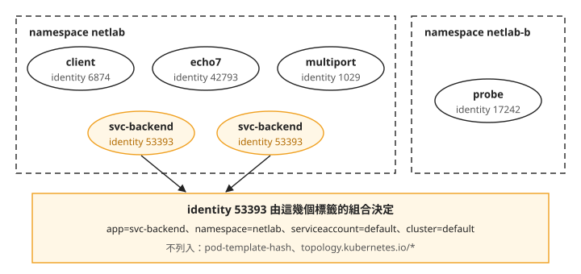
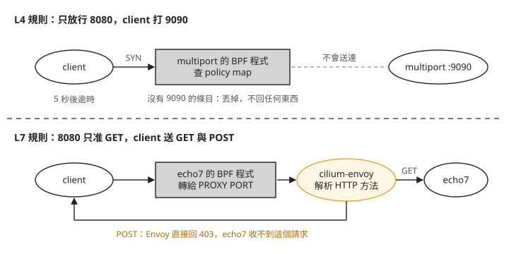
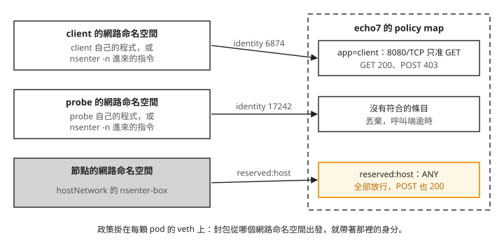

# Day 8: CiliumNetworkPolicy——命名空間隔離、L3/L4 埠限制與 L7 方法

{ align=right width="95" }

你的 `netlab` 命名空間裡有一個 HTTP 服務 `echo7`。照設計，只有同命名空間的 `client` 會呼叫它，而且只會讀（GET），不會寫（POST）。可是 Day 7 裝好 Cilium 之後，叢集裡沒有任何限制：隔壁命名空間的 pod 直接打 `echo7` 的 pod IP 也通，`client` 送 POST 也通。你要寫規則把這些擋掉，再確認規則真的在擋。

這個 sprint 處理過兩次「工作負載連到不該連的地方」：[Day 4](sprint2-day4-falco-custom-rules.md) 用 Falco 在事情發生時發告警，[Day 6](sprint2-day6-tetragon-enforcement.md) 用 Tetragon 殺掉做出違規動作的行程。這一章用第三種做法：Cilium 的網路政策，在封包層讓連線建立不起來，或在 HTTP 層拒絕特定的方法。

讀完之後，一條網路政策套上去、流量卻沒照預期被擋時，你能判斷是政策根本沒被 Cilium 收下、被另一條較寬的規則蓋過，還是流量來自 hostNetwork pod，本來就不受政策管；呼叫端看到的是逾時還是 403，也能告訴你擋下它的是哪一層的規則。

## 步驟 1: 重開叢集，重建實驗用的 pod

Day 7 收工時用 `az aks stop` 停下叢集。重新 `az aks start` 之後，先確認 Day 7 的狀態還在：kube-proxy 沒有回來，Cilium 的 kube-proxy replacement 仍然開著。Day 7 把 kube-proxy 的 DaemonSet 釘在一個不存在的節點選擇器上（Day 7 的[「刪掉的 kube-proxy 一分多鐘後又回來了」](sprint2-day7-cilium-kubeproxy.md#mine-9)），這裡要看受管控制面重開叢集時有沒有把這個修改蓋回去。

下面的指令有兩種執行位置。標著 `(node-shell)` 的，是在 Day 7 建在 `netlab` 的 `node-shell` DaemonSet 裡執行：它在每個節點放一顆開著 `hostPID`、`hostNetwork`、`privileged` 的 ubuntu pod，用 `kubectl -n netlab exec <node-shell 的 pod 名稱> -- …` 進去，就能在節點上下指令。`cilium-dbg` 是 Cilium agent 內附的除錯工具，要在節點上的 agent 容器裡執行，例如 `kubectl -n kube-system exec ds/cilium -c cilium-agent -- cilium-dbg status`。本章之後的 `cilium-dbg` 指令都用這個方式執行：

```console
$ kubectl -n kube-system get ds kube-proxy -o custom-columns=…
NAME         DES   CUR   RDY   SEL
kube-proxy   0     0     0     map[lab.local/no-kube-proxy:true]

$ kubectl get pods -A --no-headers | grep -c kube-proxy         → 0
$ (node-shell) nsenter -t 1 -m -p -- pgrep -a kube-proxy         → (沒有行程)
$ cilium-dbg status --verbose | grep -A2 KubeProxyReplacement
KubeProxyReplacement:   True
  Socket LB:            Enabled
  Socket LB Coverage:   Full
```

DaemonSet 的 `DES`、`CUR` 都是 0，選擇器還是那個不存在的標籤，節點上找不到 kube-proxy 行程，`KubeProxyReplacement` 是 `True`。重開叢集後的這個檢查，每次開工都值得做一次。

重開叢集換來的是全新的 VM（Day 7 步驟 6）。Deployment 和 DaemonSet 會自己回來，直接用 `kind: Pod` 建立的 pod 不會。Day 7 的 `client` 就是這種 pod，要重新建立。

這一章在 Day 7 的 `netlab` 命名空間（`client` 和兩顆 `svc-backend`）之外，再加三個工作負載：

- **`multiport`**：一顆 pod 兩個容器（`hashicorp/http-echo`），分別在 8080 和 9090 回應 `PORT-8080`、`PORT-9090`。Service `svc-multiport` 把 80 對到 8080、90 對到 9090。之後用它測「這個埠通、那個埠不通」。
- **`echo7`**：`traefik/whoami`，聽 8080，Service `svc-echo7` 的 80 對到它。選它是因為沒有政策時它對 GET 和 POST 都回 200。如果後端自己就拒絕 POST，之後看到 POST 失敗，就分不出是政策擋的還是應用拒絕的。
- **`netlab-b` 命名空間的 `probe`**：跟 `client` 一樣是 `nicolaka/netshoot`，用來從另一個命名空間發請求。`probe` 也是直接建立的 pod，重開叢集後同樣要重建。

下面這份檔案把重建 `client` 和這三個工作負載寫在一起。`svc-backend` 是 Deployment，重開叢集後會自己回來，不在這份檔案裡：

```bash
cat > day8-lab.yaml <<'EOF'
apiVersion: v1
kind: Pod
metadata:
  name: client
  namespace: netlab
  labels: {app: client}
spec:
  containers:
    - name: c
      image: nicolaka/netshoot:v0.13
      command: ["sleep", "infinity"]
---
apiVersion: v1
kind: Namespace
metadata:
  name: netlab-b
---
apiVersion: v1
kind: Pod
metadata:
  name: probe
  namespace: netlab-b
  labels: {app: probe}
spec:
  containers:
    - name: c
      image: nicolaka/netshoot:v0.13
      command: ["sleep", "infinity"]
---
apiVersion: apps/v1
kind: Deployment
metadata:
  name: multiport
  namespace: netlab
spec:
  replicas: 1
  selector:
    matchLabels: {app: multiport}
  template:
    metadata:
      labels: {app: multiport}
    spec:
      containers:
        - name: p8080
          image: hashicorp/http-echo:1.0
          args: ["-listen=:8080", "-text=PORT-8080"]
          ports: [{containerPort: 8080}]
        - name: p9090
          image: hashicorp/http-echo:1.0
          args: ["-listen=:9090", "-text=PORT-9090"]
          ports: [{containerPort: 9090}]
---
apiVersion: v1
kind: Service
metadata:
  name: svc-multiport
  namespace: netlab
spec:
  selector: {app: multiport}
  ports:
    - {name: p8080, port: 80, targetPort: 8080}
    - {name: p9090, port: 90, targetPort: 9090}
---
apiVersion: apps/v1
kind: Deployment
metadata:
  name: echo7
  namespace: netlab
spec:
  replicas: 1
  selector:
    matchLabels: {app: echo7}
  template:
    metadata:
      labels: {app: echo7}
    spec:
      containers:
        - name: whoami
          image: traefik/whoami:v1.10
          args: ["--port", "8080"]
          ports: [{containerPort: 8080}]
---
apiVersion: v1
kind: Service
metadata:
  name: svc-echo7
  namespace: netlab
spec:
  selector: {app: echo7}
  ports:
    - {port: 80, targetPort: 8080}
EOF
kubectl apply -f day8-lab.yaml
kubectl -n netlab wait --for=condition=Ready pod --all --timeout=180s
```

之後寫成「`client → svc-multiport:80`」這種形式的結果，都是在呼叫端的 pod 裡用 `kubectl exec` 執行 `curl` 得到的，例如 `kubectl -n netlab exec client -- curl -s -m 5 http://svc-multiport.netlab:80/`。

步驟 7 還會用到一顆特權 pod，到那一步再建。

## 步驟 2: 沒有政策時，什麼都通

先把沒有任何政策時的狀態記下來。之後每看到一次「被擋了」，都要能對照這裡，確認它原本是通的，不是本來就不通。下面是從 `client` 和 `probe` 對各個目標發 curl 的結果，左邊是誰打誰，右邊是回應：

```console
### 同命名空間
client → svc-multiport:80(→8080)        PORT-8080
client → svc-multiport:90(→9090)        PORT-9090
client → svc-echo7 GET                  200
client → svc-echo7 POST                 200
### 出叢集
client → example.com                    200
### 跨命名空間（netlab-b/probe → netlab）
probe → svc-multiport:80                PORT-8080
probe → echo7 的 pod IP                 200      ← 連 Service 都不用經過
```

同命名空間全通，對外的 `example.com` 也通。要注意的是最後一行：`probe` 在另一個命名空間，直接打 `echo7` 的 pod IP 也拿到 200。Kubernetes 的命名空間只是把 API 物件分組，本身不擋任何網路流量。

要擋，就要寫**網路政策**：描述「哪些來源可以連到哪些 pod 的哪些埠」的規則。Kubernetes 有內建的 NetworkPolicy；Cilium 另外提供自己的資源 **CiliumNetworkPolicy**（簡稱 CNP），除了來源和埠，還能寫網域名稱和 HTTP 方法。這一章用的都是 CNP。

### Cilium 怎麼認出一顆 pod

政策寫的是「誰可以連誰」，所以 Cilium 得先能認出「誰」。直覺會想用 IP，可是 pod 重建之後 IP 就變了。來看 Cilium 實際怎麼記這些 pod。Cilium 把它管理的每個網路端點（一般就是一顆 pod）叫 **endpoint**，並替每個 endpoint 建一個 `CiliumEndpoint` 物件，縮寫是 `cep`：

```console
$ kubectl get cep -A -o custom-columns=NS:…,NAME:…,ID:.status.identity.id,IP:…
NS         NAME                           ID      IP
netlab     client                         6874    10.244.0.78
netlab     echo7-…                        42793   10.244.0.212
netlab     multiport-…                    1029    10.244.0.104
netlab     svc-backend-…-h2hkx            53393   10.244.0.178
netlab     svc-backend-…-t5qzj            53393   10.244.0.20      ← 兩顆 pod 同一個號
netlab-b   probe                          17242   10.244.0.164
```

看 `ID` 欄。每顆 pod 都有一個號碼，兩顆 `svc-backend` 的 IP 不同，號碼卻都是 `53393`。這個號碼叫 **security identity**：Cilium 把 endpoint 身上的標籤組合對應成一個數字，標籤一樣的 pod 就拿到同一個號碼。政策比對的是這個號碼，節點上的 BPF map（Day 5 看過的那種核心資料表）存的也是它，不是 IP。所以 pod 重建、換了 IP，只要標籤沒變，政策照樣適用。

用 agent 的 `cilium-dbg` 查 53393 由哪些標籤組成：

```console
$ cilium-dbg identity get 53393
53393   k8s:app=svc-backend
        k8s:io.cilium.k8s.namespace.labels.kubernetes.io/metadata.name=netlab
        k8s:io.cilium.k8s.policy.cluster=default
        k8s:io.cilium.k8s.policy.serviceaccount=default
        k8s:io.kubernetes.pod.namespace=netlab
```

只有五個標籤。pod 身上其實還有 `pod-template-hash` 和 `topology.kubernetes.io/*`，Cilium 預設把這類標籤排除在 identity 之外。如果 `pod-template-hash` 也算進去，同一個 Deployment 每滾動更新一次，就會換一批新的 identity。

把這幾個 pod 和它們的號碼畫成圖：



我們可以從圖上看到兩件事。第一，號碼跟著標籤走，不跟著 pod 走：兩顆 `svc-backend` 標籤相同，號碼就相同。把 `svc-backend` 從 2 顆擴到 3 顆，第三顆的 identity 仍然是 53393。第二，命名空間本身就是 identity 的一部分，所以 `netlab-b` 的 pod 不可能跟 `netlab` 的 pod 共用號碼，這是下一步命名空間隔離能成立的原因。反過來，替 pod 加一個標籤，identity 就會換掉，見[疑難排解：改了標籤，同一組副本短暫套用不同政策](#mine-1)。

## 步驟 3: default-deny 與命名空間隔離 {#step-3}

現在開始擋。第一條政策讓 `netlab` 裡所有 pod 預設拒絕所有進來的連線，這叫 **default-deny**；之後再一條條加上允許的來源。

```bash
cat > default-deny-ingress.yaml <<'EOF'
apiVersion: cilium.io/v2
kind: CiliumNetworkPolicy
metadata:
  name: default-deny-ingress
  namespace: netlab
spec:
  endpointSelector: {}                        # every endpoint in this namespace
  enableDefaultDeny: {ingress: true, egress: false}
  ingress:
    - {}    # an empty rule: puts the endpoints into ingress enforcement mode
            # while allowing no source. THIS is what makes it take effect —
            # enableDefaultDeny alone is rejected, and `ingress: []` loads but
            # enforces nothing. See mines 2 and 3.
EOF
kubectl apply -f default-deny-ingress.yaml
```

`endpointSelector: {}` 選中這個命名空間的所有 endpoint。讓政策生效的是最後那條空規則 `- {}`：它讓選中的 endpoint 開始檢查進來的連線，卻沒有列出任何允許的來源，結果就是全部拒絕。`enableDefaultDeny` 只是把意圖寫明，單靠它不夠，下一小節會看到少了空規則會怎樣。

套上之後，要確認政策有沒有在執行，得問節點上的 Cilium agent，`kubectl` 在這件事上看不到（見[疑難排解：`kubectl get cep` 的政策欄是空的](#mine-4)）。下面每一行依序是 endpoint 編號、identity、正在檢查的方向、標籤，最後兩行是實際打的結果：

```console
$ cilium-dbg endpoint list -o json | …
680   1029    ingress   k8s:app=multiport,k8s:io.kubernetes.pod.namespace=netlab
2272  6874    ingress   k8s:app=client,…
62    17242   none      k8s:app=probe,k8s:io.kubernetes.pod.namespace=netlab-b   ← 隔壁不受影響

$ client → svc-multiport    curl: (28) 逾時
$ probe  → svc-multiport    curl: (28) 逾時
```

`multiport`（endpoint 680）和 `client`（endpoint 2272）的第三欄變成 `ingress`，表示進來的連線現在要逐一比對政策；`netlab-b` 的 `probe` 還是 `none`，因為這條政策只管它所在命名空間的 endpoint。後面的步驟會用這些編號查各個 endpoint 的狀態。你自己的叢集裡，編號和 identity 號碼會不一樣，照 `endpoint list` 的輸出代換。同命名空間的 `client` 現在也連不上 `multiport` 了。

### 被丟掉的封包長什麼樣子

呼叫端只看到逾時。要確認是政策丟的，在節點上的 agent 裡開 `cilium-dbg monitor`，只看丟包事件。下面是此時（只有 default-deny）`client` 打 `multiport` 留下的紀錄：

```console
$ cilium-dbg monitor --type drop
xx drop (Policy denied) flow … to endpoint 680, file bpf_lxc.c:2410,
    identity 6874->1029: 10.244.0.78:59028 -> 10.244.0.104:8080 tcp SYN     ×4
```

這一行有三個地方要看：

1. `to endpoint 680`、`bpf_lxc.c`：丟包發生在目的地 `multiport` 那一端。`bpf_lxc` 是 Cilium 掛在每顆 pod 網路介面上的 BPF 程式，進來的連線由被保護的那顆 pod 這一端檢查。
2. `identity 6874->1029`：紀錄寫的是哪個 identity 打哪個 identity，IP 只是附帶資訊。
3. 目的位址是 `multiport` 的 pod IP 和 8080，不是 Service 的 ClusterIP 和 80。Day 7 的 socket LB 在 `connect()` 時就把 ClusterIP 換成了後端位址（Day 7 的[「`kubeProxyReplacement: false` 不代表 kube-proxy 在做事」](sprint2-day7-cilium-kubeproxy.md#mine-8)），政策看到的是換過之後的位址。`×4` 是同一個 SYN 被丟了四次：TCP 一直重送，呼叫端最後逾時。


### 少了那條空規則會怎樣

寫 default-deny 時，很自然會先試兩種更短的寫法。這一小節的兩段輸出是示範，取自還沒套上正確版時的紀錄。想自己試，記得試完要把正確版套回去，否則後面的步驟結果會不同。第一種只寫 `enableDefaultDeny`、不寫 `ingress`，API server 直接退件：

```console
$ kubectl apply -f default-deny-ingress.yaml
The CiliumNetworkPolicy "default-deny-ingress" is invalid:
* <nil>: Invalid value: "": "spec" must validate at least one schema (anyOf)
* spec.ingress: Required value
```

CRD 要求 `spec` 裡至少要有一個規則區段。對有寫該方向規則的政策而言，`enableDefaultDeny` 預設就是 `true`，這個欄位的用途其實是設成 `false`：讓一條政策套上去時，不要把 endpoint 切成預設拒絕。它是規則的修飾，不能單獨成為一條規則。這種失敗至少看得到，API server 退件，原本套著的政策不受影響。

第二種補上一個空陣列 `ingress: []`，`kubectl apply` 就成功了，但流量完全沒變：

```console
$ kubectl apply -f dd-a.yaml            # enableDefaultDeny + ingress: []
ciliumnetworkpolicy.cilium.io/default-deny-ingress created

$ kubectl get cnp -n netlab
NAME                   AGE   VALID
default-deny-ingress   8s    False

$ kubectl -n netlab get cnp default-deny-ingress -o yaml | tail -5
status:
  conditions:
  - message: rule must have at least one of Ingress, IngressDeny, Egress, EgressDeny
    status: "False"
    type: Valid

### 流量呢？
client → svc-multiport   PORT-8080     ← 完全沒變
probe  → svc-multiport   PORT-8080     ← 完全沒變
```

`kubectl apply` 回 `created`，結束碼是 0，沒有任何警告。如果你已經套過正確版，同名的政策會被這一版覆蓋，這裡顯示的會是 `configured`，而且套著正確版時被擋住的流量會重新通過。唯一的線索是 `kubectl get cnp` 的 `VALID` 欄是 `False`，以及 `.status.conditions` 裡的原因：一條規則至少要有 Ingress、IngressDeny、Egress、EgressDeny 其中一個，空陣列不算。agent 沒有收下這條政策，所以流量照舊。

換句話說，無效的網路政策不會讓流量停下來，而是讓流量照常通過，跟沒套一樣。套完政策，先看 `VALID` 欄，再實際打一次，不要只看 `kubectl apply` 有沒有成功。

如果你照著試了這兩種寫法，用步驟一開始那份正確的檔案重新套回去：

```console
$ kubectl apply -f default-deny-ingress.yaml
```

### 命名空間隔離

default-deny 之後，再加一條政策 `allow-same-namespace`，允許同一個命名空間的 pod 互連。完整檔案如下：

```bash
cat > allow-same-namespace.yaml <<'EOF'
apiVersion: cilium.io/v2
kind: CiliumNetworkPolicy
metadata:
  name: allow-same-namespace
  namespace: netlab
spec:
  endpointSelector: {}
  ingress:
    - fromEndpoints:
        - {}
EOF
kubectl apply -f allow-same-namespace.yaml
```

它選中所有 endpoint（`endpointSelector: {}`），重點是 ingress 規則這幾行：

```yaml
  ingress:
    - fromEndpoints:
        - {}          # "any endpoint in THIS namespace"
```

`fromEndpoints` 列出允許的來源。這裡放了一個空的 selector `{}`，看起來像「任何 endpoint」，但 CNP 是命名空間層級的資源，Cilium 會替它補上「來源也在本命名空間」這個條件。結果：

```console
client(netlab)  → svc-multiport:80    PORT-8080     ✅
probe(netlab-b) → svc-multiport:80    逾時          ❌
probe(netlab-b) → multiport 的 pod IP  逾時          ❌   ← 繞過 Service 也沒用
```

`netlab` 內部互通，`netlab-b` 的 `probe` 不論打 Service 還是直接打 pod IP 都逾時。直接打 pod IP 也擋得住，因為 Cilium 比對的是來源的 identity，而 identity 裡帶著命名空間標籤，跟用哪個位址連過來無關。

## 步驟 4: L3/L4 埠限制 {#step-4}

命名空間隔離只管「誰」。接下來把 `multiport` 再收緊：只有 `client` 可以連，而且只能連 8080。這條政策叫 `multiport-8080-only`，選中 `app: multiport`，ingress 規則是：

```yaml
  ingress:
    - fromEndpoints:
        - matchLabels: {app: client}
      toPorts:
        - ports: [{port: "8080", protocol: TCP}]   # the endpoint's port, not the Service's
```

`toPorts` 寫的是 8080，也就是 pod 上的埠，不是 Service 的 80。政策掛在 endpoint 上，比對時看到的已經是 socket LB 換過的後端埠，Service 的埠號對它沒有意義。完整檔案：

```bash
cat > l3l4-port.yaml <<'EOF'
apiVersion: cilium.io/v2
kind: CiliumNetworkPolicy
metadata:
  name: multiport-8080-only
  namespace: netlab
spec:
  endpointSelector:
    matchLabels: {app: multiport}
  ingress:
    - fromEndpoints:
        - matchLabels: {app: client}
      toPorts:
        - ports:
            - {port: "8080", protocol: TCP}
EOF
```

把它套上去，再打一次：

```console
$ kubectl apply -f l3l4-port.yaml        # 只放行 client → multiport:8080
client → :80(8080)   PORT-8080
client → :90(9090)   PORT-9090        ← 一點都沒收緊
```

9090 照樣通，因為上一步的 `allow-same-namespace` 還在。網路政策是允許清單：一個 endpoint 身上的所有規則取聯集，任何一條允許就放行。`allow-same-namespace` 已經允許同命名空間的所有連線，再加一條更窄的規則，不會讓已經允許的連線變成拒絕。要收緊，得刪掉那條寬的：

```console
$ kubectl -n netlab delete cnp allow-same-namespace
```

刪掉之後：

```console
client → :80(8080)        PORT-8080          ✅ 放行的埠通
client → :90(9090)        curl: (28) 逾時     ❌ 沒放行的埠不通
client → svc-backend:80   curl: (28) 逾時     ❌ 沒放行的目標不通
```

這次 8080 通、9090 不通。`svc-backend` 也連不上了，因為它身上現在只剩 default-deny，沒有任何允許的來源。

Cilium 另外有 `ingressDeny`／`egressDeny`，用來表達「就算別的規則允許也要擋」。本課沒有驗證這一組規則。

### 政策在資料平面上長什麼樣子

每個 endpoint 套用的政策，最後會寫成節點上的一張 BPF map，叫 policy map。用 endpoint 編號查 `multiport`（680）的那一張：

```console
$ cilium-dbg bpf policy get 680           # 680 = multiport 這顆 endpoint
POLICY   DIRECTION   LABELS                     PORT/PROTO   PROXY PORT   BYTES   PACKETS
Allow    Ingress     reserved:host              ANY          NONE          968     12
Allow    Ingress     k8s:app=client             8080/TCP     NONE          974     12
                     k8s:…namespace=netlab
Allow    Egress      ANY                        ANY          NONE            -      -
```

這張表就是 `multiport` 現在套用的全部政策。第二行允許 `app=client` 打 8080/TCP。表裡沒有 9090 這一列，所以 9090 被拒：政策裡並沒有一條「拒絕 9090」的規則，被拒是因為找不到對應的允許條目。

右邊的 `BYTES`、`PACKETS` 是每一列的計數器，可以拿來確認某條規則到底有沒有被用到。這跟 Day 7 用 iptables 的計數器判斷「哪一條規則做了那次翻譯」是同樣的方法。

第一行的 `reserved:host` 不是任何一條政策寫出來的，它代表節點本身。步驟 7 會回頭看這一行。

## 步驟 5: FQDN egress

前面管的都是「誰能連進來」（ingress）。反方向是管 pod 能連出去哪裡（egress）。對外的服務常常換 IP，手動維護 IP 清單很麻煩，Cilium 讓你直接寫網域名稱，這叫 **FQDN 政策**（FQDN 是完整網域名稱）。下面這條政策叫 `client-fqdn-egress`，選中 `app: client`，讓它只能連 `example.com`：

```yaml
  egress:
    - toEndpoints:
        - matchLabels: {"k8s:k8s-app": kube-dns}
      toPorts:
        - ports: [{port: "53", protocol: ANY}]
          rules:
            dns: [{matchPattern: "*"}]    # without this there is no DNS proxy,
                                          # and toFQDNs never learns any address
    - toFQDNs:
        - matchName: "example.com"
```

完整檔案（kube-dns 的標籤在完整檔案裡寫成兩個鍵，意思相同）：

```bash
cat > fqdn-egress.yaml <<'EOF'
apiVersion: cilium.io/v2
kind: CiliumNetworkPolicy
metadata:
  name: client-fqdn-egress
  namespace: netlab
spec:
  endpointSelector:
    matchLabels: {app: client}
  egress:
    - toEndpoints:
        - matchLabels:
            io.kubernetes.pod.namespace: kube-system
            k8s-app: kube-dns
      toPorts:
        - ports:
            - {port: "53", protocol: ANY}
          rules:
            dns:
              - matchPattern: "*"
    - toFQDNs:
        - matchName: "example.com"
EOF
kubectl apply -f fqdn-egress.yaml
```

第二段 `toFQDNs` 是允許的網域清單。第一段允許 `client` 對叢集的 DNS（kube-dns）查詢，並加上 `rules.dns`。這一段不能省，等一下看資料平面就知道為什麼。結果：

```console
client → example.com       200
client → ifconfig.me       curl: (28) 逾時
client → www.google.com    curl: (28) 逾時
client → svc-multiport     curl: (28) 逾時      ← 叢集內也一起被擋了
client 的 dig example.com  <addr-a>       ← DNS 本身還通
```

`example.com` 通，另外兩個網域逾時，DNS 查詢本身還能用。倒數第二行要特別注意：連同命名空間的 `svc-multiport` 也不通了。一條政策只要出現 `egress` 區段，被選中的 endpoint 對外的所有連線就改成預設拒絕，包括原本叢集內的流量。替一顆 pod 加 FQDN 政策時，它需要的叢集內目的地也要一起列進去。

### Cilium 怎麼知道 example.com 是哪個 IP

看 `client`（endpoint 2272）的 policy map：

```console
$ cilium-dbg bpf policy get 2272          # 2272 = client
Allow  Egress  k8s:k8s-app=kube-dns …   53/UDP    PROXY PORT 44427    34828 bytes
Allow  Egress  fqdn:example.com         ANY       NONE                16864 bytes
       reserved:world
```

兩列都跟步驟 4 的不一樣。DNS 那一列的 `PROXY PORT` 有一個數字：符合這一列的封包不會直接放行，而是轉給 cilium-agent 裡的 **DNS proxy**。proxy 替 `client` 轉發查詢，看到回應裡的 IP，再把這些 IP 加進 `fqdn:example.com` 那一列。所以第二列是執行時動態產生的。它底下那個 `reserved:world` 是 Cilium 給叢集外部位址的身分：叢集外的 IP 沒有 pod 標籤，一律歸在這個保留身分下。

proxy 記下的網域與 IP 對應可以直接查：

```console
$ cilium-dbg fqdn cache list
Endpoint  Source  FQDN                TTL   IPs
2272      lookup  example.com.        30    <addr-b>,<addr-a>
2272      lookup  ifconfig.me.        30    <addr-c>
2272      lookup  www.google.com.     30    <addr-d>,…
```

Cilium 並沒有事先把 `example.com` 解析成固定的 IP，而是站在 DNS 查詢的路上，看到答案才放行。這就是第一段 `rules.dns` 不能省的原因：沒有它，DNS 不會經過 proxy，Cilium 看不到任何解析結果，`toFQDNs` 就一直是空的。政策看起來寫對了，連線卻全部被擋。

快取裡還有 `ifconfig.me` 和 `www.google.com`，可是這兩個網域的連線剛剛被擋了，見[疑難排解：被擋掉的網域照樣查得到、進了快取](#mine-6)。

### 代價：一次 curl，proxy 看到十次查詢

[Day 4](sprint2-day4-falco-custom-rules.md#mine-4) 看過 `ndots:5`：pod 查一個點數不夠多的名字時，會先依序接上各個搜尋網域試一輪。在 `client` 上執行一次 `curl http://example.com/`，同時用 `cilium-dbg monitor --type l7` 看 DNS proxy 收到的查詢，一共十次：

| # | 查詢名稱 | 結果 |
|---|---|---|
| 1–2 | `example.com.netlab.svc.cluster.local.` | 空 |
| 3–4 | `example.com.svc.cluster.local.` | 空 |
| 5–6 | `example.com.cluster.local.` | 空 |
| 7–8 | `example.com.<Azure 內部搜尋域>.` | 空 |
| 9–10 | `example.com.` | **有答案** |

每個名字查 A 和 AAAA 各一次，所以兩次一組。第 7–8 那一組是 AKS 在 `/etc/resolv.conf` 多加的 Azure 內部搜尋網域，所以在 AKS 上比一般 Kubernetes 多一輪。十次裡只有最後兩次有答案，但十次全部要經過使用者空間的 proxy。

再比較套政策前後，解析一個名字要花多少時間（`curl` 的 `time_namelookup`，各量 30 次）：

```text
                     mean     p50     p90     max
無 egress 政策       1.99 ms  1.61    1.85    7.56
FQDN 政策            4.35 ms  3.98    6.26    8.12
```

p50 從 1.61 ms 變成 3.98 ms，約 2.5 倍。這是解析一個名字的總時間，包含那十次查詢。同樣的 `ndots:5` 在 Day 4 讓 Falco 每分鐘多出 180 條要有人去看的誤報；在這裡則是每次解析多花約 2.4 ms。

下一步要從 `client` 打叢集內的 `echo7`。這條 egress 政策還在的話，`client` 連不到叢集內的任何服務，所以先刪掉它：

```console
$ kubectl -n netlab delete cnp client-fqdn-egress
```

## 步驟 6: L7，GET 過而 POST 被擋 {#step-6}

回到開場的需求：`echo7` 只讓 `client` 讀，不讓它寫。GET 和 POST 走同一個埠、同一種 TCP 連線，只看位址和埠的 L3/L4 規則分不出來，要讀到 HTTP 請求的內容才行。看應用層內容做判斷的政策叫 **L7 政策**。這條政策叫 `echo7-get-only`，選中 `app: echo7`，寫法跟步驟 4 一樣，只在 `toPorts` 底下多一段 `rules.http`。完整檔案：

```bash
cat > l7-http.yaml <<'EOF'
apiVersion: cilium.io/v2
kind: CiliumNetworkPolicy
metadata:
  name: echo7-get-only
  namespace: netlab
spec:
  endpointSelector:
    matchLabels: {app: echo7}
  ingress:
    - fromEndpoints:
        - matchLabels: {app: client}
      toPorts:
        - ports:
            - {port: "8080", protocol: TCP}
          rules:
            http:
              - method: "GET"
EOF
kubectl apply -f l7-http.yaml
```

新增的就是這幾行：

```yaml
      toPorts:
        - ports: [{port: "8080", protocol: TCP}]
          rules:
            http:
              - method: "GET"
```

貼上之前，`echo7` 被 default-deny 擋著，`client` 的 GET 會逾時。貼上之後：

```console
$ curl -o /dev/null -w 'http_code=%{http_code} time_total=%{time_total}\n' http://svc-echo7.netlab/
http_code=200 time_total=0.003433

$ curl -X POST -d x=1 http://svc-echo7.netlab/
Access denied
http_code=403 time_total=0.003860

$ PUT → 403     DELETE → 403
```

GET 回 200，POST、PUT、DELETE 都回 403。同一顆 pod、同一個 Service、同一個 8080/TCP，結果只因為 HTTP 方法不同而不同。

### 呼叫端看到的差別

L7 政策擋下請求的方式跟 L4 完全不同。把兩種拒絕在呼叫端看到的東西並排：上面是 POST 被 L7 政策拒絕，下面是步驟 4 的 9090 被 L4 政策擋下：

```console
### L7 拒絕（POST → echo7）
$ curl -i -X POST -d x=1 http://svc-echo7.netlab/
HTTP/1.1 403 Forbidden
content-type: text/plain
server: envoy               ← 注意這一行
connection: close

Access denied

### L4 丟包（client → multiport:9090）
$ curl -v http://svc-multiport.netlab:90/
*   Trying 10.0.78.148:90...
* Connection timed out after 5002 milliseconds
curl: (28) Connection timed out after 5002 milliseconds
```

L7 的拒絕是一個完整的 HTTP 回應，header 裡有 `server: envoy`。**Envoy** 是一個 HTTP proxy，Cilium 在每個節點上以 `cilium-envoy` DaemonSet 執行它（Day 7 裝 Cilium 時就看過這個元件）。有了 `rules.http`，送往 `echo7` 8080 的連線會先轉給 Envoy，由它解析 HTTP 方法，再決定轉送或拒絕。L4 規則則是直接丟掉 SYN，呼叫端什麼都收不到，只能等到逾時。

把兩條路徑畫成圖：



照著圖上兩條路徑看。L4 那條，封包在 `multiport` 的 BPF 程式就被丟掉，什麼都不回。L7 那條，BPF 程式把連線轉給 Envoy，GET 繼續送到 `echo7`，POST 由 Envoy 直接回 403，`echo7` 根本沒收到這個請求。

這個差別在實務上有三個影響：

1. **失敗多快回來**：403 在 3.9 毫秒內就回來；L4 要等呼叫端的連線逾時，這裡是 5 秒，正式環境常設 30 秒以上。等待的這段時間，呼叫端的執行緒和連線都被佔著。
2. **好不好追查**：403 帶著回應本文和 header，會留在呼叫端的日誌裡。L4 的逾時跟「對方掛了」「網路斷了」「DNS 壞了」看起來一樣，要到節點上開 `cilium-dbg monitor` 才看得到 `Policy denied`。
3. **會不會重試**：多數 HTTP 用戶端遇到逾時會重試，遇到 403 不會。同樣擋一個請求，L4 寫法會讓被擋的呼叫端一直重打，L7 寫法不會。

Envoy 回的 403 也有副作用，見[疑難排解：應用日誌查不到被拒絕的請求](#mine-7)。

### L7 的成本

多經過一個 proxy 要付出時間。同一個 `client` 對 `echo7` 送同一個 GET，兩種政策只差 `rules.http` 那三行，各量 400 次：L7 政策的 p50 比 L4 多約 0.49 ms（約 +34%）。同一種政策再量一輪，p50 只差 30 µs 以內，所以這個差距來自 L7 規則。對一般的服務呼叫，這通常可以接受；對一次請求要經過很多層服務、或延遲很敏感的路徑，要把它算進去。

時間花在哪裡，從資料平面看得出來。下面比較兩種政策下 `echo7`（endpoint 160）的 policy map，以及 agent 回報的 proxy 狀態：

```console
### L7 政策生效時
$ cilium-dbg bpf policy get 160         # 160 = echo7
Allow  Ingress  k8s:app=client   8080/TCP   PROXY PORT 12286
$ cilium-dbg status | grep Proxy
Proxy Status:  OK, … 1 redirects active on ports 10000-20000, Envoy: external

### 換成 L4 政策
Allow  Ingress  k8s:app=client   8080/TCP   PROXY PORT NONE
Proxy Status:  OK, … 0 redirects active
```

`PROXY PORT` 從 `NONE` 變成一個數字，`redirects` 從 0 變成 1：封包不再由 BPF 查完 map 直接轉送，而是進到使用者空間給 Envoy 解析。`Envoy: external` 表示 Envoy 跑在獨立的 `cilium-envoy` DaemonSet 裡，不在 agent 行程內。這組數字只代表一顆 endpoint、一條 HTTP 規則的情況；`cilium-envoy` 的記憶體在這個規模下維持在 14 Mi 左右，規則或流量多起來會怎樣，本課沒有測。

## 步驟 7: `nsenter` 與 hostNetwork pod {#step-7}

Day 6 看過一個繞過攔截的方法：Tetragon 的攔截以 cgroup 為範圍，`nsenter` 只換命名空間、不換 cgroup，所以另一個命名空間的特權 pod 鑽進受保護的 pod，做被禁止的事也不會被殺（Day 6 [步驟 4](sprint2-day6-tetragon-enforcement.md#step-4)）。同樣的做法對網路政策有沒有用？

在 `attacker` 命名空間建一顆特權 pod `nsenter-box`：開著 `hostPID`（看得到節點上所有行程，才查得到別的 pod 的 PID）和 `privileged`，另外還開了 `hostNetwork`（直接使用節點的網路）：

```bash
cat > attacker.yaml <<'EOF'
apiVersion: v1
kind: Namespace
metadata:
  name: attacker
---
apiVersion: v1
kind: Pod
metadata:
  name: nsenter-box
  namespace: attacker
  labels: {app: nsenter-box}
spec:
  hostPID: true
  hostNetwork: true
  tolerations:
    - operator: Exists
  containers:
    - name: c
      image: nicolaka/netshoot:v0.13
      command: ["sleep", "infinity"]
      securityContext:
        privileged: true
EOF
kubectl apply -f attacker.yaml
```

要進入 `client` 的網路命名空間，得先知道 `client` 在節點上的 PID。`/proc/<pid>` 裡只有指令列，看不出屬於哪顆 pod，所以改用位址反查：逐一進入每個行程的網路命名空間讀 `eth0` 的位址，跟 `client` 的 pod IP 比對：

```bash
A() { kubectl -n attacker exec nsenter-box -- "$@"; }
CLIENT_IP=$(kubectl -n netlab get pod client -o jsonpath='{.status.podIP}')
pids=$(A sh -c 'for p in $(ls /proc | grep -E "^[0-9]+$"); do
  ip=$(nsenter -t $p -n ip -4 -o addr show dev eth0 2>/dev/null | awk "{print \$4}")
  [ -n "$ip" ] && echo "$p ${ip%%/*}"; done' | sort -u)
CLIENT_PID=$(echo "$pids" | awk -v ip="$CLIENT_IP" '$2==ip{print $1; exit}')
```

`probe` 的 PID 用同樣的方式查。此時 `echo7` 只准 `client` 送 GET，`multiport` 只准 `client` 打 8080。從這顆 pod 用三種方式打同樣的目標：第 0 組直接用它自己的網路；第 1 組用 `nsenter -t <client 的 PID> -n` 進入 `client` 的網路命名空間再打；第 2 組進入 `probe` 的網路命名空間再打：

```console
=== 0) 攻擊者用自己的網路命名空間（hostNetwork: true）===
  GET  echo7                200
  POST echo7                200          ← L7 政策形同不存在
  multiport:9090            PORT-9090    ← client 都打不到的埠

=== 1) nsenter -t <client-pid> -n（鑽進 client 的 netns）===
  GET  echo7                200
  POST echo7                403          ← 被 client 的政策擋住
  multiport:8080            PORT-8080
  multiport:9090            curl: (28) 逾時   ← 被 client 的政策擋住

=== 2) nsenter -t <probe-pid> -n（鑽進另一個命名空間的 pod）===
  GET  echo7                curl: (28) 逾時
  multiport:8080            curl: (28) 逾時   ← 比原本更少權限
```

先看第 1、2 組。進入 `client` 的網路命名空間後，GET 通、POST 403、9090 逾時，跟 `client` 自己打的結果一樣；進入 `probe` 的網路命名空間，連 GET 都不通。這跟 Day 6 的結果相反：在這裡，`nsenter` 讓封包帶上那顆 pod 的 identity。同一時間開著 `cilium-dbg monitor`，丟包紀錄也記在被進入的那顆 pod 名下：

```console
identity 17242->1029: …  ← probe 的 identity
identity  6874->1029: …  ← client 的 identity
```

原因在政策執行的位置。每顆 pod 的網路命名空間透過一對 veth（成對的虛擬網路介面，一端在 pod 裡、一端在節點上）接到節點，Cilium 的 BPF 程式就掛在這條 veth 上（Day 0 介紹過的 tc 掛載點）。進了 `client` 的網路命名空間，封包就從 `client` 的 veth 出去，帶著 `client` 的 identity，碰到的也是 `client` 的那一套政策。Tetragon 綁的是 cgroup，`nsenter` 不換 cgroup，所以繞得過；Cilium 綁的是網路命名空間，而 `nsenter -n` 換的正是網路命名空間。

再看第 0 組。不用 `nsenter`，直接從自己的網路發出去，GET、POST 都是 200，連 `client` 都打不到的 9090 也通。原因在步驟 4 那張 policy map 的第一行：

```console
$ cilium-dbg bpf policy get 680
Allow    Ingress     reserved:host      ANY      NONE      968     12
```

`hostNetwork: true` 的 pod 直接使用節點的網路命名空間，在 Cilium 看來它就是節點本身，identity 是 **`reserved:host`**。這次環境的 endpoint policy map 有一條本機 host 的預設放行規則。host firewall（管理主機流量的功能）也沒有啟用，但那是另一項設定，不能把這條放行規則單純歸因於 host firewall 沒開。這一行有它的用途：kubelet 對 pod 做健康檢查也是從節點發出的，少了它，第一條 default-deny 就會讓健康檢查失敗。但它同時讓同一節點上的 hostNetwork pod，不論在哪個命名空間，仍能連到本課測試中受限的服務。`reserved:host` 只代表本機節點，從其他節點的 hostNetwork pod 來的連線，身分是 `remote-node`；本課的叢集只有一個節點，多節點的情況沒有驗證。對照 `probe`：同樣是別的命名空間的 pod，只因為沒有用 hostNetwork，什麼都打不到。

把三組畫在一起：



從圖上看，決定結果的是封包從哪個網路命名空間出發。從 `client` 或 `probe` 的命名空間出發，帶的是那顆 pod 的 identity，套的是那顆 pod 的政策；從節點的命名空間出發，帶的是 `reserved:host`，碰到的是那一行無條件的允許。所以在預設設定下，能建立 hostNetwork pod 的人，從同一個節點發出的連線就不受任何網路政策限制，而這件事在 `kubectl get cnp` 上完全看不出來。要處理它，先限制誰能建立 hostNetwork pod，再區分本機 host 到 endpoint 的放行設定與主機流量政策，見[疑難排解：同節點的 hostNetwork pod 仍能連到受限服務](#mine-9)。

## 疑難排解

### 改了標籤，同一組副本短暫套用不同政策 {#mine-1}

**症狀**：給兩顆 `svc-backend` 加一個 `tier=extra` 標籤，之後一段時間內，兩顆副本的 identity 不一樣：

```console
$ kubectl -n netlab label pod -l app=svc-backend tier=extra --overwrite
$ kubectl get cep …                                （15 秒後）
svc-backend-…-h2hkx   53393        ← 還沒換
svc-backend-…-t5qzj   3065         ← 已經換了

$ cilium-dbg endpoint list
1389   …  53393   … waiting-for-identity     ← 過渡狀態
632    …  3065    … ready

（再 10 秒）兩顆都是 3065
```

**原因**：identity 由標籤組合決定（步驟 2），加了標籤就會換一個新號碼；政策又是綁在 identity 上，所以改標籤等於改這顆 pod 適用哪些政策。換號需要時間，而且同一個 Deployment 的副本不是同時換的：一顆已經是 3065，另一顆還停在 `waiting-for-identity`，約 10–20 秒後才一致。這段時間裡，兩顆副本套用的政策不同。

**修法**：在 Cilium 叢集上，要把標籤當成網路身分的一部分。替 pod 加查詢用的標籤（`tier`、`owner` 之類）之前，先確認有沒有政策會因此選中它或不再選中它，並預期會有十幾秒的不一致。

### `enableDefaultDeny` 單獨寫，`kubectl apply` 被退件 {#mine-2}

CRD 要求 `spec` 至少有一個規則區段，`enableDefaultDeny` 只是修飾，不能單獨成立。正確寫法見[步驟 3](#step-3)。

### `ingress: []` 套上去成功，流量卻完全沒變 {#mine-3}

空陣列不算一條規則，agent 沒有收下這條政策（`kubectl get cnp` 的 `VALID` 是 `False`），流量照常通過，完整輸出見[步驟 3](#step-3)。在 CI 裡要擋這種情況，檢查 `.status.conditions[?(@.type=="Valid")].status`，不要只看 `kubectl apply` 的結束碼。

### `kubectl get cep` 的政策欄是空的 {#mine-4}

**症狀**：想用 `kubectl` 確認哪些 endpoint 正在執行政策，政策欄卻全是 `<none>`，即使政策確實在擋流量：

```console
$ kubectl get cep -n netlab -o custom-columns=NAME:…,IN:.status.policy.ingress.enforcing
NAME       IN
client     <none>       ← 政策明明在執行
multiport  <none>
```

**原因**：`CiliumEndpoint` 的 `.status.policy` 在這個部署裡沒有內容。Cilium 預設不把 endpoint 的政策狀態同步到這個物件上。

**修法**：問節點上的 agent。`cilium-dbg endpoint list` 看每個 endpoint 正在檢查哪個方向，`cilium-dbg bpf policy get <endpoint 編號>` 看逐條規則與計數器。`kubectl get cnp` 的 `VALID` 欄只說明政策被 agent 收下了，不代表它正在某個 endpoint 上執行。這跟 Day 7 的情況類似：`kubectl` 看得到的物件狀態，和 BPF map 裡實際的狀態，要分開確認。

### 加了一條更窄的規則，流量沒有變少 {#mine-5}

一個 endpoint 身上的允許規則取聯集，較寬的那一條已經允許的流量，窄規則收不回來，要刪掉或改掉寬的那一條，做法見[步驟 4](#step-4)。多人共用一個命名空間時要特別注意：只要有人為了方便加了一條 `fromEndpoints: [{}]`，其他人寫的細規則就全部不起作用，而且他們自己測試時都會通過。

### 被擋掉的網域照樣查得到、進了快取 {#mine-6}

**症狀**：`client` 套了只允許 `example.com` 的 FQDN 政策，連 `ifconfig.me`、`www.google.com` 都逾時，但 `cilium-dbg fqdn cache list` 裡有這兩個網域，表示它們的 DNS 查詢成功了（步驟 5）。

**原因**：DNS 那一段寫的是 `matchPattern: "*"`，所有查詢都放行；`toFQDNs` 管的只是查到 IP 之後的連線。這有好有壞。好處是失敗的樣子是「查得到、連不上」，比「查不到」容易追查。壞處是 DNS 這條往外送資料的路沒有關上：被 FQDN 政策限制的 pod，仍然可以把資料編進網域名稱查出去，DNS proxy 會照樣轉發，並寫進快取。

另外，快取裡的 TTL 都是 30 秒，原始回應是 8 秒。Cilium 替 FQDN 快取設了最短 TTL，所以後端換了 IP 之後，舊 IP 最長還會被允許 30 秒。

**修法**：要關掉 DNS 這條路，得把 `matchPattern` 收成明確的網域清單，代價是又要手動維護清單，而 FQDN 政策原本就是為了不用維護清單。這跟 Day 4 調校 Falco 規則時的取捨同一類（Day 4 的[「這兩條例外放行了什麼」](sprint2-day4-falco-custom-rules.md#mine-5)）。本課沒有驗證收窄之後的行為。

### 應用日誌查不到被拒絕的請求 {#mine-7}

**症狀**：呼叫端收到 403，去查被呼叫服務的日誌，卻找不到這個請求。

**原因**：403 是 Envoy 回的，請求在 Envoy 就被擋下，根本沒送到應用（步驟 6 的圖）。官方文件也說明，違反 L7 規則時 Cilium 不會丟封包，而是回 HTTP 403。回應的 header 還帶著 `server: envoy`，讓對方看得出這裡有 L7 政策，而且由 Envoy 執行；每次試探只要幾毫秒、也不會逾時，對方可以換不同的方法和路徑，一一試出政策允許哪些請求。L4 的丟包不給這些資訊。

**修法**：追查 403 時，先看 header 有沒有 `server: envoy`。有的話，這個拒絕要從 Cilium 這一側查，不要在應用日誌裡找。Day 9 會用 Hubble 看這類被拒絕的請求。

### 丟包記在某顆 pod 名下，那顆 pod 卻沒有發出這個連線 {#mine-8}

有人用 `nsenter -n` 進入了那顆 pod 的網路命名空間。Cilium 依網路命名空間決定 identity，所以紀錄寫的是被進入的那顆 pod（[步驟 7](#step-7)）。網路政策的紀錄裡沒有行程資訊，光看 `cilium-dbg monitor` 分不出是 pod 自己發的，還是有人鑽進來發的。要知道是哪個行程，得靠 Day 3–6 的工具：Falco 看得到 `nsenter` 這個動作，Tetragon 記得到是哪個行程。

### 同節點的 hostNetwork pod 仍能連到受限服務 {#mine-9}

**症狀**：一顆 `hostNetwork: true` 的 pod，不論在哪個命名空間，都能打到同一節點上被 L7 方法限制、埠限制、命名空間隔離擋住的目標，`kubectl get cnp` 上看不出任何異狀（步驟 7）。

**原因**：這次環境允許本機 host 存取本機 endpoint，policy map 有一行 `Allow Ingress reserved:host ANY`，無條件放行來自本機節點的連線，而 hostNetwork pod 在 Cilium 看來就是節點。其他節點來的連線身分是 `remote-node`，本課只有一個節點，沒有驗證那種情況。

**修法**：兩個方向。一是限制誰能建立 hostNetwork pod，這是 RBAC 與 Pod Security 的設定。Kubernetes 內建的 Pod Security admission 依 Pod Security Standards 的三個等級（Privileged、Baseline、Restricted）限制命名空間裡的 pod 能用哪些設定，從 Baseline 等級起就不允許 hostNetwork。二是依官方文件檢查本機 host 到 endpoint 的設定：agent 的 `--allow-localhost=policy` 會將這類流量交給政策控制，還要配合 endpoint 政策，保留 kubelet 健康檢查等必要連線。若要管理主機網路流量，則另行評估 `hostFirewall.enabled=true`，並以 CiliumClusterwideNetworkPolicy 的 `nodeSelector` 選取主機。兩者作用範圍不同，不能只開 host firewall 就假定上面的放行已消失。本課沒有實作這些修法，Day 9 仍觀察原設定。

## 想一想

- 同事在 `payments` 命名空間套了一條 CNP，只允許 `app=api` 打 8443，`kubectl apply` 也成功了，但從 `app=batch` 的 pod 打 8443 還是通。你會依序查哪三件事，來分辨是政策沒被收下、被別的規則蓋過，還是 `batch` 的 pod 本來就不受政策管？
- 兩個服務都被同一條政策擋下。一個的呼叫端回報「逾時，重試後還是逾時」，另一個回報「收到 403，header 是 `server: envoy`」。哪一個是 L7 規則擋的？逾時那一個，你要到哪裡、用什麼指令確認它是被政策丟掉的？收到 403 的那一個，為什麼在被呼叫服務的應用日誌裡找不到？
- 監控系統的收集器以 `hostNetwork: true` 的 DaemonSet 執行，要抓 `netlab` 各 pod 的 metrics。`netlab` 套了 default-deny 之後，跟目標 pod 在同一個節點上的那顆收集器還抓得到嗎？這件事對「default-deny 有沒有把這個命名空間保護起來」的判斷有什麼影響？

## 小結

Cilium 的網路政策不看 IP，看的是 identity：一組標籤對應一個號碼，命名空間也是其中一個標籤，所以命名空間隔離擋得住直接打 pod IP，而改一個標籤就等於改了這顆 pod 適用的政策。政策是允許清單，同一個 endpoint 上的規則取聯集，加規則只會放寬；無效的政策則會讓流量照常通過，跟沒套一樣，`kubectl apply` 成功不代表它在執行，要看 `VALID` 欄並問 agent。L4 規則在 BPF 程式裡直接丟封包，呼叫端只看到逾時；L7 規則把連線交給 Envoy，呼叫端很快拿到 403，代價是每個請求多約 0.5 ms，而且應用本身完全不知道有這個請求。之後遇到「政策套了卻沒擋住」，先看政策有沒有被收下、有沒有更寬的規則，再看流量是不是從 hostNetwork pod 來的：在預設設定下，同節點的 hostNetwork pod 仍能連到受限服務。

## 延伸閱讀

想再深入，可以從這幾份開始：

- **[政策規則的基本語意](https://docs.cilium.io/en/stable/security/policy/intro/)** —— 官方說明政策是允許清單，兩條規則並存時，較寬那一條允許的流量全部放行，對應步驟 4。
- **[L7 政策](https://docs.cilium.io/en/stable/security/policy/layer7/)** —— HTTP 的 method 與 path 規則怎麼寫、為什麼要經過節點上的 Envoy，以及官方對「違反 L7 規則不會丟包，而是回 403」的說明，對應[步驟 6](#step-6)。
- **[本機 host 與 endpoint 的政策](https://docs.cilium.io/en/stable/security/policy/layer3/#access-to-from-local-host)** —— 本機來源的預設放行與 `--allow-localhost=policy`，對應[疑難排解的本機連線](#mine-9)。
- **[Host Policies](https://docs.cilium.io/en/stable/security/policy/host/)** —— 以 `nodeSelector` 選取主機的政策及 host firewall 設定；與 endpoint 政策分開閱讀。
- **[Pod 的 DNS 設定與 ndots](https://kubernetes.io/docs/concepts/services-networking/dns-pod-service/)** —— 步驟 5 那十次查詢的來源；同一個機制在 Day 4 造成誤報，在這裡造成延遲。

## 下一步

這一章留下兩種被擋下的流量：L4 的丟包，呼叫端只看到逾時；L7 的拒絕，呼叫端拿到 403，被保護的應用卻沒有任何紀錄。Day 9 換上 Hubble，看這兩種流量在 Cilium 的觀測工具裡分別長什麼樣子，也看它能不能認出步驟 7 那種從 hostNetwork pod 來的連線。[Day 9](sprint2-day9-hubble.md)

---

!!! quote ""
    Cilium 標誌為 Cilium 專案之官方資產（CNCF artwork），此處作社群教學用途。
