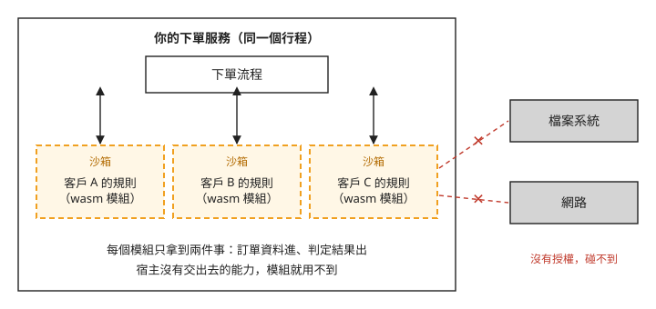
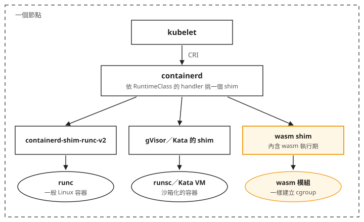
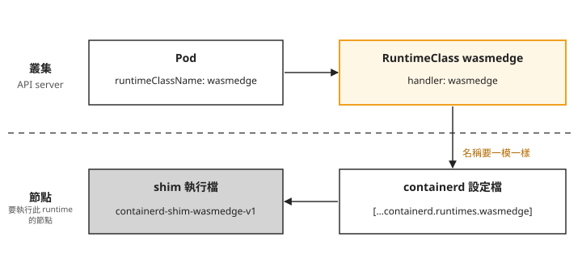

# Day 0: wasm 是什麼——編譯目標、能力沙箱與在 Kubernetes 的執行路徑

{ align=right width="95" }

假設你在做一套電商 SaaS，一個大客戶提出要求：「訂單成立前，要先跑我們自己的風控規則。規則是商業機密，不方便交給你們實作。」換句話說，你要在自己的下單流程裡，執行一段不是你們寫的程式。

這一章從這個需求出發，先介紹 WebAssembly（簡稱 wasm）是什麼、為什麼它適合執行別人寫的程式，再看 Kubernetes 怎麼把一顆 pod 交給 wasm 執行。這一章不碰叢集，Day 1 才會在真的節點上把這條路建出來。讀完之後，遇到「要在自己的平台上執行別人寫的程式」這類需求，你能判斷 wasm 該不該列入候選，也知道要讓 Kubernetes 用 wasm 執行一顆 pod，叢集裡和節點上各要宣告什麼。

## 兩個直覺做法各卡在哪裡

第一個直覺是請客戶自己架一個服務，你在下單流程裡呼叫它。這樣做得到，但規則是在客戶那邊跑的：每張訂單多一次跨網路的往返，客戶也得自己部署服務、維持它不中斷。接的客戶一多，你下單流程的延遲和故障率，就取決於一排你管不到的服務。

第二個直覺是把客戶的程式碼收進來，包成容器自己跑。這省掉了網路往返，但帶來兩個問題。第一，要替不受信任的程式設計檔案、網路與資源限制。第二，如果沿用每個客戶一個常駐服務的設計，幾百個客戶就需要管理幾百個服務，實際規則卻可能只執行幾秒鐘。容器可以限制權限，也可以按需啟動，但你仍要設計這套管理方式。

另一種做法是把規則載入自己的服務，由服務只提供必要的呼叫介面。wasm 適合拿來評估這種外掛需求：客戶的程式在你控制的執行環境裡運作，存取外部資源時必須經過你提供的介面。

## wasm 是什麼

### 一種編譯出來的格式

wasm 一開始是為瀏覽器設計的。網頁想跑運算量大的程式，JavaScript 不夠快。早期的嘗試叫 asm.js：把 JavaScript 限縮成一個嚴格的子集，讓瀏覽器的引擎可以像處理編譯語言那樣最佳化它。這個做法能用，但它終究是文字格式的 JavaScript。WebAssembly 把同一個想法做成正式的二進位格式，官方的定義是：

> 一個以堆疊為基礎的虛擬機的二進位指令格式。

實際開發通常用 Rust、Go、C 等語言，再編譯成 wasm 格式的檔案，這個檔案叫 **wasm 模組**。它也是一種編譯目標：編譯器產生的不是只適用某一款 CPU 的執行檔，而是交給 wasm 執行環境處理的指令。所以回到開場的需求，要問的是客戶的規則能不能編譯成 wasm，而不是客戶要不要學一種新語言。

wasm 的標準在 W3C 的社群群組與工作群組裡制定，參與者包含各主要瀏覽器的代表，不屬於單一廠商。

### 預設什麼都不能做

瀏覽器不能讓一個網頁隨意讀寫你電腦上的檔案。所以 wasm 從一開始就跑在記憶體安全的沙箱裡，而且預設沒有任何能力：不能開檔、不能連網路，連環境變數都讀不到。載入並執行 wasm 模組的那個程式叫**宿主**（host），模組要做什麼，都得由宿主明確交給它。在瀏覽器裡，宿主是瀏覽器；在開場的例子裡，宿主就是你的下單服務。

下面這張圖畫的是開場那個需求改用 wasm 之後的樣子：三個客戶的規則載入同一個服務行程，各自在一個沙箱裡。



我們可以從圖上看到兩件事：

1. 每個模組只拿到下單流程交給它的兩件事：訂單資料進、判定結果出。模組要開檔或連網路，宿主沒有授權就做不到。
2. 三個客戶的模組在同一個行程裡，不需要每個客戶各開一顆 pod。呼叫模組跟呼叫自己程式裡的函式一樣，不用經過網路。

這種設計讓宿主按介面限制規則能存取的資料。不過沙箱本身不替你決定 CPU、記憶體與執行時間上限；客戶規則如果一直不結束，宿主仍需要限制與中斷機制。

### WASI：讓不同宿主提供一致的系統介面

沙箱和授權的規則屬於 wasm 本身，不管宿主是誰都一樣。純運算的 wasm 模組可以由伺服器上的宿主直接執行。若還需要檔案或網路等外部能力，可以使用一組標準的系統介面，讓不同宿主以一致的方式提供它們，這組介面叫 **WASI**（WebAssembly System Interface）。官方的描述是：

> WASI 應用執行在一個**能力式的沙箱**裡：一個 wasm 模組或元件**啟動時不具備任何環境權限，只能做宿主明確授予的事**。

所以 WASI 定義的是宿主可以交出哪些能力、怎麼交出去。官方的目標是讓同一套介面從瀏覽器、雲端到嵌入式裝置都能用。

作業系統並沒有因此變成宿主。載入模組的仍是下單服務或 wasm 執行期；由它實作 WASI 介面，再按授權使用作業系統的功能。

這個 sprint 不展開編譯器與記憶體實作。平台這一側需要知道的是：它是一種編譯出來的格式，預設沒有任何能力，能做什麼由宿主決定。

## Kubernetes 怎麼執行 wasm {#step-2}

開場的例子是把 wasm 模組載進自己的服務。這個 sprint 主要看另一種用法：把 wasm 模組當成工作負載交給 Kubernetes，跟一般的 pod 一樣部署、排程。

### 一顆 pod 實際是誰啟動的

多數人對 Kubernetes 工作負載的印象是這樣：

```text
工作負載 = 容器 = OCI 映像 + Linux 的命名空間與 cgroup
```

這裡的 OCI 是容器映像等格式使用的標準；Linux 命名空間把行程看到的系統資源分開，cgroup 則用來限制與統計資源。這些是一般容器常用的機制。但 Kubernetes 並沒有規定 pod 一定要是 Linux 容器。下面這張圖把一顆 pod 在節點上被啟動的路徑畫出來：



照著圖由上往下看：

1. **kubelet** 是每個節點上負責啟動 pod 的程式。它不自己建立容器，而是透過 **CRI**（Container Runtime Interface，kubelet 跟容器執行期之間的標準介面）請 containerd 去做。
2. **containerd** 是節點上管理容器的程式。它也不直接把工作負載跑起來，而是啟動一支叫 **shim** 的程式，由 shim 負責執行。
3. 一般的 Linux 容器，shim 是 `containerd-shim-runc-v2`，它再呼叫 **runc** 建立命名空間與 cgroup。換成別的 shim，最後跑起來的就可以不是一般容器：可以是 gVisor（在使用者空間攔截系統呼叫的容器沙箱）的 runsc、Kata Containers（用輕量虛擬機包住容器）的虛擬機，也可以是 wasm 模組。wasm 的 shim 不呼叫 runc，整個 wasm 執行期就包在 shim 裡面；Day 4 安裝的 WasmEdge（一個 wasm 執行期）shim 有 109 MiB，節點原本的 `containerd-shim-runc-v2` 是 8.4 MiB。wasm 這條路一樣會替 pod 建立 cgroup，資源限制的做法跟一般容器相同。

本課使用 kubelet 與 containerd 既有的介面，再加入相容的 shim 與對應設定。能否使用仍取決於版本與工作負載格式。

### RuntimeClass：讓 pod 指定要用哪個 shim

剩下的問題是：containerd 怎麼知道某顆 pod 要用哪個 shim？Kubernetes 用一種叫 **RuntimeClass** 的資源來指定。這個 API 在 v1.20 就已經是 stable，現在的叢集都有。一個 RuntimeClass 長這樣：

```yaml
apiVersion: node.k8s.io/v1
kind: RuntimeClass
metadata:
  name: myclass
handler: myconfiguration   # 對應到 CRI 那一側的設定名稱
```

`handler` 是一個名字，對應到節點上 containerd 設定檔裡的一段。Kubernetes 官方文件寫的設定路徑是這個：

```text
[plugins."io.containerd.grpc.v1.cri".containerd.runtimes.${HANDLER_NAME}]
```

照文件或教學貼這段設定之前，先確認節點的 containerd 是哪個大版本，路徑要跟版本對上。

上面這一行是 containerd 1.x 的寫法，網路上多數教學沿用的也是它。containerd 2.x 把負責 CRI 的 plugin 拆成兩個：`io.containerd.cri.v1.runtime` 管執行期，handler 的設定放在這裡；`io.containerd.cri.v1.images` 管映像。本課 Day 1 起用的 AKS 節點是 containerd 2.x，要用 `io.containerd.cri.v1.runtime` 的路徑。

containerd 2.x 仍能轉換舊的 version 2 設定，因此不能只看大版本就判斷哪段一定無效。本課 AKS 設定混合了 version 2 宣告與新的 plugin 名稱，後續工具寫入舊路徑時出現未生效的情況；要一起核對設定格式、解析結果與節點實際回報的 handler。Day 1 會在節點上把實際的設定印出來，見 Day 1 的[「containerd 2.x 節點上的設定路徑」](sprint3-day1-three-generations.md#mine-1)。

把整條對應關係畫成圖，上半是叢集裡的物件，下半是節點上的設定：



圖上用的名字取自 Day 4 的 WasmEdge。我們可以看到，宣告分在兩個地方：

- **叢集裡**：建一個 RuntimeClass，pod 用 `runtimeClassName` 指定它。這只要做一次。
- **節點上**：containerd 設定檔裡要有一段和 `handler` 同名的設定，指向一支已經放到節點上的 shim 執行檔。改完設定要重啟 containerd 才會生效。每一顆要跑這類 pod 的節點都要做。

兩邊的名字對不上，pod 就起不來。Day 1 會分別看「handler 對得上」和「handler 不存在」兩種情況各長什麼樣子。

### gVisor 與 Kata 用的也是 RuntimeClass

RuntimeClass 不是為 wasm 新加的。Kubernetes 官方文件舉的用途，是讓需要更強隔離的 pod 改用 gVisor、Kata Containers 這類執行期；例如設定了 `gvisor` RuntimeClass 的 pod，會以 gVisor 的 `runsc` 執行。

本課建立的 AKS 叢集帶有一個名叫 `kata-vm-isolation` 的 RuntimeClass，但節點上沒有對應的 `kata` handler，Day 1 會看到它跑不起來。

wasm 用的是同一套機制：RuntimeClass、shim 介面、節點設定檔的位置都一樣，換掉的只有 shim。要在 Kubernetes 上跑 wasm，平台這一側要學的是怎麼裝 shim、怎麼改節點設定，Kubernetes 這邊沒有新的概念。

### 兩條已經停止的路

搜尋 wasm 和 Kubernetes 的資料時，會找到兩種已經停止的做法的教學，它們的官網和文章都還在線上。下表把它們跟現行做法放在一起：

| 做法 | 是什麼 | 現況 |
|---|---|---|
| **Krustlet**（2019–2021） | 用 Rust 寫的「假 kubelet」，繞過 CRI，直接向 API server 註冊成節點 | 2021 年停止維護，從未發過正式版 |
| **AKS 的 WASI node pool**（2021–2025） | 雲廠商替你把 shim 裝好，包成受管的預覽功能 | 2025-05-05 起無法再建立，微軟改推薦 SpinKube（在 Kubernetes 上執行 wasm 的開源專案） |
| **RuntimeClass + containerd shim** | 節點裝 shim、叢集宣告 RuntimeClass，跟 gVisor／Kata 同一條路 | 現行做法 |

Krustlet 另外做了一個假的 kubelet，WASI node pool 依賴雲廠商的受管功能，兩者都已經停止；現行做法只用 Kubernetes 已經有的 RuntimeClass。Day 1 會實際確認前兩條今天的狀態。

這個 sprint 會操作三條路線：wasmCloud（一個自帶執行環境的 wasm 應用平台）、手動安裝 WasmEdge 的 shim、由 SpinKube 的 runtime-class-manager 替節點安裝 shim。其中 wasmCloud 不走 RuntimeClass：它在一般的容器裡跑自己的 host，再把多個 wasm 程式（wasmCloud 稱為「元件」）載進同一顆 host pod，比較接近開場那張圖的做法。WasmEdge 和 SpinKube 走的則是 RuntimeClass 加 shim。

## wasm 適合什麼、不適合什麼

常聽到的考慮 wasm 的理由有四個：

- **冷啟動**：常見的說法是 wasm 啟動比容器快。但用 containerd 執行時，wasm 一樣要經過 shim 與 cgroup 的建立，Day 5 會用同一支程式比較 `ctr run --rm` 的耗時；這個量測還包含執行與清理，不能直接視為純啟動時間。
- **產物大小**：應用可編成 wasm 模組，不必附完整 Linux 使用者空間；部署時仍可能包成 OCI 映像，Day 4 會比較不同打包方式。
- **單節點密度**：同樣的記憶體能放下幾個租戶。Day 5 會量同一支程式在兩邊的記憶體用量。
- **跨架構**：同一個模組在 amd64 與 arm64 上都能跑，不用分別編譯。

產物大小與跨架構，本課沒有實測。

截至 2026-08，下列情況不適合用 wasm：

- **依賴完整 POSIX 介面的工作負載。** POSIX 是一組常見的作業系統介面規範；WASI 不保證提供現有 Linux 程式依賴的全部介面。
- **要跑現成的二進位檔。** 沒有原始碼，就編譯不成 wasm。
- **依賴成熟生態系的工作負載。** 函式庫、除錯工具、可觀測性整合都還不完整，跟容器差距很大。
- **需要長期穩定的技術基礎。** 這個生態系汰換得很快：Krustlet 與 AKS 的 WASI node pool 在五年內先後停止，現行做法裡也有一個關鍵元件出現停滯的跡象，Day 6–8 會實測。

整理起來，最典型的使用時機是：系統要執行不是你們自己寫的程式，例如開放客戶自訂規則、讓第三方開發外掛，又不能給它完整的權限。開場那個風控規則就是這種情況。遇到「這段邏輯我們自己寫，你們負責執行」這類要求時，除了另架服務和包成容器，wasm 也是一個選項。這門課介紹它能做什麼、邊界在哪裡，不建議把既有的工作負載搬過去。

## 帶著三個問題走完這個 sprint {#three-questions}

這個 sprint 最後要替你自己的環境回答要不要用 wasm。判斷用的三個問題先列在這裡，後面每一章的實測都在替它們收集資料：

1. **wasm 工作負載要不要看起來跟一般的 Kubernetes 工作負載一樣？** 也就是 Deployment、Service、`kubectl` 那一套能不能照用。三條路線的答案不同，Day 2–8 逐條驗證。
2. **你的動機是不是冷啟動或部署密度？** 「wasm 比容器快、比容器省」這個說法，Day 5 用同一支程式、同一顆節點量。
3. **你選的工具明年還有人維護嗎？** 方法在下一節，每條路線最後一天各查一次。

### 怎麼判斷一個開源專案還有人維護 {#health-method}

下面五項可以拿來查任何工具，其中第 2 項要配著第 4 項一起看：

1. **治理狀態**：在哪個基金會的哪個階段，有沒有封存或遷移的跡象。GitHub repo 的 `archived` 欄位比官網可靠：官網要有人動手才會關掉，封存只要按一個按鈕。
2. **release 節奏，配著第 4 項讀**：只看最後發版日期，會把順序排錯。只依賴穩定介面的元件，三年沒發版也不一定有問題；跟著快速變動的介面走的元件（例如 containerd 的設定結構），每個月發版也可能跟不上。
3. **default branch 上最後一筆不是機器人送的 commit，加上近 13 週的逐週分布**：不要看 GitHub 的 `pushed_at`，dependabot 這類自動升級工具推到自己分支的 commit 也會更新它。也不要只看總和：SpinKube 用來替節點安裝 shim 的 runtime-class-manager，在 2026-08 的查核中，近 52 週有 481 個 commit，最後 7 週沒有新 commit。這是當時的觀察，評估新版本前要重新查。要看的是有沒有連續好幾週是零。
4. **它依賴哪些介面，那些介面變動多快**：這一項決定第 2 項怎麼解讀。
5. **下游採用的第一手證據**：雲廠商的文件、實際的使用量，而不是專案官網自己列的採用名單。另一個少有人用的訊號：一個每次都會重現的 bug 在上游放了多久沒人處理，可以看出那條路徑實際有多少人在用，比 GitHub 的星星數更能說明問題。

本課的每一個工具都用這五項查過，結論寫在各路線的最後一天。連續幾週是零的判讀要保守：七、八週沒有 commit 可能只是暑假，要判定成趨勢，至少隔一季再查一次。

## 想一想

- 一家 CI 平台想讓使用者上傳自訂的建置步驟，這些步驟要用 `apt-get` 安裝套件、呼叫現成的編譯器。wasm 適合拿來執行這些步驟嗎？為什麼？
- 同事在叢集裡建了一個 `handler` 為 `spin` 的 RuntimeClass，pod 也指定了它，卻一直起不來。他確認過 shim 執行檔已經放在節點上。你會先請他檢查哪兩件事？
- 你在評估一個 wasm 相關的 operator：GitHub 顯示 `pushed_at` 是上週，近一年有三百多個 commit，官網列了十家採用的公司。這些資料夠不夠判斷它還有人維護？還要查什麼？

## 小結

wasm 是一種可供不同宿主載入的編譯目標；它不會因為能執行程式，就自動取得讀檔、連線等系統權限。WASI 為這些能力提供標準介面，宿主仍要決定授予什麼，並設定資源限制。在 Kubernetes 上，RuntimeClass 選擇 handler，節點的設定再把 handler 接到對應的 shim；執行檔、設定與必要的隔離環境都要準備好。評估工具時，除了看程式是否能跑，也要看節點怎麼管理、故障如何追查，以及所依賴版本的維護狀況。

## 延伸閱讀

想再深入，可以從這幾份開始：

- **[WebAssembly 官方站台](https://webassembly.org/)** —— 「以堆疊為基礎的虛擬機的二進位指令格式」「可攜的編譯目標」「記憶體安全的沙箱執行環境」這三個說法的出處，也說明了標準是在 W3C 的社群群組與工作群組裡制定的。
- **[WASI 官方站台](https://wasi.dev/)** —— 能力式沙箱那段描述的一手來源：模組啟動時不具備任何環境權限，只能做宿主明確授予的事。
- **[Kubernetes RuntimeClass 文件](https://kubernetes.io/docs/concepts/containers/runtime-class/)** —— 「Kubernetes 怎麼執行 wasm」那一節的依據：v1.20 起 stable、`handler` 如何對應到 containerd 設定檔的 runtimes 區段，以及官方對「在效能與安全之間取捨」這個用途的說明。
- **[gVisor 的 Kubernetes 快速上手](https://gvisor.dev/docs/user_guide/quick_start/kubernetes/)** —— 設定了 `gvisor` RuntimeClass 的 pod 會以 `runsc` 執行，可以對照 wasm 用的是同一套機制。
- **[Component Model 指南](https://component-model.bytecodealliance.org/)** —— 讓不同語言編譯出來的 wasm 互相呼叫、組合的元件模型；Day 2 的 wasmCloud 用到「元件」這個詞時，可以回來查。

## 下一步

這一章講的機制都還沒碰到叢集。[Day 1](sprint3-day1-three-generations.md) 把 RuntimeClass 真的建到叢集裡，並逐一確認 Krustlet、AKS 的 WASI node pool 與現行的 RuntimeClass 加 shim 這三條路今天的狀態，包括對已經停止的受管功能下指令，看它回什麼。

Day 1 之後的順序，依照對節點的改動程度由低到高排：先做完全不用改節點的 wasmCloud，最後才動 containerd 設定。這樣前面的量測不會受到後面改動的影響，最後一天也才有一個乾淨的基準，可以檢查拆掉之後節點有沒有恢復原狀。

---

!!! quote ""
    WebAssembly 標誌為 WebAssembly 專案之官方資產（CC0 1.0），此處作社群教學用途。
