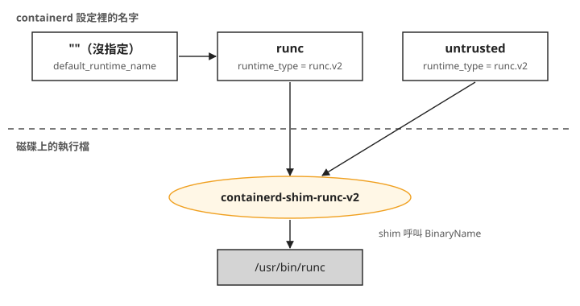
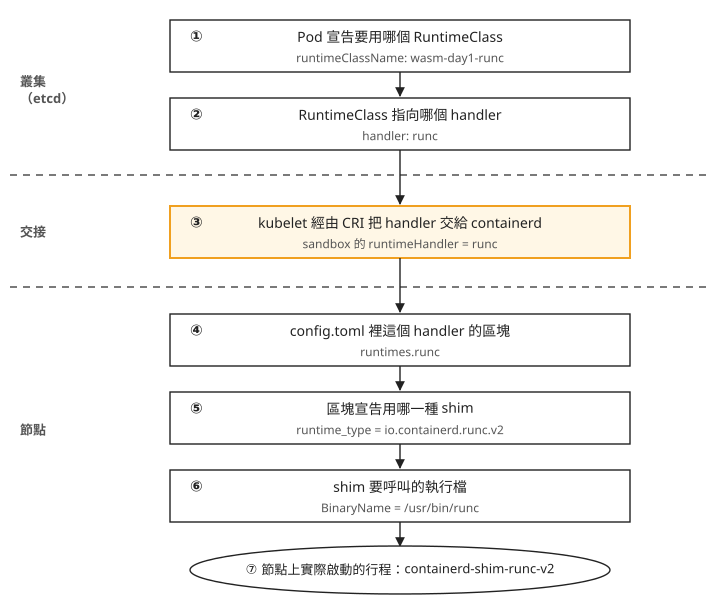
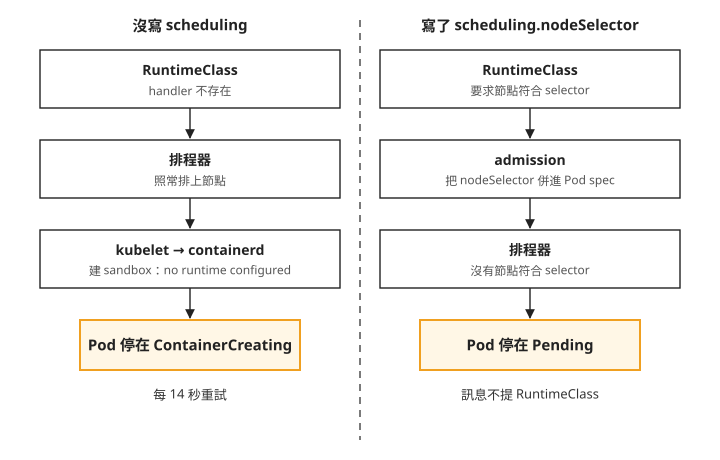

# Day 1: 從 Pod 追到節點上的 shim——RuntimeClass、handler 與兩條已退場的路

{ align=right width="88" }

想在 AKS 上跑 wasm，搜尋結果的前幾筆很可能教你兩種做法：在 `az aks nodepool add` 加上 `--workload-runtime WasmWasi`，建一個微軟代管的 WASI node pool；或是安裝 Krustlet。[Day 0](sprint3-day0-wasm-concepts.md) 提過，這兩條路都已經退場，現行的做法是 RuntimeClass 加上節點上的 containerd shim。

RuntimeClass 是 Kubernetes 用來挑選容器執行方式的物件，它的 `handler` 欄位對應到節點上 containerd 設定裡的一段。Pod 用 `runtimeClassName` 選擇 RuntimeClass，才能指定要用的 handler；未指定時會使用預設 handler，本章的 containerd 設定以 `default_runtime_name = "runc"` 指定預設值。未指定時的行為見 [Kubernetes 官方說明](https://kubernetes.io/docs/concepts/containers/runtime-class/#usage)。

這一章先對兩條舊路各下一次指令，看它們現在的樣子，以後在教學文章裡遇到就認得出來。接著在一座全新的 AKS 叢集上，把 RuntimeClass 從 Pod spec 一路追到節點上實際啟動的程式，再刻意讓它在兩個地方斷掉。Day 4 與 Day 6 會分別在節點上裝 wasm 的 shim，這一章看到的每一層，那天都會再出現一次。

讀完之後，一顆指定了 `runtimeClassName` 的 Pod 起不來時，你能搭配 Pod 的節點指派、Events 與 RuntimeClass 設定，分辨它卡在排程還是容器建立階段。狀態欄本身不足以判定原因。


本章假設本機已安裝 Azure CLI、kubectl、GitHub CLI（`gh`）與 Python 3，Azure CLI 已登入可建立 AKS 的訂閱，且 `<resource-group>` 指向已存在的資源群組；後面的 `<cluster>` 與相關佔位值請替換為自己的實驗環境。

GitHub CLI 須已登入 GitHub，或已透過環境變數 `GH_TOKEN` 提供有效的 token。尚未設定者先執行 `gh auth login`，依提示完成登入，詳見 [GitHub CLI 官方說明](https://cli.github.com/manual/gh_auth_login)。

## 開始之前：一座只給這個 sprint 用的叢集

Day 4 起會改節點上的 containerd 設定，Day 8 要拿這一章存下來的節點設定逐字比對，確認改動拆得乾淨。所以這個 sprint 用一座新的叢集，不要跟裝了其他工具的叢集共用，否則比對時分不出差異是誰造成的。網路用 AKS 預設值，一台 system 節點就夠：

```bash
az aks create -g <resource-group> -n <cluster> \
    --location <region> --tier free \
    --nodepool-name system --node-count 1 --node-vm-size Standard_D2as_v5 \
    --generate-ssh-keys
az aks get-credentials -g <resource-group> -n <cluster>
kubectl create namespace wasmlab
```

`<resource-group>`、`<cluster>`、`<region>` 換成你自己的資源群組、叢集名稱和區域。叢集建立後，請依[步驟 3](#step-3) 確認節點的 containerd 版本與設定路徑，再對照本章範例。

## 步驟 1: 試建一個 WASI node pool

WASI node pool 是 AKS 以前的預覽功能：微軟替你在節點上裝好 wasm 的 shim，建 node pool 時指定執行期類型就能用。微軟已封存的文件寫著，2025-05-05 起無法再建立新的 WASI node pool。我們直接試一次，看它實際回什麼。

核心的 `az` CLI 沒有 `--workload-runtime` 這個參數，舊文件會要你先裝 `aks-preview` 擴充套件：

```bash
az extension add --name aks-preview
```

裝好之後看 `--help`：

```console
$ az aks nodepool add --help | grep -A4 workload-runtime
    --workload-runtime : Determines the type of workload a node can run.
                         Defaults to OCIContainer.  Allowed values:
                         KataCcIsolation, KataMshvVmIsolation,
                         KataVmIsolation, OCIContainer, WasmWasi
                                                       ^^^^^^^^^
```

`WasmWasi` 還在合法值清單裡，說明裡也還附著一個建立 wasm node pool 的範例。只看 `--help`，看不出這個功能已經不能用。真的送出去：

```console
$ az aks nodepool add -g <resource-group> --cluster-name <cluster> \
    -n mywasipool --node-count 1 --node-vm-size Standard_D2as_v5 \
    --workload-runtime WasmWasi

ERROR: (InvalidWorkloadRuntimeSettingError) The agent pool mywasipool has a deprecated workload
runtime WasmWasi. WebAssembly System Interface (WASI) node pools (preview) are no longer supported
on AKS. For more information on the retirement, see https://aka.ms/aks/wasi-retirement. If you'd
like to run WebAssembly (WASM) workloads, you can deploy SpinKube to Azure Kubernetes Service.
Code: InvalidWorkloadRuntimeSettingError
```

先看最後一行的 `Code`。這個錯誤碼來自 ARM（Azure Resource Manager，Azure 上建立、修改資源的請求都會經過的 API 層），表示請求是在伺服器端的資源驗證被擋下，不是 CLI 自己檢查參數時擋的。所以改用 Terraform、SDK 或直接呼叫 REST API，照理也會拿到同一個錯誤；本課只用 `az` 試過。

訊息用現在式寫 `The agent pool mywasipool has a deprecated workload runtime`，讀起來像 pool 已經建出來、需要清理。其實沒有：

```console
$ az aks nodepool list -g <resource-group> --cluster-name <cluster> -o table
Name    Prov       Count
system  Succeeded  1        ← 只有這一個
```

訊息最後也指了遷移方向：改用 SpinKube，也就是本 sprint Day 6–7 要走的路。

### 那個 feature flag 不用去註冊

AKS 的預覽功能通常要先在訂閱上註冊一個 feature flag（預覽功能的開關）才能使用。WASI node pool 的 flag 還留在清單上：

```console
$ az feature list --namespace Microsoft.ContainerService \
    --query "[?contains(name,'Wasm')].{name:name,state:properties.state}" -o table
Name                                            State
microsoft.ContainerService/WasmNodePoolPreview  NotRegistered
```

這裡不去註冊它。註冊 feature flag 是訂閱層級的變更，同一個訂閱底下的所有叢集都會受影響，包括正式環境。而且上面的錯誤碼 `InvalidWorkloadRuntimeSettingError` 說的是 `WasmWasi` 這個值已經淘汰，flag 沒註冊時的錯誤則會說功能沒有啟用，所以註冊了應該還是會被拒。這一點是從錯誤碼推論的，本課沒有實際註冊驗證。

結論很簡單：教學文章裡看到 `--workload-runtime WasmWasi`，就知道那篇已經過時，不必照著做。

## 步驟 2: 查 Krustlet 的現況

Krustlet 是更早的做法：一個用 Rust 寫的程式，實作 kubelet 的部分功能，直接向 API server 註冊成一個節點，wasm 由它自己執行，不經過 containerd。這裡不部署它，只查看課程驗證時（2026-08）的狀態，因為搜尋時很容易遇到它的教學。

Day 0 的[專案健康度檢查方法](sprint3-day0-wasm-concepts.md#health-method)建議先看 release 和 commit。先看 release：

```console
$ gh api repos/krustlet/krustlet/releases --jq '.[] | "\(.tag_name)\t\(.published_at)"'
v1.0.0-alpha.1   2021-07-27T17:06:02Z
v0.7.0           2021-03-24T21:57:49Z
...
```

最後一個 release 是 2021-07-27 的 `v1.0.0-alpha.1`。省略掉的其他幾個也一樣，九個 release 全部標成 prerelease（預先發行版本），這個專案從來沒有發過正式版。

再看 repo 本身和最後一次 commit 改了哪些檔案。GitHub API 的星數欄位叫 `stargazers_count`，照下面這行打會得到 `"stars": null`，所以底下紀錄裡的星數和這行指令對不上；要看星數請改成 `stars:.stargazers_count`（修正後的寫法本課沒有實跑）：

```console
$ gh api repos/krustlet/krustlet --jq '{archived,pushed_at,stars}'
{ "archived": false, "pushed_at": "2023-10-02T18:41:06Z", "stars": 3605 }

$ gh api repos/krustlet/krustlet/commits/main --jq '.files[].filename'
README.md
```

最後一次 commit 在 2023-10-02，只改了 README，加進去的是這句話：

> ⚠️ This project is currently not actively maintained.

同一份 README 往下三行，還留著：

> 📯 Krustlet 1.0 coming soon!

再看官網和文件站：

```console
$ curl -s -o /dev/null -w "%{http_code}\n" https://krustlet.dev/
200
$ curl -s -o /dev/null -w "%{http_code}\n" https://docs.krustlet.dev/intro
200
```

兩個網站都正常回應，頁面上沒有停止維護的標示，repo 也沒有封存（`archived: false`）。只看官網和星星數，會以為這是一個還在運作的專案。判斷專案狀態要看 release 和 commit 紀錄，這裡就是一個例子。

那份封存的 AKS 文件裡，還有一段給 Krustlet 使用者的遷移說明：

> 如果你還在用基於 Krustlet 的 WASI node pool,可以建立一個新的 WASI node pool 來遷移到 containerd shim。

同一頁最上面的警告卻是：

> 2025 年 5 月 5 日起,你將無法建立新的 WASI node pool。

照這份文件從 Krustlet 遷移，會被指到步驟 1 那個已經不能建立的功能。兩條舊路都確認關了，接下來看現行的做法。

## RuntimeClass 的兩半

這條路分成兩半：叢集裡的 RuntimeClass 宣告一個 handler 名稱，節點上的 containerd 設定提供這個名稱的實作。

Kubernetes 不會替你檢查這兩半對不對得上。接下來先看節點那一半現在有什麼，再從叢集那一半建 RuntimeClass，一路往下追。

## 步驟 3: 看節點上的 containerd 設定 {#step-3}

要看節點上的檔案，沿用 [Sprint 2 Day 0](sprint2-day0-ebpf-concepts.md) 的做法：建立 `node-shell` DaemonSet，讓每個節點都有一顆特權 Pod，再用 `nsenter` 進到節點的命名空間。

```bash
cat > node-shell.yaml <<'EOF'
apiVersion: apps/v1
kind: DaemonSet
metadata:
  name: node-shell
  namespace: wasmlab
spec:
  selector:
    matchLabels: {app: node-shell}
  template:
    metadata:
      labels: {app: node-shell}
    spec:
      hostPID: true
      hostNetwork: true
      dnsPolicy: ClusterFirstWithHostNet
      tolerations:
        - operator: Exists
      containers:
        - name: shell
          image: ubuntu:24.04
          command: ["sleep", "infinity"]
          securityContext:
            privileged: true
          volumeMounts:
            - {name: hostroot, mountPath: /host}
      volumes:
        - name: hostroot
          hostPath: {path: /}
EOF
kubectl apply -f node-shell.yaml
kubectl -n wasmlab rollout status ds/node-shell --timeout=5m
NODE_SHELL_POD=$(kubectl -n wasmlab get pod -l app=node-shell -o jsonpath='{.items[0].metadata.name}')
```

以下在本機終端機執行。`NODE_SHELL_POD` 是剛查出的 Pod 名稱，DaemonSet 的 Pod 名稱會帶隨機後綴；不要把 DaemonSet 名稱直接當 Pod 名稱。先看 containerd 的版本和設定目錄：

```console
$ kubectl -n wasmlab exec "$NODE_SHELL_POD" -- nsenter -t 1 -m -- containerd --version
containerd github.com/containerd/containerd/v2 2.3.3-2

$ kubectl -n wasmlab exec "$NODE_SHELL_POD" -- nsenter -t 1 -m -- ls /etc/containerd/
config.toml
kubenet_template.conf          ← 沒有 conf.d/,預設是單一檔案
```

containerd 是 2.x，設定只有 `config.toml` 一個檔案。版本要先記下來，因為 containerd 1.x 和 2.x 的設定寫法不同，下面馬上會用到。

在本機建立以下四份基準檔。Day 2 比較安裝前後，Day 8 也會用到；`containerd config dump` 讀取設定檔並展開預設值，並非向執行中的服務查詢已載入設定：

```bash
kubectl -n wasmlab exec "$NODE_SHELL_POD" -- nsenter -t 1 -m -- cat /etc/containerd/config.toml > baseline-containerd-config.toml
kubectl -n wasmlab exec "$NODE_SHELL_POD" -- nsenter -t 1 -m -- containerd config dump > baseline-containerd-config-dump.toml
kubectl get node -o jsonpath='{.items[0].status.runtimeHandlers}' | python3 -m json.tool > baseline-node-runtimehandlers.json
kubectl -n wasmlab exec "$NODE_SHELL_POD" -- nsenter -t 1 -m -- sh -c 'ls -la /usr/bin/containerd-shim* /usr/bin/runc' > baseline-shim-binaries.txt
```

內容是這樣（中間省略了映像倉庫設定的幾行）：

```toml
version = 2
oom_score = -999
[plugins."io.containerd.cri.v1.images"]
  [plugins."io.containerd.cri.v1.images".pinned_images]
    sandbox = "mcr.microsoft.com/oss/v2/kubernetes/pause:3.6"
  …
[plugins."io.containerd.cri.v1.runtime".containerd]
    default_runtime_name = "runc"
    [plugins."io.containerd.cri.v1.runtime".containerd.runtimes.runc]
      runtime_type = "io.containerd.runc.v2"
    [plugins."io.containerd.cri.v1.runtime".containerd.runtimes.runc.options]
      BinaryName = "/usr/bin/runc"
      SystemdCgroup = true
    [plugins."io.containerd.cri.v1.runtime".containerd.runtimes.untrusted]
      runtime_type = "io.containerd.runc.v2"
    [plugins."io.containerd.cri.v1.runtime".containerd.runtimes.untrusted.options]
      BinaryName = "/usr/bin/runc"
[metrics]
  address = "0.0.0.0:10257"
```

看 `runtimes.runc` 那一段的開頭：`plugins."io.containerd.cri.v1.runtime"`。Day 0 照 Kubernetes 官方 RuntimeClass 文件寫的是另一個名稱：

```text
[plugins."io.containerd.grpc.v1.cri".containerd.runtimes.${HANDLER}]
```

那是 containerd 1.x 的 plugin 名稱。containerd 2.x 把 CRI 相關設定拆成映像和執行期兩個 plugin，執行期這一半的路徑變成：

```text
[plugins."io.containerd.cri.v1.runtime".containerd.runtimes.${HANDLER}]
```

<span id="mine-1"></span>containerd 2.x 仍支援舊的 version 2 格式並會遷移，不能把所有舊路徑都判定為無效。對照設定範例時，要一起確認執行檔版本、設定格式與既有 plugin 路徑。

上面的 `config.toml` 宣告 `version = 2`，內容卻已使用 2.x 的 plugin 名稱，執行 `containerd config dump` 時會出現這行警告：

```console
level=warning msg="Configuration migrated from version 2, use `containerd config migrate` to avoid migration"
```

看到 `version = 2` 不代表節點跑的是 containerd 1.x，要以 `containerd --version` 為準。

### 節點上有幾個 handler

設定裡每一段 `runtimes.<名稱>` 就是一個 handler。這份設定有兩個：`runc` 和 `untrusted`。兩段的 `runtime_type` 和 `BinaryName` 一樣，差別只在 `runc` 多了 `SystemdCgroup = true`。`untrusted` 是 Kubernetes 早年一個 pod annotation 留下的相容性入口，最後執行的程式跟 `runc` 相同。上面那行 `default_runtime_name = "runc"`，決定 Pod 沒有指定 RuntimeClass 時用哪一個 handler。

同一份清單不進節點也查得到。kubelet 會把節點上可用的 handler 回報在 Node 物件的 `status.runtimeHandlers`：

```console
$ kubectl get node -o jsonpath='{.items[0].status.runtimeHandlers}' | python3 -m json.tool
[ { "name": "",          "features": {…} },
  { "name": "runc",      "features": {…} },
  { "name": "untrusted", "features": {…} } ]
```

三筆裡多出來的空字串，就是沒有指定 `runtimeClassName` 時走的預設路徑。Day 6 裝好 wasm 的 shim 之後，這裡應該會多一筆，所以這行指令是那天最快的檢查方式。

handler 只是設定裡的名稱，真正執行的是磁碟上的檔案。containerd 不直接啟動容器，它會為 Pod 起一個叫 **shim** 的小程式，由 shim 去呼叫底層的執行檔。`runtime_type = "io.containerd.runc.v2"` 指定用哪一種 shim，containerd 照這個名稱在節點上找 `containerd-shim-runc-v2` 這個執行檔；`BinaryName` 則是 shim 要呼叫的程式。

接下來幾個指令要在節點的檔案系統裡執行。開一個節點上的 shell，這個視窗先留著，`kubectl` 指令另開一個終端機執行：

```bash
kubectl -n wasmlab exec -it "$NODE_SHELL_POD" -- nsenter -t 1 -m -- bash
```

在節點 shell 裡列出 shim 執行檔：

```console
$ ls -la /usr/bin/containerd-shim* /usr/bin/runc
-rwxr-xr-x 1 root root  8805376 /usr/bin/containerd-shim-runc-v2
-rwxr-xr-x 1 root root 10015640 /usr/bin/runc
```

節點上只有一個 shim 執行檔。把設定裡的名稱和磁碟上的檔案畫在一起，上半是設定，下半是執行檔：



我們可以從圖上看到，三條路最後都落在同一個 shim 和同一個 `runc`。Day 6 要做的兩件事也都在這張圖上：在下半放進一個新的 shim 執行檔，在上半加一段指向它的設定。少了任何一件，wasm 的 Pod 都起不來。

新增 RuntimeClass 之前，先在本機終端機查詢叢集已有的物件。以下是本章 AKS 叢集的兩筆內建物件：

```console
$ kubectl get runtimeclass
NAME                HANDLER   AGE
kata-vm-isolation   kata      4m32s
runc                runc      4m33s
```

接下來會另外建立 RuntimeClass；內建的 `kata-vm-isolation` 留到步驟 5 檢查。

## 步驟 4: 建 RuntimeClass，追到節點上的程式 {#step-4}

### handler 對得上的時候

建一個 handler 指向 `runc` 的 RuntimeClass，再起一顆指定它的 Pod：

```bash
cat > runtimeclass-runc.yaml <<'EOF'
apiVersion: node.k8s.io/v1
kind: RuntimeClass
metadata:
  name: wasm-day1-runc
handler: runc          # this handler DOES exist on the node
EOF

cat > pod-runc.yaml <<'EOF'
apiVersion: v1
kind: Pod
metadata:
  name: pod-runc-handler
  namespace: wasmlab
spec:
  runtimeClassName: wasm-day1-runc
  containers:
    - name: app
      image: mcr.microsoft.com/cbl-mariner/base/core:2.0
      command: ["sleep", "infinity"]
EOF
kubectl apply -f runtimeclass-runc.yaml -f pod-runc.yaml
```

剛才的清單已有一個叫 `runc` 的 RuntimeClass，這裡刻意自己建一個。Day 6 要建的 wasm 版本，除了 handler 名稱以外跟這份一樣。

節點上的第二個 handler `untrusted` 也建一組，等一下拿來對照：

```bash
cat > runtimeclass-untrusted.yaml <<'EOF'
apiVersion: node.k8s.io/v1
kind: RuntimeClass
metadata:
  name: wasm-day1-untrusted
handler: untrusted
---
apiVersion: v1
kind: Pod
metadata:
  name: pod-untrusted-handler
  namespace: wasmlab
spec:
  runtimeClassName: wasm-day1-untrusted
  containers:
    - name: app
      image: mcr.microsoft.com/cbl-mariner/busybox:2.0
      command: ["sh", "-c", "sleep 3600"]
EOF
kubectl apply -f runtimeclass-untrusted.yaml
```

兩顆 Pod 都會進入 `Running`。但這還不能證明 `pod-runc-handler` 是經由 `runc` 這個 handler 起來的，因為不指定 `runtimeClassName` 它一樣會跑。要確認，得問 containerd 那一側。

kubelet 和 containerd 之間用 **CRI**（Container Runtime Interface）溝通。kubelet 啟動 Pod 時，會先請 containerd 建一個 **sandbox**（同一個 Pod 裡所有容器共用的執行環境），並在這個請求裡帶上 handler 名稱。`crictl` 是在節點上查 CRI 狀態的工具。在節點 shell 執行 `crictl pods --namespace wasmlab -o json`，看各筆 sandbox 的 `runtimeHandler`。下面是整理過的輸出，`| …` 代表省略顯示處理，不要照著輸入：

```console
$ nsenter -t 1 -m -- crictl pods --namespace wasmlab -o json | …
pod-runc-handler         SANDBOX_READY  runtimeHandler='runc'
pod-untrusted-handler    SANDBOX_READY  runtimeHandler='untrusted'
node-shell               SANDBOX_READY  runtimeHandler=''        ← 沒指定的那顆
```

三顆 Pod 剛好是三種情況：指定 `runc`、指定 `untrusted`，以及什麼都沒指定的 `node-shell`。最後那顆的 `runtimeHandler` 是空字串，表示 kubelet 沒有傳 handler 給 containerd，由 containerd 套用 `default_runtime_name`。結果一樣是 `runc`，但在 CRI 這一層，「沒指定」和「明確指定 `runc`」走的是不同的路徑。

最後一層是節點上實際在跑的程式，同樣在節點 shell 裡查：

```console
$ nsenter -t 1 -m -p -- ps -eo args | grep containerd-shim
/usr/bin/containerd-shim-runc-v2 -namespace k8s.io -id 0ce4e75a... -address /run/containerd/containerd.sock
/usr/bin/containerd-shim-runc-v2 -namespace k8s.io -id 10a205b6... -address /run/containerd/containerd.sock
...
```

Pod 的容器就是由這些 `containerd-shim-runc-v2` 行程管理的。

### 串成一條線

從 Pod spec 到節點上的程式，每一層都看過了。下面這張圖把它們由上往下排起來，虛線上方存在叢集裡（etcd），下方在節點上：



照著圖上的編號看：① 和 ② 是叢集裡的宣告；③ 是 kubelet 把 handler 名稱交給 containerd 的那一步；④ 到 ⑦ 是節點上的設定、執行檔和行程。Day 6 換成 wasm 時，① ② 只換 handler 名稱，真正要動的是節點上的 ④ 到 ⑦，③ 回報的 handler 會跟著改變。

每一層用什麼查，以及這次查到的值：

| 層 | 怎麼查 | 查到的值 |
|---|---|---|
| ① Pod 的宣告 | `kubectl -n wasmlab get pod pod-runc-handler -o yaml` 看 `runtimeClassName` | `wasm-day1-runc` |
| ② RuntimeClass 的 `handler` | `kubectl get runtimeclass` | `runc` |
| ③ CRI 收到的 handler | 節點上 `crictl pods` 看 `runtimeHandler` | `runc` |
| ④ `config.toml` 的 runtime 區塊 | 節點上的設定檔 | `[plugins."io.containerd.cri.v1.runtime".containerd.runtimes.runc]` |
| ⑤ 區塊裡的 `runtime_type` | 同一個區塊 | `io.containerd.runc.v2` |
| ⑥ 區塊裡的 `options.BinaryName` | 同一個區塊 | `/usr/bin/runc` |
| ⑦ 實際啟動的 shim 行程 | 節點上 `ps` | `/usr/bin/containerd-shim-runc-v2` |

### handler 不存在的時候

再建一個 RuntimeClass，handler 指向節點上沒有的名稱。名稱用 `wasmtime-spin-v2`：這是已退場的 WASI node pool 提供的 RuntimeClass 名稱，也是 Day 6 裝好 shim 後應該要能用的那一個。這次是刻意讓它失敗，先看清楚失敗的樣子，Day 6 shim 沒裝好時就能直接認出來。

```bash
cat > runtimeclass-missing.yaml <<'EOF'
apiVersion: node.k8s.io/v1
kind: RuntimeClass
metadata:
  name: wasmtime-spin-v2
handler: wasmtime-spin-v2    # nothing on the node provides this
EOF
```

```console
$ kubectl apply -f runtimeclass-missing.yaml
runtimeclass.node.k8s.io/wasmtime-spin-v2 created      ← 沒有警告
```

API server 直接收下，沒有任何警告，它不會去節點上確認 handler 存不存在。接著送一顆指定它的 Pod。映像用一定拉得到的 `pause`，排除映像本身的問題：

```bash
cat > pod-missing-handler.yaml <<'EOF'
apiVersion: v1
kind: Pod
metadata:
  name: pod-missing-handler
  namespace: wasmlab
spec:
  runtimeClassName: wasmtime-spin-v2
  containers:
    - name: app
      image: registry.k8s.io/pause:3.10
EOF
kubectl apply -f pod-missing-handler.yaml
```

```console
$ kubectl -n wasmlab get pod pod-missing-handler
NAME                  READY   STATUS              RESTARTS   AGE
pod-missing-handler   0/1     ContainerCreating   0          112s

$ kubectl -n wasmlab describe pod pod-missing-handler | tail -3
Failed to create pod sandbox: rpc error: code = Unknown desc =
  unable to get OCI runtime for sandbox "…":
  no runtime for "wasmtime-spin-v2" is configured
```

Pod 已經排上節點，卡在 kubelet 請 containerd 建 sandbox 的那一步：containerd 的設定裡沒有 `wasmtime-spin-v2` 這個 handler。本課紀錄中 kubelet 大約每 14 秒重試一次，Pod 會一直停在 `ContainerCreating`，不會變成 `CrashLoopBackOff` 或 `Error`。如果告警規則只看這幾個狀態，這種失敗不會被發現。

`no runtime for "…" is configured` 指的是 handler 沒有登記。若 handler 已登記，但 shim 執行檔不存在，會在尋找或啟動 shim 時出現另一種錯誤，不能混為一談。

## 步驟 5: 叢集裡本來就有一個跑不動的 RuntimeClass {#step-5}

回頭看步驟 4 前查到的兩個內建物件：`runc` 對得上節點。`kata-vm-isolation` 的 handler 是 `kata`，但步驟 3 數過，節點上沒有這個 handler，也沒有 kata 的 shim。這個物件是 AKS 的 addon-manager（AKS 用來維護叢集內建元件的程式）放的，帶著 `addonmanager.kubernetes.io/mode: Reconcile` 標籤，刪掉也會被裝回來。可見 `kubectl get runtimeclass` 列得出來，不代表叢集跑得動它。

用 `kubectl get runtimeclass kata-vm-isolation -o yaml` 看它的內容，有兩個欄位是我們自己建的 RuntimeClass 沒有的：

```yaml
overhead:
  podFixed:
    memory: 600Mi
scheduling:
  nodeSelector:
    kubernetes.azure.com/kata-vm-isolation: "true"
```

`overhead.podFixed` 宣告這種執行方式本身的固定資源開銷，排程器會把它加進每顆 Pod 的資源需求。kata 要為每個 Pod 開一台輕量 VM，所以多算 600Mi 記憶體。wasm 的 shim 要不要填、填多少，要等 Day 5 量完才知道。

`scheduling.nodeSelector` 限制用這個 RuntimeClass 的 Pod 只能排到有指定標籤的節點。這個排程條件不符合時，Pod 還不會走到建立 runtime 的階段。送一顆指定 `kata-vm-isolation` 的 Pod：

```bash
cat > pod-kata-shipped.yaml <<'EOF'
apiVersion: v1
kind: Pod
metadata:
  name: pod-kata-shipped
  namespace: wasmlab
spec:
  runtimeClassName: kata-vm-isolation
  containers:
    - name: app
      image: registry.k8s.io/pause:3.10
EOF
kubectl apply -f pod-kata-shipped.yaml
```

```console
$ kubectl -n wasmlab describe pod pod-kata-shipped | tail -2
0/1 nodes are available: 1 node(s) didn't match Pod's node affinity/selector
```

Pod 停在 `Pending`，訊息說沒有節點符合 node affinity/selector，完全沒提到 RuntimeClass。原因是 API server 收下 Pod 之前，RuntimeClass 的 admission 外掛（API server 在儲存物件前執行的檢查與改寫步驟）會把 `scheduling.nodeSelector` 合併進 Pod 的 spec。節點沒有 `kubernetes.azure.com/kata-vm-isolation=true` 這個標籤，排程器就找不到可以放的節點。

追查時，用 `kubectl -n wasmlab get pod pod-kata-shipped -o jsonpath='{.spec.nodeSelector}'` 看 API server 上的 Pod 物件，會看到一個你的 manifest 裡沒寫過的 `nodeSelector`，順著它就能找到 RuntimeClass。要查的是 API server 回傳的物件，不是你送出去的 YAML 檔。

回頭對照步驟 4 那顆沒寫 `scheduling` 的 Pod：

```console
$ kubectl -n wasmlab get pod pod-missing-handler
NAME                  READY   STATUS              AGE
pod-missing-handler   0/1     ContainerCreating   112s
```

兩顆 Pod 被擋下的位置不同：一顆已經排上節點、找不到 handler；另一顆因標籤不符合，尚未交給節點執行。畫成圖，左邊是沒寫 `scheduling` 的 RuntimeClass，右邊是寫了的：



我們可以看到兩件事：

1. 沒寫 `scheduling` 時，排程器不檢查 handler 是否存在，照常把 Pod 排上節點，失敗由 kubelet 回報，訊息直接寫出找不到哪個 runtime。
2. 寫了 `scheduling` 時，Pod 在排程器那一關就停下，訊息只說節點不符合 selector。

該寫還是不寫？如果叢集裡有些節點裝了 shim、有些沒有，沒寫 `scheduling` 的 Pod 可能被排到沒裝的節點，同一個 Deployment 會有些副本正常、有些一直卡著，看起來像間歇性故障。本課的叢集只有一個節點，沒有實測這種情況，這是從上面兩種行為推出來的。寫了 `scheduling`，Pod 只會排到符合標籤的節點；標籤必須如實反映 runtime 安裝狀態，不能為了消除 Pending 就任意加上。Day 6 用的 SpinKube 安裝工具會替裝好 shim 的節點打標籤，所以那天建的 RuntimeClass 應該帶 `scheduling.nodeSelector`。

## 收尾

Day 2 會使用這座叢集與四份本機基準檔。RuntimeClass 是叢集層級物件，測試 Pod 則在 `wasmlab`。暫時不用時可以停機：

```bash
az aks stop -g <resource-group> -n <cluster>
```

<span id="mine-4"></span>停機會把節點的 VM 數量降到 0，但節點資源群組（AKS 自動建立、名稱以 `MC_` 開頭的資源群組）裡的 VNet、NSG、受管身分、load balancer 和 Standard 公用 IP 都還留著，要全部清掉只能刪除整座叢集。另外，這一章直接建立的 Pod 沒有 Deployment 之類的控制器管理，節點遭到替換時不會由控制器補回；需要重做測試時重新 `kubectl apply`。`node-shell` 由 DaemonSet 管理，會在符合條件的新節點建立 Pod。

## 疑難排解

### `kubectl get runtimeclass` 列得出來，指定它的 Pod 卻起不來 {#mine-2}

**症狀**：全新的 AKS 叢集就有 `kata-vm-isolation` 這個 RuntimeClass，指定它的 Pod 一直停在 `Pending`。

**原因**：本例先被 RuntimeClass 的 `scheduling.nodeSelector` 擋在排程階段：沒有節點符合它要求的標籤。節點同時也沒有 `kata` handler，但那不是這次 `Pending` 事件的直接原因，見[步驟 5](#step-5)。

**修法**：先對照 Pod 的 Events 與 RuntimeClass 的 selector，再用 `kubectl get node -o jsonpath='{.items[0].status.runtimeHandlers}'` 確認節點上有沒有那個 handler。這個物件由 AKS 維護，刪掉會被裝回來，不必理它，自己的 Pod 不要指定它就好。

### Pod 停在 `Pending`，訊息說 node affinity/selector 不符，但 manifest 沒寫 nodeSelector {#mine-3}

**症狀**：Pod 指定了某個 RuntimeClass，停在 `Pending`，事件是 `didn't match Pod's node affinity/selector`。

**原因**：那個 RuntimeClass 帶了 `scheduling.nodeSelector`，admission 把它併進 Pod spec，而沒有節點有那個標籤。未設定 `scheduling` 時，Pod 可能先排上節點，再因 handler 不存在而停在 `ContainerCreating`；其他原因也會產生這兩種狀態，必須看 Events。兩種情況的比較見[步驟 5](#step-5)。

**修法**：用 `kubectl -n wasmlab get pod pod-kata-shipped -o jsonpath='{.spec.nodeSelector}'` 找出那個 selector，再確認哪些節點應該有這個標籤、那些節點上的 shim 有沒有裝好。

## 想一想

1. 同事在一台 containerd 2.x 的節點上，照一篇 gVisor 教學加了 `runsc` 的設定，重啟 containerd 沒有任何錯誤，但 `status.runtimeHandlers` 裡沒有出現 `runsc`。你會先懷疑什麼？
2. 一個 Deployment 指定了 wasm 的 RuntimeClass，三個副本有兩個 `Running`、一個一直停在 `ContainerCreating`。你會如何對照三顆 Pod 的 Events、節點標籤與 runtime 設定？只有狀態差異，足以判定它有沒有帶 `scheduling` 嗎？
3. 你找到一篇用 Krustlet 在叢集裡跑 wasm 的教學，文中的官網連結打得開，文件看起來也很完整。在照著做之前，你會先查什麼？

## 小結

wasm 進 Kubernetes 的兩條舊路都關了：WASI node pool 的請求會被 ARM 以 `InvalidWorkloadRuntimeSettingError` 拒絕，Krustlet 的 repo 早已停止維護，只是官網還開著。現行的 RuntimeClass 分成兩半，叢集裡宣告 handler 名稱，節點上的 containerd 設定提供實作，Kubernetes 不檢查兩邊是否一致。從 Pod 追下去，依序是 RuntimeClass、CRI 收到的 handler、`config.toml` 的區塊、shim 執行檔和行程。本章的兩個失敗例子分別卡在排程與 sandbox 建立。之後 Pod 起不來時，先看 Events 與節點指派，再用 `status.runtimeHandlers` 和 `containerd --version` 確認節點那一半。

## 延伸閱讀

想再深入，可以從這幾份開始：

- **[AKS WASI node pool 的退場公告](https://github.com/Azure/AKS/issues/4770)** —— 第一方公告，2025-01-28 開、2025-05-06 關：2025-05-05 起無法建立新的 WASI node pool，要求改用 SpinKube 遷移。
- **[已封存的 WASI node pool 文件](https://learn.microsoft.com/en-us/azure/aks/use-wasi-node-pools)** —— 已移入 previous-versions。步驟 2 引用的兩段互相矛盾的說明都在這一頁。
- **[containerd 的 CRI 設定文件](https://github.com/containerd/containerd/blob/main/docs/cri/config.md)** —— 「Runtime classes」一節用的是 containerd 2.x 的 `io.containerd.cri.v1.runtime` 路徑，可對照步驟 3 的設定路徑說明。
- **[Kubernetes RuntimeClass 文件](https://kubernetes.io/docs/concepts/containers/runtime-class/)** —— `handler`、`scheduling`、`overhead` 三個欄位的規格，以及 admission 把 `nodeSelector` 併進 Pod 的說明；它的設定範例仍是 containerd 1.x 的路徑。

## 下一步

這一章追到最後，節點上跑的還是 `runc`，沒有任何 wasm。[Day 2](sprint3-day2-wasmcloud.md) 換上第一條路線 wasmCloud。它不在節點上加 shim，wasm 由一般 Pod 裡的 host 程式執行，所以 Day 2 結束時，節點的 containerd 設定應該跟這一章存下的基準完全相同，那一天會實際比對。三條路線照對節點的改動由少到多排，最後才動 containerd，前面的量測就不會受後面的改動影響。

---

!!! quote ""
    Kubernetes 標誌為 CNCF(Linux Foundation)官方資產,此處作社群教學用途。
