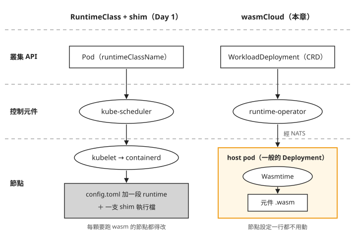
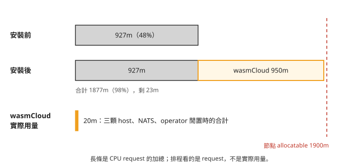
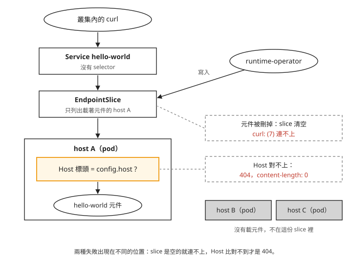

# Day 2: wasmCloud——在一般 pod 裡執行 wasm 元件，與不改節點的代價

{ align=right width="88" }

假設你的團隊要讓客戶上傳的 wasm 規則在叢集上執行，就像 Day 0 那個收單規則的例子。照 Day 1 走過的 RuntimeClass 路線，每顆要跑 wasm 的節點都得多放一支 shim 執行檔，再在 containerd 的 `config.toml` 加一段設定。可是節點映像由 AKS 管理，節點升級或汰換時拿到的是一台從映像重新開出來的 VM，手動加上去的東西要再做一次。這時有人推薦 wasmCloud，理由是它完全不用動節點。

這一章把 wasmCloud 裝進 Day 1 建好的叢集，跑起第一個 wasm 元件，再拿 Day 1 存下的節點基準逐份比對，確認節點真的沒被改過。接著看它把代價放在哪裡：要先預留多少節點資源、Kubernetes 的哪些工具看不到元件，以及出問題時錯誤訊息會在哪裡。

讀完之後，看到一套宣稱「不用改節點」的 wasm 方案，你能判斷元件實際在哪個行程裡執行、Kubernetes 的工具還看得到什麼，以及要替它預留多少資源；遇到元件物件全部 `READY=True` 卻回 404 時，你會先去查 host pod 的 log。

## wasmCloud 為什麼不用改節點

先把兩條路線並排看。下圖左邊是 Day 1 追過的 RuntimeClass 路線，右邊是 wasmCloud；由上往下依序是叢集 API 裡的物件、負責決定位置的控制元件，以及節點上真正執行 wasm 的地方。



我們可以從圖上看到，兩條路線在最底下那一層分開了。左邊的 wasm 由 containerd 透過 shim 啟動，所以節點得先有那支 shim 和對應的設定。右邊的 wasm 根本沒有交給 containerd：它在一顆叫 **host** 的 pod 裡執行。host 是 wasmCloud 提供的普通容器，裡面跑著 wasm 執行引擎 Wasmtime，它載入的是 wasm component（元件）：在 Wasm 模組之外，再宣告可供呼叫、以及需要宿主提供的介面，讓宿主知道如何與它互動。對 containerd 來說，host 只是一般的容器，用節點原本就有的 `runc` 啟動。

圖上另外兩個名字，runtime-operator 和 WorkloadDeployment，等步驟 3 清點安裝結果時再介紹。這一章接下來要用實際輸出確認圖右邊的每一格，最後比對本章追蹤的節點設定與執行檔清單。

## 步驟 1：確認 Day 1 的基準還能用

最後要證明「安裝 wasmCloud 沒有改節點」，做法是把安裝後的節點設定跟 Day 1 存下的基準比對。這個比對有一個前提：基準反映的是節點映像本身，而不是 Day 1 那一台 VM 剛好的狀態。

AKS 的節點可能因映像升級或回收而被替換；本課 stop/start 的紀錄也遇到節點名稱改變，但不能假設每次都一定替換 VM。安裝前先取目前節點的資料，跟 Day 1 的基準比對。若不同，要先確認節點映像或設定是否已改變。

如果 Day 1 已停機，先啟動叢集並重新取得連線設定。`<resource-group>` 與 `<cluster>` 沿用 Day 1 的值；把 kubeconfig 放在本課專用檔案：

```bash
az aks start -g <resource-group> -n <cluster>
az aks get-credentials -g <resource-group> -n <cluster> --file ~/.kube/wasm-lab.conf --overwrite-existing
export KUBECONFIG=~/.kube/wasm-lab.conf
kubectl wait --for=condition=Ready node --all --timeout=10m
```

Day 1 的 `node-shell` 是 DaemonSet。沿用 `node-shell.yaml`，確認它已在目前節點建立 Pod，再取得實際 Pod 名稱。下面的 `nodesh` 只是把「exec 進 node-shell，再用 `nsenter` 進節點」包成一個函式，bash 和 zsh 都能用：

```bash
kubectl apply -f node-shell.yaml
kubectl -n wasmlab rollout status ds/node-shell --timeout=5m
NODE_SHELL_POD=$(kubectl -n wasmlab get pod -l app=node-shell -o jsonpath='{.items[0].metadata.name}')
nodesh() { kubectl -n wasmlab exec "$NODE_SHELL_POD" -- nsenter -t 1 -m -- "$@"; }

nodesh cat /etc/containerd/config.toml > pre-containerd-config.toml
nodesh containerd config dump > pre-containerd-config-dump.toml
kubectl get node -o jsonpath='{.items[0].status.runtimeHandlers}' | python3 -m json.tool > pre-node-runtimehandlers.json
nodesh sh -c 'ls -la /usr/bin/containerd-shim* /usr/bin/runc' > pre-shim-binaries.txt
kubectl get runtimeclass -o name > pre-runtimeclasses.txt
```

前四份對應 Day 1 存下的四份基準；最後一份是叢集上現有的 RuntimeClass 清單，留給步驟 7 比對安裝前後。下面的 `<Day1 基準>` 代表你存放 Day 1 基準檔的目錄，檔名若不同，換成自己的：

```console
$ diff <Day1 基準>/baseline-containerd-config.toml pre-containerd-config.toml
  → exit=0

$ diff <Day1 基準>/baseline-containerd-config-dump.toml pre-containerd-config-dump.toml
  → exit=0

$ diff <Day1 基準>/baseline-node-runtimehandlers.json pre-node-runtimehandlers.json
  → exit=0

$ diff <Day1 基準>/baseline-shim-binaries.txt pre-shim-binaries.txt
  → exit=0
```


本課四份都是 `exit=0`，表示這兩次取樣的基準相同。後續安裝前後的差異，才不會混入先前節點替換造成的改變。這只涵蓋列出的檔案與欄位，不是整台 VM 的完整快照。

## 步驟 2：找到正確的安裝入口

本課用的是 wasmCloud v2.6.1，驗證時（2026-08）它是最新的 release。動手前先用同一條指令查一次，看現在的最新版是哪一個：

```console
$ gh api repos/wasmCloud/wasmCloud/releases --jq '.[] | "\(.tag_name)\t\(.published_at)"' | head -4
v2.6.1   2026-07-29T21:06:31Z
v2.6.0   2026-07-28T22:02:31Z
v2.5.2   2026-07-10T19:25:23Z
v2.5.1   2026-07-02T13:27:14Z
```


wasmCloud 在 Kubernetes 上的安裝方式在 2026 年換過一次，網路上的教學很多還停在舊做法。舊的 `wasmCloud/wasmcloud-operator` repo 已經改名成 `wadm-operator`，而 GitHub 會自動把舊網址轉過去：

```console
$ gh api repos/wasmCloud/wasmcloud-operator --jq '.full_name'
wasmCloud/wadm-operator          ← GitHub 自動轉址,舊 URL 還通

$ gh api repos/wasmCloud/wadm-operator --jq '.pushed_at'
2025-12-15T09:11:53Z             最後 release v0.5.1(2025-12-04)
```


所以教學裡寫 `helm install wasmcloud-operator …` 的，裝到的是 v1 世代的東西，而且照著舊網址點過去也不會看到任何警告。官方文件站也有類似的情況，見[疑難排解：官方文件站的指令裝到上一代 chart](#mine-5)。

v2 的 Kubernetes 安裝入口在主 repo 裡，chart 名稱是 `runtime-operator`，chart 版本與 wasmCloud 本身的版本一起發佈：

```console
$ helm show chart oci://ghcr.io/wasmcloud/charts/runtime-operator --version 2.6.1
name: runtime-operator
version: 2.6.1
appVersion: 2.6.1        ← release train 每次一起推
```


### overlay：疊在 chart 預設值上的設定

Helm 的 chart 是一組 Kubernetes 資源範本，values 是提供給範本的設定。**overlay** 就是額外的一份 values 檔，用來覆寫 chart 的預設值；安裝後這一組資源在 Helm 裡稱為 release。這一章把 release 命名為 `wasmcloud`。

本課使用以下設定：關閉已棄用的 `runtime-gateway`，HTTP 改由 operator 維護 EndpointSlice；host 則開 3 個副本。把下面內容存成 `values.local.yaml`，後面安裝時使用固定的 chart 2.6.1，避免直接讀取會持續變更的 main 分支設定：

```yaml
gateway:
  enabled: false

runtime:
  hostGroups:
    - name: default
      replicas: 3
      service:
        type: ClusterIP
      webgpu:
        enabled: true
      http:
        enabled: true
        port: 80
      resources:
        requests:
          memory: "64Mi"
          cpu: "250m" # 0.25 CPU cores
        limits:
          memory: "512Mi"
          cpu: "500m" # 0.5 CPU cores
```

`hostGroups` 底下的 `default` 是一組 host，叫做 host group，同一組 host 由同一個 Deployment 管理。記住兩個數字：`replicas: 3`，以及每顆 host `requests.cpu: 250m`。步驟 3 會看到它們在一顆 2 vCPU 的節點上代表什麼。

## 步驟 3：安裝，清點它放進叢集的東西

```console
$ helm install wasmcloud oci://ghcr.io/wasmcloud/charts/runtime-operator \
    --namespace wasmcloud --create-namespace --version 2.6.1 -f values.local.yaml
STATUS: deployed
```


CRD 讓 Kubernetes API 認得新的物件種類；operator 是持續觀察這些物件、讓實際狀態符合設定的控制程式。安裝完成後清點一下：5 個 CRD、3 個 Deployment、3 個 ClusterIP Service、3 個 NetworkPolicy，以及一組 RBAC。沒有任何 DaemonSet、webhook、PVC 或 LoadBalancer。DaemonSet 會在符合條件的節點維持 Pod，本章安裝沒有這類元件。不過有沒有 DaemonSet 本身不足以證明節點是否被修改，後面還會檢查權限、掛載與檔案差異。

三個 Deployment 各做一件事：

- **`runtime-operator`**：對帳那 5 個 CRD，決定元件該放在哪一顆 host 上，並替元件的 Service 維護 EndpointSlice。
- **`nats`**：operator 和 host 之間傳遞指令的訊息匯流排。NATS 是一套獨立的開源訊息系統，chart 內建的是單顆、資料不落地的版本，正式環境通常會改接外部的 NATS。
- **`hostgroup-default`**：就是上一節圖上的 host，3 個 replica。映像是 `ghcr.io/wasmcloud/wash:2.6.1`，一個普通的容器映像。

operator 和 host 啟動時都要連 NATS，NATS 還沒好就直接結束、交給 kubelet 重啟。所以剛裝完時 `kubectl get pods` 可能看到重啟；本課紀錄是 2 次，約一分鐘後恢復，但次數與時間依 NATS 就緒情況而異，見[疑難排解：啟動時連不上 NATS](#mine-3)。

### 預留的 CPU 與實際用量 {#cpu}

三個 Deployment 都設了 `resources`，chart 的 values.yaml 註解還寫出了閒置時的量測值：

| Deployment | requests | limits | values.yaml 註解裡的實測值 |
|---|---|---|---|
| `runtime-operator` | cpu 100m / mem 64Mi | mem 192Mi | `Idle ~19Mi (profiled)`,limit 留給 informer cache |
| `nats` | cpu 100m / mem 64Mi | mem 128Mi | `Idle ~6Mi (profiled)` |
| `hostgroup-default` | cpu 250m / mem 64Mi | cpu 500m / mem 512Mi | overlay 覆寫 |

加起來是 3 顆 host 各 250m，加上 operator 與 NATS 各 100m，共 950m。Day 1 的叢集只有一顆 2 vCPU 的節點（`Standard_D2as_v5`），可分配給 pod 的 CPU（allocatable）是 1900m。在節點上用 `kubectl describe node` 看「Allocated resources」，安裝前後的 CPU request 分別是：

```console
# 安裝前
cpu   927m (48%)     memory  994Mi (17%)

# 安裝後
cpu   1877m (98%)    memory  1314Mi (22%)
                     ↑ 節點 allocatable 是 1900m,剩 23m
```


再看這 950m 換到的實際用量，這時還沒部署任何元件：

```console
$ kubectl top pods -n wasmcloud          # 元件還沒部署,純 idle
                             20m   29Mi     ← request 是 950m / 320Mi
```


把這三個數字畫在同一條尺上，長條長度是 CPU request 的加總：



圖上要看的是右端：安裝後只剩 23m，下一個要求超過 23m CPU 的 pod 就會 `Pending`。而 request 是實際用量的 47 倍。排程器只看 request，不看實際用量，所以這段空間雖然閒著，別的 pod 也排不進來。

這不代表 chart 設錯了。每顆 host 250m 是替「host 上跑滿元件」準備的，values.yaml 的註解也說要依預期的元件密度調整。問題在 overlay：`replicas: 3` 是為了在本機的 kind 叢集上示範元件在多顆 host 之間排程，README 卻把它當成一般用途的建議設定。在小節點上安裝時，要自己決定 host 的數量，見[疑難排解：裝完 wasmCloud 後其他 pod 排不進來](#mine-1)。本章後面的步驟照 3 顆 host 的狀態示範，因為「元件只在其中一顆上」正是步驟 5、6 要觀察的現象。

### chart 沒有提供的五個欄位

另一件要先知道的事，是 chart 沒有提供哪些設定。在 wasmCloud 主 repo 的 v2.6.1 原始碼裡搜尋排程相關的五個欄位：

```bash
git clone --depth 1 --branch v2.6.1 https://github.com/wasmCloud/wasmCloud.git
cd wasmCloud
```

```console
$ grep -iE "toleration|affinity|nodeSelector|topologySpread|priorityClass" \
    charts/runtime-operator/values.yaml charts/runtime-operator/templates/runtime/deployment.yaml
                                            ← 五個關鍵字,兩個檔案,零命中
```


`tolerations`、`affinity`、`nodeSelector`、`topologySpreadConstraints`、`priorityClassName` 在 values.yaml 和 Deployment 範本裡一次都沒出現，連覆寫的入口都沒有。所以 host 無法排到帶 taint 的節點、不保證分散在不同節點上，也沒有優先權保護。這幾件事在單節點的叢集上看不出來，Day 3 加第二顆節點時就會遇到，細節見[疑難排解：chart 沒有 tolerations、affinity、priorityClassName](#mine-2)。

## 步驟 4：檢查 host pod 有沒有碰到節點

現在用實際輸出確認開頭那張圖的右半邊。先用 Day 1 的文字寫法，把兩條路線再寫一次。Day 1 的路線是這樣：

```text
Pod spec: runtimeClassName ──▶ RuntimeClass 物件的 handler
                                      │
                                kubelet 把 handler 傳給 CRI
                                      │
                     containerd 查 config.toml 的 runtimes.<handler>
                                      │
                            起對應的 shim 二進位檔
```


每一個箭頭都發生在節點上，最後一格是磁碟上的一個檔案。要跑 wasm，就得在節點上多放一支 shim，並在 `config.toml` 加一段指向它，這是 Day 6 的工作。

wasmCloud 在第一個箭頭之前就分開了：

```text
WorkloadDeployment(CRD) ──▶ runtime-operator ──NATS──▶ host pod(普通 Deployment)
                                                            │
                                                   host 行程裡的 Wasmtime
                                                            │
                                              把 .wasm bytecode 載進來執行
```


元件不會變成一顆 Pod。containerd 在整條路徑上只參與一件事：把 `ghcr.io/wasmcloud/wash:2.6.1` 這個普通容器映像拉下來，跑成 host pod，而這件事用預設的 `runc` 就能完成。下面用三段輸出確認。

以下帶 `…` 的區塊是觀察摘要，不是可直接貼上的完整命令。第一段，在 node-shell 裡用 `crictl pods --namespace wasmcloud -o json` 問 containerd，wasmCloud 的每一顆 pod 用的是哪個 runtime handler：

```console
$ nsenter -t 1 -m -- crictl pods --namespace wasmcloud -o json | …
hostgroup-default-…       runtimeHandler=''
hostgroup-default-…       runtimeHandler=''
hostgroup-default-…       runtimeHandler=''
runtime-operator-…        runtimeHandler=''
nats-…                    runtimeHandler=''
```


Day 1 用同一條指令看過三種值：指定了 `runc` 的是 `'runc'`，指定了 `untrusted` 的是 `'untrusted'`，什麼都沒指定的是 `''`。wasmCloud 的五顆 pod 全部是第三種，跟一般的 pod 走同一條預設路徑。

第二段，看 host 的 Deployment 有沒有要求任何節點權限：

```console
$ kubectl -n wasmcloud get deploy hostgroup-default -o json | …
hostPID / hostNetwork / hostIPC : None None None
privileged                      : None
securityContext : {"allowPrivilegeEscalation": false, "capabilities": {"drop": ["ALL"]},
                   "readOnlyRootFilesystem": true, "runAsNonRoot": true}
volumes         : [oci-cache(emptyDir), tmp(emptyDir),
                   runtime-cert(secret), data-cert(secret)]   ← 零個 hostPath
```


`hostPID`、`hostNetwork`、`hostIPC`、`privileged` 都沒有設，四個 volume 是兩個 emptyDir 加兩個 Secret，沒有 hostPath。Day 1 的 `node-shell` 正好相反，要 `hostPID: true`、`privileged: true` 再掛 `hostPath: /` 才看得到節點。這些欄位說明本章的 host 沒有要求直接掛載主機檔案系統或使用特權；再搭配安裝前後的檔案比較，才能判斷這次安裝沒有改動追蹤的設定。

第三段，看節點本身有沒有被加上標籤、註記或 taint：

```console
$ kubectl get node -o json | …
labels containing 'wasm' or 'spin' : []
annotations containing 'wasm'      : []
taints                             : None
```


這一點到 Day 6 會相反。SpinKube 的 `runtime-class-manager` 會替裝好 shim 的節點打標籤，所以 Day 1 的[「寫不寫 `scheduling`，handler 不存在時的失敗不同」](sprint3-day1-three-generations.md#mine-3)才提醒 Day 6 的 RuntimeClass 要帶 `scheduling.nodeSelector`。節點標籤可用來表示能力，也可能只是管理分類；單靠標籤不能判定是否安裝 runtime。應同時檢查安裝元件的指令、權限、hostPath 與節點檔案差異。

後續建立 manifest 與保存 `post-` 快照前，請回到步驟 1 保存 `pre-` 快照的原工作目錄；步驟 3 曾切進 `wasmCloud` 原始碼目錄。步驟 7 的相對檔名比對需要這些快照放在同一目錄。

### 兩條路線並排

| | **Day 1 / Day 6:RuntimeClass + containerd shim** | **Day 2:wasmCloud host** |
|---|---|---|
| wasm 元件對 Kubernetes 來說是什麼 | 一顆 Pod（有 IP、QoS、probe、`kubectl logs`） | 一個 CRD 物件，Kubernetes 不知道它在跑什麼 |
| 誰決定它跑在哪 | kube-scheduler 決定 Pod 所在節點 | kube-scheduler 排 host Pod；wasmCloud 再決定元件放在哪顆 host |
| 誰真的執行它 | containerd → shim → Wasmtime | host pod 行程裡的 Wasmtime |
| 節點要不要改 | 要：shim 執行檔、`config.toml`，通常還要標籤 | 不用 |
| 隔離邊界 | 每個元件一個 sandbox，含 cgroup 與 namespace | 同一顆 host pod 內的元件共用一個 cgroup，彼此之間靠 wasm 的能力模型隔離 |
| 資源限制粒度 | 每個元件 | 每顆 host，元件之間沒有 Kubernetes 層的上限 |
| Kubernetes 工具 | 以 Pod／Deployment 為對象；HPA、PDB 等仍須另驗 | 可管理 host Pod；元件不是獨立 Pod，不能直接套用同樣的 Pod 管理方式 |
| 升級風險落在哪 | 節點映像與 containerd 版本，例如 Day 1 的[「containerd 2.x 的設定路徑不同」](sprint3-day1-three-generations.md#mine-1) | wasmCloud 自己的控制元件，多一套 NATS 要維護 |

整張表可以收成一句話：shim 路線把 wasm 放進 Kubernetes 原本的 Pod 模型裡，代價是要改節點；wasmCloud 在 Kubernetes 上面另外加了一層排程，節點不用改，代價是 Kubernetes 的工具只看得到 host pod，看不到裡面的元件。步驟 5、6 會看到三個具體的例子。

表中「元件共用一個 cgroup」是從 pod spec 和架構推論的，本課沒有實際跑兩個元件去測它們之間的隔離強度。

## 步驟 5：部署第一個元件

元件用一個叫 **WorkloadDeployment** 的 CRD 描述，搭配一個 Service 讓叢集內可以呼叫它：

```bash
cat > hello-world.yaml <<'EOF'
apiVersion: v1
kind: Service
metadata: { name: hello-world, namespace: wasmcloud }
spec:
  type: ClusterIP        # the upstream sample uses NodePort; AKS NSGs block 30000-32767
  ports: [ { name: http, port: 80, protocol: TCP } ]
                         # no selector — see below
---
apiVersion: runtime.wasmcloud.dev/v1alpha1
kind: WorkloadDeployment
metadata: { name: hello-world, namespace: wasmcloud }
spec:
  replicas: 1
  template:
    spec:
      hostSelector: { hostgroup: default }
      kubernetes: { service: { name: hello-world } }
      components:
        - name: hello-world
          image: ghcr.io/wasmcloud/components/hello-world:0.1.0
      hostInterfaces:
        - namespace: wasi
          package: http
          interfaces: [ incoming-handler ]
          config: { host: hello-world.wasmcloud.svc.cluster.local }
EOF
kubectl apply -f hello-world.yaml
```


manifest 裡有兩個地方跟一般的 Deployment 加 Service 不同。

第一個是 `hostInterfaces` 底下的 `config.host`。它是 HTTP `Host` 標頭的比對值：host 收到請求時，會拿請求的 `Host` 標頭去找哪個元件綁定了這個值，這種做法叫虛擬主機路由。所以它要填呼叫端實際使用的網址，這裡是 Service 的 FQDN。官方範例寫的是 `localhost`，因為範例是給本機 kind 叢集用的；照抄的話會拿到一個沒有任何內容的 404，見[疑難排解：照官方範例填 `localhost`，回 404](#mine-4)。

第二個是 Service 沒有 `selector`，這是刻意的。一般 Service 靠 selector 找出符合標籤的 Pod 當後端，但元件不是 Pod，沒有標籤可以選。wasmCloud 改由 operator 直接寫這個 Service 的 EndpointSlice，只列出真正載著這個元件的 host：

```console
$ kubectl -n wasmcloud get endpointslice
NAME                    PORTS   ENDPOINTS
hello-world-…           80      <host-a>                      ← 只有一個,元件在那顆 host 上
hostgroup-default-…     80      <host-a>,<host-b>,<host-c>    ← 三顆 host 都在
```


`hello-world` 這份 slice 只有一個位址，`hostgroup-default` 那份則列出全部三顆 host。Service 和 kube-proxy 照常運作，只是「哪些後端算數」改由 operator 決定。沒有 selector 的 Service 搭配外部維護的 EndpointSlice，是 Kubernetes 正式支援的用法。

下圖是一個請求從叢集內送出後經過的路徑，也標出兩種失敗分別發生在哪一層：



照著圖由上往下看：請求先經過 Service 與 EndpointSlice，這兩層出問題時是連不上；到了 host A 裡面才比對 `Host` 標頭，比對失敗時連線是成功的，回的是 404。

### 元件不是 Pod

部署元件之後，數一下 `wasmcloud` 命名空間的 pod：

```console
$ kubectl -n wasmcloud get pods --no-headers | wc -l
5                                    ← 部署前也是 5

$ kubectl -n wasmcloud get workloaddeployment,workloadreplicaset,workload
NAME                            REPLICAS   READY
workloaddeployment/hello-world  1          True
NAME                                       REPLICAS   READY
workloadreplicaset/hello-world-748fb64f5c  1          True
NAME                                        READY
workload/hello-world-748fb64f5c-7bb6b5cb69  True
```


這裡統計的是 wasmCloud 的五顆 Pod，不包含另外建立的 `curler`；元件部署前後這五顆沒有增加。多出來的是三層 wasmCloud 自己的物件：`WorkloadDeployment` → `WorkloadReplicaSet` → `Workload`。這三層刻意對應 `Deployment` → `ReplicaSet` → `Pod`，連名稱後面的 hash 都照同樣的規則產生，讓熟悉 Kubernetes 的人一看就懂。不過它們不是 Kubernetes 原生的物件，HPA、PDB、`kubectl rollout` 都無法套用在上面。這是步驟 4 說「工具看不到元件」的第一個例子：`kubectl get pod` 的數量不會隨元件增減。

### 送一個請求

下面的請求從叢集內一顆裝了 curl 的 pod（`curler`）送出，用任何含 curl 的映像建一顆即可。它若放在 `wasmcloud` 命名空間，數 pod 時記得扣掉它。

```console
$ kubectl -n wasmcloud exec curler -- curl -sS -D- http://hello-world.wasmcloud.svc.cluster.local/
HTTP/1.1 200 OK
transfer-encoding: chunked

Hello from wasmCloud!
```


`200 OK`，回應內容是 `Hello from wasmCloud!`。一個 wasm 元件在叢集上回應了 HTTP 請求，而叢集裡沒有因此多出任何 pod。

## 步驟 6：元件有多大、起多快、用多少記憶體

元件和容器映像一樣放在 OCI registry 上。直接看它的 manifest：

```console
$ curl …/v2/wasmcloud/components/hello-world/manifests/0.1.0
"config": { "mediaType": "application/vnd.wasm.config.v0+json", "size": 469 },
"layers": [
  { "mediaType": "application/wasm", "size": 224241 }      ← 219 KiB,單一 layer
]
```


`mediaType` 是 `application/wasm`，只有一層，大小 219 KiB。容器映像的 layer 是打包好的 rootfs（`tar+gzip`），這裡沒有 rootfs、沒有 libc，也沒有 base image，只有一個 wasm 檔。Day 5 比較映像大小時會再用到這個數字。

啟動時間分兩個尺度量。第一個看 host 自己的 log，從開始拉取元件到元件啟動；第二個從 `kubectl apply` 開始，在叢集內每 0.2 秒送一次請求，量到第一個 HTTP 200 為止：

```console
# host 內部:從拉取元件到 workload 起來
05:47:14.466  WARN  pull_component{reference=…hello-world:0.1.0}
05:47:14.997  INFO  Starting workload
                                            →  531 ms

# 端到端:kubectl apply 到第一個 HTTP 200(叢集內每 0.2s 輪詢)
attempts=7  elapsed_sec=3.63
```


host 內部是 531 ms，端到端是 3.63 秒。兩個量測涵蓋的範圍不同，後者還包含控制器處理、路由更新與輪詢等待。本課沒有分別量測各階段，不能把差額指定給其中某個元件。

這兩個數字都不能當成「wasm 的冷啟動時間」。前者包含從 registry 拉取元件（量的時候元件已在快取裡）與 Wasmtime 編譯，後者包含整條控制路徑；兩者都只量了一次，沒有重複取樣，也沒有拿容器來對照。拿來估量級可以，比較快慢要等 Day 5 用同一支程式、同一顆節點量。

記憶體要看 host 層級，因為 `kubectl top` 只看得到 pod，這是工具看不到元件的第二個例子：

```console
$ kubectl top pods -n wasmcloud
hostgroup-default-…   1m   25Mi     ← 目前承載 hello-world
hostgroup-default-…   6m   25Mi     ← 曾經承載過,現在沒有
hostgroup-default-…   1m    4Mi     ← 從頭到尾沒載過
```


三顆 host 裡，從沒載過元件的是 4Mi，載過的是 25Mi。中間那顆的元件已經停掉了，記憶體仍然是 25Mi，卸載元件並沒有把記憶體還給 host 行程（較可能是記憶體配置器沒有把空間還給作業系統，不代表洩漏）。這 21Mi 的差距也不等於一個元件的記憶體用量，裡面還有 OCI 快取、Wasmtime 編譯的結果，以及 host 第一次載入元件時建立的執行期資料結構，本課沒有把它們拆開。

所以之後要量單一元件的記憶體，得先換一顆沒載過元件的 host，或重啟 host pod，否則讀數會包含前一個元件留下的部分。Day 5 就是這樣做的。

## 步驟 7：再比對一次節點 {#gate-b}

最後回到開頭的問題：安裝了 wasmCloud、跑了一個元件之後，節點有沒有被改過。用步驟 1 的五行指令再取一次，把檔名開頭的 `pre-` 換成 `post-`，然後比對：

```console
$ diff <Day1 基準>/baseline-containerd-config.toml       post-containerd-config.toml       → exit=0
$ diff <Day1 基準>/baseline-containerd-config-dump.toml  post-containerd-config-dump.toml  → exit=0
$ diff <Day1 基準>/baseline-node-runtimehandlers.json    post-node-runtimehandlers.json    → exit=0
$ diff <Day1 基準>/baseline-shim-binaries.txt            post-shim-binaries.txt            → exit=0
$ diff pre-runtimeclasses.txt                            post-runtimeclasses.txt           → exit=0
```


五份都是 `exit=0`，沒有任何差異輸出。前四份對照 Day 1 的基準，第五份對照安裝前的 RuntimeClass 清單。

還有三件事用 diff 表達不了，另外檢查。第一行在 node-shell 裡執行：

```console
$ ls /usr/bin/ | grep -iE "shim|wasm|spin|wash|crun|wasmtime|wasmedge|youki"
containerd-shim-runc-v2                  ← 只有這一支,與 Day 1 相同

$ kubectl get ds -A | grep -v kube-system
(只剩自己佈的節點觀測窗口;wasmCloud 沒有 DaemonSet)

$ kubectl get node -o json | (labels/annotations 含 wasm|spin) → []   taints → None
```


`/usr/bin` 裡跟 shim 有關的執行檔仍然只有 `containerd-shim-runc-v2`，跟 Day 1 相同；除了 kube-system 與 Day 1 自己建的東西，wasmCloud 沒有建任何 DaemonSet；節點沒有任何跟 wasm 有關的標籤、註記或 taint。開頭那張圖右邊的「節點設定一行都不用動」，到這裡確認成立。

## 疑難排解

### 裝完 wasmCloud 後，其他 pod 因為 `Insufficient cpu` 排不進來 {#mine-1}

**症狀**：wasmCloud 本身裝得起來，下一個要裝的東西卻停在 `Pending`，事件是 `Insufficient cpu`。

**原因**：README 推薦的 overlay 開 3 顆 host，每顆 request 250m，加上 operator 與 NATS 共 950m。在 2 vCPU 的節點上，安裝後 request 達到 98%，閒置時的實際用量卻只有 20m，見[步驟 3 的預留與實際用量](#cpu)。

**修法**：評估減少 host 數量或增加節點。要調整數量，可在步驟 3 保存的 values 檔修改對應 host group 的 `replicas`，保留同一項的其他欄位，再沿用該檔升級 release；不要只傳入缺少其他設定的陣列項目。不要把 request 拿掉：250m 是替 host 跑滿元件時準備的，拿掉之後元件變多，host 就沒有保底的 CPU。

### chart 沒有 tolerations、affinity、priorityClassName {#mine-2}

**症狀**：在單節點叢集上看不出問題。加了帶 taint 的節點池之後，host pod 排不上去；有多顆節點時，host 也可能全部擠在同一顆上；節點資源吃緊時，host 會被搶占，上面的元件跟著停掉。

**原因**：步驟 3 的搜尋結果，五個排程欄位在 chart 裡都沒有，也沒有 values 可以覆寫。實際的影響有三項：

- host 不保證分散。host group 的用意之一是多顆 host 互相備援，但 chart 沒有反親和性或 `topologySpreadConstraints`。本課在單節點上沒辦法驗證這一點，Day 3 加第二顆節點時才實際看到。
- 帶 taint 的節點排不上。AKS 的 spot 節點池預設帶 `kubernetes.azure.com/scalesetpriority=spot:NoSchedule`，host pod 沒有對應的 toleration。
- 沒有 `priorityClassName`，operator 和 host 的優先權跟一般 pod 一樣是 0，節點吃緊時可能被搶占。元件的可用性完全取決於載著它的 host pod，而 host 被驅逐時，上面所有元件會一起停掉。本課沒有實際測試 host 被刪掉時元件的行為，這是依架構推論。

**修法**：chart 沒有欄位可以設，只能直接 `kubectl patch` Deployment 的 pod template。這種 patch 在下次 `helm upgrade` 時不一定會被蓋掉：chart 沒有範本的欄位（例如 `tolerations`）會保留下來，Day 3 使用 Helm 4.2.2 的 server-side apply 時，`replicas` 被 `kubectl scale` 改過，下一次 `helm upgrade` 因欄位所有權衝突失敗。這是該次版本與操作組合的結果。細節見 Day 3 的[「`kubectl scale` 過的 Deployment 會讓下一次 `helm upgrade` 直接失敗」](sprint3-day3-wasmcloud-distributed.md#mine-4)。

### operator 與 host 啟動時連不上 NATS {#mine-3}

**症狀**：安裝後，或叢集停機再開機後，`runtime-operator` 與三顆 host 的 `RESTARTS` 都是 2：

```console
$ kubectl -n wasmcloud get pods
runtime-operator-…    1/1  Running  2 (41s ago)
hostgroup-default-…   1/1  Running  2 (41s ago)     ← 三顆都是 2
```


**原因**：它們啟動時 NATS 還沒準備好，連不上就直接結束。看前一次執行的 log：

```console
$ kubectl -n wasmcloud logs runtime-operator-… --previous | tail -3
ERROR  setup  unable to create runtime operator
       {"error": "transport error: nats: no servers available for connection"}

$ kubectl -n wasmcloud logs hostgroup-default-… --previous | tail -5
failed to connect to NATS Scheduler URL
Caused by:
    0: failed to connect to NATS
    1: IO error: Connection refused (os error 111)
```


chart 沒有處理啟動順序，沒有 initContainer 等 NATS，也沒有連線重試，程式直接 `exit 1`，由 kubelet 重啟。本課在 NATS 就緒後約一分鐘恢復；若持續重啟，仍要查 NATS 是否正常及連線設定。

**修法**：先確認 NATS 恢復後 host 能正常提供服務。不要把固定的重啟次數當成正常判準；監控應關注持續重啟、就緒狀態與請求失敗。改接外部 NATS 時要特別注意：NATS 在別的叢集或命名空間、NetworkPolicy 還沒生效、DNS 還沒更新時，host 會一直重啟、退避間隔拉長到五分鐘，而 `Connection refused (os error 111)` 這行錯誤不會告訴你 NATS 的位址（chart 裡的 `schedulerUrl`）設成了什麼，要自己去查。

### 照官方範例填 `config.host: localhost`，回空白的 404 {#mine-4}

**症狀**：照官方範例在 `hostInterfaces` 填 `config.host: localhost`，再用 Service 的 FQDN 呼叫：

```console
$ curl -sS -D- http://hello-world.wasmcloud.svc.cluster.local/
HTTP/1.1 404 Not Found
content-length: 0
```


404，內容長度是 0，沒有任何說明。同時三層 Workload 物件都是 `READY=True`，EndpointSlice 也有位址，從 `kubectl` 看不出任何問題。

**原因**：`config.host` 是虛擬主機比對的值（見步驟 5）。範例的 `localhost` 是給本機 kind 叢集用的；在叢集裡用 Service 的 FQDN 呼叫，請求的 `Host` 標頭就是 FQDN，比對不到。線索只出現在載著元件的那顆 host pod 的 log（`kubectl -n wasmcloud logs <host-pod>`），而且層級是 `WARN`，不是 `ERROR`：

```console
WARN handle_http_request{http.host=hello-world.wasmcloud.svc.cluster.local}:
     failed to route incoming request
     err=no workload bound to host "hello-world.wasmcloud.svc.cluster.local"
```


這是一對一的比對：設定是 `localhost` 時，加上 `-H "Host: localhost"` 呼叫會得到 200；把設定改成 FQDN 之後，反過來是 `Host: localhost` 的請求得到 404。

**修法**：`config.host` 填呼叫端實際使用的主機名稱，本章步驟 5 的 manifest 已經這樣寫。之後遇到 wasmCloud 回 404，先看 host pod 的 log 有沒有 `no workload bound to host`，不要從 Service 和 EndpointSlice 查起。

另一種症狀可以拿來對照。把元件刪掉，同一個 Service 給的不是 404，而是連不上，因為 operator 把 EndpointSlice 清空了：

```console
$ kubectl -n wasmcloud delete workloaddeployment hello-world
$ curl --max-time 10 http://hello-world.wasmcloud.svc.cluster.local/
curl: (7) Failed to connect … port 80 after 2 ms
```


這組對照裡，「連不上」是因為 EndpointSlice 已空，「404」是因為 `Host` 不符。其他網路、路由與應用程式問題也可能產生相同症狀，要查 EndpointSlice 與 host 日誌才能判定。做完這個對照，用 `kubectl apply -f hello-world.yaml` 把元件裝回來。

### 官方文件站的安裝指令，裝到上一代的 chart {#mine-5}

**症狀**：照 wasmCloud 文件站 Kubernetes 部署頁的指令安裝，`helm install` 成功、pod 也都起來了，但 `kubectl apply` 本章的 manifest 時，叢集不認得 `WorkloadDeployment`。

**原因**：截至本課驗證時（2026-08），文件站給的是這行指令：

```bash
helm upgrade --install wasmcloud-platform \
  --values https://raw.githubusercontent.com/wasmCloud/wasmcloud/main/charts/wasmcloud-platform/values.yaml \
  oci://ghcr.io/wasmcloud/charts/wasmcloud-platform --dependency-update
```


那個 chart 在 registry 上仍然拉得下來，但它是 v1 世代：

```console
$ helm show chart oci://ghcr.io/wasmcloud/charts/wasmcloud-platform
Pulled: ghcr.io/wasmcloud/charts/wasmcloud-platform:0.1.2
appVersion: 1.2.1          ← v1 世代
```


主 repo 的 `charts/` 目錄底下卻只剩 `runtime-operator`：

```console
$ gh api repos/wasmCloud/wasmCloud/contents/charts --jq '.[].name'
runtime-operator           ← 只有這一筆
```


文件站推薦的 chart 已經不在原始碼裡，registry 上的舊版本還在。安裝不會失敗，只是裝到的是 v1，CRD 不同。

**修法**：用步驟 2 的 `runtime-operator`。裝完先跑 `kubectl get crd | grep wasmcloud`，看到 `runtime.wasmcloud.dev` 底下有 `workloaddeployments` 才是 v2；看到 `wadm` 相關的就是 v1。

## 想一想

- 另一套 wasm 方案的文件說「不需要修改節點」，但安裝步驟裡有一個替節點加上 `wasm=enabled` 標籤的 DaemonSet。依這一章的判斷方式，你會認為它比較接近 wasmCloud 還是 shim 路線？你會先檢查哪幾樣東西來確認？
- 同事在一顆 4 vCPU 的節點上照 README 裝了 wasmCloud，`kubectl top` 顯示整套只用了幾十 m 的 CPU，他想把 host 增加到 10 顆以提高可用性。你會提醒他哪一件事？
- 某個 wasm 元件的呼叫突然全部失敗，`kubectl get workloaddeployment` 顯示 `READY=True`。你從叢集內 curl 它，拿到 `curl: (7) Failed to connect`。這比較像是 `config.host` 設錯，還是別的原因？下一步你會查什麼？

## 小結

wasmCloud 的元件在一顆普通的 host pod 裡由 Wasmtime 執行，containerd 只負責用 `runc` 把 host 跑起來，所以節點不需要 shim、不需要改 `config.toml`，也不需要標籤；本章用安裝前後的五份比對確認了這一點，比對之前先確認目前節點與 Day 1 的基準相同。代價移到了別的地方：官方 overlay 的 3 顆 host 在小節點上預留了大部分的 CPU；chart 沒有任何排程欄位，host 不保證分散、排不上帶 taint 的節點、也沒有優先權保護；多了 NATS 這套要維護的元件，NATS 未就緒時 host 與 operator 可能重啟；元件不是 Pod，`kubectl get pod`、`kubectl top`、HPA 都只看得到 host。之後評估任何宣稱「不用改節點」的方案時，先問它的程式在哪個行程裡執行、需要哪些節點權限與掛載，以及它要求預留多少資源；遇到物件全綠卻回 404，先看 host 的 log。

## 延伸閱讀

想再深入，可以從這幾份開始：

- **[wasmCloud 的 runtime-operator chart 原始碼](https://github.com/wasmCloud/wasmCloud/tree/main/charts/runtime-operator)** —— v2 在 Kubernetes 上的安裝入口。`values.yaml` 的註解寫了各元件閒置時的量測用量，可以對照步驟 3 的 request 一起讀；這個目錄底下沒有 README，安裝指令寫在別處。
- **[改名後的 wadm-operator repo](https://github.com/wasmCloud/wadm-operator)** —— 舊的 `wasmcloud-operator`，舊網址會自動轉址到這裡，不會有任何提示。最後推送是 2025-12-15。
- **[Kubernetes：沒有 selector 的 Service](https://kubernetes.io/docs/concepts/services-networking/service/)** —— 「Services without selectors」一節。讀完這一節，就能理解為什麼追查 wasmCloud 的路由時，要從 `kubectl get endpointslice` 開始看。

## 下一步

這一章確認了 wasmCloud 不改節點，也看到它把代價放在哪裡。但三顆 host 都在同一顆節點上，所以「host 分散在多顆節點上互相備援」還沒有驗證。[Day 3](sprint3-day3-wasmcloud-distributed.md) 加入第二顆節點，第一件事就會遇到上面的 chart 缺排程欄位問題：新節點帶 taint，host pod 排不上去。接著再看 wasmCloud 的分散式模型：同一個元件怎麼只靠能力設定改變行為，以及元件會被放到哪一顆節點。

---

!!! quote ""
    wasmCloud 標誌為 CNCF(Linux Foundation)官方資產,此處作社群教學用途。
