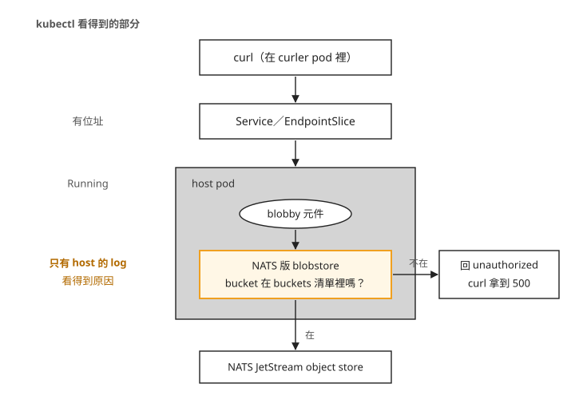
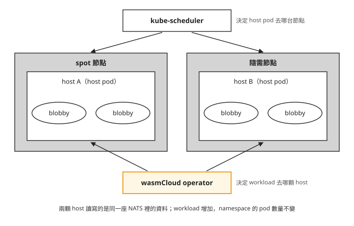
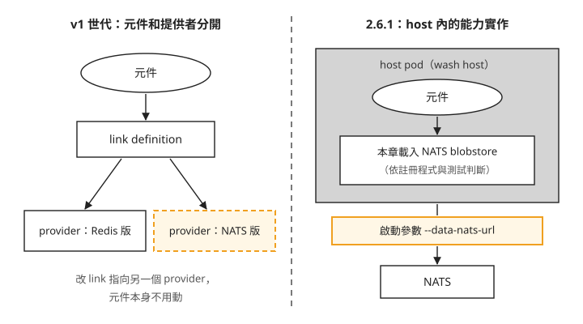

# Day 3: wasmCloud 分散式模型——能力設定、跨節點排程與 spot 節點

{ align=right width="88" }

Day 2 已經讓 HTTP 請求送到 wasmCloud 元件。這一章改用官方的檔案服務範例 blobby，讓元件接收請求後讀寫檔案。元件執行在 host 裡，儲存能力也由 host 提供；本章的 host 使用 NATS 服務中的物件儲存，讓不同 host 上的元件能讀取同一份資料。後半段會從一台節點上的 host 寫入，再從另一台節點上的 host 讀回。

能呼叫儲存介面，還不代表能存取其中的資料。bucket 是儲存物件的分組，host 會依元件設定的 `buckets` 清單判斷是否允許存取；blobby 使用的分組名稱是 `blobby`。沒有設定清單時，host 會拒絕它的讀寫請求。這一章先確認版本提供的設定入口，再測試授權，最後把 host 分散到兩台節點。讀完後，你能區分能力設定、host 的 Kubernetes 排程和元件的 wasmCloud 排程，也能判斷一個「設定成功」是否真的改變行為。

## 開始之前

沿用 Day 2 的 wasmCloud 2.6.1、`wasmcloud` namespace 和叢集內可執行 curl 的 `curler` Pod。以下 Service 網址要從叢集內呼叫；本機的終端機不能直接解析 `.svc.cluster.local`。後半段會新增 `spot1` 節點池，完成演練後再刪除它。

原始碼節錄都對應 wasmCloud 2.6.1；帶 `…` 的 console 區塊是觀察結果節錄，不能整段當成 shell 指令執行。需要操作的地方會另列完整指令。

## 步驟 1: 先確認版本提供哪種能力設定 {#mine-1}

舊版教學中的 capability provider 是獨立的能力實作，例如把儲存操作接到 Redis 或 NATS；link definition 則記錄元件使用哪個 provider。先查目前安裝的版本有沒有對應資源：

```console
$ kubectl api-resources --api-group=runtime.wasmcloud.dev
NAME                  SHORTNAMES   KIND
artifacts                          Artifact
hosts                              Host
workloaddeployments                WorkloadDeployment
workloadreplicasets                WorkloadReplicaSet
workloads             ww           Workload

$ kubectl get crd -o yaml | grep -icE "\blink\b|capabilityprovider|\bprovider\b"
0
```

這裡有 Workload、Host 等物件，沒有獨立的 provider 或 link。本章 2.6.1 的 Kubernetes 整合使用 Day 2 用過的 `hostInterfaces` 宣告能力，不能直接套用 v1 的 link 操作。查看其中的 `config`：

```console
$ kubectl explain workloaddeployment.spec.template.spec.hostInterfaces.config
FIELD: config <map[string]string>
DESCRIPTION:
    <empty>
```

`map[string]string` 只要求鍵和值都是字串，沒有列出允許的鍵。API 接受 `backend: in-memory`，只代表這個欄位的型別正確，還要看 host 的實作是否讀取它。

## 步驟 2: 讓 blobby 寫入檔案

blobby 透過 `wasi:blobstore` 介面讀寫資料。下面是介面宣告的節錄，只用來看元件要求哪些能力，不需要建立或編譯檔案。WIT 是描述 Wasm 元件介面的語言；這裡的 `world` 列出元件與外部的介面，`import` 表示它需要宿主提供 `wasi:blobstore`：

```wit
world blobby {
  import wasi:blobstore/blobstore@0.2.0-draft;
}
```

建立 `blobby.yaml`。這份設定先放入 `backend: in-memory`，用來觀察設定被接受、實際後端卻沒有改變的情況：

```bash
cat > blobby.yaml <<'EOF'
apiVersion: runtime.wasmcloud.dev/v1alpha1
kind: WorkloadDeployment
metadata: { name: blobby, namespace: wasmcloud }
spec:
  replicas: 1
  template:
    spec:
      hostSelector: { hostgroup: default }
      kubernetes: { service: { name: blobby } }
      components:
        - name: blobby
          image: ghcr.io/wasmcloud/components/blobby:0.6.0
      hostInterfaces:
        - namespace: wasi
          package: http
          interfaces: [incoming-handler]
          config: { host: blobby.wasmcloud.svc.cluster.local }   # Day 2 mine 4's fix
        - namespace: wasi
          package: blobstore
          interfaces: [blobstore]
          version: 0.2.0-draft
          config: { backend: in-memory }
EOF
```

還要建立 Service，讓 operator 能替它維護 EndpointSlice。這裡沒有 selector，位址由 wasmCloud operator 管理：

```bash
cat > blobby-service.yaml <<'YAML'
apiVersion: v1
kind: Service
metadata:
  name: blobby
  namespace: wasmcloud
spec:
  type: ClusterIP
  ports:
    - name: http
      port: 80
      protocol: TCP
YAML
kubectl apply -f blobby-service.yaml
kubectl apply -f blobby.yaml
```

先查 WorkloadDeployment 與 EndpointSlice。要看到目前設定產生的 Workload 已就緒，EndpointSlice 的位址也對應到目前 host，才能從 `curler` 發出請求。`get` 只列出查詢當下的狀態；更新尚未完成時，重查狀態再繼續：

```bash
kubectl -n wasmcloud get workloaddeployment blobby
kubectl -n wasmcloud get endpointslice -l kubernetes.io/service-name=blobby
kubectl -n wasmcloud exec curler -- curl -sS -D- -X POST --data-binary 'day3' http://blobby.wasmcloud.svc.cluster.local/day3.txt
```

對應的請求結果如下。HTTP 已經有回應，但寫入失敗：

```console
$ curl -sS -D- -X POST --data-binary 'day3' http://blobby.wasmcloud.svc.cluster.local/day3.txt
HTTP/1.1 500 Internal Server Error
content-length: 0
```

host 日誌留下了拒絕原因：

```console
ERROR handle_http_request{http.method=POST http.uri=/day3.txt}:
      failed to invoke component err=ErrorCode::InternalError(Some("unauthorized"))
```

在 Day 2 取得的 wasmCloud v2.6.1 原始碼目錄搜尋 `unauthorized`，命中的是 NATS 版 blobstore，而不是 manifest 中指定的 in-memory：

```console
$ grep -rn '"unauthorized"' crates/
crates/wash-runtime/src/plugin/wasi_blobstore/nats.rs:163
crates/wash-runtime/src/plugin/wasi_blobstore/nats.rs:203
crates/wash-runtime/src/plugin/wasi_blobstore/nats.rs:233
crates/wash-runtime/src/plugin/wasi_blobstore/nats.rs:254
```

以下是同一份程式碼的授權判斷。先看 `buckets` 沒設時得到的空清單，再看儲存分組的名稱是否在清單裡。程式中的 `container_name` 指 blobstore 的資料容器，與 Kubernetes 容器無關：

```rust
let buckets = match interface.config.get("buckets") {
    Some(buckets) => buckets.split(',').map(|s| s.to_string()).collect(),
    None => vec![],                                   // 沒設就是空的
};
…
if data.buckets.contains(container_name) { return Some(…) }   // allow
if is_write && data.read_only { return None }
None                                                          // 其餘一律拒絕
```

這次設定只有 `backend: in-memory`，沒有授權 blobby 使用任何 bucket，因此請求被拒絕。下一步加入 `buckets: blobby`，允許它存取名為 `blobby` 的分組。

下圖把請求經過的位置畫出來。Kubernetes 能確認 Service 和 host Pod 存在；是否允許讀寫 bucket，則在 host 裡決定。



所以遇到這個 500，先看 host 日誌，再查能力設定。Day 2 的虛擬主機比對失敗則回 404，兩者不能只憑「Pod 都是 Running」就判為服務正常。

## 步驟 3: 只改授權，觀察行為 {#gate-a}

把 `blobby.yaml` 裡 blobstore 的 `config: { backend: in-memory }` 改成 `config: { buckets: blobby }`，重新套用。`image`、HTTP 設定與 Service 都保持不變。確認新 Workload 已就緒、舊版本已移除，且 EndpointSlice 指向目前 host 後，建立一次 `/day3.txt`，並讀回內容：

```bash
kubectl apply -f blobby.yaml
kubectl -n wasmcloud exec curler -- curl -sS -D- -X POST --data-binary 'day3-nats-jetstream' http://blobby.wasmcloud.svc.cluster.local/day3.txt
kubectl -n wasmcloud exec curler -- curl -sS -D- http://blobby.wasmcloud.svc.cluster.local/day3.txt
```

接著把 bucket 名稱改為 `some-other-bucket`，套用後重試；最後再改回 `blobby`。每次都先確認新設定的 Workload 已就緒、舊版本已移除，再執行下面兩個請求。讀取的是剛才建立的 `/day3.txt`，寫入測試則使用另一個 `/probe.txt`，避免重新寫入掩蓋了舊資料是否還在：

```bash
kubectl -n wasmcloud exec curler -- curl -sS -D- http://blobby.wasmcloud.svc.cluster.local/day3.txt
kubectl -n wasmcloud exec curler -- curl -sS -D- -X POST --data-binary 'probe' http://blobby.wasmcloud.svc.cluster.local/probe.txt
```

下面的四種狀態包含步驟 2 的未授權結果。最後恢復授權時，要先讀到舊檔的原始內容，才能判斷撤權沒有刪除資料。以下是實測摘要，`PUT` 是原紀錄對寫入測試的標記；重播腳本實際使用 HTTP POST：

```console
=== 狀態 1:buckets 未設
  image  = ghcr.io/wasmcloud/components/blobby:0.6.0
  config = {"backend":"in-memory"}
  PUT /probe.txt -> 500      GET /day3.txt -> 500  body=

=== 狀態 2:buckets: blobby
  image  = ghcr.io/wasmcloud/components/blobby:0.6.0
  config = {"buckets":"blobby"}
  PUT /probe.txt -> 201      GET /day3.txt -> 200  body=day3-nats-jetstream

=== 狀態 3:buckets: some-other-bucket
  image  = ghcr.io/wasmcloud/components/blobby:0.6.0
  config = {"buckets":"some-other-bucket"}
  PUT /probe.txt -> 500      GET /day3.txt -> 500  body=

=== 狀態 4:改回 buckets: blobby
  image  = ghcr.io/wasmcloud/components/blobby:0.6.0
  config = {"buckets":"blobby"}
  PUT /probe.txt -> 201      GET /day3.txt -> 200  body=day3-nats-jetstream
```

映像相同，授權名稱改變後，寫入與讀取也跟著失敗或恢復。最後一個狀態還讀得到先前的內容，表示撤銷授權沒有刪除資料。資料存放在 NATS 的 JetStream object store，也就是它提供的物件儲存，而不是 blobby 元件的記憶體。

這還不能證明 NATS 自己消失後資料也能保留。內建 NATS 的磁碟使用 `emptyDir`，本章只測 host 與授權改變，沒有測 NATS Pod 被刪除後的恢復。

## 步驟 4: 把 host 放到不同節點

新增節點之前，要先區分「有空間放 Pod」與「Pod 會分散」兩件事。spot 節點可能被雲端供應商回收，適合用來觀察節點消失時的恢復。節點上的 taint 會排除不符合條件的 Pod；Pod 要設定對應的 toleration 才能排上去，但這不保證一定排到該節點。以下建立帶有 spot taint 的節點池；把資源群組與叢集名稱換成自己的值：

```bash
az aks nodepool add -g <resource-group> --cluster-name <cluster> -n spot1 \
  --node-count 1 --node-vm-size Standard_D2as_v5 \
  --priority Spot --eviction-policy Delete --spot-max-price -1 \
  --node-taints kubernetes.azure.com/scalesetpriority=spot:NoSchedule
```

新增後，既有 host Pod 仍在原節點：

```console
$ kubectl -n wasmcloud get pods -o custom-columns='POD:.metadata.name,NODE:.spec.nodeName'
hostgroup-default-…   <system-node>
hostgroup-default-…   <system-node>
hostgroup-default-…   <system-node>
nats-…                <system-node>
runtime-operator-…    <system-node>
```

節點的 CPU request 分布是：

```console
<system-node>    cpu  1877m (98%)
<spot-node>      cpu   335m (17%)      ← 只有 kube-system 的 DaemonSet
```

既有 Pod 不會因為加入節點就自動遷移；新 Pod 還必須容忍 spot taint 才能排進去。先把 host 擴到 4 顆，觀察新增 Pod 的排程結果：

```bash
kubectl -n wasmcloud scale deploy/hostgroup-default --replicas=4
```

```console
Warning  FailedScheduling  default-scheduler
0/2 nodes are available: 1 Insufficient cpu, 1 node(s) had untolerated taint(s).
```

一台節點沒有足夠 CPU，另一台有 Pod 尚未容忍的 taint。這裡刻意使用 `kubectl scale` 重現觀察，稍後會看到它與 Helm 管理同一欄位時的衝突。

### chart 沒有提供排程欄位時

2.6.1 的 chart values 沒有提供這些排程欄位，因此這裡直接修改 host Deployment。完整查詢放在[延伸閱讀](#chart-scheduling)。

把下面內容存成 `toleration-patch.json`，它允許 host 排到帶有 spot taint 的節點：

```json
{
  "spec": {
    "template": {
      "spec": {
        "tolerations": [
          {
            "key": "kubernetes.azure.com/scalesetpriority",
            "operator": "Equal",
            "value": "spot",
            "effect": "NoSchedule"
          }
        ]
      }
    }
  }
}
```

套用 patch 後，等新的 host Pod 都 Ready、舊 Pod 已終止，再查 `NODE` 欄位。以下是更新完成後的分布：

```console
$ kubectl -n wasmcloud patch deploy/hostgroup-default --type=strategic \
    --patch-file toleration-patch.json
$ kubectl -n wasmcloud get pods -o custom-columns='POD:.metadata.name,NODE:.spec.nodeName'
hostgroup-default-…   <spot-node>
hostgroup-default-…   <spot-node>
hostgroup-default-…   <spot-node>
hostgroup-default-…   <spot-node>
```

四顆 host 都在 spot 節點。toleration 只允許 Pod 使用該節點，沒有要求它們分散；這次滾動更新時，新增 Pod 可以使用的空間主要在 spot 節點。

若要兩台節點各有一顆 host，還要加上 `topologySpreadConstraints`。它限制節點之間符合標籤的 Pod 數量差距；這裡 `maxSkew: 1` 允許差一顆。把下面內容存成 `spread-patch.json`：

```json
{
  "spec": {
    "template": {
      "spec": {
        "topologySpreadConstraints": [
          {
            "maxSkew": 1,
            "topologyKey": "kubernetes.io/hostname",
            "whenUnsatisfiable": "DoNotSchedule",
            "labelSelector": {
              "matchLabels": {
                "wasmcloud.com/hostgroup": "default",
                "wasmcloud.com/name": "hostgroup"
              }
            }
          }
        ]
      }
    }
  }
}
```

```bash
kubectl -n wasmcloud scale deploy/hostgroup-default --replicas=2
kubectl -n wasmcloud patch deploy/hostgroup-default --type=strategic --patch-file spread-patch.json
```

同樣先確認新的兩顆 host Pod 都 Ready、舊 Pod 已終止，再查節點分布。這組測試更新完成後，兩顆 host 分別位於兩台節點：

```console
hostgroup-default-…   10.244.1.93    <spot-node>
hostgroup-default-…   10.244.0.117   <system-node>
```

這兩個 patch 都是 chart values 之外的設定，應與部署設定一起保存，之後才能重建相同的排程行為。

## 步驟 5: 元件由誰分配到 host {#gate-b}

host Pod 已經分散，現在把 blobby 的元件副本從 1 個增加為 4 個：

```bash
kubectl -n wasmcloud patch workloaddeployment blobby --type=merge -p '{"spec":{"replicas":4}}'
kubectl -n wasmcloud get workload -o custom-columns='WORKLOAD:.metadata.name,HOSTID:.status.hostId'
kubectl get hosts.runtime.wasmcloud.dev -A -o custom-columns='HOST:.metadata.name,HOSTID:.hostId,PODIP:.hostname,WORKLOADS:.status.workloadCount'
```

等四個新設定的 blobby Workload 都 Ready、舊版本已移除，且 EndpointSlice 指到目前 host，再比較分布。觀察重點是元件與 Pod 數量的變化，不是你的 Pod 總數是否恰好等於 5。測試用 Pod 的數量也會影響總數：

```console
=== 擴之前:命名空間 pod 總數
5

--- workload 落在哪些 host
blobby-66c4b8bd46-64d67f789f       host-A
blobby-66c4b8bd46-65b7d69b5c       host-A
blobby-66c4b8bd46-d675945bc        host-B
blobby-66c4b8bd46-ddd6545c9        host-B

--- host 物件
longing-trail-7203      10.244.1.93    WORKLOADS 2      ← 在 spot 節點
spiritual-death-0162    10.244.0.117   WORKLOADS 2      ← 在隨需節點

--- 擴完之後:命名空間 pod 總數
5
```

元件增加了，host Pod 沒有跟著一對一增加。Kubernetes scheduler 決定 host Pod 在哪台節點，wasmCloud 則決定元件在哪顆 host。下圖分開畫出這兩個決定。



圖上的四個 blobby 不是四顆 Kubernetes Pod。查元件分布時要看 Workload 與 Host 物件，不能只查 `kubectl get pods`。`Host.status` 提供了工作負載數等資訊，但本章沒有從原始碼確認排程器實際採用哪些欄位，不據此推論它的演算法。

直接呼叫某顆 host 時，還要保留 `Host: blobby.wasmcloud.svc.cluster.local` 標頭，才會符合 Day 2 的虛擬主機設定。先查出兩顆 host 的 Pod IP 與所在節點：

```bash
kubectl -n wasmcloud get pod -l wasmcloud.com/name=hostgroup -o custom-columns='HOSTPOD:.metadata.name,IP:.status.podIP,NODE:.spec.nodeName'
```

把 `<spot-host-ip>` 換成位於 `spot1` 節點池的 host Pod IP，`<system-host-ip>` 換成另一台節點上的 host Pod IP。由 spot host 寫入 `/gateb.txt`，再從 system host 讀取：

```bash
kubectl -n wasmcloud exec curler -- curl -sS -m 10 -D- -X POST -H 'Host: blobby.wasmcloud.svc.cluster.local' -H 'Content-Type: text/plain' --data-binary 'written-via-spot-node-host' http://<spot-host-ip>/gateb.txt
kubectl -n wasmcloud exec curler -- curl -sS -m 10 -D- -H 'Host: blobby.wasmcloud.svc.cluster.local' http://<system-host-ip>/gateb.txt
```

以下是跨 host 讀寫的實測摘要：

```console
  GET /day3.txt @ 10.244.1.93  (spot)   -> 200  body=day3-nats-jetstream
  GET /day3.txt @ 10.244.0.117 (system) -> 200  body=day3-nats-jetstream

  PUT /gateb.txt @ spot host   -> 201
  GET /gateb.txt @ system host -> 200  body=written-via-spot-node-host
```

兩邊讀到同一筆資料，符合兩顆 host 使用相同 NATS 儲存的設定。這個測試沒有模擬 NATS 故障。

## 步驟 6: Helm 更新為什麼與手動擴縮衝突

前面用 `kubectl scale` 改過 host Deployment。使用本課的 Helm 4.2.2 與同一版 chart 更新時，server-side apply 回報欄位衝突：

```bash
helm upgrade wasmcloud oci://ghcr.io/wasmcloud/charts/runtime-operator   --version 2.6.1 -n wasmcloud --reuse-values
```

```console
Error: UPGRADE FAILED: conflict occurred while applying object wasmcloud/hostgroup-default
  Apply failed with 1 conflict:
  conflict with "kubectl" with subresource "scale" using apps/v1: .spec.replicas
```

server-side apply 會記錄哪些管理者在管理哪些欄位，這個管理者稱為 field manager。錯誤訊息已指出衝突的是 `.spec.replicas`，因為 `kubectl scale` 與 Helm 都在管理它。

在確認 chart 中的 replicas 就是你要保留的值之後，本課用 `--force-conflicts` 將衝突欄位交回 Helm：

```bash
helm upgrade wasmcloud oci://ghcr.io/wasmcloud/charts/runtime-operator   --version 2.6.1 -n wasmcloud --reuse-values --force-conflicts
```

實測中，replicas 回到 chart 的 3，新增的 host 沒有立刻分到既有元件：

```console
$ kubectl get hosts.runtime.wasmcloud.dev -A
incompetent-birth-5131   10.244.1.183   WL <none>     ← 新來的,空的
longing-trail-7203       10.244.1.93    WL 2
spiritual-death-0162     10.244.0.117   WL 3
```

這次觀察沒有出現自動重新平衡，不能把增加 host 當成既有 workload 一定會重新分散的保證。後續擴縮應從 Helm values 的 `runtime.hostGroups[].replicas` 管理，避免反覆讓兩個工具修改同一欄位。

另外兩個 patch 欄位仍保留，因為 chart 沒有宣告它們。這是本次 Helm 版本與 chart 更新的結果，不代表任何 chart 升級都會保留外部修改；升級前仍要檢查新範本是否開始管理這些欄位。

## 步驟 7: 刪除 spot 節點池後確認恢復

完成跨節點測試後，刪掉本章建立的 `spot1` 節點池。執行前確認該節點池只承載這次演練的工作負載：

```bash
az aks nodepool delete -g <resource-group> --cluster-name <cluster> -n spot1
```

刪除後，用 `kubectl get node -o wide` 確認 spot 節點已移除，剩餘節點為 Ready，再確認下列條件：

- `kubectl -n wasmcloud get pods -o wide` 顯示 host Pod 已在剩餘節點上執行，NATS 與 `curler` 也維持 Running。
- `kubectl get hosts.runtime.wasmcloud.dev -A` 顯示 Host 物件的 Ready 為 True；`kubectl -n wasmcloud get workloaddeployment` 顯示 blobby 的 replicas 為 4、Ready 為 True。
- `kubectl -n wasmcloud get endpointslice -l kubernetes.io/service-name=blobby` 顯示的位址對應剩餘節點上的 host，不再包含已移除節點上的 host 位址。

接著從 `curler` 呼叫 Service。下方摘要中的 `$ curl` 省略了叢集內執行方式；完整寫法是 `kubectl -n wasmcloud exec curler -- curl -sS -m 10 -D- http://blobby.wasmcloud.svc.cluster.local/gateb.txt`。這是依驗證腳本的 `exec curler -- curl` 方式補全；修正後的寫法本課沒有實跑。要同時收到 HTTP 200 與 `written-via-spot-node-host`，才能確認 Service 已能讀回先前從 spot host 寫入的內容。

以下保留原測試的刪除與恢復摘要：

```console
$ az aks nodepool delete …

$ kubectl -n wasmcloud get workloaddeployment
blobby        4   True
hello-world   1   True

$ curl http://blobby.wasmcloud.svc.cluster.local/gateb.txt
200  body=written-via-spot-node-host      ← 從已經不存在的節點上寫進去的那一筆
```

host Pod 由 Deployment 補回，元件重新分配到可用 host；先前寫入的資料也仍能讀取。NATS 留在另一台節點上，所以這裡驗證的是 host 所在節點被移除後的恢復，並未驗證儲存服務同時故障。

## 版本限制

### read_only 無法阻擋已授權 bucket 的寫入 {#mine-6}

2.6.1 的這段授權程式先檢查 bucket allow-list，命中後直接放行，後面的 `read_only` 判斷不會阻擋已授權 bucket 的寫入。以下是補充驗證中設定 `buckets: blobby` 與 `read_only: "true"` 的結果，供判斷版本限制，不列為本章操作步驟：

```console
--- read_only=true
  PUT=201
  GET(ro.txt)=200 body=should-fail
```

HTTP 201 表示寫入成功，GET 的回應則顯示剛才寫入的內容已能讀回。因此這個版本不能依賴 `read_only: "true"` 提供唯讀保護。這與拼錯設定鍵不同：程式有讀取這個鍵，但判斷順序讓它沒有產生預期效果。

## 疑難排解

### 能力設定套用成功，行為卻沒有改變 {#mine-2}

`config` 是字串 map，API 不會逐一驗證設定鍵的意義。實測加入 `backend: filesystem` 與 `root: /tmp/blobby` 後仍使用 NATS。應查看對應版本 plugin 讀取的鍵，並用實際讀寫確認；本章有效的授權鍵是 `buckets`。

### Workload 就緒，檔案寫入仍回 500 {#mine-3}

先查 host 日誌。如果是 `unauthorized`，檢查 `buckets` 是否包含元件要使用的名稱。步驟 2、3 示範了從拒絕到重新授權的過程。若是 404，則先回到 Day 2 的[虛擬主機比對](sprint3-day2-wasmcloud.md#mine-4)。

### 手動擴縮後，Helm 更新回報 replicas 衝突 {#mine-4}

步驟 6 的衝突發生在 field manager 管理同一欄位。`--force` 不適用於這次的 server-side apply；`--take-ownership` 處理的是 Helm 的資源歸屬，沒有解決這個欄位衝突。先確認要採用的 replicas 值，再使用該 Helm 版本支援的 `--force-conflicts`。失敗的更新也會留在 release history，確認狀態時要看最後一次是否成功。

### 補上 toleration 後，host 全排到 spot 節點 {#mine-5}

toleration 只解決能不能排入節點，分散需求要另外設定。步驟 4 用 `topologySpreadConstraints` 限制分布；不要只加 toleration 就以為已經分散。

### 憑證 WARN 之後，公開元件仍成功啟動 {#mine-7}

```console
WARN …:resolve_credentials{registry=ghcr.io}:
     failed to retrieve docker credentials error=docker credential retrieval error: Unable to read config
INFO Starting workload                                    ← 下一行,拉取成功了
```

這次是 host 沒讀到 Docker 憑證設定，接著以匿名方式成功取得公開元件。要連同後續的 `Starting workload` 與 Workload 狀態判斷；如果使用私有 registry，不能因為這次公開映像成功就忽略憑證錯誤。

## 想一想

1. `backend: filesystem` 與 `buckets: blobby` 都能套用成功，為什麼只有後者改變測試結果？
2. 把 blobby 副本從 1 增加到 4，Pod 數量不變。你應該查哪種物件，才能知道各元件在哪裡執行？
3. 刪除 spot 節點後還能讀到檔案，是否足以證明 NATS Pod 消失後也不會丟資料？

## 小結

wasmCloud 把元件的能力與執行位置放在 host 模型裡管理。查錯時要分清楚 Kubernetes 是否成功部署 host、wasmCloud 是否成功執行元件，以及 host 是否授權它使用特定資源。擴充節點則還要分開處理 host 的排程與元件的分配，最後以實際讀寫確認恢復範圍。

## 延伸閱讀

### 為什麼原始碼有多個後端，設定卻不生效

2.6.1 的原始碼包含這些實作：

```text
crates/wash-runtime/src/plugin/wasi_blobstore/{in_memory,filesystem,nats}.rs
crates/wash-runtime/src/plugin/wasi_keyvalue/{in_memory,filesystem,nats,redis}.rs
crates/wash-runtime/src/plugin/multiplex.rs
```

`multiplex.rs` 有使用 `config.backend` 選後端的邏輯。然而 Kubernetes 裡啟動的是 `wash host`，它的註冊程式如下：

```rust
// crates/wash/src/cli/host.rs(v2.6.1)
    .with_plugin(Arc::new(plugin::wasi_blobstore::NatsBlobstore::new(&data_nats_client)))?
    .with_plugin(Arc::new(plugin::wasmcloud_messaging::NatsMessaging::new(…)))?
    .with_plugin(Arc::new(plugin::wasi_keyvalue::NatsKeyValue::new(&data_nats_client)))?
    …
#[cfg(feature = "wasm_component_model_implements")]
{
    cluster_host_builder = cluster_host_builder.with_multiplexed_plugins()?;
}
```

一般路徑註冊的是 NATS 版。下方的 `#[cfg(feature = ...)]` 是 Rust 的編譯開關，只有啟用該 feature 才會加入多後端的程式。另一種擴充入口 `hostPlugins` 也有自己的編譯條件，chart 的註解寫著：

```yaml
# Requires a wash image built with the `host-component-plugins` feature
# (not enabled in release images yet); a host handed a plugin it cannot
# build fails to start.
```

這兩個 feature 是不同的入口，不能只看其中一個就判定另一個也已啟用。本章沒有直接讀取 release 映像的編譯旗標；能確認的是，本章的測試改動 `backend` 沒有切換實際的 NATS 後端。

從 host 的啟動參數，可以看到資料用的 NATS 端點：

```console
$ kubectl -n wasmcloud get deploy hostgroup-default -o jsonpath='{…args}'
   host
   --host-group=default
   --scheduler-nats-url=nats://nats.wasmcloud.svc.cluster.local:4222
   --data-nats-url=nats://nats.wasmcloud.svc.cluster.local:4222   ← 提供者的端點在這裡
   --oci-cache-dir=/oci-cache
   --http-addr=0.0.0.0:80
```

`runtime.hostGroups[].dataNatsUrl` 是 host group 的設定。若要指向另一個 NATS，修改的位置在 host group，不是元件的 link 物件。本章沒有實測第二個 host group 搭配第二座 NATS，因此先不把它當成已驗證的切換程序。

下圖對照兩種設定方式。先看左邊獨立的 provider，再看右邊 host 啟動時選用的 NATS 連線。



圖右的 NATS 連線由 host 啟動參數決定；步驟 3 修改的 `buckets` 則控制元件能存取哪些儲存分組。

### 查詢 chart 的排程欄位 {#chart-scheduling}

以下查詢比較 chart 的 values 與已產生的 manifest，確認是否提供 toleration 與分散排程等欄位：

```console
$ helm show values oci://ghcr.io/wasmcloud/charts/runtime-operator --version 2.6.1 | wc -l
412
$ helm show values oci://ghcr.io/wasmcloud/charts/runtime-operator --version 2.6.1 \
    | grep -cE "toleration|affinity|nodeSelector|topologySpread|priorityClass"
0

$ helm get manifest wasmcloud -n wasmcloud | wc -l
924
$ helm get manifest wasmcloud -n wasmcloud | grep -cE "toleration|affinity|nodeSelector|topologySpread|priorityClass"
0
```

412 行 values 與 924 行 manifest 都有內容，對指定排程欄位的搜尋才有意義。如果取資料的指令已失敗，`grep -c` 對空輸入也可能得到 0，不能把它解讀成「不存在」。

### 相關文件

想再深入，可以從這幾份開始：

- **[Kubernetes Server-Side Apply](https://kubernetes.io/docs/reference/using-api/server-side-apply/)**：說明 field manager 與欄位衝突，對應本章 Helm 更新時的 replicas 問題。
- **[wasmCloud 的 blobby 範例](https://github.com/wasmCloud/wasmCloud/tree/main/examples/blobby)**：查看檔案服務如何使用 blobstore；比對本章時請切到所用版本。
- **[wasmCloud 的 runtime-operator chart](https://github.com/wasmCloud/wasmCloud/tree/main/charts/runtime-operator)**：核對 host group 能設定的欄位，以及 plugin 的啟用條件。

## 下一步

[Day 4](sprint3-day4-wasmedge.md) 改走 WasmEdge 與 runwasi，直接追蹤 RuntimeClass、containerd 設定和 shim。你會看到不採用 wasmCloud host 模型時，哪些工作需要由節點管理者完成。

---

!!! quote ""
    wasmCloud 標誌為 CNCF（Linux Foundation）官方資產，此處作社群教學用途。
