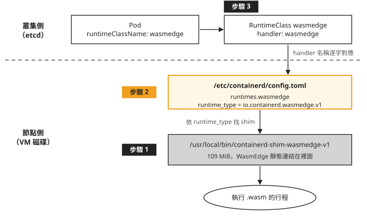
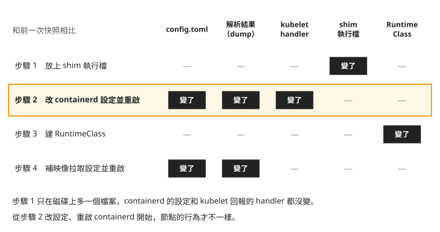

# Day 4: WasmEdge 與 runwasi——在節點上裝 shim、改 containerd 設定，以及兩種 wasm 格式

{ align=right width="82" }

假設你手上有一支編成 wasm 的小程式，想讓它在現有的 AKS 叢集上跑，排程、log、`kubectl` 都照一般 pod 的方式用，不想像 [Day 2–3](sprint3-day2-wasmcloud.md) 的 wasmCloud 那樣另外學一套 host 和 CRD。上網找「WasmEdge Kubernetes」，會找到三種做法：AKS 的 `--workload-runtime WasmWasi`、WasmEdge 官網用 crun 的教學，以及 containerd 底下的 runwasi 專案。AKS 的 WASI node pool 已退場；crun 是另一套容器執行期，官網那份舊教學本課沒有驗證。第三種已有實測，但要你自己進到節點上，放一個執行檔、改 containerd 的設定檔、重啟 containerd。

這一章走第三種做法，在 AKS 節點上把 WasmEdge 接上 Kubernetes。每做完一步，就把節點的狀態和開始前比一次，找出節點是從哪一步開始改變行為的。最後拿 wasmCloud 用的那支程式交給 WasmEdge 跑，看「編成 wasm」是不是等於兩邊都能跑。

讀完之後，一顆指定 WasmEdge 的 pod 起不來時，你能分辨是節點還沒接上 shim、映像沒有被解開，還是 wasm 檔本身是另一種格式。

## WasmEdge 要怎麼接上 Kubernetes

WasmEdge 是一個 wasm 執行期：它讀進一個 `.wasm` 檔，然後執行裡面的程式。Kubernetes 不會直接呼叫它。[Day 1](sprint3-day1-three-generations.md#step-4) 追過那條鏈：kubelet 把 pod 交給 containerd，containerd 依 pod 指定的 handler 找到設定檔裡對應的一段，再啟動一個 **shim**（每個容器各一個、負責實際啟動與看管容器的小程式）。一般容器用的是節點內建的 `containerd-shim-runc-v2`。

**runwasi** 是 containerd 底下的專案，它把 wasm 執行期包成 containerd 認得的 shim。今天用的是它發佈的 `containerd-shim-wasmedge-v1` v0.6.1，需要的 WasmEdge 程式庫也一起編進這個執行檔，稱為靜態連結。Day 1 那條鏈換成 WasmEdge 版，長這樣：

```text
RuntimeClass.handler → 節點 config.toml 的 runtimes.<name> → runtime_type 指到的 shim 二進位檔
```

把這條鏈畫成圖，上半部存在叢集（etcd）裡，下半部在每一台節點的磁碟上。圖上的「步驟 1–3」是本章依序要加上去的東西：



圖中的設定範圍與作用如下：

1. 下半部的兩樣東西（shim 執行檔、config.toml 的那一段）都在節點上，每一台要跑 wasm 的節點都得各做一次。上半部的 RuntimeClass 只要在叢集建一次。
2. 中間那段設定是唯一會讓 containerd 改變行為的地方。後面每一步都會比對節點，看這件事是不是真的。

### 另外兩種做法為什麼不用

AKS 自己的 WASI node pool 已經退役，Day 1 對它下過指令，拿到的是 `InvalidWorkloadRuntimeSettingError`。`az` 的 `--help` 和訂閱層的 feature flag 到現在都還列著它，不能拿來判斷這個功能還在不在，見[疑難排解：`--help` 和 feature flag 都說有](#mine-1)。

WasmEdge 的 containerd 整合文件轉介到 runwasi，本章採用這條路，透過 shim 接上節點既有的 containerd。

### 節點上原本有什麼

動手之前先確認 AKS 的節點上沒有任何 wasm 執行期，免得裝了兩份互相干擾。下面是節點檢查的結果節錄，`逐一 command -v` 是摘要；實際可逐一輸入 `command -v crun` 等命令。進節點的方式沿用 Day 1 的 `node-shell`：

```console
$ containerd --version
containerd github.com/containerd/containerd/v2 2.3.3-2

$ (逐一 command -v)
  crun / youki / wasmedge                        NOT FOUND
  containerd-shim-wasmedge-v1 / -wasmtime-v1     NOT FOUND
  containerd-shim-spin-v2 / -slight-v1           NOT FOUND

$ find /usr /opt /var/lib -maxdepth 4 -type f -name "*wasm*"
/usr/share/mime/application/wasm.xml              ← 命中數 1
$ find /usr/bin /usr/local/bin -maxdepth 1 -type f | wc -l
947
```

所有 wasm 相關的執行檔都是 `NOT FOUND`，搜尋範圍內只找到一個 MIME 類型定義檔。

再看 `/etc/containerd/` 底下：只有 `config.toml` 與 `kubenet_template.conf`，沒有放額外設定檔的子目錄，`config.toml` 裡也沒有 `imports`。所以要加 handler，就只能直接改 `config.toml` 這一個檔。

## 開始之前：存一份節點快照

這一章要回答「節點從哪一步開始不一樣」，所以每一步前後都要取同樣的五份資料來比。Day 2 證明 wasmCloud 沒動節點，用的也是這五份：

| 快照 | 看什麼 |
|---|---|
| `config.toml` | 節點上的 containerd 設定檔原文 |
| config dump | 目前設定檔經 containerd 解析、展開的內容 |
| runtimeHandlers | kubelet 回報這台節點有哪些 handler |
| shim 清單 | 磁碟上有哪些 runtime 與 shim 執行檔 |
| RuntimeClass | 叢集裡有哪些 RuntimeClass |

第二份要特別說明。`containerd config dump` 讀取目前設定檔並補上預設值，不會向執行中的服務查詢。它能用來檢查設定是否可被解析；要確認服務已載入，還要在重啟後檢查 `runtimeHandlers` 與實際 Pod。

本章假設叢集只有 system pool 的一台節點，`.items[0]` 都指它。`node-shell` 是 Day 1 建的 DaemonSet；先確認目前節點上的 Pod 已就緒，並依 Day 1 查出 `NODE_SHELL_POD`。下面這個函式取一次五份快照，參數是檔名前綴：

```bash
nodesh() { kubectl -n wasmlab exec "$NODE_SHELL_POD" -- nsenter -t 1 -m -- "$@"; }
snap() {
  nodesh cat /etc/containerd/config.toml > "$1-containerd-config.toml"
  nodesh containerd config dump          > "$1-containerd-config-dump.toml"
  kubectl get node -o jsonpath='{.items[0].status.runtimeHandlers}' \
    | python3 -m json.tool            > "$1-node-runtimehandlers.json"
  nodesh sh -c 'ls -l /usr/bin/runc /usr/bin/crun /usr/bin/containerd-shim-runc-v2 \
    /usr/bin/containerd-shim-wasmedge-v1 /usr/bin/containerd-shim-wasmtime-v1 \
    /usr/local/bin/containerd-shim-wasmedge-v1 /usr/local/bin/crun 2>/dev/null || true' \
    | tr -s ' '                       > "$1-shim-binaries.txt"
  kubectl get runtimeclass -o custom-columns='NAME:.metadata.name,HANDLER:.handler' \
    --no-headers | sort | tr -s ' '   > "$1-runtimeclasses.txt"
}
snap s0-baseline
```

`ls -l` 使用執行檔的完整路徑，避免模糊比對混入其他檔案。之後每一步做完就 `snap s1-…`、`snap s2-…`，再用 `diff` 逐份比對前一次。

## 步驟 1：把 shim 放上節點 {#install-shim}

先在自己的電腦上下載 release，確認雜湊值和 release 附的 `SHA256SUMS` 相同：

```bash
V=https://github.com/containerd/runwasi/releases/download/containerd-shim-wasmedge/v0.6.1
curl -sLO $V/containerd-shim-wasmedge-x86_64-linux-musl.tar.gz
shasum -a 256 containerd-shim-wasmedge-x86_64-linux-musl.tar.gz
curl -sL $V/SHA256SUMS
```

```console
$ shasum -a 256 containerd-shim-wasmedge-x86_64-linux-musl.tar.gz
99f7f56c64a0524ea1ec3922cd095b108825a513d0212db75a5dfb08ba196cce
$ curl -sL …/SHA256SUMS
99f7f56c64a0524ea1ec3922cd095b108825a513d0212db75a5dfb08ba196cce  …    ← 相符
```

兩邊的值相同，再讓節點自己下載同一個檔案。進到節點的 shell，在一個暫存目錄裡下載、解開，把執行檔裝進 `/usr/local/bin`：

```bash
kubectl -n wasmlab exec -it "$NODE_SHELL_POD" -- nsenter -t 1 -m -- bash
# inside the node
cd "$(mktemp -d)"
V=https://github.com/containerd/runwasi/releases/download/containerd-shim-wasmedge/v0.6.1
curl -sLO $V/containerd-shim-wasmedge-x86_64-linux-musl.tar.gz
tar -xzf containerd-shim-wasmedge-x86_64-linux-musl.tar.gz
```

```console
$ install -m 0755 containerd-shim-wasmedge-v1 /usr/local/bin/
-rwxr-xr-x 1 root root 114524904 /usr/local/bin/containerd-shim-wasmedge-v1

$ /usr/local/bin/containerd-shim-wasmedge-v1 -v
  Runtime: wasmedge    Version: 0.6.1    Revision: 5a8fc8e9ee0df28
```

壓縮檔 37.3 MiB，解開後是 109 MiB。節點原有的 `containerd-shim-runc-v2` 是 8.4 MiB，這一個大了 13 倍，因為整個 WasmEdge 執行期都靜態連結在裡面。

回到定義 `snap` 的本機終端機，取第二次快照（`snap s1-shim-installed`），和開始前比：

```console
containerd-config.toml           IDENTICAL
containerd-config-dump.toml      IDENTICAL
node-runtimehandlers.json        IDENTICAL
runtimeclasses.txt               IDENTICAL
shim-binaries.txt                DIFFERS
      > -rwxr-xr-x 1 root root 114524904 /usr/local/bin/containerd-shim-wasmedge-v1
```

五份裡只有 shim 清單多了一行。containerd 的設定、kubelet 回報的 handler 都沒變：磁碟上多了一個執行檔，但還沒有任何設定指向它，containerd 不會去用它。

## 步驟 2：在 containerd 設定裡加一個 handler {#configure-handler}

要讓 containerd 用這個 shim，就要在 `config.toml` 加一段 `runtimes.wasmedge`，這段的名字 `wasmedge` 就是之後 RuntimeClass 要寫的 handler。

### 先決定 plugin 路徑

Day 1 比較過新舊 plugin 路徑。containerd 2.x 能遷移完整的 version 2 設定，但本課 AKS 檔案已使用新 plugin 名稱，額外加入舊路徑時未得到預期 handler，見 Day 1 的[設定路徑檢查](sprint3-day1-three-generations.md#mine-1)。這台節點是 containerd 2.3.3，照理該用 2.x 路徑。麻煩的是 runwasi 自己的資料就有兩種寫法。它的 quickstart 文件寫的是 2.x 路徑：

```toml
# runwasi 的文件(quickstart.md)——containerd 2.x 的路徑
[plugins."io.containerd.cri.v1.runtime".containerd.runtimes.wasm]
```

同一個 tag 裡，它自己的 CI 用的 kind 節點映像是 Kubernetes v1.29.1，寫的是 1.x 路徑：

```dockerfile
# 同一個 tag 裡,runwasi 自己的 CI(test/k8s/Dockerfile,kind v1.29.1)——1.x 的路徑
[plugins."io.containerd.grpc.v1.cri".containerd.runtimes.wasm]
```

網路上的範例兩種都有。與其改了節點、重啟之後才知道對不對，不如先在副本上確認。`containerd -c <檔案> config dump` 會讀指定的設定檔、印出有效設定，但不啟動任何東西，不影響正在跑的 containerd。在節點上把 `config.toml` 複製兩份，各加上一種寫法：

```bash
# inside the node, in a scratch directory
cp /etc/containerd/config.toml cfg-1x.toml
cat >> cfg-1x.toml <<'EOF'

[plugins."io.containerd.grpc.v1.cri".containerd.runtimes.wasmedge]
  runtime_type = "io.containerd.wasmedge.v1"
EOF

cp /etc/containerd/config.toml cfg-2x.toml
cat >> cfg-2x.toml <<'EOF'

[plugins."io.containerd.cri.v1.runtime".containerd.runtimes.wasmedge]
  runtime_type = "io.containerd.wasmedge.v1"
EOF

containerd -c cfg-1x.toml config dump | grep -n wasmedge
containerd -c cfg-2x.toml config dump | grep -n wasmedge
```

再把兩份的有效設定行數、命中行，以及和沒加任何東西的基準比對的結果整理在一起（下面輸出裡副本放在 `/tmp/`，檔名是自己取的）：

```console
$ containerd -c /tmp/cfg-1x.toml config dump      # io.containerd.grpc.v1.cri…runtimes.wasmedge
  有效設定行數: 308
  命中 wasmedge 的行數: 0
  與未加任何東西的基準相比: IDENTICAL

$ containerd -c /tmp/cfg-2x.toml config dump      # io.containerd.cri.v1.runtime…runtimes.wasmedge
  有效設定行數: 323
    111:  [plugins.'io.containerd.cri.v1.runtime'.containerd.runtimes.wasmedge]
    112:    runtime_type = 'io.containerd.wasmedge.v1'
```

加入 1.x 路徑的副本解析後，`wasmedge` 設定沒有出現在有效設定裡，containerd 未針對被忽略的設定發出警告。stderr 有一則設定從 version 2 遷移的警告，與這段設定被忽略是兩件事。這份有效設定共 308 行，與基準逐字相同；2.x 寫法則出現在有效設定的第 111–112 行。

<span id="mine-2"></span>在這台 containerd 2.3.3 節點的有效設定裡，`io.containerd.grpc.v1.cri` 仍存在，但只剩 streaming server 的欄位，runtime 設定已移到 `io.containerd.cri.v1.runtime`。因此，搜尋到舊 plugin 名稱，不代表 `runtimes.wasmedge` 已生效。以下節錄舊 plugin 的有效設定：

```console
  [plugins.'io.containerd.grpc.v1.cri']
    disable_tcp_service = true
    stream_server_address = '127.0.0.1'
    …                                    ← runtimes 已經搬走了
```

對加入舊路徑的副本執行 `containerd config migrate`，輸出雖然從 version 2 轉成 version 4，仍沒有 `wasmedge` 設定。套用前要在副本的 `config dump` 裡確認完整的 handler 設定，再依下一節重啟 containerd。

### 套用設定，讓 containerd 重新讀取

確定用 2.x 路徑之後，先把節點的 `config.toml` 複製一份備份，再把 `cfg-2x.toml` 裡加的那三行（一行空白、兩行設定）附加到 `/etc/containerd/config.toml` 結尾。

containerd 要重新讀設定才會生效。三種常見的做法，只有一種有用：

```console
$ systemctl reload containerd
Failed to reload containerd.service: Job type reload is not applicable for unit containerd.service.

$ kill -HUP $(pidof containerd)
$ kubectl get node -o jsonpath='{…runtimeHandlers}'
['', 'runc', 'untrusted']                       ← SIGHUP 沒有讓新 runtime 生效

$ systemctl restart containerd
$ kubectl get node -o jsonpath='{…runtimeHandlers}'
['', 'runc', 'untrusted', 'wasmedge']           ← 生效
```

`reload` 直接被 systemd 拒絕；送 `SIGHUP` 不會顯示錯誤，但 handler 清單沒變；`systemctl restart` 之後，kubelet 回報的清單才多了 `wasmedge`。

重啟 containerd 聽起來會影響節點上所有的容器。實際比對重啟前後全叢集 pod 的 `RESTARTS`，再看節點的 `Ready` 狀態：

```console
$ diff pods-pre-restart.txt pods-post-restart.txt
IDENTICAL——21 個 pod,沒有任何一個被重建或重啟

$ kubectl get node -o jsonpath='{…conditions[?(@.type=="Ready")]}'
True  lastTransition=07:17:03Z       ← 早於 07:24:37 的重啟,節點沒掉出 Ready
```

沒有任何 pod 重啟，`Ready` 最後一次變化的時間也在重啟之前。原因是每個容器都由自己的 shim 行程看管，shim 不是 containerd 的子行程，而 containerd 的 systemd unit 設定的是 `KillMode=process`，重啟時只停掉 containerd 主行程本身。

### 第二次比對

取快照 `snap s2-containerd-configured`，和上一次比：

```console
containerd-config.toml           DIFFERS
      > [plugins."io.containerd.cri.v1.runtime".containerd.runtimes.wasmedge]
      >   runtime_type = "io.containerd.wasmedge.v1"
containerd-config-dump.toml      DIFFERS(新增 15 行,containerd 把預設值全部展開)
node-runtimehandlers.json        DIFFERS
      >   "name": "wasmedge"
      >   "features": { "recursiveReadOnlyMounts": false, "userNamespaces": false }
shim-binaries.txt                IDENTICAL
runtimeclasses.txt               IDENTICAL
```

這次設定檔、有效設定、handler 清單三份都變了。設定檔只加兩行，有效設定卻多 15 行，是 containerd 把這個 runtime 的所有預設欄位都展開了。

看 handler 那兩個 `features`：它們是 kubelet 向 runtime 問來的能力，分別表示這個 handler 支不支援遞迴的唯讀掛載、支不支援 Pod 的 user namespace。`runc` 兩項都是 `true`，`wasmedge` 兩項都是 `false`。Day 8 整理 wasm 工作負載用不到哪些 Pod 功能時，會再回到這裡。

## 步驟 3：建 RuntimeClass

最後一塊在叢集這一側。`handler` 要逐字等於上一步 `config.toml` 裡 `runtimes.` 後面的名字，不是 `runtime_type`：

```bash
cat > runtimeclass-wasmedge.yaml <<'EOF'
apiVersion: node.k8s.io/v1
kind: RuntimeClass
metadata:
  name: wasmedge
handler: wasmedge      # must match runtimes.<name> in config.toml, NOT runtime_type
EOF
```

```console
$ kubectl apply -f runtimeclass-wasmedge.yaml
```

第三次快照（`snap s3-runtimeclass`）只有 RuntimeClass 清單多一行，節點上的四份都和上一次相同。RuntimeClass 存在 etcd 裡，建它不會動到節點，也就是 Day 1 那條鏈的叢集側。

## 步驟 4：跑第一顆 wasm pod {#run-images}

用 runwasi 提供的範例映像 `wasi-demo-app`。這個映像的進入點已經是 `/wasi-demo-app.wasm`，`args` 只要給它的子命令與參數：

```bash
cat > pod-runwasi-demo.yaml <<'EOF'
apiVersion: v1
kind: Pod
metadata:
  name: wasmedge-runwasi-demo
  namespace: wasmlab
spec:
  runtimeClassName: wasmedge
  restartPolicy: Never
  containers:
    - name: demo
      image: ghcr.io/containerd/runwasi/wasi-demo-app:latest
      args: ["echo", "hello-from-wasmedge"]
EOF
kubectl apply -f pod-runwasi-demo.yaml
```

```console
$ kubectl -n wasmlab get pod wasmedge-runwasi-demo
NAME                    READY   STATUS                 AGE
wasmedge-runwasi-demo   0/1     CreateContainerError   25s

Events:
  Normal   Pulled   Successfully pulled image … Image size: 2265395 bytes.
  Warning  Failed   Error: failed to create containerd container:
                    parent snapshot sha256:5e274030… does not exist: not found
```

映像拉成功了，shim 和 handler 也都在，卻停在 `CreateContainerError`，訊息說某個 **snapshot** 不存在。snapshot 是 containerd 把映像的一層層 layer 解開之後的檔案系統，容器啟動時就以它當根目錄。訊息的意思是：這個映像的 layer 沒有被解開。

用 `ctr` 直接問節點上的 containerd：

```console
$ ctr -n k8s.io images ls | grep wasi-demo-app
…runwasi/wasi-demo-app:latest   2.2 MiB   wasip1/wasm   io.cri-containerd.image=managed
                                          ^^^^^^^^^^^
$ ctr -n k8s.io snapshots ls | wc -l
265
$ ctr -n k8s.io snapshots ls | grep 5e274030
（無輸出——265 個 snapshot 裡沒有這一個,layer 從來沒有被解開）
```

看 `PLATFORMS` 欄。每個映像都會標明它是給哪個**平台**（作業系統與 CPU 架構的組合）用的，一般容器映像是 `linux/amd64`，這個映像標的是 `wasip1/wasm`。節點的 containerd 只替符合本機平台 `linux/amd64` 的映像解開 layer，其他平台的映像，下載下來的內容存著，但不會解開成 snapshot。所以 shim 要去 rootfs 裡讀 `.wasm`，讀不到。錯誤訊息只說 snapshot 不存在，完全沒提平台，要自己看 `PLATFORMS` 欄才知道。

### 讓 containerd 解開 wasm 平台的映像

containerd 的映像設定裡有一個 `runtime_platforms`，名字看起來就是為這件事設計的。只加它的結果是這樣：

```console
# 岔路:runtime_platforms,名字看起來完全就是為這件事準備的
[plugins."io.containerd.cri.v1.images".runtime_platforms.wasmedge]
  platform = 'wasip1/wasm'          ← 設定確實進了有效設定
                                       套用、重啟、重拉,行為一模一樣
```

設定有進到有效設定裡，但 pod 還是同一個錯誤。要再加同一段設定裡的另一個欄位：

```toml
[plugins."io.containerd.cri.v1.images"]
  use_local_image_pull = true       # default false → CRI hands pulling to the transfer
                                    # service, which ignores runtime_platforms
```

這個欄位預設是 `false`，此時 Kubernetes 要求拉映像時，containerd 把工作交給另一個負責下載的元件（transfer service），而那個元件不看 `runtime_platforms`。改成 `true` 之後，拉映像改由 Kubernetes 介面（CRI）這一側自己處理，`runtime_platforms` 才有作用。

要注意寫的位置：`config.toml` 裡已經有 `[plugins."io.containerd.cri.v1.images"]` 這一段，`use_local_image_pull = true` 要加在這一段的標題底下，不要在檔尾再寫一次同樣的段落標題。`runtime_platforms` 那一段則附加在檔尾：

```toml
[plugins."io.containerd.cri.v1.images".runtime_platforms.wasmedge]
  platform = "wasip1/wasm"
  snapshotter = "overlayfs"
```

改完之後，在節點 shell 執行 `systemctl restart containerd`。回本機刪除 `wasmlab` 裡的 `wasmedge-runwasi-demo` Pod；再到節點 shell 用 `ctr -n k8s.io images rm ghcr.io/containerd/runwasi/wasi-demo-app:latest` 移除這個測試映像的快取。最後回本機重新執行 `kubectl apply -f pod-runwasi-demo.yaml`，讓 kubelet 重拉映像並建 Pod。成功後查看 Pod log：

```console
$ kubectl -n wasmlab logs wasmedge-runwasi-demo
hello-from-wasmedge
exiting
```

pod 跑完、狀態是 `Completed`，log 是預期的兩行。WasmEdge 在 AKS 上跑起來了。

本課驗證過能跑的設定是 `use_local_image_pull` 和 `runtime_platforms` 兩段都加，照這份做就好。「只加 `use_local_image_pull` 夠不夠」本課沒有拆開驗證；想精簡設定，先在測試節點拿掉 `runtime_platforms` 試一次。這個問題的完整整理見[疑難排解：pod 停在 `parent snapshot … does not exist`](#mine-3)。

!!! warning "`use_local_image_pull` 會影響整台節點"
    它改的是這台節點上所有映像的拉取路徑，不只 wasm 映像。對一般容器映像的拉取行為、速度、registry 鏡像設定有沒有影響，本課沒有測。要用在正式環境的節點上，先在測試節點觀察一般映像的拉取。

## 節點從哪一步開始不一樣

把四個步驟各自造成的變化放在一起（步驟 4 的快照是 `snap s4-image-pull-fixed`）。每一列是一個步驟，每一欄是一份快照，「變了」表示這一步做完之後，那份和前一次不同：



照著圖由上往下看：

1. 步驟 1 雖然在節點上放了 109 MiB 的執行期，containerd 的設定和 kubelet 看到的 handler 都沒變。評估風險時，「複製一個檔案」和「改變節點行為」要分開看。
2. 節點的行為從步驟 2 開始改變，也就是改 `config.toml` 並重啟 containerd 的那一步。

和 Day 1 的節點基準相比，全部做完之後節點累計多了這些東西：

| 項目 | 相對 Day 1 基準的變化 |
|---|---|
| `/etc/containerd/config.toml` | **8 行新增**、0 行移除 |
| `containerd config dump` | **21 行新增**、1 行變更 |
| kubelet 的 `runtimeHandlers` | **多一個 `wasmedge`**(兩項 feature 皆 false) |
| `/usr/local/bin` | **多一個 109 MiB 的 shim** |
| RuntimeClass | 多一個(在 etcd,不在節點) |
| containerd 重啟 | **2 次,pod 零重啟、節點沒掉出 Ready** |

對照另外兩條路：Day 2 的 wasmCloud 五份快照完全沒變；WasmEdge 要在每台節點加 8 行設定和一個 shim 執行檔；Day 6 的 SpinKube 會改用 operator 替你做類似的事。

## 同一支 wasm 程式，兩邊都能跑嗎 {#gate}

到這裡，叢集上同時有 Day 2–3 的 wasmCloud 和今天的 WasmEdge。直覺上，程式編成 wasm 之後，交給哪個 wasm 執行期都能跑。下面拿兩邊現成的映像來試。

### 三份映像的打包方式

先看映像在 registry 上怎麼打包。每個 OCI 映像都有一份 manifest，列出一份設定（config）和幾層內容（layer），各自用 **mediaType** 標明是什麼格式。下面是三份映像的 manifest 內容，第一份是 Day 2 用的 wasmCloud 範例，後兩份是 runwasi 的範例：

```console
--- wasmcloud/components/hello-world:0.1.0
  config.mediaType   = application/vnd.wasm.config.v0+json                            (469 B)
  layer[0].mediaType = application/wasm                                               (224241 B)
--- containerd/runwasi/wasi-demo-app:latest
  config.mediaType   = application/vnd.oci.image.config.v1+json                       (281 B)
  layer[0].mediaType = application/vnd.oci.image.layer.v1.tar                         (2264576 B)
--- containerd/runwasi/wasi-demo-oci:latest
  config.mediaType   = application/vnd.oci.image.config.v1+json                       (320 B)
  layer[0].mediaType = application/vnd.bytecodealliance.wasm.component.layer.v0+wasm  (2262850 B)
```

三份的打包都不一樣。wasmCloud 的設定是 wasm 專用的格式，layer 直接就是一個 `.wasm` 檔；`wasi-demo-app` 是標準的容器映像，layer 是一個 tar 包；`wasi-demo-oci` 用標準的容器設定，layer 卻直接放 `.wasm`。

把後兩份裡的 `.wasm` 取出來比雜湊值：

```console
$ shasum -a 256 wasi-demo-app.wasm demo-oci.wasm
245c955714067729ab7b3fdd26681caa8bbc5d09ba054a846aa7f5bd9a393f45  wasi-demo-app.wasm
245c955714067729ab7b3fdd26681caa8bbc5d09ba054a846aa7f5bd9a393f45  demo-oci.wasm
```

兩份是同一支程式，只是打包方式不同。步驟 4 已經跑過 `wasi-demo-app`；`wasi-demo-oci` 用同一份 pod 寫法，只把 `image` 換掉、拿掉 `args`，pod 名稱改成 `wasmedge-runwasi-oci`，也跑得起來，log 是一首重複的歌詞。這一組說明：對 WasmEdge 來說，這兩種打包方式都能用。

### 前 8 個位元組

再看檔案本身。三個 `.wasm` 的前 8 個位元組：

```console
$ xxd -l 8 -g 1 <各檔>
  hello-world.wasm      00 61 73 6d 0d 00 01 00    version=0x000d layer=0x0001 → component
  wasi-demo-app.wasm    00 61 73 6d 01 00 00 00    version=0x0001 layer=0x0000 → core module
  wasi-demo-oci.wasm    00 61 73 6d 01 00 00 00    同上
```

把兩種開頭並排畫出來：


前四個位元組 `00 61 73 6d` 是所有 wasm 檔共用的開頭（`\0asm`）。後四個位元組標示版本與種類，兩種檔案從這裡開始不同：

- **core module**：`01 00 00 00`，最原始的 wasm 格式，也就是 WASI 0.1（`wasip1`）程式編出來的樣子。
- **component**：`0d 00 01 00`，Day 0 介紹的 Component Model 格式，用 WIT 描述對外的介面，WASI 0.2（`wasip2`）的程式是這種。

wasmCloud 的 `hello-world` 是 component，runwasi 的兩個範例是 core module。

### 把 wasmCloud 的元件交給 WasmEdge

把 `hello-world:0.1.0` 寫進一顆 `runtimeClassName: wasmedge` 的 pod。只寫 `image` 時，pod 停在 `no command specified`：wasmCloud 的映像設定裡沒有 `Entrypoint`，CRI 不知道要執行什麼。補上 `command` 之後，容器真的啟動了，接著失敗：

??? example "pod-wasmcloud-component-cmd.yaml"

    ```bash
    cat > pod-wasmcloud-component-cmd.yaml <<'EOF'
    apiVersion: v1
    kind: Pod
    metadata:
      name: wasmedge-wasmcloud-cmd
      namespace: wasmlab
    spec:
      runtimeClassName: wasmedge
      restartPolicy: Never
      containers:
        - name: hello
          image: ghcr.io/wasmcloud/components/hello-world:0.1.0
          command: ["/hello-world.wasm"]
    EOF
    kubectl apply -f pod-wasmcloud-component-cmd.yaml
    ```

```console
$ kubectl -n wasmlab logs wasmedge-wasmcloud-cmd
[error] loading failed: illegal opcode, Code: 0x117
[error]     This instruction or syntax requires enabling Component Model proposal
[error]     Bytecode offset: 0x00000004
[error]     At AST node: component
```

`Bytecode offset: 0x00000004` 就是圖上箭頭指的位置：WasmEdge 讀完 `\0asm`，看到第 5 個位元組是 component 的版本號，就停下來了。第二行訊息也直接說出原因：要開啟 Component Model 才能載入。這兩種失敗的分辨方式，見[疑難排解：同一個映像兩種失敗](#mine-4)。

本章使用的 wasmedge shim v0.6.1 透過 `wasmedge_sdk` 的 `Module::from_bytes` 載入 core module，使用預設設定，沒有啟用 Component Model，也未提供 pod annotation、環境變數或 containerd 設定來啟用。這個限制針對本章採用的 shim 版本；WasmEdge 執行期本身支援 Component Model，不代表這個 shim 能載入 component。

### 反方向：把 core module 交給 wasmCloud

再把 `wasi-demo-app` 寫成 wasmCloud 的 `WorkloadDeployment`，交給 Day 2–3 的 host：

??? example "wasmcloud-runwasi-core-module.yaml"

    ```bash
    cat > wasmcloud-runwasi-core-module.yaml <<'EOF'
    apiVersion: runtime.wasmcloud.dev/v1alpha1
    kind: WorkloadDeployment
    metadata:
      name: runwasi-core-module
      namespace: wasmcloud
    spec:
      replicas: 1
      template:
        spec:
          hostSelector:
            hostgroup: default
          components:
            - name: runwasi-demo
              image: ghcr.io/containerd/runwasi/wasi-demo-app:latest
    EOF
    kubectl apply -f wasmcloud-runwasi-core-module.yaml
    ```

    另一份 `runwasi-oci-artifact` 寫法相同，名稱與 component 名改掉，`image` 換成 `wasi-demo-oci:latest`，結果一樣。

```console
$ kubectl -n wasmcloud get workload runwasi-core-module-… -o jsonpath='{.status}'
  Sync    False   "workload is not operational: WORKLOAD_STATE_NOT_FOUND"
  Ready   False   "workload is not placed or not synced"

# 三顆 host 的 log 逐行看
  log 共 10 / 14 / 12 行,其中 8 行是 pull_component 的 WARN
  提到 runwasi 且含 'Starting workload' 的行數 = 0
  對照:同一批 log 裡 blobby / hello-world 的 'Starting workload' = 1 / 2 / 2
```

`Workload` 一直不就緒，三顆 host 的 log 裡只有拉取映像的 WARN，沒有任何錯誤，也沒有 `Starting workload`。Day 3 說過，拉取的 WARN 本身不代表失敗，要看下一行有沒有 `Starting workload`（Day 3 的[「每次拉元件都會噴一行像認證失敗的 WARN」](sprint3-day3-wasmcloud-distributed.md#mine-7)）。這次還要合看 Workload 未就緒、反覆重試、正常元件的對照，以及前面確認的 core module 格式。單憑缺少這一行 log，不能判定其他映像也是格式不相容。

這兩個 `WorkloadDeployment` 會每 60 秒換一顆 host 重拉映像，看完結果就刪掉：

```console
$ kubectl -n wasmcloud delete workloaddeployment runwasi-core-module runwasi-oci-artifact
```

細節見[疑難排解：wasmCloud 收到 core module 時只會重試](#mine-6)。

### 三種打包的差異

rootfs 是容器啟動後看見的根檔案系統；OCI manifest 與 config 則記錄映像層及執行設定。

三份映像的差異整理如下：

| | wasmCloud `hello-world` | runwasi `wasi-demo-app` | runwasi `wasi-demo-oci` |
|---|---|---|---|
| config mediaType | `…vnd.wasm.config.v0+json` | `…vnd.oci.image.config.v1+json` | `…vnd.oci.image.config.v1+json` |
| layer mediaType | `application/wasm` | `…image.layer.v1.tar` | `…wasm.component.layer.v0+wasm` |
| layer 大小 | 219 KiB | 2.16 MiB | 2.16 MiB |
| `architecture` / `os` | `wasm` / **`wasip2`** | `wasm` / `wasip1` | `wasm` / `wasip1` |
| rootfs | **沒有這個欄位** | `diff_ids` 有 1 個 | `diff_ids` **是空的** |
| 進入點 | **沒有**,改成 `component.exports/imports` 列 WIT 介面 | `Entrypoint` | `Entrypoint` + `containerd.runwasi.layers` label |
| wasm 二進位 | **component** | **core module** | 同左,**SHA256 與左欄相同** |
| 本章成功載入的執行方式 | wasmCloud | wasmedge shim | wasmedge shim |

結果是：兩種打包方式 WasmEdge 都能讀，擋住互通的是 wasm 格式。同一份原始碼要給兩邊跑，就要編兩次：給 WasmEdge 編 `wasm32-wasip1` 的 core module，給 wasmCloud 編 `wasm32-wasip2`，Rust 會直接產出 component，不需要固定再做一次 component 轉換。格式符合之後，仍要核對 host 支援的匯入、匯出介面。這個結論是從格式差異推出來的，本章沒有拿同一份原始碼實際編兩次；[Day 5](sprint3-day5-cost-measurement.md) 量成本時會自己編。

## WasmEdge 這條路適合誰

用 [Day 0 的方法](sprint3-day0-wasm-concepts.md#health-method)查這兩個專案時（Day 9 整理成表），WasmEdge 本體很活躍：近 13 週有 291 個 commit，作者分布是本課查過的專案裡最平均的（最近 100 筆裡最多的單一作者占 35 筆，共 12 位）。但讓它接上 Kubernetes 的是 runwasi，情況不同：default branch 最近 8 週沒有任何 commit，最近 100 筆 commit 有一半是 dependabot 的相依套件升級，release notes 裡也還沒有 WASI 0.3。這是課程 2026-08 查核時的歷史活動紀錄。規劃部署時，還要重新確認 runwasi 與選用 shim 版本的維護情況。

所以這條路適合用來學 RuntimeClass、handler、shim 這條執行鏈，每一步都要自己做，每一步的結果也都看得到。既有的程式是 core module、短期不打算改成 component 的話，WasmEdge 的相容性也是優點。若要用於正式環境，這份手動操作還不夠：節點的安裝、設定與移除都要自己寫腳本維護，每換一台節點就要重做一次。

## 疑難排解

### `--help` 和 feature flag 都說 WasmWasi 還在 {#mine-1}

**症狀**：`az aks nodepool add --help` 把 `WasmWasi` 列在 `--workload-runtime` 的合法值裡，`az feature register` 註冊 `WasmNodePoolPreview` 也立刻回 `Registered`：

```console
$ az aks nodepool add --help
    --workload-runtime : Allowed values: KataCcIsolation, KataMshvVmIsolation,
                         KataVmIsolation, OCIContainer, WasmWasi.

$ az feature register --namespace microsoft.ContainerService --name WasmNodePoolPreview
{ "properties": { "state": "Registered" } }        ← 立刻就 Registered
```

真正建立 node pool 時卻被拒絕：

```console
$ az aks nodepool add … --workload-runtime WasmWasi
ERROR: (InvalidWorkloadRuntimeSettingError) The agent pool wasi1 has a deprecated workload runtime
WasmWasi. WebAssembly System Interface (WASI) node pools (preview) are no longer supported on AKS.
                                     送出到回覆 8 秒,未產生任何資源
```

**原因**：這個功能已經退役，但退役只做在 Azure 處理請求的那一端。CLI 的參數清單和訂閱層的 feature flag 定義都沒有跟著拿掉。

**修法**：先查官方退役公告，不要把 `--help` 或 feature flag 的狀態當成服務仍可用的證明。本次建立請求被拒絕且沒有建立 node pool，這個結果不能推廣成所有預覽功能請求都不會產生資源。錯誤訊息建議改用 SpinKube，那是本 sprint Day 6–7 的另一條路，不是 WasmEdge 的替代方案。另外，註冊 feature flag 是訂閱層級的變更（Day 1 說明過為什麼不建議），確認用完要 `az feature unregister`。

### pod 停在 `parent snapshot … does not exist` {#mine-3}

**症狀**：shim 裝好、kubelet 也回報了 `wasmedge` handler，pod 卻是 `CreateContainerError`，訊息是 `parent snapshot sha256:… does not exist: not found`，而事件顯示映像拉成功了。

**原因**：映像的平台是 `wasip1/wasm`，containerd 預設的拉取路徑不會替非本機平台的映像解開 layer，見步驟 4。錯誤訊息完全沒提到平台。

**修法**：在 `[plugins."io.containerd.cri.v1.images"]` 加 `use_local_image_pull = true`，並加上 `runtime_platforms.wasmedge`，重啟 containerd、刪掉沒解開的映像再重建 pod。只加 `runtime_platforms` 沒有效果。追查順序：`ctr -n k8s.io images ls` 看 `PLATFORMS` 欄 → `ctr -n k8s.io snapshots ls | grep <digest>` 確認沒有解開 → `containerd config dump` 看 `use_local_image_pull`。

### 同一個映像出現兩種不同的失敗 {#mine-4}

**症狀**：把 wasmCloud 的元件交給 WasmEdge，不寫 `command` 時是 `failed to generate spec: no command specified`；補上 `command` 之後，容器啟動了，log 卻是 `illegal opcode … Bytecode offset: 0x00000004`。

**原因**：第一種是打包層的問題，wasmCloud 映像的設定裡沒有 `Entrypoint` 也沒有 `Cmd`，CRI 產生不出容器規格。第二種才是根本原因：wasm 檔是 component，不是 core module。

**修法**：看到 `no command specified` 不要停在「參數沒給對」，補上 `command` 讓它往下走，才看得到真正的原因。`no command specified` 是打包層，`Bytecode offset: 0x00000004` 是格式層。

### runwasi 的 wasmedge shim 沒有開 component model {#mine-5}

**症狀**：想讓 WasmEdge 載入 component，找不到任何 pod annotation、環境變數或 containerd `options` 可以打開。

**原因**：`containerd-shim-wasmedge` 用的是 `wasmedge_sdk` 的 `Module`、`Module::from_bytes` 這組載入 core module 的 API，設定物件在程式裡寫死成預設值，沒有任何開關。同一個 repo 裡搜尋 component model 相關的設定：

```console
$ grep -rniE "component_model|ComponentModel|enable_component" crates/
containerd-shim-wasmtime/src/instance.rs:69:   config.wasm_component_model(true);
containerd-shim-wasmtime/src/instance.rs:141:  config.wasm_component_model(true);
containerd-shim-wasmtime/src/tests.rs:333:     config.wasm_component_model(true);
```

三行全部在 wasmtime 的 shim 裡，wasmedge 的 shim 一行都沒有。

**修法**：WasmEdge 執行期支援 Component Model，不等於 runwasi 的 wasmedge shim 有打開它。runwasi 的 wasmtime shim 有相關實作，但仍要驗證目標映像的打包與匯入介面，本章沒有跑過這項替代方案。這和 Day 3 的[「沒有可抽換的 capability provider」](sprint3-day3-wasmcloud-distributed.md#mine-1)是同一類問題：功能在原始碼裡，但你實際跑的那個執行檔沒有啟用它。判斷一個能力能不能用，要看你手上的執行檔，不是看 repo 的功能清單。

### wasmCloud 收到 core module 時沒有錯誤，只會一直重試 {#mine-6}

**症狀**：`WorkloadDeployment` 的 `READY` 停在 `Unknown`，`Workload` 的 `Sync` 是 `False`，訊息只有 `WORKLOAD_STATE_NOT_FOUND`。三顆 host 的 log 只有拉取映像的 WARN，沒有錯誤，也沒有 `Starting workload`，每 60 秒換一顆 host 重來一次。

**原因**：host 拉得到映像，但裡面不是它能載入的 component，而這條路徑不會回報任何錯誤。同一批 log 裡，`blobby`、`hello-world` 的 `Starting workload` 有出現，證明這行 log 沒有被過濾掉。

**修法**：把沒有 `Starting workload` 視為追查線索，再比對 Workload 狀態、映像格式與能正常啟動的對照元件；這一行缺席本身不能唯一定位原因。重試會每 60 秒重新拉一次映像，持續產生流量與 log，實驗完用 `kubectl -n wasmcloud delete workloaddeployment <名稱>` 刪掉。

## 想一想

- 同事在另一座 AKS 叢集照一篇部落格加了 WasmEdge 的 handler，重啟 containerd 之後，`kubectl get node -o jsonpath='{.items[0].status.runtimeHandlers}'` 裡還是沒有 `wasmedge`，pod 停在 `no runtime for "wasmedge" is configured`。在節點上你會先檢查哪兩件事？
- 一顆 `runtimeClassName: wasmedge` 的 pod 停在 `CreateContainerError`，訊息是 `parent snapshot … does not exist`。另一顆換了映像的 pod 則是容器啟動後 `Error`，log 有 `Bytecode offset: 0x00000004`。這兩顆分別卡在哪一層？各自該怎麼處理？
- 團隊想讓同一份 Rust 程式同時部署到 wasmCloud 和 WasmEdge，有人提議「編一次，打包成兩種映像就好」。依本章的結果，這個做法可行嗎？要怎麼改？

## 小結

WasmEdge 透過 runwasi 的 shim 接上 Kubernetes，要做三件事：把 shim 執行檔放上每一台節點、在 containerd 的 `config.toml` 用 2.x 路徑加一個 handler 並重啟 containerd、在叢集建一個 handler 名稱相同的 RuntimeClass。節點的行為從改設定那一步開始改變，放執行檔本身不會。設定寫錯路徑時 containerd 不會報錯，所以改節點前先在副本上看有效設定。之後遇到 WasmEdge 的 pod 起不來，依序問三個問題：kubelet 的 `runtimeHandlers` 裡有沒有這個 handler；映像的平台是不是 `wasip1/wasm`、layer 有沒有被解開；wasm 檔的第 5 個位元組是 core module 還是 component。

## 延伸閱讀

想再深入，可以從這幾份開始：

- **[containerd/runwasi](https://github.com/containerd/runwasi)** —— 本章用的 shim。可以對照看 `docs/src/getting-started/quickstart.md`（containerd 2.x 路徑）與 `test/k8s/Dockerfile`（1.x 路徑），也就是步驟 2 那兩種寫法的出處。
- **[containerd 的 CRI 設定文件](https://github.com/containerd/containerd/blob/main/docs/cri/config.md)** —— `use_local_image_pull` 與 `runtime_platforms` 的說明都在這裡，對應步驟 4。
- **[WasmEdge 的 containerd 整合頁](https://wasmedge.org/docs/develop/deploy/cri-runtime/containerd)** —— WasmEdge 官方對 containerd 整合的說明，內容轉介到 runwasi。

## 下一步

wasmCloud 和 WasmEdge 兩條路都走過了：wasmCloud 不改節點，WasmEdge 在每台節點加 8 行設定和一個 109 MiB 的 shim。這兩天都還沒量過啟動時間與記憶體，109 MiB 的 shim 跑起來佔多少資源也不知道。[Day 5](sprint3-day5-cost-measurement.md) 先確認叢集停機再啟動、節點換成新 VM 之後，今天的節點改動是不是自動消失，再把兩條路的成本量出來。

---

!!! quote ""
    WasmEdge 標誌為 CNCF(Linux Foundation)官方資產,此處作社群教學用途。
