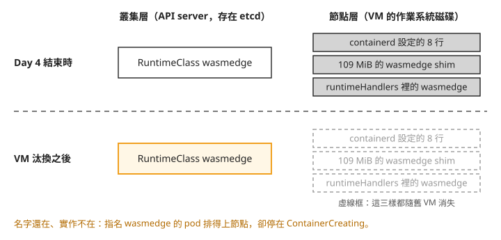
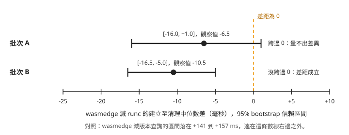
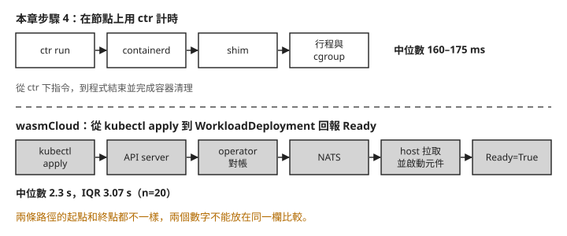

# Day 5: 量測 wasm 與容器的成本——對照組、信賴區間與 shim 的記憶體

{ align=right width="95" }

你大概讀過這類說法：「wasm 冷啟動比容器快一個數量級」「wasm 比容器輕」。想在自己的叢集上驗證，最直接的做法是拿同一支程式，一次編成 wasm 交給 Day 4 裝好的 wasmedge shim，一次編成一般執行檔交給 runc，各啟動 50 次。結果出來，wasmedge 的中位數是 167 毫秒，runc 是 173.5 毫秒。可以說 wasm 快了 6.5 毫秒嗎？再跑一批，換成快 10.5 毫秒。這點差距是否只是量測的波動？

這一章在一顆節點上比較容器建立、執行到清理的總時間與記憶體，再說明映像大小的比較條件，重點放在每個數字量完之後要問的問題：量具本身有多少雜訊，差距有沒有大過雜訊，兩個數字是不是在同一個條件下量的。讀完之後，拿到兩組啟動時間或記憶體讀數時，你能判斷差距能不能拿來排名，也能說出 wasm 容器在節點上的記憶體花在哪裡。

## 步驟 1: 先確認 Day 4 的 shim 還在不在 {#step-1}

Day 4 在節點上裝了 109 MiB 的 wasmedge shim、在 containerd 設定裡加了 8 行，也建了 `wasmedge` 這個 RuntimeClass。動手量之前，先在本機執行 `kubectl get node -o jsonpath='{.items[0].status.runtimeHandlers[*].name}'`。這個完整 JSONPath 取自重裝腳本 `42-reinstall-wasmedge.sh` 第 55 行；`runtimeHandlers` 是 kubelet 回報節點有哪些 handler 的欄位。

如果清單裡有 `wasmedge`，再照 [Day 1 步驟 3](sprint3-day1-three-generations.md) 的方式確認 shim 檔案與 containerd 設定仍在；三者都正常就直接進入步驟 2。若有缺失，再依本步驟末尾的 Day 4 連結補齊缺少的部分，不要重複加入已存在的設定。

如果兩章之間節點 VM 被替換，寫在舊 VM 磁碟上的安裝與設定可能消失。以下保留一組缺失時的對照紀錄：用 Day 1 的指令將目前狀態存成 `day5-s0-` 開頭的檔案，再與基準比對。區塊裡的 `{…runtimeHandlers}` 是不可照打的簡寫，查詢時請使用上方的完整 JSONPath。

```console
$ diff <Day1 基準>/baseline-containerd-config.toml day5-s0-containerd-config.toml
（無輸出,exit=0）                              ← 與 Day 1 基準逐字相同

$ cat day5-s0-shim-binaries.txt
-rwxr-xr-x 1 root root  8805376 /usr/bin/containerd-shim-runc-v2
-rwxr-xr-x 1 root root 10015640 /usr/bin/runc
                                               ← 那支 109 MiB 的 shim 不見了

$ kubectl get node -o jsonpath='{…runtimeHandlers}'
['', 'runc', 'untrusted']                      ← wasmedge 不在了
```

這組紀錄中，containerd 設定和 Day 1 基準逐字相同，shim 檔案不在，`runtimeHandlers` 裡也沒有 `wasmedge`。遇到這三項都缺失的情況，才需要重做完整安裝。

再看叢集這一側：

```console
$ kubectl get runtimeclass
kata-vm-isolation   kata
runc                runc
wasm-day1-runc      runc
wasm-day1-untrusted untrusted
wasmedge            wasmedge          ← 還在
wasmtime-spin-v2    wasmtime-spin-v2
```

`wasmedge` 這個 RuntimeClass 還在。RuntimeClass 是存在 etcd 裡的叢集物件，不會因為換了 VM 就消失。下面這張圖把兩側放在一起，上排是 Day 4 結束時，下排是 VM 換過之後：



我們可以從圖上看到，VM 換過之後，叢集處於「名字還在、實作不在」的狀態。這跟 Day 1 看到的 `kata-vm-isolation` 是同一類問題：API server 不會檢查 RuntimeClass 指向的 handler 在節點上存不存在，本例沒有排程標籤限制，Pod 排上節點後會因 handler 缺失而停在 `ContainerCreating`；Day 1 的 Kata 例子則先被 selector 擋在排程階段。要判斷 handler 在不在，看節點的 `runtimeHandlers`，不要看 `kubectl get runtimeclass`。遇到這個狀況的處理方式見[疑難排解：VM 換過之後，RuntimeClass 還在但 pod 起不來](#mine-1)。

本課在 `az aks stop`／`start` 後觀察到節點替換，不代表每次停止、啟動都一定更換 VM。節點映像升級、spot 節點被回收也會換掉 VM，可以預期同樣的結果，但本課沒有實際驗證。

這個結果也影響 [Day 8](sprint3-day8-reversibility.md) 的做法。Day 8 要移除 SpinKube，再把節點的 containerd 設定和 Day 1 的基準逐字比對，確認拆得乾淨。如果比對期間換了 VM，結果相同也可能只是新節點沒有安裝過那些元件。所以 Day 8 的移除和比對要在同一個 VM 生命週期內做完，中間不能停機。

需要補回缺失項目時，依序參照 Day 4 的[安裝 shim](sprint3-day4-wasmedge.md#install-shim)、[設定 handler](sprint3-day4-wasmedge.md#configure-handler)與[映像解包設定](sprint3-day4-wasmedge.md#run-images)。RuntimeClass 還在時，不必重建它。裝完在本機執行完整指令 `kubectl get node -o jsonpath='{.items[0].status.runtimeHandlers}'`，`runtimeHandlers` 裡應該又出現 `wasmedge`，確認後進入步驟 2。

## 步驟 2: 一份原始碼，三個目標

[Day 4](sprint3-day4-wasmedge.md#gate) 發現 wasm 有兩種格式：wasmedge shim 只吃 core module，wasmCloud 只吃 component。網路上現成的範例程式各自編成其中一種，拿兩支不同的程式比，量到的差距可能來自程式本身。所以這一章自己寫一支程式，從同一份原始碼編出三個版本。

Rust 用 **target triple** 指定要編給哪一種執行環境，它是一串用連字號串起來的名字，寫出 CPU 架構、作業系統和執行環境。這裡用到三個：

| target triple | 產出 | 給誰跑 |
|---|---|---|
| `wasm32-wasip1` | core module | wasmedge shim |
| `wasm32-wasip2` | component | wasmCloud |
| `x86_64-unknown-linux-musl` | 靜態連結的 Linux 執行檔 | runc |

原生版要是 linux/amd64 的執行檔，所以在叢集裡開一顆裝了 Rust 工具鏈的 pod 來編：

```yaml
apiVersion: v1
kind: Pod
metadata:
  name: builder
  namespace: wasmlab
spec:
  restartPolicy: Never
  containers:
    - name: rust
      image: rust:1-bookworm
      command: ["sleep", "infinity"]
```

```bash
kubectl apply -f builder.yaml
kubectl -n wasmlab exec -it builder -- bash
```

musl 是 Linux 的 C 標準函式庫；這裡把需要的函式一起連結進執行檔，讓空映像也能執行。進到 pod 之後，先裝 musl 的工具，再開一個新專案：

```bash
apt-get update -qq
apt-get install -y -qq musl-tools
mkdir -p /work && cd /work
cargo new --bin payload
cd payload
```

程式有兩種模式。不帶參數時印一行就結束，計時涵蓋這次容器建立、程式執行與清理完成；帶 `stay <秒數>` 時會停住不結束，讓我們有時間去讀它佔了多少記憶體。把 `src/main.rs` 換成：

```rust
fn main() {
    let args: Vec<String> = std::env::args().skip(1).collect();
    if args.first().map(String::as_str) == Some("stay") {
        let secs: u64 = args.get(1).and_then(|s| s.parse().ok()).unwrap_or(300);
        println!("cnp-sprint3-day5 payload: resident for {secs}s");
        std::thread::sleep(std::time::Duration::from_secs(secs));
        return;
    }
    let who = if args.is_empty() { "world".to_string() } else { args.join(" ") };
    println!("cnp-sprint3-day5 payload: hello {who}");
}
```

`Cargo.toml` 的 release 設定控制最佳化方式。三個版本共用縮小產物、跨模組最佳化、移除符號與 panic 時直接結束的選項，避免編譯選項成為另一個差異：

```toml
[profile.release]
opt-level = "s"
lto = true
strip = true
panic = "abort"
```

然後一次編出三個目標：

```bash
# one crate, one release profile, three target triples
rustup target add wasm32-wasip1 wasm32-wasip2 x86_64-unknown-linux-musl
for T in wasm32-wasip1 wasm32-wasip2 x86_64-unknown-linux-musl; do
  cargo build --release --target "$T"
done
```

三次建置使用相同原始碼與 release 選項，改變的是 target triple；各目標仍會連入不同的標準函式庫與執行期支援。後面量到的差距，就不會是「兩支程式寫得不一樣」造成的。

### 打包成映像

三個成品要包成 OCI 映像，containerd 和 wasmCloud 才拉得到。rootfs 是容器看見的檔案系統；這裡用 tar 打包。artifact 泛指 registry 裡儲存的成品，不一定是 Linux 容器映像。本課包了四個：

| 後綴 | 內容 | 給誰 |
|---|---|---|
| `-wasm` | core module，空 base，tar rootfs | wasmedge shim |
| `-native-scratch` | 原生執行檔，空 base，tar rootfs | runc，**無 base image** |
| `-native-debian` | 原生執行檔疊在 `debian:12-slim` 上 | runc，**有 base image** |
| `-comp` | component，`application/wasm` artifact | wasmCloud |

`-wasm` 和 `-native-scratch` 用的是同一套打包方式：一層 tar，裡面只有那一個檔案，沒有任何 base image。兩者的映像大小要能比較，這是前提；如果一邊多疊了一層作業系統，比到的就是那層作業系統的大小。`-native-debian` 是另一種對照，代表一般疊在 Linux 發行版上的應用容器。

打包用 `crane`（v0.21.9）和 `oras`（v1.3.3）兩個工具，在 builder pod 裡執行。先在 builder 安裝對應版本：

```bash
curl -sSL https://github.com/google/go-containerregistry/releases/download/v0.21.9/go-containerregistry_Linux_x86_64.tar.gz | tar xz -C /usr/local/bin crane
curl -sSL https://github.com/oras-project/oras/releases/download/v1.3.3/oras_1.3.3_linux_amd64.tar.gz | tar xz -C /usr/local/bin oras
```

本課推到 ttl.sh，這是不用帳號的臨時 registry，tag 寫 `1h` 代表映像一小時後自動刪除，量測要在這段時間內做完；想留久一點，換成自己的 registry。`<prefix>` 換成一串自己的隨機字：

```bash
mkdir -p /out
cp target/wasm32-wasip1/release/payload.wasm        /out/payload-wasip1.wasm
cp target/wasm32-wasip2/release/payload.wasm        /out/payload-wasip2.wasm
cp target/x86_64-unknown-linux-musl/release/payload /out/payload-native
cd /out
R=ttl.sh/<prefix>

tar --owner=0 --group=0 --mode=0755 -cf wasm-layer.tar --transform 's,payload-wasip1.wasm,payload.wasm,' payload-wasip1.wasm
tar --owner=0 --group=0 --mode=0755 -cf native-layer.tar --transform 's,payload-native,payload,' payload-native

crane append --oci-empty-base -f wasm-layer.tar   -t "${R}-wasm-base:1h"   --platform linux/amd64
crane mutate "${R}-wasm-base:1h"   --entrypoint /payload.wasm -t "${R}-wasm:1h"
crane append --oci-empty-base -f native-layer.tar -t "${R}-native-base:1h" --platform linux/amd64
crane mutate "${R}-native-base:1h" --entrypoint /payload      -t "${R}-native-scratch:1h"
crane append -b debian:12-slim -f native-layer.tar -t "${R}-debian-base:1h"
crane mutate "${R}-debian-base:1h" --entrypoint /payload      -t "${R}-native-debian:1h"

echo '{}' > wasm-config.json
cp payload-wasip2.wasm payload.wasm
oras push "${R}-comp:1h" \
  --config wasm-config.json:application/vnd.wasm.config.v0+json \
  payload.wasm:application/wasm
```

比較大小時，分別記錄三個成品的檔名、位元組數與 SHA-256，以及每個映像的 reference、各 layer 的大小與 digest。檔案大小和映像 layer 大小分開記錄；映像只拿 `-wasm` 和 `-native-scratch` 這兩個打包方式相同的版本來比。

在 builder pod 裡執行以下指令，保存 `ls -l` 的檔案大小欄位，雜湊會寫入 `/out/sha256.txt`。這三行取自建置腳本 `43-build-one-source.sh` 第 60–62 行：

```bash
cd /out
ls -l
sha256sum payload-* > /out/sha256.txt
```

接著沿用打包時的 `R`，讀取各映像的 manifest 並存成 JSON；從 `layers` 裡記下 `size` 與 `digest`。以下逐字取自 `45-package-and-push.sh` 第 45–48 行：

```bash
for n in wasm native-scratch native-debian comp; do
  echo "=== ${R}-${n}:1h"
  crane manifest "${R}-${n}:1h" | tee "/out/manifest-${n}.json"; echo
done
```

## 步驟 3: 先量量具本身的雜訊

容器的單次總時間在節點上用 `ctr` 量。`ctr` 是 containerd 附的命令列工具，Day 4 用它查過映像。直接用 `ctr` 啟動容器，不經過 API server、scheduler 和 kubelet，計時從執行 `ctr run --rm` 到命令返回，包含命令列工具、RPC、容器建立、程式執行與退出清理。它沒有把純啟動階段分離出來，也不是服務能接收請求的時間。

用 node-shell 進到節點（Day 1 建的那顆特權 pod）：

```bash
NODE_SHELL_POD=$(kubectl -n wasmlab get pod -l app=node-shell -o jsonpath='{.items[0].metadata.name}')
kubectl -n wasmlab exec -it "$NODE_SHELL_POD" -- nsenter -t 1 -m -- bash
```

前面在 builder 的操作完成後，回到本機再進節點 shell。量測用獨立的 containerd namespace `cnp5`，跟 kubelet 用的 `k8s.io` 分開。先用 `ctr -n cnp5 images pull` 把 `-wasm` 和 `-native-scratch` 兩個映像拉到節點上，量測時就不會把下載時間算進去。

在開始量之前，要先回答一個問題：計時這件事本身要花多少時間、會晃動多少？`ctr` 每次要啟動一個新的行程、連到 containerd 再回來，這段時間不管跑什麼容器都會付。單一樣本的波動不能直接當成兩組差值的判定門檻，後面會用重抽樣估計差值的不確定性。

所以先量一組**對照組**（null control）：用同一支 `ctr` 下一個什麼都不做的指令 `ctr version`，只問 containerd 的版本，不建立任何容器。這組數字讓我們知道基本命令往返的耗時；它不是 runtime 差距必須超過的門檻。下面的採樣程式依驗證時的 `48-measure-node.sh` 改寫成直接展開的形式（改寫版本本課沒有實跑），先量 50 次對照組，再交錯量兩個 runtime。這份程式沒有檢查每次命令是否成功，失敗也會記下時間，因此不能直接拿來收集新的有效樣本：

```bash
W=ttl.sh/<prefix>-wasm:1h
C=ttl.sh/<prefix>-native-scratch:1h

# warm-up so the first sample is not paying for page cache
ctr -n cnp5 run --rm --runtime io.containerd.wasmedge.v1 "$W" warm-w >/dev/null 2>&1
ctr -n cnp5 run --rm "$C" warm-c >/dev/null 2>&1

for i in $(seq 1 50); do
  t0=$(date +%s%N); ctr -n cnp5 version >/dev/null 2>&1; t1=$(date +%s%N)
  echo "harness $(( (t1 - t0) / 1000000 ))"
done
for i in $(seq 1 50); do
  t0=$(date +%s%N); ctr -n cnp5 run --rm --runtime io.containerd.wasmedge.v1 "$W" "w$RANDOM$i" >/dev/null 2>&1; t1=$(date +%s%N)
  echo "wasmedge $(( (t1 - t0) / 1000000 ))"
  t0=$(date +%s%N); ctr -n cnp5 run --rm "$C" "c$RANDOM$i" >/dev/null 2>&1; t1=$(date +%s%N)
  echo "runc $(( (t1 - t0) / 1000000 ))"
done
```

重新量測時，應先確認映像可執行，每次保留退出碼；失敗立即停止該組採樣並顯示錯誤，不得把失敗時間計入。這次歷史紀錄沒有逐筆退出碼，無法補證每個樣本都成功，因此下面數字只作方法與既有資料判讀，不能當成已通過這項條件的新效能結果。

有兩個細節值得注意。正式取樣前，每個 runtime 先各跑一次暖機，讓相關的檔案先進到記憶體的快取裡，第一個樣本不會因為讀磁碟而特別慢。另外，wasmedge 和 runc 是一個接一個交錯跑，不是先跑完 50 次 wasmedge 再跑 50 次 runc；如果量測途中節點變忙或變閒，可減少先後次序造成的偏差，但不能保證兩邊受到完全相同的影響。

整理這些樣本時用**中位數**和 **IQR**。中位數是把 50 個數字排好之後最中間的那個；IQR（四分位距）是排在第 75% 的數字減掉排在第 25% 的數字，也就是中間那一半樣本分布得多寬。不用平均數，是因為啟動時間有一個降不下去的最低值，偶爾又會冒出特別慢的一次，平均數會被少數幾個慢的樣本往上拉，不能代表「一般的一次」。

對照組的結果：

```text
harness   n=50   median 16.0 ms   IQR 1.0   (min 15.0, max 30.0)
```

這批版本查詢的中位數是 16 毫秒，IQR 為 1 毫秒。它的變異較小，但不能據此把容器樣本的其他變異全部歸因給 runtime。

## 步驟 4: 建立、執行與清理，兩批各 n=50

同樣的程序跑兩批，每批各 50 個樣本。下面是兩批的統計，欄位依序是樣本數、最小值、第 25%、中位數、第 75%、最大值和 IQR（單位毫秒）：

```text
=== 批次 A
label       n     min     p25  median     p75     max     IQR
harness    50    15.0    16.0    16.0    17.0    30.0     1.0
wasmedge   50   147.0   156.0   167.0   178.5   197.0    22.5
runc       50   153.0   159.5   173.5   185.5   279.0    26.0

=== 批次 B
harness    50    15.0    16.0    16.0    17.0    28.0     1.0
wasmedge   50   147.0   154.0   161.0   169.0   196.0    15.0
runc       50   148.0   165.0   171.5   181.8   255.0    16.8
```

把五組中位數畫在同一把尺上：

<svg viewBox="0 0 660 210" role="img" aria-label="建立至清理的中位數(毫秒,每批 n=50)" width="100%" style="max-width:660px; font-family: var(--md-text-font-family, sans-serif);">
<text x="0" y="18" font-size="15" font-weight="600" fill="var(--md-default-fg-color)">建立至清理的中位數(毫秒,每批 n=50)</text>
<text x="160" y="50" font-size="13" text-anchor="end" fill="var(--md-default-fg-color)">版本查詢</text>
<rect x="170" y="34" width="33" height="22" rx="2" fill="#9aa0a6"/>
<text x="211" y="50" font-size="13" font-weight="600" fill="var(--md-default-fg-color)">16</text>
<text x="160" y="84" font-size="13" text-anchor="end" fill="var(--md-default-fg-color)">wasmedge 批次A</text>
<rect x="170" y="68" width="342" height="22" rx="2" fill="#e8590c"/>
<text x="520" y="84" font-size="13" font-weight="600" fill="var(--md-default-fg-color)">167</text>
<text x="160" y="118" font-size="13" text-anchor="end" fill="var(--md-default-fg-color)">runc 批次A</text>
<rect x="170" y="102" width="356" height="22" rx="2" fill="#4c7bd9"/>
<text x="534" y="118" font-size="13" font-weight="600" fill="var(--md-default-fg-color)">173.5</text>
<text x="160" y="152" font-size="13" text-anchor="end" fill="var(--md-default-fg-color)">wasmedge 批次B</text>
<rect x="170" y="136" width="330" height="22" rx="2" fill="#e8590c"/>
<text x="508" y="152" font-size="13" font-weight="600" fill="var(--md-default-fg-color)">161</text>
<text x="160" y="186" font-size="13" text-anchor="end" fill="var(--md-default-fg-color)">runc 批次B</text>
<rect x="170" y="170" width="352" height="22" rx="2" fill="#4c7bd9"/>
<text x="530" y="186" font-size="13" font-weight="600" fill="var(--md-default-fg-color)">171.5</text>
</svg>

wasmedge 和 runc 的長條幾乎一樣長，兩者都遠高於 16 毫秒的版本查詢對照值。兩批的中位數都是 wasmedge 略低，分別低 6.5 和 10.5 毫秒。問題在於：wasmedge 自己的 IQR 就有 15 到 22.5 毫秒，差 6.5 毫秒會不會只是這一批剛好抽到比較快的幾次？

### 用 bootstrap 估計差距的範圍

回答這個問題用的是 **bootstrap 信賴區間**。做法是拿手上這 50 個 wasmedge 樣本，從裡面隨機抽 50 次，每次抽完放回去（同一個樣本可以被抽到不只一次），得到一組「重抽」的樣本；runc 也一樣抽一組，算兩組中位數的差。這樣重複一萬次，就有一萬個差值。把最小的 2.5% 和最大的 2.5% 去掉，剩下的範圍叫 95% 信賴區間，意思是：以手上的資料來看，真正的差距大致落在這個範圍內。

判讀規則很簡單：區間跨過 0，代表「兩者一樣快」也在合理範圍內，這批資料分不出誰快；區間整個在 0 的某一邊，差距才算成立。亂數用固定的種子，同一份資料每次算出來的區間都一樣。

可在本機下載[統計程式](../assets/labs/s3d5/50-effect-vs-noise.py)、[批次 A](../assets/labs/s3d5/samples-node-n50.txt)與[批次 B](../assets/labs/s3d5/samples-node-n50b.txt)。以 `python3 50-effect-vs-noise.py wasmedge runc < samples-node-n50.txt` 重算 A，再換成 B 的檔名；這只分析已保存資料，不會連線叢集。兩批的結果：

```text
=== 批次 A:wasmedge vs runc
observed difference = -6.5 ms
bootstrap 95% CI    = [-16.0, +1.0] ms
verdict: NOT MEASURABLE (CI covers 0)

=== 批次 B:wasmedge vs runc
observed difference = -10.5 ms
bootstrap 95% CI    = [-16.5, -5.0] ms
verdict: measurable
```

畫在一條數線上，橘色虛線是「差距為 0」：



照著圖看兩件事。第一，批次 A 的區間剛好越過 0，批次 B 的區間停在 -5，兩批的點估計都偏向 wasmedge 較短，區間也大幅重疊；差別是 A 包含 0、B 不包含 0，不能說效果方向相反。第二，就算採信批次 B，差距也在 5 到 16.5 毫秒之間，跟一次啟動的 160 多毫秒比，約占數個百分點，還要看這個差距對應用是否有實際影響。

同樣的方法拿來比 wasmedge 和版本查詢對照值：

```text
wasmedge vs harness   批次 A CI = [+144.0, +157.0] ms   measurable
                      批次 B CI = [+141.0, +149.5] ms   measurable
```

wasmedge 比版本查詢對照值多出約 150 毫秒，兩批都很明確。

### 這組數字能說什麼

在這個條件下，兩組「建立、執行、清理」總時間的中位數約為 160–175 毫秒。A 的差值區間包含 0，B 不包含 0；現有資料支持的範圍有限，又缺少逐筆退出碼，不能用來宣稱一般的 wasm 冷啟動排名。

wasmedge 比版本查詢多出的約 150 毫秒，包含好幾個階段。本課沒有分段計時，不能判定其中多少來自 cgroup、shim、程式本身或清理。若要比較純啟動或 HTTP 可用時間，必須另選一致的開始與結束條件。

要檢查結果是否穩定，可在相同條件下增加獨立批次。每批維持相同的暖機、版本查詢與交錯採樣方式，依步驟 3 的要求保留退出碼與錯誤；把各批有效樣本分開保存，再用相同統計程式重算中位數、IQR 與差值的信賴區間。增加樣本與批次可讓估計更有依據，但不保證某一種判定一定成立。

## 步驟 5: 記憶體

### shim 的記憶體：觀察並行容器增加時的用量 {#shim-memory}

每個容器在節點上都有一個 shim 行程替它跟 containerd 溝通（Day 1 追過這條路徑）。要量 shim 吃多少記憶體，第一個想到的是 `ps` 的 RSS 欄位，但 RSS 會算錯：RSS 是一個行程用到的全部實體記憶體，包含跟其他行程共用的部分。wasmedge 的 shim 會分出好幾個行程，它們共用同一份程式碼，用 RSS 加總會把共用的部分重複算好幾次。

所以這裡用 **PSS**（proportional set size）：共用的頁面按共用的行程數平均分攤，每個行程只算自己那一份，加總起來就不會重複。PSS 可以從 `/proc/<pid>/smaps_rollup` 讀到：

```bash
for p in $(pgrep -f containerd-shim); do awk '/^Pss:/{print $2}' /proc/$p/smaps_rollup; done
```

（這會把節點上所有 shim 都算進去；本課只加總命令列裡帶 `cnp5` 的那些，也就是自己用 `ctr` 啟動的容器。）

實際使用的[並行取樣腳本](../assets/labs/s3d5/52-measure-shim-scaling.sh)在節點執行，參數為打包時的 `<prefix>`，僅統計 `cnp5` namespace 的 shim。它依序建立 1、2、3 個 `stay` 容器，每組等 6 秒再讀 PSS，清理後才換下一組。上面的泛用 `pgrep` 只是讀 PSS 的示意，不能直接拿它加總全節點來重現以下數字：

```text
wasmedge n=1 shim_pss_KiB=49235  shim_procs=4
wasmedge n=2 shim_pss_KiB=58774  shim_procs=8
wasmedge n=3 shim_pss_KiB=68210  shim_procs=12
runc     n=1 shim_pss_KiB=4709   shim_procs=1
runc     n=2 shim_pss_KiB=9904   shim_procs=2
runc     n=3 shim_pss_KiB=13885  shim_procs=3
```

以下是原紀錄從 1–3 個容器樣本推估的固定項與每容器增量。當時用「常駐」稱呼固定項，但沒有直接量過零容器時的用量，不能當成零負載實測，也不能直接套到任意容器數：

```text
wasmedge  常駐 38.8 MiB  +9.3 MiB/容器  4 行程/容器
runc      常駐  0.1 MiB  +4.5 MiB/容器  1 行程/容器
```

畫成長條圖：

<svg viewBox="0 0 660 235" role="img" aria-label="shim 記憶體對並行容器數" width="100%" style="max-width:660px; font-family: var(--md-text-font-family, sans-serif);">
<text x="0" y="18" font-size="15" font-weight="600" fill="var(--md-default-fg-color)">shim 記憶體 PSS(MiB)對並行容器數</text>
<rect x="0" y="30" width="12" height="12" rx="2" fill="#e8590c"/><text x="18" y="41" font-size="12" fill="var(--md-default-fg-color)">wasmedge</text><rect x="106" y="30" width="12" height="12" rx="2" fill="#4c7bd9"/><text x="124" y="41" font-size="12" fill="var(--md-default-fg-color)">runc</text>
<text x="100" y="80" font-size="13" text-anchor="end" fill="var(--md-default-fg-color)">1 個容器</text>
<rect x="110" y="56" width="316" height="18" rx="2" fill="#e8590c"/>
<text x="434" y="70" font-size="12.5" font-weight="600" fill="var(--md-default-fg-color)">48.1</text>
<rect x="110" y="79" width="30" height="18" rx="2" fill="#4c7bd9"/>
<text x="148" y="93" font-size="12.5" font-weight="600" fill="var(--md-default-fg-color)">4.6</text>
<text x="100" y="139" font-size="13" text-anchor="end" fill="var(--md-default-fg-color)">2 個容器</text>
<rect x="110" y="115" width="377" height="18" rx="2" fill="#e8590c"/>
<text x="495" y="129" font-size="12.5" font-weight="600" fill="var(--md-default-fg-color)">57.4</text>
<rect x="110" y="138" width="64" height="18" rx="2" fill="#4c7bd9"/>
<text x="182" y="152" font-size="12.5" font-weight="600" fill="var(--md-default-fg-color)">9.7</text>
<text x="100" y="198" font-size="13" text-anchor="end" fill="var(--md-default-fg-color)">3 個容器</text>
<rect x="110" y="174" width="438" height="18" rx="2" fill="#e8590c"/>
<text x="556" y="188" font-size="12.5" font-weight="600" fill="var(--md-default-fg-color)">66.6</text>
<rect x="110" y="197" width="89" height="18" rx="2" fill="#4c7bd9"/>
<text x="207" y="211" font-size="12.5" font-weight="600" fill="var(--md-default-fg-color)">13.6</text>
</svg>

圖上是直接量到的 PSS：1–3 個容器時，wasmedge 約 48–67 MiB，runc 約 4.6–13.6 MiB。這組樣本中，wasmedge 每個容器有 4 個 shim 行程，runc 有 1 個；這是本次樣本的正常觀察，不是故障。計數使用 `pgrep -fc 'containerd-shim.*cnp5'`，取自並行取樣腳本第 43 行，只計入命令列帶 `cnp5` 的 shim。同時跑 3 個容器時，兩種 runtime 分別數到 12 與 3 個行程；直接用 `pgrep -fc containerd-shim` 會混入其他 namespace 的容器。但資料沒有把每一頁記憶體的用途分開，不能把推估的固定項全歸給執行期程式碼。

固定項加上容器數乘以增量，可以作為這組樣本的近似模型。要用於更大規模的容量規劃，還要在目標容器數與工作負載下取樣；shim 檔案大小也不等於執行時的實體記憶體用量。

### 容器自己的記憶體

shim 之外，容器裡的程式自己用多少？cgroup v2 是 Linux 用來分組計帳與限制資源的機制，每個容器在它底下有自己的目錄，其中 `memory.current` 是目前算在這個容器頭上的記憶體，包含它與子 cgroup 的計帳用量及檔案快取等項目；它不是記憶體限制或峰值，也不能直接當作 RSS。

以下保留原有簡寫供核對，請勿照打。固定的 cgroup 路徑應改成先查容器 PID，再從 `/proc/<pid>/cgroup` 取得路徑；這段簡寫修正後的寫法本課沒有實跑。要重現既有量測，請使用後面從驗證素材逐字補入的完整程序：

```bash
ctr -n cnp5 run -d --runtime io.containerd.wasmedge.v1 "$W" memw /payload.wasm stay 120
ctr -n cnp5 run -d "$C" memc /payload stay 120
cat /sys/fs/cgroup/cnp5/memw/memory.current /sys/fs/cgroup/cnp5/memc/memory.current
```

以下取自[記憶體取樣腳本](../assets/labs/s3d5/51-measure-memory.sh)第 12、19–40、48–51 行，在步驟 3 的節點 shell 執行，沿用已設定的 `W`、`C`。先定義讀值函式，再啟動容器、等 5 秒，查 PID 與 cgroup 路徑，讀值後清理：

```bash
NSP=cnp5
report() {
  local id="$1" label="$2"
  local pid cg path
  pid=$(ctr -n $NSP task ls | awk -v i="$id" '$1==i{print $2}')
  cg=$(cat /proc/"$pid"/cgroup | head -1 | cut -d: -f3)
  path=/sys/fs/cgroup${cg}
  echo "--- $label  container=$id  pid=$pid"
  echo "    cgroup            = $cg"
  echo "    memory.current    = $(cat "$path"/memory.current) bytes"
  echo "    memory.peak       = $(cat "$path"/memory.peak 2>/dev/null || echo n/a) bytes"
  echo "    anon              = $(awk '$1=="anon"{print $2}' "$path"/memory.stat) bytes"
  echo "    file              = $(awk '$1=="file"{print $2}' "$path"/memory.stat) bytes"
  echo "    procs in cgroup   = $(wc -l < "$path"/cgroup.procs)"
  ps -o pid,rss,comm -p "$pid"
}

ctr -n $NSP run -d --runtime io.containerd.wasmedge.v1 "$W" memw /payload.wasm stay 120
ctr -n $NSP run -d "$C" memc /payload stay 120
sleep 5

report memw wasmedge
report memc runc

ctr -n $NSP task kill -s SIGKILL memw 2>/dev/null
ctr -n $NSP task kill -s SIGKILL memc 2>/dev/null
sleep 3
ctr -n $NSP c rm memw memc 2>/dev/null
```

以下保留原章節的讀值摘要；`mem.txt` 第 13–30 行記錄了對應的 PID、cgroup 路徑與讀值：

```text
--- wasmedge
    memory.current = 1601536 bytes   (1.53 MiB)
    PID   RSS COMMAND
  61034 15064 youki:[2:INIT]
--- runc
    memory.current =  294912 bytes   (0.28 MiB)
    PID   RSS COMMAND
  61077   316 payload
```

同一份原始碼，wasm 版的 `memory.current` 是 1.53 MiB，原生版是 0.28 MiB，約 5.4 倍。wasm 版除了程式本身，還要在容器裡把 WasmEdge 執行期跑起來。下面的 `ps` 輸出是同一個行程的 RSS，跟上一節說的一樣包含共用的頁面，所以不拿來比較。

wasm 容器裡的行程名稱是 `youki:[2:INIT]`。youki 是一套用 Rust 寫的 OCI 容器執行期，runwasi 用它的函式庫來建立容器，所以行程名稱帶著它的名字。

### 磁碟

shim 檔案的大小：

```text
/usr/bin/containerd-shim-runc-v2              8.4 MiB
/usr/local/bin/containerd-shim-wasmedge-v1  109.2 MiB    (13.0 倍)
```

<svg viewBox="0 0 660 108" role="img" aria-label="shim 二進位檔大小(MiB)" width="100%" style="max-width:660px; font-family: var(--md-text-font-family, sans-serif);">
<text x="0" y="18" font-size="15" font-weight="600" fill="var(--md-default-fg-color)">shim 二進位檔大小(MiB)</text>
<text x="160" y="50" font-size="13" text-anchor="end" fill="var(--md-default-fg-color)">runc 的 shim</text>
<rect x="170" y="34" width="30" height="22" rx="2" fill="#4c7bd9"/>
<text x="208" y="50" font-size="13" font-weight="600" fill="var(--md-default-fg-color)">8.4</text>
<text x="160" y="84" font-size="13" text-anchor="end" fill="var(--md-default-fg-color)">wasmedge 的 shim</text>
<rect x="170" y="68" width="389" height="22" rx="2" fill="#e8590c"/>
<text x="567" y="84" font-size="13" font-weight="600" fill="var(--md-default-fg-color)">109.2</text>
</svg>

wasmedge 的 shim 大了 13 倍，這支檔案包含靜態連結的執行期。但磁碟大小不能換算為等量的常駐記憶體。

把這一步的數字放在一起看：wasm 檔案本身很小，但在節點上跑起來，本次量到的 shim PSS 與容器 cgroup 用量都比 runc 高。做容量規劃時要算的是跑起來之後的記憶體，不是 wasm 檔案的大小。

要注意這裡的 runc 對照組是空 base 的靜態執行檔，這個對照組沒有加上 Linux 發行版的檔案層。一般應用容器疊在 Linux 發行版上，結果可能不同；本課打包了 `-native-debian`，但沒有拿它來量。

### wasmCloud 那一側：量不到單一元件

wasmCloud 的元件跑在 host 這顆 pod 裡，要量一個元件吃多少記憶體，得先有一顆沒跑過任何元件的 host。[Day 2](sprint3-day2-wasmcloud.md) 看過，元件停掉之後記憶體不會還給 host 行程，跑過元件的 host 讀數已經被墊高。所以這裡刪掉一顆 host pod 讓它重建，每 4 秒讀一次新 pod 的記憶體，同時從 log 數它啟動了幾個 workload：

```text
new host pod: hostgroup-default-…
t+4s   working_set_bytes=4800512  workloads_started=0
…
t+160s working_set_bytes=4837376  workloads_started=0
```

160 秒內，新 host 一個 workload 都沒有分到。原因是 [Day 3](sprint3-day3-wasmcloud-distributed.md) 看過的行為：wasmCloud 不會重新平衡，新加入的 host 不會分到既有的 workload。這樣做只會得到一顆一直空著的 host，正確的順序見[疑難排解：乾淨的 host 一直分不到 workload](#mine-3)。

能拿到的只有兩端：空 host 約 4.80 MB，帶著 6 個 workload 的 host 約 26.65 MB。那 6 個是 Day 2、Day 3 部署的 blobby 和 hello-world 混在一起，不是本章編的程式，不能除出每個元件多少。

## 步驟 6: wasmCloud 的啟動時間要放在哪一欄

對應的 [WorkloadDeployment 範本](../assets/labs/s3d5/47-wasmcloud-payload.yaml)把 image 改成自己的 `-comp:1h` reference；[歷史採樣腳本](../assets/labs/s3d5/53-measure-wasmcloud.sh)則在本機透過 kubectl 執行，參數依序為 manifest 路徑與次數。這份腳本只供核對下列資料的採樣方式，沒有失敗逾時處理，也沒有確認 HTTP 就緒，不能直接當成服務啟動的測試工具。wasmCloud 的時間是這樣量的：刪掉 `WorkloadDeployment`，再 `kubectl apply` 一次，每 0.5 秒查一次狀態，計時到讀到 `Ready=True`，重複 20 次。終點不是首次 HTTP 成功，還包含輪詢間隔造成的等待：

```text
wasmcloud_ready  n=20  min 1422  p25 1979.5  median 2302  p75 5049.2  max 12699  IQR 3069.8
```

中位數 2.3 秒，IQR 3.07 秒，晃動的幅度比中位數本身還大。

這個 2.3 秒不能跟步驟 4 的 160 到 175 毫秒放在同一欄比。下面這張圖把兩條路徑並排，上面是步驟 4 計時的範圍，下面是 wasmCloud 這組數字計時的範圍：



照著圖看：上排從 `ctr` 下指令算到容器執行與清理完成；下排從 `kubectl apply` 開始算，中間經過 API server、operator 的對帳迴圈、wasmCloud 內部用來傳訊息的 NATS，再由 host 拉取元件並啟動。兩組數字的起點、終點和經過的元件都不一樣，我們把這種差別叫做**量測平面**不同。量測平面不同的數字放進同一張表，讀者會以為 wasmCloud 慢了十幾倍，其實是量了不同的東西。

若要比較到 Ready 的控制路徑時間，得讓 wasmedge 也從 `kubectl apply` 一個 Pod 開始計時，走完 API server、kubelet、CRI 到 shim 的整條路徑。兩邊還須定義可比的 Ready 條件；若比較服務可用性，應改以成功回應同一種請求為終點。本課沒有做這組量測。

## 這些數字能用到哪裡

本章的結論有幾個前提，引用時要一起帶上：

- 只有一顆節點、一支印一行就結束的程式。程式沒有 I/O、沒有網路，也不配置大量記憶體，結論不能直接推到真實的應用。
- 計時涵蓋建立、執行與清理；兩批差值的信賴區間有重疊，一批包含 0、一批不包含 0，且缺逐筆退出碼，不能宣稱一般啟動排名。
- 容器的對照組只有空 base 的靜態執行檔，沒有量疊在 Linux 發行版上的版本。
- 映像大小沒有數字。
- wasmCloud 的啟動時間和每個元件的記憶體，都沒有跟另外兩者放在同一個條件下量到。

## 疑難排解

### VM 換過之後，RuntimeClass 還在但 pod 起不來 {#mine-1}

**症狀**：前一天裝好、驗過能跑的 `wasmedge` RuntimeClass，叢集停機再啟動之後，`kubectl get runtimeclass` 照樣列得出來，但指名它的 pod 都停在 `ContainerCreating`，訊息是 `no runtime for "wasmedge" is configured`。

**原因**：RuntimeClass 存在 etcd，handler 的實作（containerd 設定和 shim 檔案）寫在 VM 的磁碟上，換了 VM 只剩前者，見[步驟 1](#step-1)。

**修法**：用 `kubectl get node -o jsonpath='{.items[0].status.runtimeHandlers}'` 確認 handler 不在之後，照 Day 4 的安裝 shim、設定 handler 與映像解包設定重裝。手動對節點做的任何改動，都要假設下一次換 VM 時會消失。

### 乾淨的 host 一直分不到 workload {#mine-3}

**症狀**：為了量 wasmCloud 單一元件的記憶體，刪掉一顆 host pod 換一顆新的，等了 160 秒，`workloads_started` 一直是 0。

**原因**：wasmCloud 不重新平衡（[Day 3](sprint3-day3-wasmcloud-distributed.md) 量過），新加入的 host 不會分到既有的 workload。刪 pod 換新的，只會得到一顆一直空著的 host。

**修法**：先準備好乾淨的 host，再部署一個新的 `WorkloadDeployment`，順序不能反。另一種做法是把 host group 縮到 1 顆，讓所有 workload 集中在同一顆 host 上，再一個一個加上去，每加一個讀一次記憶體。

## 想一想

- 同事在另一顆節點上跑了一批 n=30，wasmedge 的中位數比 runc 快 12 毫秒，想在報告裡寫「wasm 啟動比較快」。在同意之前，你會請他補哪些數字？
- 一顆節點預計同時跑 20 個 wasmedge 容器。估算 shim 要吃多少記憶體時，109 MiB、38.8 MiB、9.3 MiB 這三個數字各該怎麼用？如果換成 20 個 runc 容器呢？哪些是直接量到的值，哪些只是超出 1–3 個容器範圍的試算，還需要怎樣驗證？
- 週一早上，指名 `wasmedge` 的 pod 全部停在 `ContainerCreating`，`kubectl get runtimeclass` 卻看得到 `wasmedge`。週末叢集停過機。你會先查哪一個欄位？

## 小結

比較快慢，要先對齊計時起點、終點與成功條件。本章的 `ctr run --rm` 包含建立、執行及清理，wasmCloud 則量到狀態被查為 Ready，兩者不能直接排名。版本查詢的 16 毫秒是對照資訊，不是差距的最低門檻；差值要連同信賴區間與資料限制一起解讀。記憶體方面，這組小程式的 wasmedge shim PSS 與容器 cgroup 用量較高，但 1–3 個容器的推估不等於大規模容量公式。每個結論都要連同工作負載、版本與取樣範圍使用。

## 延伸閱讀

想再深入，可以從這幾份開始：

- **[containerd 的 shim 說明](https://github.com/containerd/containerd/blob/main/core/runtime/v2/README.md)** —— shim 為什麼是獨立的行程、containerd 重啟為什麼不會停掉容器，以及 shim 的生命週期。步驟 5 量到的 shim 行程數和常駐記憶體，可以從這裡理解。
- **[containerd/runwasi](https://github.com/containerd/runwasi)** —— 本章量的 wasmedge shim。`crates/containerd-shim-wasmedge` 底下看得到它用 youki 建立容器，也就是 cgroup 裡那個 `youki:[2:INIT]` 的來源。
- **[Linux 核心的 /proc 文件](https://docs.kernel.org/filesystems/proc.html)** —— `smaps_rollup` 裡 PSS 和 RSS 的定義。量好幾個行程共用記憶體的程式時，用 RSS 加總會高估。

## 下一步

wasmCloud 和 WasmEdge 兩條路線的成本到這裡都量過了：容器計時範圍與資料完整性仍有比較限制，記憶體則是本次 wasmedge 樣本較高。[Day 6](sprint3-day6-spinkube-shim.md) 走最後一條路線 SpinKube，它會用 operator 自動把 shim 裝上節點；那一天要看的是，自動化之後節點上被改了什麼、又留下什麼。

---

!!! quote ""
    WebAssembly 標誌為 WebAssembly 專案之官方資產(CC0 1.0),此處作社群教學用途。
