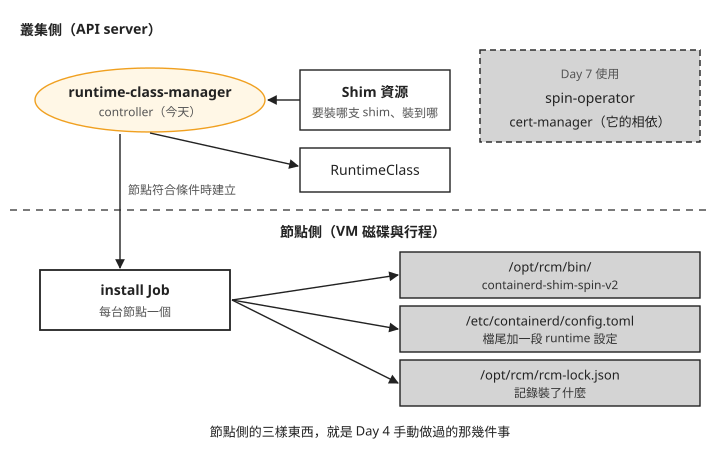
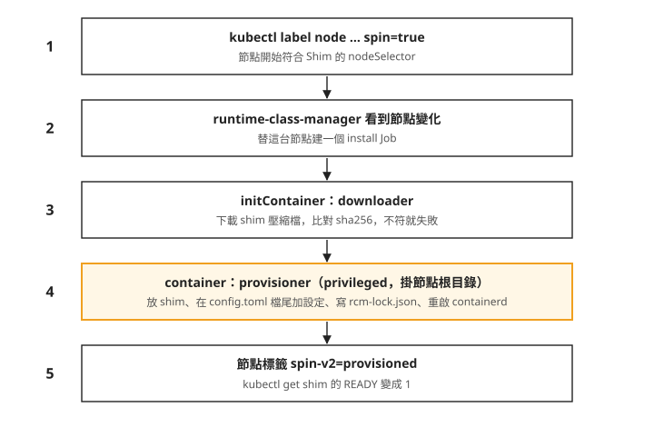
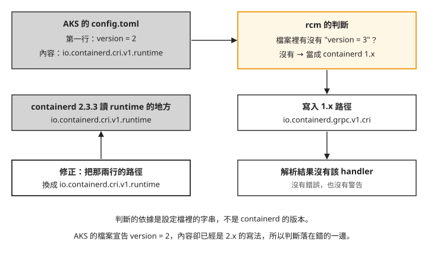

# Day 6: SpinKube(上)——runtime-class-manager 佈建 shim 與節點側設定

{ align=right width="88" }

[Day 4](sprint3-day4-wasmedge.md) 在一台節點上手動裝好 WasmEdge 的 shim：下載執行檔、在 `config.toml` 加一段 runtime 設定、重啟 containerd。一台節點這樣做還可以。叢集有十幾台節點、spot 節點隨時被回收、節點映像升級時整批換新，[Day 5](sprint3-day5-cost-measurement.md#mine-1) 也看過節點層的改動撐不過一次 VM 汰換，每台新節點都得重做一次。這件事適合交給 controller 自動做。

這一章用 SpinKube 的 runtime-class-manager 自動佈建 shim。裝完之後，`kubectl get shim` 顯示 READY、節點標著 `provisioned`、安裝用的 Job 是 Complete，送一顆 pod 進去，卻得到 `no runtime for "spin-v2" is configured`。我們會一步一步找出原因，修好它，最後讓一個 Spin 應用回應 HTTP 200。

讀完之後，一個自動化工具回報「節點已佈建」時，你能判斷 containerd 是否真的載入了那段設定；pod 起不來時，能分辨是 plugin 路徑寫錯、RuntimeClass 被同名物件佔住，還是映像缺少進入點。

## 從手動安裝到交給 controller

先回想 Day 4 在節點上做的三件事：把 shim 執行檔放上節點、在 `config.toml` 寫一段 runtime 設定、重啟 containerd 讓設定生效。再加上一個 API server 端的動作：建一個 RuntimeClass 指向那個 handler。

**SpinKube** 是一組讓 Spin 應用跑在 Kubernetes 上的專案。Spin 是一個用 WebAssembly 寫 HTTP 服務的框架，它的應用由 shim `containerd-shim-spin` 執行。SpinKube 把工作分成兩半：節點側由 **runtime-class-manager**（以下簡稱 rcm）負責，它是一個 controller，替符合條件的節點裝 shim、改設定、建 RuntimeClass；應用側由 spin-operator 負責，把 Spin 應用變成 Deployment，那是 Day 7 的內容。

rcm 從 **Shim 資源**得知要做什麼。Shim 是 rcm 定義的自訂資源，一份 Shim 描述一支 shim：從哪裡下載、雜湊值是多少、要裝到哪些節點、裝完要建什麼名字的 RuntimeClass。節點上的 `rcm-lock.json` 則記錄裝了哪支 shim、雜湊值與檔案路徑。

下圖把今天會碰到的元件按位置分開，上半部是 API server 裡的物件，下半部是節點上的檔案。圖中的 cert-manager 是管理 TLS 憑證的元件，Day 7 的 spin-operator 需要它，rcm 本身不需要：



照著圖看：rcm 讀 Shim 資源，決定要裝哪支 shim、裝到哪些節點；真正動手改節點的是它替每台節點建立的 install Job。節點側那三樣東西，前兩樣就是 Day 4 手動做過的事，第三樣是手動路線沒有的安裝紀錄。接下來的步驟會一個一個看到它們。

## 開始之前

本章指令使用 `spin` CLI v4.0.2、`containerd-shim-spin` v0.25.1 與 rcm v0.2.0；節點側的結果來自 containerd 2.3.3。安裝時請使用各步驟指定的版本。

節點上的指令透過 Day 1 的 `node-shell` DaemonSet 執行。先確認目前節點的 Pod 已就緒，重新取得名稱：

```bash
kubectl -n wasmlab rollout status ds/node-shell --timeout=5m
NODE_SHELL_POD=$(kubectl -n wasmlab get pod -l app=node-shell -o jsonpath='{.items[0].metadata.name}')
```

以下 `kubectl`、Helm 與 Spin 命令在本機執行；需要進節點時，命令會明列 `exec` 與 `nsenter`。

下載[節點取樣腳本](../assets/labs/s3d6/node-snapshot.sh)，存為 `node-snapshot.sh`。腳本會記錄 containerd 設定檔與解析結果、handler、shim 執行檔、RuntimeClass、設定目錄和節點標籤。先用 `kubectl config get-contexts` 找出本課 context，設定 `CTX`；`KUBECONFIG` 沿用 Day 2 的專用檔案。在本機執行：

```bash
export CTX=<lab-context>
bash node-snapshot.sh day6-s0
```

開始安裝前，先將 `day6-s0` 與 Day 1 保存的基準比對。以下假設基準檔放在 `sprint3-day1-manifests/`：

```console
$ diff sprint3-day1-manifests/baseline-containerd-config.toml day6-s0-containerd-config.toml
$ diff sprint3-day1-manifests/baseline-containerd-config-dump.toml day6-s0-containerd-config-dump.toml
$ diff sprint3-day1-manifests/baseline-node-runtimehandlers.json day6-s0-node-runtimehandlers.json
```

三次比對都沒有輸出且結束碼為 0，表示這三項與 Day 1 基準相同。本章後面的映像拉取結果以沒有 Day 5 的 WasmEdge handler 與映像拉取設定為前提。若沿用 Day 5 的原節點，請記錄仍在的差異；仍可操作 SpinKube，但不能把這個環境的映像拉取結果當成「未加設定」的對照。

每個階段換一個輸出前綴，例如 `day6-s1`，再逐份用 `diff` 比對。腳本假設只有一台測試節點；若有多台，要分別選定節點取樣，不能把第一筆 Node 與另一台 node-shell 的結果混用。

## 步驟 1:打包一個 Spin 應用 {#step-1}

本機需要 Spin CLI 4.0.2 與 `static-fileserver` 範本；安裝方式見 [Spin CLI 官方說明](https://spinframework.dev/v4/install)。請依文件的指定版本方式選 4.0.2，再用 `spin --version` 確認；直接安裝最新版不一定與本課相同。二進位檔手動安裝不會附範本，需依同頁的 Templates 段落另裝。先準備等一下要跑的應用。用 `spin` CLI 的 `static-fileserver` 範本建一個 app（`spin new -t static-fileserver`，依提示輸入專案名稱），它把 `assets/` 目錄裡的檔案當成靜態網頁回應。切換到新建專案目錄，後面的 `spin registry push` 也在該目錄執行。在 `assets/index.html` 放一行 `Sprint3 Day6 SpinKube probe`。這個範本的 wasm 元件是官方預先編好的，不需要裝 Rust 之類的編譯工具。

推到 ttl.sh。ttl.sh 是不用帳號的公開 registry，tag 寫 `:1h` 表示映像保留一小時，適合做實驗；`<tag>` 換成你自己取的名字：

```console
$ spin registry push ttl.sh/<tag>:1h
Pushed with digest sha256:5e551527…
```


依 [Spin v4 發佈文件](https://spinframework.dev/v4/distributing-apps)與 [OCI Distribution v1.1.0](https://github.com/opencontainers/distribution-spec/blob/v1.1.0/spec.md#pulling-manifests)，推送成功後用 HTTP GET 從 [ttl.sh](https://ttl.sh/) 取得 manifest，`<tag>` 換成剛才推送使用的名稱，並在一小時內執行（依官方文件補上，本課沒有實跑）：

```bash
curl -fsSL \
  -H 'Accept: application/vnd.oci.image.manifest.v1+json, application/vnd.docker.distribution.manifest.v2+json' \
  'https://ttl.sh/v2/<tag>/manifests/1h'
```

把這個映像的 manifest 從 registry 拉回來看，layers 欄位是這樣：

```json
"layers": [
  { "mediaType": "application/vnd.wasm.content.layer.v1+wasm",         "size": 3781679 },
  { "mediaType": "application/vnd.fermyon.spin.application.v1+config", "size": 609 }
]
```


Day 4 看過的三種打包都只有一層，Spin 的有兩層。第一層是 wasm 本體。第二層 609 B 叫 **locked app**：Spin 應用的完整描述，包括用什麼觸發（這裡是 HTTP）、哪個路徑交給哪個元件、元件從哪裡來。28 B 的 `index.html` 也被 base64 編碼後直接放進 locked app，沒有另開一層。

image config 只有 209 B，裡面只有一個指向 locked app 的 label，沒有 `Cmd`，也沒有 `Entrypoint`。這一點在步驟 6 會讓 pod 起不來，先記著。

把它併進 [Day 4 的打包對照表](sprint3-day4-wasmedge.md#gate)，現在有四欄：

| | wasmCloud | runwasi tar | runwasi wasm-layer | **Spin App** |
|---|---|---|---|---|
| layer mediaType | `application/wasm` | `…layer.v1.tar` | `…wasm.component.layer.v0+wasm` | **`…wasm.content.layer.v1+wasm` + `…fermyon.spin.application.v1+config`** |
| 層數 | 1 | 1 | 1 | **2** |
| 進入點 | 列 WIT 介面 | `Entrypoint` | `Entrypoint` + label | **沒有,config label 指向 locked app** |
| `os` 欄位 | `wasip2` | `wasip1` | `wasip1` | **`wasip1`(但 payload 其實是 component)** |
| 誰讀得懂 | wasmCloud | WasmEdge | WasmEdge | containerd-shim-spin |

最右欄跟前三欄的 mediaType 都不同。wasm 的 OCI 打包沒有共通約定，mediaType 由各家自己定義，同一個 registry 裡的映像，不一定是同一種東西，要看哪個 shim 讀得懂。另外，用 Day 4 的方法看 wasm 檔的前 8 個位元組，是 `00 61 73 6d 0d 00 01 00`，代表 component；image config 的 `os` 欄位卻寫 `wasip1`。所以在 Spin 的打包裡，不能用 `os` 欄位判斷裡面是 component 還是 core module。

## 步驟 2:安裝 cert-manager 與 runtime-class-manager

先裝 cert-manager v1.21.1，供 Day 7 的 spin-operator 使用。rcm 0.2.0 的 chart 只有六個 template，沒有 webhook，也沒有任何 Certificate 資源。官方安裝指引把 cert-manager 排在第一步，是為了後面的 spin-operator，只裝 shim 可以略過，這裡先裝好給 Day 7 用。cert-manager 的 chart 在 jetstack 的 Helm repo，還沒加過的話，先 `helm repo add jetstack https://charts.jetstack.io`。

```console
$ helm upgrade --install cert-manager jetstack/cert-manager -n cert-manager \
    --create-namespace --version v1.21.1 --set crds.enabled=true --wait
$ helm upgrade --install runtime-class-manager \
    oci://ghcr.io/spinframework/charts/runtime-class-manager --version 0.2.0 \
    -n rcm --create-namespace --wait
```

rcm 的 chart 裝了一個 Deployment（controller 本身）、一個 `Shim` CRD（`shims.runtime.spinkube.dev`）、ServiceAccount 與 RBAC。

跟 Day 4 一樣，每一步前後都比對一次節點：`config.toml`、`containerd config dump`、`runtimeHandlers`、shim 執行檔清單、RuntimeClass 清單，今天再加上 containerd 設定目錄和節點標籤，共七項。裝完這兩個 chart，七項都跟裝之前一樣。controller 跑起來了，但它還沒碰任何節點。

## 步驟 3:告訴 rcm 要裝什麼、裝到哪些節點

`containerd-shim-spin` 的每個 release 都附了一份官方 Shim 資源。下載本課保存的 [v0.25.1 官方 Shim YAML](../assets/labs/s3d6/shim-spin-v2.yaml)，存成 `shim-spin-v2.yaml`，不做任何修改，然後 `kubectl apply -f shim-spin-v2.yaml`。它的重點欄位是這幾個：

```yaml
spec:
  nodeSelector: {spin: "true"}
  fetchStrategy:
    platforms:
      - {os: linux, arch: x86_64, location: "…/containerd-shim-spin-v2-linux-x86_64.tar.gz",
         sha256: "1755fbeb…"}
  runtimeClass: {name: wasmtime-spin-v2, handler: spin-v2}
```


由上往下看：`nodeSelector` 指定只有帶 `spin=true` 標籤的節點會被安裝；`fetchStrategy.platforms` 依 CPU 架構列出下載位置和 sha256，完整檔案裡另外還有一筆 aarch64；`runtimeClass` 指定要建的 RuntimeClass 叫 `wasmtime-spin-v2`，handler 是 `spin-v2`。

套用之後，看 rcm 有沒有動作：

```console
$ kubectl get shim -o wide
NAME      RUNTIMECLASS       READY   NODES
spin-v2   wasmtime-spin-v2   0       0

$ kubectl get jobs -A
No resources found
```

`READY 0`、`NODES 0`，也沒有任何 Job，節點的七項比對全都沒變。叢集裡沒有節點帶 `spin=true`，所以 rcm 什麼都不做。安裝範圍完全由 `nodeSelector` 決定，預設一台都沒有。Day 4 的手動路線，範圍是「你連進了哪台節點」，沒有地方記錄；這裡的範圍寫在一個 YAML 欄位裡，查得到。

替節點貼上標籤：

```console
$ kubectl label node --all spin=true
```


貼完之後，叢集裡出現一個 Job，幾秒內就 Complete。這是 rcm 替這台節點建立的 **install Job**，真正改節點的就是它。把它的結構攤開來：

```text
initContainer: downloader   → 下載 tarball,逐字比對 sha256,不符就失敗
container:     provisioner  → 掛 hostPath /,裝 shim、改 config.toml、經 D-Bus 重啟 containerd
兩者皆 privileged
```


把貼標籤之後的流程畫成圖，由上往下是時間順序：



照著圖上的編號看，第 3 步和第 4 步是兩個容器。downloader 先跑，下載 shim 壓縮檔並比對 sha256，雜湊對不上就失敗，Job 不會往下走；Day 4 有在本機核對雜湊，但節點另外下載的那份沒有再次核對；rcm 則在節點上的下載程序驗證。provisioner 以 privileged 模式掛載整台節點的根目錄，做的就是 Day 4 手動做的那幾件事，最後透過 systemd 重啟 containerd。

再比對一次節點，這次有變化：

```text
config.toml       +6 行(檔尾,# RCM runtime config for spin-v2 起)
/opt/rcm/bin/containerd-shim-spin-v2     83.9 MiB
/opt/rcm/rcm-lock.json                   記錄 shim 名、sha256、路徑
節點標籤          +spin=true、+spin-v2=provisioned
```


shim 放在 `/opt/rcm/bin/`，不在 `PATH` 裡。rcm 在 `config.toml` 的 `runtime_type` 直接寫這支執行檔的絕對路徑，containerd 2.x 接受這種寫法，所以 shim 不需要放進 `PATH`。如果你沿用 Day 4 的方式，掃 `/usr/bin` 和 `/usr/local/bin` 確認 shim 在不在，會以為沒裝，見[疑難排解：在 `/usr/bin` 找不到 shim](#mine-5)。

安裝紀錄在 `/opt/rcm/rcm-lock.json`。之後要確認 shim 的名稱、雜湊值與安裝路徑，可以查這份檔案。

## 步驟 4:先處理同名的 RuntimeClass {#step-4}

從控制面看，安裝已經完成，每個指標都是成功：

```console
$ kubectl get shim -o wide
NAME      RUNTIMECLASS       READY   NODES
spin-v2   wasmtime-spin-v2   1       1

節點標籤:  "spin-v2": "provisioned"
install Job: Complete,log 沒有任何 warning,最後一行是 restarting containerd
```


Shim 的 `RUNTIMECLASS` 欄寫著 `wasmtime-spin-v2`。可是叢集裡本來就有一顆同名的 RuntimeClass，是 [Day 1 步驟 4](sprint3-day1-three-generations.md#step-4) 刻意建的對照組，handler 指向不存在的實作。SpinKube 的官方 Shim 資源用的也是這個名字，YAML 註解寫明這是 spin-operator 的預設值。看看 rcm 怎麼處理這個衝突：

```console
{"level":"debug","shim":"spin-v2","message":"RuntimeClass found: wasmtime-spin-v2"}

$ kubectl get runtimeclass wasmtime-spin-v2 -o yaml
handler: wasmtime-spin-v2       ← 還是 Day 1 那個壞 handler
resourceVersion: "2402"         ← 完全沒被改過
```


rcm 的 log 說它找到了這顆 RuntimeClass，然後就沒有下文。RuntimeClass 的 handler 還是 Day 1 的 `wasmtime-spin-v2`，`resourceVersion` 沒變，表示沒有被改過，rcm 也沒有報任何錯誤。rcm 的原始碼只用名字檢查 RuntimeClass 是否存在，存在就跳過建立，不比對裡面的欄位，見[疑難排解：同名的 RuntimeClass 沒有被更新](#mine-2)。

處理方式是刪掉 Day 1 那顆，讓 rcm 重建。Day 1 的對照組要示範的是「handler 不存在會怎樣」，跟名字無關，所以先用一個不會撞名的名字建一顆替代品，再刪原件：

```bash
cat > runtimeclass-day1-control-renamed.yaml <<'EOF'
apiVersion: node.k8s.io/v1
kind: RuntimeClass
metadata:
  name: wasm-day1-missing-handler
handler: wasmtime-spin-v2
EOF
kubectl apply -f runtimeclass-day1-control-renamed.yaml
kubectl delete runtimeclass wasmtime-spin-v2
```

刪掉之後等一陣子，`wasmtime-spin-v2` 不會自己回來。rcm 只監看 Shim、Node、Job 三種資源的變化，RuntimeClass 被刪掉不會觸發它重新處理（reconcile）。對 Shim 做任何一次更新就能觸發，例如加一個 annotation：

```console
$ kubectl annotate shim spin-v2 day6/poke=<任意值> --overwrite
```

rcm 隨即重建 RuntimeClass，見[疑難排解：刪掉的 RuntimeClass 沒有自動重建](#mine-3)。重建出來的這一顆長這樣：

```yaml
handler: spin-v2
metadata:
  ownerReferences:
    - {kind: Shim, name: spin-v2, controller: true}
scheduling:
  nodeSelector: {spin: "true"}
```


這顆有兩個欄位是 Day 4 手動建的 `wasmedge` 沒有的。`scheduling.nodeSelector` 在 [Day 1 的疑難排解](sprint3-day1-three-generations.md#mine-3)看過：指名這個 RuntimeClass 的 pod，只會被排到帶 `spin=true` 的節點；沒寫這一欄的 `wasmedge`，pod 可能被排到沒裝 shim 的節點再失敗。本課只有一台節點，多節點時的過濾行為沒有實際測過。`ownerReferences` 表示這顆 RuntimeClass 屬於 Shim `spin-v2`，刪掉 Shim 時，Kubernetes 會連帶刪掉它，Day 8 拆除時會用到這一點。

## 步驟 5:送一顆 pod 進去 {#step-5}

現在 RuntimeClass 的 handler 是 `spin-v2`。寫一顆最簡單的 Pod 指名它，不經過 spin-operator，測試 `spin-v2` handler 能否使用。映像換成步驟 1 推上去的那一個：

```bash
cat > pod-spinapp-probe.yaml <<'EOF'
apiVersion: v1
kind: Pod
metadata:
  name: spinapp-probe
  namespace: wasmlab
spec:
  runtimeClassName: wasmtime-spin-v2
  restartPolicy: Never
  containers:
    - name: app
      image: ttl.sh/<tag>:1h
EOF
kubectl apply -f pod-spinapp-probe.yaml
```

`kubectl -n wasmlab describe pod spinapp-probe` 的事件：

```console
Warning  FailedCreatePodSandBox  kubelet
  no runtime for "spin-v2" is configured
```


這是 [Day 1](sprint3-day1-three-generations.md#step-4) 看過的訊息：containerd 不認得這個 handler。可是 install Job 明明改過 `config.toml`，也重啟過 containerd。用 Day 4 的方法分三層查，分別看設定檔寫了什麼、設定檔經 containerd 解析後包含什麼、kubelet 回報的 handler 清單：

```console
$ kubectl -n wasmlab exec "$NODE_SHELL_POD" -- nsenter -t 1 -m -- grep -c spin-v2 /etc/containerd/config.toml
$ kubectl -n wasmlab exec "$NODE_SHELL_POD" -- nsenter -t 1 -m -- sh -c 'containerd config dump | grep -c spin-v2'
$ kubectl get node -o jsonpath='{.items[0].status.runtimeHandlers}'
```

三層的結果：

```text
config.toml 命中 spin-v2 的行數 = 4      檔案總行數 = 27       ← 宣告面:有
containerd config dump 命中     = 0      dump 總行數 = 308      ← 實際載入面:沒有
node.status.runtimeHandlers = ['', 'runc', 'untrusted']         ← 綁定粒度:沒有
```


`config.toml` 裡有 4 行提到 `spin-v2`，設定檔的解析結果裡一行都沒有。dump 本身有 308 行，跟沒裝任何東西時一樣，這指出 rcm 寫入的 handler 沒有出現在設定解析結果；重啟後的 Node 回報也沒有它。kubelet 回報的 handler 清單裡也沒有 `spin-v2`。

回頭看 rcm 寫進 `config.toml` 的那一段，第一行是這樣：

```toml
[plugins."io.containerd.grpc.v1.cri".containerd.runtimes.spin-v2]
```


`io.containerd.grpc.v1.cri` 是 containerd 1.x、config version 2 使用的路徑，config version 3 的 runtime 路徑則是 `io.containerd.cri.v1.runtime`。[containerd 官方文件](https://github.com/containerd/containerd/blob/main/docs/cri/config.md#config-versions) 說明，2.x 仍支援 version 2，會自動轉換為 version 3。本章與 [Day 4](sprint3-day4-wasmedge.md#mine-2) 遇到的是新舊 plugin 路徑混用的設定：在本章的 containerd 2.3.3 節點上，rcm 新增的舊路徑區塊沒有出現在解析結果中。rcm 為什麼會選到這個路徑？

rcm 決定路徑的程式在 `internal/containerd/configure.go`，v0.2.0 的原文：

```go
func generateConfig(shimPath string, runtimeName string, runtimeOptions map[string]string, configData []byte) string {
	// Config domain for containerd 1.0 (config version 2)
	domain := "io.containerd.grpc.v1.cri"
	if strings.Contains(string(configData), "version = 3") {
		// Config domain for containerd 2.0 (config version 3)
		domain = "io.containerd.cri.v1.runtime"
	}
	…
}
```


它在設定檔內文裡找 `version = 3` 這個字串：找到就用 2.x 路徑，找不到就用 1.x 路徑。[Day 1](sprint3-day1-three-generations.md) 看過本章 AKS 節點所用的 `config.toml`：第一行宣告 `version = 2`，內容卻已經用 2.x 的 plugin 路徑。下圖呈現這份混用設定在 rcm v0.2.0 與 containerd 2.3.3 下的處理結果：



我們可以從圖上看到，rcm 的判斷依據是設定檔裡的一個字串。本章設定檔的版本號跟內容不一致，rcm 在這份混用格式的設定中寫出未被採用的新增路徑。Day 4 手動寫設定之前，先用 `containerd -c <file> config dump` 在副本上確認過路徑，所以沒有遇到這個問題；rcm 用字串比對取代了這一步，而且判斷錯了也不會報錯。

rcm 的官方文件 `supported_distros.md` 把 Azure Kubernetes 列為官方支援，但本章的 rcm v0.2.0、containerd 2.3.3 與這份混用設定仍出現上述問題。這個結果不能推論成所有 AKS 節點都會發生；安裝後仍要檢查設定解析結果與 handler 清單。

## 步驟 6:改一個字串，讓 pod 跑起來 {#step-6}

修法只動 rcm 寫的那兩行：把 `io.containerd.grpc.v1.cri` 換成 `io.containerd.cri.v1.runtime`，再重啟 containerd。shim、Shim 資源都不用動，也不用重裝。先備份，再替換、重啟：

```console
$ kubectl -n wasmlab exec "$NODE_SHELL_POD" -- nsenter -t 1 -m -- cp /etc/containerd/config.toml /etc/containerd/config.toml.rcm-1x-backup
$ kubectl -n wasmlab exec "$NODE_SHELL_POD" -- nsenter -t 1 -m -- sed -i 's|io\.containerd\.grpc\.v1\.cri"\.containerd\.runtimes\.spin-v2|io.containerd.cri.v1.runtime".containerd.runtimes.spin-v2|g' /etc/containerd/config.toml
$ kubectl -n wasmlab exec "$NODE_SHELL_POD" -- nsenter -t 1 -m -- systemctl restart containerd
```

這是手動修改節點上的檔案，節點汰換之後就會消失。如果新節點仍使用相同的混用設定，rcm v0.2.0 就會再選到舊路徑。正式環境要等上游修正，或另外想辦法讓它在每台新節點上自動套用；本課沒有測過把 `config.toml` 第一行改成 `version = 3` 的做法。另外，rcm 解除安裝時是用字串比對找出自己寫的那一段再刪掉，手改過之後字串對不上，Day 8 會實際走一次。

重啟之後，再用步驟 5 的方法查 dump 和 handler 清單（下面輸出的前兩行，是在 dump 裡數 `spin-v2` 出現幾次）。這次 `spin-v2` 出現了。刪掉步驟 5 那顆 pod，用同一份 YAML 再建一次，事件變成另一種錯誤：

```console
$ kubectl -n wasmlab delete pod spinapp-probe
$ kubectl apply -f pod-spinapp-probe.yaml
```

```console
Warning  Failed  Error: … failed to generate spec: no command specified
```


映像拉下來了，sandbox 也建好了，卡在產生容器規格這一步。原因在步驟 1：Spin 映像的 image config 沒有 `Cmd` 也沒有 `Entrypoint`，容器執行時不知道要執行什麼。spin-operator 產生的 Deployment 會自己補上 `command: ["/"]`，直接手寫 Pod 就要自己補，見[疑難排解：pod 停在 `no command specified`](#mine-4)。

補上 `command` 另建一顆：

```bash
cat > pod-spinapp-probe-cmd.yaml <<'EOF'
apiVersion: v1
kind: Pod
metadata:
  name: spinapp-probe-cmd
  namespace: wasmlab
spec:
  runtimeClassName: wasmtime-spin-v2
  restartPolicy: Never
  containers:
    - name: app
      image: ttl.sh/<tag>:1h
      command: ["/"]
      ports:
        - containerPort: 80
EOF
kubectl apply -f pod-spinapp-probe-cmd.yaml
```

pod 進入 Running 之後，看它的 log，再從叢集裡另開一顆 curl pod 打它。`<pod-ip>` 用 `kubectl -n wasmlab get pod spinapp-probe-cmd -o wide` 查；curl 的指令是 `kubectl -n wasmlab run day6-curl --image=curlimages/curl:8.11.1 -- -sS -i http://<pod-ip>/static/index.html`，回應用 `kubectl -n wasmlab logs day6-curl` 看。下面把修正後的檢查、pod 的 log 與回應整理在一起：

下面保留的 `kubectl logs spinapp-probe-cmd` 少了 namespace；Pod manifest 指定的是 `wasmlab`，正確寫法是 `kubectl -n wasmlab logs spinapp-probe-cmd`。修正後的寫法本課沒有實跑。

```console
--- 有效設定裡出現幾次 spin-v2(改前是 0)
3
$ kubectl get node -o jsonpath='{…runtimeHandlers}'
['', 'runc', 'spin-v2', 'untrusted']

$ kubectl logs spinapp-probe-cmd
Serving http://0.0.0.0:80

$ curl -sS -i http://<pod-ip>/static/index.html
HTTP/1.1 200 OK

Sprint3 Day6 SpinKube probe
```


修正之後，containerd 的有效設定裡出現 3 行 `spin-v2`，handler 清單多了 `spin-v2`，Spin 應用在 80 port 回應 HTTP 200，內容就是步驟 1 放進 `index.html` 的那一行。從本機打包、推到公開 registry、節點拉取映像、`containerd-shim-spin` 執行，到 HTTP 回應，整條路都走通了，而且沒有用到 spin-operator。

還有一件事跟 Day 4 不一樣。Day 4 的 runwasi 映像要在 containerd 加 `use_local_image_pull = true` 才拉得動，本次新節點的 Spin 映像沒有加任何映像拉取設定就拉成功了。可能跟打包形態有關（Spin 的 layer 不是 tar，沒有東西要解開），本課沒有做對照實驗確認。

## rcm 自動化了 Day 4 的哪些事

把 Day 4 的手動步驟和 rcm 的做法並排比較：

| Day 4 手動 | rcm 自動化 | 誰做得比較好 |
|---|---|---|
| `curl` 下載，自己挑版本與架構 | `fetchStrategy.platforms`，依節點的 CPU 架構選 | rcm：寫在 YAML 裡，一份涵蓋多種架構 |
| 本機核對 SHA256，節點再次下載未重驗 | downloader 在節點比對 sha256，不符就失敗 | rcm：核對實際安裝的下載檔 |
| 沒有任何安裝紀錄 | `rcm-lock.json` 記 shim 名、sha256、路徑 | rcm |
| 手寫設定，**先離線 parse 確認路徑才寫** | 在設定檔裡找 `version = 3` 字串決定路徑 | Day 4：rcm v0.2.0 在本章混用設定中選錯路徑，而且不報錯 |
| 人決定什麼時候重啟 | provisioner 自己重啟 | rcm 比較方便，但重啟時機無法控制，也不會先把節點上的工作移走 |
| RuntimeClass 沒帶 `scheduling` | 帶 `scheduling.nodeSelector` 與 `ownerReferences` | rcm |
| 安裝範圍是「連進了哪台節點」 | `nodeSelector`，預設一台都沒有 | rcm：範圍查得到 |
| 新節點加入時什麼都不會發生 | controller 監看 Node，應該會自動補裝 | 還沒驗證，Day 7 第一件事 |

取得檔案、校驗、放置、記錄、範圍、RuntimeClass 的生命週期，rcm 都比手動做得完整。它選錯的是「設定要寫到哪個 plugin 路徑」，而這正是 Day 4 先在副本上驗證過才寫進節點的那一步。

## 疑難排解

### rcm 回報已佈建，pod 卻是 `no runtime for "spin-v2" is configured` {#mine-1}

**症狀**：Shim `READY 1/1`、節點標著 `spin-v2=provisioned`、shim 在磁碟上、install Job `Complete` 且 log 沒有 warning，指名該 RuntimeClass 的 pod 卻卡在 `FailedCreatePodSandBox`。

**原因**：rcm v0.2.0 用設定檔裡有沒有 `version = 3` 來選 plugin 路徑。本章節點的 `config.toml` 宣告 `version = 2`、內容是 2.x 寫法，rcm 寫進 1.x 路徑後，containerd 2.3.3 的解析結果沒有那一段。這是本章混用設定的結果，version 2 本身仍受 containerd 2.x 支援。完整過程見[步驟 5](#step-5)。

**修法**：把那兩行的 `io.containerd.grpc.v1.cri` 換成 `io.containerd.cri.v1.runtime`，重啟 containerd，指令在[步驟 6](#step-6)。任何會自動改 containerd 設定的元件，裝完都用 `containerd config dump` 確認，不要只看 `config.toml`：前者是磁碟設定經解析、補上預設值的結果；它不是執行中服務的查詢，還要在重啟後檢查 `runtimeHandlers` 並跑實際 Pod。

### 同名的 RuntimeClass 沒有被更新 {#mine-2}

**症狀**：叢集裡已經有一顆同名的 RuntimeClass（handler 是別的值），套上 Shim 之後 `kubectl get shim` 照樣 READY，那顆 RuntimeClass 的欄位卻都沒變，`resourceVersion` 也沒變。

**原因**：rcm 只用名字檢查 RuntimeClass 存不存在，存在就跳過建立，不比對欄位。RuntimeClass 是叢集層級的資源，沒有 namespace 可以隔開，前一次安裝的殘留、其他 wasm 方案或手動實驗，都可能先用掉 `wasmtime-spin-v2` 這個名字。

**修法**：裝 rcm 之前先 `kubectl get runtimeclass <name> -o yaml`；有同名的就先刪掉，再讓 rcm 重建，做法見[步驟 4](#step-4)。刪掉之後還要觸發一次重建，見下一項。

### 刪掉的 RuntimeClass 沒有自動重建 {#mine-3}

**症狀**：刪掉 RuntimeClass 之後，controller 的 log 沒有任何反應，`kubectl get shim` 的 `RUNTIMECLASS` 欄還印著那個已經不存在的名字。

**原因**：rcm 只監看 Shim、Node、Job 三種資源（controller 啟動時的 log 列出了這三個），RuntimeClass 被刪掉不會觸發它重新處理。

**修法**：對 Shim 做一次更新，例如 `kubectl annotate shim <name> k=v --overwrite`，RuntimeClass 隨即重建。

### pod 停在 `no command specified` {#mine-4}

**症狀**：handler 已經出現、映像也拉下來了，pod 卻是 `failed to generate spec: no command specified`。錯誤訊息裡沒有提到 wasm、Spin 或 shim。

**原因**：Spin 映像的 image config 沒有 `Cmd` 也沒有 `Entrypoint`，進入點資訊在 locked app 裡，容器執行時不認得那個 label。見[步驟 1](#step-1)與[步驟 6](#step-6)。

**修法**：Pod spec 補上 `command: ["/"]`。用 spin-operator 部署時它會自動補，只有自己手寫 Pod 或 Deployment 時會遇到。

### 在 `/usr/bin` 找不到 shim {#mine-5}

**症狀**：install Job `Complete`、log 印 `shim installed`，但掃 `/usr/bin`、`/usr/local/bin` 確認 shim 在不在，會判斷成沒裝。

**原因**：rcm 把 shim 放在自己的目錄 `/opt/rcm/bin/`，並在 `runtime_type` 寫絕對路徑，shim 不需要在 `PATH` 裡。官方文件沒有寫這個位置。

**修法**：換一種安裝方式，就要重新確認 shim 放在哪裡。依可靠程度，依序查 `containerd config dump` 裡的 `runtime_type`、`/opt/rcm/rcm-lock.json`、install Job 的 log。不要用「掃某幾個目錄」判斷有沒有裝。

## 想一想

- 你在一座新的叢集上用 rcm 裝另一支 shim，節點的 `config.toml` 第一行是 `version = 3`。步驟 5 的問題還會出現嗎？裝完之後你會用哪個指令確認？
- 同事說：「`kubectl get shim` 是 READY，節點也標了 `provisioned`，所以 shim 裝好了。」你會請他再看哪兩樣東西，才能確定 pod 跑得起來？
- 一顆 Spin pod 一直卡在 `ContainerCreating`，事件是 `no runtime for "spin-v2" is configured`。叢集裡有好幾台節點，只有部分節點貼了 `spin=true`。依照本章看到的 RuntimeClass 欄位，這顆 pod 有可能被排到沒裝 shim 的節點嗎？你接下來會查什麼？

## 小結

runtime-class-manager 把 Day 4 手動做的事交給 controller：Shim 資源描述要裝哪支 shim、裝到哪些節點，節點貼上符合 `nodeSelector` 的標籤後，rcm 替它建一個 install Job，下載並比對 sha256、放好執行檔、在 `config.toml` 加一段設定、寫一份 `rcm-lock.json`、重啟 containerd。控制面的每個指標都顯示成功，只代表各自那一步做完了，不代表 containerd 真的載入了設定。在本章的混用設定下，rcm v0.2.0 依設定檔裡的字串選錯 plugin 路徑，要用 `containerd config dump` 和節點的 `runtimeHandlers` 才看得出來；改掉那兩行的路徑之後，Spin 應用就能跑起來。之後遇到任何自動改節點設定的工具，記得檢查 設定檔經 containerd 解析後包含什麼；遇到叢集層級的資源名稱，先確認有沒有同名的物件。

## 延伸閱讀

想再深入，可以從這幾份開始：

- **[runtime-class-manager](https://github.com/spinframework/runtime-class-manager)** —— 本章的主角。README 寫明它負責建立 RuntimeClass 與安裝 containerd shim 執行檔；`internal/containerd/configure.go` 是步驟 5 那段 `strings.Contains` 的出處。專案已從 `spinkube/*` 搬到 GitHub 的 `spinframework/*`，查文件和 chart 時用新位置。
- **[containerd-shim-spin](https://github.com/spinframework/containerd-shim-spin)** —— shim 本體。release 附的 Shim 資源就是本章使用的那份，註解裡說明了 RuntimeClass 為什麼叫 `wasmtime-spin-v2`。
- **[Day 4 的疑難排解：混用設定下的 plugin 路徑問題](sprint3-day4-wasmedge.md#mine-2)** —— 站內連結。該章實測設定中舊路徑未被載入的情況，以及改節點前先在副本上驗證的做法。
- **kwasm-operator 舊安裝路線** —— AKS 官方文件曾介紹從 `http://kwasm.sh/` 安裝 kwasm-operator。本章使用 rcm，閱讀舊教學時要留意安裝元件不同。

## 下一步

節點側裝好了，但修 plugin 路徑那一步是手動改的，節點一汰換就會消失。[Day 7](sprint3-day7-spinkube-operator.md) 叢集重新開機後，先看新節點上的標籤還在不在、rcm 會不會自動重新安裝、會不會又寫一次錯的路徑。接著才是 Day 7 的主題：安裝 spin-operator。它的最新版本 v0.6.1 發布於 2025-07，之後就沒有新版，這一組元件裡只有它停在那裡。Day 7 也會試試不經過 operator，只用 Deployment 加上 `runtimeClassName` 跑同一個應用。

---

!!! quote ""
    SpinKube 標誌為 CNCF(Linux Foundation)官方資產,此處作社群教學用途。
