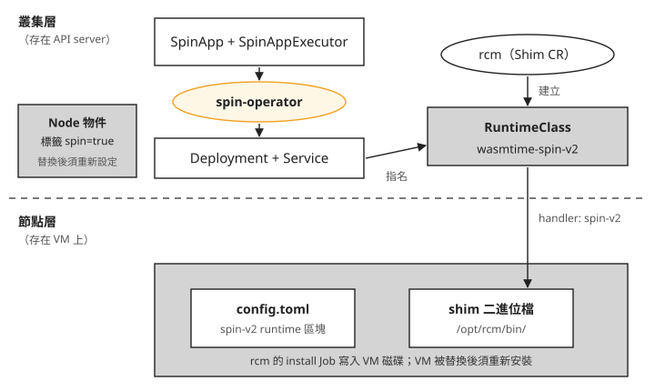

# Day 7: SpinKube(下)——spin-operator、SpinApp 與不經 operator 的執行

{ align=right width="88" }

假設你的團隊打算用 SpinKube 跑 wasm 服務。評估時有人去看了 GitHub,發現四個元件裡的 spin-operator 已經 13 個月沒發新版(截至 2026-08)。主管問了一個很實際的問題:哪天這個元件沒人維護了,我們的服務會不會跟著停?

[Day 6](sprint3-day6-spinkube-shim.md) 用 runtime-class-manager(以下簡稱 rcm)把 Spin 的 shim 裝上節點,手寫一顆 Pod 跑通了。這一章用 spin-operator 部署同一支程式。它是跑在叢集裡的 controller,讀取 `SpinApp` 物件,建立對應的 Deployment 和 Service。`SpinApp` 是它定義的資源,描述要跑哪一顆 Spin 映像、用哪個 executor(指定部署方式的設定資源)、幾個副本,讓你不用逐項手寫 Deployment 與 Service。

接著另外手寫一份普通的 Deployment,比較兩條部署路線的結果。讀完之後,你能分辨 spin-operator 負責的部署轉換,與節點上 shim 負責的程式執行；本章沒有模擬 operator 故障後所有既有資源的行為。

## 開始之前:確認 Day 6 的環境

沿用 Day 6 的節點、rcm、RuntimeClass 與 cert-manager。先確認節點是否被替換,再檢查 `spin=true` 標籤、shim 與 `spin-v2` handler 是否仍可用；只有節點被替換或結果不符時,才需要恢復對應設定。

用 `kubectl get node -o jsonpath='{.items[0].metadata.labels}'` 看節點標籤。下面是標籤缺失時的觀察摘要,省略的部分不能直接貼成 shell 命令:

```console
$ kubectl get node -o jsonpath='{…metadata.labels}' | (篩 spin/rcm/kwasm)
{}                    ← 節點標籤總數 42 個,命中 0
```

`kubectl label node` 只改 Node 物件,替換節點後不會保留手動標籤。需要讓新節點帶有標籤時,可依 [Sprint 1 Day 3](sprint1-day3-hami-memory-isolation.md) 步驟 2 的方式設定 AKS 節點池標籤；rcm 能否因此自動重裝 shim,本課沒有驗證。

Shim CR 的 `nodeSelector` 是 `spin: "true"`,rcm 只替符合的節點裝 shim。若標籤缺失,shim controller 的 log 會出現:

```text
{"shim":"spin-v2","message":"RuntimeClass found: wasmtime-spin-v2"}
{"shim":"spin-v2","message":"No nodes found"}
```

`No nodes found` 表示沒有符合 selector 的節點,rcm 不會替它們佈建。

若節點已被替換,也要檢查 rcm 的 log。舊 install Job 仍存在、對應節點已消失時,可能出現以下錯誤:

```text
{"level":"error","error":"Node \"<old-node-name>\" not found","message":"Unable to fetch node"}
ERROR Observed a panic {"controller": "job", "panic": "assignment to entry in nil map", …}
```

controller-runtime 會攔下 panic 並重試,因此 Pod 仍可能顯示:

```console
$ kubectl -n rcm get pod
runtime-class-manager-…   1/1   Running   0
```

只看 `READY 1/1`、`RESTARTS 0` 無法判斷 reconcile 是否成功。若有上述錯誤,見[疑難排解:rcm 的 pod 顯示 Running,log 裡卻一直 panic](#mine-1)。

### 缺少標籤時的 Pending 狀態

先檢查 RuntimeClass 的 `scheduling.nodeSelector` 與節點標籤,確認是否符合 [Kubernetes 1.35 RuntimeClass 文件](https://v1-35.docs.kubernetes.io/docs/concepts/containers/runtime-class/#scheduling)的排程條件(依官方文件補上，本課沒有實跑):

```bash
kubectl get runtimeclass wasmtime-spin-v2 -o yaml
kubectl get nodes -l spin=true
```

只有 selector 是 `spin: "true"`、且沒有節點帶 `spin=true` 時,才執行下方示範；已有符合標籤的節點時,跳過示範並接續正常部署。先把下方 `<image>` 換成 Day 6 當次推送、尚未過期的完整映像名稱(包含 tag),過期就依 Day 6 的[打包應用](sprint3-day6-spinkube-shim.md#step-1)重推。

以下將 Pod YAML 存成 `72-pod-pending-shape.yaml`,依 Kubernetes 1.35 的 [`kubectl apply`](https://v1-35.docs.kubernetes.io/docs/reference/kubectl/generated/kubectl_apply/) 建立 Pod,再查詢狀態、事件與合併後的 selector(依官方文件補上，本課沒有實跑):

```bash
cat > 72-pod-pending-shape.yaml <<'EOF'
apiVersion: v1
kind: Pod
metadata:
  name: spinapp-pending-shape
  namespace: wasmlab
spec:
  runtimeClassName: wasmtime-spin-v2
  restartPolicy: Never
  containers:
    - name: app
      image: "<image>"
      command: ["/"]
      ports:
        - containerPort: 80
EOF
kubectl -n wasmlab apply -f 72-pod-pending-shape.yaml
kubectl -n wasmlab get pod spinapp-pending-shape
kubectl -n wasmlab get events \
  --field-selector involvedObject.name=spinapp-pending-shape
kubectl -n wasmlab get pod spinapp-pending-shape \
  -o jsonpath='{.spec.nodeSelector}'
```

若 RuntimeClass 還在,但沒有節點帶 `spin=true`,指名 `wasmtime-spin-v2` 的 pod 會出現以下狀態:

```console
NAME                    READY   STATUS    AGE
spinapp-pending-shape   0/1     Pending   20s
Warning  FailedScheduling  0/1 nodes are available: 1 node(s) didn't match Pod's node affinity/selector.
```

pod 停在 `Pending`,排程器找不到符合條件的節點。這是 [Day 1 的「handler 不存在時,寫不寫 `scheduling` 會有兩種失敗」](sprint3-day1-three-generations.md#mine-3)講的第二種情況:Day 6 由 rcm 建的 RuntimeClass 帶了 `scheduling.nodeSelector: {spin: "true"}`,現在沒有節點帶這個標籤。兩種情況並排:

| | 沒寫 `scheduling` | 寫了 `scheduling.nodeSelector` |
|---|---|---|
| 誰擋下來 | kubelet(pod 已排上節點) | scheduler(pod 排不上) |
| 狀態 | `ContainerCreating` 無限重試 | `Pending` |
| 例子 | Day 1 手建的那顆 | rcm 建的這顆 |

訊息裡沒提到 RuntimeClass,線索在 API server 回傳的 pod 上。原始查詢漏了 `-n wasmlab`,以下保留原文；請使用後面驗證 log 已實跑的完整查詢:

```console
$ kubectl get pod spinapp-pending-shape -o jsonpath='{.spec.nodeSelector}'
{"spin":"true"}
```

驗證 log 的完整查詢與輸出如下:

```console
$ kubectl -n wasmlab get pod spinapp-pending-shape -o jsonpath='{.spec.nodeSelector}'
{"spin":"true"}
```

這是 RuntimeClass 的 admission 外掛在 pod 建立時把 `scheduling.nodeSelector` 併進去的。看到一個自己沒寫過的 `nodeSelector`,就順著 `runtimeClassName` 去查那顆 RuntimeClass。

### 只在檢查不符時恢復節點

若有建立上述測試 pod,先刪除它；若節點缺少 `spin=true`,再貼標籤:

```console
$ kubectl -n wasmlab delete pod spinapp-pending-shape
$ kubectl label node --all spin=true
```

若 rcm 重新佈建後,containerd 仍未載入 `spin-v2`,依 [Day 6 的「rcm 猜錯 plugin 路徑」](sprint3-day6-spinkube-shim.md#mine-1)檢查 `config.toml`。確認仍是 containerd 1.x 的 plugin 路徑時,才將那兩行改成 `io.containerd.cri.v1.runtime` 並重啟 containerd。節點宣告的 handler 裡應出現 `spin-v2`:

```console
$ kubectl get node -o jsonpath='{.items[0].status.runtimeHandlers}'
['', 'runc', 'spin-v2', 'untrusted']
```

節點、標籤與 handler 都符合 Day 6 的設定時,直接繼續安裝 spin-operator。

## spin-operator 在 SpinKube 裡的位置

rcm 負責節點上的 shim 與 containerd 設定,並建立 RuntimeClass；spin-operator 依 SpinApp 建立 Deployment 和 Service。下圖把兩者分開畫,虛線以上存在 API server,虛線以下存在節點的 VM 上:



我們可以從圖上看到兩件事:

1. spin-operator 產出的東西(Deployment、Service)全部在叢集層,它不碰節點。
2. 兩層只在 RuntimeClass 這一個物件上相接:Deployment 用名字指名它,它用 `handler` 對到節點上的 shim。

這一章要驗證的就是這張圖:如果 spin-operator 真的只在上半部工作,拿掉它,下半部照樣能執行程式。

## 步驟 1: 安裝 spin-operator

先看版本現況(截至 2026-08):spin-operator 最新版是 v0.6.1,發佈於 2025-07-09。2025 上半年大約每三個月發一版,之後就停了,但 repo 沒有封存。這跟 [Day 1](sprint3-day1-three-generations.md) 的 Krustlet 不同,Krustlet 的 repo 已經明白寫著不再維護。

只看最後發版日,會覺得 spin-operator 是整組裡風險最高的元件。[Day 0 的檢查方法](sprint3-day0-wasm-concepts.md#health-method)第 2、4 條提醒過,發版日要跟「它依賴的介面演進多快」一起看。spin-operator 用到的 Kubernetes API 只有 `apps/v1` Deployment、`v1` Service、`admissionregistration.k8s.io/v1` webhook 和它自己的 CRD,這些都是長期穩定的 API。Day 6 遇到的版本問題出在 containerd 的 plugin 路徑,那一層歸 rcm 管,而 rcm 還在發版。所以評估一個停止發版的元件時,先問它貼著哪一層:只依賴穩定 API 的元件可以停很久,貼著 containerd 設定這類常變動介面的元件,停幾個月就可能出問題。下面實際裝一次,確認在 Kubernetes 1.35 上沒有相容性問題。

spin-operator 的 release 附了四個檔案:chart 壓縮檔、`spin-operator.crds.yaml`、`spin-operator.runtime-class.yaml`、`spin-operator.shim-executor.yaml`。官方安裝指引的第 2 步是套用 `spin-operator.runtime-class.yaml`。**走 rcm 這條路線時跳過這一步。** 那份檔案建立的 RuntimeClass 跟 rcm 建的同名,`handler` 卻寫 `spin`,與本章使用的 `spin-v2` 不符。

下載 CRD 檔,先套用 CRD,再用 Helm 裝 chart(cert-manager 在 Day 6 已經裝好,spin-operator 的 webhook 憑證要靠它):

```console
$ curl -LO https://github.com/spinframework/spin-operator/releases/download/v0.6.1/spin-operator.crds.yaml
```

```console
$ kubectl apply -f spin-operator.crds.yaml
$ helm upgrade --install spin-operator \
    oci://ghcr.io/spinframework/charts/spin-operator --version 0.6.1 \
    -n spin-operator --create-namespace --wait
```

裝完逐項確認:controller pod `Running` 且 `restartCount=0`;cert-manager 發的 Certificate `READY True`;validating 與 mutating 兩個 webhook 都註冊了;controller 的 log 裡沒有任何 API deprecation 警告。13 個月沒發版,在這個版本的 Kubernetes 上沒有造成相容性問題。

### SpinAppExecutor:告訴 operator 怎麼建 Deployment

`SpinApp` 要指名一個 `SpinAppExecutor`。executor 記錄 operator 建 Deployment 時要用哪顆 RuntimeClass,以及要不要掛上預設的 CA 憑證。它是有 namespace 的資源,必須跟 SpinApp 放在同一個 namespace。官方的 `spin-operator.shim-executor.yaml` 沒寫 namespace,直接套用會落在 `default`,所以這裡自己寫一份,放進這一章的 `wasmlab` namespace:

```bash
cat > 73-spinapp-executor.yaml <<'EOF'
apiVersion: core.spinkube.dev/v1alpha1
kind: SpinAppExecutor
metadata:
  name: containerd-shim-spin
  namespace: wasmlab
spec:
  createDeployment: true
  deploymentConfig:
    runtimeClassName: wasmtime-spin-v2
    installDefaultCACerts: true
EOF
kubectl apply -f 73-spinapp-executor.yaml
```

如果 SpinApp 和 executor 放在不同的 namespace,spin-operator 的 validating webhook 會在建立時直接拒絕,錯誤訊息寫明欄位、值和原因:`spec.executor: Invalid value: "containerd-shim-spin": executor does not exist in namespace`。對照 Day 6 的 rcm:遇到同名 RuntimeClass 時它不報錯、直接跳過([Day 6 的「rcm 對同名 RuntimeClass 只查存在」](sprint3-day6-spinkube-shim.md#mine-2))。這個 webhook 會在 `kubectl apply` 時拒絕 executor 不存在的設定；是否有 webhook 本身，不能保證所有設定錯誤都會被提前攔下。

## 步驟 2: 用 SpinApp 部署

映像沿用 Day 6 推到 ttl.sh 的那一顆。以下所有 `<image>` 都要換成你實際推送的完整映像名稱,包含 tag:照 Day 6 操作就是 `ttl.sh/<tag>:1h`,其中 `<tag>` 是你自己取的名字。ttl.sh 的映像會過期,過期了就照 Day 6 的[打包應用](sprint3-day6-spinkube-shim.md#step-1)重推一次。本章驗證時另推了 `:2h` 映像,不能只換名稱卻沿用不同的尾碼。以下改為沿用 Day 6 的完整映像名稱,修正後的寫法本課沒有實跑。

```yaml
apiVersion: core.spinkube.dev/v1alpha1
kind: SpinApp
metadata: {name: day7-operator-app, namespace: wasmlab}
spec:
  image: "<image>"
  executor: containerd-shim-spin
  replicas: 1
```

將上方 YAML 存成 `73-spinapp.yaml`,確認 `<image>` 已換成尚未過期的完整映像名稱,再依 Kubernetes 1.35 的 [`kubectl apply`](https://v1-35.docs.kubernetes.io/docs/reference/kubectl/generated/kubectl_apply/) 與 [`kubectl wait`](https://v1-35.docs.kubernetes.io/docs/reference/kubectl/generated/kubectl_wait/) 套用並等待 `Available=True`,最後查看建立的資源(依官方文件補上，本課沒有實跑):

```bash
kubectl -n wasmlab apply -f 73-spinapp.yaml
kubectl -n wasmlab wait --for=condition=Available \
  spinapp/day7-operator-app --timeout=180s
kubectl -n wasmlab get spinapp,deploy,svc,pod
```

`SpinApp` 的 `spec` 有 18 個欄位,必填的只有 `image` 和 `executor`。套用之後,`SpinApp` 的 READY 變成 1。Service 的網址 `*.svc.cluster.local` 只在叢集裡面解析得到,所以 curl 要在叢集裡開一顆臨時 pod 來跑:

```console
$ kubectl -n wasmlab run day7-curl-a --rm -i --restart=Never --image=curlimages/curl:8.11.1 -- \
    -sS -i http://day7-operator-app.wasmlab.svc.cluster.local/static/index.html
```

結果如下(curl 的部分省略了前面的 `kubectl run`):

```console
spinapp/day7-operator-app     READY 1
$ curl -sS -i http://day7-operator-app.wasmlab.svc.cluster.local/static/index.html
HTTP/1.1 200 OK
etag: 8fa951d7…

Sprint3 Day6 SpinKube probe
```

回應 200,內容是 Day 6 那顆靜態檔案伺服器的首頁。`etag` 是回應內容的版本標記，步驟 3 會用它比對兩個入口的內容。

### operator 替你做了什麼

operator 產出的 Deployment 可以用 `kubectl -n wasmlab get deploy day7-operator-app -o yaml` 看。下面把跟 Spin 有關的欄位整理出來:

```text
runtimeClassName: wasmtime-spin-v2
command:          ["/"]                        ← 補上 Day 6 疑難排解提到的那一行
env:              SPIN_HTTP_LISTEN_ADDR=0.0.0.0:80
volumes:          runtime-config(Secret)、CA 憑證
labels:           core.spinkube.dev/app.…status: ready
resources:        {}                           ← 沒有填,overhead 也沒有
```

一行一行看:

- `runtimeClassName`:從 executor 抄過來,讓 pod 走 `wasmtime-spin-v2` 這顆 RuntimeClass。
- `command: ["/"]`:Spin 映像沒有 `Cmd`/`Entrypoint`,Day 6 手寫 Pod 時就是補這一行([Day 6 的「Spin 映像沒有 Cmd/Entrypoint」](sprint3-day6-spinkube-shim.md#mine-4))。
- `SPIN_HTTP_LISTEN_ADDR`:operator 明確指定 `0.0.0.0:80`。本章 shim v0.25.1 的預設也是這個位址，所以這個環境變數在此版本不是跑通服務的必要條件。
- 兩個掛載:一個是 Spin 的 runtime 設定檔(放在 Secret 裡),一個是 CA 憑證,後者來自 executor 的 `installDefaultCACerts: true`。
- 一個 label:Deployment 的 Pod template 已寫入 `…status: ready`,Service 的 selector 會用它選取 Pod。這個標籤不代表 Pod 已就緒,不能據此判斷何時開始接收流量。
- `resources` 是空的,沒有 CPU 和記憶體的 requests/limits。

這些都是普通的 Kubernetes 欄位,自己寫也寫得出來。下一步就來試。

## 步驟 3: 不經 operator，直接建立 Deployment {#gate-b}

從上面那份 Deployment 裡只留三樣東西,其他(兩個掛載、operator 自己的 label)全部拿掉,看最少需要哪些欄位。下方節錄與完整檔案的 `<image>` 都填步驟 2 使用的完整映像名稱:

```yaml
spec:
  runtimeClassName: wasmtime-spin-v2      # 1. the only field that routes to the shim
  containers:
    - name: app
      image: <image>
      command: ["/"]                      # 2. Spin images have no Cmd/Entrypoint
      env:
        - name: SPIN_HTTP_LISTEN_ADDR
          value: "0.0.0.0:80"
```

完整的檔案還要補上 Deployment 的 selector 和 label,以及一個 Service:

```bash
cat > 74-deployment-gate-b.yaml <<'EOF'
apiVersion: apps/v1
kind: Deployment
metadata:
  name: day7-native-app
  namespace: wasmlab
spec:
  replicas: 1
  selector:
    matchLabels: {app: day7-native-app}
  template:
    metadata:
      labels: {app: day7-native-app}
    spec:
      runtimeClassName: wasmtime-spin-v2
      containers:
        - name: app
          image: <image>
          command: ["/"]
          env:
            - name: SPIN_HTTP_LISTEN_ADDR
              value: "0.0.0.0:80"
          ports:
            - containerPort: 80
---
apiVersion: v1
kind: Service
metadata:
  name: day7-native-app
  namespace: wasmlab
spec:
  selector: {app: day7-native-app}
  ports:
    - port: 80
      targetPort: 80
EOF
kubectl apply -f 74-deployment-gate-b.yaml
```

等 Deployment 就緒,再用同樣的方式開一顆臨時 pod 去 curl(這次的 pod 名稱用 `day7-curl-b`):

```console
$ kubectl -n wasmlab get deploy day7-native-app
day7-native-app   1/1

$ curl … http://day7-native-app.wasmlab.svc.cluster.local/static/index.html
HTTP/1.1 200 OK
etag: 8fa951d7…                ← 與 (A) 逐字相同
```

`etag` 跟步驟 2 的完全相同:同一顆映像、同一個 shim 回應了請求。這一次沒有 `SpinApp`、沒有 `SpinAppExecutor`,spin-operator 也沒有收到任何跟這個 Deployment 有關的事件。把兩顆 pod 的 `runtimeClassName`、`nodeSelector`、`command` 並排比對,三個欄位都一樣;`nodeSelector` 在兩邊都是 RuntimeClass 的 admission 併進去的,不是誰寫的。

### 對照組:刪掉 `runtimeClassName`

三個欄位裡,哪一個決定 pod 交給 shim 執行?把同一份 Deployment 改名為 `day7-native-norc`,只刪掉 `runtimeClassName` 那一行(不需要 Service),套用之後:

```console
day7-native-norc-…   0/1   RunContainerError
Warning  Failed  … runc create failed: … exec: "/": is a directory
```

錯誤來自 runc,也就是 Kubernetes 預設用來跑一般容器的執行體。少了 `runtimeClassName`,pod 就交給 runc,而 runc 把 `command: ["/"]` 當成一個要執行的檔案路徑,`/` 是目錄,於是失敗。這也說明了 `command: ["/"]` 不是路徑,它只對 containerd-shim-spin 有意義。三條路畫在一起:


照著圖由上往下看:A 和 B 的起點不同,但都在橘色那一格匯合,之後走的是同一條路;C 的映像、command、環境變數都跟 B 一樣,只少了橘色那一格,就落到 runc。決定 pod 由誰執行的,只有 `runtimeClassName` 這一個欄位。

對照組跑完就刪掉,它會一直重試:

```console
$ kubectl -n wasmlab delete deploy day7-native-norc
```

### spin-operator 也沒有動節點

Day 6 用來比對節點狀態的七份取樣(`config.toml`、containerd 有效設定、`runtimeHandlers`、shim 檔案、相關目錄、節點標籤、RuntimeClass 清單),在裝 spin-operator 前後逐字相同,連目錄的修改時間都沒變。這跟前面那張兩層圖一致:節點層歸 rcm,叢集層歸 spin-operator,兩邊只在 RuntimeClass 上相接。

回到開場的問題。spin-operator 做的事,是把 `SpinApp` 翻譯成一份 Deployment 和 Service,翻譯時補上 `command`、`SPIN_HTTP_LISTEN_ADDR`、掛載這幾個容易漏的欄位。真正執行 wasm 的,是 Day 1 建立的那條鏈:RuntimeClass → handler → containerd 的 runtime 區塊 → shim,這條鏈不需要 operator。這個測試證明能直接用 Deployment 執行同一支應用；沒有驗證停掉 operator 後既有資源的全部行為。若未來要移除 operator，你得自己寫 Deployment,自己補那幾個欄位;wasm 的執行不需要它,新的服務也能用普通的 Deployment 部署。這也是 SpinKube 跟另外兩條路線最不一樣的地方:wasmCloud 在自己的 host 行程裡執行 wasm,Kubernetes 只看到一顆普通的 pod;SpinKube 的 wasm 則是由 Kubernetes 自己的 RuntimeClass 機制交給 shim 執行。

這個結論是用最小的用例得出的:`SpinApp` 的 18 個欄位,本章只用了 `image`、`executor`、`replicas` 三個。如果你會用到 `runtimeConfig`、`variables` 這類欄位,要再確認一次它們是否都能用普通的 Deployment 寫出來,本課沒有逐一驗證。

## 疑難排解

### rcm 的 pod 顯示 Running,log 裡卻一直 panic {#mine-1}

**症狀**:叢集重開機,或節點池縮容、spot 回收、節點升級之後,rcm 的 controller pod `1/1 Running`、`RESTARTS 0`,`kubectl get shim` 也沒有異常。翻 log 才看得到 `Observed a panic`,而且每隔一段時間出現一次,間隔愈拉愈長,不會停。

**原因**:install Job 存在 API server 裡,節點消失時它不會跟著消失。它的 ownerReference 指向 Shim CR,不是 Node,所以也不會被自動回收;rcm 預設也沒有替 Job 設定完成後自動刪除的時間。rcm 的 `getNode()` 在節點不存在時用 `client.IgnoreNotFound(err)` 把「找不到」當成沒有錯誤,回傳一顆空的 Node,呼叫端拿著它去寫 `Labels`(一個還沒初始化的 map)就 panic。controller-runtime 攔下 panic,改成退避重試,所以行程不會結束,pod 狀態一直是健康的。

**修法**:找出名稱裡帶著已不存在節點的 install Job,刪掉:

```console
$ kubectl -n rcm get jobs
$ kubectl -n rcm delete job <old-node-name>-spin-v2-install
```

[Day 8](sprint3-day8-reversibility.md) 驗證過:刪掉之後,對應那顆 Job 的 panic 就停了。之後判斷一個 controller 健不健康,不要只看 `RESTARTS`;controller-runtime 會把 panic 攔下來,要看 log 裡有沒有 `Observed a panic`,或看 `controller_runtime_reconcile_errors_total` 這類指標。

### pod 一直 `RunContainerError`,訊息是 `exec: "/": is a directory` {#mine-3}

**症狀**:跑 Spin 映像的 pod 反覆 `RunContainerError`,訊息是 `exec: "/": is a directory`。訊息裡沒有 wasm、spin 或 RuntimeClass,看起來像 command 寫錯。

**原因**:pod 少了 `runtimeClassName`(打錯、被 Helm values 蓋掉、複製 manifest 時漏掉),交給了 runc,runc 把 `command: ["/"]` 當成路徑執行。步驟 3 的對照組示範的就是這個情況。

**修法**:補回 `runtimeClassName`。遇到 wasm 映像報出這類照字面解讀的執行錯誤,先查 `kubectl get pod <name> -o jsonpath='{.spec.runtimeClassName}'`,再去查 command。

## 想一想

- 另一個團隊用一個已經一年沒發版的 operator 管他們的 wasm 服務。你只能做一個實驗來判斷「它停擺時服務會不會停」,你會怎麼設計這個實驗?要看到什麼結果,才能說它只是讓部署比較方便的那一層?
- 同事把 SpinApp 改成自己寫的 Deployment,從 operator 產出的 YAML 複製過來,但複製時漏了 `runtimeClassName`。pod 會停在哪個狀態、訊息會是什麼?如果漏的是 `SPIN_HTTP_LISTEN_ADDR`，依本章 shim 版本的預設值，能否直接判定 Service 一定連不上？
- 叢集週末自動停機,週一開機後,SpinApp 的新 pod 全部 `Pending`,rcm 的 pod 卻是 `Running`、`RESTARTS 0`。你會依序查哪幾個地方?要讓下次開機不用再手動處理標籤,要改什麼?

## 小結

SpinKube 分成兩層:rcm 管節點,把 shim 裝上去、改 containerd 設定、建立 RuntimeClass;spin-operator 管叢集,把 `SpinApp` 翻譯成 Deployment 和 Service。不經 spin-operator、直接寫一份帶 `runtimeClassName`、`command: ["/"]` 和 `SPIN_HTTP_LISTEN_ADDR` 的 Deployment,程式照樣回應請求,說明這支應用能不經 SpinApp 部署；operator 停擺時既有資源的完整行為，仍需要另做故障測試。Node 替換後不會沿用手動標籤,新 VM 磁碟也沒有舊 VM 的 rcm 設定；rcm 的 pod 即使顯示 `Running`、`RESTARTS 0`,仍可能持續發生 reconcile 錯誤。評估 operator 時,可以檢查它產出的物件,測試最小的等價 Deployment；判斷 controller 是否正常工作,還要檢查 log。

## 延伸閱讀

想再深入,可以從這幾份開始:

- **[spin-operator](https://github.com/spinframework/spin-operator)** —— README 說明它監看 `SpinApp` 並建立對應的 Deployment;release 頁附安裝用的 CRD、chart、RuntimeClass 與 executor 檔案。
- **[runtime-class-manager](https://github.com/spinframework/runtime-class-manager)** —— `internal/controller/job_controller.go` 的 `getNode()` 與 `updateNodeLabels()` 兩個函式不到三十行,是[疑難排解:rcm 一直 panic](#mine-1) 的出處。
- **[Kubernetes RuntimeClass 文件](https://kubernetes.io/docs/concepts/containers/runtime-class/)** —— 「Scheduling」一節說明 admission 如何把 `scheduling.nodeSelector` 併進 pod,對應本章開頭那顆 `Pending` 的 pod。

## 下一步

SpinKube 的節點層和叢集層都裝過一次了。[Day 8](sprint3-day8-reversibility.md) 要把它們全部拆掉,拿 Day 1 存的節點基準逐項比對,看拆完之後節點能不能回到原狀。拆除和比對必須在同一台 VM 上完成,並檢查 rcm 能否移除 Day 6 手動改過 plugin 路徑的那段設定。

---

!!! quote ""
    SpinKube 標誌為 CNCF(Linux Foundation)官方資產,此處作社群教學用途。
