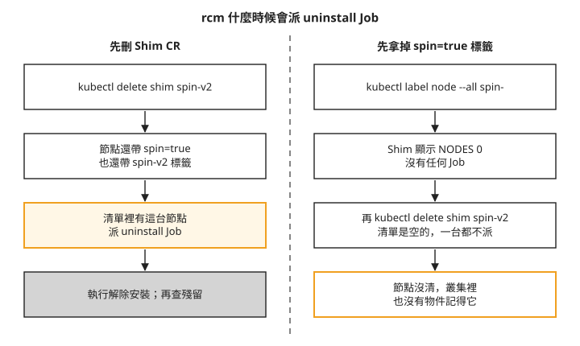
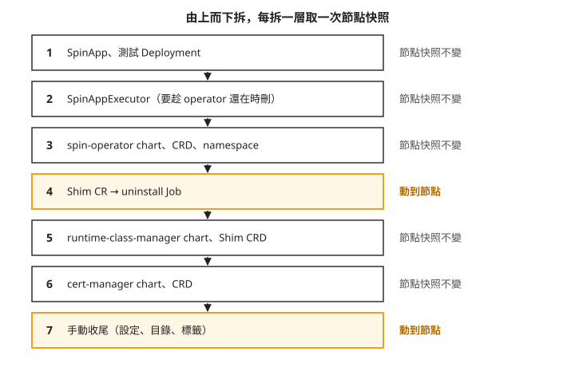
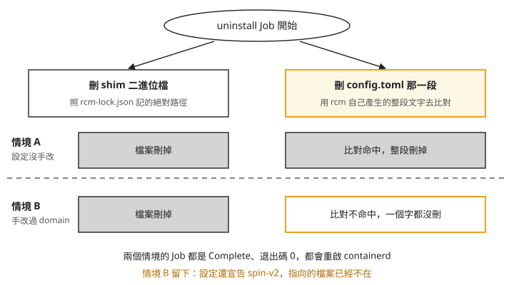

# Day 8: 拆掉 SpinKube——解除安裝的觸發條件、拆除順序與節點殘留

{ align=right width="88" }

SpinKube 試用完了，要把它從叢集拆掉。直覺的做法是：把節點上的 `spin=true` 標籤拿掉、`helm uninstall` 三個 chart、刪掉 CRD。每個指令都會回報成功，`kubectl get shim` 也會顯示沒有節點。可是 Day 6 為了讓 handler 生效，手動改過節點上 containerd 設定裡的 plugin domain。rcm 拆除時會不會把那段改過的設定一起清掉？如果沒有清掉，從叢集這一側看得出來嗎？

這一章把 Day 6、Day 7 裝上去的東西一層一層拆掉，每拆一層就取一次節點快照，最後跟 Day 1 存下的節點基準逐字比對。過程中會遇到兩種「指令成功、事情沒做」的情況，一種跟拆除順序有關，一種跟那段手改過的設定有關。

讀完之後，拆掉一套會改節點的外掛時，你能判斷節點是真的回到原狀，還是元件回報成功但設定還留著，也知道該照什麼順序拆、拆完要量哪兩件事。

## 開始之前

這一章的比對要成立，有一個前提：從開機到最後一次比對，叢集中間不能停機。Day 5 量過，本課 `az aks stop` 再 `start` 曾換成新 VM，節點上的改動全部消失（見 Day 5 的[「停機抹掉節點層改動，而 RuntimeClass 留在 etcd」](sprint3-day5-cost-measurement.md#mine-1)）。如果中途停過機，最後比對出來「跟基準相同」，就分不出是拆乾淨了，還是 VM 被換掉了。

先判斷起始狀態。情境 A 需要一台尚未加上 rcm 設定與檔案的測試節點，再讓 rcm 安裝；如果接著 Day 7 使用已修好 plugin domain 的節點，請直接從[情境 B](#scenario-b)開始，不要宣稱做過 A。停止、啟動叢集不保證每次換 VM。

使用 Day 6 的[七份取樣腳本](../assets/labs/s3d6/node-snapshot.sh)，在本機記錄拆除前後。另保留 `kubectl get node -o yaml` 的 Node UID 與 providerID，確認兩次比對是同一台節點。`day8-s0` 是下列實測在尚未安裝 rcm 的新節點上保存的基準；如果你的起點是 Day 7，應另命名為 `day8-before-removal`，不要直接期待得到相同的七份差異。

開機之後，`rcm` namespace 裡可能留著指向舊節點的 install Job，它們指向已經被換掉的舊節點，會讓 rcm 的 controller 反覆 panic（見 Day 7 的[「Job 在、節點不在會 panic」](sprint3-day7-spinkube-operator.md#mine-1)）。先查 Job 與節點名稱；以下清除全部 Job 的做法僅用於本課專用 `rcm` namespace，且確認沒有進行中的安裝或解除安裝工作時：

```console
$ kubectl -n rcm delete job --all
```

接著貼上標籤，讓 rcm 在新節點上重新安裝 shim。這和 Day 6 的佈建步驟 的做法一樣，Day 7 的 Shim CR 還在叢集裡，不必重新套用：

```console
$ kubectl label node --all spin=true
```

install Job 跑完之後，節點回到 Day 6 剛裝好的樣子：`config.toml` 尾端多了 rcm 寫的 6 行、`/opt/rcm/bin/` 下有 83.9 MiB 的 shim，節點多了 `spin=true` 與 `spin-v2: provisioned` 兩個標籤。這時的設定還沒手改過，也就是說 handler 還沒生效。後面兩個情境就從這裡分開。

## 步驟 1: 拿掉標籤，看 rcm 會不會拆

Shim CR 用 `nodeSelector: {spin: "true"}` 選節點，貼上標籤會觸發安裝。很自然會以為反過來，拿掉標籤就會觸發解除安裝。實際試一次：

```console
$ kubectl label node --all spin-
```

等幾分鐘，`rcm` namespace 裡不會出現新的 Job。Shim 的狀態變成這樣：

```console
$ kubectl get shim -o wide
NAME      RUNTIMECLASS       READY   NODES
spin-v2   wasmtime-spin-v2   0       0
```

`NODES 0` 看起來像是「這台節點已經不歸 rcm 管了」。但節點上的 6 行設定和 shim 一個都沒動，`spin-v2: provisioned` 標籤也還在。

### rcm 只在 Shim CR 被刪除時才拆

rcm 把節點上的清理交給一顆 **uninstall Job**：和安裝時的 install Job 一樣，是派到節點上執行的 Job，只是做的是反向的事。要知道什麼時候會派出它，得看 rcm 的 controller。整支 controller 只有一處會走到解除安裝：

```go
// Shim has been requested for deletion, delete the child resources
if !shimResource.DeletionTimestamp.IsZero() {
    err := sr.handleDeleteShim(ctx, &shimResource, nodes)
    …
}
```

`DeletionTimestamp` 是你下 `kubectl delete` 時，API server 在物件上蓋的時間戳。finalizer 是刪除前必須完成清理的標記；帶這個標記的物件不會立刻消失，controller 看到這個時間戳，就知道要先做完清理（finalizer 在步驟 4 會再遇到）。所以觸發解除安裝的唯一動作是刪除 Shim CR，拿掉標籤只會讓節點掉出清單。

`handleDeleteShim` 收到的 `nodes`，是**刪除當下**還符合 `nodeSelector` 的節點，而且它只對帶著 `spin-v2` 標籤的節點派 Job。兩個條件都要成立。下面這張圖把兩種順序並排，左邊先刪 CR，右邊先拿標籤：



右欄最後一格是問題所在。標籤已經拿掉時再刪 Shim CR，指令馬上完成，不會出現任何 Job：

```console
$ kubectl -n rcm get jobs
No resources found                       ← install Job 隨 ownerReference 被 GC
$ kubectl get runtimeclass wasmtime-spin-v2
Error from server (NotFound)             ← RuntimeClass 也被 GC(Day 6 預告的行為,驗到了)
```

install Job 和 RuntimeClass 會跟著不見，是因為它們的 **ownerReference** 指向 Shim CR（Day 6 的 RuntimeClass 檢查看過）：子物件記著父物件是誰，父物件刪掉時，Kubernetes 的垃圾回收（GC）把子物件一起刪掉。結果是叢集裡已經沒有物件記得這台節點被改過，節點上的 83.9 MiB shim 和 6 行設定卻都還在。

還有補救的機會。rcm 把「這台節點裝過了」記在節點的 `spin-v2: provisioned` 標籤上，這個標籤還在，所以重新套用 Day 6 的 Shim CR、再貼回 `spin=true`，Shim 會回到 `READY 1`，而且不會重新安裝。回到這個狀態，再照正確的順序拆就好。要是連 `spin-v2` 標籤也沒了，就只能照步驟 6 手動清。

所以拆除順序是固定的：**先刪 Shim CR，再動標籤**。官方文件沒有寫刪除順序，`NODES 0` 也不會提示節點還留著東西（見[疑難排解：先移標籤再刪 Shim CR](#mine-1)）。

## 步驟 2: 情境 A——設定沒手改過時的解除安裝

先看 rcm 的解除安裝在它設計的條件下表現如何。節點上的設定是 rcm 自己寫的原樣，沒修過 plugin domain。標籤都在，直接刪 Shim CR：

```console
$ kubectl delete shim spin-v2
```

uninstall Job 立刻出現，幾秒內 Complete。跑完後的節點：

| 項目 | 結果 |
|---|---|
| `config.toml` | 1247 B → **999 B,逐字回到 Day 1 基準** |
| `/opt/rcm/bin/containerd-shim-spin-v2` | **已刪除** |
| `rcm-lock.json` | 168 B → 16 B(`{"shims": {}}`) |
| 節點標籤 `spin-v2` | 已移除 |
| RuntimeClass | 隨 ownerReference 被 GC |

containerd 設定、有效設定、runtime handler 清單三份快照，都跟 Day 1 基準逐字相同。留下的只有兩樣：`/opt/rcm/` 這個空目錄（裡面剩一個 16 B 的 lock 檔），以及你自己貼的 `spin=true`。rcm 為什麼不刪目錄，本課沒有查到原因。

這就是「拆乾淨」的樣子。下一個情境拿它當對照。

## 步驟 3: 情境 B 的準備——重新安裝並修好 domain {#scenario-b}

在 AKS 上，情境 A 只是對照組。Day 6 量過，rcm 寫的設定用的是 containerd 1.x 的 plugin 名稱，本課 AKS 既有設定已用新 plugin 名稱，額外加入舊路徑後 handler 沒有出現在解析結果與 Node 回報；要讓 SpinKube 真的跑得起來，就得把那兩行的 plugin domain 改成 2.x 的名稱（見 Day 6 的[「rcm 猜 plugin 路徑，在 AKS 上猜錯」](sprint3-day6-spinkube-shim.md#mine-1)）。所以實際會被拆的節點，都是改過設定的節點。

沿用 Day 7 且已能回 HTTP 200 的節點，可直接保留目前狀態進入步驟 4。若剛完成情境 A，再照下面重建：

1. 重新套用 Day 6 的 Shim CR。情境 A 已經把 `spin-v2` 標籤清掉，這次 rcm 會真的重新安裝。
2. 照 Day 6 的[plugin domain 修正](sprint3-day6-spinkube-shim.md#step-6) 修 plugin domain，重啟 containerd，確認 `runtimeHandlers` 出現 `spin-v2`。本課修 domain 前先把原檔備份成 `config.toml.rcm-1x-backup`，步驟 6 收尾時會刪掉它；你沒有留備份就略過那一步。
3. 跑一次 Day 7 的[最小 Deployment](sprint3-day7-spinkube-operator.md#gate-b)，確認回應 HTTP 200。ttl.sh 上的映像過期的話，照 Day 6 的[打包應用](sprint3-day6-spinkube-shim.md#step-1) 重新推一次。

第 3 步不能省。拆之前要先證明節點是好的，拆完「跑不起來」才有對照意義。

## 步驟 4: 由上而下拆——只有兩層會動到節點

先把拆除順序畫出來。由上而下是 Kubernetes 物件依賴的方向：上層的物件需要下層的 controller 才刪得掉。右側標的是每拆一層之後，節點快照有沒有變：



照著編號看，七層裡只有第 4 層（uninstall Job）和第 7 層（手動收尾）會碰節點。spin-operator、cert-manager、helm chart、CRD、namespace，不論裝或拆都不會碰節點，每拆一層取的七份快照都跟前一份逐字相同。再加上安裝時的 install Job 與手改 domain，整個過程中會動到節點的就這四個動作。

第 1 層先刪 SpinApp 和 Day 7 的測試 Deployment。這裡刻意先刪光測試 pod，所以「還有 Spin pod 在跑時解除安裝會怎樣」本課沒有驗證，正式環境拆除前要自己測。

第 2、3 層的順序要注意。SpinAppExecutor 身上帶著 `core.spinkube.dev/finalizer`。**finalizer** 是物件上的一個標記，表示「刪除前必須由某個 controller 先做完清理，再把標記拿掉」；標記沒被拿掉，物件就一直停在 Terminating。處理這個標記的就是 spin-operator，所以要趁 operator 還在時刪 SpinAppExecutor，再拆 operator：

```console
$ kubectl -n default delete spinappexecutor containerd-shim-spin --timeout=60s
$ kubectl -n wasmlab delete spinappexecutor containerd-shim-spin --timeout=60s
$ helm uninstall spin-operator -n spin-operator
$ kubectl delete crd spinapps.core.spinkube.dev spinappexecutors.core.spinkube.dev
$ kubectl delete namespace spin-operator
```

順序反過來，`kubectl delete` 會一直掛著不回來（見[疑難排解：先 helm uninstall operator](#mine-2)）。

## 步驟 5: 情境 B——刪 Shim CR，看手改過的設定會怎樣

第 4 層是這一章要看的重點。刪 Shim CR 之前，先清掉 `rcm` namespace 裡的舊 Job：

```console
$ kubectl -n rcm delete job --all
```

這一步省不得。uninstall Job 的名字固定是 `<節點名>-spin-v2-uninstall`，rcm 用 **server-side apply** 送出它：把「這個物件應該長這樣」交給 API server，由 API server 跟現有的物件合併。情境 A 那顆同名的 Job 還在、內容一模一樣，合併的結果就是什麼都不改，不會建新的 Job，pod 也不會重跑。controller 的 log 照樣寫 `Deploying uninstall-Job`，`kubectl get jobs` 照樣看得到一顆 `Complete 1/1`，但那是情境 A 留下的舊 Job，節點什麼都沒清（見[疑難排解：同名舊 Job 讓解除安裝什麼都不做](#mine-3)）。

清掉之後重新套用 Shim CR，再刪除它，這次會派出一顆新的 uninstall Job。它的 log 只有兩行，退出碼 0：

```text
INFO uninstall called shim=spin-v2
INFO restarting containerd
```

再看節點：`config.toml` 刪之前 1253 B，刪之後還是 1253 B，一個字都沒動；shim 二進位檔卻被刪掉了。

### 一個檔案刪得掉，一段設定刪不掉

uninstall Job 做兩件事，走兩條不同的路徑。下面這張圖把兩件事分成左右兩欄，上下兩列是兩個情境：



我們可以從圖上看到兩件事。第一，刪檔案只看 lock 檔記的路徑，跟設定內容無關，所以兩個情境都成功。第二，刪設定靠比對整段文字，手改過就對不上，可是兩個情境的 Job 看起來完全一樣。

右邊那條路徑在 rcm 的 `RemoveRuntime()` 裡：

```go
// Warn if config.toml does not contain the runtimeName
if !strings.Contains(string(data), runtimeName) {          // guard: just "spin-v2"
    l.Warn("runtime config does not exist, skipping")
    return false, nil
}
cfg := generateConfig(shimPath, runtimeName, c.runtimeOptions, data)
modifiedData := strings.ReplaceAll(string(data), cfg, "")  // match: the whole block
err = afero.WriteFile(c.hostFs, c.configPath, []byte(modifiedData), 0o644)
…
return true, nil                                           // hardcoded
```

照著程式由上往下看：

1. 開頭的檢查只找 `spin-v2` 這幾個字。手改過的那段裡還有 `spin-v2`，檢查通過，所以不會印出 `skipping` 警告。
2. `generateConfig` 重新產生 rcm「當初寫進去的那段」。它看 `config.toml` 有沒有 `version = 3` 來決定用哪個 plugin 名稱，AKS 的是 `version = 2`，於是產生 1.x 名稱的版本，跟磁碟上改成 2.x 名稱的那段對不上，`ReplaceAll` 一處都沒換掉。
3. 回傳值固定是 `true`，不檢查檔案到底有沒有變。上層看到 `true`，就重啟 containerd、回報成功。

結果是 rcm 把一份內容沒變的檔案寫回磁碟、重啟 containerd，Job 顯示完成（見[疑難排解：手改過 domain 之後解除安裝回報成功](#mine-4)）。本課只驗了「改 plugin domain」這一種手改；改路徑、改選項的值、在中間插一行註解，從程式碼看也會對不上，但沒有實際測過。

### handler 還在，檔案已經不在

留下來的 6 行設定，讓節點繼續宣告 `spin-v2` 這個 handler，而它指向的 shim 已經刪了。建一個 handler 是 `spin-v2` 的 RuntimeClass，再丟一顆 pod 上去，就看得到後果：

```console
day8-dead-handler-probe   0/1   ContainerCreating          ← 每 10–15 秒重試,永遠不會成功
Warning  FailedCreatePodSandBox  … failed to start shim: failed to resolve runtime path:
  invalid custom binary path: stat /opt/rcm/bin/containerd-shim-spin-v2: no such file or directory
```

pod 順利排上節點，kubelet 也找得到 handler，直到 containerd 要啟動 shim 時才失敗，而且會一直重試。這是三條路線至今遇到的第三種失敗，前兩種在 Day 1 的[「寫不寫 scheduling 給你兩種完全不同的失敗」](sprint3-day1-three-generations.md#mine-3)看過：

| 形狀 | 條件 | 樣子 |
|---|---|---|
| `Pending` | RuntimeClass 有 `scheduling`,沒有節點命中 | 排不上去 |
| `no runtime for "…" is configured` | 節點沒有這個 handler | 排得上,kubelet 拒絕 |
| **`invalid custom binary path`** | **handler 在、指向的檔案不在** | **排得上、handler 查得到,containerd 起 shim 時才炸** |

第三種最難查。`kubectl get runtimeclass`、`kubectl describe node` 的 `runtimeHandlers`、`containerd config dump`，三個地方看起來都正常，要實際 `ls` 那個路徑才看得出檔案不在。所以解除安裝之後不要只看 Job 的退出碼，要量兩件事：`containerd config dump | grep -c spin-v2` 必須是 0，`/opt/rcm/bin/containerd-shim-spin-v2` 必須不存在。

看完後果，把測試用的 RuntimeClass 和 pod 刪掉，它們不該留到最後的比對。接著拆第 5、6 層：

```console
$ helm uninstall runtime-class-manager -n rcm
$ kubectl delete crd shims.runtime.spinkube.dev
$ kubectl delete namespace rcm
$ helm uninstall cert-manager -n cert-manager
```

helm 預設不刪 chart 帶的 CRD。cert-manager 會在 `helm uninstall` 的輸出列出保留下來的六個 CRD，照著清單刪掉，再刪 `cert-manager` namespace。rcm 和 spin-operator 的 chart 不會提示，所以前面是自己指名刪的。這兩層拆完，節點快照都不變。

## 步驟 6: 手動收尾

到這裡，SpinKube 在叢集這一側已經沒有任何物件，但節點上還有 rcm 沒清的東西。以下是本課專用測試節點的清理指令。先檢查 RCM 標記到檔尾是否只有這個 shim 的設定，且 `/opt/rcm` 沒有其他 Shim 資源使用；條件不符時不能整段刪到檔尾或刪整個目錄，應只刪對應的區塊與檔案。

第 1–4 步在節點 shell 執行：先依 Day 1 取得 `NODE_SHELL_POD`，再以 `kubectl -n wasmlab exec -it "$NODE_SHELL_POD" -- nsenter -t 1 -m -- bash` 進入。第 5 步的 `kubectl label` 必須回到本機終端機執行：

```bash
# 1. cut the RCM block out of config.toml (uninstall left it behind)
sed -i '/^# RCM runtime config for spin-v2$/,$d' /etc/containerd/config.toml
# 2. remove the backup left by the domain fix — rcm never knew it existed
rm -f /etc/containerd/config.toml.rcm-1x-backup
# 3. the directory shell survives even scenario A
rm -rf /opt/rcm
# 4. without this, runtimeHandlers keeps advertising spin-v2
systemctl restart containerd
# 5. the label you applied yourself — rcm only cleans its own
kubectl label node --all spin-
```

第 1 步刪掉 RCM 那段之後，檔尾還會剩下 rcm 當初加在那段前面的一行空行。要跟基準逐字相同，第 1 步之後再把最後的空行收掉：

```bash
sed -i '${/^$/d}' /etc/containerd/config.toml
```

這五步沒有一步是 rcm 會替你做的。第 1、2、4 步在情境 A 不需要，只有設定被手改過才需要。問題是設定有沒有被手改過，從叢集這一側查不出來：拆之前，兩個情境的 `kubectl get shim` 都是 `READY 1/1`。因此每次都要實際檢查殘留，再決定需要清理哪些檔案，不能不看內容就照刪。

## 步驟 7: 跟 Day 1 基準比對

最後一次取節點快照，跟 Day 1 基準比對三份關鍵檔案，再跟今天開機時那份快照比對全部七份：

```text
day8-final 對 Day 1 基準:
IDENTICAL  containerd-config.toml
IDENTICAL  containerd-config-dump.toml
IDENTICAL  node-runtimehandlers.json

day8-final 對 day8-s0(同一顆 VM、七份全比):
五份 IDENTICAL；另兩份差異是 node-dirs 的 mtime，以及預期刪除的 RuntimeClass
```

三份關鍵檔案都回到 Day 1 的樣子。確認 Node 身分與 VM 未替換後，可以判斷這三項追蹤的設定已還原；這不是整台節點所有狀態的完整證明。

同 VM 的七份比較中，兩份差異是目錄／設定檔的修改時間，以及 `wasmtime-spin-v2` RuntimeClass 已被刪除。後者是預期的叢集狀態變更，不能說完全沒有狀態差異。另一次「對 Day 1」的 shim 清單比較，才有取樣器空白壓縮方式不同的情況；兩種比較不能混在一起。

## SpinKube 適合誰

Day 6 到今天三天走完，再加上 Day 0 [判斷專案是否還活著的方法](sprint3-day0-wasm-concepts.md#health-method)查到的資料，可以替這條路線下判斷了。

以下活動數字是 2026-08 課程查核的歷史結果，部署前應重新檢查。各層的維護狀況不一樣。最上層的 `spin` CLI 很活躍，查證時近 13 週有 219 個 commit，自動化機器人只佔 3%。中間層的 shim、rcm、operator 三個 repo，default branch 最近 7–8 週沒有任何人的 commit，唯一在動的是 dependabot（GitHub 自動提出相依套件升級的機器人）：三個 repo 共 41 個 open PR，其中 27 個是它開的。這幾天在 rcm 遇到的四個問題，三個在上游沒有 issue，一個有 issue 但開了 27 個月沒人跟進。公開的 GitHub 上寫過 rcm `Shim` CR 的檔案只有 7 份，寫過 `SpinApp` 的有 245 份：這只是當時公開搜尋可見的樣本，不能由檔案數推算實際使用者數，也不能據此判定問題沒有回報的原因。

**適合**：wasm 工作負載必須跟一般 Kubernetes 工作負載長得一樣的團隊。Day 4 的 WasmEdge 也使用 RuntimeClass；SpinKube 在此之外增加 Spin 應用的部署工具：真正執行 wasm 的是 containerd 加一支 shim，operator 和 rcm 都只是讓安裝方便一點，Day 7 已經證明同一支應用可以用普通 Deployment 部署，不經 operator 產生資源。若要減少對 operator 的依賴，可評估只使用 RuntimeClass 加 shim 這兩層，把 rcm 和 operator 當成可以替換的工具。

**不適合**：沒有人負責維護節點層操作手冊的團隊。在 AKS 上，SpinKube 要手改設定才能用，而改過設定就拆不乾淨，節點的清理得自己來，步驟 6 那五步是起點。

## 疑難排解

### 先移標籤再刪 Shim CR，節點沒被清理 {#mine-1}

**症狀**:拿掉 `spin=true` 後，`kubectl get shim` 顯示 `NODES 0`。接著刪 Shim CR，指令馬上完成，沒有 uninstall Job，install Job 和 RuntimeClass 也跟著消失，但節點上的 shim 和 6 行設定都還在。

**原因**:rcm 只在 Shim CR 被刪除的那一刻，對還符合 `nodeSelector` 而且帶 `spin-v2` 標籤的節點派 uninstall Job，標籤先拿掉，清單就是空的（步驟 1）。

**修法**:節點上的 `spin-v2: provisioned` 標籤還在的話，重新套用 Shim CR、貼回 `spin=true`，等 Shim 回到 `READY 1`，再照「先刪 CR、再動標籤」的順序拆。`spin-v2` 標籤也沒了，就照步驟 6 手動清。

### `kubectl delete spinappexecutor` 掛著不回來 {#mine-2}

**症狀**:`helm uninstall spin-operator` 幾秒就成功。接著刪 `SpinAppExecutor`，一個停在 Terminating，另一個的 `kubectl delete` 直接掛住，等了好幾分鐘也不回來。

**原因**:`SpinAppExecutor` 帶著 `core.spinkube.dev/finalizer`，負責拿掉它的是 spin-operator 的 controller，而 controller 已經被拆掉了。`kubectl delete` 預設會等物件真的消失，所以一直等下去（步驟 4）。

**修法**:手動拿掉 finalizer：

```console
$ kubectl -n <ns> patch spinappexecutor <name> --type=merge -p '{"metadata":{"finalizers":null}}'
```

之後拆任何 operator 都照同一個順序：先刪 CR，再拆 controller，最後刪 CRD。SpinKube 的文件只寫了安裝順序，沒寫拆除順序。刪除時加上 `--timeout=60s`，逾時就去看物件的 `metadata.finalizers`，這樣分得出是慢還是永遠不會結束。

### 刪了 Shim CR，看得到 `Complete 1/1`，節點卻沒清 {#mine-3}

**症狀**:刪 Shim CR 後，controller log 寫 `Deploying uninstall-Job`，Shim 消失、RuntimeClass 被 GC，`kubectl -n rcm get jobs` 也有一顆 `…-spin-v2-uninstall Complete 1/1`，但節點上的東西都還在。仔細看，那顆 Job 的 UID 和完成時間是上一次解除安裝留下的。

**原因**:uninstall Job 名字固定，用 server-side apply 送出，同名舊 Job 還在、內容相同時什麼都不會改（步驟 5）。rcm 沒替 uninstall Job 設 ownerReference，chart 預設也沒設 TTL，所以舊 Job 不會自己消失。同一台節點第二次解除安裝，一定會遇到。

**修法**:解除安裝前先 `kubectl -n rcm delete job --all`。確認 Job 有沒有真的重跑，要比對 Job 的 UID 或 `completionTime`，不能只看 `Complete 1/1`。

<span id="mine-5"></span>預防的做法：rcm 的 chart 有一個 helm value `rcm.nodeInstallerJob.ttl`，預設是 `0`，等於關閉，文件也沒有提到。安裝 rcm 時帶上 `--set rcm.nodeInstallerJob.ttl=<秒>`，Job 跑完一段時間後會自動刪除，舊 Job 就不會擋住下一次解除安裝，也不會留下 Day 7 那種指向舊節點的 install Job。這是讀 rcm 原始碼與 chart 預設值得出的結論，本課沒有在叢集上實際驗證。它管不到刪除順序（[先移標籤再刪 Shim CR](#mine-1)）和手改過的設定（[手改過 domain](#mine-4)）這兩個問題。

### 手改過 domain 之後，解除安裝回報成功，設定原封不動 {#mine-4}

**症狀**:uninstall Job 的 log 只有 `uninstall called` 和 `restarting containerd` 兩行，退出碼 0，沒有 `skipping` 警告。之後 `config.toml` 大小沒變、`containerd config dump` 還找得到 `spin-v2`、`runtimeHandlers` 還有 `spin-v2`，shim 二進位檔卻被刪了。新的 pod 用到這個 handler，會卡在 `ContainerCreating`，事件是 `invalid custom binary path`。

**原因**:rcm 用自己產生的整段文字比對要刪的設定，手改過 plugin domain 就對不上，而回傳值固定是成功（步驟 5）。

**修法**:照步驟 6 手動收尾。之後每次解除安裝都量兩件事：`containerd config dump | grep -c <handler>` 必須是 0，`runtime_type` 指向的路徑必須不存在。在 AKS 上要讓 SpinKube 跑起來就得照 Day 6 修 domain，所以修了就要預期解除安裝會留下這段設定。

## 想一想

- 同事要把 SpinKube 從一個三台節點的叢集拆掉。他先把其中一台的 `spin=true` 標籤拿掉，看 `kubectl get shim` 從 `NODES 3` 變成 `NODES 2`，覺得那台已經拆好了，接著才刪 Shim CR。三台節點裡，哪幾台會被 rcm 清理？你會怎麼確認？
- 你在 AKS 上照步驟 6 收完尾，過一週又要在同一個叢集重新試裝 SpinKube，裝好、修好 domain，最後又要拆。第二次拆之前，`rcm` namespace 裡該先做什麼？拆完之後你會量哪兩件事，來決定要不要再做手動收尾？
- 另一套 operator 也用 finalizer 保護它的 CR。你只想先把 operator 的 Deployment 停掉，CR 留著之後再刪。這樣做之後刪 CR 會發生什麼？如果已經這樣做了，你有哪兩種方式讓 CR 刪得掉？

## 小結

rcm 的解除安裝只在 Shim CR 被刪除時觸發，而且只處理那一刻還被選中、還帶著 `spin-v2` 標籤的節點，所以拆除要照固定順序：先刪 CR，再動標籤；帶 finalizer 的 CR 要趁 controller 還在時刪；同一台節點再拆一次前，要先清掉舊的 uninstall Job。在設定沒被手改過的情況下，rcm 能把節點還原到 Day 1 的基準；在 AKS 上修過 plugin domain 之後，它只刪得掉 shim 檔案，設定原封不動，卻照樣回報成功，留下一個 handler 在、檔案不在的節點。之後拆任何會改節點的外掛，都不要只看 Job 的退出碼或 CR 的狀態，要直接量節點：有效設定裡還有沒有那個 handler、它指向的檔案在不在，最後在同一個 VM 生命週期內跟基準逐字比對。

## 延伸閱讀

想再深入，可以從這幾份開始：

- **[Kubernetes:Finalizers](https://kubernetes.io/docs/concepts/overview/working-with-objects/finalizers/)** —— 步驟 4 拆除順序背後的機制。文件說物件會停在 terminating，直到控制平面「or other components」完成 finalizer 定義的動作；負責的元件已經被拆掉時，就是[疑難排解：掛著不回來](#mine-2)的情況。
- **[Kubernetes:Server-Side Apply](https://kubernetes.io/docs/reference/using-api/server-side-apply/)** —— 步驟 5 舊 Job 擋住新 Job 的機制。Day 3 的[「`kubectl scale` 過的 Deployment 會讓下一次 `helm upgrade` 失敗」](sprint3-day3-wasmcloud-distributed.md#mine-4)遇到的是它的欄位所有權，這一章遇到的是對內容相同的物件 apply 時什麼都不改。
- **[runtime-class-manager](https://github.com/spinframework/runtime-class-manager)** —— `internal/containerd/configure.go` 裡的 `RemoveRuntime()` 不到三十行，開頭的檢查、整段比對和固定的回傳值都在裡面，可以對照步驟 5 逐行讀。

## 下一步

三條路線的實作到這一章全部結束，各自的判斷也都在收尾那天給了：wasmCloud 在 [Day 3](sprint3-day3-wasmcloud-distributed.md)、WasmEdge 在 [Day 4](sprint3-day4-wasmedge.md)、SpinKube 在本章。[Day 9](sprint3-day9-decision-matrix.md) 把三份判斷收成一張決策表，每一格標明是實測、查證還是推論。

---

!!! quote ""
    SpinKube 標誌為 CNCF(Linux Foundation)官方資產,此處作社群教學用途。
