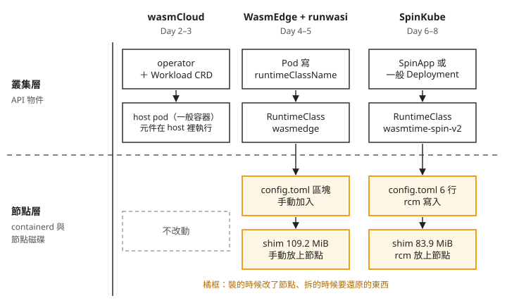
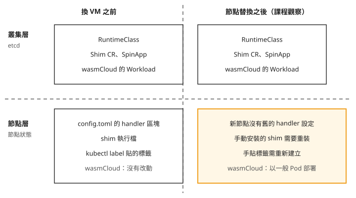

# Day 9: Sprint 3 總結——依需求選擇 wasm 的執行方式

{ align=right width="95" }

平台團隊想讓客戶上傳自己的規則程式；另一個團隊想縮短短任務的啟動時間；還有人希望 wasm 服務能沿用現有的 Deployment 和 Service。三個需求都提到 wasm，需要確認的事情卻不同。

走過 Day 1–8，你已經看過 wasmCloud、WasmEdge 與 SpinKube 怎麼執行程式，也實際追過安裝、設定失效和拆除。這一章回到需求本身：哪種執行方式符合你的管理方式，哪些效能結論有量測支持，以及導入前還有哪些事情要驗證。

## 先看程式在哪裡執行

把三條路線畫在同一張圖上，上半部是 Kubernetes 管理的物件，下半部是需要寫進節點的設定與執行檔。

wasmCloud 的 host 是一般容器，wasm 元件在 host 裡執行。新增元件時，增加的是 `Workload` 等自訂資源，不一定增加 Pod。Day 2、3 的節點快照沒有出現 containerd 設定或 shim 檔案的變動；你要學的是 wasmCloud 自己的部署、能力設定和排程方式。

WasmEdge 與 SpinKube 的路線則讓 Pod 指定 `runtimeClassName`。Kubernetes 透過 RuntimeClass 選出 handler，節點上的 containerd 再啟動對應的 shim。[Day 1](sprint3-day1-three-generations.md) 已經看過：API 裡有 RuntimeClass，和節點真的能執行它，是兩件事。

這個差別也決定你要維護哪一層。wasmCloud 需要管理 host 與自訂資源；另兩條路線還需要管理節點上的 handler 設定與 shim。

## 想沿用 Deployment 和 Service 時

如果需求是把 wasm HTTP 服務放進現有的 Kubernetes 部署流程，可以先回看 [Day 7](sprint3-day7-spinkube-operator.md)。那裡驗證了兩種入口：用 SpinApp 讓 operator 建立資源，以及直接建立帶有 `runtimeClassName` 的 Deployment。後者不需要 spin-operator 參與。

因此，評估 SpinKube 時可以分開問：是否需要 Spin 的執行環境，以及是否需要 operator 幫你產生 Deployment、Service。負責節點安裝的 runtime-class-manager（rcm）又是另一項選擇；沒有它時，節點設定與 shim 的安裝需要另外管理。

WasmEdge 的手動路線同樣經過 Pod、RuntimeClass 與 shim，不能只因為要用 Kubernetes 物件就把它排除。它在這門課的用途是讓你直接看到每一層的設定，並執行 core module。若應用需要 component 格式，先回看 [Day 4 的格式差異](sprint3-day4-wasmedge.md)，確認程式產物能被選定的執行期接受。

Day 7 的驗證涵蓋 Deployment、Service 與日誌；產出的 `resources` 是空的，沒有實測 CPU／記憶體限制。正式環境還會用到的 HPA、PDB、NetworkPolicy，這門課沒有逐項實測，導入時需要連同你的服務一起驗證。

## 想用 wasmCloud 組合元件時

如果希望由平台提供 HTTP、儲存等能力，元件只使用獲准的介面，可以從 [Day 2](sprint3-day2-wasmcloud.md) 的 host 模型開始評估。接著用 [Day 3](sprint3-day3-wasmcloud-distributed.md) 的例子檢查能力設定與部署位置：一個元件被放到另一顆 host 之後，是否仍然能讀到相同資料。

這條路線要接受 wasmCloud 的管理方式。你會查看 Workload 與 host 日誌，不能只用 Pod 數量判斷元件有沒有啟動。網路文章若使用 provider 與 link definition，也要先確認它描述的世代；本課使用的 2.6.1 以 `hostInterfaces` 設定能力，不能把舊版教學的操作直接套上。

Day 3 驗證了跨節點的 host 與共享儲存，尚未驗證跨雲部署、跨邊緣網路故障或完整的租戶隔離。這些需求可以成為下一個實驗的題目，不能從「元件能移到另一顆 host」直接推得已經符合。

## 想改善冷啟動或記憶體用量時

先問量的是什麼。[Day 5](sprint3-day5-cost-measurement.md) 使用同一份原始碼編譯出不同目標，在單節點上以 `ctr` 比較 WasmEdge 與 runc。程式只印一行字，原生容器的對照組使用 scratch 映像。計時到 `ctr run --rm` 返回為止，包含程式執行、退出與資源清理；它不是單獨量測啟動，也不是正式服務從送出 Deployment 到開始接流量的時間。

兩批各 50 次取樣沒有得到一致的速度差異判定。因此，這組資料不足以支持「換成 WasmEdge 就會明顯縮短啟動時間」。它也沒有直接量測 SpinKube 的同等工作負載，不能把 WasmEdge 的數字當成 SpinKube 的效能結論。

記憶體也要看節點總量。Day 5 由 1–3 個並行容器的 PSS 樣本推估，WasmEdge 的固定項約 38.8 MiB，每增加一個容器約增加 9.3 MiB；runc 對照組約為 0.1 MiB 與 4.5 MiB。PSS 是依共享比例分攤的實體記憶體；這些固定項是從樣本推估，不是零容器時直接量到的常駐用量。在這組小程式與版本組合裡，wasm 沒有呈現比較省記憶體的結果。應用本身變大、執行時間改變，結果是否不同，要用實際工作負載重新量。

wasmCloud 沒有可與上述測試直接比較的冷啟動與每元件記憶體資料，映像大小也沒有完成一致的比較。三條路線的效能排名，這門課給不出來。

## 節點更換之後，設定要怎麼回來

安裝成功之外，還要看節點更換之後能否恢復。下圖比較 Day 5、7 觀察到的情況：Kubernetes API 物件仍在，新節點卻沒有舊節點上的手動修改。

圖中最容易誤判的是 RuntimeClass：名字仍在，並不表示 handler 已經恢復。Day 7 手動貼上的節點標籤也沒有自動出現在替換後的節點。若要靠節點池設定保留標籤並觸發重新安裝，需要另外驗證整個流程；本課沒有完成這項測試。

這裡描述的是課程實際觀察到的節點替換，不是說所有 VM 重新開機都會清除磁碟。檢查安裝能否恢復時，應確認節點與磁碟的生命週期，不能只看「服務已重啟」。

拆除則回到 [Day 8](sprint3-day8-reversibility.md)：先刪除 Shim CR、保留 rcm 找節點所需的標籤，讓解除安裝 Job 有機會執行，再檢查節點檔案。課程使用的 rcm 無法直接清除手動修正過 plugin domain 的設定，因此最後還需要手動還原。驗證這個過程時必須使用同一台 VM；若中途換過節點，就無法用最後的空白差異證明是解除安裝清乾淨的。

## 後續還要確認的事情

如果選定節點層的路線，下一個實驗應包含節點輪替、安裝失敗後的恢復，以及有執行中工作負載時的拆除。Day 8 完成的是單節點的拆除比對，多節點部署和對既有流量的影響仍需驗證。wasmCloud 的完整解除安裝也沒有實測，節點設定沒有變動不等於叢集資源一定會被清除。

專案維護狀態則要另查。這門課在 2026 年 8 月留下的 commit 數、作者分布與 release 觀察，只代表當時的狀況。評估新版本時，除了發版日期，也要看它依賴哪一種介面：管理 Kubernetes 資源的 operator，與修改 containerd 設定的工具，面對的版本相容問題並不相同。[Day 0](sprint3-day0-wasm-concepts.md#health-method) 說明了查核方法。

## 想一想

1. 同事認為「RuntimeClass 還在，所以節點換過也不必重裝」。你會從哪一層找出反例？
2. 一份測試只比較 WasmEdge 與 runc 的小程式，能否據此決定把 HTTP 服務搬到 SpinKube？還缺什麼資料？
3. 團隊接受 wasmCloud 的元件模型，卻需要跨雲故障切換。Day 3 的跨節點測試足以證明這個需求嗎？

## 小結

選 wasm 的執行方式時，先確認程式由誰管理、能力在哪裡設定，以及節點更換或移除時要還原什麼。效能則回到量測範圍：一個版本的小程式測試只能回答那個測試的問題。這些判斷能幫你決定下一步要驗哪個需求，而不是只因為一條路線安裝成功就把它用在正式環境。

## 延伸閱讀

想再深入，可以從這幾份開始：

- **[Kubernetes RuntimeClass 文件](https://kubernetes.io/docs/concepts/containers/runtime-class/)**：說明 RuntimeClass、handler 與節點排程的關係，適合用來核對叢集與節點各自需要的設定。
- **[containerd 的 CRI 設定文件](https://github.com/containerd/containerd/blob/main/docs/cri/config.md)**：查看不同版本的 runtime 設定位置；實際安裝時應對照節點使用的版本。
- **[WASI 0.3.0 發行說明](https://github.com/WebAssembly/WASI/releases/tag/v0.3.0)**：從標準定義核對介面能力，再確認選定的執行期支援哪些部分。

## 下一步

下一個 Sprint 轉向服務之間的流量：從 [Sprint 4 介紹](../sprints/sprint4.md) 看服務網格如何處理請求路由、身分與流量觀察。

---

!!! quote ""
    WebAssembly 標誌為 WebAssembly 專案之官方資產（CC0 1.0），此處作社群教學用途。
