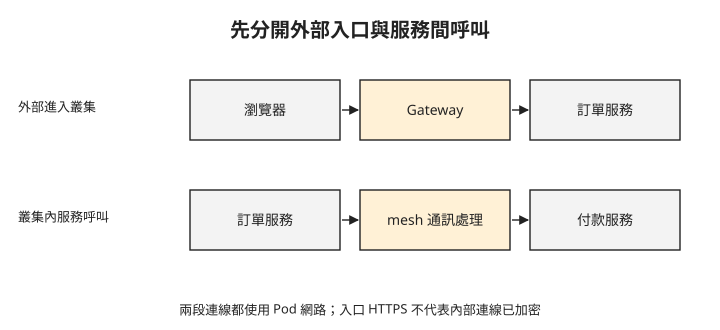

# Day 0：入口能連線之後，服務之間還缺什麼？

{ align=right width="80" }

購物網站已經能從瀏覽器打開，訂單服務也能呼叫付款服務。但團隊提出兩個新要求：入口要支援 HTTP/3，內部服務則要驗證彼此身分，避免任何能連到付款服務的程式都能送出請求。這兩件事發生在不同的連線上，更換入口元件不會自動完成內部驗證。讀完這章，你要能沿著請求路徑，判斷需求應由入口閘道、服務網格，還是 Pod 網路處理。

## 先找出要管理的是哪一段連線

從叢集外進入服務的流量稱為 **north-south（南北向）**；叢集內服務互相呼叫則稱為 **east-west（東西向）**。這是描述流量方向的用語，不代表某個產品只能處理其中一種。

入口閘道（Gateway）接收外部連線，再依主機名稱或網址路徑轉送到服務。購物網站與付款服務之間的呼叫，則可以交給 **service mesh（服務網格）**：在應用程式之外統一處理服務通訊，例如驗證服務身分、加密及限制連線。

下圖沿用同一筆購物操作。先看上排的外部入口，再看下排訂單服務發出的新請求；兩排管理的連線不同。

Gateway 把請求交給訂單服務後，訂單服務仍可能另外呼叫付款服務。付款服務是否要求身分驗證，不能只從入口已啟用 HTTPS 推斷。兩段流量都需要底層 Pod 網路；前面學過的 **CNI** 負責設定 Pod 網路，Cilium 是其中一種實作。

## 內部請求為什麼需要服務身分？

只知道來源 IP，還不足以表達「只有訂單服務可以呼叫付款服務」。Pod 重建後 IP 可能改變，規則真正要對應的是工作負載身分。

**mTLS（雙向 TLS）**讓連線兩端都出示憑證並驗證對方，同時加密連線。服務網格可以替應用程式處理這件事，但你仍要決定哪些身分有權存取哪些服務。加密、身分驗證與授權是相關但不同的要求：連線已加密，不表示來源已獲准執行所有操作。

[Day 2](sprint4-day2-istio-ambient.md) 會用 Istio ambient 觀察服務身分；[Day 3](sprint4-day3-cilium-mesh.md) 則會分別檢查 WireGuard 加密與 HTTP 存取規則。比較時必須分開這些證據，不能用「都有加密」直接判定功能相同。

## 不在每個 Pod 放代理，可以怎麼做？

傳統 **sidecar** 部署會在每個應用 Pod 裡加入代理容器，讓它處理進出流量。代理會使用 CPU 與記憶體；更新注入的代理版本也通常需要替換應用 Pod。當 Pod 很多時，團隊可能希望把代理與應用的生命週期分開。

Istio ambient 將工作拆成兩部分：每個節點的 **ztunnel** 處理服務身分與加密通道；需要理解 HTTP 內容時，再部署稱為 **waypoint** 的 Envoy 代理。ztunnel 是使用者空間的程式，不能因為沒有 sidecar，就把它當成 eBPF 在核心中的處理。

Cilium 則以 eBPF 處理網路轉送與部分網路政策，並可整合核心的 WireGuard 加密功能。需要檢查 HTTP 方法或路徑時，流量會導向 Envoy。WireGuard 執行加密與 eBPF 導引封包，是不同的工作。

因此，選擇不使用 sidecar，仍然要問代理部署在哪裡，以及哪些請求會經過代理。本課不以某種部署方式判定所有情境的效能，也不把 sidecar 描述成已經不能使用。

## 看到 HTTP 規則，就找出誰會解析 HTTP

**L7（應用層）**在本課主要指 HTTP 方法、路徑與標頭等內容。例如允許 `GET /`、拒絕 `POST /`，必須有人解析 HTTP；只檢查 IP 與連接埠的規則無法完成這個判斷。

接下來會遇到三種使用 Envoy 的方式。它們共用代理技術，但設定介面與部署責任不同，不能直接互換設定檔。

| 要處理的需求 | 本課使用的元件 | HTTP 規則由誰執行 |
|---|---|---|
| 外部請求依主機名稱進入服務 | Envoy Gateway | Gateway 管理的 Envoy |
| 內部服務的 HTTP 連線限制 | Istio ambient | waypoint 的 Envoy |
| Cilium 網路政策中的 HTTP 方法與路徑限制 | Cilium | Cilium 管理的 Envoy |

Cilium 同時提供 CNI、服務通訊與 Gateway API 相關功能，因此會在多個需求中出現。Istio ambient 也可以使用 Cilium 提供的 Pod 網路。比較產品前，先確認比較的是入口、服務身分、HTTP 政策，還是底層網路，才能避免把不同範圍的功能放在一起。

## 想一想

1. 網站入口已啟用 HTTPS，能否據此證明訂單服務到付款服務也有加密？你還需要觀察哪一段？
2. 需求是只允許 `GET /health`，IP 與連接埠政策夠不夠？本章哪些元件能解析這個條件？
3. 同事說「沒有 sidecar，所以所有流量都只在 eBPF 裡處理」。用 Istio ambient 的分工說明這句話缺了什麼。

## 小結

先沿著請求找出管理範圍，再選元件：Gateway 處理外部入口，mesh 處理內部服務通訊，CNI 提供 Pod 網路。接著把加密、身分驗證與 HTTP 政策分別列出，確認誰在什麼位置執行它們。[Day 1](sprint4-day1-envoy-gateway.md) 會先完成入口路由，再驗證用戶端到 Envoy 的 HTTP/3 連線。

## 延伸閱讀

想再深入，可以從這幾份開始：

- [Istio ambient 架構](https://istio.io/latest/docs/ambient/architecture/)：ztunnel 與 waypoint 的責任。
- [Cilium Service Mesh](https://docs.cilium.io/en/stable/network/servicemesh/)：Cilium 的服務通訊功能與資料路徑。
- [Envoy Gateway](https://gateway.envoyproxy.io/)：以 Gateway API 管理 Envoy 的專案。

---

!!! quote ""
    Kubernetes 標誌為 CNCF（Linux Foundation）官方資產，此處作社群教學用途。
