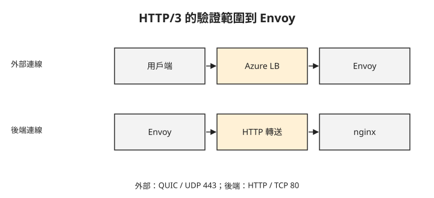
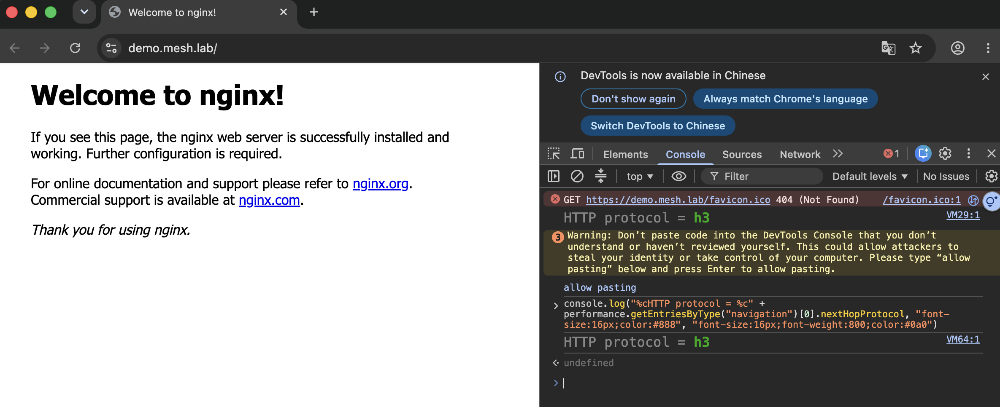

# Day 1：用 Envoy Gateway 驗證入口路由與 HTTP/3

{ align=right width="76" }

同一個 nginx 網站已經可以透過 Service 存取。接續 [Day 0](sprint4-day0-mesh-concepts.md) 的入口需求，現在要讓外部使用者用 `demo.mesh.lab` 連進來，並且支援 HTTP/3。

本章採用 **Envoy Gateway**，透過 Gateway API 這組 Kubernetes 資源管理入口。Envoy Gateway 控制器讀取這些資源，建立 Envoy 代理與對外的 LoadBalancer Service，並把入口規則轉成代理設定；實際接收連線、處理 TLS 與轉送請求的是 **Envoy 代理**。這樣就能用 Kubernetes 資源管理主機名稱、路由與協定，不必直接撰寫底層 Envoy 設定，分工可參考[官方概念文件](https://gateway.envoyproxy.io/docs/concepts/gateway-api/)。若不使用 Envoy Gateway，就需要自行管理 Envoy 設定，或採用其他入口控制器。

頁面能打開，只能說明某條路徑成功；它不能告訴你主機名稱規則是否生效，也不能證明使用了 HTTP/3。這章會用對照請求與協定資訊，分別判斷這兩件事。

## 先備妥 Pod 網路與入口控制器

重現本章時，請採用 AKS、Cilium 1.20.0、Envoy Gateway v1.8.3 與 Kubernetes 1.35.6 的版本組合；這些版本不是最低版本要求。實作前需備妥可使用的 AKS 叢集、Helm，以及命名空間 `mesh-demo` 中名為 `web`、連接埠為 80 的 nginx Service 與後端 Pod。範例網域不需要公開 DNS；後續以 Host 標頭或 `--resolve` 指定路由與位址。

這組練習環境使用 **BYOCNI（自行安裝 CNI）**：建立 AKS 時選用 `network-plugin none`，再自行安裝 Cilium。它讓後續章節可以調整 Cilium 與 Istio 共存所需的設定；已有其他 CNI 的叢集不能直接照下面安裝指令覆蓋。本章不提供既有叢集的 CNI 遷移程序。

尚未安裝 CNI 時，控制平面可以是 Running，但節點仍然 NotReady。下面兩行呈現的就是這個差別：

```text
prov=Succeeded  power=Running  k8s=1.35.6  networkPlugin=none  containerd=2.3.3-2
aks-nodepool1-31753998-vmss000000   NotReady   ...   containerd://2.3.3-2
```

`networkPlugin=none` 與節點的 `NotReady` 要一起判讀。先確認使用的是預定的 BYOCNI 環境，再安裝網路外掛。下列指令需要 Helm 已加入 Cilium chart repository；`<API server FQDN>` 請替換成該叢集 kubeconfig 中 `server` URL 的主機名稱，不含 `https://` 與連接埠。

```sh
helm install cilium cilium/cilium --version 1.20.0 --namespace kube-system \
  --set aksbyocni.enabled=true --set nodeinit.enabled=true \
  --set kubeProxyReplacement=true \
  --set k8sServiceHost=<API server FQDN> --set k8sServicePort=443 \
  --set socketLB.hostNamespaceOnly=true \
  --set cni.exclusive=false --set envoyConfig.enabled=true
```

`cni.exclusive=false` 允許後續 Istio CNI 共存；`socketLB.hostNamespaceOnly=true` 限制 socket 負載平衡的作用範圍，供 ambient 的流量導引使用。這些設定在 [Day 2](sprint4-day2-istio-ambient.md) 會繼續使用。安裝完成後，除了節點 Ready，還要確認 Cilium 與 Envoy 狀態：

```text
aks-nodepool1-31753998-vmss000000   Ready   <none>   6m30s   v1.35.6
# cilium status
Cilium:            OK
Envoy DaemonSet:   OK
Cluster Pods:      5/5 managed by Cilium
```

AKS 管理的 kube-proxy DaemonSet 不會因為設定 `kubeProxyReplacement=true` 就自動刪除；檢查 Cilium 狀態時，仍可能看到它。

接著需要先安裝 Envoy Gateway 控制器及它使用的 Gateway API CRD；安裝方式見[官方快速入門](https://gateway.envoyproxy.io/docs/tasks/quickstart/)。以下以控制器與 CRD 已就緒為前提，繼續設定入口與路由。

全新安裝時，依 [v1.8 安裝文件](https://gateway.envoyproxy.io/v1.8/install/install-helm/)安裝控制器與兩組 CRD，版本固定為本章的 [v1.8.3](https://github.com/envoyproxy/gateway/releases/tag/v1.8.3)，再用 Kubernetes v1.35 的 [wait](https://v1-35.docs.kubernetes.io/docs/reference/kubectl/generated/kubectl_wait/) 等待 CRD 與控制器就緒（依官方文件補上，本課沒有實跑）：

```sh
helm install eg oci://docker.io/envoyproxy/gateway-helm \
  --version v1.8.3 --namespace envoy-gateway-system --create-namespace

kubectl wait --for=condition=Established --timeout=5m \
  crd/gatewayclasses.gateway.networking.k8s.io \
  crd/gateways.gateway.networking.k8s.io \
  crd/httproutes.gateway.networking.k8s.io \
  crd/clienttrafficpolicies.gateway.envoyproxy.io

kubectl wait -n envoy-gateway-system deployment/envoy-gateway \
  --for=condition=Available --timeout=5m
```

## 把入口選擇、監聽與路由分開

Gateway API 將不同管理責任分成幾種物件。**GatewayClass** 選擇控制器實作；**Gateway** 宣告入口的 listener，也就是接收連線的協定與連接埠；**HTTPRoute** 宣告哪些 HTTP 請求送到哪個 Service。平台團隊可以管理共用 Gateway，應用團隊則管理自己的路由。

以下是已驗證的 HTTP 路由設定。套用前，前述 `web` Service 必須已存在。先看 `parentRefs` 如何將 HTTPRoute 連到 `eg`，再看 `backendRefs` 如何指向 `web:80`：

```yaml
apiVersion: gateway.networking.k8s.io/v1
kind: GatewayClass
metadata:
  name: eg
spec:
  controllerName: gateway.envoyproxy.io/gatewayclass-controller
---
apiVersion: gateway.networking.k8s.io/v1
kind: Gateway
metadata:
  name: eg
  namespace: mesh-demo
spec:
  gatewayClassName: eg
  listeners:
    - name: http
      protocol: HTTP
      port: 80
      hostname: "demo.mesh.lab"
      allowedRoutes:
        namespaces:
          from: Same
---
apiVersion: gateway.networking.k8s.io/v1
kind: HTTPRoute
metadata:
  name: web
  namespace: mesh-demo
spec:
  parentRefs:
    - name: eg
  hostnames:
    - "demo.mesh.lab"
  rules:
    - matches:
        - path:
            type: PathPrefix
            value: /
      backendRefs:
        - name: web
          port: 80
```

`hostnames` 限定 `demo.mesh.lab`，`PathPrefix: /` 則匹配它底下的路徑。Gateway 與 HTTPRoute 放在同一個 `mesh-demo` 命名空間，符合 listener 的 `allowedRoutes` 設定。

將上方完整 YAML 存成 `gateway-http.yaml` 後，套用資源並等待 Gateway 完成配置，再依 [v1.8 狀態查詢文件](https://gateway.envoyproxy.io/v1.8/troubleshooting/configuration/)與 Kubernetes v1.35 的 [get](https://v1-35.docs.kubernetes.io/docs/reference/kubectl/generated/kubectl_get/) 查詢資源狀態與入口 IP（依官方文件補上，本課沒有實跑）：

```sh
kubectl apply -f gateway-http.yaml

kubectl wait -n mesh-demo gateway/eg \
  --for=condition=Programmed --timeout=5m

kubectl get gatewayclass eg -o yaml
kubectl get -n mesh-demo gateway/eg httproute/web -o yaml

kubectl get svc -n envoy-gateway-system \
  -l gateway.envoyproxy.io/owning-gateway-namespace=mesh-demo,gateway.envoyproxy.io/owning-gateway-name=eg \
  -o wide
```

控制器接受設定後，應再確認它已完成配置，且後端參照可解析。驗證結果如下：

```text
Gateway eg:    Accepted=True  Programmed=True
HTTPRoute web: Accepted=True  ResolvedRefs=True
envoy-mesh-demo-eg-dd08789d   LoadBalancer   <LB-IP>   80:32421/TCP
```

`Accepted=True` 表示設定被接受，`Programmed=True` 表示 Gateway 已配置；HTTPRoute 的 `ResolvedRefs=True` 則表示參照能解析。這些狀態仍不能取代一次實際請求。將 `<LB-IP>` 換成該 LoadBalancer Service 的外部 IP，再用兩種 Host 測試：

```console
$ curl -H "Host: demo.mesh.lab" http://<LB-IP>/
HTTP/1.1 200 OK
server: nginx/1.13.6

$ curl -H "Host: nope.invalid" http://<LB-IP>/
wrong-host -> HTTP 404
```

同一個入口 IP，正確 Host 回 200、錯誤 Host 回 404，才把 hostname 匹配也驗到了。`server: nginx` 提供後端回應的線索，但單憑這個標頭無法證明整條代理路徑；需要和 Gateway 狀態、所使用的入口 IP 一起判讀。

## 啟用 HTTP/3 前，先建立 HTTPS listener

**HTTP/3** 使用 **QUIC** 傳送 HTTP，QUIC 建立在 UDP 上。這次要驗證的是用戶端到 Envoy 的連線；Envoy 可以把請求轉成另一種 HTTP 版本送給 nginx。

下圖標出協定終止的位置。注意最右邊：後端不必改成 HTTP/3，才能讓外部入口提供 HTTP/3。



因此要同時檢查 UDP 443 能否抵達 Envoy，以及 HTTPS listener 的憑證是否符合 `demo.mesh.lab`。先在 `mesh-demo` 備妥名為 `demo-tls` 的 TLS Secret，再以以下已驗證的 Gateway 設定加入 HTTPS listener。憑證需包含對應網域，瀏覽器測試還需要信任它的簽發者。

```yaml
apiVersion: gateway.networking.k8s.io/v1
kind: Gateway
metadata:
  name: eg
  namespace: mesh-demo
spec:
  gatewayClassName: eg
  listeners:
    - name: http
      protocol: HTTP
      port: 80
      hostname: "demo.mesh.lab"
      allowedRoutes:
        namespaces:
          from: Same
    - name: https
      protocol: HTTPS
      port: 443
      hostname: "demo.mesh.lab"
      tls:
        mode: Terminate
        certificateRefs:
          - kind: Secret
            name: demo-tls
      allowedRoutes:
        namespaces:
          from: Same
```

`tls.mode: Terminate` 表示 TLS 在 Gateway 終止，`certificateRefs` 則指定憑證。這些前提完成後，才加入 **ClientTrafficPolicy**，也就是 Envoy Gateway 管理用戶端連線行為的政策。以下設定須套用在 `mesh-demo`，因為它的目標 Gateway `eg` 位於該命名空間：

```yaml
apiVersion: gateway.envoyproxy.io/v1alpha1
kind: ClientTrafficPolicy
metadata:
  name: enable-http3
  namespace: mesh-demo
spec:
  targetRefs:
    - group: gateway.networking.k8s.io
      kind: Gateway
      name: eg
  http3: {}
```

備妥 `mesh-demo/demo-tls` 後，將上方含 HTTPS listener 的 Gateway YAML 存成 `gateway-https.yaml`、ClientTrafficPolicy YAML 存成 `enable-http3.yaml`，依 [v1.8 HTTP/3 文件](https://gateway.envoyproxy.io/v1.8/tasks/traffic/http3/)套用並查詢資源狀態與 Service 連接埠（依官方文件補上，本課沒有實跑）：

```sh
kubectl apply -f gateway-https.yaml
kubectl apply -f enable-http3.yaml

kubectl get -n mesh-demo gateway/eg httproute/web \
  clienttrafficpolicy/enable-http3 -o yaml

kubectl get svc -n envoy-gateway-system \
  -l gateway.envoyproxy.io/owning-gateway-namespace=mesh-demo,gateway.envoyproxy.io/owning-gateway-name=eg \
  -o yaml
```

查詢後，確認各資源 conditions 的 `observedGeneration` 對應目前的 `metadata.generation`，再檢查 Gateway 的 listener 狀態與 Service 的 TCP／UDP 443；控制器尚未處理完這次變更時，請稍候重查。

在驗證版本中，`http3: {}` 會讓 Envoy Gateway 為同一個 LoadBalancer Service 加入 UDP 443。觀察輸出時要看協定欄，不能只看同樣出現的數字 443：

```text
envoy-mesh-demo-eg-dd08789d   LoadBalancer   <LB-IP>   PORTS: 80,443,443  PROTOS: TCP,TCP,UDP
  http-80:      TCP/80
  https-443:    TCP/443
  https-443-h3: UDP/443      ← http3 帶出來的 QUIC port
```

TCP 443 供既有 HTTPS 連線使用，UDP 443 供 QUIC 使用。本章採用的 AKS 與 Envoy Gateway 版本可以在一個 Service 內提供兩者；換用其他版本或雲端負載平衡器時，需先確認是否支援同一個 Service 混用 TCP 與 UDP。

## 先讀廣告，再確認實際連線

HTTPS 回應可使用 **alt-svc** 標頭告知用戶端另有 HTTP/3 入口。以下請求本身走 HTTP/2：

```console
$ curl -k --http2 --resolve demo.mesh.lab:443:<LB-IP> https://demo.mesh.lab/
HTTP/2 200
alt-svc: h3=":443"; ma=86400          ← 廣告了 HTTP/3
```

`alt-svc` 只表示伺服器宣告支援 HTTP/3。它沒有證明 UDP 可達，也沒有證明下一次請求會使用 HTTP/3。必須用支援 HTTP/3 的 curl 再連線，並讀取實際協定：

```console
$ curl --http3 -v --resolve demo.mesh.lab:443:<LB-IP> https://demo.mesh.lab/
* Connected to demo.mesh.lab (<LB-IP>) port 443
* using HTTP/3                    ← 走 HTTP/3
> GET / HTTP/3
< HTTP/3 200                      ← 回應也是 HTTP/3
< server: nginx/1.13.6
< alt-svc: h3=":443"; ma=86400
```

這個命令未使用 `-k`，因此要求 curl 信任站台憑證；若使用未受信任的測試憑證，會先遇到憑證錯誤。加上 `-k` 會略過憑證驗證，不能據此判定正式站台的憑證正確。

`using HTTP/3` 與 `HTTP/3 200` 才是這次連線使用 HTTP/3 的證據。範圍到 Envoy 為止，不能據此宣稱 Envoy 到 nginx 也使用 HTTP/3。

## 在瀏覽器檢查協定

瀏覽器對不同 HTTP 版本通常呈現相同頁面，所以要開啟 DevTools 的 Network 分頁查看 Protocol 欄。也可讀取 **nextHopProtocol**，也就是瀏覽器為這次導覽記錄的網路協定：

```js
performance.getEntriesByType('navigation')[0].nextHopProtocol   // → "h3"
```

以下畫面顯示網站載入成功，主控台同時回報 `h3`。頁面內容與協定欄位回答的是不同問題。



## 疑難排解 {#gaps}

### curl 不支援 --http3

HTTP/3 是否可用取決於 curl 的編譯功能，不能只依作業系統或版本號推斷。若出現 `the installed libcurl version doesn't support this`，請使用有 HTTP/3 功能的 curl，並確認實際呼叫的是該執行檔。

### 瀏覽器一直沒有使用 h3

先確認憑證受信任、主機名稱符合憑證，再確認 UDP 443 的 Service、負載平衡器與防火牆路徑。`alt-svc` 存在而連線仍是 h2，不能直接判定 HTTPRoute 錯誤；單一 QUIC 錯誤碼也不足以推定所有環境都是相同原因。

## 想一想

1. 正確 Host 與錯誤 Host 都回 200，應先檢查路由中的哪一個條件？
2. 只有 `alt-svc: h3`、沒有實際 h3 連線，還缺哪一類證據？
3. curl 顯示 `HTTP/3 200`，是否代表 nginx 也啟用了 QUIC？請沿著圖說明。

## 小結

Gateway API 讓入口配置與應用路由分開管理。判斷功能完成時，先以正反例檢查 Host 匹配，再檢查 HTTPS listener、UDP 443 與實際協定。HTTP/3 在 Envoy 終止，因此入口成功不會自動證明內部服務通訊的加密；[Day 2](sprint4-day2-istio-ambient.md) 會繼續處理服務間的身分與連線限制。

## 延伸閱讀

想再深入，可以從這幾份開始：

- [Envoy Gateway HTTP/3](https://gateway.envoyproxy.io/docs/tasks/traffic/http3/)：HTTPS listener 與 ClientTrafficPolicy 的設定。
- [Gateway API 概念](https://gateway-api.sigs.k8s.io/docs/concepts/api-overview/)：各種資源的管理責任。
- [AKS BYOCNI](https://learn.microsoft.com/en-us/azure/aks/use-byo-cni)：自行管理 CNI 的前提與支援範圍。

---

!!! quote ""
    Envoy 標誌為 CNCF（Linux Foundation）官方資產，此處作社群教學用途。瀏覽器 DevTools 擷圖為本課程實測自製。
