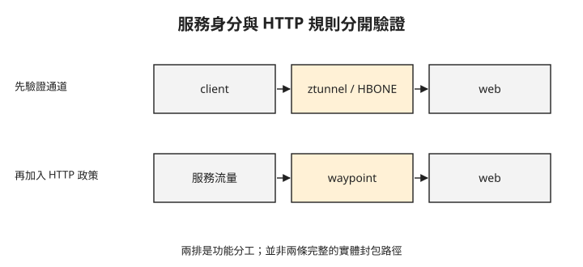

# Day 2：從連得上，進一步驗證服務身分與連線限制

{ align=right width="72" }

入口已經可以服務外部請求，但內部的 client 呼叫 web 仍只知道「回了 200」。團隊還想知道：連線兩端分別是哪個工作負載？流量突然增加時，代理能否限制送往 web 的連線？這章會分別讀取身分紀錄與拒絕訊號，判斷這兩個要求是否成立。

## 讓既有 Pod 加入 ambient

**ambient** 是 Istio 將代理與應用 Pod 分開部署的模式。每個節點的 **ztunnel** 負責帶有工作負載身分的加密通道；它不會替應用解析所有 HTTP 規則。前章已介紹的 mTLS，會在這裡驗證連線雙方的憑證。

本章沿用 [Day 1](sprint4-day1-envoy-gateway.md) 的 Cilium 1.20.0 與 `mesh-demo/web`，使用 Istio 1.30.3。開始前需有相應版本的 istioctl，並確認 Cilium 設為 `cni.exclusive=false`、`socketLB.hostNamespaceOnly=true`，以及這組環境使用的 iptables masquerade。這些是已驗證的共存設定，不能只把兩套元件裝上去就假定流量導引正確。

以下安裝 ambient 元件。輸出分別列出控制平面、CNI 與 ztunnel：

```console
$ istioctl install --set profile=ambient -y
✔ Istio core installed
✔ CNI installed
✔ Istiod installed
✔ Ztunnel installed
```

Istio CNI 負責準備 ambient 所需的流量導引，原有 Cilium 仍提供 Pod 網路。兩個 DaemonSet 在驗證環境都正常執行：

```text
istio-cni-node   1/1   Running   (istio-system)
cilium           1/1   Running   (kube-system)
```

這個狀態只證明元件已啟動；下一步必須發出應用請求，才能確認工作負載真的加入 mesh。

先準備具有獨立 ServiceAccount 的 client。以下設定來自本章使用的 client manifest；`serviceAccountName: client` 會在稍後的身分紀錄中出現。

```yaml
apiVersion: v1
kind: ServiceAccount
metadata:
  name: client
  namespace: mesh-demo
---
apiVersion: apps/v1
kind: Deployment
metadata:
  name: client
  namespace: mesh-demo
  labels:
    app: client
spec:
  replicas: 1
  selector:
    matchLabels:
      app: client
  template:
    metadata:
      labels:
        app: client
    spec:
      serviceAccountName: client
      containers:
        - name: curl
          image: curlimages/curl:8.11.1
          command: ["sleep", "infinity"]
          resources:
            requests:
              cpu: 10m
              memory: 16Mi
```

client 容器會保持執行，供你從容器內向 `web.mesh-demo.svc.cluster.local:80` 發出 HTTP 請求。接著為命名空間加上 ambient 標籤。以下第二行是三次請求結果摘要，並非可執行的 shell 指令：

```console
$ kubectl label ns mesh-demo istio.io/dataplane-mode=ambient
$ client → web:  req1 200  req2 200  req3 200
```

三次 200 表示請求成功，還沒有回答身分與加密問題。加入 ambient 不需要把代理注入每個應用 Pod；驗證中既有工作負載可在標籤更新後納管，但仍要檢查實際連線紀錄。

## 從 ztunnel 紀錄找出身分與目的地

**SPIFFE** 是工作負載身分的標準表示方式。這裡的 `spiffe://cluster.local/ns/mesh-demo/sa/client` 把信任網域、命名空間與 ServiceAccount 組合成身分。它不等同於 Pod IP，也不代表已授權執行所有操作。

**HBONE** 是 ambient 傳送服務流量使用的通道協定，使用 mTLS 保護通道。下圖把通道保護與稍後加入的 HTTP 處理分開，避免把 ztunnel 當成 HTTP 代理。



上排用於服務身分與加密，加入 waypoint 後才有下排的 HTTP 代理處理。以下是 ztunnel 的連線紀錄節錄：

```text
src.workload="client-..."  src.identity="spiffe://cluster.local/ns/mesh-demo/sa/client"
dst.addr=10.0.0.235:15008  dst.hbone_addr=10.0.0.235:80
dst.service="web.mesh-demo.svc.cluster.local"
dst.identity="spiffe://cluster.local/ns/mesh-demo/sa/default"
```

`dst.addr` 的 15008 是 HBONE 通道端點，`dst.hbone_addr` 的 80 是應用目的連接埠。`src.identity` 對應 client ServiceAccount，`dst.identity` 對應 web 使用的 default ServiceAccount。這些欄位要一起看；單獨看到 15008 這個連接埠，不足以證明任意流量都已加密。

這組紀錄來自單節點練習，不能把它說成已驗證跨節點傳輸。它證明的是 ambient 通道與工作負載身分，[Day 3](sprint4-day3-cilium-mesh.md) 會改驗 Cilium WireGuard 的跨節點加密；那份結果不能補成 Istio 的跨節點證據。

## 加入 waypoint，再限制送往 web 的連線

**waypoint** 是 ambient 中處理 HTTP 流量的 Envoy 代理。本章的 HTTP 連線池限制在 waypoint 執行；ztunnel 的通道保護不會自動包含這項規則。先建立 waypoint，並把命名空間的服務加入它的處理範圍：

```console
$ istioctl waypoint apply -n mesh-demo --enroll-namespace
✅ waypoint applied; namespace labeled istio.io/use-waypoint: waypoint
```

此命令使用 `--enroll-namespace` 完成命名空間設定，不需要另外加 `-y`。接著套用 **DestinationRule**，也就是針對目的服務設定流量政策的 Istio 資源。這份設定把 **connection pool（連線池）**上限壓低，讓超出容量的請求容易被拒絕：

```yaml
apiVersion: networking.istio.io/v1
kind: DestinationRule
metadata:
  name: web-cb
  namespace: mesh-demo
spec:
  host: web.mesh-demo.svc.cluster.local
  trafficPolicy:
    connectionPool:
      tcp:
        maxConnections: 1
      http:
        http1MaxPendingRequests: 1
        maxRequestsPerConnection: 1
    outlierDetection:
      consecutive5xxErrors: 1
      interval: 1s
      baseEjectionTime: 30s
      maxEjectionPercent: 100
```

`maxConnections: 1` 限制連線數，`http1MaxPendingRequests: 1` 限制等待連線的 HTTP 請求。`outlierDetection` 另外處理連續錯誤後的後端排除；不能把這兩種機制混成同一個上限。設定刻意偏低，只用於觀察，不是正式服務的容量建議。

套用設定後，驗證以 50 個並行請求呼叫 web，得到以下分布：

```text
  22 200
  28 503        ← 斷路 trip
```

200 與 503 的數量會受連線時序影響，不應要求每次都重現 22 比 28。判斷連線池限制是否介入，還要看失敗回應的標頭。驗證中可觀察到：

```text
x-envoy-overloaded: true
x-envoy-decorator-operation: web.mesh-demo.svc.cluster.local:80/*
```

`x-envoy-overloaded: true` 是 Envoy 容量限制介入的線索；搭配本章刻意降低的連線池設定，支持部分請求由代理拒絕的判斷。`x-envoy-decorator-operation` 提供代理處理的服務資訊，不能單憑它推定所有 503 都由同一項限制造成。原始紀錄中帶 overload 標頭的回應數與 503 總數不同，這裡不把所有 503 一概歸因。

## 疑難排解

### 叢集顯示 Running，但 kubectl 回 no such host {#mine-1}

若控制平面狀態正常，kubectl 卻無法解析 API 主機名稱，先比較本機 resolver 與其他可用 DNS resolver 的結果。驗證中曾出現公用 DNS 已能解析、本機仍回 NXDOMAIN 的情況，符合 DNS 負快取的症狀；這不代表每次 AKS 停開機都一定會刪除 DNS 紀錄。

可以等待快取失效。若已確認正確 IP，也可暫時將 kubeconfig 的連線位址指向它，並保留原 FQDN 作 TLS 名稱。`<cluster>` 是 kubeconfig 中對應的 cluster 項目名稱，`<FQDN>` 是原 `server` URL 的主機名稱：

```sh
kubectl config set-cluster <cluster> \
  --server=https://<已解析的 IP>:443 \
  --tls-server-name=<FQDN>
```

這會修改本機 kubeconfig，且 IP 可能改變。DNS 恢復後，應將 `server` 還原為原本 FQDN；不要把暫時固定 IP 當成長期配置。

## 想一想

1. client 收到 200，卻找不到兩端身分與 HBONE 紀錄，可以宣布 mTLS 驗證完成嗎？
2. 只部署 ztunnel、尚未部署 waypoint，就期待本章的 HTTP 連線池限制生效，漏了哪一步？
3. 壓測出現 503，但沒有 overload 訊號，你還能否直接判定是連線池限制？為什麼？

## 小結

加入 ambient 後，先用 ztunnel 紀錄確認通道與雙方身分，再以 waypoint 執行 HTTP 流量政策。成功回應、加密通道與容量拒絕，各需要不同證據。這章沒有量測完整 mesh 成本，也沒有將單次 503 比例當成效能結果。[Day 3](sprint4-day3-cilium-mesh.md) 會改用 Cilium 的加密與 HTTP 政策，並區分哪些能力已驗證、哪些尚未完成。

## 延伸閱讀

想再深入，可以從這幾份開始：

- [Istio ambient 概觀](https://istio.io/latest/docs/ambient/overview/)：ztunnel 與 waypoint 的分工。
- [ambient 平台前提](https://istio.io/latest/docs/ambient/install/platform-prerequisites/)：Cilium 共存設定。
- [Istio circuit breaking](https://istio.io/latest/docs/tasks/traffic-management/circuit-breaking/)：連線池與過載觀測。

---

!!! quote ""
    Istio 標誌為 CNCF（Linux Foundation）官方資產，此處作社群教學用途。
