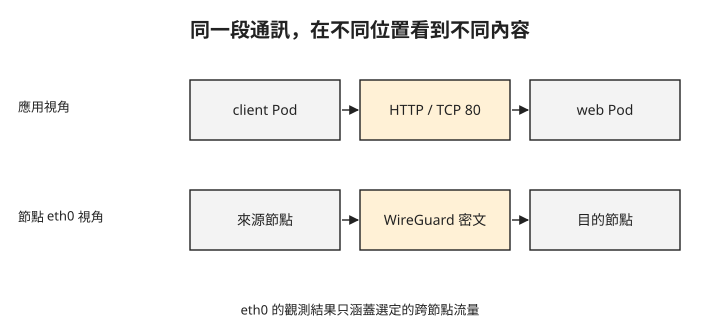

# Day 3：分開驗證 Cilium 的加密、HTTP 政策與身分

{ align=right width="76" }

Cilium 狀態顯示 Encryption 已啟用，client 也能呼叫 web。這是否足以向團隊說明「服務之間已加密，而且互相驗證身分」？還不夠：狀態顯示設定，應用回應顯示可用性，兩者都沒有直接呈現網路上傳送的內容。這章會分開讀取封包、HTTP 正反例與身分後端狀態，判斷每項證據支持到哪裡。

## 先讓測試只經過預定的元件

[Day 2](sprint4-day2-istio-ambient.md) 的 ztunnel 與 waypoint 仍可能處理流量。若直接加入 Cilium 政策，看到的結果可能混合兩套代理。因此本章使用已移除 Istio 的練習環境，保留 Cilium 1.20.0、`mesh-demo/client` 與 `web`。

清理時除了取消 ambient 納管，也要刪除命名空間的 waypoint 資源、清除 `istio.io/use-waypoint` 標籤，並確認 waypoint Pod 已消失。接著移除 Istio 控制元件。以下節錄保留移除與檢查結果：

```text
$ kubectl label ns mesh-demo istio.io/dataplane-mode-
$ istioctl uninstall --purge -y
# 驗:istio-system 空、mesh-demo 沒有 ambient 標籤、也沒有 waypoint
$ kubectl -n istio-system get pods
No resources found in istio-system namespace.
```

`istio-system` 沒有 Pod，只是檢查之一；還需確認 `mesh-demo` 沒有 waypoint 或 ambient 標籤。這項清理會撤除原有 mesh 保護，適用於隔離的練習環境，不是正式服務的遷移程序。

## 從跨節點封包確認 WireGuard 加密

**WireGuard** 使用金鑰建立加密通道。Cilium 整合核心的 WireGuard 功能保護支援範圍內的 Pod 流量；eBPF 參與封包處理與導引，實際加密不能一律歸為 eBPF 執行。

這個測試需要兩個節點，client 與 web 分別排在不同節點，且 Cilium 已依[官方 WireGuard 設定](https://docs.cilium.io/en/stable/security/network/encryption-wireguard/)啟用加密。Day 1 的安裝命令沒有開啟 WireGuard，不能直接沿用那個狀態就期待以下結果。先確認 Cilium 狀態包含加密介面與對端：

```text
Encryption:  Wireguard  [NodeEncryption: Disabled, cilium_wg0 (Port: 51871, Peers: 1)]
```

`Peers: 1` 表示這個介面已有一個 WireGuard 對端；**NodeEncryption** 指節點自身流量的加密選項，這裡是 Disabled。因此後面只檢查選定的跨節點 Pod 流量，不能宣稱所有主機流量都受保護。

抓包的位置會影響你看見的內容。下圖上排是 Pod 發出的應用請求，下排是節點網卡上要檢查的加密通道；本章的觀測位置是節點 `eth0`。



應用程式可以繼續使用 HTTP，節點網卡上的跨節點封包則應走 WireGuard。驗證期間 client 向另一個節點的 web 發出 200 次請求，並同步擷取來源節點 `eth0` 流量：

```text
# client(node A, 10.224.0.4)→ web/nginx(node B, 10.224.0.5),跨節點,200 次全部 200
200 回應: 200 / 200

# 節點 eth0 的 pcap 分析
總封包                                  2734
WireGuard 密文 UDP 51871 ⇄ 10.224.0.5   2412
明文 HTTP TCP80 到 web pod 10.0.1.6         0
任何觸及 web pod IP 10.0.1.6 的明文封包       0

# 樣本(length 是密文長度)
IP 10.224.0.4.51871 > 10.224.0.5.51871: UDP, length 144
IP 10.224.0.5.51871 > 10.224.0.4.51871: UDP, length 144
```

先看可用性：200 次請求全部成功。再看擷取結果：通往對端節點的 UDP 51871 封包有 2412 個，篩選 web Pod IP 與 TCP 80 的明文封包則為 0。結合 WireGuard 狀態與對端位址，這支持「這段跨節點測試流量經過 WireGuard」的判斷。

2412 個封包不等於 2412 次應用請求，不能拿它直接算 HTTP 成功率。明文為 0 也只涵蓋這個介面、篩選條件與觀測期間；它沒有驗證同節點流量、主機流量或所有其他工作負載。

## 用 HTTP 正反例檢查 L7 政策

接著換一個要求：client 只能對 web 發出 `GET /`，不能讀取 `/admin`，也不能使用 POST。WireGuard 負責通道加密，不會解讀這些 HTTP 條件。

**CiliumNetworkPolicy** 是 Cilium 的網路政策資源。它先選出目的工作負載，再指定允許的來源與連接埠；包含 HTTP 規則時，Cilium 會導引流量給 Envoy 執行 L7 判斷。以下政策需要 web Pod 有 `app=web`、client Pod 有 `app=client` 標籤：

```yaml
apiVersion: cilium.io/v2
kind: CiliumNetworkPolicy
metadata:
  name: web-l7
  namespace: mesh-demo
spec:
  endpointSelector:
    matchLabels: { app: web }
  ingress:
  - fromEndpoints:
    - matchLabels: { app: client }
    toPorts:
    - ports:
      - { port: "80", protocol: TCP }
      rules:
        http:
        - { method: "GET", path: "^/$" }
```

`endpointSelector` 選 web，`fromEndpoints` 選 client。`path` 是正規表示式；`^/$` 限定完整根路徑，不會同時放行 `/admin`。套用後，驗證從同一個 client 分別送出三種請求：

```text
GET  /       -> 200   (允許)
GET  /admin  -> 403   (path 不符)
POST /       -> 403   (method 不符)
```

第一個請求確認服務仍可用，另外兩個則分別改變路徑與方法。這樣才能區分「服務整體連不上」與「HTTP 條件被拒絕」。驗證中的 403 由 Cilium 管理的 Envoy 回覆，並非 nginx 找不到頁面的 404。

這項測試是 HTTP 授權，不是 [Day 2](sprint4-day2-istio-ambient.md) 的連線池限制。兩者都需要 HTTP 處理，但規則與驗證方式不同，後續比較時不應當成同一項測試。

## 身分後端未就緒，不能宣稱驗證成功

Cilium 的 **mutual authentication（相互身分驗證）**另有身分機制。**SPIRE** 是提供 SPIFFE 工作負載身分的系統；它與 WireGuard 通道加密的角色不同。驗證環境中的設定包含：

```text
cilium-config:
  mesh-auth-mutual-enabled = true
  mesh-auth-spire-agent-socket = /run/spire/sockets/agent/agent.sock
```

這只能說明功能旗標與 SPIRE socket 路徑已設定。還要檢查身分後端是否可用。該環境的結果如下：

```text
cilium-spire/spire-server-0   1/2  CrashLoopBackOff  (30 restarts)
cilium-spire/spire-agent-*    0/1  Init:Error        (25 restarts, ×2)
```

SPIRE server 未就緒，agent 也未完成初始化，因此這組測試沒有完成工作負載相互驗證。WireGuard 抓包成功不能補足這個缺口，也不能因為單一環境啟動失敗，就推論 Cilium 在任何環境都無法提供身分驗證。

本課沒有驗證 Cilium 的連線池限制，也沒有完成 mutual-auth 的授權正反例。若需求包含這些能力，還要另做相應測試；目前可使用的證據是跨節點 WireGuard 傳輸與 HTTP 方法／路徑政策。

## 想一想

1. WireGuard 封包存在、SPIRE 卻未就緒，你可以宣稱哪一項要求成立？哪一項還不能？
2. client 和 web 排在同一節點時，沿用本章的 eth0 抓包結果，能否驗證跨節點加密？
3. `GET /`、`GET /admin`、`POST /` 全部回 403，為什麼不算完整通過這條政策的測試？

## 小結

加密、HTTP 授權與工作負載身分，需要各自的證據。這章確認選定的跨節點流量走 WireGuard，並用三種請求驗證 Cilium 的 HTTP 政策；SPIRE 未就緒則保留為未完成項目。[Day 4](sprint4-day4-istio-vs-cilium.md) 會把這些結果與 Istio 比較，連同測試範圍一起判斷選型。

## 延伸閱讀

想再深入，可以從這幾份開始：

- [Cilium WireGuard 加密](https://docs.cilium.io/en/stable/security/network/encryption-wireguard/)：啟用方式與流量範圍。
- [Cilium mutual authentication](https://docs.cilium.io/en/stable/network/servicemesh/mutual-authentication/mutual-authentication/)：SPIRE 與身分驗證的分工。
- [Cilium HTTP 政策](https://docs.cilium.io/en/stable/security/policy/layer7/#http)：HTTP 規則的欄位語意。

---

!!! quote ""
    Cilium 標誌為 CNCF（Linux Foundation）官方資產，此處作社群教學用途。封包與政策結果來自本課程實測。
