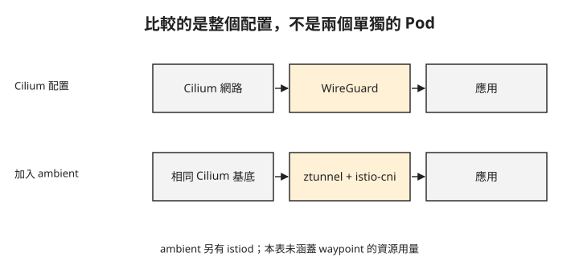

# Day 4：依需求比較 Istio 與 Cilium，先看證據涵蓋什麼

{ align=right width="64" }
{ align=right width="64" }

團隊準備決定服務通訊方案，有人拿出兩組數字：「ztunnel 只用 2Mi，Cilium agent 卻用 200Mi；但 Cilium 請求又比較快，該選哪個？」問題在於兩個元件負責的工作不同，量測也沒有包含所有功能。這章會從需求回看已完成的測試，判斷候選方案與下一個必須補的驗證。

## 先列出每個實驗真正回答的問題

[Day 1](sprint4-day1-envoy-gateway.md) 驗證外部入口，包含 hostname 路由與用戶端到 Envoy 的 HTTP/3。[Day 2](sprint4-day2-istio-ambient.md) 與 [Day 3](sprint4-day3-cilium-mesh.md) 則測試內部通訊，但它們的 HTTP 測試並不相同：Istio 測連線池限制，Cilium 測方法與路徑授權。

比較前，先把成功結果與未完成項目放回各自的需求：

| 需求 | Istio ambient 的證據 | Cilium 的證據 |
|---|---|---|
| 保護服務通訊 | ztunnel 紀錄呈現 HBONE 通道與兩端 SPIFFE 身分 | 跨節點 WireGuard 擷取中未見選定 Pod 流量的明文 |
| 工作負載相互身分驗證 | client/default ServiceAccount 身分出現在連線紀錄 | SPIRE 未就緒，未完成驗證 |
| HTTP 方法與路徑授權 | 本課未測試這組正反例 | `GET /` 成功，`GET /admin` 與 `POST /` 被拒絕 |
| HTTP 連線池限制 | waypoint 搭配 DestinationRule，出現 overload 訊號 | 本課未測試對等設定 |

表中的「未測試」不代表產品沒有能力。「SPIRE 未就緒」也只描述這組環境，不能直接變成所有部署的產品結論。你能據此安排下一個測試，但不能把空白欄當成正式能力排名。

## 比資源之前，先確定哪些元件會一起存在

Cilium 在本課同時提供 Pod 網路。採用 Istio ambient 時，Cilium 仍然存在，再額外加入 Istio 元件。因此 **增量成本**指在既有環境上新增的用量，不能拿新增元件與整套網路直接互相比較。

下圖把兩種測量配置並排。下排保留上排的 Cilium，再加入 ambient；HTTP waypoint 未列在這次資源數據中。

圖中的差別提醒你：ztunnel 的用量只是新增元件之一。若需求包含 Day 2 的 HTTP 連線池限制，還得計入 waypoint，不能用 2Mi 當成完整 mesh 的預算。

以下數據來自兩節點、低負載環境的 `kubectl top` 觀測。DaemonSet（表內標 DS）在每個節點各有一份；表中是元件 Pod 的觀測範圍，並非整個叢集加總。

| 配置 | 元件 | CPU | 記憶體 |
|---|---|---|---|
| Cilium | cilium agent DS | 41–280m | 約 200Mi |
| Cilium | cilium-envoy DS | 3m | 13Mi，L7 閒置 |
| Cilium | cilium-operator | 1–8m | 27–45Mi |
| 新增 ambient | ztunnel DS | 3–4m | 2Mi |
| 新增 ambient | istio-cni DS | 2–3m | 17Mi |
| 新增 ambient | istiod | 21m | 41Mi |

Cilium agent 的用量包含網路管理工作，不能全算成 mesh 的額外成本；同樣地，ztunnel 的 2Mi 不能代表 ambient 所有元件。正式容量規劃還需要實際負載下的變化與高峰，這份單次觀測只能提供起始參考。

從維護角度看，採用 ambient 也增加了 `istio-cni`、`ztunnel` 兩個 DaemonSet，以及控制平面 istiod。團隊需要管理共存設定、升級與故障檢查，這些工作不會出現在記憶體表裡。

## 延遲差 0.8ms，能支持多大的結論？

兩組延遲測試使用相同的跨節點 client→web 拓樸，各發出 60 次請求。測量值是 curl 的 **time_total**，包含該請求從開始到完成的用戶端經過時間，不是單一代理函式的執行時間。

**p50** 是一半樣本不超過的值，**p95** 則是一組樣本中約 95% 不超過的值。以下所有欄位單位都是毫秒：

| 配置 | 平均 | p50 | p95 |
|---|---:|---:|---:|
| Cilium L4 路徑，加上 WireGuard | 2.76 | 2.62 | 4.37 |
| 相同 Cilium 基底，再加入 Istio HBONE | 3.54 | 3.12 | 5.59 |

這兩批樣本的平均差為 0.78ms，約 0.8ms。它描述的是這次兩種配置的觀測差異；Istio 組仍包含底層 WireGuard，並非兩種互斥加密方案的比較。

這裡沒有多批重複測試、誤差估計或高並行測試，因此不能將 0.8ms 當成固定成本，也不能僅憑它證明差異完全來自使用者空間代理。更不能以這組 L4 路徑數字，宣稱加入 waypoint 後仍有相同結果。

## 把候選方案放回三種需求

### 已經使用 Cilium，只需要跨節點加密與 HTTP 存取規則

Day 3 已提供 WireGuard 與方法／路徑政策的正反例。可以先評估這條配置，並在自己的工作負載重做測試。若需求沒有服務身分驗證，就不要把尚未完成的 SPIRE 測試當成這個需求的必要條件；但若日後新增身分要求，必須重新評估。

### 需要工作負載身分，還需要 HTTP 連線池限制

Day 2 的 Istio ambient 已涵蓋這兩類功能，可作為優先驗證的候選配置。下一步要補上所需的授權政策、正式負載與 waypoint 成本。Cilium 仍提供底層網路，因此要一併維護兩套元件的相容設定。

### 已有 sidecar，正在考慮遷移

本課沒有量測 sidecar 的資源與延遲，也沒有完整列出遷移功能差異。不能用上面的表直接決定移除 sidecar。應先盤點目前使用的功能，再依目標版本確認 ambient 是否涵蓋，最後做小範圍遷移驗證。

這三種情境的差別在必要能力與待補證據。先找出不能缺少的功能，再比較完整配置的成本，比從單一數字推導全面選型可靠。

## 想一想

1. 你的服務要用 waypoint 執行 HTTP 政策，能否用「每節點增加 2Mi」估算總成本？還少了哪些元件？
2. 同事說「Cilium 不支援 HTTP 連線池限制，因為 Day 3 沒有測成功」，這個結論超出了哪一項證據？
3. 應用有嚴格延遲要求，這 60 次低負載樣本足以決定上線嗎？你會補哪種測試？

## 小結

入口、傳輸加密、工作負載身分與 HTTP 政策各有不同的驗證方式。選型時先確認功能是否滿足，再比較同一需求下的完整部署成本；單次資源與延遲數據無法代替容量或可靠性測試。到這裡，流量傳送過程已有保護，但應用執行時仍會處理明文。[Day 5](sprint4-day5-confidential-concepts.md) 將把問題移到執行環境：當宿主機管理者不在信任範圍內，還需要什麼保護？

## 延伸閱讀

想再深入，可以從這幾份開始：

- [Istio ambient](https://istio.io/latest/docs/ambient/)：目標版本的功能與部署方式。
- [Cilium Service Mesh](https://docs.cilium.io/en/stable/network/servicemesh/)：加密、身分與 HTTP 處理的功能範圍。

---

!!! quote ""
    Istio 與 Cilium 標誌為 CNCF（Linux Foundation）官方資產，此處作社群教學用途。數據來自本課程實測。
