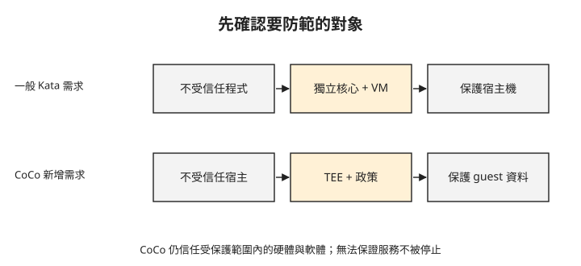

# Day 5：傳輸加密之後，誰能讀到處理中的資料？

{ align=right width="80" }

付款服務已使用加密連線，資料在網路上不會直接以明文傳送。但服務計算時仍要把資料解開；如果資料擁有者不希望宿主機管理者讀取這份明文，前幾章的網路保護還不夠。這章會先指出要防範的對象，再判斷一般 Kata 隔離與機密容器各能處理哪一段風險。

## 先寫清楚攻擊者與要保護的資料

**威脅模型**描述誰可能攻擊、要保護什麼，以及哪些元件仍受信任。對同一個「隔離 Pod」要求，團隊可能有兩種不同意思：平台希望不受信任的程式無法控制節點；資料擁有者則希望節點管理者不能讀取程式的私密資料。

這兩種需求都合理，但需要不同證據。先看一般容器：它使用宿主機核心，透過 namespace 等機制隔開工作負載。若需求是降低惡意程式利用共享核心影響宿主機的風險，可以考慮在工作負載與宿主機之間加入 VM 邊界。

**Kata Containers** 會把 Pod 放進具有自身核心的輕量 VM。VM 內的環境稱為 **guest**；管理 VM 執行的虛擬化層稱為 **hypervisor**。一般 Kata 的目標包含保護宿主機免受不受信任工作負載影響，但沒有提供「即使宿主機不可信，guest 記憶體仍保密」的保證。[Kata 威脅模型](https://github.com/kata-containers/kata-containers/blob/main/docs/threat-model/threat-model.md)

## 改變的是信任範圍

**Confidential Containers（CoCo，機密容器）**以機密 VM 隔開工作負載與不受信任的宿主環境。Kata 提供 Pod 與 VM 的整合基礎，CoCo 再結合硬體保護、guest 內政策與遠端證明流程。**遠端證明（remote attestation）**讓另一方驗證由硬體與執行環境產生的證據，再依政策決定是否釋出秘密。[CoCo 證明流程](https://confidentialcontainers.org/docs/attestation/)

guest 內的 **Kata Agent** 負責設定與控制 Pod。宿主會透過 Kata Agent API 發出操作請求，guest 內的政策則限制哪些請求可以執行，避免不受信任的宿主藉由這個介面觸發不允許的操作。[CoCo 跨越信任邊界的請求限制](https://confidentialcontainers.org/docs/architecture/trust-model/trust-model/#crossing-the-trust-boundary)

一般 Kata 提供獨立核心與 VM 邊界；機密容器還要求特定硬體與軟體組合，使宿主環境不能直接讀取受保護的 guest 私有記憶體明文。CoCo 的信任模型把 guest 外的 kubelet、containerd、宿主核心與 Kata shim 都列為不受信任，而 guest 內的核心、韌體與輔助元件仍在信任範圍內。[CoCo 信任模型](https://confidentialcontainers.org/docs/architecture/trust-model/trust-model/)

以 Kata Agent 為例：它在受保護的 guest 內管理 Pod，因此其安全性也是信任前提。若這類程式遭入侵，即使硬體仍阻止宿主直接讀取私有記憶體，也無法代替 guest 內程式本身的安全性。

因此不能把機密容器理解成「不需要信任任何人」。你仍依賴硬體機制、guest 軟體與驗證政策，也必須避免應用程式自己透過 API 或日誌洩漏資料。

## TEE 保護執行中的私有記憶體

**TEE（Trusted Execution Environment，可信執行環境）**提供硬體支援的隔離範圍。本課接下來使用 VM 層級的 TEE：AMD **SEV-SNP**；Intel **TDX** 是另一種 VM 層級技術。它們不只是在磁碟上加密檔案，而是保護 VM 執行時的記憶體與相關隔離屬性。實際保證依硬體平台與設定而異。

下圖分別列出兩種需求。重點是中間的保護機制及最右邊受保護的對象，而不是把「用了 VM」直接當成機密運算。

圖中一般 Kata 的 VM 邊界用來降低工作負載影響宿主的風險；CoCo 的 TEE 與 guest 政策則用來保護 guest 內的機密資料。

這項保護也不表示宿主機什麼都看不到。宿主環境仍負責排程 VM、提供網路與裝置，可以觀察部分外部行為，也可以不讓工作負載執行。拒絕服務並不因為記憶體受保護就消失；guest 主動輸出的資料也不會自動保密。[CoCo 信任範圍與限制](https://confidentialcontainers.org/docs/architecture/trust-model/trust-model/)

所以需求應寫成具體範圍，例如「解密金鑰只交給符合指定條件的 guest，私有記憶體不向宿主環境暴露明文」，而不是「用了 TEE 就完全安全」。

## 遠端服務如何知道這個 guest 符合條件？

資料擁有者不能只依工作負載提供的環境宣告，就判定它在符合條件的機密 VM 裡；交付秘密之前，需要透過遠端證明驗證執行環境。

這個流程至少分成取得證據、驗證證據、檢查政策、交付秘密。硬體證據涵蓋哪些開機元件，與容器映像是否另有簽章或政策驗證，必須分清楚；一份硬體報告不會自動證明應用程式邏輯正確。[CoCo 證明流程](https://confidentialcontainers.org/docs/attestation/)

Pod 的 Running 狀態不足以判定金鑰交付條件是否成立；「秘密只交給符合條件的環境」還需要另一套允許與拒絕測試。

## 主機觀測能力會在哪裡改變？

前面使用 eBPF 觀察宿主核心處理的封包與事件。工作負載改放進 VM 後，guest 的系統呼叫在 guest 核心內執行，不能再假定宿主機能用原來的方式直接觀測。同時，宿主機仍可能看到 VM 程序、外層網路流量與資源使用。

eBPF 與機密容器可以出現在同一個系統，只是觀測範圍受執行位置與信任邊界限制。若希望取得 guest 內的應用指標，需要在受信任環境內安排觀測與輸出方式，並確認輸出不洩漏原本要保護的資料。

## 想一想

1. 平台要執行不受信任的外掛程式，主要擔心容器逃逸。一般 Kata 能提供哪一層額外隔離？這是否同時保證宿主機讀不到資料？
2. Pod 已 Running，秘密服務是否就應該交付金鑰？還缺哪些判斷？
3. 宿主機能停止一台機密 VM，是否表示記憶體機密性已失效？這涉及哪種不同的安全要求？

## 小結

先指出攻擊者與資料位置，才能選對隔離機制。一般 Kata 提供獨立核心與 VM 邊界；CoCo 進一步結合 TEE、guest 政策及遠端證明，保護不受信任宿主環境中的敏感工作負載。[Day 6](sprint4-day6-kata-sandboxing.md) 先驗證一般 Kata 的執行環境，[Day 7](sprint4-day7-katacc.md) 再加入機密運算硬體，[Day 8](sprint4-day8-attestation.md) 則檢查秘密是否依證明結果釋出。

## 延伸閱讀

想再深入，可以從這幾份開始：

- [Kata 威脅模型](https://github.com/kata-containers/kata-containers/blob/main/docs/threat-model/threat-model.md)：工作負載與宿主的隔離需求。
- [CoCo 信任模型](https://confidentialcontainers.org/docs/architecture/trust-model/trust-model/)：guest 內外的信任範圍與不涵蓋的攻擊。
- [AKS 機密容器總覽](https://learn.microsoft.com/en-us/azure/aks/confidential-containers-overview)：本課後續使用的整合方式。

---

!!! quote ""
    Kubernetes 標誌為 CNCF（Linux Foundation）官方資產，此處作社群教學用途。
