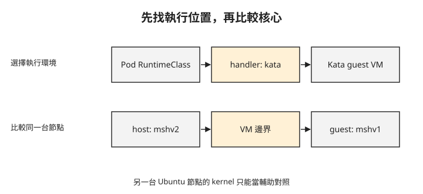

# Day 6：確認 Kata Pod 使用的是哪個核心

{ align=right width="80" }

一個 Pod 已經 Running，進去查看行程時也看不到宿主機程序。這能證明它使用 Kata 的 VM 隔離嗎？一般容器的 PID namespace 也會有類似結果。這章會沿著 RuntimeClass 找到節點 runtime，再對照 guest 與實際宿主機的核心，判斷工作負載是否使用預期的執行環境。

## 準備可執行 Kata 的節點

延續 [Day 5](sprint4-day5-confidential-concepts.md) 的威脅模型，本章處理的是不受信任工作負載影響宿主機的風險。一般容器共享宿主核心；Kata 在工作負載與宿主機之間加入 VM 邊界，降低不受信任程式利用共享核心影響宿主機的風險。[AKS Pod Sandboxing 隔離機制](https://learn.microsoft.com/en-us/azure/aks/use-pod-sandboxing#how-it-works)

前面已學過 RuntimeClass → handler → containerd runtime → shim 的關係。這次使用的 RuntimeClass 是 `kata-vm-isolation`，handler 是 `kata`；它會透過 Kata 建立具有自身核心的輕量 VM。

本章採用 AKS Pod Sandboxing，節點池使用 Azure Linux 與支援巢狀虛擬化的第 2 代 VM。**巢狀虛擬化**讓本身已是 VM 的 AKS 節點，仍能建立 Kata 的 guest VM。可選用 `Standard_D4s_v3` 作為練習機型；若要換成其他 SKU（雲端機型代碼），也須符合上述條件，並依[AKS 官方文件](https://learn.microsoft.com/en-us/azure/aks/use-pod-sandboxing)確認目標區域的可用機型與限制。

以下命令會新增一個計費節點池。`<resource-group>` 與 `<cluster>` 請使用現有練習叢集的資源群組與名稱；這裡沿用前幾章的自管 Cilium 網路。AKS Pod Sandboxing 只支援 Azure Linux，因此 `--os-sku AzureLinux` 與 `--workload-runtime KataVmIsolation` 都是這個配置的必要設定：

```bash
az aks nodepool add -g <resource-group> --cluster-name <cluster> \
  --name katapool --mode User \
  --os-sku AzureLinux --workload-runtime KataVmIsolation \
  --node-vm-size Standard_D4s_v3 --node-count 1
```

節點建立後，先核對節點 Ready、Cilium 是否涵蓋新節點，以及節點公布的 runtime handler。以下是觀測結果；`<kata-node>` 指新 Kata 節點，最後一個 jsonpath 以省略號表示欄位摘要，不是可直接執行的完整查詢：

清單中的 `kata-cc` 是供機密容器使用的 handler，本章使用的是 `kata`。列出 `kata-cc` 不代表節點具備機密運算硬體，相關要求見[進入 Day 7 前的硬體條件](#day7-hardware)。

```console
$ kubectl get nodes -o wide
aks-katapool-…-vmss000000    Ready   …   Microsoft Azure Linux 3.0   6.6.137.mshv2-1.azl3   containerd://2.2.4
aks-nodepool1-…-vmss000006   Ready   …   Ubuntu 24.04.4 LTS          6.8.0-1063-azure       containerd://2.3.3-2

$ kubectl -n kube-system get ds cilium
desired=3  ready=3            ← Cilium DaemonSet 涵蓋了新的 Kata 節點

$ kubectl get node <kata-node> -o jsonpath='{…runtimeHandlers}'
kata kata-cc runc untrusted   ← 注意這一行,連 kata-cc 都預先在了
```

Azure Linux 與 Ubuntu 節點在同一個叢集共存，各自有不同核心與 containerd 版本。Cilium desired 與 ready 都是 3，表示 DaemonSet 已涵蓋新節點，但應用的網路是否通仍要另外測試。

## 把 Pod 核心與它所在的宿主機比較

接下來的檢查以 `kata-lab` 裡兩個已部署的測試 Pod 為前提：`isolated-pod` 指定 `runtimeClassName: kata-vm-isolation`，排在 Kata 節點；`normal-pod` 不指定 Kata，排在一般 Ubuntu 節點。兩者都需要包含 `uname` 與網路測試工具的映像。部署方式可依官方 Pod Sandboxing 範例，並先確認各 Pod 實際排程到哪個節點。

下圖將已學過的 runtime 選擇接到 Kata VM。要驗證核心，須把圖中最右側的 guest 與承載它的 Kata 節點比較。



讀取兩個 Pod 的核心版本，得到以下結果：

```console
$ kubectl -n kata-lab exec isolated-pod -- uname -r
6.6.137.mshv1-1.azl3          ← Microsoft Hypervisor 的 guest kernel

$ kubectl -n kata-lab exec normal-pod -- uname -r
6.8.0-1063-azure              ← Ubuntu 主機 kernel
```

一般 Pod 的 `6.8.0-1063-azure` 與 Ubuntu 節點一致。更重要的是：Kata Pod 為 `6.6.137.mshv1-1.azl3`，它實際所在的 Azure Linux 宿主機則是前一段輸出的 `6.6.137.mshv2-1.azl3`。同一個 Kata 節點上的 guest 與 host 核心不同，配合 runtime 與排程資訊，支持它使用獨立核心的判斷。

只比較位於不同 OS 節點的兩個 Pod，證據會不足：兩個一般容器若分別排在不同核心的節點，也可能得到不同的 `uname`。同樣地，行程數很少也不能區分 Kata 與一般容器。

這是執行環境的檢查，尚未提供機密 VM 的遠端證明，也沒有測試宿主機無法讀取 guest 私有記憶體。

## 再確認跨節點、DNS 與 Service 路徑

獨立核心的 Pod 仍要與叢集其他服務通訊。以下結果分別檢查跨節點 ICMP、DNS 解析，以及 Kubernetes Service 的 HTTPS 回應：

```console
# kata pod (10.0.2.202) → normal-pod (10.0.1.103),跨節點跨池
2 packets transmitted, 2 received, 0% packet loss, rtt avg 3.016 ms

# DNS
$ nslookup kubernetes.default.svc.cluster.local  →  10.0.0.1
# Service(API server)
$ curl -sk https://kubernetes.default/healthz     →  http_code=401
```

Ping 兩次成功，表示選定的跨節點路徑可達；DNS 回覆 Service IP，表示名稱解析可用。最後的 401 是 API server 的未授權回應，支持「請求抵達服務」的判斷，並不代表應用取得了存取權限。

其中 curl 使用 `-k`，略過憑證驗證；因此不能把這筆測試當成伺服器憑證已被正確驗證。這組結果也只涵蓋選定流量，不代表所有 Cilium 政策或 Kata 網路功能都已測完。

## 回到節點確認 handler 的設定

最後要確認 `kata` handler 如何對應到 runtime。下列節錄是在 Kata 節點上的檢查 Pod 讀取宿主機設定；`/host` 是該檢查 Pod 掛載的宿主檔案系統。一般應用 Pod 不會自動擁有這個掛載或權限。

節錄也包含供 Day 7 對照的 `kata-cc` 設定。其中 `snapshotter` 指定管理容器檔案系統快照的元件，`tardev` 是此設定選用的元件名稱；本章只需確認 `kata` 的對應關係。[containerd snapshotter 說明](https://github.com/containerd/containerd/blob/main/docs/snapshotters/README.md)

```console
$ grep -nE "kata|runtime_type" /host/etc/containerd/config.toml
[plugins."io.containerd.grpc.v1.cri".containerd.runtimes.kata]
  runtime_type = "io.containerd.kata.v2"
  [.kata.options] ConfigPath = "/usr/share/defaults/kata-containers/configuration.toml"

[plugins."io.containerd.grpc.v1.cri".containerd.runtimes.kata-cc]
  snapshotter = "tardev"
  runtime_type = "io.containerd.kata-cc.v2"
  [.kata-cc.options] ConfigPath = "…/configuration-clh-snp.toml"
```

先找 `runtimes.kata`，再讀 `runtime_type = "io.containerd.kata.v2"`。**ConfigPath** 指定 Kata 使用的配置檔。這份輸出是縮寫節錄，包含省略路徑與簡寫 options 標題，不能複製回節點當成完整 TOML。

`runtimes.kata-cc` 則使用另一個 runtime type、snapshotter 與配置檔。這只代表映像準備了設定；是否能執行仍取決於節點硬體與完整配置。

## 進入 Day 7 前的硬體條件 {#day7-hardware}

本章只要求執行 `kata-vm-isolation`，不需要機密運算硬體。進入 [Day 7](sprint4-day7-katacc.md) 執行 `kata-cc` 前，須依該章的節點要求準備硬體，並檢查 RuntimeClass 與平台設定。`Standard_D4s_v3` 不具備下一章需要的機密容器硬體條件；即使 handler 清單與配置檔已有 `kata-cc`，仍不能取代硬體驗證。

## 想一想

1. 兩個一般容器分別排在不同版本核心的節點，`uname` 不同，可以據此宣稱用了 Kata 嗎？應補哪個對照？
2. `runtimeHandlers` 已有 `kata-cc`，為什麼還不能執行機密容器？
3. API server 回 401，這筆測試證明了什麼？它是否證明身分與憑證都驗證成功？

## 小結

驗證 Kata 時，要把排程位置、RuntimeClass、節點 handler 與實際宿主核心連起來，再確認應用網路路徑。這章的證據支持獨立 guest 核心與選定網路路徑可用；它沒有提供記憶體機密性的保證。[Day 7](sprint4-day7-katacc.md) 會改用符合條件的機密運算節點與 kata-cc，進一步檢查機密執行路徑的平台設定。

## 延伸閱讀

想再深入，可以從這幾份開始：

- [AKS Pod Sandboxing](https://learn.microsoft.com/en-us/azure/aks/use-pod-sandboxing)：節點與 Pod 的部署前提。
- [Kata Containers](https://katacontainers.io/)：VM 隔離的架構。
- [Sprint 3 Day 1](sprint3-day1-three-generations.md)：RuntimeClass 與節點 runtime 的關係。

---

!!! quote ""
    Kubernetes 標誌為 CNCF（Linux Foundation）官方資產，此處作社群教學用途。
