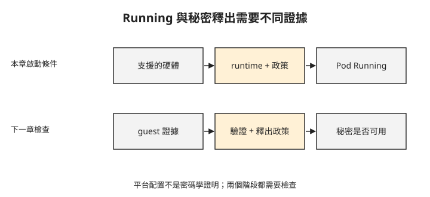

# Day 7：為 kata-cc 準備硬體、runtime 與安全政策

{ align=right width="80" }

上一章的節點已有 `kata-cc` handler，卻不代表把 Pod 的 RuntimeClass 改掉就能使用機密容器。硬體是否支援、節點是否配置對應 runtime、guest 是否允許這個 Pod 的操作，都會影響啟動。這章會逐項核對這些條件，並分清平台設定與遠端密碼學證明。

## 先找能建立機密 child VM 的節點

AKS 的 kata-cc 路徑會為 Pod 建立機密 **child VM**，也就是在節點之下執行的 SEV-SNP guest。節點必須支援這種部署方式；一般機密 VM 與可建立機密 child VM 的機型不能只看名稱相近就互換。

本課使用的 **SKU（雲端機型代碼）**是 `Standard_DC4as_cc_v5`，屬於 Azure 為這條路徑提供的系列。以下查詢範例檢查指定區域與機型的可用區資訊：

```console
$ az vm list-skus -l westeurope --size Standard_DC4as_cc_v5 \
    --query "[?name=='Standard_DC4as_cc_v5'].locationInfo[0].zones" -o tsv
3	1	2                     ← westeurope 有,還有三個可用區
```

有可用區資訊，不等於你的訂閱已有足夠配額或當下有容量。查詢時還要確認限制與配額。原驗證在 `japaneast` 無法建立這個 SKU，改在 `westeurope` 完成；這是當時的結果，不能當成今天的區域供應清單。

## 使用標準系統池，再加入 kata-cc 使用者池

下面是已驗證的建立方式，會產生計費資源。`<rg>` 與 `<cluster>` 分別是你選定的資源群組及叢集名稱。命令保留驗證使用的 Kubernetes 1.34；實作前需確認目標區域仍提供與 kata-cc 相容的版本，不能把歷史版本直接當成永久可用。

命令中的 OIDC issuer 提供身分權杖的簽發者資訊，workload identity 則讓工作負載以聯合身分使用 Azure 服務；它們是下一章存取金鑰服務的前提，不等同於 TEE 證明。

```bash
# 1) 標準系統池(Ubuntu 小節點)+ OIDC + workload identity
az aks create -g <rg> -n <cluster> --location westeurope --tier free \
  --kubernetes-version 1.34 \
  --os-sku Ubuntu --node-vm-size Standard_D2as_v5 --node-count 1 \
  --enable-oidc-issuer --enable-workload-identity

# 2) kata-cc 當 user 池(AzureLinux + KataCcIsolation + DC4as_cc_v5)
az aks nodepool add -g <rg> --cluster-name <cluster> --name katacc --mode User \
  --os-sku AzureLinux --workload-runtime KataCcIsolation --node-vm-size Standard_DC4as_cc_v5

# 3) 官方要求:加池後跑一次 update 才會啟用 CC 功能(RuntimeClass 這時才出現)
az aks update -g <rg> -n <cluster>
```

先用一般系統池建立叢集，再把 `KataCcIsolation` 加為使用者池。`az aks update` 是此驗證流程啟用機密容器整合的一步。完成後，檢查節點與 RuntimeClass：

```console
$ kubectl get node -l agentpool=katacc -o wide
aks-katacc-…   Ready   CBL-Mariner/Linux   5.15.157.mshv1-2.cm2   containerd://1.7.7

$ kubectl get runtimeclass | grep kata-cc
kata-cc-isolation   kata-cc    ← az aks update 之後才出現
```

`kata-cc-isolation` 的 handler 是 `kata-cc`，節點也已 Ready。這仍只是平台狀態；下一步要讓指定這個 RuntimeClass 的 Pod 真正啟動。

這組環境使用預設 AKS 網路，沒有沿用 Day 6 的 BYOCNI Cilium。因此本章結果不代表已驗證 Cilium 與 kata-cc 的組合。

## 政策要先描述允許的操作

機密 guest 不應無條件接受宿主端送來的操作。**安全政策**用來限制 guest agent 可以執行哪些請求；**OPA/Rego**是這裡使用的政策引擎與規則語言。

先準備 `pod.yaml`：Pod 使用 `runtimeClassName: kata-cc-isolation`、排程到對應節點池，並包含預定的映像、指令與環境變數。接著依 manifest 產生政策，而不是先部署一個沒有政策的 Pod。原驗證中，沒有政策時收到以下 sandbox 錯誤：

```console
Failed to create pod sandbox: … UpdateInterfaceRequest: internal error query did not produce any values
```

`UpdateInterfaceRequest` 是 guest agent 設定網路介面的請求名稱。這組失敗與缺少政策有關；相同文字出現在其他環境時，仍要核對政策，不能僅憑訊息一律判定 CNI 故障。

`az confcom katapolicygen` 會依 manifest 產生政策，注入 `io.katacontainers.config.agent.policy` annotation。原驗證使用的 macOS 工具回報：

```console
$ az confcom katapolicygen -y pod.yaml
ERROR: The katapolicygen subcommand for MacOS has not been implemented.
```

若工具仍有相同限制，可以使用 Linux 環境產生政策。以下已驗證方式要求本機已安裝且啟動 Podman，並把工作目錄的 `pod.yaml` 送進 Linux 容器：

```bash
podman run --rm --platform linux/amd64 -i mcr.microsoft.com/azure-cli sh -c '
  az extension add -n confcom -y
  cat > /tmp/pod.yaml
  az confcom katapolicygen -y /tmp/pod.yaml
  cat /tmp/pod.yaml
' < pod.yaml > pod-policy.yaml
```

這裡的 `/tmp/pod.yaml` 位於可丟棄的容器內，輸入與輸出則是本機的 `pod.yaml`、`pod-policy.yaml`。部署前要確認輸出仍是有效 YAML、政策 annotation 已加入，並檢查政策與預定映像、命令及環境變數一致。這個未釘版本的工具映像與擴充套件會隨時間改變，升級後需重新檢查產物。

若先前已建立沒有政策的 Pod，需先刪除它，再用產出的 manifest 建立；只更新手邊的 YAML 不會重建既有 sandbox。已套用政策的 Pod 在驗證中正常執行：

```console
$ kubectl -n cc-lab get pod cc-pod -o wide
cc-pod   1/1   Running   …   runtimeClass=kata-cc-isolation   node=aks-katacc-…
```

Running 表示這組硬體、runtime 與政策能完成啟動。它尚未回答遠端金鑰服務是否接受這個 guest。

## 讀取平台設定，保留證據層級

下圖列出啟動所需條件，並把下一章的證明與秘密釋出分開。先完成上排，才有可供後續驗證的 guest。



本章進一步檢查節點上的 containerd 設定，確認 `kata-cc` 指向對應 runtime 與 SEV-SNP 配置：

```console
# 節點:AzureLinux/Mariner、SEV-SNP DC4as_cc_v5
# containerd 設定裡,kata-cc handler 指向 Cloud Hypervisor + SEV-SNP 的設定
[plugins."io.containerd.grpc.v1.cri".containerd.runtimes.kata-cc]
  snapshotter = "tardev"
  runtime_type = "io.containerd.kata-cc.v2"
  [.kata-cc.options] ConfigPath = "…/configuration-clh-snp.toml"
                                                        ↑ clh = Cloud Hypervisor,snp = SEV-SNP
```

`clh` 表示 Cloud Hypervisor，`snp` 對應 SEV-SNP。這份縮寫輸出、節點 SKU 與 Pod RuntimeClass 共同顯示預期的平台執行路徑；它不是由獨立驗證方確認的硬體證據，不能單靠檔名證明所有記憶體保護屬性。

本章沒有取得 guest 內的 SNP report，也沒有直接測試宿主讀取私有記憶體失敗。遠端驗證與金鑰釋出會在 [Day 8](sprint4-day8-attestation.md) 接續。

## 疑難排解

### 指定區域無法建立 _cc_v5 節點 {#mine-1}

若收到 `VMSizeNotSupported`，核對所需機型、區域、訂閱限制與配額。可用其他區域時，需在該區域準備叢集；不要用一般 `DCas_v5` 直接替換 kata-cc 所需的 child VM 機型。

### 初始節點 bootstrap 回 curl 404 {#mine-2}

驗證曾在 kata-cc 作初始系統池、Kubernetes 1.35.6 的組合遇到下載失敗；改成前述標準系統池、kata-cc 使用者池與 1.34 後完成。這同時改了多個條件，因此不能斷言唯一原因是池角色。遇到問題要依 bootstrap 訊息與當前支援版本檢查，不要把歷史 workaround 視為永久規則。

### Pod 停在 ContainerCreating，出現 UpdateInterfaceRequest 錯誤 {#mine-3}

先確認政策 annotation 是否存在，內容是否由正確 manifest 產生。本章的無政策案例因 guest agent 拒絕請求而失敗；修正方式見前面的政策產製與重建步驟。

### katapolicygen 回報 macOS 未實作 {#mine-4}

使用前述 Linux 容器產製方式。這是驗證時工具版本的限制；更新工具後，以實際支援情況為準。

### Pod Running，卻不能 exec 或讀取 logs {#mine-5}

預設政策可拒絕 `ExecProcessRequest` 與 `ReadStreamRequest`，分別影響執行命令與讀取串流。這不是 Pod 沒啟動。若確實需要除錯存取，要先評估允許範圍、重產政策並重建 Pod；政策改變也會影響下一章綁定的政策雜湊。

## 想一想

1. 節點名稱、SKU 與配置檔都符合預期，這是否等同遠端金鑰服務已驗證 guest？
2. 原 Pod 沒有政策而啟動失敗，你只修改本機 YAML 後再次查看同一個 Pod，為什麼狀態可能不變？
3. 開放 exec 後重新產生政策，下一章的秘密釋出規則可能需要重新檢查什麼？

## 小結

kata-cc 的啟動需要合適的機型、runtime 整合與 guest 安全政策。平台資訊可以確認配置方向，Running 可以確認啟動成功，但兩者都不能取代遠端證明。接下來會讓金鑰服務依證據與政策決定是否釋出金鑰，並用允許與拒絕兩種結果檢查條件。

## 延伸閱讀

想再深入，可以從這幾份開始：

- [AKS 機密容器部署](https://learn.microsoft.com/en-us/azure/aks/deploy-confidential-containers-default-policy)：環境與部署前提。
- [DCasccv5 機型](https://learn.microsoft.com/en-us/azure/virtual-machines/sizes/general-purpose/dcasccv5-series)：機密 child VM 硬體條件。
- [機密容器安全政策](https://learn.microsoft.com/en-us/azure/confidential-computing/confidential-containers-aks-security-policy)：政策產製與 guest 操作限制。

---

!!! quote ""
    Kubernetes 標誌為 CNCF（Linux Foundation）官方資產，此處作社群教學用途。
