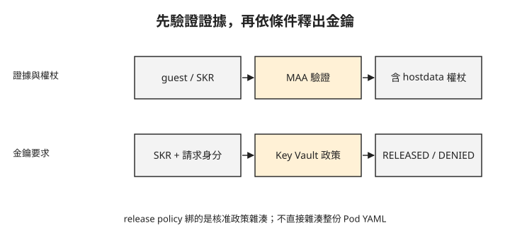

# Day 8：兩個 Pod 都 Running，為什麼只有一個拿得到金鑰？

{ align=right width="80" }

兩個 kata-cc Pod 都能啟動，也都使用各自有效的安全政策。但資料擁有者只願意把金鑰交給其中一份核准政策。這章會讓金鑰服務比較證明中的政策雜湊，並用允許與拒絕兩次結果，區分「能執行」與「能取得秘密」。

## 先認識誰驗證、誰決定釋出

**MAA（Microsoft Azure Attestation）**驗證執行環境提供的證據，並簽發包含 **claim（已簽署屬性）**的權杖。**SKR（Secure Key Release）**sidecar 協助工作負載取得證明並向 Key Vault 要求金鑰。

Key Vault 的 **release policy（金鑰釋出政策）**則指定：接受哪個證明服務，以及權杖中哪些屬性必須符合條件。這和 Day 7 限制 guest agent 操作的安全政策，是兩份不同用途的政策。

先沿著下圖看證據與決策的方向。金鑰是否釋出，由 Key Vault 根據請求者權限及 release policy 判斷，不是 Pod 自己宣告。



工作負載身分回答「誰在向 Azure API 發出請求」，證明與 release policy 回答「這個執行環境是否符合金鑰持有者的要求」。只完成其中一項不夠。

## 準備金鑰服務與工作負載身分

本章沿用 Day 7 的 kata-cc 環境，以及已啟用的 OIDC issuer 與 workload identity。下列命令建立 Key Vault Premium、MAA 與 managed identity，會產生 Azure 資源。

`<rg>`、`<kv>`、`<maa>`、`<mid>` 分別是資源群組與三種資源名稱；名稱須符合 Azure 規則。`<叢集 OIDC issuer>` 取自 AKS 的 OIDC issuer URL；`<mid client id>`、`<mid principal>` 分別取 managed identity 的 clientId、principalId；`<kv id>` 是 Key Vault 的完整資源 ID。不要把這三種 ID 互換。

```bash
# Key Vault Premium(HSM 金鑰)、MAA 證明服務、managed identity
az keyvault create -g <rg> -n <kv> --sku premium --enable-rbac-authorization true
az attestation create -g <rg> -n <maa> -l westeurope
az identity create -g <rg> -n <mid>

# workload identity:managed identity ↔ 叢集 OIDC ↔ k8s service account
az identity federated-credential create --name skr-fic --identity-name <mid> -g <rg> \
  --issuer "<叢集 OIDC issuer>" --subject "system:serviceaccount:cc-lab:skr-sa" \
  --audience api://AzureADTokenExchange
kubectl create sa skr-sa -n cc-lab
kubectl annotate sa skr-sa -n cc-lab azure.workload.identity/client-id=<mid client id>

# 給 managed identity Key Vault 的密鑰角色
az role assignment create --role "Key Vault Crypto Officer" --assignee-object-id <mid principal> --scope <kv id>
az role assignment create --role "Key Vault Crypto User"    --assignee-object-id <mid principal> --scope <kv id>
```

聯合身分設定把 `cc-lab/skr-sa` 這個 ServiceAccount 連到 managed identity。consumer Pod 也必須指定此 ServiceAccount，並依 workload identity 的要求啟用注入，才能使用這條身分路徑。

以上保留練習時的兩個角色指派。`Crypto Officer` 包含金鑰管理權限，不能將這組寬權限配置直接視為正式環境的最小權限設計。實際部署應分開管理金鑰的人與只需要求釋出的工作負載，確認各自操作權限；本課未驗證最小角色組合。

## 先產生政策，再計算它的雜湊

本章的 **hostdata** 是 SNP 證據中用來綁定安全政策雜湊的欄位。**SHA-256** 將政策內容轉成固定長度的摘要；只要政策位元組改變，摘要通常也會改變。它不是完整 Pod YAML 的直接雜湊。

準備包含 app 與 `mcr.microsoft.com/aci/skr:2.7` 的 consumer manifest，使用 `kata-cc-isolation` 與 `skr-sa`，再依 [Day 7](sprint4-day7-katacc.md) 的方式產生政策，保存為 `consumer-policy.yaml`。app 需呼叫 SKR 的 `/key/release`，提供 MAA endpoint、Key Vault endpoint 與金鑰 ID；請求格式見 [SKR API](https://github.com/microsoft/confidential-sidecar-containers/blob/main/cmd/skr/README.md)。

以下取出 annotation、解碼，再計算政策雜湊。這個抽取方式假設 annotation 是單行、沒有額外引號的輸出格式；開始前須確認只抽到一份非空的 base64 內容，解碼成功且是完整政策。

```bash
# 政策注入 consumer manifest 後,在 macOS 本機算:
POLICY_B64=$(grep 'agent.policy:' consumer-policy.yaml | sed 's/.*policy: //')
printf '%s' "$POLICY_B64" | base64 -d | shasum -a 256
# → ca8442bb3d17f7d85556b5c21682db11f2313cdbe3db1adcd27c89c3f88e720d
```

範例的 64 位十六進位值來自這份政策，你自己的結果通常不同。不要複製範例雜湊代替實際產物；也不要只因 `shasum` 印出值，就假定前面的抽取與解碼成功。

## 把核准的政策雜湊綁到金鑰

以下 release policy 限定可信任的 MAA authority、證明類型，以及 hostdata。保存為 `release-policy.json` 前，必須把 authority 換成 MAA 資源實際提供的完整 attestation URI；hostdata 的 `ca8442bb…720d` 是縮寫，**必須換成上一步完整的 64 位雜湊**。

```json
{
  "version": "1.0.0",
  "anyOf": [{
    "authority": "https://<maa>.weu.attest.azure.net",
    "allOf": [
      { "claim": "x-ms-attestation-type", "equals": "sevsnpvm" },
      { "claim": "x-ms-sevsnpvm-hostdata", "equals": "ca8442bb…720d" }
    ]
  }]
}
```

接著建立允許依政策匯出的 HSM 金鑰。`exportable` 是這個測試讓金鑰進入合格 guest 的前提，與一般不可匯出金鑰的使用方式不同。

```bash
az keyvault key create --vault-name <kv> -n skr-key --kty RSA-HSM --size 3072 \
  --exportable true --policy release-policy.json
```

金鑰現在綁定原政策。稍後建立變更版本時，這份 release policy 必須保持不變，才能做有意義的拒絕測試。

## 先驗證核准版本

部署已產生政策的 consumer Pod。app 向本 Pod 的 SKR sidecar 要求釋出金鑰，再把結果以狀態字串提供給叢集內的 TCP Service；回應內容應只有狀態，不能包含金鑰。`<service>` 是這個狀態服務的位址，並非 SKR API 本身。

原驗證透過狀態服務讀到：

```console
# app 內部:curl SKR → SKR 取 SEV-SNP report → MAA 簽 token(hostdata=ca8442bb…)
#           → workload identity 呼叫 Key Vault → release policy 相符 → 放金鑰
$ curl http://<service>/          →  RELEASED
```

`RELEASED` 是 app 整理後的結果，表示這組測試完成金鑰釋出。它不是原始 SNP report，也不是完整 MAA 權杖；驗證紀錄沒有提供 guest report 原文，因此這裡不把狀態字串當成可供獨立解析的硬體證據。

## 改環境變數，重新產生政策，再測拒絕

接著複製原 manifest，在 app 新增 `TAMPER=yes`，並**對變更後的 manifest 重新執行政策產生工具**。這一步不可省略：本章測試的是新政策能讓新 Pod 啟動，但它不在金鑰核准清單內。若只改 Pod、沿用舊政策，可能先被 guest agent 拒絕啟動，測到的會是另一個機制。

變更版政策的 SHA-256 如下：

```console
# 篡改版的政策 hash:
a07958c9891de4f177cf6f1bf207b75d1c6ee78250f8064b968308e730c912b0
# ≠ 金鑰綁定的 ca8442bb…720d
```

將變更版部署為另一個 Pod 與狀態 Service，並繼續要求同一把金鑰。金鑰的 release policy 仍綁原雜湊。結果是：

```console
$ kubectl get pod skr-tampered            →  2/2 Running   （自己的政策相符自己）
$ curl http://<tampered-service>/         →  DENIED
```

變更版 2/2 Running，表示它符合自己的啟動政策；狀態服務回 DENIED，則呈現它沒有取得金鑰。這組對照支持「釋出條件綁定核准的政策雜湊」；它沒有測試任意 Pod 欄位變更，也沒有保證所有欄位都會被政策產生器納入。

實作時若只有 DENIED，仍需區分 RBAC、證明服務、網路與 release policy 的拒絕原因。此處留存的是結果摘要，沒有原始 Key Vault 錯誤明細，不能把任意同名回應都直接歸因 hostdata。

## 疑難排解

### 建立 MAA 的命令逾時，資源狀態尚未就緒 {#mine-1}

用戶端逾時不代表雲端建立作業一定已停止。先檢查同一資源的 provisioning 狀態，再決定等待或重試，避免立即重複建立。給長時間作業足夠的等待時間，不要只以本機命令是否在兩分鐘內結束判定成功。

### 算出的 SHA-256 是空字串摘要 {#mine-2}

`e3b0c442…` 是空輸入的 SHA-256。驗證時曾因工具映像缺少抽取所用的程式，導致後段對空輸入計算。先檢查 annotation 抽取、base64 解碼與各命令狀態，再計算雜湊。換到本機計算能避開該容器工具缺口，仍不能省略輸入檢查。

### 預設政策不允許 exec 或 logs {#mine-3}

`ExecProcessRequest` 與 `ReadStreamRequest` 可被 guest 政策拒絕，見 [Day 7 的操作限制](sprint4-day7-katacc.md#mine-5)。本章以 app 主動提供 TCP 狀態服務觀察結果，並未開放這兩項操作。狀態服務與 consumer manifest 需事先準備，不能把範例中的 `<service>` 直接當成現成資源。

## 想一想

1. 新增環境變數後仍使用舊政策，Pod 在 sandbox 階段就失敗。這和本章 DENIED 對照測到的是同一件事嗎？
2. 你同時更新變更版政策與 Key Vault 核准雜湊，再看到 RELEASED，是否仍能驗證原本的拒絕條件？
3. 任意 YAML 欄位改變，都一定會改變 hostdata 嗎？應先檢查哪個產物？

## 小結

安全政策控制 guest 允許的操作，金鑰釋出政策則控制哪份已證明的政策可以取得秘密。本章先讓核准版本取得金鑰，再對變更 manifest 重產政策、保留原金鑰條件，觀察另一個可啟動 Pod 被拒絕。證據支持這組政策雜湊對照，範圍不應擴大成所有工作負載內容的全面保證。[Day 9](sprint4-day9-decision-matrix.md) 會據此整理部署選擇與移除後的檢查。

## 延伸閱讀

想再深入，可以從這幾份開始：

- [AKS 機密容器部署](https://learn.microsoft.com/en-us/azure/aks/deploy-confidential-containers-default-policy)：政策、身分與證明服務整合。
- [SKR sidecar API](https://github.com/microsoft/confidential-sidecar-containers/blob/main/cmd/skr/README.md)：金鑰釋出請求與設定。
- [MAA 概觀](https://learn.microsoft.com/en-us/azure/attestation/overview)：證據驗證與權杖角色。

---

!!! quote ""
    Kubernetes 標誌為 CNCF（Linux Foundation）官方資產，此處作社群教學用途。
