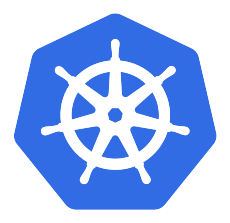
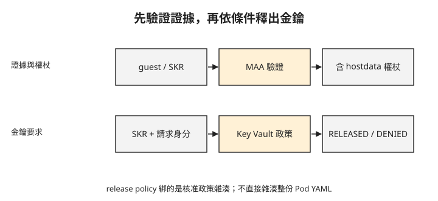

# Day 8：兩個 Pod 都 Running，為什麼只有一個拿得到金鑰？

{ align=right width="80" }

假設你負責一把解密金鑰，要交給跑在別人節點上的程式使用。Day 7 已經讓 kata-cc Pod 在 SEV-SNP 機密硬體上啟動，Pod 帶著自己的安全政策。但 Running 只說明平台把它跑起來了，沒有告訴你裡面跑的是不是你核准的那份工作負載。工作負載身分只回答「誰在向 Azure 發請求」，回答不了 Pod 裡跑的是哪一份政策。

這一章在金鑰上加一道條件：要金鑰的 Pod 得先證明自己跑的是哪一份安全政策，政策對得上才給。這章用兩個都能 Running 的 Pod 做對照，一個用核准的政策，另一個只多一個環境變數、重新產生政策，再看金鑰服務對兩者的回應。

讀完之後，遇到 Pod Running 卻拿不到金鑰，你會知道要比對哪兩個值，也知道拒絕還可能來自哪些地方。

## 開始之前

你需要 Day 7 的 kata-cc 叢集，包括 `cc-lab` namespace、已啟用的 OIDC issuer 與 workload identity，以及在 Podman 的 Linux 容器裡產生政策的做法。這章的指令會在 Azure 建立 Key Vault Premium、MAA 與 managed identity，這幾個名詞下面會逐一說明。

這章練的是設定金鑰的釋出條件，並看懂釋出與拒絕兩個結果。consumer Pod 的 manifest 和回報結果的狀態服務沒有附上，最後兩節只能做結果判讀；要自己部署，consumer 的寫法可以從 [AKS 機密容器部署](https://learn.microsoft.com/en-us/azure/aks/deploy-confidential-containers-default-policy) 的 `consumer.yaml` 改起。

## 金鑰放在哪裡、誰來檢查

金鑰放在 **Key Vault**，這是 Azure 管理金鑰、秘密與憑證的服務。Pod 要取用金鑰時，會透過同一個 Pod 裡的 **SKR（Secure Key Release）sidecar**：它負責取得執行環境的證明，再帶著證明向 Key Vault 要金鑰。

證明由 **MAA（Microsoft Azure Attestation）**檢查。SKR 把機密硬體產生的報告交給 MAA，MAA 驗過之後簽發一份權杖，權杖裡的每一項已簽署屬性叫做 **claim**。

Key Vault 拿到權杖後，照金鑰上的 **release policy（金鑰釋出政策）**判斷：權杖要來自哪個 MAA、哪些 claim 必須等於什麼值。這份政策跟 Day 7 那份限制 guest agent 操作的安全政策用途不同，前者管金鑰給誰，後者管 Pod 裡能做什麼。

下面這張圖把流程分成兩排。上排是證據怎麼變成權杖，下排是拿權杖要金鑰：



從圖上可以看到兩件事：

1. 上排的終點是一份帶 hostdata 的權杖。hostdata 是什麼、為什麼關鍵，算政策雜湊那一節會講。
2. 下排的 Key Vault 同時看兩樣東西：請求者的身分有沒有權限，以及權杖是否符合 release policy。工作負載身分回答「誰在向 Azure 發請求」，證明回答「這個執行環境是不是金鑰持有者要的那一個」，兩項都要過。

## 建立 Key Vault、MAA 與工作負載身分

這一節要準備三樣資源。**managed identity（受控識別）**是由 Azure 管理認證資訊的身分，Pod 用它向 Azure 服務證明自己是誰，程式裡不必存密碼。Key Vault 選 Premium，因為要用 **HSM（硬體安全模組）**保護的金鑰，HSM 在硬體裡儲存金鑰、執行密碼運算。

先建立三項資源。`<rg>`、`<kv>`、`<maa>`、`<mid>` 換成你的資源群組與三項資源的名稱，名稱要符合 Azure 的命名規則：

```bash
# Key Vault Premium(HSM 金鑰)、MAA 證明服務、managed identity
az keyvault create -g <rg> -n <kv> --sku premium --enable-rbac-authorization true
az attestation create -g <rg> -n <maa> -l westeurope
az identity create -g <rg> -n <mid>
```

接下來的聯合身分與角色指派，要用到四個建立後才有的值：叢集的 OIDC issuer URL、managed identity 的 clientId 與 principalId，以及 Key Vault 的完整資源 ID。後面寫 release policy 還要 MAA 的 attestation URI。先把它們查出來存進變數，名稱填剛才用的，`CLUSTER` 填 Day 7 的叢集名稱。[Workload Identity 官方文件](https://learn.microsoft.com/en-us/azure/aks/workload-identity-deploy-cluster?pivots=azure-cli&tabs=new-cluster)要求 Azure CLI 2.47.0 以上。

!!! note "依官方文件整理，未實跑"
    來源：[Workload Identity 部署](https://learn.microsoft.com/en-us/azure/aks/workload-identity-deploy-cluster?pivots=azure-cli&tabs=new-cluster)、[az identity show](https://learn.microsoft.com/en-us/cli/azure/identity?view=azure-cli-latest#az-identity-show)、[az keyvault show](https://learn.microsoft.com/en-us/cli/azure/keyvault?view=azure-cli-latest#az-keyvault-show)、[AKS 機密容器部署](https://learn.microsoft.com/en-us/azure/aks/deploy-confidential-containers-default-policy)（`attestUri` 查詢）

```bash
RG='<rg>'
CLUSTER='<aks-cluster-name>'
MID='<mid>'
KV='<kv>'
MAA='<maa>'

export OIDC_ISSUER=$(az aks show -g "$RG" -n "$CLUSTER" \
  --query oidcIssuerProfile.issuerUrl -o tsv)

export MID_CLIENT_ID=$(az identity show -g "$RG" -n "$MID" \
  --query clientId -o tsv)

export MID_PRINCIPAL_ID=$(az identity show -g "$RG" -n "$MID" \
  --query principalId -o tsv)

export KV_ID=$(az keyvault show -g "$RG" -n "$KV" \
  --query id -o tsv)

export MAA_URI=$(az attestation show -g "$RG" -n "$MAA" \
  --query attestUri -o tsv)
```

`KV_ID` 是 Vault 的資源 ID，[官方範例](https://learn.microsoft.com/en-us/azure/aks/deploy-confidential-containers-default-policy)也是用 `az keyvault show --query id` 取得角色指派的 `--scope`；金鑰 ID 和 Vault URL 不能拿來代替。

有了這些值，就可以把 Kubernetes 的 ServiceAccount 和 managed identity 接起來。聯合身分（federated credential）告訴 Azure：叢集 OIDC issuer 簽給 `cc-lab/skr-sa` 的權杖，可以換成這個 managed identity 的身分。接著建立 ServiceAccount，並在 annotation 寫上 managed identity 的 clientId。最後給 managed identity Key Vault 的兩個角色。

!!! note "修正版未重跑"
    和下方原指令差在 `--identity-name`、`-g`、`--issuer`、`client-id`、`--assignee-object-id`、`--scope` 改從上一段的變數帶入。

```bash
az identity federated-credential create --name skr-fic --identity-name "$MID" -g "$RG" \
  --issuer "$OIDC_ISSUER" --subject "system:serviceaccount:cc-lab:skr-sa" \
  --audience api://AzureADTokenExchange
kubectl create sa skr-sa -n cc-lab
kubectl annotate sa skr-sa -n cc-lab azure.workload.identity/client-id="$MID_CLIENT_ID"

az role assignment create --role "Key Vault Crypto Officer" --assignee-object-id "$MID_PRINCIPAL_ID" --scope "$KV_ID"
az role assignment create --role "Key Vault Crypto User"    --assignee-object-id "$MID_PRINCIPAL_ID" --scope "$KV_ID"
```

下面是修正前的寫法，以佔位符代替上面那幾個變數。照上面的區塊打就不必再執行這一段：

```bash
# workload identity:managed identity ↔ 叢集 OIDC ↔ k8s service account
az identity federated-credential create --name skr-fic --identity-name <mid> -g <rg> \
  --issuer "<叢集 OIDC issuer>" --subject "system:serviceaccount:cc-lab:skr-sa" \
  --audience api://AzureADTokenExchange
kubectl create sa skr-sa -n cc-lab
kubectl annotate sa skr-sa -n cc-lab azure.workload.identity/client-id=<mid client id>

# 給 managed identity Key Vault 的密鑰角色
az role assignment create --role "Key Vault Crypto Officer" --assignee-object-id <mid principal> --scope <kv id>
az role assignment create --role "Key Vault Crypto User"    --assignee-object-id <mid principal> --scope <kv id>
```

這條身分路徑只對指定 `skr-sa` 的 Pod 有效。consumer Pod 要寫 `serviceAccountName: skr-sa`，並依 workload identity 的要求啟用注入；[官方範例](https://learn.microsoft.com/en-us/azure/aks/deploy-confidential-containers-default-policy)的做法是在 Pod 加上 `azure.workload.identity/use: "true"` 標籤。

這裡讓同一個 managed identity 同時拿兩個角色。`Crypto Officer` 帶金鑰管理權限，`Crypto User` 用來使用金鑰。正式環境要把管理金鑰的人和只需要求釋出的工作負載分開指派，各自只給需要的權限。

## 產生 consumer 的政策，算出它的雜湊

consumer Pod 裡有兩個容器：你的 app 和 SKR sidecar（`mcr.microsoft.com/aci/skr:2.7`）。manifest 要寫好這幾項，再依 [Day 7](sprint4-day7-katacc.md) 的方式產生政策，存成 `consumer-policy.yaml`：

- `runtimeClassName: kata-cc-isolation` 與 `serviceAccountName: skr-sa`。
- app 呼叫 SKR 的 `/key/release`，帶上 MAA endpoint、Key Vault endpoint 與金鑰 ID，請求格式見 [SKR API](https://github.com/microsoft/confidential-sidecar-containers/blob/main/cmd/skr/README.md)。
- app 把結果（`RELEASED` 或 `DENIED`）用 `nc -l` 掛在一個 TCP 埠，再配一個 Service，從叢集內用 ClusterIP 讀。kata-cc 的預設政策不允許 `kubectl exec` 和 `logs`，所以結果要由 app 主動提供，見[疑難排解](#mine-3)。

release policy 要比對的值叫 **hostdata**，是 SNP 硬體報告裡用來綁定安全政策雜湊的欄位。雜湊用的是 **SHA-256**：它把一段內容轉成固定 64 位十六進位的摘要，內容改了一個位元組，摘要通常就會不同。要注意雜湊的對象是解碼後的政策內容，不是整份 Pod YAML。

政策產生工具會把政策以 base64 放進 manifest 的 `io.katacontainers.config.agent.policy` annotation。下面在本機把它取出、解碼，再算雜湊。如果你照 Day 7 在 Podman 容器裡產生政策，雜湊要改在本機算，原因見[疑難排解](#mine-2)：

```bash
# 政策注入 consumer manifest 後,在 macOS 本機算:
POLICY_B64=$(grep 'agent.policy:' consumer-policy.yaml | sed 's/.*policy: //')
printf '%s' "$POLICY_B64" | base64 -d | shasum -a 256
# → ca8442bb3d17f7d85556b5c21682db11f2313cdbe3db1adcd27c89c3f88e720d
```

`# →` 後面那串是這份政策的雜湊。你的 manifest 跟這裡不同，算出來的值也會不同，下一節要綁到金鑰上的是你自己的值。

`grep` 和 `sed` 這兩段假設 annotation 寫在同一行、值沒有加引號。格式不符時 `POLICY_B64` 會是空的，`shasum` 照樣印出一個值，看起來像成功。所以算之前先確認 `POLICY_B64` 有內容，解碼後是完整的政策文字。

## 把核准的雜湊綁到金鑰

release policy 寫三個條件：權杖要由你的 MAA 簽發（`authority`），證明類型是 SEV-SNP 機密 VM（`x-ms-attestation-type` 等於 `sevsnpvm`），hostdata 等於上一步算出的雜湊（`x-ms-sevsnpvm-hostdata`）。下面直接用變數寫出 `release-policy.json`，`HOSTDATA` 沿用上一步的 `POLICY_B64` 取完整的 64 位雜湊：

!!! note "修正版未重跑"
    和下方原 JSON 差在 `authority` 改用 `$MAA_URI`、hostdata 改用完整雜湊 `$HOSTDATA`，並用 heredoc 直接寫成檔案。

```bash
HOSTDATA=$(printf '%s' "$POLICY_B64" | base64 -d | shasum -a 256 | cut -d' ' -f1)

cat > release-policy.json <<EOF
{
  "version": "1.0.0",
  "anyOf": [{
    "authority": "$MAA_URI",
    "allOf": [
      { "claim": "x-ms-attestation-type", "equals": "sevsnpvm" },
      { "claim": "x-ms-sevsnpvm-hostdata", "equals": "$HOSTDATA" }
    ]
  }]
}
EOF
```

下面是修正前的寫法，結構相同：

!!! note "只保留關鍵片段"
    `authority` 用佔位符、hostdata 縮寫成 `ca8442bb…720d`，不能直接存成檔案使用；完整語法見 [Key Vault 金鑰釋出政策語法](https://learn.microsoft.com/en-us/azure/key-vault/keys/policy-grammar)。

```json
{
  "version": "1.0.0",
  "anyOf": [{
    "authority": "https://<maa>.weu.attest.azure.net",
    "allOf": [
      { "claim": "x-ms-attestation-type", "equals": "sevsnpvm" },
      { "claim": "x-ms-sevsnpvm-hostdata", "equals": "ca8442bb…720d" }
    ]
  }]
}
```

接著建立帶這份 release policy 的 HSM 金鑰。`--exportable true` 讓金鑰可以依 release policy 匯出，這是金鑰能交到合格 Pod 手上的前提。[az keyvault key create](https://learn.microsoft.com/en-us/cli/azure/keyvault/key?view=azure-cli-latest#az-keyvault-key-create) 的說明寫明：要建立帶 release policy 的金鑰，`exportable` 必須是 true，呼叫者也要有 export 權限。

```bash
az keyvault key create --vault-name <kv> -n skr-key --kty RSA-HSM --size 3072 \
  --exportable true --policy release-policy.json
```

金鑰現在綁定核准政策的雜湊。下一節做拒絕測試時，這份 release policy 保持不動，兩個 Pod 要的是同一把金鑰、同一組條件。

## 讀懂核准版本的結果

用核准政策部署 consumer Pod 和它的狀態 Service 後，Pod 裡的 app 向 SKR 要金鑰，從叢集內讀狀態 Service 就能看到結果。狀態 Service 的回應內容只能有狀態，不能包含金鑰。`<service>` 是狀態 Service 的位址。下面的註解先交代這一次請求經過哪些服務，最後一行才是讀到的結果：

!!! note "只保留關鍵片段"
    省略了狀態 Service 的實際位址（`<service>`）與讀取的位置；前兩行是流程註解，這段不能直接執行。狀態服務的做法見[疑難排解](#mine-3)，SKR 請求見 [SKR API](https://github.com/microsoft/confidential-sidecar-containers/blob/main/cmd/skr/README.md)。

```console
# app 內部:curl SKR → SKR 取 SEV-SNP report → MAA 簽 token(hostdata=ca8442bb…)
#           → workload identity 呼叫 Key Vault → release policy 相符 → 放金鑰
$ curl http://<service>/          →  RELEASED
```

註解裡的 `hostdata=ca8442bb…` 是 MAA 權杖裡 hostdata 的值，它跟上一節綁進 release policy 的雜湊開頭相同；最後一行是 `RELEASED`。`RELEASED` 是 app 自己整理後回報的，只說明金鑰釋出成功，裡面沒有 SNP 報告或 MAA 權杖的原文。要檢查權杖裡的 claim，得另外取出 MAA 權杖來解析，權杖格式見 [MAA 概觀](https://learn.microsoft.com/en-us/azure/attestation/overview)。

## 改一個環境變數，讀懂拒絕的結果

複製原 manifest，在 app 加一個環境變數 `TAMPER=yes`，然後**對變更後的 manifest 重新產生政策**。這一步不能省。這個測試要的是一個能正常啟動、只是不在金鑰核准範圍內的 Pod。如果只改 Pod、沿用舊政策，Pod 可能在啟動時就被 guest agent 擋下，那測到的就變成 Day 7 的啟動政策，金鑰釋出條件根本沒有走到。

重新產生的政策雜湊：

```console
# 篡改版的政策 hash:
a07958c9891de4f177cf6f1bf207b75d1c6ee78250f8064b968308e730c912b0
# ≠ 金鑰綁定的 ca8442bb…720d
```

開頭從 `ca8442bb` 變成 `a07958c9`，只多一個環境變數，政策雜湊就不同了。把變更版部署成另一個 Pod 和狀態 Service，向同一把金鑰要求釋出。金鑰的 release policy 還是綁原本的雜湊。

確認變更版 Pod 的狀態，`skr-tampered` 在 `cc-lab` namespace：

!!! note "修正版未重跑"
    和下方原指令差在多了 `-n cc-lab`。

```bash
kubectl get pod skr-tampered -n cc-lab
```

下面是修正前的寫法跑出的結果，連同讀狀態服務的結果：

!!! note "只保留關鍵片段"
    兩行都只留指令與結果，省略了 `kubectl get pod` 的完整欄位和狀態 Service 的實際位址（`<tampered-service>`），不能直接執行。

```console
$ kubectl get pod skr-tampered            →  2/2 Running   （自己的政策相符自己）
$ curl http://<tampered-service>/         →  DENIED
```

看兩個地方。`2/2 Running` 表示兩個容器都起來了，變更版符合它自己的啟動政策；`DENIED` 表示它沒拿到金鑰。這組對照的設計是金鑰條件不動、只換政策，所以兩個 Pod 都能啟動，金鑰卻只給了核准的那一個。

`DENIED` 這個字串本身不帶原因。自己部署時，只看到 `DENIED`，還要區分是權限、證明服務、網路還是 release policy 哪一層拒絕。SKR 釋出成功時的回應裡就有金鑰（格式見 [SKR API](https://github.com/microsoft/confidential-sidecar-containers/blob/main/cmd/skr/README.md)），不能把整份回應轉給狀態 Service。建議（未驗證）：只讓 app 回報 SKR 回應的錯誤碼或錯誤訊息，不含金鑰。

這組對照改的是環境變數。其他欄位改了會不會讓雜湊改變，要看政策產生工具有沒有把那個欄位寫進政策，改之前先重產政策、比對雜湊。

## 疑難排解

### 算出的 SHA-256 是空字串摘要 {#mine-2}

算出 `e3b0c442…` 開頭的值，表示 `shasum` 收到的是空輸入，`e3b0c442…` 就是空字串的 SHA-256。在 `mcr.microsoft.com/azure-cli` 容器裡用 `awk` 抽 annotation 會遇到這個情況：這個映像沒有 `awk`，抽取那一步失敗，後面照樣對空內容算出雜湊。改在本機算，並先確認 annotation 抽取結果非空、base64 解碼成功、每個命令都正常結束。

### 預設政策不允許 exec 或 logs {#mine-3}

kata-cc 的預設政策會拒絕 `ExecProcessRequest` 與 `ReadStreamRequest`，所以 `kubectl exec` 和 `kubectl logs` 都進不了 consumer Pod，見 [Day 7 的操作限制](sprint4-day7-katacc.md#mine-5)。本章改由 app 自己呼叫 SKR，把結果用 `nc -l` 掛在 TCP 埠，再從叢集內用 ClusterIP 讀；kata-cc 的 Service 只支援 TCP，這個做法剛好符合。範例裡的 `<service>` 要換成你自己部署的狀態 Service。

## 想一想

1. 新增環境變數後仍使用舊政策，Pod 在 sandbox 階段就失敗。這和本章 DENIED 對照測到的是同一件事嗎？
2. 你同時更新變更版政策與 Key Vault 核准雜湊，再看到 RELEASED，是否仍能驗證原本的拒絕條件？
3. 任意 YAML 欄位改變，都一定會改變 hostdata 嗎？應先檢查哪個產物？

## 小結

安全政策決定 guest 裡能做什麼，金鑰釋出政策決定哪一份經過證明的政策能拿到秘密。這一章把核准政策的雜湊綁進金鑰，核准版本拿到 `RELEASED`；對變更後的 manifest 重產政策、金鑰條件不動，另一個同樣能 Running 的 Pod 拿到 `DENIED`。下次看到 Pod Running 卻拿不到金鑰，先比對 Pod 政策的雜湊和金鑰綁定的 hostdata，再往身分、MAA 與網路查。[Day 9](sprint4-day9-decision-matrix.md) 會用這些結果整理部署選擇，以及移除環境後要檢查什麼。

## 延伸閱讀

想再深入，可以從這幾份開始：

- [AKS 機密容器部署](https://learn.microsoft.com/en-us/azure/aks/deploy-confidential-containers-default-policy)：政策、身分與證明服務整合，含完整的 `consumer.yaml` 範例。
- [SKR sidecar API](https://github.com/microsoft/confidential-sidecar-containers/blob/main/cmd/skr/README.md)：金鑰釋出請求與設定。
- [MAA 概觀](https://learn.microsoft.com/en-us/azure/attestation/overview)：證據驗證與權杖角色。

---

!!! quote ""
    Kubernetes 標誌為 CNCF（Linux Foundation）官方資產，此處作社群教學用途。
