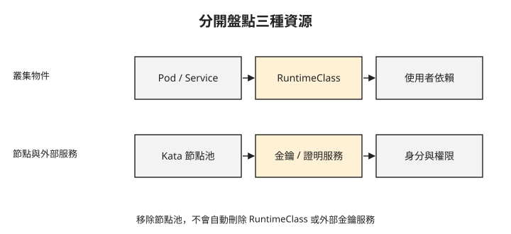

# Day 9：把機密容器的驗證結果帶回部署決策

{ align=right width="80" }

機密 Pod 已經能啟動，核准政策取得金鑰，變更政策的版本則被拒絕。現在團隊要決定是否採用這個配置，也要知道實驗資源移除後會留下什麼。這章會把需求、證據與維運責任連起來，判斷下一步該保留、補測或清理哪些項目。

## 每一項成功結果，都有自己的範圍

[Day 6](sprint4-day6-kata-sandboxing.md) 用實際宿主與 guest 核心、runtime 設定及網路結果，檢查一般 Kata。這回答 VM 隔離與選定網路路徑是否符合預期，沒有證明宿主無法讀取私有記憶體。

[Day 7](sprint4-day7-katacc.md) 使用機密容器所需的 SKU、RuntimeClass 與政策讓 Pod 啟動，確認平台配置方向；[Day 8](sprint4-day8-attestation.md) 再將政策雜湊綁到金鑰釋出條件。變更版新增環境變數後重新產生政策，保持金鑰條件不變，得到拒絕結果。這比單看 Running 多了一項秘密釋出驗證，但沒有涵蓋所有可能的 Pod 變更。

假設團隊已有使用 Azure Key Vault 的系統，現在要求只有符合指定政策的工作負載能取得金鑰。可以先評估 Day 7–8 的 AKS kata-cc 配置，搭配 MAA 證明服務、SKR 與 Key Vault 金鑰釋出政策。Day 8 中，核准政策的工作負載得到 `RELEASED`；新增環境變數並重新產生政策後，雜湊改變，金鑰釋出條件維持原樣，結果是 `DENIED`。這組結果支持繼續評估這條整合路徑，涵蓋的拒絕情境則限於這次政策變更。

採用前，團隊還要在預定部署配置上補測：政策升級時，新核准版本能否取得金鑰、不再核准的版本是否遭拒；縮減身分權限後，允許與拒絕結果是否仍符合要求；證明或金鑰服務無法使用時，應用如何處理失敗。也要量測啟動成本與金鑰釋出延遲，確認應用相容性及容量需求。這些都是採用前的待辦。

若需求只是降低不受信任程式影響宿主的風險，可以從一般 Kata 評估；若還要對不受信任宿主保護敏感執行資料，則要評估機密 VM／kata-cc 的信任政策、證明條件與秘密輸出方式。網路加密仍保護傳輸，機密執行保護受信任範圍內的資料，應用授權仍決定誰能使用服務；任何一項都不會自動取代其他項目。

## AKS 整合與上游 CoCo，責任差在哪裡？

延續這個 Azure 系統的案例，可以這樣分工：平台維運人員確認 AKS 支援的 SKU、OS、區域與版本，管理 kata-cc 節點與 runtime；應用維護者用 `az confcom katapolicygen` 產生 guest 政策；金鑰管理者維護 Key Vault release policy 與身分權限。MAA 負責驗證證據，SKR 搭配 Key Vault release policy 完成金鑰釋出流程。

政策升級需要應用維護者與金鑰管理者一起檢查 guest 政策及金鑰釋出政策。以 Day 8 的條件為例，guest 政策雜湊改變後，若金鑰仍只允許舊雜湊，新版本就會遭拒。因此，升級流程要包含核准新雜湊、決定舊版本是否繼續受允許，以及重做允許與拒絕測試。

若需求改成跨平台部署，可以評估上游 CoCo 搭配 **Trustee**，也就是協助證明與秘密交付的一組服務；其中 **Attestation Service** 驗證證據，**KBS（Key Broker Service）**依驗證與資源政策控制秘密交付。這裡比較的是架構與元件責任，Day 7–8 的測試結果適用於前述 AKS 配置。

選擇上游配置時，團隊要依平台部署 Kata 與機密 guest 元件，使用 `genpolicy` 等對應工具產生政策，並承擔硬體、韌體、runtime 與證明服務的相容性驗證及維護。採用前須在所選配置重做允許與拒絕測試，不能只替換雲端機型名稱，就假定流程與安全保證等價。元件關係可參考 [CoCo Trustee 架構](https://confidentialcontainers.org/docs/attestation/)。

## 移除節點池，不會自動移除 RuntimeClass

實驗移除 kata-cc 節點池後，叢集還保留 RuntimeClass。以下輸出呈現的是 API 物件與剩餘節點 handler 清單：

```console
$ kubectl get runtimeclass          # kata-cc 節點池已刪
kata-cc-isolation   kata-cc    ← 還在
kata-vm-isolation   kata       ← 還在
# 剩下的系統節點 handlers:(空)
```

`kata-cc-isolation` 仍宣告 handler 名稱 `kata-cc`，但提供它的節點已移除。RuntimeClass 是叢集物件，節點上的 runtime 實作則是另一層；兩者生命週期不同。

此時再建立使用這個 RuntimeClass 的 Pod，可能因排程限制而 Pending，或在排到不支援的節點後建立 sandbox 失敗，取決於 RuntimeClass 與節點設定。剩餘節點的 handler 清單空白，也不代表一般容器 runtime 消失。

下圖列出要分開檢查的範圍。刪除其中一層，不會自動證明其他層也已移除。



先確認沒有工作負載依賴要移除的 runtime，再處理節點池與不再使用的 RuntimeClass。若環境是共用叢集，還要確認這些物件是否由平台管理、是否仍被其他服務使用。外部的 Key Vault、MAA、managed identity 與聯合身分也需各自盤點；移除節點池不會自動移除它們。

清理完成的判準是預定移除的資源已不存在，並確認共用環境中保留的資源仍有用途；檢查範圍要包含叢集內物件、節點與外部服務。

## 採用之前，還有哪些未完成項目？

本課沒有直接取得 guest 內的 SNP report 原文，沒有部署上游 Trustee/KBS，也沒有量測機密 Pod 的啟動成本與金鑰釋出延遲。Day 6 驗證 Cilium 加一般 Kata，Day 7–8 則使用另一組預設 AKS 網路；Cilium 加 kata-cc 並未在同一配置完成驗證。

這些缺口決定後續驗證順序：先選定要使用的實際部署組合，再重做必要的允許與拒絕測試、故障處理和容量測試。不要把不同環境各自成功的片段直接拼成「整套已驗證」。

## 想一想

1. 移除 kata-cc 節點池後仍看得到 RuntimeClass，這個物件證明的是什麼？沒有證明的是什麼？
2. 你要使用 Cilium 加 kata-cc，能否直接引用 Day 6 與 Day 8 宣稱整合完成？還缺哪個測試？
3. 政策升級後雜湊改變，但新版本仍應取得金鑰，團隊需要一起管理哪兩份政策？

## 小結

本 sprint 從外部入口、服務通訊走到工作負載執行環境。每一層都要先指出保護範圍，再用對應的證據驗證；部署與移除也要區分叢集物件、節點實作及外部服務。接下來的 [Sprint 5 Day 0](sprint5-day0-game-server-concepts.md) 會換成有長時間連線與房間生命週期的遊戲伺服器，檢查一般 Deployment 為什麼不足以表達它的需求。

## 延伸閱讀

想再深入，可以從這幾份開始：

- [AKS 機密容器總覽](https://learn.microsoft.com/en-us/azure/aks/confidential-containers-overview)：平台支援條件。
- [CoCo 證明架構](https://confidentialcontainers.org/docs/attestation/)：上游的證明與秘密交付元件。
- [Sprint 3 Day 8](sprint3-day8-reversibility.md)：RuntimeClass 與節點 runtime 的移除範圍。

---

!!! quote ""
    Kubernetes 標誌為 CNCF（Linux Foundation）官方資產，此處作社群教學用途。
