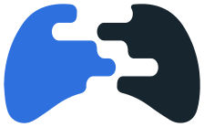
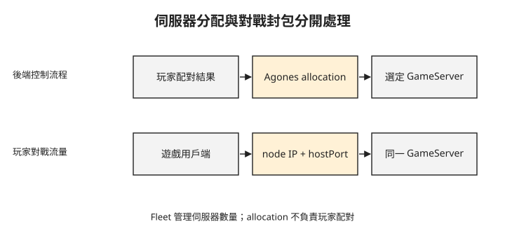

# Day 0：副本補回來，為什麼玩家的對戰還是斷了？

{ align=right width="90" }

四名玩家正在同一個房間對戰，伺服器記憶體裡保存著角色位置與剩餘時間。這時 Pod 被替換，新 Pod 很快就 Running，副本數也恢復了，但原本那場對戰沒有回來。這章會從玩家與伺服器的關係出發，判斷單純維持 Pod 數量還缺哪些遊戲生命週期資訊。

## 先分清楚伺服器副本與進行中的對戰

**dedicated game server** 是專門執行遊戲對戰的伺服器程式。玩家共同參與的這段遊戲活動稱為 **session**；在本課的模型中，一場 session 的即時狀態保存在分配到的伺服器內。

Kubernetes 可以執行有狀態工作負載，但一般 Deployment 不知道哪一台已分配給玩家、哪一台仍空閒，也不會自動把記憶體中的對戰狀態搬到另一個副本。因此「Pod 數量足夠」與「原對戰仍持續」是不同的要求。

**Agones** 在 Kubernetes 上增加遊戲伺服器的管理語意。它管理可分配與已分配的伺服器，讓更新和擴縮容能考慮這些狀態；它不會自動替任意遊戲實作斷線重連、對戰狀態複寫或災難恢復。

## 用三種物件表達不同的管理問題

**GameServer** 表示單一遊戲伺服器實例；**Fleet** 以共同規格管理一組 GameServer；**GameServerAllocation** 是要求挑選並分配可用伺服器的 API 物件。它們會在 Day 1–3 依序出現，但不應全部籠統稱為同一種 CRD：allocation 使用 Agones 提供的分配 API。

GameServer 的 Pod 內會加入 **SDK sidecar**，讓遊戲程式回報健康狀態、準備完成與結束。這些訊號補上一般 Pod Running 沒有表達的資訊。例如程式已啟動，但地圖還在載入時，還不該把玩家分過去。

下面把平台分配與玩家遊戲封包分開。上排決定誰取得哪一台伺服器，下排才是進行中的對戰流量。



配置完成後，玩家要連的是選定伺服器的位址。後端每次替換成另一個 Pod，都不能假定它已擁有同一場 session 的狀態。

## 本課先使用 UDP 直連

**hostPort** 是節點上對應到 Pod 容器連接埠的入口。本課 Agones 範例讓用戶端連向節點外部 IP 與動態 hostPort，沒有在中間使用 Kubernetes Service。以下是官方 quickstart 的 UDP echo 互動範例，不是本章另做的實測：

```console
$ nc -u <node-ip> 7190
Hello World !
ACK: Hello World !
```

`7190` 是範例分配到的埠，不是每次固定值。用戶端應使用 GameServer 的 `status.address` 與 `status.ports[].port`；如果硬寫另一個埠，即使伺服器 Ready 也可能收不到回應。

很多即時遊戲會用 UDP 傳送位置等頻繁更新的資料，避免必須等待遺失資料重送後才能交付後續資料。UDP 本身不保證送達或順序，遊戲仍需自行處理重要事件、重送或排序。這是本課採用的範例，並不代表所有遊戲都只能使用 UDP。

## 登入、配對與遊戲連線是不同階段

後續會加入 **Nakama**，提供玩家登入與即時配對等後端功能。玩家先透過 HTTP／gRPC 登入取得 session token，再以 WebSocket 維持配對連線；配對完成後，由後端要求 Agones 分配伺服器，再把連線資訊交給玩家。

配對決定「哪些玩家一起玩」，allocation 決定「這組玩家使用哪台伺服器」。Agones 不會僅因收到 allocation 就替你完成玩家技能分組。

[Day 4](sprint5-day4-quilkin-udp-proxy.md) 還會加入 **Quilkin**，也就是遊戲用 UDP proxy。用戶端可以先連 proxy，再由 proxy 把封包轉到選定 GameServer。此時 **routing token** 是選擇後端的資料，不能直接當成玩家身分或防作弊保證。

幾種容易混淆的值可依用途區分：

| 值 | 使用位置 | 代表什麼 |
|---|---|---|
| server key | Nakama 登入 API | 用戶端呼叫所需的伺服器設定值；放在 client 裡不等於能證明 client 未被修改 |
| session token | 登入後 API 與 WebSocket | 已驗證的玩家 session |
| matchmaker ticket | 配對流程 | 一筆仍在排隊的配對請求，可用來取消 |
| routing token | 經 Quilkin 的 UDP 封包 | proxy 用來選擇目的 GameServer 的路由資料 |

## 從 Ready 與 Allocated 開始讀狀態

接下來最常看的狀態是 Ready 與 Allocated：前者表示可供配置，後者表示已配置給使用者。GameServer 還有啟動、排程、關閉等狀態，不能把這兩個值當成完整狀態機。

連接埠採 `portPolicy: Dynamic` 時，Agones 會從設定範圍選 hostPort；因此防火牆必須涵蓋預定範圍。健康回報則由 SDK 與控制元件處理。以下是本課版本使用的預設欄位，後面遇到健康狀態時會回來對照：

```text
spec.health:
  initialDelaySeconds: 5
  periodSeconds: 5
  failureThreshold: 3

spec.sdkServer:
  grpcPort: 9357
  httpPort: 9358
```

`periodSeconds` 與 `failureThreshold` 影響健康回報缺失如何被判定；9357、9358 是 SDK 通訊入口，不是玩家要連的遊戲埠。不要把 SDK port 與 GameServer status 中的動態 hostPort 混用。

## 疑難排解

### Repository 有新 PR，卻查不到近期正式版本 {#mine-1}

開放的 PR 或分支推送，可能只是相依套件更新，不能單獨證明核心功能持續維護。採用專案前，應一起查看主分支有效提交、正式版本、維護者公告，以及你要使用功能的相容性。

本課準備時曾用 Open Match 的 PR 活動與發版紀錄做對照。這些資訊會變動，因此這裡不把歷史快照當成永久的「可用／不可用」清單。只有發版少也不必然代表專案停止維護；需要回到官方說明判斷。

## 想一想

1. 三個 Pod 都 Running，但只有一個 GameServer Ready，後端應假設有三台可以立刻分配嗎？
2. 玩家已完成配對，為什麼還需要 allocation？
3. GameServer 重建後 hostPort 改變，用戶端仍連舊埠。先檢查哪個欄位，而不是直接判定 UDP 程式壞掉？

## 小結

遊戲伺服器需要表達準備完成、分配與結束，單靠 Pod 副本數無法保護一場對戰的記憶體狀態。Agones 提供這些管理語意，登入、玩家配對與遊戲封包則分別由對應服務處理。[Day 1](sprint5-day1-agones-first-gameserver.md) 會建立第一個 GameServer，讀取它實際分配的位址與埠，再從叢集外驗證 UDP 回應。

## 延伸閱讀

想再深入，可以從這幾份開始：

- [Agones 概觀](https://agones.dev/site/docs/overview/)：元件與管理範圍。
- [GameServer reference](https://agones.dev/site/docs/reference/gameserver/)：狀態、port policy 與健康設定。
- [建立第一個 GameServer](https://agones.dev/site/docs/getting-started/create-gameserver/)：直連範例。
- [Nakama 配對](https://heroiclabs.com/docs/nakama/concepts/multiplayer/matchmaker/)：配對連線與 ticket 的生命週期。

---

!!! quote ""
    Agones 標誌為 CNCF（Linux Foundation）官方資產，此處作社群教學用途。
