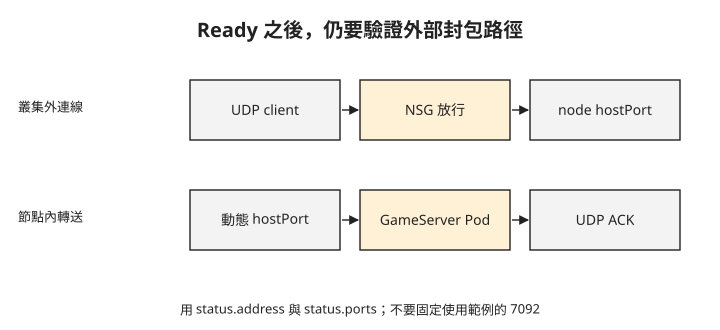

# Day 1：GameServer 已 Ready，外部玩家連得到嗎？

{ align=right width="90" }

第一個 GameServer 已經 Ready，但玩家從自己的電腦送出 UDP 訊息卻沒有回應。是遊戲程式沒準備好、連錯了動態埠，還是節點前的防火牆沒有放行？這章會依序確認控制元件、伺服器位址與外部 UDP 回應，讓你能分辨「伺服器已準備好」和「玩家真的連得上」。

## Agones 與 GameServer

Deployment 會維持副本數，但不追蹤對戰狀態。遊戲進行中若換成另一個 Pod，新的副本不會自動接續原 session。Agones 用自訂資源定義（CRD，擴充 Kubernetes 可接受的物件種類）表達遊戲伺服器，並管好它從啟動、可以接受玩家連線、被分配給玩家，到結束的整個生命週期。

最小的物件是 `GameServer`。一個 `GameServer` 對應一個 Pod，裡面執行遊戲程式與 SDK sidecar；遊戲程式透過 sidecar 回報準備與健康狀態。Agones 會動態分配遊戲用的 hostPort，並把入口回報在 `GameServer.status.address` 與 `status.ports`。Deployment 的 Pod 也能設定 hostPort，但 Deployment 本身不提供這套遊戲入口分配與回報機制。本章玩家直接連這組 node IP + port，中間沒有 Service。

先看玩家封包要經過哪些位置。AKS 節點前的 NSG（Network Security Group）以規則控制進出網路的流量。GameServer Ready 只涵蓋伺服器狀態，還沒有驗證圖中的整條外部路徑。



game server pod 用 `nodeSelector` 釘在 `role=gameserver` 的節點池，因為這組節點有公網 IP；`portPolicy: Dynamic` 讓 Agones 挑一個 hostPort，外部 client 連的是 `GameServer.status.address` 與 `status.ports[].port`。

**你需要什麼**：

- 一座 AKS 叢集，以下安裝流程適用於 Kubernetes 1.34.10 與 Agones 1.60.0；使用其他組合前，先依 Agones 對應版本的支援矩陣確認。
- 一個有節點公網 IP 的 game-server 節點池（步驟 1）。沒有節點公網 IP，client 就打不到 node:hostPort，只能改走 LoadBalancer 或其他路由層，那是 Day 4 的做法。
- 本機的 `kubectl`、`helm`、`az` 與 `nc`。

動手前用 `kubectl config current-context` 確認 kubectl 指向你的叢集。

## 步驟 1:建立 game-server 節點池

game-server 節點池要有節點公網 IP，並帶上 `role=gameserver` label，讓後面的 `GameServer` 用 `nodeSelector` 排上來：

```console
$ az aks nodepool add -g <RESOURCE-GROUP> --cluster-name <CLUSTER> -n gamesrv \
    --node-count 2 --node-vm-size Standard_D2s_v5 --enable-node-public-ip \
    --labels role=gameserver --mode User
```

`<RESOURCE-GROUP>` 與 `<CLUSTER>` 是你建立 AKS 時用的 resource group 與叢集名稱，可以用 `az aks list -o table` 查到。建好後用 `kubectl get nodes -o wide` 確認 gamesrv 節點的 `EXTERNAL-IP` 欄位有值。

## 步驟 2:安裝 Agones 1.60

在上述版本組合中，Agones CRD 的額外欄位會觸發欄位驗證錯誤，因此將 CRD 與控制面分開安裝：CRD 用 `kubectl create --validate=false`，Helm release 則關掉 CRD 安裝。

**CRD**：Agones chart 的 5 個 CRD 放在 `templates/crds/`。先加入 Agones 的 Helm repo，再用 `helm template --show-only` 只渲染這 5 個檔案，交給 `kubectl create --validate=false`：

```console
$ helm repo add agones https://agones.dev/chart/stable
$ helm repo update
$ helm template agones agones/agones --version 1.60.0 -n agones-system \
    --show-only templates/crds/fleet.yaml \
    --show-only templates/crds/fleetautoscaler.yaml \
    --show-only templates/crds/gameserver.yaml \
    --show-only templates/crds/gameserverallocationpolicy.yaml \
    --show-only templates/crds/gameserverset.yaml \
  | kubectl create --validate=false -f -
```

用 `create` 直接建立 CRD，避開更新資源時的欄位處理錯誤；`--validate=false` 在支援伺服器端欄位驗證的環境要求忽略未知欄位檢查，不是讓 API server 接受任何無效資源。這是針對上述版本組合中 CRD 額外欄位的處理，不能當成所有安裝錯誤的通用修法。建立成功時會印出 5 行 `customresourcedefinition... created`，對應 `fleets`、`fleetautoscalers`、`gameservers`、`gameserverallocationpolicies`、`gameserversets` 這 5 個 CRD。

**控制面**：用 Helm 安裝，但 chart 不要碰 CRD：

```console
$ helm install agones agones/agones --version 1.60.0 \
    --set agones.crds.install=false \
    -n agones-system --create-namespace --wait
STATUS: deployed
```

裝完後，用 `kubectl -n agones-system get pods` 確認元件就緒。依上述安裝設定，應有 9 個 Pod 全部顯示 `1/1 Running`：`agones-allocator` 3 顆、`agones-controller` 2 顆、`agones-extensions` 2 顆、`agones-ping` 2 顆。

`agones-controller` 是持續協調資源狀態的控制元件，本章由它處理 `GameServer`。`agones-allocator` 提供 gRPC／REST 介面，讓叢集外的服務請求分配遊戲伺服器；分配操作留到 Day 3 介紹。`agones-ping` 提供讓 client 量測延遲的 ping 服務。

## 步驟 3:建立第一顆 GameServer

將以下 YAML 存成目前目錄下的 [`gameserver.yaml`](https://github.com/DeepWaveLab/CloudNativePracticing/blob/main/labs/sprint5/day1/gameserver.yaml)。映像是 Agones 範例 `simple-game-server:0.43`，容器 port 是 `7654`，hostPort 由 Agones 動態配置：

```yaml
apiVersion: agones.dev/v1
kind: GameServer
metadata:
  generateName: simple-game-server-
spec:
  ports:
    - name: default
      portPolicy: Dynamic
      containerPort: 7654
  template:
    spec:
      nodeSelector:
        role: gameserver
      containers:
        - name: simple-game-server
          image: us-docker.pkg.dev/agones-images/examples/simple-game-server:0.43
          resources:
            requests: {memory: 64Mi, cpu: 20m}
            limits: {memory: 64Mi, cpu: 20m}
```

`metadata.generateName` 會在每次建立時產生新名稱；重複建立會新增 GameServer，不會更新原本的伺服器。`kubectl apply` 需要固定名稱來追蹤同一個物件，適用於 Day 2 有固定 `metadata.name` 的 `Fleet`；本章這份檔案要用 `kubectl create`：

```console
$ kubectl create -f gameserver.yaml
gameserver.agones.dev/simple-game-server-8vlf6 created
$ kubectl get gameserver -o wide
NAME                       STATE   ADDRESS          PORT   NODE
simple-game-server-8vlf6   Ready   <NODE-IP>   7092   aks-gamesrv-18046246-vmss000000
```

看三個欄位：`STATE` 是 `Ready`，`ADDRESS` 是 game-server 節點的公網 IP，`PORT` 是 Agones 配出的動態 hostPort。若尚未 Ready，稍後重複執行 `kubectl get gameserver -o wide`，確認 Ready 再連線。

## 步驟 4:放行 Agones 使用的 UDP port range

`GameServer` 已經拿到 hostPort，不代表 Internet 可以通過節點前的 NSG。這裡直接放行 `7000-8000/UDP`：

```console
$ az network nsg rule create -g <NODE-RESOURCE-GROUP> \
    --nsg-name <NSG-NAME> -n allow-agones-udp \
    --priority 1000 --direction Inbound --access Allow --protocol Udp \
    --destination-port-ranges 7000-8000 --source-address-prefixes Internet
```

`<NODE-RESOURCE-GROUP>` 是 AKS 自動建立、放節點 VM 的 resource group（名稱以 `MC_` 開頭），可以用 `az aks show -g <RESOURCE-GROUP> -n <CLUSTER> --query nodeResourceGroup -o tsv` 查到；`<NSG-NAME>` 用 `az network nsg list -g <NODE-RESOURCE-GROUP> --query "[].name" -o tsv` 查。

這裡放的是 port range，因為 `portPolicy: Dynamic` 不保證下一顆 server 還是同一個 port。Fleet 與 autoscaler 會陸續建立新的 server，只放單一 port，後面的 server 會隨機連不上。

## 步驟 5:從叢集外用 UDP 直連

回到本機，對 `GameServer` status 回報的 address 與 port 送 UDP 封包。下面的 7092 是這次分配值，請連同 `<NODE-IP>` 一起換成你剛查到的結果：

```console
$ printf 'Hello Agones from client\n' | nc -u -w4 <NODE-IP> 7092
ACK: Hello Agones from client
```

client 沒有打 Kubernetes Service，也沒有打 LoadBalancer，直接打到 node 公網 IP 與 Agones 分配的 hostPort。收到 `ACK` 表示封包穿過 NSG、進到該 node 的 hostPort，最後被 `simple-game-server` 處理。

## 想一想

1. GameServer Ready，卻沒有外部 ACK，除了遊戲程式外，還要查哪兩個入口條件？
2. 第二次建立 GameServer 分配到另一個 hostPort，為什麼只放行 7092 會出問題？
3. 使用 generateName 的檔案重複執行 create，會更新原伺服器，還是建立新實例？

## 小結

先確認 Agones 控制元件與 GameServer Ready，再使用 status 的實際位址和動態埠，從叢集外取得 UDP 回應。這樣才同時驗到伺服器狀態與外部路徑；Ready 本身不會替你開放 NSG。[Day 2](sprint5-day2-fleet-lifecycle.md) 會把單一 GameServer 包成 Fleet，觀察副本不足時如何補建。

## 延伸閱讀

想再深入，可以從這幾份開始：

- **[Agones on Azure Kubernetes Service](https://agones.dev/site/docs/installation/creating-cluster/aks/)** —— 官方的 AKS 建叢集說明，包含 `--enable-node-public-ip` 與 NSG 放行 7000–8000/UDP 的做法。
- **[Install Agones using Helm](https://agones.dev/site/docs/installation/install-agones/helm/)** —— Helm 安裝參數，包括本章用到的 `agones.crds.install`。
- **[建立第一顆 GameServer](https://agones.dev/site/docs/getting-started/create-gameserver/)** —— 對照本章的 `kubectl get gs`、node address、port 與 `nc -u` 連線方式。
- **[Agones releases](https://github.com/googleforgames/agones/releases)** —— 本章使用 `1.60.0`，升級前先看這裡的 release notes。

---

!!! quote ""
    Agones 標誌為 CNCF（Linux Foundation）官方資產，此處作社群教學用途。
