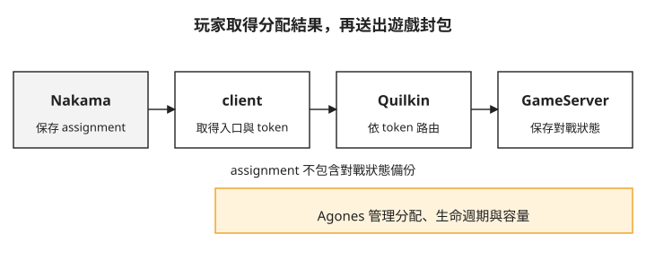

# Day 10: 新遊戲需要哪些平台元件，哪些還不用？

{ align=right width="90" }

團隊準備把一款遊戲放進 Kubernetes，帳號服務已經存在。有人希望直接沿用這幾天的 Agones、Quilkin 與 Nakama；另一個需求卻只是讓玩家輪流出牌，每一步的狀態都能寫回資料庫。這兩種情況，需要同一套部署嗎？

先回答一個更具體的問題：一場對戰是否需要持續由某個程序保存狀態，玩家也必須一直連到它？本章用前面實際看到的分配、路由與失效行為，整理哪些需求對應哪些元件。最後應能為自己的遊戲選出起點，也能說出選擇前還欠哪些證據。

## 先畫出狀態放在哪裡

Day 5 的玩家資料放在 PostgreSQL，Nakama 接收登入與 storage 請求；Day 9 的 relay 則在記憶體裡保存目前有哪些玩家加入。這些資料的生命週期不同：帳號需要跨越多場對戰，relay 的連線名單只服務這一場。

本課的實作可以分成圖中的三段。先看中間的交接資料，再看右邊的遊戲程序；「拿到 assignment」與「能繼續原本對戰」並不是同一件事。

assignment 裡保存的是去哪裡連線，不是對戰狀態的備份。Day 8 關閉節點後，Fleet 補出新的 Ready，舊 token 的探測卻一直 timeout；這就是兩者的差別。若需求是「換一台 server 後仍接續對戰」，需要另外設計狀態保存與恢復，這幾天的 allocation 與 token 並沒有提供它。

## 判斷是否需要 Agones：看對戰生命週期

如果每次請求都能從外部資料庫取得完整狀態，任一副本都能接手下一次請求，那麼先用一般 Deployment 管理服務是可評估的起點。若一組玩家需要分配並持續使用同一個遊戲程序，還要區分「可以接新對戰」與「正在服務對戰」，就需要額外的生命週期管理。

Agones 在本課解決的是後者：`GameServerAllocation` 選取 Ready server 並轉為 Allocated，Fleet 維持伺服器數量，遊戲程式以 SDK 回報就緒、健康與結束。Day 8 把 Fleet replicas 調到 0 時，Allocated server 仍保留，正好說明為什麼一般副本數不足以描述一場進行中的對戰。

不要只用「卡牌」或「射擊」決定。回合制遊戲也可能有綁定程序的房間狀態；即時遊戲也可能採用不同的分散方式。先追一場對戰的狀態在哪裡，以及移除程序會失去什麼，再選管理方式。[Fleet 規格](https://agones.dev/site/docs/reference/fleet/) 可以用來核對 replicas 與分配的關係。

| 需要回答的問題 | 本課的證據 | 對設計的影響 |
|---|---|---|
| 何時能接新對戰？ | Day 1–3 的 Ready 與 allocation | 把「可分配」當成明確狀態 |
| 分配後還剩多少空位？ | Day 7 兩次分配用完兩顆 Ready | 固定 replicas 不會因分配自動增加；容量補足另行規劃 |
| 對戰結束時誰釋放程序？ | Day 8 的 EXIT、Day 9 的 BYE 後 Shutdown | 遊戲需要主動回報結束，也要處理玩家未到或失聯 |
| 伺服器失效後誰恢復對戰？ | Day 8 補 Ready 後舊探測仍失敗 | Fleet 補容量；對戰恢復需另做設計 |

## 判斷是否需要 Quilkin：看入口與路由需求

Day 1 的 client 直接連到節點位址與 GameServer port，路徑較短，也讓 client 必須知道每次分配的伺服器位置。Day 4、7 改成連到 proxy，再以 routing token 選擇 GameServer。這讓入口與後方 server 位址分開，但也增加 proxy、路由設定與觀測的工作。

若目前只需要驗證遊戲程序可以接收 UDP，直連足以開始；若需要統一入口與可設定的 UDP 路由，再評估 Quilkin。這是從本課兩種連線方式得到的設計判斷，並非效能比較：課程沒有測量加入 proxy 後的延遲分布、吞吐量或故障切換時間。

還有兩個實際限制。第一，Day 7 的三字元 token 只是練習配置，沒有碰撞處理、資格驗證與完整失效流程；錯誤 token 沒收到回應，不能據此認定已解決所有未授權流量。第二，Day 9 的 relay 看到的是 proxy 的 IP:port，並不是玩家的原始來源；如果遊戲需要原始位址或玩家身分，要另外設計如何可信地傳遞與驗證。Quilkin 的定位與可設定功能可查[官方儲存庫](https://github.com/EmbarkStudios/quilkin)。

## 判斷是否需要 Nakama：看既有後端缺哪一段

Day 5 用 Nakama 處理登入與 storage，Day 6 用 matchmaker 湊齊玩家，再由 hook 呼叫 Agones。這個接法說明：Agones 接收的是 allocation 請求，並不要求配對服務一定是 Nakama。已經有帳號、配對與授權系統的團隊，可以評估由既有後端完成同一段交接。

反過來，如果這些功能還沒建立，Nakama 提供了可一起使用的 API 與 server runtime；代價是需要理解它的資料模型、資料庫與維運方式。本課驗過 migration、單一玩家 storage，以及兩位玩家的配對，尚未涵蓋 PostgreSQL 高可用、備份還原、正式金鑰與多節點行為。選它之前，要把這些需求納入試作。[Nakama 官方文件](https://heroiclabs.com/docs/nakama/) 可用來查各項功能與部署條件。

| 團隊已有的能力 | 可評估的接法 | 還要驗證什麼 |
|---|---|---|
| 已有帳號與配對服務 | 既有服務在配對成立後建立 allocation | 授權、重試不重複分配、失敗如何回報玩家 |
| 尚缺登入、storage 與配對 | 以 Nakama 串接這些功能 | 權限拒絕、並行寫入、資料庫維運與對外入口 |
| 配對通知可能漏接 | 保存 assignment，提供主動查詢 | 舊 assignment 何時失效，如何避免把玩家送回失效 server |

Day 7 已驗證 notification 與 RPC 回傳同一份 assignment，但沒有演練完整重連。`get_assignment` 只讀資料，不會檢查伺服器是否仍存活。需要重連的服務，不能把「查得到」當成「還能連」。

## 判斷遊戲程序做到哪裡：echo、relay 與權威狀態

Day 9 換成 Unity SDK 後，登入、配對與 UDP 的分工沒有改變。真正讓兩位玩家看見彼此的，是 GameServer 由 echo 改成 relay。這提供一個清楚的驗證順序：先測路徑能通，再測資料會送到其他玩家，最後才檢查遊戲規則與同步品質。

| 程序的行為 | 本課已證明 | 尚不能據此推論 |
|---|---|---|
| echo 回覆發送者 | 封包可以往返 | 玩家收到彼此資料 |
| relay 轉送玩家位置 | 兩個視窗與 log 顯示雙向位置資料 | 網路零丟包、位置合法、無作弊 |
| server 驗證輸入並計算狀態 | 本課未實作 | 已有權威遊戲邏輯或完整同步機制 |

本章提到的 relay 是 Agones 上的獨立 UDP 程序。Nakama 另有透過自身 realtime socket 轉送的 [client relayed multiplayer](https://heroiclabs.com/docs/nakama/concepts/multiplayer/relayed/)，兩者的封包路徑與生命週期不同，不能只因名字相同就互換。

## 決定前，補足與故障有關的證據

Day 8 的時間線顯示：主動結束與程序崩潰後，很快就觀察到 GameServer 狀態改變；節點失效時，玩家探測先失敗，Node 與 GameServer 的狀態才陸續更新。它們測的是不同事件，也只有這組環境的觀察，不能排成通用效能排名，更不能當成玩家恢復時間。

這次真正能帶進設計的判斷是：主動回報結束、觀察程序失敗與偵測節點失聯，各依賴不同訊號；只看 GameServer 計數會漏掉玩家已收不到回應的時段。下一次試作應同時保存 client 探測、節點、GameServer 與 metrics 的時間線，並確認補位後是恢復容量，還是也恢復了對戰狀態。

以下幾項沒有在本課驗證，若需求包含它們，就應列入下一次試作：

- **不同玩家的網路條件**：跨網路的延遲、遺失與亂序，以及 client 的插值、預測與延遲補償。Day 9 的兩個 player 都在同一台 Mac 上。
- **不同中斷來源**：節點 drain、Spot 回收通知、更新與故障切換，不能直接沿用手動關機的結果。
- **多區域與入口**：區域選擇、跨區分配、Nakama 對外 TLS，以及 proxy 容量與可用性。
- **長期資料與身分**：資料庫還原、預設金鑰替換、配對資格驗證，以及憑證更新。

## 想一想

1. 團隊已有帳號與配對服務，還想使用 Agones，需要把整個後端換成 Nakama 嗎？請指出需要接上的介面。
2. Fleet 已補回 Ready，玩家仍帶舊 token timeout，應優先檢查哪個責任範圍？
3. 兩個同機 Unity player 的收發數量相符，還缺少哪些資料，才能評估正式玩家的網路體驗？

## 小結

是否採用整套平台，取決於對戰狀態、分配、封包入口與既有後端的需求。Agones 處理 GameServer 生命週期，Quilkin 處理本課的 UDP 路由，Nakama 提供玩家與配對 API；遊戲程式仍要負責規則、同步與結束條件。先選擇能回答目前問題的組合，再用實際失敗情境驗證缺少的部分，比一次採用全部元件更容易知道問題出在哪一段。

## 延伸閱讀

想再深入，可以從這幾份開始：

- [Agones overview](https://agones.dev/site/docs/overview/)：對照 GameServer、Fleet、allocation 與 SDK 的責任。
- [Agones Unity SDK](https://agones.dev/site/docs/guides/client-sdks/unity/)：使用 Unity 撰寫伺服器時的生命週期介面；本課只建置 macOS client，未驗證 dedicated server build。
- [Nakama 文件](https://heroiclabs.com/docs/nakama/)：查詢資料模型、配對與正式部署的要求。

## 下一步

Sprint 5 到這裡結束。回到[課程總覽](../index.md)，選擇下一個要深入驗證的主題。

---

!!! quote ""
    Agones 標誌為 CNCF（Linux Foundation）官方資產，此處作社群教學用途。
