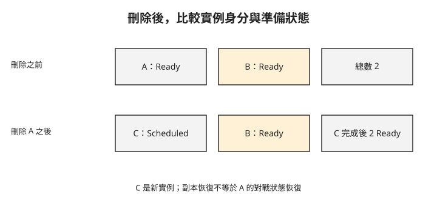

# Day 2：刪除一個 GameServer 後，Fleet 如何補足副本？

{ align=right width="90" }

平台準備了兩台空閒遊戲伺服器，其中一台被刪除後，如果沒有人補建，下一組玩家就少了一個可用選擇。上一章手動建立單一 GameServer，這章改由 Fleet 持續維持數量。我們會宣告兩個副本，再比較刪除前後的名稱、狀態與埠，判斷控制器補出的是新實例，還是原實例重新啟動。

## Fleet 維持副本，Ready 表示是否能分配

**Fleet** 管理一組使用相同規格的 GameServer。你宣告 `replicas: 2`，控制器便持續把實際伺服器數量調整到目標；它還會依 GameServer 的生命週期處理更新與縮容。

新伺服器需要排程、取得映像、啟動遊戲程式並回報 Ready。預先準備可以減少玩家等待，但 Fleet 的固定 replicas 是總副本目標，並不自動代表固定的空閒容量。這章尚未分配任何伺服器，所以兩個副本最後都是 Ready；下一章配置一個之後，就會看出總數與可用數的差異。

在 `Fleet` 裡，`Scheduled` 表示 Agones 已經替 `GameServer` 建立 pod 並安排到節點；`Ready` 表示遊戲程式已透過 SDK 告訴 Agones 可以接玩家。

下面先列出要觀察的變化。刪除後應該有一個新名稱，而未刪除的實例保持原樣；稍後會用實際輸出核對。



圖中的 A、B、C 代表不同實例，不是 GameServer 的狀態名稱。

## 步驟 1:建立 replicas 為 2 的 Fleet

先刪掉 Day 1 建立的 `GameServer`（`kubectl delete gameserver <名稱>`），讓清單裡只剩 Fleet 產生的 server。

[`fleet.yaml`](https://github.com/DeepWaveLab/CloudNativePracticing/blob/main/labs/sprint5/day2/fleet.yaml) 沿用 Day 1 的 `simple-game-server:0.43` 與 `portPolicy: Dynamic`，差別是外層改成 `Fleet`，並指定 `replicas: 2`：

```yaml
apiVersion: agones.dev/v1
kind: Fleet
metadata:
  name: simple-game-server
spec:
  replicas: 2
  template:
    spec:
      ports:
        - name: default
          portPolicy: Dynamic
          containerPort: 7654
      template:
        spec:
          nodeSelector:
            role: gameserver
          containers:
            - name: simple-game-server
              image: us-docker.pkg.dev/agones-images/examples/simple-game-server:0.43
              resources:
                requests: {memory: 64Mi, cpu: 20m}
                limits: {memory: 64Mi, cpu: 20m}
```

將上述設定存成 `fleet.yaml` 並套用。等待新伺服器完成準備後，驗證中看到 desired、current 與 ready 都是 2：

```console
$ kubectl apply -f fleet.yaml
fleet.agones.dev/simple-game-server created
$ kubectl get fleet simple-game-server -o wide
NAME                 SCHEDULING   DESIRED   CURRENT   ALLOCATED   READY   AGE
simple-game-server   Packed       2         2         0           2       4s
```

`SCHEDULING` 是 **Packed**，表示優先將伺服器集中到較少節點的排程方式。它是排程偏好，仍受節點可用資源與其他排程條件影響。

## 步驟 2:確認兩顆 GameServer 都 Ready

查 `GameServer` 可以看到 Fleet 產生的兩顆實例：

```console
$ kubectl get gameserver
simple-game-server-ql5ws-cmk28   Ready   7113
simple-game-server-ql5ws-fbkn4   Ready   7040
```

名稱是 Fleet 名稱加上兩段隨機尾碼，port 各自不同。下一步刪掉其中一顆；下面刪的是 `cmk28`，照做時換成你清單裡的名稱。

## 步驟 3:刪掉一顆 GameServer

先確認要刪的是未配置給玩家的 Ready 實例。下面保留驗證時的名稱，實作時請換成你清單中選定的 GameServer：

```console
$ kubectl delete gameserver simple-game-server-ql5ws-cmk28
gameserver "...cmk28" deleted
```

接著再次查看 GameServer；這是新實例尚在準備中的一次觀測：

```console
$ kubectl get gameserver
simple-game-server-ql5ws-fbkn4   Ready       7040    ← 沒被刪的那顆
simple-game-server-ql5ws-qdsfl   Scheduled   7358    ← Fleet 新建的，正在轉 Ready
```

被刪的 `cmk28` 消失；沒被刪的 `fbkn4` 名稱與 port 都沒變；Fleet controller 建立一顆新的 `qdsfl` 補回 desired replicas，它先進 `Scheduled`，再轉成 `Ready`。這次建立的是新的 GameServer，並沒有復原被刪除實例中的遊戲記憶體狀態。

保留的 `fbkn4` 名稱與埠未變，只能確認這個實例沒有被替換，不能據此判定連線是否中斷，也不能推廣成任意更新與故障下都不受影響。

最後再次查詢 GameServer 與 Fleet，確認補位的新名稱仍在清單中、兩個實例都 Ready，且 Fleet 的 `CURRENT` 回到 2：

```console
$ kubectl get gameserver
$ kubectl get fleet simple-game-server -o wide
```

如果新實例仍是 Scheduled，就等它完成準備後再查詢；只看到一筆 Scheduled，還沒有完成補足可用容量的檢查。

判讀總數與可用數時，還要區分 `Allocated`：它表示已分配給玩家。在本課一場對戰一台伺服器的模式下，這台仍算在總副本數內，但不再是 Ready 候選，所以 `replicas: 2` 不代表隨時有兩台 Ready。

## 想一想

1. Fleet 的 current 已是 2，但其中一台還是 Scheduled，可以說有兩台可立刻分配嗎？
2. 新 GameServer 有不同名稱與埠，是否表示原對戰的記憶體狀態已恢復？
3. `replicas: 2` 的 Fleet 有一台 Allocated，還能否期待自動維持兩台 Ready？

## 小結

Fleet 依目標副本數補建伺服器，GameServer 狀態則說明它是否已可分配。刪除後要同時核對名稱、狀態與總數，才能區分新建替代與既有實例；固定 replicas 也不等同固定 Ready buffer。[Day 3](sprint5-day3-allocation-autoscaler.md) 會先分配一台，再用 FleetAutoscaler 維持預留容量。

## 延伸閱讀

想再深入，可以從這幾份開始：

- **[Fleet Specification](https://agones.dev/site/docs/reference/fleet/)** —— `Fleet` 的完整欄位，包括 `replicas`、`scheduling` 與更新策略。
- **[Quickstart: Create a Game Server Fleet](https://agones.dev/site/docs/getting-started/create-fleet/)** —— 官方的 Fleet 操作範例，可以對照本章的建立與補位流程。
- **[Agones GameServer reference](https://agones.dev/site/docs/reference/gameserver/)** —— 查 `Scheduled`、`Ready`、`Allocated`、`Shutdown` 各狀態的定義。

---

!!! quote ""
    Agones 標誌為 CNCF（Linux Foundation）官方資產，此處作社群教學用途。
