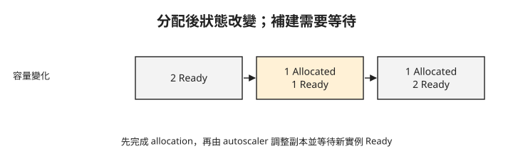

# Day 3：分配一台伺服器後，如何保留兩台 Ready？

{ align=right width="90" }

Fleet 有兩台 Ready 伺服器，第一組玩家取得其中一台後，空閒容量就剩一台。總副本數仍是兩台，上一章的 Fleet 不需要再補建。這章會先把一台分配給玩家，再用 FleetAutoscaler 保留兩台 Ready，並用狀態變化確認兩個動作各自完成。

## Allocation 把 Ready 容量變成玩家入口

**GameServerAllocation** 是後端或 matchmaker 送給 Agones 的一次性分配請求，意思是「從符合條件的 `GameServer` 裡挑一顆可用的 server」。挑選與標記在同一個操作裡完成，在本章選擇 Ready 實例的設定下，同一台不會被兩個分配請求同時取得。成功後，它除了物件名稱，還會回 `status.address` 與 `status.ports`；這組 address:port 就是玩家端接下來要連的入口。

**Allocated** 表示伺服器已被分配。在本章的一場對戰一台伺服器模式，它不再是下一次 Ready 分配的候選。這個狀態也讓平台能區分已使用與空閒容量；它本身不保證硬體故障時對戰不中斷。

**FleetAutoscaler** 依政策調整 Fleet 副本目標。這次使用 **Buffer** 政策，目標是保留指定數量的 Ready 實例，而不是依 CPU 忙碌程度決定數量。下圖先把分配當下與補建完成分開，兩者不是同步發生。



第一個變化由 allocation 完成；第二個變化還要等待控制器調整副本，以及新 GameServer 啟動並回報 Ready。

## 步驟 1:建立 buffer 為 2 的 FleetAutoscaler

[`fleetautoscaler.yaml`](https://github.com/DeepWaveLab/CloudNativePracticing/blob/main/labs/sprint5/day3/fleetautoscaler.yaml) 指向 Day 2 的 `simple-game-server` Fleet，policy 使用 `Buffer`。將以下內容存成 `fleetautoscaler.yaml`：

```yaml
apiVersion: autoscaling.agones.dev/v1
kind: FleetAutoscaler
metadata:
  name: simple-game-server-autoscaler
spec:
  fleetName: simple-game-server
  policy:
    type: Buffer
    buffer:
      bufferSize: 2
      minReplicas: 0
      maxReplicas: 10
```

套用後查 Fleet 狀態。目前沒有 allocated server，原本的 2 顆 Ready 已經滿足 buffer：

```console
$ kubectl apply -f fleetautoscaler.yaml
fleetautoscaler.autoscaling.agones.dev/simple-game-server-autoscaler created
```

`kubectl get fleet simple-game-server` 的 DESIRED 到 READY 四欄（節錄）：

```text
NAME                 DESIRED   CURRENT   ALLOCATED   READY
simple-game-server   2         2         0           2
```

`bufferSize: 2` 不是固定 replicas 等於 2，而是「扣掉 Allocated 之後，還要留 2 顆 Ready」。本章一台 Allocated 加兩台 buffer，目標便是 3。這仍受 `minReplicas` 與 `maxReplicas` 限制；到達 10 台上限時，不能保證每次分配後都有空間補足兩台 Ready。

## 步驟 2:送出 GameServerAllocation

[`gameserverallocation.yaml`](https://github.com/DeepWaveLab/CloudNativePracticing/blob/main/labs/sprint5/day3/gameserverallocation.yaml) 用 **selector（標籤選擇條件）**指向 `simple-game-server` Fleet。將以下設定存成 `gameserverallocation.yaml`，並在與 Fleet 相同的命名空間送出請求：

```yaml
apiVersion: allocation.agones.dev/v1
kind: GameServerAllocation
spec:
  selectors:
    - matchLabels:
        agones.dev/fleet: simple-game-server
```

用 `kubectl create` 建立一次性 allocation，並直接把回傳欄位印出來：

```console
$ kubectl create -f gameserverallocation.yaml \
    -o jsonpath='STATE={.status.state} GS={.status.gameServerName} ADDR={.status.address}:{.status.ports[0].port}'
STATE=Allocated  GS=simple-game-server-ql5ws-fbkn4  ADDR=<NODE-IP>:7040
```

後端應先確認狀態為 Allocated，再使用回傳的伺服器名稱與 address:port；分配不成功時不能使用空白或過期位址。這次回應中，狀態是 `Allocated`，server 是 `simple-game-server-ql5ws-fbkn4`，連線位置是 `<NODE-IP>:7040`。被選中的這顆從 Ready pool 被拿走，不再是可分配的庫存。

## 步驟 3:等待 autoscaler 補回 Ready buffer

allocation 之後，Ready 少了一顆。`FleetAutoscaler` 的控制迴圈再次比較目標與目前狀態後，把 replicas 拉到 3：

```console
$ kubectl get fleet simple-game-server -o wide    # 下面節錄 DESIRED 到 AGE 欄
NAME                 DESIRED   CURRENT   ALLOCATED   READY   AGE
simple-game-server   3         3         1           2       104s
$ kubectl get gameserver
simple-game-server-ql5ws-cpqgc   Ready       7263    ← buffer 新補
simple-game-server-ql5ws-fbkn4   Allocated   7040    ← 受保護,未被縮掉
simple-game-server-ql5ws-qdsfl   Ready       7358
```

最後有 3 顆 server：`fbkn4` 是 Allocated，`qdsfl` 是原本留下來的 Ready，`cpqgc` 是 buffer 新補出來的 Ready。

Day 2 的 `replicas: 2` 是固定宣告；裝上 autoscaler 後，replicas 改由 buffer policy 決定：allocated 數量是 0 時 desired 是 2，變成 1 時 desired 就是 3。這是 game server pool 常見的容量模型：已分配出去的 server 不算庫存，庫存是 Ready。autoscaler 另外補新的 Ready server，已分配出去的那顆維持 Allocated。

補建不是同步完成的，要等 autoscaler 下一次協調，再加上新伺服器的排程與啟動。監控或測試腳本要把這段延遲算進去，不要在 allocation 回應後立刻檢查 Ready 數。

這次觀察到 Allocated 實例在擴容時持續存在，沒有被替換。輸出中的「受保護」註記不能當成縮容測試：本章沒有把副本目標調小，也沒有測試節點故障。要驗證活躍對戰在維護時的行為，需要另外的測試情境。

## 想一想

1. 目前有 3 台 Allocated、bufferSize 為 2，且沒有碰到副本上限，目標副本數應是多少？
2. allocation 剛成功，Ready 暫時少一台，是否就代表 autoscaler 失效？還要觀察哪些步驟？
3. current 已到 maxReplicas，繼續分配後 Ready 下降，為什麼增加 bufferSize 不一定能立刻補足容量？

## 小結

allocation 選出 Ready 伺服器並回傳連線資訊，FleetAutoscaler 則在控制迴圈中調整總副本，補回預留的 Ready 容量。兩者完成時間不同，且 buffer 受副本上限與節點資源限制；判斷可分配容量時，要一起讀 Allocated、Ready 與目標副本。[Day 4](sprint5-day4-quilkin-udp-proxy.md) 會在玩家的 UDP 資料路徑加入 Quilkin，由 token 選擇後端伺服器。

## 延伸閱讀

想再深入，可以從這幾份開始：

- **[GameServerAllocation Specification](https://agones.dev/site/docs/reference/gameserverallocation/)** —— allocation 的 selector、回傳的 `status` 欄位，以及 Day 4 會用到的 `metadata`。
- **[Fleet Autoscaler Specification](https://agones.dev/site/docs/reference/fleetautoscaler/)** —— `Buffer` policy 的 `bufferSize`、`minReplicas`、`maxReplicas`，以及其他 policy 類型。
- **[Quickstart: Create a Fleet Autoscaler](https://agones.dev/site/docs/getting-started/create-fleetautoscaler/)** —— 官方的 buffer autoscaler 操作範例。
- **[Allocator Service](https://agones.dev/site/docs/advanced/allocator-service/)** —— 需要從叢集外呼叫 allocation 時的 gRPC／REST 入口；在叢集內直接建立 `GameServerAllocation` 時用不到。

---

!!! quote ""
    Agones 標誌為 CNCF（Linux Foundation）官方資產，此處作社群教學用途。
