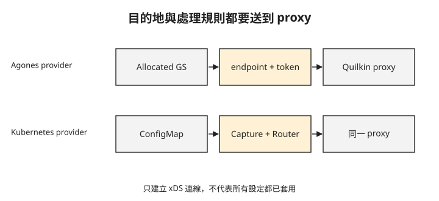
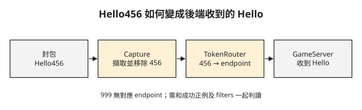

# Day 4：Quilkin 能轉送 UDP，為什麼錯誤 token 也會通？

{ align=right width="88" }

玩家已取得一台伺服器，現在平台希望統一使用 UDP proxy 入口。部署後封包有回應，但帶正確 token 與錯誤 token 都會收到 ACK；所有 Pod 看起來也正常。這章會從動態設定與封包處理順序找出差別，確認「能轉送」之外，路由條件也確實生效。

## 先決定用戶端入口與路由條件

**Quilkin** 是放在遊戲用戶端與 GameServer 之間的 UDP proxy。本章讓用戶端改連同一個 UDP LoadBalancer，再由封包尾端的 token 選擇後端。這是用戶端知道 proxy 存在、會配合附加 token 的部署方式。

固定 proxy 入口可以避免用戶端直接依賴每台伺服器的 node:hostPort，但不會搬移原對戰狀態，也不會自動關閉 Day 1 放行的節點直連路徑。本章只驗證經 proxy 的路由；若需求是禁止繞過 proxy，還需另設後端網路限制並驗證。

先備妥 Day 3 的 Fleet、至少一台 Ready GameServer，以及已開放的測試網路。下面的完整 manifests 使用 `default` 命名空間，包含對應 ServiceAccount 與 RBAC；實作時保持同一命名空間，若要搬移則需一起調整身分綁定。

## 動態設定要有目的地，也要有處理規則

**xDS** 是傳遞代理動態設定的一組協定。Quilkin 控制面把 GameServer 資訊轉為 **endpoint（可轉送的位址與路由資料）**，再把封包的處理規則組成 **filter chain** 傳給 proxy。

這組規則有兩步：**Capture** 從封包尾端擷取 3 bytes，並移除這段尾碼；**TokenRouter** 以擷取的 token 選擇對應 endpoint。如果只有目的地、沒有 filters，proxy 可能仍能轉送，卻沒有執行這兩步。

**provider** 是控制面讀取設定的來源。在本課版本，`--provider.k8s.agones` 讀 Agones 取得 endpoints，`--provider.k8s` 讀 ConfigMap 取得 filters。下圖將兩種來源並列，兩者都要傳到 proxy。



少其中一類設定，就不能完成預定的 token 路由。正文會直接使用已補齊兩個 provider 的配置，故障例留在[疑難排解：錯誤 token 仍有回應](#mine-3)。

本章使用 Quilkin image `ghcr.io/embarkstudios/quilkin:0.10.0-3d8eaef`，也就是官方 xDS 範例指定的版本。此映像使用 flag 形式的 CLI；對應範例與 image 必須一起核對，不能混用舊子指令。用這版 image 起一顆一次性 pod 執行 `--help`，會看到子指令只剩三個，其餘功能全部是 `--service.*` 與 `--provider.*` flag（下面節錄 Commands 段）：

```console
$ kubectl run quilkin-help --rm -i --restart=Never \
    --image=ghcr.io/embarkstudios/quilkin:0.10.0-3d8eaef -- --help
Commands:
  generate-config-schema  Generates JSON schema files for known filters
  qcmp
  help
```

這裡用 xDS 架構：一顆 `quilkin-manage-agones` 提供 xDS，三顆 `quilkin-proxies` 對外收 UDP。原驗證也檢查過另一套 relay 範例，發現 label 與 CLI 不一致，見[Service 選到不提供服務的 Pod](#mine-1)與[映像不接受子指令](#mine-2)。這裡的步驟只部署 xDS 配置。

## 步驟 1:部署 Quilkin xDS control plane

control plane 的關鍵是同時啟用 Kubernetes provider 與 Agones provider。下面只節錄 Deployment 的 args 與 image，缺少 selector、Pod labels 等必要欄位，不能單獨套用；請先將完整 manifest 存到工作目錄。完整檔案（含 ServiceAccount、RBAC 與 Service）見 [`xds-control-plane.yaml`](https://github.com/DeepWaveLab/CloudNativePracticing/blob/main/labs/sprint5/day4/xds-control-plane.yaml)：

```yaml
apiVersion: apps/v1
kind: Deployment
metadata:
  labels:
    role: xds
  name: quilkin-manage-agones
spec:
  template:
    spec:
      containers:
        - name: quilkin
          args:
            - --service.xds
            - --provider.k8s
            - --provider.k8s.agones
          image: ghcr.io/embarkstudios/quilkin:0.10.0-3d8eaef
```

同一份 manifest 也帶入 filter ConfigMap。Capture 抓 suffix 3 bytes，`remove: true` 表示轉送給 game server 前會把 token 從 payload 剝掉：

```yaml
apiVersion: v1
kind: ConfigMap
metadata:
  name: quilkin-xds-filter-config
  labels:
    quilkin.dev/configmap: "true"
data:
  quilkin.yaml: |
    version: v1alpha1
    filters:
      - name: quilkin.filters.capture.v1alpha1.Capture
        config:
          suffix:
            size: 3
            remove: true
      - name: quilkin.filters.token_router.v1alpha1.TokenRouter
```

用 `kubectl apply -f xds-control-plane.yaml` 部署。control plane pod 要到 `1/1 Running`；下一步的 proxy 部署好之後，它們的 log 應出現 `Connected to management server` 與 `entering xDS stream loop`，表示已建立管理連線；是否取得完整 endpoints 與 filters，還要檢查代理設定及後面的正反例。

## 步驟 2:部署 UDP proxy pool

proxy pool 對外開 UDP `7777`，並向 control plane 取 xDS 設定。下面仍是節錄，缺少 Deployment selector 與 Pod labels，不能單獨套用。請先將完整 manifest 存到工作目錄，檔案見 [`xds-proxy-pool.yaml`](https://github.com/DeepWaveLab/CloudNativePracticing/blob/main/labs/sprint5/day4/xds-proxy-pool.yaml)：

```yaml
apiVersion: apps/v1
kind: Deployment
metadata:
  labels:
    role: proxy
  name: quilkin-proxies
spec:
  replicas: 3
  template:
    spec:
      containers:
        - name: quilkin
          image: ghcr.io/embarkstudios/quilkin:0.10.0-3d8eaef
          args:
            - --service.udp
            - --provider.xds.endpoints=http://quilkin-manage-agones
          ports:
            - containerPort: 7777
              protocol: UDP
---
apiVersion: v1
kind: Service
metadata:
  name: quilkin-proxies
spec:
  ports:
    - port: 7777
      protocol: UDP
      targetPort: 7777
  selector:
    role: proxy
  type: LoadBalancer
```

用 `kubectl apply -f xds-proxy-pool.yaml` 部署，三顆 proxy 都要到 `1/1 Running`。查看 Service 取得對外入口：

```console
$ kubectl get svc quilkin-proxies
quilkin-proxies   LoadBalancer   10.0.32.213   <LB-IP>   7777:32477/UDP
```

從這一步開始，client 的固定入口是 `EXTERNAL-IP` 欄位的位址加上 port 7777，不再是 Day 1–3 的 node IP 與 hostPort。

## 步驟 3:用 allocation annotation 帶入 token

Quilkin 的 Agones provider 會讀 `GameServer` metadata 裡的 `quilkin.dev/tokens` annotation，值是 token 的 base64。這裡沿用官方範例的 token：`NDU2` 是 `456` 的 base64。這是示範用的短 token，不是安全認證憑證。完整檔案見 [`gameserverallocation-token.yaml`](https://github.com/DeepWaveLab/CloudNativePracticing/blob/main/labs/sprint5/day4/gameserverallocation-token.yaml)：

```yaml
apiVersion: allocation.agones.dev/v1
kind: GameServerAllocation
spec:
  selectors:
    - matchLabels:
        agones.dev/fleet: simple-game-server
  metadata:
    annotations:
      quilkin.dev/tokens: NDU2
```

將設定存成 `gameserverallocation-token.yaml`，再送出 allocation。下面的查詢名稱請換成回應的 `status.gameServerName`，不要照抄範例隨機尾碼：

```console
$ kubectl create -f gameserverallocation-token.yaml \
    -o jsonpath='STATE={.status.state} GS={.status.gameServerName} ADDR={.status.address}:{.status.ports[0].port}'
STATE=Allocated  GS=simple-game-server-ql5ws-b5xr7  ADDR=<NODE-IP>:7499
$ kubectl get gameserver simple-game-server-ql5ws-b5xr7 -o jsonpath='{.metadata.annotations.quilkin\.dev/tokens}'
NDU2
```

`kubectl logs deploy/quilkin-manage-agones` 可以看到 control plane 把這顆 server 轉成 endpoint：log 裡依序會有 `providers=["agones","k8s"]`、`applying server <NODE-IP>:7499 tokens=["NDU2"]`，以及 `InitDone old_num_endpoints=0 new_num_endpoints=1`。`new_num_endpoints=1` 表示控制面已整理出一個目標，不單獨保證所有 proxy 都已接收並套用；後面的封包測試會確認實際資料路徑。

## 步驟 4:驗正確 token 與錯誤 token

先看預期的封包變化。正確 token 是原始的三個 bytes `456`，不是 annotation 裡的 base64 字串 `NDU2`。



Capture 移除尾碼後，遊戲程式應只收到 `Hello`。`<LB-IP>` 請換成 `quilkin-proxies` Service 的外部 IP，再從叢集外送出：

```console
$ printf 'Hello456' | nc -u -w4 <LB-IP> 7777
ACK: Hello
```

接著只改尾碼，用不在 endpoint 清單內的 `999` 測試：

```console
$ printf 'Hello999' | nc -u -w3 <LB-IP> 7777
```

驗證中等待期間沒有收到回應，stdout 為空。不同 nc 實作的 UDP 等待行為可能不同；無回應要與剛才相同路徑的正例及已載入的 filters 一起判讀，不能單獨當成網路一定被政策拒絕的證據。

正向與負向兩個測試都要做。只驗 `ACK` 會漏掉最嚴重的失效模式：proxy 仍然轉發 UDP，但 TokenRouter 根本沒有載入（[疑難排解：錯誤 token 仍有回應](#mine-3)）。

## 疑難排解

### Service 選到不提供目標連接埠的 Pod {#mine-1}

**症狀**：照官方 relay quickstart 部署時，proxies 連 `quilkin-relay-agones:7800` 出現 transport error；用 `kubectl logs deploy/quilkin-relay-agones` 看到的可能是 agent log，訊息包含 `Found 2 pods, using pod/quilkin-agones-agent…`。

**根因**：`relay-control-plane.yaml` 裡 relay 與 agent 兩個 Deployment 都貼 `role: xds`，Service selector 也是 `role: xds`。agent 不聽 7800/7900，卻被放進 endpoint。

**修法**：relay 與 agent 用不同 label，例如 `role: relay` 與 `role: agent`，Service 只選 relay。xDS 範例只有一個 `role: xds` Deployment，沒有這個問題。

### Pod 回報 unrecognized subcommand {#mine-2}

**症狀**：relay 與 agent pod 進入 `CrashLoopBackOff`，log 顯示 `error: unrecognized subcommand 'relay'` 或 `error: unrecognized subcommand 'agent'`。

**根因**：`relay-control-plane.yaml` 還在用舊式子指令，但同一份範例指定的 image `0.10.0-3d8eaef` 已改成 flag 式 CLI，`quilkin --help` 只剩 `generate-config-schema`、`qcmp`、`help` 三個子指令。

**修法**：改用 `examples/agones-xonotic-xds/`，或把 relay/agent manifest 改成 `--service.*` 與 `--provider.*` flags。Quilkin pre-1.0 的範例與 CLI 需要一起驗，不只看 image tag。

### 正確與錯誤 token 都收到原樣回應 {#mine-3}

**症狀**：pod 全 Ready、endpoint 也有 token，UDP 封包能通；但 `Hello456` 回 `ACK: Hello456`，代表 token 沒被剝掉，`Hello999` 也回 `ACK: Hello999`，代表錯 token 也被放行。整個過程沒有錯誤訊息。

**根因**：官方 xDS 範例的 `xds-control-plane.yaml` 只帶 `--service.xds --provider.k8s.agones`。這會 watch `GameServer` 產生 endpoint，但不讀 filter ConfigMap，proxy `/config` 會看到 `FILTERS []`。反過來只開 `--provider.k8s` 則有 filters、沒有 endpoint。兩者要同時開。

**修法**：control plane args 改成 `--service.xds --provider.k8s --provider.k8s.agones`。驗收時 proxy `/config` 必須同時有 endpoints 與 filters，並且一定要做負向測試：錯誤 token 必須無回應。

## 這個測試還沒有涵蓋什麼？

本章只測一個 allocated endpoint 與一組固定三位元組 token。這足以觀察擷取、移除與路由流程，不足以證明多 endpoint 分配、token 碰撞、重送攻擊或玩家身分驗證。正式使用需要設計 token 的產生、有效期、交付與回收，並讓 token 長度和 Capture 設定一致。

另外，proxy 沒有替遊戲實作加密，也沒有消除後端直連入口。需要哪些額外保護，應依遊戲的威脅模型決定，再分別測試。

## 想一想

1. `Hello456` 收到 `ACK: Hello456`，代表哪個預期的封包處理步驟沒有發生？
2. 正確與錯誤 token 都沒有回應，能否直接宣布 TokenRouter 正常？還要先確認什麼？
3. 已部署 Quilkin，但 Day 1 的 node:hostPort 仍可從 Internet 連入，這算是只允許 proxy 存取後端了嗎？

## 小結

Quilkin 的控制面要同時提供 endpoints 與 filters，proxy 才能依 token 處理封包。正例要檢查尾碼確實被移除，反例則要結合可用的正向路徑與設定一起判斷。這章驗到的是單一 token 的路由流程，還沒有完成玩家認證或後端入口封鎖。[Day 5](sprint5-day5-nakama-postgres.md) 會加入 Nakama 與 PostgreSQL，處理玩家帳號與持久資料。

## 延伸閱讀

想再深入，可以從這幾份開始：

- **[Quilkin Agones Provider](https://embarkstudios.github.io/quilkin/main/book/providers/agones.html)** —— 查 `quilkin.dev/tokens` annotation、Agones endpoint 與 filter ConfigMap 的來源。
- **[Quilkin with Agones and Xonotic xDS quickstart](https://embarkstudios.github.io/quilkin/main/book/deployment/quickstarts/agones-xonotic-xds.html)** —— 對照本章的 xDS control plane、proxy `/config` 與 token routing 流程。
- **[Quilkin changelog](https://github.com/EmbarkStudios/quilkin/blob/main/CHANGELOG.md)** —— 對照 `relay`、`agent`、`proxy`、`manage` 子指令移除後的 CLI 變更。
- **[Agones third party examples: Quilkin](https://agones.dev/site/docs/third-party-content/examples/)** —— Agones 官方把 Quilkin 放在第三方整合案例，說明它在 dedicated game server 路由與存取控制中的位置。

---

!!! quote ""
    Quilkin 吉祥物為 Embark Studios 之官方資產，此處作社群教學用途。
