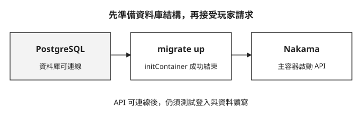
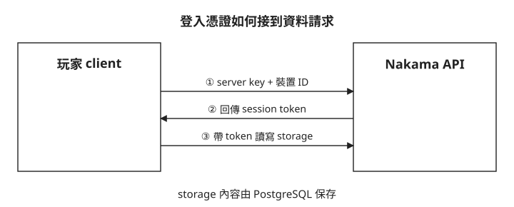

# Day 5: 玩家離開對戰後，資料存在哪裡？

{ align=right width="72" }

玩家完成一場對戰，GameServer 隨後結束。隔天重新登入時，他還應該看得到自己的進度。前幾天建立的 Fleet 與 UDP 路由能讓玩家進入對戰；這份需要跨越對戰生命週期的資料，該由誰保存？

本章用 Nakama 接收玩家的登入與資料讀寫請求，再由 PostgreSQL 保存資料。你會先確認資料庫結構準備完成，再登入、寫入一筆內容並讀回。做完後，遇到「Pod 已經 Running，但玩家仍讀不到資料」，就能分開檢查啟動、身分驗證與資料讀寫三個階段。

## 先分清楚對戰與玩家資料的生命週期

Agones 的 `GameServer` 負責一場正在進行的遊戲；**Nakama** 是遊戲後端伺服器，本章讓它負責辨認玩家與處理持久資料。Nakama 提供的資料讀寫 API 稱為 **storage**；實際資料放在 PostgreSQL，而不是只留在 Nakama Pod 的記憶體。

Nakama 不能在空資料庫裡直接讀寫自己的資料表。啟動前要先執行 **migration**，也就是依版本建立或更新資料庫結構。這裡把 `migrate up` 放進 Kubernetes 的 **initContainer**：它成功結束後，主容器才開始執行。請沿著圖中的順序看，資料庫可連線與 HTTP API 可連線是兩個不同的檢查點。



因此，Nakama 主容器尚未啟動時，要先看 migration 的 log；API 已啟動卻不能存資料時，才繼續檢查登入憑證與 storage 回應。`Running` 本身不足以證明整條流程成功。

## 準備檔案與資料庫密碼

延續前幾天的 Kubernetes 叢集，本章使用單副本 PostgreSQL 16 與 Nakama 3.40.0。**PVC（PersistentVolumeClaim）** 是向 Kubernetes 申請持久儲存空間的資源，本章用它申請保存 PostgreSQL 資料的磁碟空間。**StorageClass** 定義儲存空間的類型與配置方式，讓 Kubernetes 能依 PVC 的需求配置儲存空間。兩者的關係可參考 [Kubernetes 持久儲存文件](https://kubernetes.io/docs/concepts/storage/persistent-volumes/)。

叢集需要具有名為 `default`、可配置 4Gi PVC 的 StorageClass；本機需要 `kubectl`、`openssl` 與 `curl`。這是理解串接方式的配置，尚未涵蓋資料庫高可用、備份還原或多使用者權限測試。

先查詢叢集的 StorageClass 名稱與預設標記（依官方文件補上，本課沒有實跑），指令見 [Kubernetes v1.34 官方文件](https://v1-34.docs.kubernetes.io/docs/tasks/administer-cluster/change-default-storage-class/#changing-the-default-storageclass)：

```bash
kubectl get storageclass
```

`NAME` 欄列出 StorageClass 名稱，名稱後方的 `(default)` 才表示它是叢集預設值。完整的 `postgres.yaml` 明確指定 `storageClassName: default`，因此需要名稱為 `default` 的 StorageClass，不要求它同時是叢集預設值；指定名稱的行為見 [Kubernetes v1.34 PVC Class 文件](https://v1-34.docs.kubernetes.io/docs/concepts/storage/persistent-volumes/#class-1)。若查不到名為 `default` 的項目，就不符合本章前提，請先確認儲存配置再繼續；不能直接假設換成其他 StorageClass 也能成功。

操作使用課程儲存庫的 `labs/sprint5/day5/` 目錄，請先在終端機切換到這個目錄。下面的 YAML 是閱讀用節錄；實際套用的是目錄內完整的 `postgres.yaml` 與 `nakama.yaml`，不能只把節錄存成檔案部署。

建立 `nakama` namespace，並將資料庫密碼存進 Secret：

```bash
kubectl create namespace nakama
kubectl -n nakama create secret generic nakama-db \
  --from-literal=postgres-password="$(openssl rand -hex 24)"
```

<a id="mine-1"></a>

稍後會把密碼放進 `username:password@host:port/database` 格式的連線字串，本章請沿用上面的 `openssl rand -hex 24`，產生只含十六進位字元的密碼。

## 先讓 PostgreSQL 可以保存資料

完整的 [`postgres.yaml`](https://github.com/DeepWaveLab/CloudNativePracticing/blob/main/labs/sprint5/day5/postgres.yaml) 包含 StatefulSet、Service 與 PVC。**StatefulSet** 管理需要固定身分與持久儲存的 Pod，讓本章的 `postgres-0` 在重建後仍能掛回原本的資料儲存空間；這是 [StatefulSet](https://kubernetes.io/docs/concepts/workloads/controllers/statefulset/) 與 PVC 在這裡的用途。閱讀節錄時，先找三個地方：資料庫名稱 `nakama`、密碼取自哪個 Secret，以及資料目錄掛到哪個 volume。

```yaml
apiVersion: apps/v1
kind: StatefulSet
metadata:
  name: postgres
  namespace: nakama
spec:
  serviceName: postgres
  replicas: 1
  template:
    spec:
      containers:
        - name: postgres
          image: postgres:16-alpine
          env:
            - name: POSTGRES_DB
              value: nakama
            - name: POSTGRES_USER
              value: postgres
            - name: POSTGRES_PASSWORD
              valueFrom:
                secretKeyRef:
                  name: nakama-db
                  key: postgres-password
          volumeMounts:
            - name: data
              mountPath: /var/lib/postgresql/data
  volumeClaimTemplates:
    - metadata:
        name: data
      spec:
        resources:
          requests:
            storage: 4Gi
```

在上述目錄執行 `kubectl apply -f postgres.yaml`。已用 `kubectl create` 建立的 namespace 可能出現缺少 `last-applied-configuration` annotation 的警告；它不代表資料庫部署失敗。接著讀實際狀態：

```text
$ kubectl -n nakama get pods,sts,svc,pvc -o wide
NAME                          READY   STATUS    RESTARTS   AGE     IP            NODE                              NOMINATED NODE   READINESS GATES
pod/postgres-0                1/1     Running   0          2m38s   10.244.1.86   aks-system-26490877-vmss000001    <none>           <none>

NAME                        READY   AGE     CONTAINERS   IMAGES
statefulset.apps/postgres   1/1     2m38s   postgres     postgres:16-alpine

NAME               TYPE        CLUSTER-IP    EXTERNAL-IP   PORT(S)                      AGE     SELECTOR
service/postgres   ClusterIP   10.0.36.156   <none>        5432/TCP                     2m38s   app.kubernetes.io/name=postgres

NAME                                    STATUS   VOLUME                                     CAPACITY   ACCESS MODES   STORAGECLASS   VOLUMEATTRIBUTESCLASS   AGE     VOLUMEMODE
persistentvolumeclaim/data-postgres-0   Bound    pvc-<pvc-uuid>   4Gi        RWO            default        <unset>                 2m38s   Filesystem
```

這裡 PostgreSQL 是 `1/1 Running`、PVC 是 `Bound`，表示容器已就緒且儲存空間已配置。`postgres` Service 的 5432 port 則是下一個步驟使用的資料庫入口。輸出中的節點名與 IP 是範例環境的結果，不需要在自己的環境照填。

## 用 migration 與啟動 log 判斷 Nakama 是否就緒

完整的 [`nakama.yaml`](https://github.com/DeepWaveLab/CloudNativePracticing/blob/main/labs/sprint5/day5/nakama.yaml) 讓 migration 與主容器使用同一組資料庫連線設定。看下面兩行執行指令的差別：第一個只更新 schema，第二個才啟動服務。

```yaml
initContainers:
  - name: migrate
    image: heroiclabs/nakama:3.40.0
    command:
      - /bin/sh
      - -ec
    args:
      - |
        DB_ADDR="postgres:${POSTGRES_PASSWORD}@postgres.nakama.svc.cluster.local:5432/nakama"
        /nakama/nakama migrate up --database.address "$DB_ADDR"
containers:
  - name: nakama
    image: heroiclabs/nakama:3.40.0
    command:
      - /bin/sh
      - -ec
    args:
      - |
        DB_ADDR="postgres:${POSTGRES_PASSWORD}@postgres.nakama.svc.cluster.local:5432/nakama"
        exec /nakama/nakama --name nakama-0 --database.address "$DB_ADDR" --logger.level INFO --session.token_expiry_sec 7200
```

執行 `kubectl apply -f nakama.yaml` 後，先查部署狀態。把 `<context-name>` 換成自己叢集的 kubectl context 名稱；若 Nakama Pod 尚未顯示 `1/1 Running`，稍後重複執行同一個查詢：

```text
$ kubectl --context <context-name> -n nakama get pods,deploy,sts,svc,pvc -o wide
```

若持續未就緒，查詢 events，並用下一個 log 指令檢查 `migrate` 容器，確認啟動停在哪個階段：

```text
$ kubectl --context <context-name> -n nakama get events --sort-by='.lastTimestamp'
```

等 Nakama Pod 顯示 `1/1 Running` 後，再依序讀 migration 與主容器的 log，確認是否有下面的成功訊息。先讀 `migrate` 容器：

```text
$ kubectl -n nakama logs deployment/nakama -c migrate --tail=200
{"level":"info","ts":"2026-09-02T02:30:13.597Z","caller":"server/db.go:142","msg":"Database information","version":"PostgreSQL 16.15 on x86_64-pc-linux-musl, compiled by gcc (Alpine 15.2.0) 15.2.0, 64-bit"}
{"level":"info","ts":"2026-09-02T02:30:13.597Z","caller":"migrate/migrate.go:109","msg":"Applying database migrations","limit":-1}
{"level":"info","ts":"2026-09-02T02:30:14.476Z","caller":"migrate/migrate.go:116","msg":"Successfully applied migration","count":19}
```

`Successfully applied migration` 表示這次初始化成功套用 19 個 migration。這是新資料庫的實測結果；已有資料庫再次執行時，不應把「一定要新增 19 個」當成成功條件。

接著讀主容器的 log，確認它連上相同資料庫，並啟動 HTTP API：

```text
$ kubectl -n nakama logs deployment/nakama -c nakama --tail=120
{"level":"info","ts":"2026-09-02T02:30:15.210Z","caller":"main.go:145","msg":"Node","name":"nakama-0","version":"3.40.0+d4d92f9","runtime":"go1.26.5","cpu":2,"proc":2}
{"level":"info","ts":"2026-09-02T02:30:15.240Z","caller":"server/db.go:142","msg":"Database information","version":"PostgreSQL 16.15 on x86_64-pc-linux-musl, compiled by gcc (Alpine 15.2.0) 15.2.0, 64-bit"}
{"level":"info","ts":"2026-09-02T02:30:15.262Z","caller":"server/api.go:329","msg":"Starting API server gateway for HTTP requests","port":7350}
{"level":"info","ts":"2026-09-02T02:30:15.580Z","caller":"main.go:243","msg":"Startup done"}
```

`Starting API server gateway` 指向 7350，`Startup done` 表示啟動完成。再對照 Pod 與 Service：

```text
NAME                          READY   STATUS    RESTARTS   AGE     IP            NODE                              NOMINATED NODE   READINESS GATES
pod/nakama-5fc787f857-qpkfh   1/1     Running   0          2m15s   10.244.2.3    aks-gamesrv-18046246-vmss000003   <none>           <none>

NAME               TYPE        CLUSTER-IP    EXTERNAL-IP   PORT(S)                      AGE     SELECTOR
service/nakama     ClusterIP   10.0.174.16   <none>        7349/TCP,7350/TCP,7351/TCP   2m16s   app.kubernetes.io/name=nakama
```

Service 是 `ClusterIP`，沒有對外 IP。今天只使用 7350 的 REST API；它也提供下一章配對需要的 WebSocket 入口。表中的 7349 與 7351 分別供 gRPC API 與管理介面使用，今天不需要連線。

## 從本機確認 API 入口

在一個終端機保留 port-forward 執行，再開第二個終端機執行 `curl`。兩行指令不會在同一個前景終端機連續完成：

```text
$ kubectl -n nakama port-forward service/nakama 7350:7350
Forwarding from 127.0.0.1:7350 -> 7350
Forwarding from [::1]:7350 -> 7350

$ curl -i -sS http://127.0.0.1:7350/healthcheck
HTTP/1.1 200 OK
Cache-Control: no-store, no-cache, must-revalidate
Content-Type: application/json
Grpc-Metadata-Content-Type: application/grpc
Vary: Accept-Encoding
Date: Wed, 02 Sep 2026 02:30:58 GMT
Content-Length: 2

{}
```

這個 HTTP 200 證明本機能透過 port-forward 連到 Nakama；它還沒有證明某位玩家可以寫入並讀回自己的資料。下一步才會檢查這件事。

## 登入後，帶同一位玩家的憑證讀寫資料

**Device authentication** 用裝置識別字串辨認玩家。本章以它建立測試帳號，Nakama 回傳的 **session token** 是後續 API 請求的登入憑證。先看圖中的兩種憑證：建立登入時使用 server key；登入成功後，資料請求改帶玩家自己的 session token。



`defaultkey` 是這份練習設定的預設 server key。執行範例時，把 `<device-uuid>` 換成自己這次測試的唯一識別字串；後續 `Bearer <redacted>` 要換成登入回應的 `token`，不是 `refresh_token`。`<redacted>` 是紀錄遮蔽值，不能照貼當作憑證。

```text
$ curl -sS -w '\nHTTP_STATUS:%{http_code}\n' \
  -X POST 'http://127.0.0.1:7350/v2/account/authenticate/device?create=true' \
  --user 'defaultkey:' \
  -H 'Content-Type: application/json' \
  -d '{"id":"sprint5-day5-<device-uuid>"}'

{
  "created": true,
  "token": "<redacted>",
  "refresh_token": "<redacted>"
}
HTTP_STATUS:200

$ curl -sS -w '\nHTTP_STATUS:%{http_code}\n' \
  -H 'Authorization: Bearer <redacted>' \
  'http://127.0.0.1:7350/v2/account'

{
  "user": {
    "id": "<user-id>",
    "username": "SnkYKrmmZC",
    "create_time": "2026-09-02T02:31:40Z"
  },
  "wallet": "{}"
}
HTTP_STATUS:200
```

`created: true` 表示建立了帳號；接著 `/v2/account` 回傳的 `user.id`，就是稍後讀取 storage 所需的 `<user-id>`。請記下自己回應中的值，且保持使用同一位玩家的 token。

一筆 **storage object** 用 collection、key 與擁有者識別。**collection** 是資料分組，**key** 是該組裡的物件名稱；以玩家進度為例，可以用 `saves` 分組保存存檔，再用 `savegame` 命名其中一筆進度。這種分組方式可參考 [Nakama collections 文件](https://heroiclabs.com/docs/nakama/concepts/storage/collections/)。

下面實作用玩家自己的 `day5` collection 裡的 `gate` 物件測試讀寫。`value` 存放 JSON 內容，`permission_read: 1` 與 `permission_write: 1` 允許擁有者讀寫。把 `<nonce>` 換成這次測試的識別字串，稍後便能確認讀回的是這一次寫入的資料。

```text
$ curl -sS -w '\nHTTP_STATUS:%{http_code}\n' \
  -X PUT 'http://127.0.0.1:7350/v2/storage' \
  -H 'Authorization: Bearer <redacted>' \
  -H 'Content-Type: application/json' \
  -d '{
    "objects": [
      {
        "collection": "day5",
        "key": "gate",
        "value": "{\"sprint\":5,\"day\":5,\"gate\":\"storage-roundtrip\",\"nonce\":\"20260902T023140Z-<nonce>\"}",
        "permission_read": 1,
        "permission_write": 1
      }
    ]
  }'

{
  "acks": [
    {
      "collection": "day5",
      "key": "gate",
      "version": "dfcdf4139104b7e3adf60672e5dac2c0",
      "user_id": "<user-id>",
      "create_time": "2026-09-02T02:31:40.962190Z",
      "update_time": "2026-09-02T02:31:40.962190Z"
    }
  ]
}
HTTP_STATUS:200
```

寫入回應的 `acks` 是確認訊息；其中 `version` 是這個物件版本的識別值。還要用同一位玩家的 token，以及上一步取得的 `<user-id>` 讀回內容：

```text
$ curl -sS -w '\nHTTP_STATUS:%{http_code}\n' \
  -X POST 'http://127.0.0.1:7350/v2/storage' \
  -H 'Authorization: Bearer <redacted>' \
  -H 'Content-Type: application/json' \
  -d '{
    "object_ids": [
      {
        "collection": "day5",
        "key": "gate",
        "user_id": "<user-id>"
      }
    ]
  }'

{
  "objects": [
    {
      "collection": "day5",
      "key": "gate",
      "user_id": "<user-id>",
      "value": "{\"day\": 5, \"gate\": \"storage-roundtrip\", \"nonce\": \"20260902T023140Z-<nonce>\", \"sprint\": 5}",
      "version": "dfcdf4139104b7e3adf60672e5dac2c0",
      "permission_read": 1,
      "permission_write": 1,
      "create_time": "2026-09-02T02:31:40Z",
      "update_time": "2026-09-02T02:31:40Z"
    }
  ]
}
HTTP_STATUS:200
```

比較 `value` 時，先解析成 JSON 再比欄位內容：回應改變了欄位順序與空白，字串不同不代表資料不同。這裡相同的 collection、key、user id、version 與內容，一起支持「這位玩家剛寫入的資料可以讀回」。單看 HTTP 200 只能證明請求成功回應。

## 想一想

1. healthcheck 回 HTTP 200，卻沒有測 storage，還缺少哪一段證據？
2. migration 成功後，主容器仍連不上資料庫，為什麼要先比對兩者的連線設定？
3. 寫入與讀回的 JSON 欄位順序不同，應如何判斷是不是同一份資料？

## 小結

玩家資料跨越單場對戰的生命週期，所以本章用 Nakama 接收 API 請求、PostgreSQL 保存資料。追查問題時依序區分資料庫與 migration、API 入口、玩家憑證及 storage 內容。正式服務還需要另外規劃資料庫備份與高可用、更換預設金鑰、設定對外入口與 TLS，並測試權限拒絕與並行寫入衝突，這些都不能由本章單一玩家的成功讀寫推論。

## 延伸閱讀

想再深入，可以從這幾份開始：

- [Nakama commands](https://heroiclabs.com/docs/nakama/getting-started/commands/)：查 `migrate up` 與資料庫連線參數。
- [Storage collections](https://heroiclabs.com/docs/nakama/concepts/storage/collections/)：查 collection、key 與物件的識別方式。
- [Storage permissions](https://heroiclabs.com/docs/nakama/concepts/storage/permissions/)：對照讀寫權限數值。

## 下一步

玩家能登入與保存資料後，還需要知道去哪一台 GameServer。[Day 6](sprint5-day6-matchmaking.md) 會把兩位玩家的配對結果接到 Agones allocation，並讓他們收到同一組遊戲伺服器位置。

---

!!! quote ""
    Nakama 標誌為 Heroic Labs 之官方資產，此處作社群教學用途。
