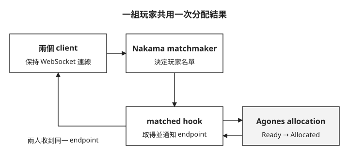

# Day 6: 兩位玩家配對後，如何進入同一台 GameServer？

{ align=right width="72" }

兩位玩家都已登入，也按下「開始配對」。其中一人拿到伺服器位置，另一人卻一直等待；或者兩人各自進入不同伺服器。這時只確認登入成功，無法回答問題：誰決定這兩個人是一組，又由誰替這一組保留同一台遊戲伺服器？

本章把這兩個決定接起來。你會讀 Nakama 的配對事件、Agones 的分配回應，再對照兩位 client 收到的位置。判斷成功的依據是「同一組玩家收到同一次 allocation 的結果」，而不只是某個 API 回應成功。

## Matchmaking 與 allocation 是兩件事

先看玩家名單。Nakama 內建的 **matchmaker** 負責配對：把符合條件的玩家湊成一組，讓每個 client 都收到同一場配對成立的事件。Agones 負責分配 server：從 Ready pool 裡挑一顆 `GameServer`，把它轉成 `Allocated`，並回傳玩家可以連線的 address:port。只完成湊人，玩家還不知道要連去哪裡；只做 allocation，分配結果尚未對應玩家名單。兩者中間要有一段程式把它們接起來。

配對一成立就要執行分配，所以需要能在 Nakama 裡執行的自訂程式，稱為 **server runtime module**。它是跑在 Nakama 裡的自訂後端邏輯，可以用 Lua、Go 或 JavaScript/TypeScript 寫；module 在 Nakama 啟動時載入，用 **hook** 註冊事件發生時要執行的函式。`matchmaker_matched` hook 剛好是接 Agones 的位置：Nakama 已經決定哪些玩家湊成同一組，但 client 還需要同一組遊戲伺服器 endpoint。

hook 要建立 `GameServerAllocation`，就是呼叫 Kubernetes API。Kubernetes API 不會因為請求來自叢集內就自動信任它；Nakama Pod 用 **ServiceAccount token** 證明它代表哪個工作負載，再透過 **RBAC** 規則取得權限，才被允許在 Agones Fleet 所在 namespace 建立 `gameserverallocations`。本章新增的 Role 只授予 create allocation；它本身不授予列出或修改 `GameServer` 的權限。實際有效權限仍會包含同一身分的其他 RoleBinding。

先順著圖看伺服器端的兩個決定，再看結果如何回到同一組玩家。圖中的 endpoint 就是可以連線的位址與 port。



分配只做一次，通知卻要送給每位玩家。若兩邊各自呼叫 allocation，就可能拿到不同 GameServer；把分配放在同一次配對的 hook 裡，才能共用結果。

### 配對結果怎麼回到 client

client 完成 Day 5 的登入後，先開 realtime WebSocket，再送 `matchmaker_add`。這是持續連線的介面，Nakama 可以在配對成立時主動傳回訊息。之後不再主動發問，而是在同一條 socket 上等 server 推訊息下來。它會收到兩則訊息：

- **`matchmaker_matched`**：Nakama 內建的配對成立事件，列出同組有哪些玩家。
- **code `6006` 的 notification**：本章 Lua hook 自己送出的通知，內容是 Agones 分配到的 `address`、`port` 與 `GameServer` 名稱。`6006` 是本章自訂的通知代碼，client 靠它分辨「這是 server endpoint」。

把 endpoint 送回 client 還有另一種做法：client 收到 `matchmaker_matched` 後，透過 RPC（呼叫後端自訂函式）查詢「我該連哪裡」。這裡選 notification，因為配對成立的時間點由 server 決定，由 server 主動推比 client 事後來問少一次來回。

`matchmaker_matched` 裡也有一個 `token` 欄位，但它和 Day 4 的 Quilkin routing token 無關。這個 token 是給 Nakama 自己的多人對戰（client relayed match）用的，client 拿它呼叫 match join，就能加入一場由 Nakama 轉送訊息的對戰。對戰跑在 Agones 的 dedicated game server 上時，不走 Nakama match，這個 token 用不到，client 真正要用的是 notification 裡的 address:port。

## 先確認部署位置與既有資源

本章沿用 Day 5 的 `nakama` namespace、PostgreSQL 與 Nakama Service，以及 `default` namespace 裡的 `simple-game-server` Fleet。至少要有一顆 Ready GameServer，配對成功後才有伺服器可分配。若仍沿用 Day 3 的 buffer autoscaler，分配後會補足 Ready 容量；固定 replicas 的 Fleet 不會因 allocation 自動擴大。

請在課程儲存庫的 `labs/sprint5/day6/` 目錄操作，使用其中完整的 `rbac.yaml`、`nakama-module-configmap.yaml`、`nakama-deployment.yaml` 與 `mm_client.py`。以下程式與 Deployment YAML 是重點節錄，不是完整可部署檔案。本機需有 Python 3 與 `websockets` 套件；client 連到本機 7350，由 port-forward 接到 Nakama。

## 步驟 1:授權 Nakama 建立 GameServerAllocation

RBAC 只開 `create gameserverallocations`，而且 Role 放在 Agones Fleet 所在的 `default` namespace（完整檔案：[rbac.yaml](https://github.com/DeepWaveLab/CloudNativePracticing/blob/main/labs/sprint5/day6/rbac.yaml)）：

```yaml
apiVersion: rbac.authorization.k8s.io/v1
kind: Role
metadata:
  name: nakama-gameserverallocation-create
  namespace: default
rules:
  - apiGroups:
      - allocation.agones.dev
    resources:
      - gameserverallocations
    verbs:
      - create
---
apiVersion: rbac.authorization.k8s.io/v1
kind: RoleBinding
metadata:
  name: nakama-gameserverallocation-create
  namespace: default
roleRef:
  apiGroup: rbac.authorization.k8s.io
  kind: Role
  name: nakama-gameserverallocation-create
subjects:
  - kind: ServiceAccount
    name: nakama
    namespace: nakama
```

用前章的 `kubectl apply -f` 方式套用完整 `rbac.yaml` 後，再以 `kubectl auth can-i` 確認這個 ServiceAccount 能否建立 allocation：

```text
$ kubectl auth can-i create gameserverallocations.allocation.agones.dev --as=system:serviceaccount:nakama:nakama -n default
yes
```

`yes` 回答的是這次詢問的 create 權限；它沒有檢查網路連線，也沒有證明 Pod 已掛載 token。下一步補上這兩者之間的程式。

## 步驟 2:掛入 Lua runtime module

Lua module 放在 ConfigMap `nakama-agones-matchmaker` 裡（完整檔案：[nakama-module-configmap.yaml](https://github.com/DeepWaveLab/CloudNativePracticing/blob/main/labs/sprint5/day6/nakama-module-configmap.yaml)）。主線是四步：讀 ServiceAccount token、POST `GameServerAllocation`、從回應取 `status.address` 與 `status.ports[].port`、把 endpoint 通知給 matched users。呼叫 Kubernetes API 的部分：

```lua
local function allocate_gameserver(context)
  local token = context.env and context.env["K8S_TOKEN"] or nil
  if token == nil or token == "" then
    error("K8S_TOKEN runtime env is missing")
  end

  local allocation_body = nk.json_encode({
    apiVersion = "allocation.agones.dev/v1",
    kind = "GameServerAllocation",
    spec = {
      selectors = {
        {
          matchLabels = {
            ["agones.dev/fleet"] = "simple-game-server",
          },
        },
      },
    },
  })

  local headers = {
    ["Authorization"] = "Bearer " .. token,
    ["Content-Type"] = "application/json",
    ["Accept"] = "application/json",
  }

  local code, _, body = nk.http_request(
    "https://kubernetes.default.svc/apis/allocation.agones.dev/v1/namespaces/default/gameserverallocations",
    "POST",
    headers,
    allocation_body,
    5000,
    true
  )
```

`nk.http_request` 的最後一個參數 `true` 會略過 TLS 驗證，只適合 lab。回應的 `status.state` 不是 `Allocated`、或缺 address 與 port 時，完整版會直接 `error()`，讓 Nakama log 留下原因。

配對成立後，hook 對每個 matched user 送 persistent notification：

```lua
local function matchmaker_matched(context, matched_users)
  nk.logger_info(string.format("sprint5-day6 matchmaker_matched users=%d", #matched_users))

  local allocation = allocate_gameserver(context)
  local content = {
    address = allocation.address,
    port = allocation.port,
    gameserver = allocation.gameserver,
    endpoint = string.format("%s:%s", allocation.address, tostring(allocation.port)),
  }

  for _, entry in ipairs(matched_users) do
    nk.notification_send(
      entry.presence.user_id,
      "sprint5-day6-allocation",
      content,
      6006,
      "",
      true
    )
  end

  return ""
end

nk.register_matchmaker_matched(matchmaker_matched)
```

Deployment 要開 pod 內的 ServiceAccount token，並把 ConfigMap 的 `main.lua` 用 `subPath` 掛成單檔（完整檔案：[nakama-deployment.yaml](https://github.com/DeepWaveLab/CloudNativePracticing/blob/main/labs/sprint5/day6/nakama-deployment.yaml)）：

```yaml
spec:
  serviceAccountName: nakama
  automountServiceAccountToken: true
  containers:
    - name: nakama
      args:
        - |
          DB_ADDR="postgres:${POSTGRES_PASSWORD}@postgres.nakama.svc.cluster.local:5432/nakama"
          K8S_TOKEN="$(cat /var/run/secrets/kubernetes.io/serviceaccount/token)"
          exec /nakama/nakama --name nakama-0 --database.address "$DB_ADDR" --logger.level INFO --session.token_expiry_sec 7200 --runtime.path /nakama/data/modules --runtime.env "K8S_TOKEN=${K8S_TOKEN}"
      volumeMounts:
        - name: runtime-modules
          mountPath: /nakama/data/modules/main.lua
          subPath: main.lua
          readOnly: true
```

<a id="mine-1"></a>
<a id="mine-2"></a>

`automountServiceAccountToken: true` 要寫在 pod spec，因為 Day 5 的 ServiceAccount 關掉了自動掛載，需要在這裡覆蓋設定，Pod 才會掛載 Kubernetes API token。用 `subPath` 是為了避免 Nakama 掃到 ConfigMap 投影目錄裡的同一份 Lua 檔兩次。

先套用完整 `nakama-module-configmap.yaml`，再套用 `nakama-deployment.yaml`，讓新的 Pod 掛到 module。這份 Deployment 已包含 module revision annotation；之後若只修改 ConfigMap，還要觸發新的 Pod，不能期待 `subPath` 掛載的檔案自動更新。

## 步驟 3:確認 Nakama 載入 module 並註冊 hook

重啟後，Nakama log 必須同時出現 module 載入、module count 與 hook registration：

```text
$ kubectl -n nakama logs deployment/nakama -c nakama --tail=120
{"level":"info","ts":"2026-09-05T05:18:32.957Z","caller":"server/runtime.go:671","msg":"Initialising runtime","path":"/nakama/data/modules"}
{"level":"info","ts":"2026-09-05T05:18:32.958Z","caller":"server/runtime_lua.go:119","msg":"Initialising Lua runtime provider","path":"/nakama/data/modules"}
{"level":"info","ts":"2026-09-05T05:18:32.962Z","caller":"server/runtime_lua_nakama.go:2373","msg":"sprint5-day6 Agones matchmaker module loaded","runtime":"lua"}
{"level":"info","ts":"2026-09-05T05:18:32.963Z","caller":"server/runtime_lua.go:1288","msg":"Lua runtime modules loaded"}
{"level":"info","ts":"2026-09-05T05:18:32.963Z","caller":"server/runtime.go:771","msg":"Found runtime modules","count":1,"modules":["main.lua"]}
{"level":"info","ts":"2026-09-05T05:18:32.963Z","caller":"server/runtime.go:2657","msg":"Registered Lua runtime Matchmaker Matched function invocation"}
{"level":"info","ts":"2026-09-05T05:18:33.313Z","caller":"main.go:243","msg":"Startup done"}
```

<a id="mine-3"></a>

要看的是 `count=1`。若顯示 `count=2` 並載入兩次同名 module，通常是整個 ConfigMap 目錄被掛進 runtime path。Nakama rollout 之後，先前的 port-forward 可能還指向已刪除的 Pod。請在另一個終端機重新執行 `kubectl -n nakama port-forward svc/nakama 7350:7350` 並保持它開著，再測 client。

## 步驟 4:送兩個 realtime client 進 matchmaker

配對成立時 hook 要分配一顆 server，所以 `simple-game-server` Fleet 至少要有 1 顆 Ready。

本機需先安裝 Python 3.12，以下在 `labs/sprint5/day6/` 目錄使用 bash／zsh 操作。

先建立並啟用虛擬環境，安裝 `websockets==17.1` 並檢查能否匯入（依官方文件補上，本課沒有實跑；參考 [Python 3.12 虛擬環境與套件安裝](https://docs.python.org/3.12/tutorial/venv.html)、[websockets 17.1 安裝文件](https://websockets.readthedocs.io/en/17.1/intro/index.html)）：

```bash
python3.12 -m venv .venv
source .venv/bin/activate
python -m pip install "websockets==17.1"
python -c "import websockets"
```

後續的 `python3 mm_client.py` 請在同一個已啟用虛擬環境的終端機執行。

測試 client（[mm_client.py](https://github.com/DeepWaveLab/CloudNativePracticing/blob/main/labs/sprint5/day6/mm_client.py)）做三件事：REST device auth、WebSocket 送 `matchmaker_add`、等待 `matchmaker_matched` 與 code `6006` notification。它用 Python 的 `websockets` 套件開 realtime socket（沿用已安裝 `websockets` 的 Python 環境），下面只列等待訊息的迴圈。結束條件要兩者都滿足：

```python
while time.monotonic() < deadline and (endpoint is None or matched is None):
    raw = await asyncio.wait_for(socket.recv(), timeout=max(1, deadline - time.monotonic()))
    message = json.loads(raw)

    if "matchmaker_matched" in message:
        matched = message["matchmaker_matched"]

    for notification in message.get("notifications", {}).get("notifications", []):
        content = notification.get("content", {})
        if isinstance(content, str):
            content = json.loads(content)
        if notification.get("code") == 6006:
            endpoint = content
```

<a id="mine-4"></a>

client 必須同時收到 `matchmaker_matched` 與 code `6006` 通知才結束，不能依賴兩者的先後順序；只等 notification 就離線，可能漏掉配對事件。

先查詢 `default` namespace 的 GameServer 狀態，把 `<context>` 換成你的 Kubernetes context。下面的 `simple-game-server-ql5ws-qknrb` 還是 Ready，port 是 7170；輸出中的 `20.89.45.184` 對應 client 與 hook 範例裡的 `<NODE-IP>`。

```text
$ kubectl --context <context> -n default get gs -o wide
NAME                             STATE       ADDRESS        PORT   NODE                              AGE
simple-game-server-ql5ws-b5xr7   Allocated   20.89.45.184   7499   aks-gamesrv-18046246-vmss000003   5d2h
simple-game-server-ql5ws-jkzn4   Allocated   20.89.45.184   7441   aks-gamesrv-18046246-vmss000003   3d3h
simple-game-server-ql5ws-khc5t   Allocated   20.89.45.184   7107   aks-gamesrv-18046246-vmss000003   5d2h
simple-game-server-ql5ws-qknrb   Ready       20.89.45.184   7170   aks-gamesrv-18046246-vmss000003   2m19s
simple-game-server-ql5ws-w46dh   Ready       20.89.45.184   7122   aks-gamesrv-18046246-vmss000003   3m49s
```

接著執行 `python3 mm_client.py`。下表整理兩個 client 收到的事件與分配結果，省略身分、session、ticket、token 與通知時間等欄位；完整輸出保留在下方。

| 比較項目 | client-a | client-b |
|---|---|---|
| 配對事件 | 收到 `matchmaker_matched` | 收到 `matchmaker_matched` |
| 分配通知 | 收到 code `6006` | 收到 code `6006` |
| GameServer | `simple-game-server-ql5ws-qknrb` | `simple-game-server-ql5ws-qknrb` |
| endpoint | `<NODE-IP>:7170` | `<NODE-IP>:7170` |

兩人的 GameServer 名稱與 endpoint 都相同，`SUMMARY` 的 `same_endpoint` 也為 `true`。

<details markdown="1">
<summary>client 執行指令與完整輸出</summary>

```text
$ python3 mm_client.py
client-a: auth user_id=<user-a> token=<redacted>
client-b: auth user_id=<user-b> token=<redacted>
client-a: ws {"cid": "client-a", "matchmaker_ticket": {"ticket": "<ticket-a>"}}
client-b: ws {"cid": "client-b", "matchmaker_ticket": {"ticket": "<ticket-b>"}}
client-b: ws {"notifications": {"notifications": [{"code": 6006, "content": "{\"address\":\"<NODE-IP>\",\"endpoint\":\"<NODE-IP>:7170\",\"gameserver\":\"simple-game-server-ql5ws-qknrb\",\"port\":7170}", "create_time": "2026-09-05T05:19:18Z", "id": "<notif-b>", "persistent": true, "sender_id": "<system-sender>", "subject": "sprint5-day6-allocation"}]}}
client-b: ws {"matchmaker_matched": {"self": {"presence": {"session_id": "<session-b>", "user_id": "<user-b>", "username": "WxTuzBAMQU"}}, "ticket": "<ticket-b>", "token": "<redacted>", "users": [{"presence": {"session_id": "<session-b>", "user_id": "<user-b>", "username": "WxTuzBAMQU"}}, {"presence": {"session_id": "<session-a>", "user_id": "<user-a>", "username": "MXqRJCrXaj"}}]}}
client-a: ws {"notifications": {"notifications": [{"code": 6006, "content": "{\"address\":\"<NODE-IP>\",\"endpoint\":\"<NODE-IP>:7170\",\"gameserver\":\"simple-game-server-ql5ws-qknrb\",\"port\":7170}", "create_time": "2026-09-05T05:19:18Z", "id": "<notif-a>", "persistent": true, "sender_id": "<system-sender>", "subject": "sprint5-day6-allocation"}]}}
client-a: ws {"matchmaker_matched": {"self": {"presence": {"session_id": "<session-a>", "user_id": "<user-a>", "username": "MXqRJCrXaj"}}, "ticket": "<ticket-a>", "token": "<redacted>", "users": [{"presence": {"session_id": "<session-b>", "user_id": "<user-b>", "username": "WxTuzBAMQU"}}, {"presence": {"session_id": "<session-a>", "user_id": "<user-a>", "username": "MXqRJCrXaj"}}]}}
SUMMARY {"endpoint": "<NODE-IP>:7170", "results": [{"allocation": {"address": "<NODE-IP>", "endpoint": "<NODE-IP>:7170", "gameserver": "simple-game-server-ql5ws-qknrb", "port": 7170}, "client": "client-a", "matched": {"self": {"presence": {"session_id": "<session-a>", "user_id": "<user-a>", "username": "MXqRJCrXaj"}}, "ticket": "<ticket-a>", "token": "<redacted>", "users": [{"presence": {"session_id": "<session-b>", "user_id": "<user-b>", "username": "WxTuzBAMQU"}}, {"presence": {"session_id": "<session-a>", "user_id": "<user-a>", "username": "MXqRJCrXaj"}}]}, "notifications_count": 1, "user_id": "<user-a>"}, {"allocation": {"address": "<NODE-IP>", "endpoint": "<NODE-IP>:7170", "gameserver": "simple-game-server-ql5ws-qknrb", "port": 7170}, "client": "client-b", "matched": {"self": {"presence": {"session_id": "<session-b>", "user_id": "<user-b>", "username": "WxTuzBAMQU"}}, "ticket": "<ticket-b>", "token": "<redacted>", "users": [{"presence": {"session_id": "<session-b>", "user_id": "<user-b>", "username": "WxTuzBAMQU"}}, {"presence": {"session_id": "<session-a>", "user_id": "<user-a>", "username": "MXqRJCrXaj"}}]}, "notifications_count": 1, "user_id": "<user-b>"}], "same_endpoint": true}
```

</details>

注意 notification 比 `matchmaker_matched` 先到：hook 在 Nakama 送出 matched 事件之前執行，所以 client 不能假設先後順序。

再查 Nakama hook log，對照配對人數、分配到的 GameServer 與 endpoint：

```text
$ kubectl -n nakama logs deployment/nakama -c nakama --since=3m | grep 'sprint5-day6'
{"level":"info","ts":"2026-09-05T05:18:32.962Z","caller":"server/runtime_lua_nakama.go:2373","msg":"sprint5-day6 Agones matchmaker module loaded","runtime":"lua"}
{"level":"info","ts":"2026-09-05T05:19:17.964Z","caller":"server/runtime_lua_nakama.go:2370","msg":"sprint5-day6 matchmaker_matched users=2","runtime":"lua","mode":"matchmaker"}
{"level":"info","ts":"2026-09-05T05:19:18.203Z","caller":"server/runtime_lua_nakama.go:2370","msg":"sprint5-day6 allocation response {\"address\":\"<NODE-IP>\",\"gameserver\":\"simple-game-server-ql5ws-qknrb\",\"port\":7170,\"state\":\"Allocated\"}","runtime":"lua","mode":"matchmaker"}
{"level":"info","ts":"2026-09-05T05:19:18.211Z","caller":"server/runtime_lua_nakama.go:2370","msg":"sprint5-day6 allocated gameserver=simple-game-server-ql5ws-qknrb endpoint=<NODE-IP>:7170 users=2","runtime":"lua","mode":"matchmaker"}
```

`users=2` 對應這次配對的兩位玩家；allocation 回應的 `simple-game-server-ql5ws-qknrb` 與 `<NODE-IP>:7170` 也和兩個 client 收到的一致。

最後再查一次 GameServer 狀態，和執行 client 前的輸出比較：

```text
$ kubectl --context <context> -n default get gs -o wide
NAME                             STATE       ADDRESS        PORT   NODE                              AGE
simple-game-server-ql5ws-8rhnv   Ready       20.89.45.184   7295   aks-gamesrv-18046246-vmss000003   8s
simple-game-server-ql5ws-b5xr7   Allocated   20.89.45.184   7499   aks-gamesrv-18046246-vmss000003   5d2h
simple-game-server-ql5ws-jkzn4   Allocated   20.89.45.184   7441   aks-gamesrv-18046246-vmss000003   3d3h
simple-game-server-ql5ws-khc5t   Allocated   20.89.45.184   7107   aks-gamesrv-18046246-vmss000003   5d2h
simple-game-server-ql5ws-qknrb   Allocated   20.89.45.184   7170   aks-gamesrv-18046246-vmss000003   2m38s
simple-game-server-ql5ws-w46dh   Ready       20.89.45.184   7122   aks-gamesrv-18046246-vmss000003   4m8s
```

`simple-game-server-ql5ws-qknrb` 從 Ready 轉成 Allocated，位址與 port 維持 `20.89.45.184:7170`。原本已有的三顆 Allocated 沒有改變，這次只新增一次 allocation；沿用的 buffer autoscaler 另補出一顆 Ready 的 `simple-game-server-ql5ws-8rhnv`。

## 想一想

1. RBAC 查詢回 `yes`，Pod 卻找不到 token 檔案，還缺少哪一項部署設定？
2. client 只收到 code `6006` 通知便離線，為什麼不能據此認定它也收到配對事件？
3. 兩位玩家都收到 endpoint，還要如何確認那是同一次 allocation 的結果？

## 小結

本章讓 Nakama 決定玩家名單，再由同一次 hook 向 Agones 取得一台 GameServer，將同一份結果送給所有 matched users。判讀時要把身分與授權、module 載入、兩種 client 訊息及 GameServer 狀態接起來看。拿到 endpoint 仍不代表 UDP 已送達；這是下一章要補的證據。

## 正式環境還要補的

這裡的 hook 呼叫 Kubernetes API 時略過了 TLS 驗證（`insecure=true`），正式環境要改成驗證叢集 CA。allocation 失敗時也只會在 Nakama log 留下錯誤，client 收不到 allocation 通知；後續需設計失敗回報，以及能避免重複分配的重試策略。ServiceAccount token 在本例啟動時讀取一次，也沒有實作長時間執行時的憑證更新。

## 延伸閱讀

想再深入，可以從這幾份開始：

- **[Nakama Lua runtime](https://heroiclabs.com/docs/nakama/server-framework/lua-runtime/)** —— 查 Lua module 載入、runtime API 與 hook 寫法。
- **[Nakama configuration](https://heroiclabs.com/docs/nakama/getting-started/configuration/)** —— 對照本章用 `--runtime.env` 把 Kubernetes token 傳入 Lua context 的做法。
- **[Nakama matchmaker](https://heroiclabs.com/docs/nakama/concepts/multiplayer/matchmaker/)** —— 查 realtime matchmaker、`matchmaker_add` 與 matched event 的語意。
- **[Nakama notifications](https://heroiclabs.com/docs/nakama/concepts/notifications/)** —— 對照本章用 code `6006` persistent notification 把 allocation 結果送回 client。
- **[Agones access API](https://agones.dev/site/docs/guides/access-api/)** —— 查從 Kubernetes API 建立 `GameServerAllocation` 與讀取 allocation status 的路徑。

## 下一步

到這裡，玩家可以登入 Nakama、進 matchmaker，並拿到 Agones 分配的 `GameServer` endpoint。[Day 7](sprint5-day7-python-client-e2e.md) 換到玩家那一側，用一支只靠 Python 標準函式庫的 client 走完登入、配對、RPC 查詢，再把 UDP 封包經 Quilkin 送進分配到的 GameServer。

---

!!! quote ""
    Nakama 標誌為 Heroic Labs 之官方資產，此處作社群教學用途。
