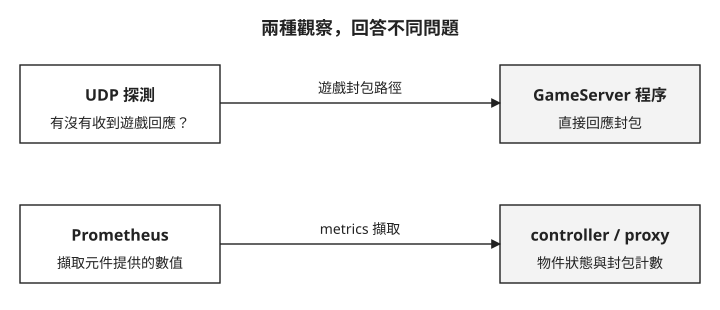

# Day 8: 玩家已經斷線，為什麼 GameServer 還顯示 Allocated？

{ align=right width="90" }

玩家連續收不到遊戲回應，但儀表板仍顯示一顆 Allocated、一顆 Ready。這兩個數字沒有變，是監控壞了，還是它們原本就回答不同問題？如果 Fleet 稍後補出新的 Ready，原本那場對戰會跟著恢復嗎？

本章用四種情況比較答案：遊戲主動結束、程序崩潰、Fleet 縮容與節點失效。你會對照封包探測、Kubernetes 節點、GameServer 物件與 metrics，判斷每個訊號何時改變，以及它能證明什麼。下文秒數都是這次環境的觀察值，不是服務恢復時限。

## 先區分玩家連得上與平台狀態已更新

從玩家這一側看，收不到回應可能有許多原因。本章刻意製造四種條件，觀察平台如何處理；它們不是所有故障的分類。先讀表裡的「玩家端」，再比較 GameServer 物件的狀態：

| 結束方式 | 誰觸發 | GameServer 狀態 | 玩家端 |
|---|---|---|---|
| 遊戲主動收掉 | 遊戲程式呼叫 SDK `Shutdown()` | `Shutdown`，隨後刪除 | 對戰已經結束，正常收場 |
| 程序崩潰 | 遊戲程序異常結束或停止回報 health | `Unhealthy`，Fleet 刪掉並補新的 | 對戰中斷 |
| Fleet 縮容 | 調低 replicas | 本次刪除 `Ready`，保留 `Allocated` | 這次縮容未終止已分配伺服器 |
| 節點失效 | 本章關閉演練 VM | 本次在 Pod 驅逐後觀察到 `Unhealthy` | 先失去回應，物件狀態稍後才更新 |

本次前三種操作後，數秒內就觀察到 GameServer 狀態變化；節點失效卻經過數分鐘。關鍵是「資料來源」：玩家探測的是封包是否回來，controller 處理的是 Kubernetes 與 GameServer 物件的變化，兩者不會同步更新。

**metrics** 是元件對外提供的數值；本章用 **Prometheus** 定期擷取並保存它們，這個擷取動作稱為 **scrape**。Agones controller 的 `agones_gameservers_count` 依 Fleet 與狀態分組回報 GameServer 數量，資料來源是 GameServer 物件本身，沒有去探測 server 活著沒有。節點失聯但物件還沒更新的那段時間，metrics 也會照舊回報。

節點失效演練會關掉整台 VM，所以演練 Fleet 放在帶 taint 的專用節點池上，只有明確宣告 toleration 的 pod 會排上去。關機前要確認目標節點上沒有演練以外的工作負載，例如正式 Fleet、Quilkin proxy 或 Nakama。

先看下圖的兩種資料來源：UDP 探測直接看遊戲回應，Prometheus 則讀元件提供的計數。即使兩者都正常運作，也可能暫時呈現不同結果。



所以 GameServer 計數適合觀察平台管理的物件與容量；要判斷玩家是否真的能遊戲，還要對照封包探測與節點健康。

操作沿用 Day 7 的 `gslab` 節點池、`lab-game-server` Fleet 與 Quilkin。請在課程儲存庫的 `labs/sprint5/day8/` 目錄操作，使用完整 manifest 與 `probe.py`；下方 YAML 節錄只供解讀。開始時需有兩顆 Ready GameServer，且 `lab-game-server` 沒有 FleetAutoscaler，否則 autoscaler 可能把手動設定的 replicas 改回去。本機還需要支援範例 UDP 選項的 `nc`、Python 3 與 Azure CLI。

本章的完整檔案在 [labs/sprint5/day8/](https://github.com/DeepWaveLab/CloudNativePracticing/tree/main/labs/sprint5/day8)。

## 步驟 1:部署 Prometheus，抓 Agones 與 Quilkin

先用已熟悉的 `kubectl apply -f` 方式套用完整 `prometheus-lab.yaml`。Prometheus 用單一 Deployment 部署在 `monitoring-lab` namespace，同樣靠 `nodeSelector` 與 toleration 跑在專用節點池上，image 是 `prom/prometheus:v3.5.0`（完整檔案：[prometheus-lab.yaml](https://github.com/DeepWaveLab/CloudNativePracticing/blob/main/labs/sprint5/day8/prometheus-lab.yaml)）。它需要列出 pod 才能找到抓取目標，所以在 `agones-system` 與 `default` 各給一組只讀 pods 的 Role，subject 是 `monitoring-lab` 的 ServiceAccount `prometheus`：

```yaml
apiVersion: rbac.authorization.k8s.io/v1
kind: Role
metadata:
  name: prometheus-lab-discovery
  namespace: agones-system
rules:
  - apiGroups: [""]
    resources: [pods]
    verbs: [get, list, watch]
```

抓取設定如下。兩個 job 都用 `kubernetes_sd_configs` 找出各個 pod，逐一直接抓取。Agones controller 的副本透過 leader election 選出 **leader**（目前負責控制工作的副本），其餘副本是 standby；GameServer 相關 metrics 只有 leader 提供。若透過 Service 抓取，請求可能被分到 standby，即使 target 顯示 `up`，也查不到 GameServer 計數。直接抓每個 pod，才能持續擷取 leader 提供的指標：

```yaml
global:
  scrape_interval: 5s
scrape_configs:
  - job_name: agones-controller
    kubernetes_sd_configs:
      - role: pod
        namespaces:
          names: [agones-system]
    relabel_configs:
      - source_labels: [__meta_kubernetes_pod_label_agones_dev_role]
        regex: controller
        action: keep
      - source_labels: [__meta_kubernetes_pod_ip]
        target_label: __address__
        replacement: "$1:8080"
      - source_labels: [__meta_kubernetes_pod_name]
        target_label: pod
  - job_name: quilkin-proxies
    fallback_scrape_protocol: PrometheusText0.0.4
    kubernetes_sd_configs:
      - role: pod
        namespaces:
          names: [default]
    relabel_configs:
      - source_labels: [__meta_kubernetes_pod_label_role]
        regex: proxy
        action: keep
      - source_labels: [__meta_kubernetes_pod_ip]
        target_label: __address__
        replacement: "$1:8000"
      - source_labels: [__meta_kubernetes_pod_name]
        target_label: pod
```

Quilkin 0.10 的 admin `/metrics` 回應沒有帶 `Content-Type`，Prometheus 3.x 不會自動把這種回應當成文字格式處理。因此上面的 Quilkin job 已設定 `fallback_scrape_protocol: PrometheusText0.0.4`，讓 Prometheus 在 `Content-Type` 空白或無效時，改用指定的文字格式解析。設定選項見 [Prometheus configuration](https://prometheus.io/docs/prometheus/latest/configuration/configuration/#scrape_config)。

Agones controller 的 metrics 在 port 8080，Quilkin proxy 的在 admin port 8000。把 `monitoring-lab` namespace 的 `prometheus` Deployment 之 9090 port-forward 到本機，保留該終端機，再於瀏覽器開啟 `http://127.0.0.1:9090`。在 Targets 頁（或查 `/api/v1/targets`），本次環境看到 2 個 `agones-controller` target 與 3 個 `quilkin-proxies` target 都是 `up`。

Prometheus 把同一指標名稱、同一組標籤的數值，連同每次擷取的時間保存下來，這一串紀錄就叫「時間序列」（time series，下文簡稱 series）。例如固定 Fleet、狀態與來源 pod，就能觀察該組 GameServer 計數隨時間的變化；任一標籤值不同，就屬於另一條時間序列。詳見 [Prometheus data model](https://prometheus.io/docs/concepts/data_model/)。

在 Prometheus 的查詢欄輸入 `agones_gameservers_count{fleet_name="lab-game-server",type="Ready"}`。結果應等於 Ready 的顆數，這裡是 2；只有 leader 提供這組時間序列，因此查詢時不必指定 pod。

同一時間 kubectl 看到的也是 2 顆 Ready：

```text
NAME                          STATE   ADDRESS        PORT   NODE
lab-game-server-s7xfm-2gcfx   Ready   <NODE-IP>      7114   aks-gslab-97904148-vmss000000
lab-game-server-s7xfm-4cl5c   Ready   <NODE-IP>      7356   aks-gslab-97904148-vmss000000
```

Quilkin 則提供封包、丟包與 endpoint 數量等 23 個 `quilkin_` 開頭的 series，例如 `quilkin_packets_total`（依 `event` 分成 read 與 write）、`quilkin_packets_dropped_total` 與 `quilkin_active_endpoints`。封包 counters 從 proxy 啟動後開始累積，包含收到的其他流量；`active_endpoints` 則是當下數量，不能當作累積封包數。本次查到其中一顆 proxy 的 read 是 614、write 是 1，dropped 卻有 1363；另一顆的 dropped 是 15868。

這些是不同 proxy 的累積數值，不能直接算成本章玩家的丟包率。錯誤 token 可能讓封包被丟棄，但這份資料沒有按原因、玩家或時間區間分離；也不能僅因入口對外開放，就斷言所有 dropped 都來自外部掃描。

## 步驟 2:graceful shutdown——送 `EXIT`

先從遊戲主動通知結束開始，這稱為 **graceful shutdown**。接下來的 `EXIT`、`CRASH` 與縮容測試都用一份只指定 Fleet 的 allocation（[gsa-lab.yaml](https://github.com/DeepWaveLab/CloudNativePracticing/blob/main/labs/sprint5/day8/gsa-lab.yaml)），用 `kubectl create -f gsa-lab.yaml` 分配：

```yaml
apiVersion: allocation.agones.dev/v1
kind: GameServerAllocation
spec:
  selectors:
    - matchLabels:
        agones.dev/fleet: lab-game-server
```

另開一個終端機持續觀察演練 Fleet 的 GameServer 狀態，每行加上 UTC 時間：

```console
$ kubectl get gs -l agones.dev/fleet=lab-game-server -w --no-headers \
    -o custom-columns=NAME:.metadata.name,STATE:.status.state,NODE:.status.nodeName,DEL:.metadata.deletionTimestamp \
    | while read -r line; do echo "$(date -u +%H:%M:%S) $line"; done
```

最後一欄是 `deletionTimestamp`，`<none>` 表示還沒開始刪除。

在原本的終端機分配一顆，再對回應中那一顆的 address:port 送 UDP `EXIT`。下方 `7114` 與稍後 `7356` 都要換成自己的 allocation 回傳值；兩項測試直接連 GameServer，不經需要 token 的 Quilkin：

```console
$ kubectl create -f gsa-lab.yaml -o jsonpath='{.status.gameServerName} {.status.address} {.status.ports[0].port}'
lab-game-server-s7xfm-2gcfx <NODE-IP> 7114
$ printf 'EXIT' | nc -u -w2 <NODE-IP> 7114
ACK: EXIT
```

觀察送出 `EXIT` 前後的狀態：

```text
02:56:09 lab-game-server-s7xfm-2gcfx   Allocated   aks-gslab-97904148-vmss000000   <none>
02:56:10 lab-game-server-s7xfm-2gcfx   Shutdown    aks-gslab-97904148-vmss000000   <none>
02:56:10 lab-game-server-s7xfm-2gcfx   Shutdown    aks-gslab-97904148-vmss000000   2026-09-29T02:56:10Z
02:56:10 lab-game-server-s7xfm-bsn92   PortAllocation                                   <none>
02:56:10 lab-game-server-s7xfm-bsn92   Creating                                         <none>
02:56:10 lab-game-server-s7xfm-bsn92   Starting                                         <none>
02:56:10 lab-game-server-s7xfm-bsn92   Scheduled        aks-gslab-97904148-vmss000000   <none>
02:56:11 lab-game-server-s7xfm-bsn92   Scheduled        aks-gslab-97904148-vmss000000   <none>
02:56:11 lab-game-server-s7xfm-2gcfx   Shutdown         aks-gslab-97904148-vmss000000   2026-09-29T02:56:10Z
02:56:12 lab-game-server-s7xfm-bsn92   RequestReady     aks-gslab-97904148-vmss000000   <none>
02:56:12 lab-game-server-s7xfm-bsn92   Ready            aks-gslab-97904148-vmss000000   <none>
```

`simple-game-server` 收到 `EXIT` 後呼叫 SDK `Shutdown()`，狀態隨即轉成 `Shutdown`，接著原本的 GameServer 被刪除，Fleet 補出新的 Ready。觀察時應區分「舊對戰結束」與「新容量可用」兩個時間點。正式的遊戲 server 在對戰結束時也應該走這條路：遊戲呼叫 SDK `Shutdown()` 後，可直接進入關閉流程。

## 步驟 3:crash——送 `CRASH`

`CRASH` 讓程序直接結束，不經過 SDK。同樣先分配一顆再送：

```console
$ kubectl create -f gsa-lab.yaml -o jsonpath='{.status.gameServerName} {.status.address} {.status.ports[0].port}'
lab-game-server-s7xfm-4cl5c <NODE-IP> 7356
$ printf 'CRASH' | nc -u -w2 <NODE-IP> 7356
```

觀察送出 `CRASH` 前後的狀態：

```text
02:57:06 lab-game-server-s7xfm-4cl5c   Allocated   aks-gslab-97904148-vmss000000   <none>
02:57:10 lab-game-server-s7xfm-4cl5c   Unhealthy   aks-gslab-97904148-vmss000000   <none>
02:57:10 lab-game-server-s7xfm-48427   PortAllocation                                   <none>
02:57:10 lab-game-server-s7xfm-4cl5c   Shutdown         aks-gslab-97904148-vmss000000   <none>
02:57:10 lab-game-server-s7xfm-48427   Creating                                         <none>
02:57:10 lab-game-server-s7xfm-4cl5c   Shutdown         aks-gslab-97904148-vmss000000   2026-09-29T02:57:10Z
02:57:10 lab-game-server-s7xfm-48427   Starting                                         <none>
02:57:10 lab-game-server-s7xfm-4cl5c   Shutdown         aks-gslab-97904148-vmss000000   2026-09-29T02:57:10Z
02:57:10 lab-game-server-s7xfm-48427   Scheduled        aks-gslab-97904148-vmss000000   <none>
02:57:11 lab-game-server-s7xfm-48427   Scheduled        aks-gslab-97904148-vmss000000   <none>
02:57:12 lab-game-server-s7xfm-48427   RequestReady     aks-gslab-97904148-vmss000000   <none>
02:57:12 lab-game-server-s7xfm-48427   Ready            aks-gslab-97904148-vmss000000   <none>
```

送出 `CRASH` 後 client 收不到回應，程序在回 ACK 之前就結束了。接著 Agones 把它標成 `Unhealthy`，對應事件是：

```text
Warning   Unhealthy        gameserver/lab-game-server-s7xfm-4cl5c   Issue with Gameserver pod
Normal    Shutdown         gameserver/lab-game-server-s7xfm-4cl5c   Deletion started
```

這顆 GameServer 屬於 Fleet，所以進入 `Unhealthy` 後被刪除，再建立新的 GameServer。這描述的是 Fleet 替換物件的結果；容器是否曾依 Pod 的 restartPolicy 重啟，不能只從這份 GameServer watch 判定。對玩家來說，這場對戰已經中斷；平台能做的只是盡快補回可分配的容量。

## 步驟 4:縮容時 Allocated 不會被刪

先分配一顆，再把 Fleet 直接縮到 0：

```console
$ kubectl create -f gsa-lab.yaml -o jsonpath='{.status.gameServerName}'
lab-game-server-s7xfm-48427
$ kubectl scale fleet lab-game-server --replicas=0
fleet.agones.dev/lab-game-server scaled
$ kubectl get fleet lab-game-server
NAME              SCHEDULING   DESIRED   CURRENT   ALLOCATED   READY   AGE
lab-game-server   Packed       0         1         1           0       8m40s
$ kubectl get gs -l agones.dev/fleet=lab-game-server
NAME                          STATE       ADDRESS     PORT   NODE                            AGE
lab-game-server-s7xfm-48427   Allocated   <NODE-IP>   7156   aks-gslab-97904148-vmss000000   85s
```

觀察視窗裡，縮容後被收掉的是原本 Ready 的那顆：

```text
02:58:10 lab-game-server-s7xfm-bsn92   Shutdown    aks-gslab-97904148-vmss000000   <none>
02:58:10 lab-game-server-s7xfm-bsn92   Shutdown    aks-gslab-97904148-vmss000000   2026-09-29T02:58:10Z
02:58:10 lab-game-server-s7xfm-bsn92   Shutdown    aks-gslab-97904148-vmss000000   2026-09-29T02:58:10Z
```

`DESIRED 0` 但 `CURRENT 1`：這次 Fleet 刪掉 Ready 的 `bsn92`，Allocated 的 `48427` 留著。這支持 Fleet 縮容保留已分配 GameServer 的行為，不能擴大為所有維運動作都不會中斷對戰；直接刪除物件、節點失效與 drain 是不同情況。

演練後刪掉剛才分配的 GameServer。replicas 先維持 0，下一步要從 0 開始排。

## 步驟 5:節點失效

### 準備：把 Allocated server 放在會被關掉的節點上

節點池擴成 2 台：

```console
$ az aks nodepool scale -g <RESOURCE-GROUP> --cluster-name <CLUSTER> -n gslab --node-count 2
```

```text
NAME                            STATUS   ROLES    AGE   VERSION
aks-gslab-97904148-vmss000000   Ready    <none>   12m   v1.34.10
aks-gslab-97904148-vmss000001   Ready    <none>   43s   v1.34.10
```

Fleet 的 scheduling 是 `Packed`，新的 GameServer 會優先擠到已經有 GameServer 的節點。為了讓演練對象落在節點 1，先用 `kubectl cordon` 將節點 0 標為不可排程（它不會搬走已存在的 Pod），再沿用前面的 scale 操作把 replicas 從 0 設成 1，確認新的 GameServer 排在節點 1 且 Ready 之後，才以 `uncordon` 恢復節點 0 的排程。接著分配這顆 server，並依 Day 4 的做法在 allocation metadata 帶上 Quilkin token `k7x`（[gsa-lab-token.yaml](https://github.com/DeepWaveLab/CloudNativePracticing/blob/main/labs/sprint5/day8/gsa-lab-token.yaml)）：

```yaml
apiVersion: allocation.agones.dev/v1
kind: GameServerAllocation
spec:
  selectors:
    - matchLabels:
        agones.dev/fleet: lab-game-server
  metadata:
    annotations:
      quilkin.dev/tokens: azd4   # base64("k7x")
```

把 replicas 設回 2，再看兩顆 GameServer 的 `NODE` 欄位。`Packed` 傾向把新 server 排到已經有 server 的節點，這次第二顆也落在節點 1；若它落在節點 0，關機演練一樣成立，只是被影響的只有 Allocated 那顆：

```text
NAME                          STATE       ADDRESS       PORT   NODE
lab-game-server-s7xfm-bq5kq   Allocated   <NODE-IP>     7061   aks-gslab-97904148-vmss000001
lab-game-server-s7xfm-qlr4x   Ready       <NODE-IP>     7001   aks-gslab-97904148-vmss000001
```

關機前列出節點 1 上的所有 pod。除了 kube-proxy、CNI 這類每台節點都有的 DaemonSet pod，應用程式應該只有演練用的 GameServer，沒有 Nakama、PostgreSQL、Prometheus 或其他服務：

```console
$ kubectl get pods -A -o wide --field-selector spec.nodeName=<要關的節點>
```

### 模擬玩家：每秒一次 UDP 探測

在本機用一支小腳本模擬玩家，每秒經 Quilkin 送一個帶 token 的封包，0.8 秒內沒回應就記一次 timeout（完整檔案：[probe.py](https://github.com/DeepWaveLab/CloudNativePracticing/blob/main/labs/sprint5/day8/probe.py)；參數依序是 proxy 位址、port、token、持續秒數）。主迴圈如下：

```python
s = socket.socket(socket.AF_INET, socket.SOCK_DGRAM); s.settimeout(0.8)
while time.time() < end:
    i += 1; t0 = time.time()
    s.sendto(f"seq{i}".encode() + token, (host, port))
    try:
        data, _ = s.recvfrom(1024); res = "ok " + data.decode().strip()
    except socket.timeout:
        res = "timeout"
    print(time.strftime("%H:%M:%S", time.gmtime(t0)), f"seq{i}", res, flush=True)
    time.sleep(max(0, 1 - (time.time() - t0)))
```

```console
$ python3 probe.py <LB-IP> 7777 k7x 900
```

### 關掉節點 1 的 VM

節點池的 VM 在 AKS 自動建立的 node resource group 裡，是一組 VMSS。`<NODE-RESOURCE-GROUP>` 用 `az aks show -g <RESOURCE-GROUP> -n <CLUSTER> --query nodeResourceGroup -o tsv` 查，`<VMSS-NAME>` 用 `az vmss list -g <NODE-RESOURCE-GROUP> -o table` 查（名稱裡帶著節點池名 `gslab`）。務必將待關機 Kubernetes Node 的雲端識別資料，對照到 `gslab` VMSS 裡的實際 instance ID；不能只看到名稱尾碼就推定 ID。以下實測命令中的 `1` 是當時確認的目標，重做時要替換成自己的對應值。還沒確認映射與上一步 Pod 清單，就不應執行關機。deallocate 該台 instance：

```console
$ az vmss deallocate -g <NODE-RESOURCE-GROUP> \
    -n <VMSS-NAME> --instance-ids 1 --no-wait
```

把探測、節點狀態、GameServer 狀態與事件依時間排在一起：

```text
03:01:24 lab-game-server-s7xfm-bq5kq   Allocated   aks-gslab-97904148-vmss000001
03:01:24 lab-game-server-s7xfm-qlr4x   Ready       aks-gslab-97904148-vmss000001
03:01:34 deallocate vmss instance 1 (aks-gslab-97904148-vmss000001)
03:01:35 seq12 ok ACK: seq12
03:01:36 seq13 timeout
03:02:29 aks-gslab-97904148-vmss000001   NotReady
         Warning NodeNotReady pod/lab-game-server-s7xfm-bq5kq  Node is not ready
~03:09:50 Normal TaintManagerEviction pod/lab-game-server-s7xfm-bq5kq  Marking for deletion
03:10:02 lab-game-server-s7xfm-bq5kq   Unhealthy   aks-gslab-97904148-vmss000001
03:10:02 lab-game-server-s7xfm-qlr4x   Unhealthy   aks-gslab-97904148-vmss000001
         Normal SuccessfulDelete gameserverset/lab-game-server-s7xfm  Deleted gameserver in state Unhealthy
03:10:02 lab-game-server-s7xfm-8tjjh   Scheduled   aks-gslab-97904148-vmss000000
03:10:04 lab-game-server-s7xfm-lcl44   Ready       aks-gslab-97904148-vmss000000
03:10:04 lab-game-server-s7xfm-8tjjh   Ready       aks-gslab-97904148-vmss000000
probe: 12 ok / 553 timeout
```

比較輸出時，依序找出四個觀察點：

| 觀察點 | 它回答的問題 |
|---|---|
| UDP 第一次 timeout | 玩家何時開始收不到回應？ |
| Node 轉成 NotReady | Kubernetes 何時標示節點不健康？ |
| GameServer 轉成 Unhealthy | 平台何時把遊戲伺服器算成失效？ |
| 存活節點出現新的 Ready | 何時又有容量可供下一次分配？ |

這段輸出裡，探測先開始 timeout，GameServer 經過數分鐘才轉為 Unhealthy。理解其中一部分等待，需看 Kubernetes 的 **taint-based eviction**，也就是依節點 taint 與 Pod toleration 決定何時驅逐：節點失聯後會被加上 `node.kubernetes.io/unreachable`，pod 預設容忍這個 taint 300 秒，時間到了才被驅逐。演練結束時節點上的 taint 與 GameServer pod 的預設 toleration：

```text
node.kubernetes.io/unreachable=NoSchedule 2026-09-29T03:02:29Z
node.kubernetes.io/unreachable=NoExecute 2026-09-29T03:02:29Z
node.cloudprovider.kubernetes.io/shutdown=NoSchedule
node.kubernetes.io/out-of-service=NoExecute
---
node.kubernetes.io/not-ready NoExecute 300
node.kubernetes.io/unreachable NoExecute 300
```

從上方時間線看，驅逐時間晚於 NotReady 加 300 秒。紀錄不足以解釋這段額外等待；事後看見的 `out-of-service` 與 `cloudprovider shutdown` taint 也沒有足夠時間資料可證明因果。估算節點失效要多久才會被平台發現時，不要只拿 300 秒去算，要用自己環境實測的時間。

### 這段時間 metrics 看到什麼

Prometheus 以 30 秒為一格查 `agones_gameservers_count{fleet_name="lab-game-server"}`，只列數值有變化的時間點：

```text
03:01:23 Allocated 1
03:10:23 Allocated 0
03:01:23 Ready 1
03:10:23 Ready 2
```

節點關機後，`Allocated=1` 與 `Ready=1` 仍維持數分鐘。這段時間內，物件仍存在，但實際遊戲程序已無法回應。查詢以 30 秒取樣，因此表中是這組查詢看見變化的時間點，不是 controller 更新狀態的精確時刻。

最後，Allocated 的 `bq5kq` 被刪掉後沒有任何東西接手。Fleet 補的是兩顆新的 Ready server，不會把對戰搬過去；帶著 token `k7x` 的探測一直 timeout 到手動停止。玩家端與後端需要另外設計斷線處理、舊 assignment 的失效與重新配對；讀回 Day 7 保存的 assignment，不會讓舊對戰復原。

## 步驟 6:移除失效節點，拆掉演練環境

用 `delete-machines` 移除已關機的那台節點（就是上面時間線裡 NotReady 的那台），節點池回到 1 台：

```console
$ az aks nodepool delete-machines -g <RESOURCE-GROUP> --cluster-name <CLUSTER> -n gslab \
    --machine-names <NODE-NAME>
```

```text
NAME                              STATUS   ROLES    AGE   VERSION    AGENTPOOL
aks-gamesrv-18046246-vmss000006   Ready    <none>   27m   v1.34.10   gamesrv
aks-gamesrv-18046246-vmss000007   Ready    <none>   27m   v1.34.10   gamesrv
aks-gslab-97904148-vmss000000     Ready    <none>   24m   v1.34.10   gslab
aks-system-26490877-vmss000003    Ready    <none>   27m   v1.34.10   system
```

以下是停止使用這組環境時的收尾。若緊接著做 Day 9，可保留存活的 `gslab` 節點、`nakama-lab` 與 `lab-game-server`；若選擇全部刪除，Day 9 先依 Day 7 重建它們。完整拆除時：依序刪除 `monitoring-lab` namespace 與它在 `agones-system`、`default` 的兩組 Role/RoleBinding、Fleet `lab-game-server`、`nakama-lab` namespace、`nakama-lab-gameserverallocation-create` Role/RoleBinding，最後刪節點池：

```console
$ az aks nodepool delete -g <RESOURCE-GROUP> --cluster-name <CLUSTER> -n gslab
```

## 想一想

1. 節點已失聯，`agones_gameservers_count` 卻仍是 Allocated 1，這個數字實際反映什麼？
2. Fleet 補回兩顆 Ready 後，舊 token 的探測仍 timeout，為什麼這不矛盾？
3. Pod toleration 是 300 秒，為什麼不能據此保證五分鐘後玩家恢復遊戲？

## 小結

同一次故障會在不同觀察點留下不同時間：封包先停止回應，節點與 GameServer 物件稍後才改變，Prometheus 再擷取到變化。本章的數字讓你看到這些差距，但沒有提供通用恢復時限。Fleet 補的是新的可分配容量；原本對戰的狀態與玩家重連，需要遊戲與後端另外處理。

## 正式環境還要補的

本章只以關閉隨需 VM 模擬節點失效，沒有測試 Spot 回收通知。若要安排節點維護，需另外演練 `kubectl drain`（驅逐節點上的 Pod）與 PodDisruptionBudget（限制自願中斷時可同時停止的 Pod 數量），確認進行中的對戰如何收尾。可從 [Agones controlling disruption](https://agones.dev/site/docs/advanced/controlling-disruption/) 閱讀遊戲程序收到終止訊號後的處理方式，以及允許驅逐的條件。

若外部配對系統需要先保留一台 GameServer，等候對戰開始，可閱讀 SDK 的 [Reserve(seconds)](https://agones.dev/site/docs/guides/client-sdks/#reserveseconds)。它會讓 GameServer 進入 `Reserved` 狀態，在保留期間不因 Fleet 縮容或更新被刪除，也不接受 GameServerAllocation 分配；指定時間到期後回到 `Ready`。這是配對前的保留機制，不能讓節點失聯後的對戰復原。

若遊戲結束時還要儲存結果或通知後端，需確認程序收到終止訊號後有足夠的收尾時間。`simple-game-server` 的 `gracefulTerminationDelaySec` 是範例程式參數，用來模擬收到終止訊號後、離開程序前的等待秒數，可對照[官方原始碼](https://github.com/agones-dev/agones/blob/main/examples/simple-game-server/main.go)閱讀；真正的遊戲仍需自行實作儲存與通知，並配合 Pod 的終止寬限時間。節點維護、`Reserved` 與這個延遲參數都未在本章演練，不能沿用本次秒數。

監控這一側，Prometheus 要有多副本與持久化儲存，再加上儀表板與告警規則；Quilkin 的計數預設包含 proxy 收到的所有流量，要依 token 或 GameServer 拆開看，得另外規劃。

## 延伸閱讀

想再深入，可以從這幾份開始：

- **[Agones metrics](https://agones.dev/site/docs/guides/metrics/)** —— 列出 `agones_gameservers_count` 等 controller metrics 的意義，以及用 Prometheus 抓取的方式。
- **[Agones health checking](https://agones.dev/site/docs/guides/health-checking/)** —— 說明 GameServer 何時轉成 `Unhealthy`，以及 Fleet 刪除並替換 Unhealthy server 的規則。
- **[Kubernetes taints and tolerations](https://kubernetes.io/docs/concepts/scheduling-eviction/taint-and-toleration/)** —— taint-based eviction 與 `not-ready`、`unreachable` 預設 300 秒 toleration 的來源。
- **[Prometheus configuration](https://prometheus.io/docs/prometheus/latest/configuration/configuration/)** —— 查 `fallback_scrape_protocol` 的可用值，對照步驟 1 的格式相容性設定。
- **[simple-game-server 原始碼（release-1.60.0）](https://github.com/googleforgames/agones/blob/release-1.60.0/examples/simple-game-server/main.go)** —— 對照 `EXIT`、`CRASH` 與 `automaticShutdownDelaySec` 的實際行為。

## 下一步

[Day 9](sprint5-day9-unity-client.md) 改用 Unity 的 nakama-unity SDK 重做同一條流程，再用自寫的 relay server 讓兩個 Unity 視窗互相看到對方移動。

---

!!! quote ""
    Agones 標誌為 CNCF（Linux Foundation）官方資產，此處作社群教學用途。
